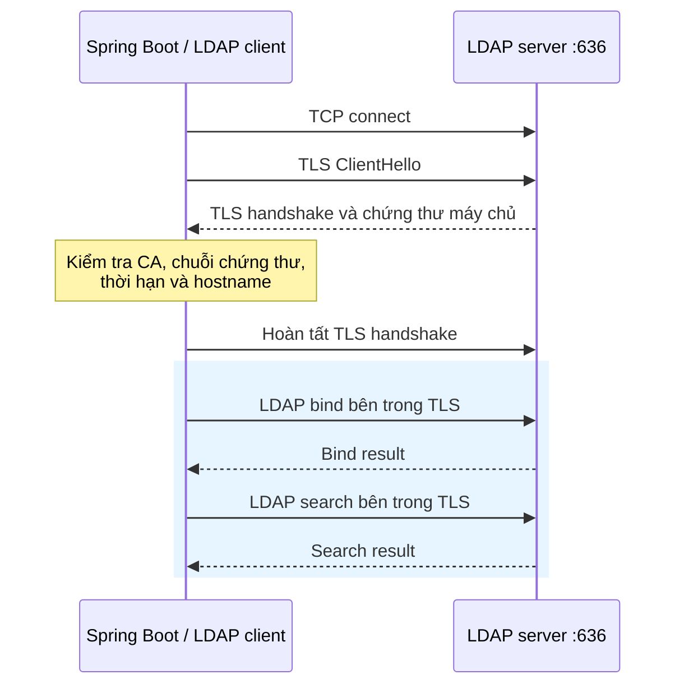
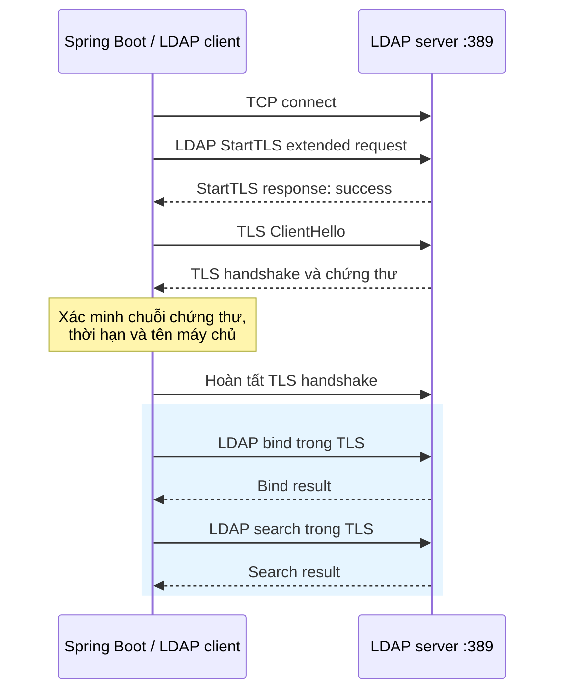

# LDAPS, StartTLS và kiểm tra chứng thư

## 1. Vì sao kết nối LDAP cần TLS?

Trong hệ thống tích hợp bằng **Spring Boot**, LDAP (Lightweight Directory Access Protocol) thường được dùng để tra cứu tài khoản, nhóm, đơn vị tổ chức hoặc xác thực thông tin đăng nhập từ một dịch vụ thư mục như OpenLDAP hay Active Directory. Ứng dụng có thể cần **bind** bằng tài khoản dịch vụ, tìm người dùng theo thuộc tính, đọc nhóm hoặc kiểm tra quyền truy cập. Các thao tác này có thể chứa tên tài khoản, mật khẩu và dữ liệu định danh cần được bảo vệ trên mạng.

Nếu kết nối LDAP không mã hóa, một bên có khả năng quan sát đường truyền có thể đọc nội dung truy vấn, phản hồi và thông tin xác thực kiểu *simple bind*. Hai cách phổ biến để bảo vệ kênh kết nối là **LDAPS** và **StartTLS**. Cả hai đều dùng TLS, nhưng khác nhau ở thời điểm bắt đầu phiên TLS và cách client thiết lập kết nối.

**TLS bảo vệ kênh truyền; việc xác thực người dùng và phân quyền đọc/sửa dữ liệu vẫn do LDAP bind, chính sách thư mục và logic ứng dụng đảm nhận.** Một kết nối được mã hóa nhưng chấp nhận chứng thư máy chủ không hợp lệ vẫn có thể bị chuyển hướng tới máy chủ giả mạo.

### 1.1. Các thuật ngữ cần phân biệt

| Thuật ngữ | Vai trò | Ví dụ |
| --- | --- | --- |
| LDAP | Giao thức truy vấn và thao tác trên dịch vụ thư mục | Search người dùng theo `uid`, đọc thuộc tính `memberOf`. |
| LDAP bind | Xác thực hoặc thiết lập danh tính mà client dùng khi thao tác với thư mục | Bind bằng `cn=svc-reader,ou=services,dc=example,dc=org`. |
| TLS | Bảo vệ tính bí mật, toàn vẹn và giúp xác thực đầu bên kia của kết nối | Client kiểm tra chứng thư máy chủ trước khi gửi mật khẩu. |
| LDAPS | LDAP chạy bên trong TLS được thiết lập ngay khi kết nối | Thường dùng `ldaps://directory.example.org:636`. |
| StartTLS | Thao tác mở rộng LDAP yêu cầu nâng cấp một kết nối LDAP hiện có lên TLS | Thường dùng `ldap://directory.example.org:389`, sau đó gửi StartTLS. |
| CA / truststore | Nguồn chứng thư tin cậy mà client dùng để kiểm tra chuỗi chứng thư | Truststore PKCS#12 chứa CA nội bộ được phép ký chứng thư LDAP. |
| SAN (*Subject Alternative Name*) | Tập danh tính DNS/IP được chứng thư khai báo | `DNS:directory.example.org`. |

Port **389** và **636** chỉ là quy ước phổ biến; tổ chức có thể dùng port khác. Độ an toàn phụ thuộc việc TLS có được thiết lập thành công **và chứng thư được kiểm tra đúng**, không phụ thuộc đơn thuần vào số port.

## 2. LDAPS: TLS ngay từ lúc bắt đầu kết nối

Với **LDAPS**, client mở kết nối TCP tới endpoint LDAP và thực hiện bắt tay TLS trước khi gửi yêu cầu LDAP, kể cả thao tác bind.



Luồng cơ bản:

1. Ứng dụng kết nối tới `ldaps://directory.example.org:636`.
2. Client nhận chứng thư do máy chủ gửi và kiểm tra theo chính sách tin cậy của JVM/client.
3. Chỉ khi TLS handshake thành công, client mới gửi yêu cầu LDAP như bind và search.
4. Nếu kiểm tra chứng thư thất bại, kết nối phải dừng; ứng dụng báo lỗi kết nối/thư mục thay vì tiếp tục gửi mật khẩu qua kênh không an toàn.

Trong bài toán tích hợp, LDAPS phù hợp khi hạ tầng thư mục công bố sẵn endpoint TLS riêng và thiết bị mạng (load balancer, firewall, proxy) hỗ trợ kiểu kết nối này. Cần xác nhận chứng thư được trình bày thực tế bởi **endpoint mà ứng dụng kết nối**: đó có thể là máy chủ LDAP hoặc một bộ cân bằng tải thực hiện TLS termination.

## 3. StartTLS: nâng cấp một phiên LDAP sang TLS trước khi bind

Với **StartTLS**, client bắt đầu bằng kết nối LDAP thông thường rồi gửi yêu cầu mở rộng **StartTLS**. Khi máy chủ chấp nhận, hai bên bắt tay TLS trên chính kết nối đó. Các thao tác LDAP chứa dữ liệu nhạy cảm chỉ được gửi **sau khi TLS đã hoàn tất và chứng thư đã được xác thực**.



Điểm quan trọng: **`ldap://` không mặc nhiên nghĩa là không mã hóa nếu ứng dụng thực sự đàm phán StartTLS thành công**. Ngược lại, cấu hình mỗi URL `ldap://...:389` mà không kích hoạt StartTLS thì chưa bảo vệ kết nối.

### 3.1. Quy tắc fail-closed khi dùng StartTLS

Một cấu hình StartTLS an toàn phải coi việc nâng cấp lên TLS là yêu cầu bắt buộc:

- Không thực hiện *simple bind* bằng mật khẩu hoặc gửi dữ liệu nhạy cảm trước khi TLS handshake thành công.
- Nếu máy chủ trả lỗi `StartTLS unsupported`, handshake thất bại hoặc chứng thư không hợp lệ, **đóng kết nối và báo lỗi**. Không tự động thử lại bằng LDAP plaintext.
- Không vô hiệu hóa kiểm tra CA hoặc hostname để làm cho kết nối “chạy được”.
- Không dùng nhầm `ldaps://...:636` với thao tác StartTLS; LDAPS bắt tay TLS ngay từ đầu, còn StartTLS bắt đầu trên kết nối `ldap://`.
- Nếu dùng connection pool hoặc reconnect, đảm bảo **mỗi kết nối mới** đã được bảo vệ bằng TLS trước khi xác thực và thực hiện truy vấn. Đặc biệt thận trọng với cơ chế pooling JNDI mặc định khi dùng StartTLS.

Về mặt giao thức, StartTLS có giai đoạn mở đầu chưa được bảo vệ bởi TLS. Vì vậy, việc ứng dụng **kiên quyết yêu cầu nâng cấp** là điều quyết định: kẻ trung gian không được phép khiến client lùi về một chế độ xác thực không mã hóa.

### 3.2. So sánh LDAPS và StartTLS

| Tiêu chí | LDAPS | LDAP + StartTLS |
| --- | --- | --- |
| URL thường dùng | `ldaps://host:636` | `ldap://host:389` |
| Thời điểm TLS | Ngay khi kết nối | Sau yêu cầu mở rộng StartTLS thành công |
| Có giai đoạn LDAP ban đầu trước TLS? | Không | Có, để gửi/nhận yêu cầu StartTLS; **chưa gửi mật khẩu** |
| Xác minh chứng thư máy chủ | Bắt buộc về mặt bảo mật | Bắt buộc về mặt bảo mật |
| Khả năng nâng cấp từ endpoint LDAP có sẵn | Cần endpoint LDAPS | Cần máy chủ và client hỗ trợ StartTLS |
| Rủi ro cấu hình điển hình | Sai truststore, hostname, chứng thư trên listener 636 | Thiếu thao tác StartTLS, fallback plaintext, pooling sai |
| Mã hóa truy vấn sau khi thiết lập TLS | Có | Có |

Khi được cấu hình và xác thực chứng thư đúng, cả hai đều có thể đáp ứng yêu cầu bảo vệ dữ liệu LDAP trên đường truyền. Lựa chọn giao thức nên dựa vào chính sách của dịch vụ thư mục, khả năng của client và hạ tầng đang vận hành.

## 4. Kiểm tra chứng thư máy chủ thực sự bao gồm những gì?

Trong TLS, nhận được một chứng thư không đồng nghĩa với việc có thể tin tưởng máy chủ. Client cần đánh giá **đường tin cậy** và **danh tính endpoint**.

### 4.1. Chuỗi chứng thư và CA tin cậy

Máy chủ thường gửi chứng thư của chính mình (*leaf/server certificate*) và các chứng thư CA trung gian cần thiết. Client xây dựng đường dẫn tới một **trust anchor** nằm trong truststore được phép sử dụng. Truststore của JVM có thể gồm các CA công khai; với CA nội bộ của doanh nghiệp, ứng dụng thường cần một truststore có CA nội bộ tương ứng.

```text
      CA gốc nội bộ (trust anchor)
                  │ ký
                  ▼
             CA trung gian
                  │ ký
                  ▼
       Chứng thư LDAP server
       SAN: directory.example.org
                  │
                  ▼
       Client xây dựng đường tin cậy
       và kiểm tra endpoint identity
```

Một số điều kiện thường được kiểm tra:

1. **Tin cậy:** chuỗi chữ ký có thể được xác minh tới CA được tin cậy trong truststore phù hợp.
2. **Hiệu lực:** chứng thư chưa hết hạn hoặc chưa tới ngày hiệu lực (`notBefore`/`notAfter`); thời gian hệ thống phải chính xác.
3. **Tên máy chủ:** tên DNS/IP ứng dụng thực sự kết nối khớp với danh tính trong **SAN** của chứng thư. Không thể thay việc kiểm tra này bằng việc chứng thư “đã ký bởi CA đúng”.
4. **Mục đích và thuật toán:** chứng thư/khóa và thuật toán phải tương thích với mục đích TLS máy chủ và chính sách an toàn hiện hành; ví dụ Extended Key Usage `serverAuth` khi có EKU áp dụng.
5. **Trạng thái thu hồi (nếu chính sách yêu cầu):** CRL/OCSP cần được cấu hình và kiểm chứng theo chính sách vận hành; không mặc nhiên giả định mọi JVM đều kiểm tra thu hồi trực tuyến ở mọi cấu hình.

**Mấu chốt:** truststore trả lời “CA nào được tin?”, còn kiểm tra hostname trả lời “đây có đúng máy chủ mình định kết nối?”. Cần cả hai.

### 4.2. Tại sao hostname mismatch vẫn nguy hiểm dù chứng thư được ký hợp lệ?

Giả sử ứng dụng kết nối `directory.example.org`, nhưng chứng thư máy chủ chỉ khai báo `DNS:ldap-node-01.internal.example.org`. Chứng thư có thể đúng chữ ký và còn hạn, nhưng không chứng minh máy chủ đang giao tiếp có quyền đại diện cho tên `directory.example.org`.

Giải pháp là cấp chứng thư có SAN phù hợp với tên endpoint được ứng dụng dùng, hoặc đổi endpoint sang một tên **được phép và thực sự khớp** chứng thư. Nếu truy cập bằng IP, chứng thư thường phải có mục `IP Address` SAN phù hợp; một DNS SAN không tự động chứng minh danh tính của địa chỉ IP.

Không chấp nhận các “cách chữa nhanh” như cho `HostnameVerifier` luôn trả về `true`, sử dụng trust manager tin mọi chứng thư hoặc tắt xác thực endpoint của JNDI. Chúng làm mất khả năng nhận biết máy chủ giả mạo dù đường truyền vẫn được mã hóa.

### 4.3. Truststore và keystore khác nhau

| Thành phần | Chứa gì | Công dụng trong trường hợp phổ biến |
| --- | --- | --- |
| **Truststore** của client | Chứng thư CA hoặc chứng thư máy chủ được tin cậy | Kiểm tra chứng thư **LDAP server**. |
| **Keystore** của client | Khóa riêng và chứng thư của **client** | Chỉ cần khi LDAP server yêu cầu TLS client certificate (*mutual TLS*, mTLS). |
| Chứng thư server và khóa riêng trên LDAP server/proxy | Danh tính máy chủ, khóa riêng tương ứng | Trình bày cho client trong TLS handshake. |

LDAP bind với username/password qua TLS **không đồng nghĩa** với mTLS. Đây là hai lớp xác thực khác nhau. Chỉ cấu hình chứng thư client khi hệ thống thư mục yêu cầu.

## 5. Cấu hình LDAPS cho Spring Boot

Spring Boot tích hợp LDAP qua **Spring LDAP**. Với trường hợp ứng dụng cần bind và truy vấn thư mục, có thể cấu hình `spring.ldap.*` và để Spring Boot tạo các thành phần kết nối theo auto-configuration khi phụ thuộc phù hợp đã được khai báo.

### 5.1. Cấu hình `application.yml`

```yaml
spring:
  ldap:
    urls: ldaps://directory.example.org:636
    base: dc=example,dc=org
    username: cn=svc-reader,ou=services,dc=example,dc=org
    password: ${LDAP_BIND_PASSWORD}
```

Trong đó:

- `urls` là endpoint TLS; tên host phải nằm trong SAN của chứng thư được trình bày tại endpoint.
- `base` là DN gốc cho các thao tác tìm kiếm, **không phải** tên DNS dùng để kiểm tra chứng thư.
- `username` là DN của tài khoản dịch vụ được dùng để bind; quyền của tài khoản này nên đủ cho nghiệp vụ và không rộng hơn cần thiết.
- `password` lấy từ secret được cấp cho môi trường chạy, tránh lưu giá trị thật vào Git hoặc log.

Chỉ khai báo `ldaps://` chưa giải quyết vấn đề **CA nội bộ**: JVM phải có truststore tin cậy chuỗi chứng thư máy chủ.

### 5.2. Thiết lập truststore cho JVM

Với truststore PKCS#12 đã có sẵn, cấu hình cho JVM khởi chạy ứng dụng bằng các system property thích hợp:

```text
-Djavax.net.ssl.trustStore=/etc/app/certs/ldap-truststore.p12
-Djavax.net.ssl.trustStoreType=PKCS12
-Djavax.net.ssl.trustStorePassword=<mật khẩu cung cấp qua secret>
```

Các dòng trên mô tả JVM arguments, trong đó giá trị password là chỗ trống minh họa; **không chép chuỗi dấu ngoặc vào command thật và không hard-code bí mật trong repository**. Sử dụng cơ chế cấp secret của môi trường triển khai và hạn chế quyền đọc cả truststore lẫn secret. Thuộc tính JVM này có thể ảnh hưởng **các kết nối TLS khác dùng SSLContext mặc định** trong cùng tiến trình Java; nếu ứng dụng có nhiều tích hợp cần các CA khác nhau, cần thiết kế trust management phù hợp thay vì vô tình thay thế toàn bộ tập CA được tin tưởng.

Có thể xây dựng truststore riêng từ chứng thư CA **đã xác nhận tính xác thực từ một kênh đáng tin cậy**:

```bash
keytool -importcert -trustcacerts \
  -alias corporate-ldap-ca \
  -file corporate-ldap-ca.pem \
  -keystore ldap-truststore.p12 \
  -storetype PKCS12

keytool -list -v \
  -keystore ldap-truststore.p12 \
  -storetype PKCS12
```

`keytool` có thể yêu cầu nhập mật khẩu tương tác. Không nên lấy đại chứng thư do một kết nối chưa xác thực trả về rồi tự động thêm vào truststore: hành động đó có thể biến chứng thư của kẻ trung gian thành đối tượng được tin tưởng. Khi có CA mới hoặc luân chuyển chứng thư, chuẩn bị cập nhật truststore trước thời điểm đổi trên server.

### 5.3. Ví dụ truy vấn sau khi kết nối TLS thành công

Một `LdapTemplate` từ Spring LDAP có thể thực hiện truy vấn bằng bộ lọc do thư viện xây dựng:

```java
import java.util.List;
import javax.naming.directory.Attributes;
import org.springframework.ldap.core.AttributesMapper;
import org.springframework.ldap.core.LdapTemplate;
import org.springframework.ldap.query.LdapQuery;
import org.springframework.stereotype.Service;

import static org.springframework.ldap.query.LdapQueryBuilder.query;

@Service
public class DirectoryLookupService {
    private final LdapTemplate ldapTemplate;

    public DirectoryLookupService(LdapTemplate ldapTemplate) {
        this.ldapTemplate = ldapTemplate;
    }

    public List<String> findCommonNames(String uid) {
        LdapQuery q = query()
                .base("ou=people")
                .where("uid").is(uid);

        return ldapTemplate.search(q, (AttributesMapper<String>) attrs -> {
            var cn = attrs.get("cn");
            return cn == null ? null : cn.get().toString();
        });
    }
}
```

Ví dụ tập trung vào cách gọi LDAP qua `LdapTemplate`; các cấu hình TLS được áp dụng ở **lớp kết nối**, trước khi đoạn truy vấn này chạy. Bộ lọc được xây dựng từ API để tránh tự ghép chuỗi LDAP filter từ đầu vào người dùng. Trong dự án thật cần quyết định cách xử lý trường hợp thuộc tính `cn` thiếu hoặc có nhiều giá trị, quyền đọc thuộc tính và kết quả không tìm thấy; phần đó thuộc hợp đồng dữ liệu của dịch vụ thư mục.

## 6. Cấu hình StartTLS trong Spring LDAP

StartTLS đòi hỏi cấu hình rõ ràng chiến lược xác thực của Spring LDAP. Không chỉ đổi URL LDAPS thành `ldap://` rồi cho rằng TLS tự được bật.

### 6.1. Cấu hình ứng dụng

```yaml
app:
  directory:
    url: ldap://directory.example.org:389
    base-dn: dc=example,dc=org
    bind-dn: cn=svc-reader,ou=services,dc=example,dc=org
    bind-password: ${LDAP_BIND_PASSWORD}
```

Đây là nhóm cấu hình **tự định nghĩa** (`app.directory.*`) cho ví dụ bean bên dưới. Chúng không phải các thuộc tính mặc định tự bật StartTLS của Spring Boot.

### 6.2. Bean `LdapContextSource` dùng chiến lược StartTLS

```java
import org.springframework.beans.factory.annotation.Value;
import org.springframework.context.annotation.Bean;
import org.springframework.context.annotation.Configuration;
import org.springframework.ldap.core.LdapTemplate;
import org.springframework.ldap.core.support.DefaultTlsDirContextAuthenticationStrategy;
import org.springframework.ldap.core.support.LdapContextSource;

@Configuration
public class LdapStartTlsConfiguration {

    @Bean
    public LdapContextSource ldapContextSource(
            @Value("${app.directory.url}") String url,
            @Value("${app.directory.base-dn}") String baseDn,
            @Value("${app.directory.bind-dn}") String bindDn,
            @Value("${app.directory.bind-password}") String bindPassword) {

        LdapContextSource source = new LdapContextSource();
        source.setUrl(url); // ldap://...:389, không phải ldaps://
        source.setBase(baseDn);
        source.setUserDn(bindDn);
        source.setPassword(bindPassword);
        source.setPooled(false); // tránh JNDI native pooling khi dùng StartTLS
        source.setAuthenticationStrategy(
                new DefaultTlsDirContextAuthenticationStrategy());
        return source;
    }

    @Bean
    public LdapTemplate ldapTemplate(LdapContextSource ldapContextSource) {
        return new LdapTemplate(ldapContextSource);
    }
}
```

`DefaultTlsDirContextAuthenticationStrategy` của Spring LDAP hỗ trợ **đàm phán StartTLS trước bước bind**. Trong ví dụ này, việc kiểm tra chứng thư máy chủ vẫn phải dựa vào truststore, SSL/TLS provider và chính sách hostname verification được cấu hình an toàn cho phiên JVM; chiến lược StartTLS không có nghĩa là được phép bỏ qua xác thực chứng thư. Cùng một `LdapTemplate` có thể thực hiện các truy vấn sau khi `LdapContextSource` tạo ngữ cảnh và xác thực thành công.

Vì ví dụ tự khai báo `LdapContextSource` và `LdapTemplate`, cần đảm bảo các bean LDAP do ứng dụng sử dụng đều tham chiếu tới nguồn kết nối này và tránh tạo thêm nguồn LDAP plaintext khác một cách vô ý. Các phiên bản Spring Boot/Spring LDAP có thể khác nhau về auto-configuration và quản lý vòng đời: nên kiểm thử bằng đúng dependency version của dự án.

### 6.3. Minh họa cơ chế StartTLS ở mức JNDI

Khi cần hiểu rõ thứ tự kết nối, Java JNDI cung cấp các API `StartTlsRequest` và `StartTlsResponse`. Mẫu sau cho thấy các bước **mở kết nối ẩn danh → nâng cấp TLS → bind bằng mật khẩu → truy vấn**, thay vì gửi mật khẩu trước TLS:

```java
import java.util.Hashtable;
import javax.naming.Context;
import javax.naming.NamingException;
import javax.naming.ldap.InitialLdapContext;
import javax.naming.ldap.StartTlsRequest;
import javax.naming.ldap.StartTlsResponse;

public class JndiStartTlsExample {
    public void connectAndBind(String bindDn, String password)
            throws Exception {

        Hashtable<String, Object> env = new Hashtable<>();
        env.put(Context.INITIAL_CONTEXT_FACTORY,
                "com.sun.jndi.ldap.LdapCtxFactory");
        env.put(Context.PROVIDER_URL, "ldap://directory.example.org:389");
        env.put(Context.SECURITY_AUTHENTICATION, "none");

        InitialLdapContext ctx = new InitialLdapContext(env, null);
        StartTlsResponse tls = null;
        try {
            tls = (StartTlsResponse) ctx.extendedOperation(
                    new StartTlsRequest());
            tls.negotiate(); // TLS handshake và kiểm tra chứng thư

            ctx.addToEnvironment(Context.SECURITY_AUTHENTICATION, "simple");
            ctx.addToEnvironment(Context.SECURITY_PRINCIPAL, bindDn);
            ctx.addToEnvironment(Context.SECURITY_CREDENTIALS, password);
            ctx.reconnect(null); // Thực hiện bind sau khi TLS đã thiết lập

            // Tại đây mới thực hiện LDAP search hoặc các thao tác cần quyền.
        } finally {
            if (tls != null) {
                tls.close();
            }
            ctx.close();
        }
    }
}
```

Đây là đoạn minh họa thứ tự giao thức, không thay thế cho Spring LDAP khi dự án đang dùng `LdapTemplate`. Trong triển khai production nên bổ sung timeout, quản lý lỗi khi đóng tài nguyên, metrics và chính sách secret phù hợp. **Không** đặt `Context.SECURITY_PRINCIPAL` và `SECURITY_CREDENTIALS` trong môi trường khởi tạo kết nối trước khi StartTLS thành công: một số provider sẽ tự động bind ngay lúc tạo context.

## 7. Kiểm tra chứng thư và endpoint trước khi đưa vào vận hành

Để tìm lỗi TLS, trước hết xác định chính xác **hostname, port và chế độ kết nối** mà ứng dụng sẽ dùng. Kiểm tra từ môi trường mạng tương đương pod/VM chạy Spring Boot vì DNS, proxy, firewall và truststore có thể khác máy cá nhân.

### 7.1. Dùng OpenSSL kiểm tra LDAPS

Ví dụ có sẵn bản CA đáng tin cậy `corporate-ldap-ca.pem`:

```bash
openssl s_client \
  -connect directory.example.org:636 \
  -servername directory.example.org \
  -verify_hostname directory.example.org \
  -verify_return_error \
  -showcerts \
  -CAfile corporate-ldap-ca.pem
```

`-verify_hostname` yêu cầu kiểm tra tên DNS; `-verify_return_error` khiến lỗi xác minh được phản ánh rõ, và `-CAfile` định nghĩa CA tin cậy cho **lệnh kiểm thử này**. `-showcerts` hữu ích để kiểm tra chuỗi chứng thư do endpoint thực sự trình bày. Với hostname hoặc bản OpenSSL không hỗ trợ tùy chọn tương ứng, cần chọn lệnh kiểm thử thích hợp thay vì bỏ qua phép kiểm tra danh tính máy chủ.

### 7.2. Dùng OpenSSL kiểm tra StartTLS

```bash
openssl s_client \
  -connect directory.example.org:389 \
  -starttls ldap \
  -verify_hostname directory.example.org \
  -verify_return_error \
  -showcerts \
  -CAfile corporate-ldap-ca.pem
```

`-starttls ldap` cho OpenSSL biết phải gửi yêu cầu nâng cấp theo giao thức LDAP trước khi TLS handshake. Nếu lệnh này thành công nhưng ứng dụng vẫn lỗi, đối chiếu **truststore của JVM**, tên endpoint thật, chính sách TLS và cách Spring LDAP kích hoạt chiến lược StartTLS. OpenSSL có thể dùng tập CA và chính sách xác minh khác Java, vì vậy thành công trong `s_client` **không chứng minh** kết nối của Spring Boot chắc chắn thành công.

### 7.3. Kiểm tra truststore Java và debug handshake

```bash
keytool -list -v \
  -keystore /etc/app/certs/ldap-truststore.p12 \
  -storetype PKCS12
```

Trong môi trường test có thể bật log JSSE tạm thời bằng JVM option:

```text
-Djavax.net.debug=ssl,handshake
```

Log handshake hỗ trợ tìm chứng thư được chọn, phiên TLS và nguyên nhân thất bại. Chỉ bật trong môi trường kiểm soát phù hợp, giới hạn quyền truy cập log và tắt sau khi chẩn đoán; tránh ghi lộ secret/chi tiết nội bộ không cần thiết. Có thể kiểm tra chứng thư và SAN riêng từ tệp chứng thư máy chủ đã xuất ra:

```bash
openssl x509 -in ldap-server.pem -noout -text
```

Quan sát các mục `Subject Alternative Name`, `Issuer`, `Not Before`, `Not After`, `Key Usage` và `Extended Key Usage` nếu có. Đừng dùng riêng thuộc tính `Subject CN` để thay thế quy tắc xác thực SAN trong thiết kế hiện đại.

## 8. Lỗi thường gặp, nguyên nhân và cách xử lý

| Biểu hiện | Nguyên nhân có thể | Hướng kiểm tra/khắc phục |
| --- | --- | --- |
| `PKIX path building failed` hoặc `unable to find valid certification path` | Thiếu CA tin cậy, thiếu chứng thư trung gian, sai truststore được JVM nạp | Kiểm tra chuỗi chứng thư endpoint; xác minh đúng CA; cấu hình truststore và cung cấp đủ intermediate cần thiết. |
| `No subject alternative DNS name matching ...` | Tên DNS của URL không khớp SAN | Cấp chứng thư có SAN đúng hoặc dùng tên endpoint hợp lệ thực sự khớp. |
| `CertificateExpiredException` / `CertificateNotYetValidException` | Chứng thư hết hạn, chưa hiệu lực hoặc đồng hồ sai | Kiểm tra thời gian hệ thống; phối hợp luân chuyển chứng thư đúng hạn. |
| `handshake_failure` / `protocol_version` | Không có tổ hợp giao thức, cipher, thuật toán phù hợp hoặc chính sách TLS bị từ chối | Kiểm tra hỗ trợ TLS server/JVM, policy bảo mật, chứng thư và thuật toán; ưu tiên TLS 1.2/1.3 theo chuẩn hạ tầng. |
| `Connection refused`, timeout | Sai port/host, firewall, server chưa bật LDAPS/StartTLS, lỗi DNS | Thử đúng host/port, kiểm tra listener, network policy và routing từ pod/VM chạy ứng dụng. |
| StartTLS báo `unsupported` hoặc trả lỗi mở rộng | Server/proxy không hỗ trợ StartTLS trên endpoint đó | Xác nhận cấu hình dịch vụ thư mục; dùng endpoint được công bố; không fallback về plaintext. |
| LDAPS trên port 389 hoặc StartTLS trên port 636 bị lỗi giao thức | Nhầm phương thức khởi động TLS | Dùng `ldaps://` cho LDAPS hoặc `ldap://` cộng StartTLS theo đúng endpoint. |
| TLS thành công nhưng bind trả `invalidCredentials` | Bind DN/password sai, tài khoản khóa/hết hạn hoặc chính sách directory | Kiểm tra danh tính bind và secret, chính sách directory; không chẩn đoán bằng cách tắt TLS. |
| TLS thành công nhưng search trả `insufficientAccessRights` | ACL thư mục không cho tài khoản bind đọc thuộc tính | Phân quyền tối thiểu phù hợp, xác minh base DN và filter; không coi đây là lỗi chứng thư. |
| Thỉnh thoảng thành công, thỉnh thoảng lỗi hostname/CA | Các node sau load balancer trình bày chứng thư khác nhau, CA rotation chưa đồng bộ | Kiểm tra từng endpoint và toàn bộ chuỗi cert khi cân bằng tải, kế hoạch đổi cert/truststore. |

Không nên xử lý lỗi chứng thư bằng cách tắt TLS hostname verification, viết `TrustManager` tin mọi chứng thư hoặc hạ cấp sang LDAP không mã hóa. Những lựa chọn đó che giấu nguyên nhân và làm yếu xác thực endpoint.

### 8.1. Ví dụ điều tra khi triển khai pod mới bị lỗi PKIX

Một dịch vụ Spring Boot kết nối thành công tới `ldaps://directory.example.org:636` ở môi trường staging nhưng phát sinh `PKIX path building failed` trong pod production.

1. **Xác định endpoint và JVM thực tế:** log hostname/port (không log mật khẩu), phiên bản JDK, cấu hình `javax.net.ssl.trustStore` và loại truststore.
2. **Kiểm tra mạng và chuỗi chứng thư từ production:** dùng công cụ TLS phù hợp để xác nhận cert server thực sự trình bày bởi endpoint hoặc load balancer.
3. **Đối chiếu CA:** đảm bảo truststore được mount vào đúng path và chứa CA có quyền ký chuỗi đang dùng; kiểm tra quyền đọc file của tiến trình.
4. **Kiểm tra hostname và thời gian:** SAN có `directory.example.org` không, chứng thư còn hiệu lực không, đồng hồ pod/node có đồng bộ không.
5. **Kiểm thử sau sửa:** kết nối bằng ứng dụng Java với đúng truststore, xác minh bind/search thành công và thử với CA hoặc hostname sai để đảm bảo kết nối bị từ chối.

Nếu OpenSSL thành công còn JVM thất bại, tập trung vào khác biệt truststore, phiên bản JVM, hỗ trợ TLS và provider. Nếu cả hai đều thất bại, điều tra cấu hình endpoint và chứng thư trước khi đổi mã ứng dụng.

## 9. Quản lý chứng thư trong môi trường nhiều dịch vụ

Một tích hợp LDAP thường chạy trên nhiều pod hoặc máy chủ và kết nối qua load balancer. Để hạn chế lỗi khi luân chuyển chứng thư:

1. **Theo dõi thời hạn:** cảnh báo trước ngày hết hạn của cert máy chủ và CA; tính đến chứng thư trung gian.
2. **Luân chuyển theo thứ tự:** khi thay CA, phân phối trust anchor mới đến các ứng dụng trước khi đổi server cert; duy trì thời gian chồng lấp có kiểm soát nếu chính sách cho phép.
3. **Kiểm tra tất cả node:** mỗi máy chủ LDAP hoặc proxy có thể trình bày cert/chain khác nhau; đừng chỉ thử một IP rồi kết luận toàn cụm ổn.
4. **Đánh giá referral và endpoint phụ:** nếu LDAP client theo referral tới host khác, mỗi kết nối phụ cũng phải áp dụng TLS và xác minh danh tính của host đích theo chính sách an toàn.
5. **Bảo vệ secret:** lưu mật khẩu bind trong kho secret, áp dụng quyền tối thiểu, không log nội dung bind hoặc dữ liệu cá nhân không cần thiết.
6. **Giới hạn kết nối và thời gian chờ:** đặt timeout thích hợp để lỗi TLS/LDAP không giữ vô hạn luồng xử lý nghiệp vụ; theo dõi độ trễ bind và search.
7. **Kiểm thử âm tính:** dùng môi trường kiểm thử để xác nhận cert hết hạn, CA không tin cậy, sai SAN và StartTLS thất bại đều bị từ chối an toàn.

Nếu Spring Boot dùng LDAP để giải quyết danh tính cho các luồng tích hợp khác (HTTP, database, broker thông điệp), cần phân biệt **lỗi không kết nối được thư mục** với **tài khoản không tồn tại** hoặc **sai mật khẩu**. Một timeout/handshake failure của LDAP là sự cố hạ tầng: không nên chuyển nó thành kết luận người dùng chưa được cấp quyền hay tự động cho phép truy cập. Thực thi retry có giới hạn, circuit breaker hoặc phục hồi phụ thuộc yêu cầu độ sẵn sàng và chính sách xác thực của hệ thống.

## 10. Checklist trước khi đưa LDAP TLS vào production

| Câu hỏi xác minh | Điều kiện mong muốn |
| --- | --- |
| Ứng dụng kết nối bằng LDAPS hay StartTLS? | URL, port và cơ chế khởi động TLS tương ứng với endpoint được hạ tầng công bố. |
| Có gửi credential trước TLS không? | Không; StartTLS được bắt buộc thành công trước khi bind. |
| Certificate chain hợp lệ không? | Xây dựng được đường tin cậy đến CA được phép dùng trong truststore. |
| Hostname verification có hoạt động không? | Kết nối đúng SAN thành công; sai SAN phải thất bại. |
| Chứng thư còn hiệu lực, mục đích phù hợp không? | Kiểm tra thời gian, thuật toán và server-auth policy. |
| JVM dùng đúng truststore không? | Path, loại store, quyền đọc và secret được kiểm soát. |
| Có cơ chế fallback về plaintext hoặc trust-all không? | Không có. |
| Có load balancer, referral hoặc nhiều replica không? | Mọi endpoint liên quan được xác minh và quản lý chứng thư nhất quán. |
| Đã thử lỗi TLS/CA/hostname trong kiểm thử tích hợp chưa? | Thao tác bị từ chối, không rò credential, lỗi được phân loại đúng. |
| Đã có kế hoạch luân chuyển chứng thư và giám sát chưa? | Có cảnh báo hết hạn, kế hoạch cập nhật CA và kiểm tra sau đổi. |

**Kết nối các khái niệm:** LDAPS bắt đầu TLS ngay lúc kết nối; StartTLS nâng cấp một kết nối LDAP trước khi xử lý dữ liệu nhạy cảm; còn **xác minh chứng thư và hostname** quyết định ứng dụng có đang trao đổi dữ liệu với đúng máy chủ thư mục được tin cậy hay không. Với Spring Boot, cấu hình URL, chiến lược StartTLS, truststore và vòng đời chứng thư phải được kiểm tra cùng nhau để luồng tích hợp LDAP vừa hoạt động ổn định vừa giữ được ranh giới bảo mật.
