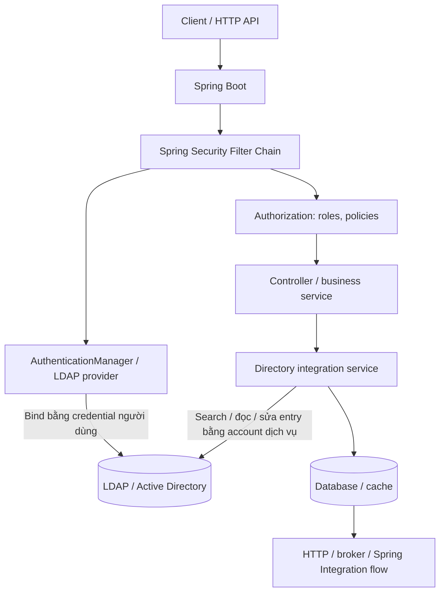
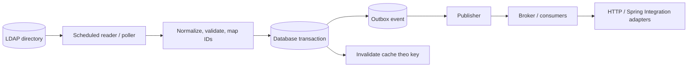
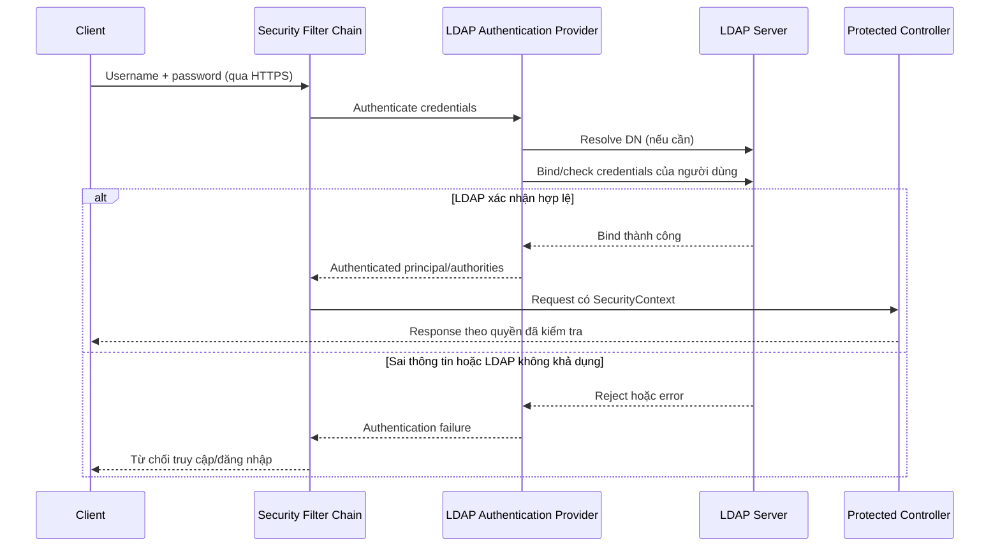

# Phân biệt tích hợp dữ liệu thư mục với cơ chế xác thực của Spring Security

## 1. Hai nhu cầu cùng dùng LDAP nhưng có mục tiêu khác nhau

Trong **SPRING_BOOT_INTEGRATION**, ứng dụng Spring Boot thường kết nối hệ thống thư mục LDAP hoặc Active Directory (AD) để tra cứu nhân viên, phòng ban, nhóm, trạng thái tài khoản và thông tin liên hệ. Cùng lúc, ứng dụng có thể cần xác nhận danh tính người đang đăng nhập. Hai nhu cầu này cùng giao tiếp với dịch vụ thư mục nhưng thuộc **hai trách nhiệm kiến trúc khác nhau**:

- **Tích hợp dữ liệu thư mục (directory data integration):** đọc, tìm kiếm, đồng bộ hoặc cập nhật entry/attribute để cung cấp dữ liệu cho quy trình nghiệp vụ. Thường sử dụng Spring LDAP, `LdapTemplate` hoặc API LDAP/JNDI, được điều phối bởi service hoặc flow tích hợp.
- **Xác thực bằng Spring Security (authentication):** kiểm tra credentials của người dùng qua một `AuthenticationProvider` hoặc `AuthenticationManager`, tạo `Authentication` đã xác thực và đưa vào `SecurityContext` theo cơ chế bảo mật của ứng dụng. Spring Security có thể dùng LDAP bind hoặc phương thức khác như OIDC; LDAP là **một lựa chọn nguồn xác thực**, không phải định nghĩa của Spring Security.
- **Phân quyền (authorization):** sau khi xác thực, ứng dụng quyết định ai được làm gì dựa trên authority/role và quy tắc truy cập. Việc lấy group từ LDAP có thể là một nguồn dữ liệu phân quyền, nhưng **tra cứu group** và **cấp quyền truy cập** vẫn là các bước riêng.

Ví dụ: endpoint `GET /employees/{id}` đọc thuộc tính `displayName` từ LDAP phục vụ đồng bộ nhân sự. Endpoint `POST /orders/approve` cần biết người gọi đã xác thực và có quyền `ORDER_APPROVER`. Cả hai có thể truy cập directory, nhưng việc service đọc được entry của nhân viên **không chứng minh** người gọi biết mật khẩu của nhân viên đó.

### Sơ đồ hai đường đi



Sơ đồ biểu diễn hai kênh truy cập directory. Trong triển khai cụ thể, provider xác thực có thể dùng account dịch vụ để **tìm DN**, rồi thực hiện **bind bằng credentials của người dùng**; cách tìm kiếm và bind phải được xác định theo loại directory.

## 2. So sánh theo trách nhiệm và hợp đồng dữ liệu

| Tiêu chí | Tích hợp dữ liệu LDAP | Xác thực LDAP qua Spring Security |
|---|---|---|
| Câu hỏi nghiệp vụ | “Nhân viên này thuộc bộ phận nào?”, “entry nào thay đổi?” | “Người đang đăng nhập có chứng minh được danh tính không?” |
| Đầu vào | User ID, DN, LDAP filter, phạm vi tìm kiếm, checkpoint | Username + credential của phiên xác thực, context request |
| Thao tác LDAP | Search, read, compare, modify, add/delete theo quyền | Xác định DN và thử bind/kiểm tra credential theo provider |
| Danh tính kết nối | Thường là service account giới hạn quyền | Có thể service bind để search và user bind để xác minh |
| Đầu ra | Bản ghi thư mục/DTO hoặc kết quả đồng bộ | `Authentication`, principal và authorities trong security context |
| Thành phần Spring | Spring LDAP `LdapTemplate`, service, scheduler, IntegrationFlow | `SecurityFilterChain`, `AuthenticationManager`, LDAP authentication provider |
| Khi không tìm thấy | Trả kết quả rỗng hoặc “entry not found”; luồng nghiệp vụ tự quyết định | Đăng nhập thất bại, không tạo phiên đã xác thực |
| Khi LDAP lỗi | Có thể retry, đưa vào hàng đợi, giữ checkpoint; dữ liệu có thể tạm chậm | Phải từ chối xác thực hoặc áp dụng chính sách thay thế đã được thiết kế rõ, không tự cho phép truy cập |
| Cache | Có thể cache thuộc tính ít nhạy cảm với TTL phù hợp | Không dùng cache thuộc tính đồng bộ làm bằng chứng người dùng đã xác thực |
| Giao dịch | Có thể cần cập nhật DB/broker sau đồng bộ; không có transaction nguyên tử tự động xuyên các hệ thống | Xác thực tạo trạng thái bảo mật/request; không tự commit thay đổi nghiệp vụ |
| Quan sát | Số entry đọc, độ trễ sync, checkpoint, lag, lỗi schema | Tỷ lệ login thành công/thất bại, độ trễ bind, lỗi connectivity, audit |

**Không nên gộp hai trách nhiệm** vào một “LDAP service” duy nhất chỉ vì chúng có cùng URL. Có thể dùng hạ tầng kết nối chung khi yêu cầu phù hợp, nhưng policy về secret, lifecycle, timeout, quyền truy cập, lỗi và cache khác nhau.

## 3. Một số khái niệm LDAP cần hiểu đúng

LDAP là giao thức truy cập dịch vụ thư mục. Dữ liệu có dạng cây entry, mỗi entry có **distinguished name (DN)** và nhiều attribute. Cấu trúc cụ thể tùy sản phẩm directory và schema.

Ví dụ giả định với schema kiểu `inetOrgPerson`:

```text
dc=example,dc=org
└── ou=people
    └── uid=linh,ou=people,dc=example,dc=org
        objectClass: inetOrgPerson
        uid: linh
        cn: Nguyen Linh
        mail: linh@example.org
└── ou=groups
    └── cn=order-approvers,ou=groups,dc=example,dc=org
```

Các thành phần:

- **DN:** định danh vị trí entry trong cây, ví dụ `uid=linh,ou=people,dc=example,dc=org`; có thể thay đổi khi entry được move/rename.
- **Base DN:** gốc tìm kiếm được cấu hình, chẳng hạn `dc=example,dc=org`.
- **Search base:** nhánh cụ thể cần tìm, chẳng hạn `ou=people` tương đối với base.
- **LDAP filter:** điều kiện tìm entry, ví dụ `(&(objectClass=inetOrgPerson)(uid=linh))`; input người dùng phải được escape đúng chuẩn LDAP filter.
- **Attribute:** tên, email, trạng thái tài khoản, group; không phải attribute nào cũng có trong mọi directory.
- **Bind:** thiết lập danh tính trong kết nối LDAP. Service bind dùng service account; user bind xác nhận credential người dùng tùy cơ chế/provider.

**Lưu ý khác biệt triển khai:** Microsoft Active Directory thường dùng `sAMAccountName`, `userPrincipalName`, `objectGUID` và các quy tắc membership riêng; một số LDAP server khác dùng `uid`, `entryUUID` hoặc `memberUid`. Thuộc tính `memberOf` không được đảm bảo xuất hiện hoặc hoạt động giống nhau trên mọi server. Code phải nêu rõ schema dự kiến, không suy tất cả directory có cùng tổ chức dữ liệu.

DN hoặc email không nhất thiết là khóa nghiệp vụ ổn định: nhân viên có thể đổi tên đăng nhập, email hoặc phòng ban. Khi đồng bộ lâu dài, ưu tiên immutable ID của directory nếu nhà cung cấp có hỗ trợ, và lưu mapping ID theo nguồn.

## 4. Tích hợp dữ liệu thư mục với Spring LDAP

### 4.1. Cấu hình nguồn LDAP cho thao tác dữ liệu

Giả sử ứng dụng dùng Spring Boot với Spring LDAP và directory dành cho môi trường thử nghiệm:

```yaml
# application.yml
spring:
  ldap:
    urls: ${DIRECTORY_LDAPS_URL}
    base: dc=example,dc=org
    username: ${DIRECTORY_SERVICE_DN}
    password: ${DIRECTORY_SERVICE_PASSWORD}

app:
  directory:
    people-base: ou=people
    sync-batch-size: 200
```

`spring.ldap.*` giúp auto-configuration tạo context source khi có thư viện/cấu hình phù hợp. Dependency phổ biến là `spring-boot-starter-data-ldap` khi dùng Spring Data LDAP, hoặc thư viện Spring LDAP phù hợp với dự án; cần đảm bảo `LdapTemplate` được tạo từ đúng `ContextSource` trong phiên bản đang sử dụng.

- `DIRECTORY_SERVICE_DN` là **service account cho thao tác dữ liệu**, cấp tối thiểu quyền đọc đúng nhánh/attribute cần thiết; không dùng tài khoản quản trị directory.
- URL mẫu nên là `ldaps://directory.example.org:636` được bảo vệ bởi TLS hợp lệ; với LDAP trên cổng khác có thể dùng StartTLS nếu client/server được cấu hình đúng.
- Không đưa mật khẩu vào file theo dõi mã nguồn, log hay tham số tùy tiện; dùng secret manager hoặc cấu hình bí mật của nền tảng triển khai.
- Những thuộc tính `app.directory.*` là cấu hình **tự định nghĩa**, phải được ứng dụng bind/đọc; chúng không có hiệu lực mặc định chỉ vì nằm trong YAML.

**Cấu hình LDAP ở đây không tự bật login bằng Spring Security.** Ứng dụng có thể tra cứu danh bạ hoàn toàn độc lập với việc dùng JWT, OIDC, SAML hoặc một hệ thống khác để đăng nhập.

### 4.2. Đọc entry bằng `LdapTemplate`

Ví dụ dùng một directory hỗ trợ `inetOrgPerson` và `uid`. Chỉ nhận mã người dùng, ghép filter bằng builder thay vì nối chuỗi từ request:

```java
@Service
public class DirectoryUserReader {
    private final LdapTemplate ldapTemplate;

    public DirectoryUserReader(LdapTemplate ldapTemplate) {
        this.ldapTemplate = ldapTemplate;
    }

    public Optional<DirectoryUser> findByUid(String uid) {
        AndFilter filter = new AndFilter();
        filter.and(new EqualsFilter("objectClass", "inetOrgPerson"));
        filter.and(new EqualsFilter("uid", uid));

        List<DirectoryUser> matches = ldapTemplate.search(
                "ou=people",
                filter.encode(),
                (AttributesMapper<DirectoryUser>) attrs ->
                        new DirectoryUser(
                                attribute(attrs, "uid"),
                                attribute(attrs, "cn"),
                                attribute(attrs, "mail")
                        )
        );

        if (matches.size() > 1) {
            throw new IllegalStateException("uid is not unique in the search scope");
        }
        return matches.stream().findFirst();
    }

    private static String attribute(Attributes attrs, String name)
            throws NamingException {
        Attribute value = attrs.get(name);
        return value == null ? null : String.valueOf(value.get());
    }

    public record DirectoryUser(String uid, String displayName, String email) {}
}
```

Ví dụ cần các import từ `org.springframework.ldap.core`, `org.springframework.ldap.filter`, `javax.naming`, Java Collections và Spring stereotype. `LdapTemplate.search` trả về các bản ghi phù hợp; `AttributesMapper` chuyển attribute sang DTO. Với field bắt buộc, nên validate `null`/rỗng và schema thay vì chấp nhận thiếu dữ liệu một cách im lặng.

**Ý nghĩa bảo mật:** method `findByUid` đọc dữ liệu bằng quyền service account và **không nhận mật khẩu người dùng**. Kể cả method tìm thấy đúng một entry, kết quả `Optional<DirectoryUser>` không phải `Authentication`; không được gán `authenticated=true` hay tạo security context chỉ vì tra cứu thành công.

Đối với input tự do, giới hạn độ dài, kiểm tra định dạng ID và luôn escape filter. Nếu cần dựng DN để cập nhật entry, dùng `LdapNameBuilder`/API DN thích hợp thay vì nối chuỗi DN chứa ký tự đặc biệt.

### 4.3. Đồng bộ directory sang DB, cache và broker

Luồng tích hợp điển hình:



Những trách nhiệm chính:

1. **Định nghĩa hợp đồng dữ liệu:** map tên/ID/phòng ban/membership sang DTO nghiệp vụ. Xác định attribute nào được phép lưu, attribute nào có thể thiếu, attribute nào đa giá trị.
2. **Đồng bộ idempotent:** upsert bằng khóa ổn định; mỗi entry có source identifier, phiên bản/timestamp/checksum phù hợp. Việc quét lại cùng entry không được tạo bản ghi trùng hoặc phát side effect lặp.
3. **Xử lý dữ liệu thay đổi/xóa:** chỉ dựa vào query theo `modifyTimestamp` có thể bỏ sót xóa, sửa nhanh, lệch đồng hồ hoặc quyền truy cập. Với provider hỗ trợ, cân nhắc DirSync/changelog/persistent search; nếu không, dùng full reconciliation định kỳ có kiểm soát.
4. **Phân trang và giới hạn tải:** directory có thể đặt size/time limit, giới hạn connection và paging. Không giả định một LDAP search sẽ trả toàn bộ hàng trăm nghìn entry.
5. **Lỗi và retry:** lỗi mạng/timeout có thể thử lại theo backoff; lỗi schema, mapping hoặc dữ liệu không hợp lệ cần phân loại và lưu trạng thái để xử lý. Tránh vòng lặp polling liên tục khi directory đang quá tải.
6. **Thông báo xuống hệ thống khác:** sử dụng outbox hoặc chiến lược đáng tin cậy khi vừa ghi DB vừa phát broker event, vì LDAP → DB → broker không có transaction phân tán mặc định.
7. **Cache:** TTL/phân vùng theo tenant hợp lý; khi directory hoặc DB thay đổi, invalidation phải phù hợp quy tắc nghiệp vụ. Không dùng bản cache dữ liệu cũ để tự chứng minh password vẫn hợp lệ.

Nếu một bước sync thất bại, ứng dụng có thể giữ dữ liệu đã đồng bộ gần nhất và ghi nhận **data freshness/staleness** theo chính sách nghiệp vụ. Quyết định cho phép đọc dữ liệu cũ là quyết định của lớp nghiệp vụ, không phải một quy tắc mặc định cho xác thực.

## 5. Xác thực bằng Spring Security LDAP

### 5.1. Luồng xác thực là gì?

Khi Spring Security tích hợp LDAP, `AuthenticationManager` điều phối một hoặc nhiều `AuthenticationProvider`. Provider kiểm tra credential qua directory rồi tạo `Authentication` được xác thực, có principal và quyền nếu mapping được cấu hình. Lớp HTTP security chỉ coi request đã xác thực sau khi authentication thành công.



Có hai hướng xác minh credential thường gặp:

- **Bind authentication:** bind với DN và password người dùng. Đây thường là cách trực quan để directory tự kiểm tra mật khẩu và chính sách tài khoản.
- **Password comparison:** đọc/so sánh theo cơ chế directory/provider hỗ trợ; các attribute password, kiểu hash và quyền đọc khác nhau theo nhà cung cấp. Không tự xây phép so mật khẩu từ dữ liệu LDAP vì rất dễ sai cơ chế bảo mật.

Trong thực tế, bind authentication được ưu tiên khi directory hỗ trợ và chính sách yêu cầu. Authentication có thể gồm cả bước service account tra cứu DN theo tên đăng nhập trước khi bind người dùng. Nếu directory trả về lỗi account locked/expired hoặc credential sai, ứng dụng cần xử lý theo chính sách bảo mật và đặc thù provider.

Không tự viết hàm xác thực bằng cách gọi LDAP simple bind trực tiếp với mật khẩu rỗng hoặc `null`. Một số server hỗ trợ *unauthenticated bind* trong tình huống DN có giá trị nhưng password rỗng; client tự viết có thể diễn giải nhầm kết quả đó thành đăng nhập thành công. Dùng provider chuẩn của Spring Security, kiểm thử ca password rỗng và không chuyển tiếp mật khẩu sang service đồng bộ dữ liệu.

### 5.2. Ví dụ cấu hình một authentication manager dùng LDAP bind

Ví dụ dành cho ứng dụng web đơn giản dùng Spring Security phiên bản hỗ trợ `LdapBindAuthenticationManagerFactory`, với DN người dùng có dạng `uid={0},ou=people,dc=example,dc=org` và `BaseLdapPathContextSource` đã được cấu hình trỏ đến base `dc=example,dc=org`:

```java
@Configuration
@EnableWebSecurity
class WebSecurityConfiguration {

    @Bean
    AuthenticationManager ldapAuthenticationManager(
            BaseLdapPathContextSource contextSource) {

        LdapBindAuthenticationManagerFactory factory =
                new LdapBindAuthenticationManagerFactory(contextSource);
        factory.setUserDnPatterns("uid={0},ou=people");
        return factory.createAuthenticationManager();
    }

    @Bean
    SecurityFilterChain apiSecurity(
            HttpSecurity http,
            AuthenticationManager ldapAuthenticationManager) throws Exception {

        http.authenticationManager(ldapAuthenticationManager);
        http.authorizeHttpRequests(requests -> requests
                .requestMatchers("/private/**").authenticated()
                .anyRequest().permitAll());
        http.httpBasic(Customizer.withDefaults());
        return http.build();
    }
}
```

Code là khung minh họa cho **HTTP Basic được bảo vệ bằng HTTPS**; ứng dụng thực tế chọn phương thức login/session/token, xử lý CSRF/CORS và chính sách phân quyền theo bối cảnh. Cần thư viện Spring Security LDAP ngoài Spring Security Web/Config, import các class tương ứng và phiên bản Spring Security/Spring LDAP tương thích.

Các điểm cần nhớ:

- `setUserDnPatterns(...)` giả định DN quy tắc cố định. Với cấu trúc DN không theo mẫu, dùng cơ chế search DN của provider với search base/filter và account tìm kiếm phù hợp.
- Chỉ khai báo `spring.ldap.urls` không đồng nghĩa tất cả request Spring Security đã được bảo vệ, và cũng không đồng nghĩa `SecurityFilterChain` dùng LDAP. Cần cấu hình authentication provider/manager thật sự.
- Trong ví dụ, `/private/**` chỉ yêu cầu **đã xác thực**. Để phân quyền theo vai trò, cần cấu hình `hasAuthority(...)`/`hasRole(...)` và mapping authorities một cách nhất quán.
- Spring Boot có thể tự cung cấp hoặc tùy biến một số bean bảo mật tùy dependency; xác minh không vô tình có hai `AuthenticationManager` hay filter chain mâu thuẫn.
- Endpoint health/metrics và login cần được cấp quyền riêng; không mở công khai thông tin LDAP bằng cách cấu hình `permitAll()` quá rộng trong ứng dụng sản xuất.

Với **Active Directory**, hình thức username có thể là `user@domain.example` (UPN), `DOMAIN\user` hoặc `sAMAccountName` tùy chính sách. Một provider chuyên dụng như `ActiveDirectoryLdapAuthenticationProvider` có thể thích hợp hơn quy tắc `uid={0}`. Không áp dụng cứng ví dụ OpenLDAP cho AD.

### 5.3. Xác thực thành công chưa phải đã được phân quyền

Ví dụ một người dùng bind thành công nhưng không nằm trong nhóm phê duyệt đơn hàng. Họ **đã xác thực** nhưng vẫn phải bị từ chối endpoint phê duyệt.

```java
@RestController
@RequestMapping("/orders")
class OrderApprovalController {

    @PostMapping("/{id}/approve")
    @PreAuthorize("hasAuthority('ORDER_APPROVER')")
    ResponseEntity<Void> approve(@PathVariable long id) {
        // Thực hiện nghiệp vụ qua service có transaction/idempotency.
        return ResponseEntity.noContent().build();
    }
}
```

Ví dụ trên yêu cầu kích hoạt method security phù hợp, chẳng hạn `@EnableMethodSecurity`, và cấu hình mapping authorities để principal có authority `ORDER_APPROVER` khi thực sự đủ điều kiện. Quyền có thể đến từ LDAP group hoặc một policy service khác.

Nếu dùng quy tắc `hasRole("ORDER_APPROVER")`, cần thống nhất tiền tố mặc định `ROLE_` với authorities thực tế. Không nên chỉ kiểm tra thuộc tính `department=Finance` rồi tự động cho quyền thanh toán khi chưa có quyết định chính sách phân quyền.

## 6. Group, role và dữ liệu directory: nơi hai luồng gặp nhau

Một nhóm LDAP chứa thông tin membership, nhưng quyết định quyền trong ứng dụng có thể khác cấu trúc nhóm gốc.

| Dữ liệu LDAP | Ý nghĩa có thể có | Lưu ý khi ánh xạ quyền |
|---|---|---|
| `cn=order-approvers` trong nhóm | Người dùng là thành viên nhóm | Nêu rõ namespace, DN, nhóm lồng nhau và quy tắc mapping |
| `member` hoặc `uniqueMember` | Danh sách DN của thành viên | Không phải provider nào cũng trả dạng giống nhau |
| `memberOf` | Một số server cung cấp membership ngược | Có thể không có, không bao gồm nested group hoặc là attribute do server tính |
| `department` | Thông tin tổ chức | Không mặc nhiên tương đương quyền truy cập |
| `accountStatus`/thuộc tính khóa tài khoản | Trạng thái tài khoản (tùy directory) | Cần kiểm tra qua cơ chế xác thực/provider phù hợp, không chỉ qua DTO cache |

Có hai mô hình:

1. **Ánh xạ lúc login:** provider hoặc `GrantedAuthoritiesMapper` lấy group và gán authorities vào `Authentication`. Đơn giản cho authorization của request nhưng role có thể cũ trong suốt session hoặc thời hạn token.
2. **Kiểm tra quyền động:** endpoint kiểm tra membership/quy tắc từ nguồn tin cậy tại thời điểm thao tác nhạy cảm, hoặc từ permission service/cache có cơ chế invalidation. Giảm độ trễ cập nhật nhưng tăng phụ thuộc thời gian thực và cần chiến lược khi directory mất kết nối.

Một luồng đồng bộ group vào database có thể hỗ trợ tìm kiếm, reporting hoặc precompute quyền, nhưng **không tự động đồng bộ SecurityContext đang tồn tại**. Nếu người dùng bị xóa khỏi nhóm, cần quy định rõ khi nào session/JWT/authority được cập nhật hoặc thu hồi. Với quyết định bảo mật quan trọng, thiết kế stale-data policy phải chặt hơn cache danh bạ.

## 7. Ranh giới bảo mật và nguyên tắc quyền tối thiểu

### 7.1. Phân biệt service bind và user bind

- **Service bind**: một identity kỹ thuật dùng để search/đọc attribute theo ACL. Không chứng minh bất kỳ user cuối nào đã đăng nhập.
- **User bind**: một phần kiểm chứng credential của người dùng. Phải dùng trên kênh mã hóa và tuân thủ chính sách lockout, password expiration, disabled account của directory.
- **Proxy/impersonation hoặc delegated authentication**: nếu directory/SSO hỗ trợ, cần thiết kế rõ cách ủy quyền và audit. Không tự gán DN của user vào connection service rồi coi như đang thực thi thay người dùng đó.

Nên dùng **hai bộ quyền riêng** cho directory integration và authentication search khi cần; với hệ thống nhỏ có thể chia sẻ context source nhưng vẫn phải giữ ranh giới logic và quyền. Service account chỉ cần search có thể bị giới hạn hẳn các quyền modify/add/delete.

### 7.2. TLS và secrets

Simple bind với mật khẩu phải chạy qua **LDAPS hoặc StartTLS được xác minh chứng chỉ**. Không tắt hostname verification hoặc chấp nhận mọi chứng chỉ để “sửa lỗi” môi trường production. Thiết lập trust store phù hợp, kế hoạch xoay vòng certificate và kiểm tra thời gian hết hạn.

Không log password, DN nhạy cảm, toàn bộ LDAP entry, nhóm bảo mật hoặc token. Trong lỗi xác thực, trả thông điệp bên ngoài không tiết lộ tài khoản tồn tại hay không; log bảo mật nội bộ nên có mã sự kiện và correlation ID hợp lệ, giới hạn quyền đọc và retention.

### 7.3. LDAP injection và dữ liệu không tin cậy

**LDAP filter injection:** chuỗi input không được nối trực tiếp vào `(&(uid=...))`. Hãy dùng `EqualsFilter`/filter builder và API escape phù hợp, validate độ dài/form username. DN building cũng cần xử lý ký tự đặc biệt qua API cấu trúc DN.

**Dữ liệu attribute không an toàn:** tên người dùng, email, display name lấy từ LDAP vẫn là input bên ngoài khi hiển thị HTML, tạo SQL, truyền vào HTTP client hoặc sinh tệp. Cần escaping/output encoding, parameterized SQL và kiểm soát đường dẫn tương ứng. Không coi dữ liệu từ LDAP tự động “sạch” chỉ vì directory là hệ thống nội bộ.

**Scope và ACL:** search base đủ hẹp, filter chính xác, giới hạn số kết quả và quyền đọc attribute tối thiểu; không cấp tài khoản dịch vụ quyền đọc hash password, private key hoặc thông tin không cần thiết.

## 8. Lỗi, timeout và chính sách phụ thuộc

Tích hợp dữ liệu và xác thực có thể cùng gặp lỗi LDAP server nhưng cách xử lý khác nhau.

| Sự cố | Directory data integration | Spring Security LDAP authentication |
|---|---|---|
| LDAP server timeout | Retry có backoff/circuit breaker; giữ checkpoint và đánh dấu sync lag | Không công nhận người dùng mới đã xác thực; ghi nhận dependency failure |
| Sai service credential | Báo lỗi config/secret, dừng sync có kiểm soát | Nếu credential dùng cho user search, login có thể thất bại; không bypass provider |
| Entry không tìm thấy | Trả `empty` hoặc xử lý deletion/reconcile theo policy | Login không thành công, không tạo `Authentication` |
| LDAP filter/schema thay đổi | Alert mapping và hợp đồng dữ liệu, cách ly record lỗi | Có thể làm login/role mapping lỗi; cần quy trình rollback rõ ràng |
| Group membership thay đổi | Đồng bộ DB/cache và invalidation | Áp dụng policy cập nhật authorities/session/token |
| Directory mất kết nối kéo dài | Lùi polling và dùng snapshot theo mức freshness chấp nhận được | Fail closed cho lần xác thực mới, trừ cơ chế backup authentication đã được thiết kế và kiểm soát |
| Dữ liệu quá lớn | Paging, incremental sync, rate limit | Hạn chế số lần search trong login, tránh group query không giới hạn |

“Fail closed” ở đây nghĩa là **không tự tạo đăng nhập thành công khi không kiểm chứng được credentials**. Với phiên đã xác thực trước đó, quyết định giữ/hết hiệu lực session hoặc token phụ thuộc loại cơ chế bảo mật, thời hạn và chính sách thu hồi; không suy mọi phiên đang hoạt động đều lập tức mất hiệu lực khi LDAP offline.

Đặt timeout ngắn và hợp lý cho thao tác xác thực theo yêu cầu trải nghiệm và bảo mật; thao tác đồng bộ có thể chấp nhận giới hạn dài hơn nhưng phải tránh chiếm hết connection pool. Khi chia sẻ LDAP hạ tầng, giám sát tài nguyên để một batch sync lớn không làm tăng latency của các login đang diễn ra.

## 9. Transaction, cache và tính nhất quán trong Spring Boot Integration

Trong hệ thống kết hợp **HTTP client, cơ sở dữ liệu, cache, broker thông điệp và Spring Integration**, một lần LDAP search có thể kích hoạt thay đổi nhiều hệ thống:

```text
LDAP read
  -> normalize directory DTO
  -> upsert application DB
  -> invalidate Redis cache
  -> publish "directory-user-changed" event
  -> downstream HTTP adapter updates another service
```

LDAP không tự tham gia cùng JDBC transaction của ứng dụng. Đọc entry thành công rồi ghi DB thất bại cần được xử lý riêng; DB commit nhưng publish broker thất bại cần outbox/retry; cache invalidation thất bại có thể khiến dữ liệu cũ còn tồn tại. Vì vậy:

- Đặt **source of truth** cho từng loại trường. Ví dụ `mail` do directory quản lý, `notificationPreference` do ứng dụng quản lý. Sync không được ghi đè dữ liệu do ứng dụng sở hữu.
- Dùng stable directory ID và version/checksum/timestamp thích hợp; thiết kế **idempotent upsert** và xử lý sự kiện trùng lặp.
- Xác định bản ghi bị xóa/đổi DN, group bị thay đổi và quy trình soft delete/deprovision; không tự xóa dữ liệu nghiệp vụ liên quan chỉ vì một lần search rỗng.
- Không cố gộp LDAP, DB, cache và broker vào “một transaction nguyên tử” khi không có hỗ trợ. Dùng checkpoint, outbox, reconciliation và quan sát độ trễ đồng bộ.
- Với thông tin liên quan quyền truy cập, freshness policy phải nghiêm ngặt. Chẳng hạn, nếu role mapping dựa vào DB mirror, cần chủ động giảm khả năng cấp quyền dựa vào membership đã bị thu hồi.

Khi LDAP được sử dụng cho **xác thực**, chỉ số quan trọng là tính đúng đắn của credential validation, bảo vệ tài khoản và chính sách phân quyền; một lần login không nên đồng thời kích hoạt batch sync hàng nghìn entry gây quá tải.

## 10. Kiểm thử độc lập từng trách nhiệm

### 10.1. Test tích hợp dữ liệu

- **Search:** tìm theo `uid`, ràng buộc search base, phân biệt không thấy/đúng một/nhiều entry và attribute thiếu.
- **Dữ liệu schema:** thử nested group, multi-valued attribute, ký tự Unicode, đổi DN/email và GUID/UUID theo provider.
- **Input độc hại:** ký tự `*`, `(`, `)`, `\`, byte không hợp lệ; xác minh filter builder không mở rộng phạm vi query.
- **Sync:** lần chạy lại không tạo duplicate; sau lỗi giữa DB và broker hệ thống replay được; checkpoint không bị vượt qua trước khi dữ liệu bền vững.
- **Thay đổi/xóa:** kiểm tra incremental sync và full reconciliation; không đánh dấu mọi entry vắng mặt là “đã xóa” khi search bị phân trang/timeout.
- **Tải:** giới hạn result size, paging và backoff khi directory giới hạn truy vấn.

Với integration test có thể sử dụng embedded LDAP hoặc LDAP/AD-compatible test server tách biệt; chú ý embedded LDAP không tái hiện đầy đủ đặc thù và chính sách của AD thật.

### 10.2. Test xác thực và phân quyền

- **Đúng/sai mật khẩu:** user bind thành công chỉ với password đúng; sai password không tạo `Authentication`.
- **Tài khoản khóa/disable/expired:** xác nhận provider xử lý chính sách server tương ứng; hành vi cụ thể phụ thuộc directory và cách cấu hình.
- **Group và role:** mapping cho phép đúng endpoint; user không thuộc nhóm vẫn bị từ chối dù login thành công.
- **Directory unavailable:** lần xác thực mới thất bại an toàn, không có fallback cho phép `anonymous` truy cập endpoint bảo vệ.
- **TLS/secret:** verify certificate, không truyền password qua URL hay log; có kế hoạch rotate credential.
- **Session/authority freshness:** thay membership trong directory; xác nhận chính sách refresh hoặc revoke được thực thi như mong đợi.

Test controller bằng `@WithMockUser` hoặc mock `Authentication` chỉ kiểm tra logic **authorization** của ứng dụng; nó **không chứng minh** quá trình LDAP bind thực sự hoạt động. Cần integration test provider riêng với directory test và credential mẫu để xác nhận đường xác thực thực tế.

### 10.3. Một ma trận phân biệt lỗi quan trọng

| Thao tác | LDAP trả về gì? | Hệ thống phải kết luận gì? |
|---|---|---|
| `findByUid("linh")` | Có entry phù hợp | Có dữ liệu directory; **chưa kết luận login** |
| `findByUid("unknown")` | Không có entry | Không có bản ghi tại phạm vi search |
| `authenticate("linh", "wrong")` | Bind/credential bị từ chối | Chưa xác thực, từ chối đăng nhập |
| `authenticate("linh", "correct")` | Bind hợp lệ | Đã xác thực; còn phải kiểm tra authorization |
| `getGroups("linh")` | Trả về group `order-approvers` | Có dữ liệu membership; cần mapping policy/namespace đúng |
| `LDAP temporarily unavailable` | Search hoặc bind timeout | Sync có thể trì hoãn; login mới không được mặc định thành công |

## 11. Quan sát và vận hành

Khi giám sát, tách dữ liệu vận hành của hai kênh:

| Chỉ số/nhật ký | Directory data integration | Authentication |
|---|---|---|
| Latency | LDAP search, page/batch, DB upsert, broker publish | Resolve DN, bind, group lookup, total auth time |
| Tỷ lệ lỗi | Connectivity, schema mismatch, paging, checkpoint | Credential reject, locked account, provider unavailable |
| Tiến độ | Last successful sync, processed/failed entries, data freshness lag | Auth success/failure rates, rate limiting, suspicious bursts |
| Audit | Ai/cái gì thay đổi entry/DB record | Ai thực hiện login, kết quả và phương thức xác thực |
| Cảnh báo | Sync lag vượt SLO, nhiều entry lỗi, outbox backlog | LDAP unavailable, auth error đột biến, bất thường do cấu hình |

Nhãn metric nên dùng các giá trị hữu hạn như `operation=search|bind`, `directory=corp`, `result=success|failure`. Không đặt username, DN đầy đủ, email, group cá nhân hay password vào metric tags. Log bảo mật có thể giữ correlation identifier theo retention và quyền truy cập được quy định, nhưng tránh lộ dữ liệu nhạy cảm.

Giám sát connectivity/health của LDAP qua service account **không đồng nghĩa** đường user authentication chắc chắn thành công. Ngược lại, một lần user bind thành công không đảm bảo batch sync có đủ quyền đọc tất cả OU cần thiết. Nên có kiểm tra tách biệt cho từng trách nhiệm.

## 12. Các lỗi thiết kế thường gặp

**“Đọc được entry trong LDAP tức là người dùng đã đăng nhập.”** Sai. Search dùng account ứng dụng chỉ chứng minh entry tồn tại và client có quyền đọc. Phải có một bước xác minh credentials hoặc một nguồn identity tin cậy khác.

**“Tôi đã thêm Spring Security nên `LdapTemplate` tự chạy qua security context.”** Sai. Spring Security xử lý authentication/authorization; service LDAP không tự suy danh tính của HTTP caller khi đang dùng service bind. Cần thiết kế rõ quyền truy cập và dữ liệu nhạy cảm được phép trả ra.

**“Đã sync group vào Redis nên quyền truy cập luôn mới nhất.”** Sai. Cache có TTL, invalidation có thể thất bại, phiên/JWT có thể giữ role cũ. Cần chính sách quyền theo mức độ nhạy cảm và cơ chế thu hồi quyền.

**“Mọi LDAP server đều có `uid`, `memberOf` và DN theo cùng mẫu.”** Sai. Schema, nested groups, paging và trạng thái account thay đổi theo AD/OpenLDAP/vendor. Cấu hình search và mapping theo directory thật.

**“Nếu LDAP lỗi thì cho đăng nhập tạm để không gián đoạn dịch vụ.”** Nguy hiểm. Khi không chứng minh được credentials của lần login mới, mặc định phải từ chối. Giải pháp HA/federated identity được thiết kế trước có thể giảm downtime mà vẫn bảo vệ danh tính.

**“Đồng bộ LDAP → DB → Kafka sẽ atomic nếu method có `@Transactional`.”** Sai. Transaction JDBC thường không bao phủ LDAP và broker. Dùng idempotency, outbox/reconciliation và xử lý lỗi từng ranh giới.

**“Mọi thuộc tính directory đều có thể public qua REST.”** Sai. Dữ liệu thư mục có thể chứa thông tin cá nhân, cấu trúc tổ chức và group nhạy cảm. Áp dụng ACL theo người gọi, DTO tối thiểu và logging phù hợp.

## 13. Quy trình lựa chọn đúng giải pháp

Khi một yêu cầu mới có chữ “LDAP”, hãy xác định trước:

1. **Mục tiêu là tra cứu/đồng bộ dữ liệu hay đăng nhập?** Nếu là dữ liệu, dùng adapter/service với Spring LDAP; nếu là login, dùng authentication mechanism của Spring Security hoặc identity provider đã chọn.
2. **Ai là caller và danh tính nào truy cập directory?** Service account đọc dữ liệu, hay người dùng đang chứng minh credential; phân tách quyền và secret.
3. **Thuộc tính nào là dữ liệu nghiệp vụ, thuộc tính nào liên quan security?** Không sao chép password/hash; kiểm soát nhóm/role có thể được dùng ra quyết định bảo mật.
4. **Có cần đồng bộ vào DB/cache/broker không?** Nếu có, thiết kế mapping, idempotency, checkpoint, nguồn dữ liệu chuẩn, độ trễ và khôi phục.
5. **Sai/lỗi LDAP có tác động gì?** Search có thể trả rỗng/đợi retry; authentication mới phải bị từ chối khi không xác minh được.
6. **Kiểm chứng thế nào?** Tạo test riêng cho `LdapTemplate` và LDAP provider, kiểm tra transport TLS, schema, role mapping và tình huống directory không khả dụng.

## 14. Kết luận

Trong chương **LDAP và thư mục** của **SPRING_BOOT_INTEGRATION**, cùng một LDAP server có thể phục vụ cả việc **tích hợp dữ liệu** và **xác thực**, nhưng hai đường đi có hợp đồng và tiêu chí đúng sai khác nhau. Spring LDAP hỗ trợ thao tác với entry/attribute để đồng bộ dữ liệu qua HTTP client, cơ sở dữ liệu, cache, broker và các flow Spring Integration. Spring Security chịu trách nhiệm thiết lập danh tính tin cậy và kiểm soát truy cập, có thể sử dụng LDAP bind làm một phương thức xác thực. Thiết kế tốt tách service bind và user bind, dữ liệu thư mục và authority, độ trễ đồng bộ và hiệu lực quyền, đồng thời kiểm thử mỗi lớp theo đúng mục tiêu bảo mật và nghiệp vụ của nó.
