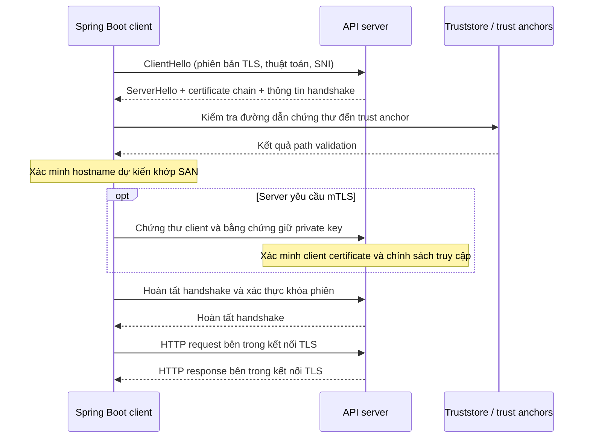
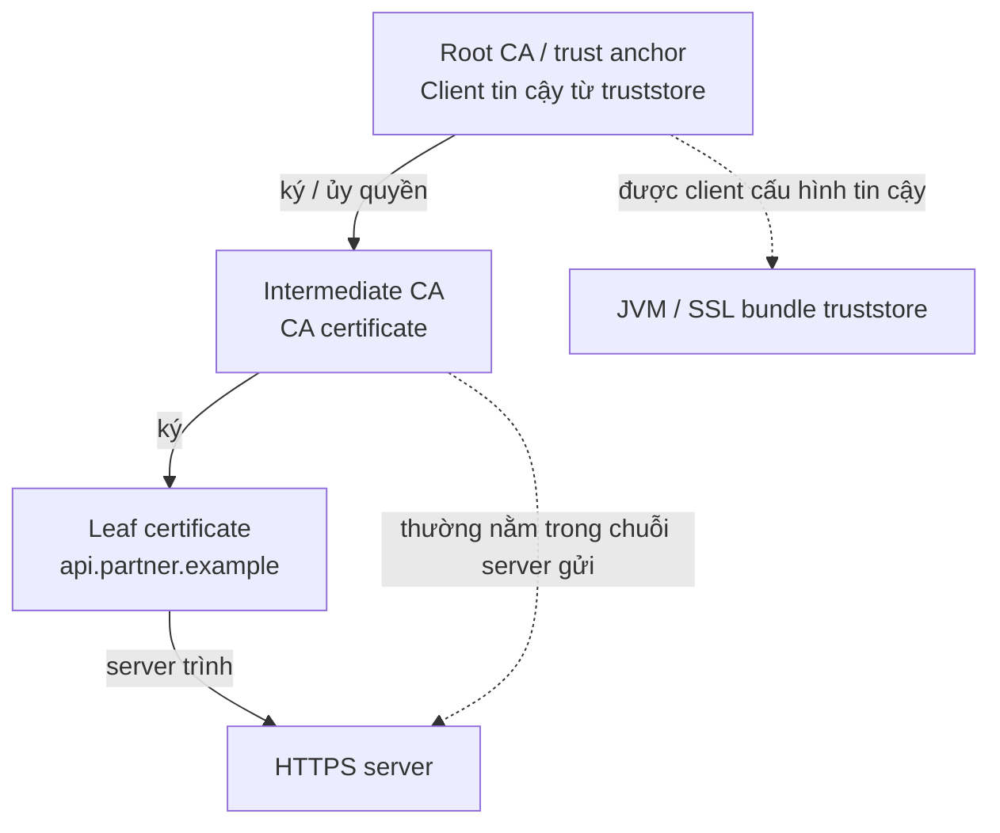
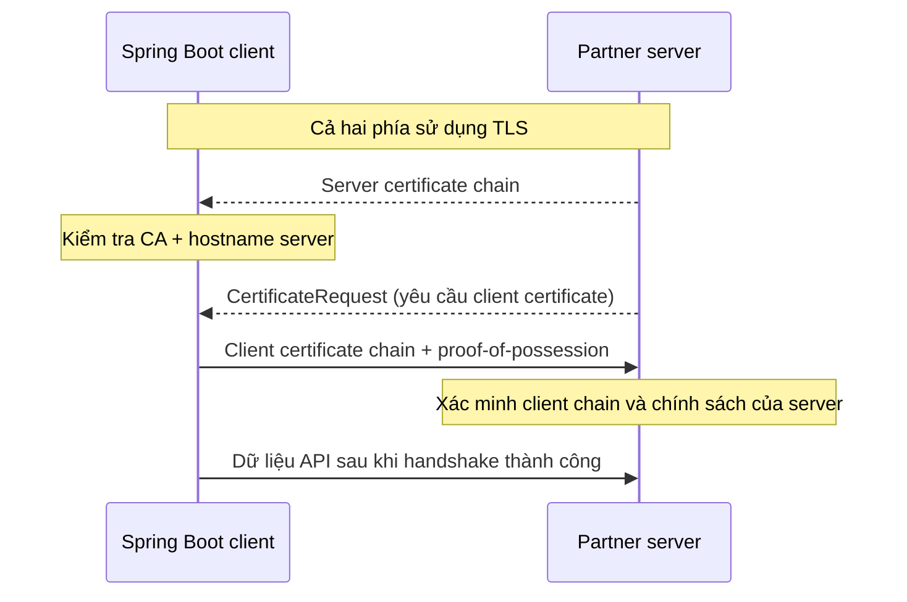

# TLS, hostname verification và chuỗi chứng thư tin cậy

## 1. Vì sao kết nối tích hợp cần được xác thực?

Một ứng dụng Spring Boot thường trao đổi dữ liệu với nhiều hệ thống: gọi API qua `RestClient` hoặc `WebClient`, đọc/ghi cơ sở dữ liệu bằng JDBC, kết nối Redis, gửi message tới Kafka/RabbitMQ hoặc sử dụng các adapter của Spring Integration. Thông tin trao đổi có thể gồm token, dữ liệu khách hàng, giao dịch và sự kiện nghiệp vụ.

**TLS (Transport Layer Security)** bảo vệ kết nối trước hành vi nghe lén hoặc sửa đổi dữ liệu trên đường truyền. Nhưng chỉ thấy URL bắt đầu bằng `https://` hoặc một socket đã bật mã hóa **chưa đủ để kết luận kết nối an toàn**. Ứng dụng còn phải:

1. Xác định máy chủ đang nói chuyện có chứng thư (certificate) hợp lệ và được bên gọi tin cậy.
2. Xác minh chứng thư ấy được cấp cho **đúng hostname** mà ứng dụng định kết nối.
3. Khi có yêu cầu **mutual TLS (mTLS)**, trình chứng thư của client để máy chủ xác thực client.
4. Phân biệt danh tính kết nối với quyền thực hiện thao tác nghiệp vụ; dùng cơ chế authorization phù hợp.

Trong phạm vi **SPRING_BOOT_INTEGRATION**, các yếu tố này là một phần của quản lý cấu hình, hợp đồng dữ liệu, xử lý lỗi, kiểm thử và quan sát. Một lỗi TLS ở lớp kết nối có thể khiến việc gọi HTTP, truy vấn dữ liệu hoặc tiêu thụ thông điệp thất bại hoàn toàn, dù JSON, SQL hay schema sự kiện đều đúng.

### Mục tiêu học tập

Sau bài này, bạn có thể:

- Giải thích TLS handshake, server certificate, CA, trust anchor, truststore và keystore.
- Phân biệt **xác minh chuỗi chứng thư** với **hostname verification**.
- Cấu hình SSL bundle trong Spring Boot và áp dụng cho `RestClient` bằng `RestClient.Builder` do Spring Boot cung cấp.
- Mở rộng từ one-way TLS sang mTLS mà vẫn xác minh hostname phía server.
- Nhận biết lỗi kết nối đặc trưng trong HTTP client, JDBC và broker; chẩn đoán mà không tắt kiểm tra chứng thư.
- Thiết kế kiểm thử, xoay vòng chứng thư và quan sát tình trạng TLS trong môi trường thực tế.

> **Phạm vi phiên bản:** ví dụ Spring Boot dùng Java 17+, Spring Boot **3.2–3.5** và các phiên bản Spring Framework tương thích. Spring Boot có SSL bundle từ dòng 3.1; hỗ trợ áp dụng bundle cho `RestClient` qua `RestClientSsl` từ 3.2. Tên package và API của Spring Boot 4 khác dòng 3.x, cần kiểm tra tài liệu đúng phiên bản dự án.

## 2. TLS bảo vệ điều gì, không bảo vệ điều gì?

TLS tạo kênh truyền có các thuộc tính chính:

| Thuộc tính | Ý nghĩa thực tế |
| --- | --- |
| **Confidentiality** | Người quan sát mạng khó đọc nội dung application data được mã hóa. |
| **Integrity** | Phát hiện dữ liệu bị sửa đổi trên đường truyền. |
| **Server authentication** | Client kiểm tra máy chủ dựa trên chứng thư, chuỗi tin cậy và hostname. |
| **Client authentication (tùy chọn)** | Server có thể yêu cầu client trình chứng thư để thực hiện mTLS. |

TLS **không tự động**:

- Phân quyền xem tài khoản A hay B; cần xác thực/ủy quyền ở tầng ứng dụng.
- Bảo đảm payload JSON không sai nghiệp vụ hay chống replay sự kiện ở mức ứng dụng.
- Giữ một giao dịch nguyên tử xuyên database, HTTP và broker.
- Mã hóa dữ liệu sau khi đã được giải mã ở reverse proxy, API gateway hoặc chương trình nhận.
- Làm client tin đúng máy chủ nếu đã tắt hostname verification hoặc tùy tiện tin tất cả certificate.

Ví dụ: ứng dụng gọi `https://billing.partner.example` qua một proxy TLS, sau đó proxy gọi tiếp backend bằng HTTP. TLS ở hop đầu tiên chỉ bảo vệ tuyến client → proxy. Nếu dữ liệu yêu cầu bảo mật cả ở hop tiếp theo, cần thêm TLS cho proxy → backend hoặc cơ chế bảo vệ tương ứng.

## 3. TLS handshake nhìn từ phía Spring Boot client

Với HTTPS, những bước khái quát của một lần kết nối mới:



Sơ đồ đơn giản hóa chi tiết thông điệp, đặc biệt sự khác biệt giữa TLS 1.2 và 1.3. Trong TLS 1.3, một phần nội dung handshake được mã hóa và thứ tự thông điệp cụ thể không giống mô tả tổng quát ở trên. Điểm quan trọng đối với ứng dụng: **kiểm tra certificate chain và hostname phải thành công trước khi tin cậy kênh ứng dụng**.

### 3.1. SNI không phải hostname verification

**Server Name Indication (SNI)** là thông tin client gửi khi bắt tay TLS để máy chủ có nhiều domain trên cùng IP chọn chứng thư phù hợp. Nó giúp máy chủ chọn certificate, nhưng bản thân SNI không chứng minh chứng thư hợp lệ.

**Hostname verification** là bước client so sánh tên máy chủ mong muốn với định danh được chứng thư cho phép. Gửi đúng SNI nhưng tắt hostname verification vẫn có nguy cơ bị chuyển sang một máy chủ khác có chứng thư được một CA tin cậy cấp cho **tên khác**.

Ví dụ, client muốn gọi `payments.example.com`: chứng thư cho `reports.example.com` dù được CA hợp lệ ký vẫn không phải chứng thư cho `payments.example.com`.

### 3.2. TLS sử dụng certificate ra sao?

Certificate chứa public key, subject/issuer, thời hạn, danh sách tên hợp lệ, các mục đích sử dụng khóa và chữ ký của bên cấp. Certificate **không chứa private key**. Server chứng minh quyền sử dụng khóa riêng tương ứng trong quá trình handshake.

Khóa phiên được thỏa thuận trong handshake; ở các bộ mã hiện đại thường dùng cơ chế trao đổi khóa tạm thời, sau đó lưu lượng ứng dụng được bảo vệ bằng mã hóa đối xứng. Không nên hiểu rằng mọi gói HTTP đều được mã hóa trực tiếp bằng public key ghi trong certificate.

## 4. Chuỗi chứng thư tin cậy là gì?

Một máy chủ thường sử dụng chứng thư **leaf/end-entity** được ký bởi CA trung gian. CA trung gian có thể được CA cấp cao hơn ký. Client dùng các certificate và trust anchor đã biết để xây dựng, xác minh một **certificate path**.



Các thành phần:

| Thành phần | Vai trò | Thường nằm ở đâu? |
| --- | --- | --- |
| **Leaf certificate** | Chứng thư định danh endpoint, ví dụ `api.partner.example` | Server trình trong TLS handshake |
| **Intermediate CA** | Tổ chức trung gian ký leaf hoặc CA khác; có ràng buộc CA | Server nên gửi các intermediate cần thiết |
| **Root CA / trust anchor** | Điểm bắt đầu tin cậy do client/admin quyết định | Truststore hệ điều hành, JVM hoặc truststore ứng dụng |
| **Truststore** | Kho chứng thư đáng tin; cung cấp trust anchor cho phía kiểm tra | JVM `cacerts`, PKCS12/JKS hoặc PEM bundle |
| **Keystore** | Kho danh tính cục bộ, thường gồm private key và certificate chain để client/server trình | PKCS12 hoặc cặp PEM cert + private key |

Tùy đường dẫn xác minh và chính sách tin cậy, trust anchor không nhất thiết phải chính là root self-signed được trình trong handshake. Server thường **không cần gửi root CA** vì client phải có trust anchor sẵn từ nguồn đáng tin. Một chuỗi thiếu intermediate có thể khiến client Java không xây được path dù trình duyệt trên máy phát triển vẫn truy cập được nhờ cơ chế tìm/nạp intermediate khác nhau.

Một certificate path hợp lệ cần thỏa các điều kiện thích hợp như:

- Chữ ký giữa các certificate trong đường dẫn được xác minh.
- Thời hạn `Not Before`/ `Not After` phù hợp với thời gian hệ thống.
- Chứng thư CA được phép ký chứng thư khác (`Basic Constraints`, `Key Usage`).
- Mục đích chứng thư phù hợp yêu cầu TLS server/client (`Extended Key Usage`, khi áp dụng).
- Thuật toán, độ mạnh khóa và chính sách tin cậy được phía client chấp nhận.
- Đường dẫn dẫn tới trust anchor đã được client tin cậy.

**Thu hồi chứng thư (revocation)** qua CRL/OCSP là một chủ đề riêng: không nên giả định mọi Java TLS client tự động bật kiểm tra revocation trong mọi cấu hình. Khi hệ thống có yêu cầu cao về thu hồi, cần thiết kế và kiểm thử chính sách PKIX/OCSP/CRL cho đúng runtime và thư viện đang dùng.

### Một chứng thư được ký hợp lệ nhưng vẫn bị từ chối

Ví dụ máy chủ gửi leaf do **Private CA A** ký, còn truststore client chỉ có **Private CA B**. Chữ ký trên leaf có thể hoàn toàn chính xác; client vẫn phải từ chối vì không có đường tin cậy đến CA mà nó chấp nhận.

Ngược lại, nếu client thêm một CA vào truststore, client có thể bắt đầu tin những endpoint khác được CA đó ký **khi tên hostname khớp**. Vì vậy phải kiểm soát phạm vi truststore và quy trình nhập CA; không tải certificate từ một kết nối không tin cậy rồi tự động chấp nhận như một CA mới.

## 5. Hostname verification: đúng danh tính đích

Với HTTPS, client không chỉ kiểm tra leaf do CA tin cậy ký; còn phải kiểm tra **tên trong URL** tương ứng với các định danh được chứng thư cấp.

Trong hệ thống hiện đại, tên hợp lệ được khai báo chủ yếu ở phần **Subject Alternative Name (SAN)**:

```text
X509v3 Subject Alternative Name:
    DNS:api.partner.example
    DNS:api.internal.partner.example
```

Nếu gọi:

```text
https://api.partner.example/v1/orders
```

thì định danh `DNS:api.partner.example` khớp. Nhưng nếu gọi trực tiếp:

```text
https://10.0.0.20/v1/orders
```

thì certificate chỉ có SAN dạng DNS nói trên không đáp ứng việc xác minh theo địa chỉ IP. Certificate cần **IP Address SAN** thích hợp khi client kết nối bằng IP. Không thể mặc định rằng IP phân giải từ tên DNS tự khớp SAN chứa tên DNS.

### 5.1. Những trường hợp dễ nhầm

| Certificate có SAN | Client kết nối tới | Kết quả nên mong đợi |
| --- | --- | --- |
| `DNS:api.partner.example` | `https://api.partner.example` | Khớp tên nếu chuỗi tin cậy và các kiểm tra khác hợp lệ |
| `DNS:api.partner.example` | `https://api-internal.partner.example` | Không khớp hostname |
| `DNS:*.partner.example` | `https://api.partner.example` | Có thể khớp wildcard một nhãn theo quy tắc verifier |
| `DNS:*.partner.example` | `https://v1.api.partner.example` | Không được suy ra wildcard khớp nhiều nhãn |
| `DNS:api.partner.example` | `https://10.0.0.20` | Không khớp định danh IP |
| `IP:10.0.0.20` | `https://10.0.0.20` | Khớp IP nếu các kiểm tra khác hợp lệ |

**Không dựa vào Common Name (CN)** như nguồn định danh duy nhất. Quy tắc fallback về CN có thể khác giữa thư viện/phiên bản; cấp chứng thư có SAN chính xác là lựa chọn rõ ràng và phù hợp hiện nay.

### 5.2. Vì sao không được tắt hostname verification?

Một cách “sửa nhanh” rất nguy hiểm là dùng verifier luôn trả về `true`, `NoopHostnameVerifier` hoặc bỏ qua toàn bộ kiểm tra trust. Khi đó một server có certificate hợp lệ cho **domain khác** vẫn có thể bị chấp nhận, tạo cơ hội cho tấn công trung gian hoặc định tuyến sai.

Các cách khắc phục đúng:

1. Sửa URL/config để dùng hostname mà server đã được cấp chứng thư.
2. Cấp lại certificate có SAN đúng với tên DNS/IP thực tế cần phục vụ.
3. Nếu đi qua proxy, load balancer hay service mesh, xác nhận **hostname mà client dùng** và chứng thư trình tại TLS endpoint tương ứng.
4. Với private CA, thêm **CA được tổ chức kiểm soát và xác minh** vào truststore cụ thể của kết nối.

Không dùng các phương án như “trust all”, bỏ qua hostname, `curl -k` hoặc tắt xác minh TLS làm cấu hình production.

## 6. One-way TLS và mutual TLS (mTLS)

### 6.1. One-way TLS

Đa số HTTPS API dùng server authentication:

- Client nhận certificate chain từ server.
- Client kiểm tra trust chain và hostname.
- Sau handshake, client dùng Bearer token, API key hoặc cơ chế ứng dụng khác để xác định quyền gọi API nếu dịch vụ yêu cầu.

Trong tình huống này, **client không cần có private key và certificate riêng chỉ để gọi HTTPS**. Một truststore tùy chỉnh chỉ cần thiết nếu server không thể được xác minh bằng các trust anchor mặc định phù hợp của runtime.

### 6.2. mTLS

Trong mTLS, server **cũng yêu cầu client trình certificate** và chứng minh đang giữ private key tương ứng:



Về mặt khái niệm, mTLS cần:

| Bên | Tin cậy ai? | Cần giữ bí mật gì? |
| --- | --- | --- |
| Spring Boot client | CA cấp certificate cho server; kiểm tra hostname server | Private key của **client**, nếu có mTLS |
| Partner server | CA cấp certificate cho các client được phép | Private key của **server** |

Khi đã xác thực certificate của client, server vẫn phải quyết định **client được quyền gọi API nào và trên tenant nào**. Certificate hợp lệ có thể chỉ xác định workload, không tương đương với quyền thao tác mọi dữ liệu.

### 6.3. Keystore khác truststore

Một cách nhớ ngắn:

- **Truststore:** “Tôi tin những CA/certificate nào khi kiểm tra bên đối diện?”
- **Keystore:** “Tôi trình danh tính và private key nào khi bên đối diện muốn xác thực tôi?”

Một file PKCS12 có thể chứa cả key entry lẫn trusted certificate entries, nhưng **vai trò sử dụng** vẫn khác nhau. Không trao private key client cho đối tác; chỉ cung cấp public certificate/CA khi cần trao đổi thiết lập tin cậy.

## 7. Cấu hình HTTPS client trong Spring Boot bằng SSL bundle

Spring Boot **SSL bundle** gom trust material, key material và một số tùy chọn SSL vào cấu hình có tên. Bạn có thể áp dụng bundle cho những kết nối được API Spring Boot hoặc client tương ứng hỗ trợ; không có nghĩa mọi driver tự động đọc cùng một bundle.

Ví dụ dưới đây là một ứng dụng gọi `https://api.partner.example`, sử dụng **Private CA** của đối tác. Các đoạn config/code minh họa một môi trường Spring Boot 3.2–3.5; certificate, hostname và file path phải thay bằng giá trị được tổ chức quản lý.

### 7.1. Định nghĩa bundle bằng certificate PEM

```yaml
# application.yml
spring:
  ssl:
    bundle:
      pem:
        partner-api:
          truststore:
            certificate: file:/etc/order-service/tls/partner-root-ca.pem

integration:
  partner:
    base-url: https://api.partner.example
```

Ở đây:

- `partner-api` là **tên bundle** do ứng dụng đặt.
- `truststore.certificate` trỏ tới chứng thư CA mà ứng dụng được phép tin cậy trong kết nối này; file phải có nội dung PEM hợp lệ và được cấp phát từ nguồn đáng tin.
- `integration.partner.base-url` là endpoint nghiệp vụ; hostname phải khớp certificate server trình.

Không nên đưa private key hoặc mật khẩu vào repository. Cung cấp secret qua secret manager, mount file với quyền tối thiểu hoặc cơ chế phân phối bí mật đã được phê duyệt. Hạn chế đưa truststore cố định vào JAR nếu cần xoay vòng CA độc lập với thời điểm build.

**Lưu ý:** nếu đối tác dùng CA công khai mà JVM mặc định đã tin cậy, có thể **không cần truststore riêng**. Cài một truststore chỉ có Private CA có thể làm mất khả năng tin các CA công khai cho client áp dụng bundle đó, tùy cách khởi tạo trust manager; không nên giả định các truststore tự động được hợp nhất.

### 7.2. Tạo `RestClient` từ builder được Spring Boot cấu hình

```java
// PartnerProperties.java
package example.integration.partner;

import org.springframework.boot.context.properties.ConfigurationProperties;

@ConfigurationProperties(prefix = "integration.partner")
public record PartnerProperties(String baseUrl) {
}
```

```java
// PartnerClientConfiguration.java
package example.integration.partner;

import org.springframework.boot.autoconfigure.web.client.RestClientSsl;
import org.springframework.boot.context.properties.EnableConfigurationProperties;
import org.springframework.context.annotation.Bean;
import org.springframework.context.annotation.Configuration;
import org.springframework.http.HttpHeaders;
import org.springframework.http.MediaType;
import org.springframework.web.client.RestClient;

@Configuration(proxyBeanMethods = false)
@EnableConfigurationProperties(PartnerProperties.class)
public class PartnerClientConfiguration {

    @Bean("partnerRestClient")
    RestClient partnerRestClient(
            RestClient.Builder builder,
            RestClientSsl ssl,
            PartnerProperties properties) {

        return builder
                .baseUrl(properties.baseUrl())
                .apply(ssl.fromBundle("partner-api"))
                .defaultHeader(HttpHeaders.ACCEPT,
                        MediaType.APPLICATION_JSON_VALUE)
                .build();
    }
}
```

Điểm cốt lõi là `RestClient.Builder` do Spring Boot **tiêm vào**. `RestClientSsl` áp dụng SSL bundle có tên `partner-api` lên request factory của client. Đây là API dành cho Spring Boot **3.2–3.5** với import `org.springframework.boot.autoconfigure.web.client.RestClientSsl`; ở dòng Boot 4 package khác.

**Quan hệ với cấu hình timeout:** `apply(ssl.fromBundle(...))` có thể thay thế `ClientHttpRequestFactory` đã thiết lập trước đó. Nếu ứng dụng cần custom timeout, proxy hay pooling đồng thời với SSL bundle, cấu hình chúng bằng cơ chế tương thích phiên bản Spring Boot/HTTP client (ví dụ factory builder và settings thích hợp) và kiểm chứng rằng SSL lẫn timeout đều thực sự có hiệu lực. Đừng thêm `requestFactory(...)` ở nơi khác rồi mặc định cấu hình SSL/timeout cũ được giữ nguyên.

### 7.3. Adapter gọi đối tác

```java
// PartnerAccountClient.java
package example.integration.partner;

import org.springframework.beans.factory.annotation.Qualifier;
import org.springframework.stereotype.Component;
import org.springframework.web.client.RestClient;

@Component
public class PartnerAccountClient {

    private final RestClient client;

    public PartnerAccountClient(
            @Qualifier("partnerRestClient") RestClient client) {
        this.client = client;
    }

    public PartnerAccountSnapshot getAccount(String accountId) {
        PartnerAccountSnapshot result = client
                .get()
                .uri("/v1/accounts/{id}", accountId)
                .retrieve()
                .body(PartnerAccountSnapshot.class);

        if (result == null) {
            throw new IllegalStateException("Partner response has no body");
        }
        return result;
    }
}

record PartnerAccountSnapshot(String id, String status) {
}
```

`PartnerAccountClient` chỉ giải quyết hợp đồng HTTP và dữ liệu. Trong luồng tích hợp thực tế, lớp nghiệp vụ phía trên cần quyết định có retry hay không, chuyển lỗi nào thành lỗi nghiệp vụ, chính sách idempotency và mức độ trễ chấp nhận được. TLS hợp lệ không giải quyết những vấn đề này.

Không lấy toàn bộ absolute URL từ dữ liệu người dùng để thay `baseUrl`: điều đó có thể dẫn tới **SSRF** hoặc gửi credential tới host không mong muốn. Chỉ nhận biến đường dẫn/tham số đã kiểm tra và giữ danh sách endpoint tin cậy trong cấu hình.

## 8. Sử dụng truststore PKCS12/JKS thay cho PEM

Một số tổ chức đã chuẩn hóa kho certificate theo PKCS12/JKS. Spring Boot cũng hỗ trợ SSL bundle kiểu `jks`:

```yaml
spring:
  ssl:
    bundle:
      jks:
        partner-api:
          truststore:
            location: file:/etc/order-service/tls/partner-truststore.p12
            password: ${PARTNER_TRUSTSTORE_PASSWORD}
            type: PKCS12
```

Với cách cấu hình này, tên bundle vẫn là `partner-api`; Java `RestClient` ở trên **không phải đổi**. Chỉ nên dùng **một định nghĩa bundle có cùng tên** theo một định dạng rõ ràng trong ứng dụng để tránh mơ hồ.

Có thể tạo truststore từ CA certificate đã kiểm tra bằng `keytool`:

```bash
keytool -importcert \
  -alias partner-root-ca \
  -file partner-root-ca.pem \
  -keystore partner-truststore.p12 \
  -storetype PKCS12
```

Lệnh này sẽ hỏi password và, tùy tùy chọn, yêu cầu xác nhận certificate. **Kiểm tra fingerprint/nguồn CA bằng kênh độc lập trước khi nhập**; không tự lấy certificate chưa xác thực từ endpoint lỗi TLS rồi nhập vào truststore.

Để kiểm tra truststore sau khi tạo:

```bash
keytool -list -v \
  -keystore partner-truststore.p12 \
  -storetype PKCS12
```

Hai lệnh sử dụng `keytool` từ JDK. Không dùng `-storepass` với giá trị bí mật ngay trên command line của máy dùng chung hoặc CI log, vì tham số có thể lộ vào lịch sử lệnh hoặc danh sách process.

**JKS/PKCS12 là định dạng lưu trữ**, không phải thuật toán TLS. Chọn container certificate đúng chỉ là bước cấu hình; client vẫn phải thực hiện chain validation và hostname verification bình thường.

## 9. Thêm mTLS vào `RestClient`

Khi đối tác yêu cầu client certificate, bổ sung **key material** vào bundle PEM:

```yaml
spring:
  ssl:
    bundle:
      pem:
        partner-api:
          truststore:
            certificate: file:/etc/order-service/tls/partner-root-ca.pem
          keystore:
            certificate: file:/etc/order-service/tls/order-service-client-chain.pem
            private-key: file:/etc/order-service/tls/order-service-client.key
```

`truststore` tiếp tục dùng để kiểm tra **server**. `keystore` cung cấp chứng thư và private key **của client** nếu server yêu cầu mTLS. Code tạo `RestClient` bằng `ssl.fromBundle("partner-api")` không cần thay đổi cho khác biệt này.

Một vài điều kiện để mTLS thành công:

- Server phải được cấu hình yêu cầu/chấp nhận chứng thư client và tin CA cấp certificate client.
- Certificate client còn hạn, dùng được cho mục đích client authentication theo chính sách tương ứng.
- Private key thực sự khớp với public key trên certificate client.
- File chứng thư chain client chứa các intermediate cần thiết theo yêu cầu của đối tác.
- Phía client **vẫn** phải xác minh server chain và server hostname.
- Thông tin danh tính từ certificate client phải được ánh xạ sang workload/quyền nghiệp vụ thích hợp ở server.

Ví dụ lỗi thường gặp: cả client và server đều tin cùng CA, nhưng phía server yêu cầu `Extended Key Usage: clientAuth` còn certificate client chỉ được cấp cho `serverAuth`; handshake vẫn có thể thất bại.

Không dùng một private key chung cho nhiều môi trường hoặc nhiều workload khi có thể cấp danh tính riêng; quản lý thời hạn và quy trình xoay vòng key/certificate. Mật khẩu, key và secret cần được đưa ra khỏi mã nguồn.

## 10. Kết nối database, cache và broker: cùng nguyên tắc, cấu hình khác nhau

Các nguyên tắc TLS giống nhau trên nhiều giao thức, nhưng mỗi driver có **thuộc tính và cách kiểm tra endpoint riêng**. Không suy luận rằng `spring.ssl.bundle.*` tự động áp dụng cho JDBC, Redis, Kafka hoặc RabbitMQ nếu driver và bản Spring Boot đang chạy không hỗ trợ liên kết bundle tương ứng.

### 10.1. PostgreSQL JDBC

Ví dụ PostgreSQL JDBC driver với CA riêng:

```yaml
spring:
  datasource:
    url: "jdbc:postgresql://db.internal.example:5432/orders?sslmode=verify-full&sslrootcert=/etc/order-service/tls/db-root-ca.pem"
    username: ${DB_USERNAME}
    password: ${DB_PASSWORD}
```

Ý nghĩa của cấu hình cụ thể này:

- `sslmode=verify-full` yêu cầu kết nối TLS, xác minh chứng thư server và tên host.
- `sslrootcert` chỉ đường tới CA material dùng cho xác minh theo cơ chế của PostgreSQL JDBC driver.
- Host `db.internal.example` phải phù hợp với certificate của server/proxy TLS mà driver kết nối.

Không nên coi `sslmode=require` là tương đương với `verify-full`: mã hóa kết nối và xác minh đúng danh tính endpoint là hai yêu cầu khác nhau. Thuộc tính cho MySQL, SQL Server hay driver khác có tên và semantics riêng; tra đúng tài liệu driver để tránh cấu hình chỉ mã hóa mà bỏ qua hostname verification.

### 10.2. Kafka

Với Kafka dùng TLS, cần xét cả đường kết nối tới **bootstrap server** lẫn các broker endpoint trong metadata. Client có thể kết nối ban đầu thành công nhưng sau đó thất bại vì chứng thư của một broker không khớp hostname được broker quảng bá.

Ví dụ tùy chọn cho Kafka Java client khi dùng PKCS12 truststore:

```yaml
spring:
  kafka:
    bootstrap-servers: broker-1.internal.example:9093,broker-2.internal.example:9093
    properties:
      security.protocol: SSL
      ssl.truststore.location: /etc/order-service/tls/kafka-truststore.p12
      ssl.truststore.password: ${KAFKA_TRUSTSTORE_PASSWORD}
      ssl.truststore.type: PKCS12
```

Các broker phải trình chứng thư phù hợp hostname của các endpoint mà client thực sự dùng. Với mTLS, cần thêm client keystore/certificate theo cơ chế Kafka tương ứng. Không bỏ qua hostname verification bằng cách đặt `ssl.endpoint.identification.algorithm` thành rỗng để “chữa” lỗi cấu hình broker: nên sửa certificate SAN, DNS hoặc `advertised.listeners` trước.

### 10.3. Redis, RabbitMQ và các adapter khác

- **Redis:** xem driver và mô hình sử dụng `rediss://`/TLS, trust material và endpoint identification; không mặc định việc dùng cache loại bỏ yêu cầu xác thực máy chủ.
- **RabbitMQ:** kết nối `amqps`/TLS cần thiết lập CA, certificate client khi mTLS và hostname verification theo thư viện AMQP đang dùng.
- **Spring Integration:** HTTP outbound gateway, AMQP/Kafka adapter hoặc service activator sử dụng client/connection factory tương ứng; cần cấu hình TLS tại **đúng client thực hiện socket**, không chỉ ở `MessageChannel` hoặc flow.

Một hệ thống dùng nhiều loại kho và broker nên có **bảng quản lý kết nối** theo endpoint, giao thức, trust source, client identity, thời hạn certificate, người chịu trách nhiệm và phương án xoay vòng. Đừng dùng một truststore toàn cục rộng quyền cho mọi kết nối chỉ để giảm số lượng file.

## 11. Chẩn đoán lỗi TLS theo nguyên nhân

Lỗi TLS thường xuất hiện trước khi request HTTP được xử lý hoặc trước khi JDBC/consumer hoàn tất kết nối. Do đó log tầng nghiệp vụ có thể chỉ thấy ngoại lệ chung như `ResourceAccessException`, `SSLHandshakeException` hoặc lỗi driver.

| Dấu hiệu/log thường gặp | Khả năng nguyên nhân | Hướng điều tra |
| --- | --- | --- |
| `PKIX path building failed`, `unable to find valid certification path` | Không xây được đường tin cậy đến trust anchor; thiếu CA hoặc intermediate | Xem certificate chain server gửi, truststore thực tế của **process Java**, CA và cấu hình bundle |
| `No subject alternative DNS name matching ...` | URL hostname không có trong SAN | So sánh hostname ứng dụng gọi với SAN trên leaf; kiểm tra proxy, IP, DNS, `advertised.listeners` |
| `CertificateExpiredException` / `NotYetValidException` | Certificate hết hạn/chưa có hiệu lực hoặc đồng hồ sai | Kiểm tra `notBefore/notAfter`, thời gian hệ thống và chuỗi trung gian |
| `Received fatal alert: bad_certificate` | Một phía từ chối chứng thư bên kia; hay gặp trong mTLS | Kiểm tra client cert, CA phía server, EKU, chain và chính sách server |
| `handshake_failure` | Không thống nhất TLS version/cipher, client certificate hoặc policy khác | Đọc log cả hai phía, kiểm tra TLS protocol/cipher và mTLS |
| `wrong version number` hoặc báo dữ liệu không phải TLS | Gửi TLS vào cổng plaintext hoặc sai proxy/port | Xác minh `https`/`amqps`/port và tuyến kết nối |
| `connection reset` khi handshake | Proxy/firewall/ngang mạng đóng kết nối, policy TLS hoặc service lỗi | Kiểm tra trace/log proxy và server; không kết luận ngay là lỗi CA |
| Chỉ lỗi ở một broker/replica | Certificate hoặc hostname của endpoint được quảng bá không đúng | Kiểm tra mọi broker/DB node thực sự được kết nối, không chỉ bootstrap host |

Tất cả các thông báo trên là **gợi ý chẩn đoán**, không phải ánh xạ một-một. Cùng một ngoại lệ có thể đến từ nhiều nguyên nhân tùy client, TLS version và hướng handshake.

### 11.1. Kiểm tra certificate chain bên ngoài ứng dụng

Với OpenSSL, có thể kết nối tới endpoint để xem certificate được trình và kiểm tra cả hostname nếu cung cấp CA đã biết:

```bash
openssl s_client \
  -connect api.partner.example:443 \
  -servername api.partner.example \
  -verify_hostname api.partner.example \
  -CAfile partner-root-ca.pem \
  -verify_return_error \
  -showcerts
```

Để xem SAN và thời hạn một file certificate:

```bash
openssl x509 -in server-leaf.pem \
  -noout -subject -issuer -dates -ext subjectAltName
```

`openssl s_client` chỉ kiểm tra **theo trust material/cấu hình OpenSSL đang sử dụng**. Một kết quả thành công với OpenSSL không tự chứng minh Java client dùng đúng truststore, driver và hostname verifier; kết quả có thể khác do cấu hình hoặc chain xây dựng khác nhau. Nếu hạ tầng có TLS proxy, cần chạy thử từ cùng tuyến mạng với ứng dụng.

### 11.2. Xem debug TLS của JVM khi cần

Khi lỗi chỉ xảy ra trên Java, có thể bật log của JSSE trong môi trường kiểm thử có kiểm soát:

```text
-Djavax.net.debug=ssl,handshake
-Djava.security.debug=certpath
```

Các tùy chọn debug giúp thấy handshake, certificate và quyết định xác minh đường dẫn theo runtime. Chỉ bật có thời hạn khi điều tra: log có thể rất lớn và chứa metadata nhạy cảm. Chỉnh mức độ log, che thông tin và giới hạn người truy cập; không bật toàn bộ debug trên production mặc định.

Đường kiểm tra thực tế:

1. Xác định **URL/hostname và port cuối cùng** mà thư viện đang gọi.
2. Xác định endpoint trình certificate: service trực tiếp, proxy, ingress hay broker.
3. Đọc SAN, issuer, validity và chuỗi certificate server thực sự gửi.
4. Kiểm tra truststore/bundle/CA được **đúng client** sử dụng.
5. Nếu mTLS, kiểm tra client cert, private key và CA/policy phía server.
6. Đối chiếu sự kiện lỗi với rotation, deploy, thay cấu hình DNS/mesh và thời hạn certificate.

## 12. Kiểm thử kết nối TLS trong Spring Boot

TLS là tính chất của **kết nối thực và cấu hình certificate**; mock đơn thuần của HTTP client không thể chứng minh hostname verification đã bật. Nên phân lớp kiểm thử:

| Cấp kiểm thử | Mục tiêu |
| --- | --- |
| Unit test cho adapter | Xử lý dữ liệu, lỗi nghiệp vụ, fallback/retry theo hợp đồng; không cần socket thật |
| Integration test có HTTPS server cục bộ | Thực hiện handshake thật bằng CA test, SAN test và SSL bundle thực |
| Integration test mTLS | Server từ chối client thiếu/không hợp lệ và chấp nhận client identity đúng |
| Test trong staging | Xác nhận DNS, proxy/load balancer, toàn bộ broker/node, CA và chính sách TLS thực tế |
| Rotation/failure drill | Thay CA/client cert, cert sắp hết hạn, thay hostname, mất kết nối và khôi phục |

### 12.1. Những tình huống tối thiểu cần kiểm tra

| Tình huống | Kỳ vọng |
| --- | --- |
| Server certificate đúng SAN và do CA test tin cậy cấp | Handshake thành công |
| Server certificate do CA chưa tin cậy cấp | Handshake bị từ chối |
| Server có chain hợp lệ nhưng SAN không khớp hostname | Handshake bị từ chối |
| Certificate hết hạn hoặc chưa có hiệu lực | Handshake bị từ chối |
| mTLS server yêu cầu client certificate, client không trình | Handshake hoặc kết nối bị từ chối |
| mTLS client trình đúng certificate/key và server tin CA cấp | Handshake thành công, sau đó còn kiểm tra authorization |
| Server thiếu intermediate cần thiết | Client có thể không dựng được chain; sửa cấu hình server gửi chain |

Khi tạo certificate cho test, nên cấp CA test và leaf có SAN phù hợp với hostname thực sự dùng, chẳng hạn `DNS:localhost` nếu test kết nối bằng `https://localhost`; nếu test gọi `https://127.0.0.1`, cần SAN kiểu IP tương ứng. Không kiểm thử bằng cách tắt hostname verification để một chứng thư test tùy ý được chấp nhận.

### 12.2. Mô hình test với SSL bundle

```text
Test tạo local HTTPS server
  → server dùng leaf cert + key do Test CA ký
  → Spring Boot test profile trỏ SSL bundle tới Test CA
  → RestClient thực gọi https://localhost:<port>
  → assert dữ liệu trả về hoặc lỗi TLS theo test case
```

Có thể sử dụng server HTTPS nhúng, Testcontainers hoặc một stub server hỗ trợ TLS; công cụ nào cũng được, miễn bài test **thực sự đi qua TLS socket**. Dùng CA thử nghiệm riêng, tuyệt đối không copy private key production vào môi trường test.

Với SSL bundle, `@RestClientTest` kết hợp mock server trong bộ nhớ rất có ích để kiểm tra URL/header/body, nhưng thường **không thay thế** một test HTTPS thực. Hai nhóm test nhằm kiểm chứng những thuộc tính khác nhau.

## 13. Vòng đời chứng thư và vận hành thực tế

Chứng thư có thời hạn; CA hoặc trust anchor cũng có thể thay đổi. Xoay vòng không chuẩn bị trước có thể làm một nhóm client đột ngột mất kết nối.

### 13.1. Quy trình rotation gợi ý

1. **Kiểm kê:** thống kê endpoint, SAN, leaf/intermediate/root, truststore, client identity và ngày hết hạn.
2. **Chuẩn bị:** cấp certificate mới đúng SAN/EKU và chain; phân phối public CA/certificate cho các bên cần tin cậy.
3. **Chuyển tiếp:** nếu đổi CA, có thể cần giai đoạn trust cả CA cũ và mới, theo chính sách bảo mật và khả năng truststore.
4. **Triển khai:** thay certificate trên server/client theo thứ tự đã kiểm chứng; kiểm tra các instance phía sau load balancer và nhiều vùng.
5. **Xác nhận:** thực hiện handshake thật từ các ứng dụng liên quan; đo tỷ lệ lỗi, xác minh expiry mới.
6. **Thu hồi:** sau khi chuyển đổi hoàn tất, loại bỏ CA/certificate cũ không còn cần thiết theo chính sách, đồng thời giữ đường phục hồi khi có sự cố.

Không mặc định cập nhật file certificate là mọi kết nối Java sẽ đọc lại ngay. SSL context, connection pool, phiên kết nối đang mở và hành vi reload phụ thuộc từng thư viện/phiên bản. Hãy kiểm tra hỗ trợ **hot reload**, cơ chế đóng/tạo lại kết nối và khả năng rollout của ứng dụng; nếu không hỗ trợ, cần restart/rolling deployment có kiểm soát.

### 13.2. Những tín hiệu cần theo dõi

- Thời gian còn lại đến expiry của leaf và intermediate thiết yếu; có cảnh báo trước hạn phù hợp quy trình phát hành.
- Số lỗi TLS handshake theo client, upstream, hostname và loại exception.
- Tỷ lệ timeout/connect error, vì chúng có thể tăng khi proxy từ chối handshake.
- Tình trạng certificate đồng nhất giữa các instance phía sau load balancer.
- Thời điểm deploy, thay DNS, cập nhật truststore và CA rotation so với thời điểm bắt đầu lỗi.
- Độ trễ request, số kết nối và tác động của retry lên upstream khi bắt tay lỗi.

Giám sát nên dùng **nhãn có cardinality thấp**; không xuất token, nội dung private key, request body nhạy cảm hoặc nguyên certificate PEM vào log. Trace ID giúp nối lỗi của HTTP adapter/broker consumer với ứng dụng gọi và endpoint đích.

### 13.3. Retry không giải quyết lỗi xác minh

Nếu hostname không khớp, certificate hết hạn hoặc CA không tin cậy, retry cùng một kết nối với cùng cấu hình thường chỉ tạo thêm lưu lượng và log. Đây là lỗi cấu hình/danh tính cần khắc phục từ gốc.

Trong khi đó, timeout hoặc mất kết nối tạm thời có thể cân nhắc retry hữu hạn với backoff/jitter, nhưng vẫn phải kiểm tra idempotency của request hoặc event. Một lệnh thanh toán `POST` bị lỗi ngay sau khi gửi có thể đã được upstream thực hiện; TLS không làm thao tác tự trở nên an toàn để gửi lại.

## 14. Những sai lầm bảo mật phổ biến

| Thao tác | Vì sao nguy hiểm/sai | Cách đúng |
| --- | --- | --- |
| Dùng `TrustAllStrategy` hoặc trust manager chấp nhận mọi certificate | Mất phần lớn tác dụng xác thực server | Dùng CA/trust anchor được phê duyệt và path validation |
| Dùng `NoopHostnameVerifier` hoặc verifier luôn `true` | Không kiểm tra đang nói đúng server mong muốn | Cấp certificate có SAN đúng; dùng hostname phù hợp |
| Gọi dịch vụ bằng IP khi certificate chỉ có DNS SAN | Endpoint identity không khớp | Kết nối bằng DNS đúng hoặc cấp IP SAN khi cần |
| Nhập leaf/CA từ một lần kết nối lỗi mà chưa kiểm tra | Có thể tự tin một certificate do đối tượng tấn công cung cấp | Xác minh CA fingerprint qua kênh độc lập |
| Bỏ qua intermediate bị thiếu | Java client có thể không tạo được certificate path | Cấu hình server trình chain đầy đủ |
| Dùng một truststore toàn cục chứa quá nhiều CA | Mở rộng phạm vi endpoint có thể được tin cậy | Dùng named bundle/truststore theo upstream khi phù hợp |
| Đưa private key và password vào Git/Docker image chung | Tăng nguy cơ rò rỉ danh tính workload | Dùng secret manager, mount file và quyền truy cập tối thiểu |
| Cho rằng mTLS đã thay mọi quyền nghiệp vụ | Danh tính máy/client không đồng nghĩa quyền xử lý từng bản ghi | Thực thi authorization theo principal/tenant/scopes |
| Tin rằng SSL bundle áp dụng tới mọi driver | JDBC và broker có cấu hình riêng | Đối chiếu cơ chế TLS của từng driver, tích hợp cụ thể |
| Chỉ unit test mock rồi kết luận TLS an toàn | Mock không kiểm tra certificate/hostname thực | Thêm integration test dùng TLS socket thật |

## 15. Tình huống thực tế: sau khi đổi certificate, HTTP và Kafka cùng lỗi

**Bối cảnh:** nhóm vận hành thay certificate của dịch vụ đối tác và broker Kafka. Trong khi ứng dụng Spring Boot vẫn build thành công, nhiều instance báo `PKIX path building failed`; một số consumer khác lại báo hostname mismatch.

**Phân tích có hệ thống:**

1. Đối với lỗi PKIX, xác nhận certificate mới do CA nào ký, server có gửi đúng intermediate và bundle/truststore của từng instance đã được cập nhật hay chưa.
2. Đối với lỗi hostname mismatch, đối chiếu SAN với endpoint thật. Với Kafka, kiểm tra cả hostnames từ metadata/ `advertised.listeners`, không chỉ bootstrap DNS.
3. Kiểm tra client đang kết nối tới TLS endpoint nào: proxy/ingress có thể trình certificate khác server gốc.
4. Kiểm tra thời điểm hết hạn và đồng hồ của từng instance, nhất là khi certificate mới chưa tới `notBefore`.
5. Sau khi sửa CA/chain/SAN, thực hiện handshake và các thao tác tích hợp thật để xác nhận; chỉ sau đó mới xử lý retry/backlog của consumer theo quy trình idempotent.

**Bài học:** hai lỗi đều liên quan TLS nhưng nằm ở hai bước khác nhau. Thêm CA mới không chữa được hostname mismatch; cấp certificate đúng SAN không chữa được việc client thiếu trust anchor. Cần kiểm tra từng điều kiện một cách độc lập.

## 16. Checklist đưa kết nối TLS vào production

1. **Tên đích:** URL/DNS/port cố định trong cấu hình đáng tin; SAN phù hợp hostname, kể cả broker/node sau bootstrap.
2. **Chain:** server trình leaf và intermediate cần thiết; client có trust anchor được xác minh và quản lý.
3. **Truststore:** áp dụng đúng phạm vi upstream; tránh tin cậy rộng và không tắt verification.
4. **Keystore/mTLS:** private key của từng workload được bảo vệ; certificate có EKU phù hợp; phía server tin CA cấp cho client.
5. **Phiên bản:** xác minh TLS protocol, cipher, Spring Boot API, driver và cấu hình chính xác theo bản triển khai.
6. **HTTP/database/broker:** mỗi client thực sự sử dụng đúng SSL context, hostname check, timeout và policies.
7. **Authorization:** vẫn xác thực token/role/scope và tenant ở tầng nghiệp vụ; không đồng nhất mTLS với mọi quyền truy cập.
8. **Kiểm thử:** có cả test handshake thật với đúng CA, sai CA, sai SAN, hết hạn và mTLS khi áp dụng.
9. **Rotation:** giám sát expiry, kiểm tra việc reload SSL context, lên kế hoạch đổi CA và rollback.
10. **Quan sát/lỗi:** phân biệt PKIX, hostname, mTLS và lỗi mạng; retry hữu hạn cho lỗi tạm thời; không log key/token.

### Câu hỏi tự kiểm tra

**1.** Máy chủ trình certificate do CA đáng tin cậy ký nhưng SAN chỉ chứa `api-a.example`. Vì sao `RestClient` gọi `https://api-b.example` vẫn phải thất bại?

**2.** Khác nhau giữa truststore và keystore ở một Spring Boot HTTP client dùng mTLS là gì?

**3.** Tại sao import thêm root CA không chắc sửa được lỗi `PKIX path building failed` nếu server không trình intermediate cần thiết?

**4.** Trong Kafka, vì sao bootstrap server kết nối thành công nhưng producer vẫn có thể thất bại sau khi nhận metadata về broker khác?

**5.** Một HTTP request bị `SSLHandshakeException` vì certificate hết hạn có nên được retry nhiều lần không? Thông tin nào cần kiểm tra trước?

**6.** Nếu tất cả unit test adapter đều pass, làm sao chứng minh production không vô tình dùng `NoopHostnameVerifier`?

## Tài liệu tham khảo

- [Spring Boot 3.4 — Calling REST Services, RestClient SSL Support](https://docs.spring.io/spring-boot/3.4/reference/io/rest-client.html): cách dùng `RestClientSsl` với `RestClient.Builder` trong Spring Boot 3.x.
- [Spring Boot — SSL bundles](https://docs.spring.io/spring-boot/reference/features/ssl.html): cấu hình bundle PEM, JKS/PKCS12 và trust material. Khi dùng Boot 3.x, đối chiếu trang tài liệu cho đúng phiên bản.
- [Spring Boot 3.5 API — RestClientSsl](https://docs.spring.io/spring-boot/3.5/api/java/org/springframework/boot/autoconfigure/web/client/RestClientSsl.html): hành vi áp dụng SSL lên request factory.
- [Java JSSE Reference Guide](https://docs.oracle.com/en/java/javase/17/security/java-secure-socket-extension-jsse-reference-guide.html): trust manager, key manager, hostname identification và TLS debug trên Java.
- [PostgreSQL JDBC — Using SSL](https://jdbc.postgresql.org/documentation/ssl/): cấu hình xác minh certificate/hostname theo driver PostgreSQL.

## Kết luận

Kết nối TLS đáng tin cậy phải đồng thời **mã hóa lưu lượng, xác minh đường tin cậy của chứng thư và xác minh đúng hostname**. Với mTLS, client còn trình certificate và private key riêng để server nhận diện, nhưng vẫn cần authorization ở tầng nghiệp vụ. Spring Boot SSL bundle giúp tổ chức trust/key material theo từng tích hợp; khi áp dụng vào `RestClient`, hãy giữ đúng request factory, timeout và kiểm tra thực tế. Trên JDBC, cache và broker, luôn cấu hình theo driver cụ thể và kiểm thử socket TLS thật. Quản lý vòng đời certificate, quan sát lỗi handshake và tuyệt đối tránh bỏ qua xác minh là nền tảng để các luồng tích hợp HTTP, dữ liệu và thông điệp hoạt động an toàn, ổn định.
