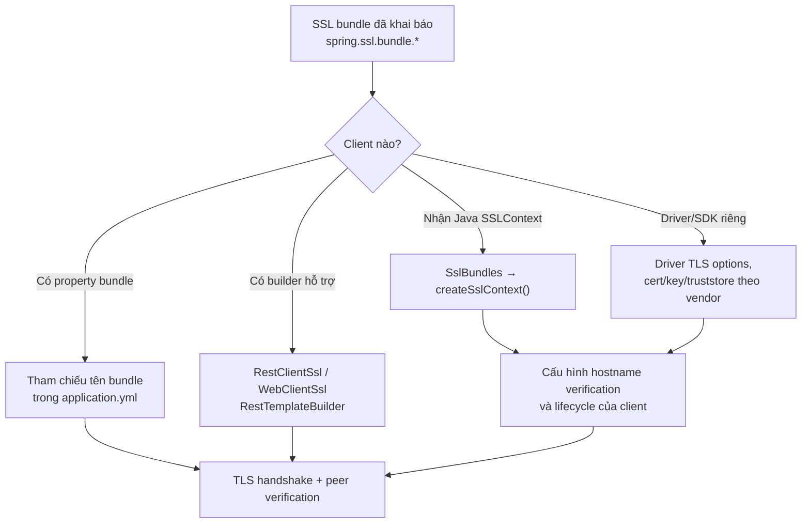
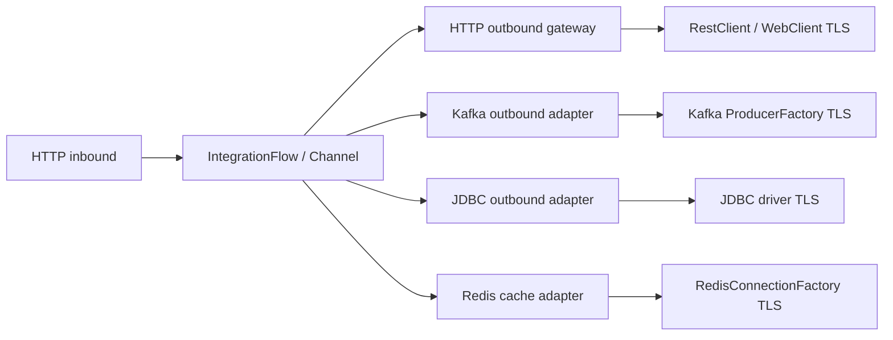

# Áp dụng SSL bundle theo khả năng hỗ trợ của từng client

## 1. Bài toán: cùng một ứng dụng nhưng nhiều kiểu kết nối TLS

Một dịch vụ Spring Boot có thể đồng thời nhận HTTPS từ API gateway, gọi API đối tác bằng `RestClient`, truy vấn PostgreSQL, ghi cache Redis, gửi sự kiện Kafka, nhận tác vụ RabbitMQ và gọi một dịch vụ dùng Apache Pulsar. Những kết nối này đều cần bảo mật, nhưng **không dùng cùng một API để áp dụng SSL**.

Ví dụ, khai báo:

```yaml
spring:
  ssl:
    bundle:
      pem:
        partner-ca:
          truststore:
            certificate: file:/etc/tls/partner-ca.pem
```

chỉ **tạo một SSL bundle có tên `partner-ca`**. Nó không tự động khiến mọi HTTP client, JDBC driver, cache hoặc broker client sử dụng CA đó. Mỗi thành phần phải được **gắn bundle bằng thuộc tính Spring Boot, builder adapter hoặc API của chính client**. Nếu không có bước này, hệ thống có thể vẫn dùng truststore mặc định của JVM, dùng cấu hình TLS cũ hoặc không bật TLS.

Trong module **SPRING_BOOT_INTEGRATION**, đây là vấn đề vận hành thiết yếu: một luồng `HTTP → DB → outbox → Kafka → consumer → Redis` có nhiều ranh giới kết nối, nhiều bộ timeout và nhiều cách xác thực. Áp dụng SSL bundle đúng giúp quản lý CA, client identity và mTLS theo từng ranh giới; áp dụng sai có thể khiến kết nối bị từ chối hoặc, nguy hiểm hơn, xác minh danh tính peer không đầy đủ.

### Mục tiêu học tập

Sau bài này, bạn có thể:

1. Xác định client nào hỗ trợ **thuộc tính `ssl.bundle` trực tiếp**, client nào hỗ trợ qua **Spring Boot builder**, và client nào cần **cấu hình riêng của driver/SDK**.
2. Gắn bundle cho HTTPS server, `RestClient`, `WebClient`, `RestTemplate`, Kafka, RabbitMQ và Redis trong bối cảnh Spring Boot 3.5.
3. Biết cách áp dụng một `SslBundle` cấp thấp cho thư viện nhận `SSLContext` mà không bỏ qua hostname verification.
4. Phân biệt **truststore cho server verification**, **keystore cho danh tính client**, SSL bundle và xác thực nghiệp vụ.
5. Tổ chức nhiều bundle cho nhiều upstream, kiểm soát TLS/mTLS, timeout, secret và thay đổi theo môi trường.
6. Kiểm thử TLS thật, nhận biết lỗi cấu hình, lập kế hoạch rotation và tránh giả định reload hoạt động ở mọi client.

> **Phạm vi phiên bản:** ví dụ tập trung vào **Spring Boot 3.5.x, Java 17+**, Spring Framework/driver do Boot BOM quản lý. SSL bundles xuất hiện từ Boot 3.1; hỗ trợ của từng client và package Java có thể khác giữa Boot 3.1–3.4 và Boot 4.x. Các ví dụ về endpoint, certificate và secret đều là giả định. Trước khi triển khai, tra **Common Application Properties của đúng version** thay vì dùng một bảng thuộc tính của phiên bản mới cho ứng dụng cũ.

## 2. Phân biệt các mức độ hỗ trợ SSL bundle

Có bốn mức tích hợp thường gặp:

| Mức | Cách sử dụng | Điểm cần kiểm tra |
| --- | --- | --- |
| **A — Property trực tiếp** | Khai báo `spring.<technology>...ssl.bundle: <name>` hoặc `server.ssl.bundle` | Boot có tạo đúng bean và client được auto-configured không? |
| **B — Builder hỗ trợ** | Inject builder và `RestClientSsl`/`WebClientSsl`, hoặc `RestTemplateBuilder.sslBundle(...)` | Áp dụng bundle có thay factory/connector/timeout đã cấu hình không? |
| **C — API thấp tầng** | Inject `SslBundles`, lấy `SslBundle` rồi tạo `SSLContext`/managers | Client có API nhận context? Ai bật hostname verification, SNI, pool lifecycle? |
| **D — Driver/SDK riêng** | Dùng tham số TLS do JDBC, R2DBC, Pulsar hoặc SDK quy định | Không có property bundle trực tiếp; cần mapping vật liệu chứng thư riêng |

Mức C **không bảo đảm** mọi thư viện có thể nhận một Java `SSLContext`. Ví dụ, client dựa trên Netty có thể yêu cầu `io.netty.handler.ssl.SslContext`, còn driver có thể chỉ chấp nhận file truststore/certificate riêng. Trường hợp đó cần adapter hoặc cơ chế cấu hình được nhà cung cấp hỗ trợ.



**Câu hỏi đầu tiên không phải “SSL bundle nằm ở đâu?” mà là “ai sở hữu connection factory/client thật đang mở socket?”** Một bean custom, một builder được tạo bằng `new`, hoặc một client do thư viện thứ ba quản lý có thể không đi qua auto-configuration của Boot.

## 3. SSL bundle chứa gì, và nó không làm gì?

Bundle mô tả key/trust material cùng tùy chọn TLS:

- **Keystore/key material:** certificate chain và private key của **chính ứng dụng**. Được dùng khi ứng dụng là HTTPS server hoặc khi client phải trình certificate với mTLS.
- **Truststore/trust material:** các CA/certificate mà ứng dụng dùng để **xác minh peer**.
- **SSL options:** protocol/cipher suites hoặc tùy chọn khác mà consumer của bundle có thể áp dụng.
- **Tên bundle:** định danh cấu hình, ví dụ `web-server`, `partner-orders`, `kafka-broker`.

Bundle **không phải** là:

1. Công tắc bật TLS cho mọi bean trong Spring context.
2. Thay thế cho hostname verification, certificate chain validation và revocation policy.
3. Cơ chế cấp quyền HTTP, database hoặc broker.
4. Công cụ xin, gia hạn hoặc thu hồi certificate.
5. Cam kết client tự reload key/certificate khi file đổi.

### 3.1. Ví dụ nhiều bundle tách ranh giới tin cậy

```yaml
spring:
  ssl:
    bundle:
      pem:
        partner-orders:
          truststore:
            certificate: file:/etc/order-service/tls/partner-ca.pem
          keystore:
            certificate: file:/etc/order-service/tls/orders-client-chain.pem
            private-key: file:/etc/order-service/tls/orders-client.key
        redis-internal:
          truststore:
            certificate: file:/etc/order-service/tls/redis-ca.pem
        broker-mtls:
          truststore:
            certificate: file:/etc/order-service/tls/broker-ca.pem
          keystore:
            certificate: file:/etc/order-service/tls/broker-client-chain.pem
            private-key: file:/etc/order-service/tls/broker-client.key
      jks:
        web-server:
          key:
            alias: order-service
          keystore:
            location: file:/etc/order-service/tls/server.p12
            password: ${HTTPS_KEYSTORE_PASSWORD}
            type: PKCS12
```

Đây là **bốn bundle cho bốn vai trò**, không phải bốn bundle cần tạo trong mọi service. Các file `/etc/...` phải được phân phối qua secret mount/hệ thống cấp phát được bảo vệ. Bundle `partner-orders` có cả truststore và keystore vì ví dụ đối tác yêu cầu **mTLS**; nếu chỉ HTTPS thông thường, không cần client key.

**Không nên** tạo một bundle `trust-everything` chứa tất cả CA nội bộ và bên ngoài rồi gắn cho mọi kết nối. Tách bundle theo upstream và danh tính workload giúp giới hạn tác động của CA rotation, thu hồi quyền và cấu hình sai.

### 3.2. PEM và PKCS12/JKS

| Đặc điểm | PEM | JKS/PKCS12 |
| --- | --- | --- |
| Cách chứa vật liệu | File certificate/key/CA riêng, định dạng text PEM | Keystore/truststore container nhị phân |
| Cấu hình Boot | `spring.ssl.bundle.pem.<name>.*` | `spring.ssl.bundle.jks.<name>.*` |
| Private key | `keystore.private-key` | Key entry trong store, có thể cần alias/key password |
| Trust CA | `truststore.certificate` | Trust entries trong store |
| Triển khai | Thuận tiện khi secret manager cấp cert/key riêng | Thuận tiện khi hệ thống cấp `.p12`/`.jks` |

`jks` là **nhánh cấu hình**, không bắt buộc store có định dạng JKS. Ví dụ trên sử dụng `type: PKCS12`. Không đồng nhất *keystore* với *truststore*: một container có thể chứa các loại entry khác nhau, nhưng vai trò phải được xác định rõ trong cấu hình.

## 4. Ma trận hỗ trợ Spring Boot 3.5 theo thành phần

Bảng này là trọng tâm của bài. Với các thành phần được **Boot auto-configure** và phiên bản tương thích, các property dưới đây được tài liệu cấu hình Spring Boot 3.5 công bố. “Trực tiếp” nghĩa là có đường liên kết qua tên bundle **ở nhóm cấu hình tương ứng**, không có nghĩa tất cả kiểu client custom đều tự dùng.

| Thành phần | Cách áp dụng | Ví dụ |
| --- | --- | --- |
| Embedded HTTPS server | **A — trực tiếp** | `server.ssl.bundle` |
| RSocket server được Boot cấu hình | **A — trực tiếp** | `spring.rsocket.server.ssl.bundle` |
| `RestClient` đồng bộ | **B — builder** | `RestClientSsl.fromBundle("name")` |
| `WebClient` reactive | **B — builder** | `WebClientSsl.fromBundle("name")` |
| `RestTemplate` | **B — builder** | `RestTemplateBuilder.sslBundle(sslBundles.getBundle("name"))` ở Boot 3.5 |
| Spring Kafka producer/consumer | **A — trực tiếp** | `spring.kafka.ssl.bundle`, override tại `producer.ssl.bundle` / `consumer.ssl.bundle` |
| Kafka Streams | **A — trực tiếp** | `spring.kafka.streams.ssl.bundle` |
| RabbitMQ AMQP | **A — trực tiếp** | `spring.rabbitmq.ssl.bundle` |
| RabbitMQ Streams (nếu module phù hợp) | **A — trực tiếp** | `spring.rabbitmq.stream.ssl.bundle` |
| Redis (Lettuce/Jedis qua Boot auto-configuration) | **A — trực tiếp** | `spring.data.redis.ssl.bundle` |
| MongoDB | **A — trực tiếp** | `spring.data.mongodb.ssl.bundle` |
| Cassandra | **A — trực tiếp** | `spring.cassandra.ssl.bundle` |
| Couchbase | **A — trực tiếp** | `spring.couchbase.env.ssl.bundle` |
| Elasticsearch REST client | **A — trực tiếp** | `spring.elasticsearch.restclient.ssl.bundle` |
| JDBC/HikariCP (ví dụ PostgreSQL) | **D — driver riêng** trong Boot 3.5 | JDBC URL, `sslmode`, driver-specific cert/trust params |
| R2DBC driver | **D — driver riêng** nếu không có integration cụ thể | URL/options của R2DBC driver và SSL provider |
| Neo4j | **D — driver riêng** theo Boot 3.5 config | `spring.neo4j.security.*` |
| Apache Pulsar client | **D/C — Pulsar SDK/customizer** | `PulsarClientBuilderCustomizer`, TLS file/parameters của Pulsar |
| Spring Integration adapter | **Theo client/connection factory bên dưới** | Nếu adapter dùng Kafka/Rabbit/HTTP/DB, cấu hình TLS ở connection owner |
| SDK bên thứ ba bất kỳ | **C hoặc D**, phải kiểm tra API | `SslBundles`/SSLContext hoặc vendor-specific settings |

Các thuộc tính được liệt kê là **điểm kiểm tra phiên bản**, không khẳng định feature tương ứng có sẵn trên tất cả Boot 3.x hoặc không cần starter/driver thích hợp. Ví dụ `spring.rabbitmq.ssl.bundle` áp dụng connection factory AMQP do Boot cấu hình; một RabbitMQ client được tạo thủ công ở nơi khác có thể không đọc thuộc tính này.

### 4.1. Quy tắc dùng bảng

1. **Xác định actual bean**: `RestClient`, `LettuceConnectionFactory`, `ConsumerFactory`, `HikariDataSource`, v.v.
2. **Tra tài liệu của đúng Boot version**: tìm tên property **và điều kiện auto-configuration**.
3. **Kiểm tra dependency/driver version**: SSL API có thể khác nếu tự override BOM.
4. **Khai báo bundle** với trust material và client identity phù hợp.
5. **Gắn bundle vào đúng client** bằng property/builder/driver config.
6. **Kiểm thử handshake thật** từ cùng network path, với CA/SAN đúng và sai.
7. **Đánh giá reload/rotation** của client đã được tạo; không suy diễn từ tính năng bundle chung.

## 5. Mức A: áp dụng bundle cho embedded HTTPS server

Khi chính Spring Boot là HTTPS server, nó cần key/certificate để chứng minh danh tính với client.

```yaml
spring:
  ssl:
    bundle:
      pem:
        public-api-server:
          keystore:
            certificate: file:/etc/tls/api-server-fullchain.pem
            private-key: file:/etc/tls/api-server.key

server:
  port: 8443
  ssl:
    bundle: public-api-server
```

`server.ssl.bundle` chỉ cần tên bundle, không phải đường dẫn certificate; vật liệu nằm dưới `spring.ssl.bundle.pem.public-api-server`. Embedded server hỗ trợ sẽ dùng material ấy để tạo TLS listener.

Với mTLS inbound, server còn cần CA kiểm tra **client certificate**:

```yaml
spring:
  ssl:
    bundle:
      pem:
        internal-api-server:
          keystore:
            certificate: file:/etc/tls/internal-server-fullchain.pem
            private-key: file:/etc/tls/internal-server.key
          truststore:
            certificate: file:/etc/tls/trusted-client-ca.pem

server:
  ssl:
    bundle: internal-api-server
    client-auth: need
```

Điểm cần nhớ:

- `client-auth: need` yêu cầu certificate client khi TLS implementation hỗ trợ.
- Certificate server phải có SAN khớp hostname/IP mà caller sử dụng.
- Kiểm tra mTLS thành công **không tự cấp quyền** đọc hoặc sửa order; authorization vẫn cần Spring Security/business policy.
- Không trộn `server.ssl.bundle` với các thuộc tính server SSL riêng lẻ để khai báo **cùng** keystore/truststore. Với bundle, cấu hình protocol/cipher thuộc `spring.ssl.bundle.<type>.<name>.options`; một số property server SSL tương đương bị bỏ qua.

Nếu TLS terminate ở ingress/load balancer chứ không phải trong JVM, hãy xác định **từng hop**: client → ingress và ingress → backend là hai kết nối khác nhau; một bundle cho embedded server không tự cấu hình proxy.

## 6. Mức B: `RestClient` và `RestClientSsl`

Với Spring Boot 3.2+ và Spring Framework 6.1+, `RestClient` hỗ trợ SSL bundle qua bean `RestClientSsl`.

### 6.1. Cấu hình một HTTP client cho một đối tác

```yaml
spring:
  ssl:
    bundle:
      pem:
        partner-orders:
          truststore:
            certificate: file:/etc/tls/orders-ca.pem
          keystore:
            certificate: file:/etc/tls/orders-client-chain.pem
            private-key: file:/etc/tls/orders-client.key

integration:
  orders:
    base-url: https://orders.partner.example
```

Code Java:

```java
package example.integration.http;

import org.springframework.beans.factory.annotation.Qualifier;
import org.springframework.beans.factory.annotation.Value;
import org.springframework.boot.autoconfigure.web.client.RestClientSsl;
import org.springframework.context.annotation.Bean;
import org.springframework.context.annotation.Configuration;
import org.springframework.web.client.RestClient;

@Configuration(proxyBeanMethods = false)
public class PartnerHttpConfiguration {

    @Bean
    @Qualifier("ordersRestClient")
    RestClient ordersRestClient(
            RestClient.Builder builder,
            RestClientSsl ssl,
            @Value("${integration.orders.base-url}") String baseUrl) {

        return builder
                .baseUrl(baseUrl)
                .apply(ssl.fromBundle("partner-orders"))
                .build();
    }
}
```

`RestClient.Builder` được Boot cung cấp, nên giữ được các customizer chung của ứng dụng. `RestClientSsl` lấy bundle theo **tên** và áp dụng vào request factory của client này.

**Cảnh báo về factory:** theo API Spring Boot 3.5, việc áp dụng `RestClientSsl` **thay thế `ClientHttpRequestFactory` đã cấu hình trước đó**; factory mới giữ các `ClientHttpRequestFactorySettings` phù hợp và SSL bundle. Nếu bạn cần proxy, pool, connect/read timeout, HTTP/2 hoặc request factory đặc thù, hãy kết hợp qua `ClientHttpRequestFactoryBuilder` và settings tương thích thay vì kỳ vọng mọi tùy chỉnh cũ tự được giữ. Xác minh bằng test TLS **và** timeout/proxy.

### 6.2. Đừng chia sẻ builder mutable không kiểm soát

`RestClient.Builder` là mutable/stateful. Nếu lần lượt:

```text
builder.baseUrl(partnerA).apply(bundleA)
builder.baseUrl(partnerB).apply(bundleB)
```

trên cùng một builder mà không clone hoặc tạo builder riêng, có nguy cơ một client nhận cấu hình của client khác. Hãy tạo **bean riêng theo upstream**, dùng injection builder theo chuẩn Boot hoặc clone builder khi cần. Tên bundle là một phần của ranh giới tin cậy.

### 6.3. TLS lỗi khác với HTTP 4xx/5xx

Một exception xác minh CA/hostname xảy ra **trước khi** gửi HTTP request hoàn chỉnh và nhận response. Nó không phải HTTP 401/403 hoặc 503. Adapter HTTP cần phân biệt:

- PKIX/SAN/handshake: lỗi certificate, trust, protocol, mTLS hoặc mạng.
- HTTP 401/403: quyền tầng ứng dụng, token/role/API contract.
- HTTP 429/503: phía đối tác quá tải/tạm thời không sẵn sàng.
- Timeout: cần xác định connect, TLS handshake, socket/read hay tổng request.

Không retry vô hạn lỗi certificate bằng cách tăng thread pool hoặc tắt hostname verification.

## 7. Mức B: `WebClient` và `WebClientSsl`

Trong ứng dụng reactive hoặc tích hợp I/O bất đồng bộ, Spring Boot hỗ trợ `WebClientSsl`:

```java
package example.integration.http;

import org.springframework.beans.factory.annotation.Value;
import org.springframework.boot.autoconfigure.web.reactive.function.client.WebClientSsl;
import org.springframework.context.annotation.Bean;
import org.springframework.context.annotation.Configuration;
import org.springframework.web.reactive.function.client.WebClient;

@Configuration(proxyBeanMethods = false)
public class ReactivePartnerConfiguration {

    @Bean
    WebClient partnerWebClient(
            WebClient.Builder builder,
            WebClientSsl ssl,
            @Value("${integration.orders.base-url}") String baseUrl) {

        return builder
                .baseUrl(baseUrl)
                .apply(ssl.fromBundle("partner-orders"))
                .build();
    }
}
```

Đoạn trên sử dụng API Boot 3.5 và yêu cầu dependency WebFlux/reactive client phù hợp. Nếu dùng phiên bản Boot mới hơn, package `WebClientSsl` có thể khác.

**Lưu ý connector:** `WebClientSsl.fromBundle(...)` có thể **thay `ClientHttpConnector` đã cấu hình** trên builder. Nếu đang dùng Reactor Netty connector riêng với connection pooling, `responseTimeout`, proxy, wiretap hoặc custom DNS resolver, không được giả định các tùy chọn trước đó vẫn còn sau khi áp SSL. Cần cấu hình **connector + SSL** theo API Boot/Netty phù hợp và test lại.

Trong hệ thống event processing, dùng `WebClient` không tự tạo backpressure toàn hệ:

- Reactive `flatMap` vẫn cần giới hạn concurrency nếu gọi partner.
- Network client phải có timeout và giới hạn connection pool.
- mTLS handshake và hostname validation phải được kiểm chứng ở runtime.
- Khi gọi HTTP rồi gửi Kafka, vẫn có ranh giới commit riêng; SSL bundle không giải quyết idempotency/outbox.

## 8. Mức B: `RestTemplate` trong ứng dụng còn sử dụng API cũ

Spring Boot 3.5 có `RestTemplateBuilder.sslBundle(SslBundle)`; phiên bản 3.1–3.3 từng dùng tên `setSslBundle(...)`, mà ở Boot 3.5 đã bị đánh dấu deprecated.

```java
package example.integration.http;

import org.springframework.boot.ssl.SslBundles;
import org.springframework.boot.web.client.RestTemplateBuilder;
import org.springframework.context.annotation.Bean;
import org.springframework.context.annotation.Configuration;
import org.springframework.web.client.RestTemplate;

@Configuration(proxyBeanMethods = false)
public class LegacyHttpConfiguration {

    @Bean
    RestTemplate partnerRestTemplate(
            RestTemplateBuilder builder, SslBundles bundles) {

        return builder
                .rootUri("https://legacy.partner.example")
                .sslBundle(bundles.getBundle("partner-orders"))
                .build();
    }
}
```

Đây là ví dụ **Boot 3.5**. Không copy `.sslBundle(...)` sang một project 3.2 rồi mặc định method đã tồn tại. Kiểm tra tài liệu API của `RestTemplateBuilder` tương ứng.

Đừng tự gọi `new RestTemplate()` và kỳ vọng `spring.ssl.bundle.*` được áp tự động. Tương tự `RestClient`, nếu cần request factory custom hoặc timeout/proxy, phải đối chiếu builder settings và test.

## 9. Mức A: Kafka — bundle và `security.protocol` là hai quyết định khác nhau

Spring Boot 3.5 cung cấp `spring.kafka.ssl.bundle`, và thuộc tính tách biệt cho producer, consumer, Kafka Streams. Ví dụ:

```yaml
spring:
  ssl:
    bundle:
      pem:
        kafka-mtls:
          truststore:
            certificate: file:/etc/tls/kafka-ca.pem
          keystore:
            certificate: file:/etc/tls/kafka-client-chain.pem
            private-key: file:/etc/tls/kafka-client.key

  kafka:
    bootstrap-servers: kafka-broker.internal.example:9093
    security:
      protocol: SSL
    ssl:
      bundle: kafka-mtls
```

**Hai bước bắt buộc cần phân biệt:**

1. `security.protocol: SSL` yêu cầu Kafka client sử dụng transport TLS. Nếu dùng SASL qua TLS, lựa chọn thường là `SASL_SSL` kèm cấu hình SASL riêng.
2. `ssl.bundle: kafka-mtls` cung cấp vật liệu trust/client identity cho client do Boot cấu hình.

Khai báo bundle mà để `security.protocol=PLAINTEXT` **không phải cấu hình TLS hợp lệ**. Ngược lại, bật SSL mà thiếu trust material với CA riêng sẽ gây lỗi xác minh certificate.

### 9.1. Producer, consumer và Streams có thể có chính sách khác

Spring Boot 3.5 có các đường dẫn:

```yaml
spring:
  kafka:
    security:
      protocol: SSL
    ssl:
      bundle: kafka-mtls
    producer:
      ssl:
        bundle: kafka-mtls
    consumer:
      ssl:
        bundle: kafka-mtls
    streams:
      ssl:
        bundle: kafka-mtls
```

Các dòng `producer/consumer/streams.ssl.bundle` ở đây **chỉ để thể hiện khả năng override**, thường không cần lặp cùng một tên nếu bundle chung đã phù hợp. Khi các ứng dụng producer/consumer dùng client identity khác nhau, tách bundle theo role và cấu hình ở cấp tương ứng.

Đừng quên:

- Kafka producer, consumer và Kafka Streams dùng connection factories/configs khác nhau.
- Broker có thể trả về hostname khác sau bootstrap qua metadata. CA đúng nhưng broker advertised SAN sai vẫn lỗi.
- Kafka ACL, SASL/mTLS role và topic authorization **không tự suy ra** từ truststore.
- Đối với producer retry, consumer replay và transaction, phải thiết kế idempotency/offset handling độc lập với TLS.

### 9.2. Hạn chế khi tạo `KafkaProducer` thủ công

Nếu code gọi trực tiếp `new KafkaProducer<>(Map.of(...))` không đi qua `ProducerFactory` do Boot cấu hình, **nó không tự đọc** `spring.kafka.ssl.bundle`. Bạn phải lấy Kafka `Properties` đã được Boot xây dựng với `SslBundles`, hoặc cấu hình SSL bằng Kafka client properties tương ứng. Tránh tạo một đường code dùng client tùy ý đi vòng qua chính sách TLS chung.

## 10. Mức A: RabbitMQ AMQP và RabbitMQ Streams

Với `spring-boot-starter-amqp`, Spring Boot 3.5 hỗ trợ tham chiếu bundle trực tiếp:

```yaml
spring:
  ssl:
    bundle:
      pem:
        rabbitmq-internal:
          truststore:
            certificate: file:/etc/tls/rabbitmq-ca.pem

  rabbitmq:
    host: rabbitmq.internal.example
    port: 5671
    ssl:
      enabled: true
      bundle: rabbitmq-internal
      validate-server-certificate: true
      verify-hostname: true
```

Như vậy:

- `enabled: true` bật TLS cho connection theo chính sách cấu hình.
- `bundle` chọn CA/identity.
- `verify-hostname` và `validate-server-certificate` không được tắt chỉ để “cho kết nối thành công”.
- Nếu broker yêu cầu certificate client, bundle cần thêm keystore chứa client cert/key.

RabbitMQ cũng có thuộc tính `spring.rabbitmq.stream.ssl.bundle` cho **RabbitMQ Streams** khi starter/client tương ứng được sử dụng. **AMQP connection factory và Streams client có thể là hai lớp khác nhau**: cấu hình AMQP không mặc nhiên cấu hình mọi connection của Streams.

### 10.1. Những chi tiết không nằm trong SSL bundle

TLS và xác thực broker không thay thế:

- `username/password` hoặc cơ chế auth của RabbitMQ.
- Virtual host permissions, exchange/queue topology và publisher confirms.
- Prefetch, ack/nack, retry/DLQ, consumer concurrency.
- End-to-end idempotency khi message được redeliver.

Tương tự Kafka, khi tạo RabbitMQ Java client hoặc connection factory bằng tay, cần kiểm tra custom bean có thực sự áp dụng bundle không; Boot không thay đổi một client nằm ngoài phạm vi auto-configuration của nó.

## 11. Mức A: Redis — SSL bundle áp dụng vào connection factory được Boot tạo

Spring Boot 3.5 hỗ trợ Redis qua Lettuce/Jedis auto-configuration, với:

```yaml
spring:
  ssl:
    bundle:
      pem:
        redis-internal:
          truststore:
            certificate: file:/etc/tls/redis-ca.pem

  data:
    redis:
      host: redis.internal.example
      port: 6380
      ssl:
        enabled: true
        bundle: redis-internal
```

Trong nhiều cấu hình Boot 3.5, đặt `ssl.bundle` sẽ tự kích hoạt SSL trừ khi bị cấu hình trái ngược; ví dụ **ghi rõ `enabled: true`** để tài liệu dễ đọc.

Lưu ý:

1. Với Redis Cluster/Sentinel, client có thể khám phá endpoint/nodes khác; certificate phải có SAN phù hợp với các hostname client thực sự dùng.
2. Không dùng `rediss://` hoặc URL theo driver rồi giả định mọi phương án điều khiển truststore giống nhau. Kiểm tra precedence của `spring.data.redis.url` và các thuộc tính `host/port`.
3. Redis ACL/password vẫn cần thiết, TLS không tự bảo vệ sai quyền truy cập key.
4. Spring Data Redis `RedisConnectionFactory` do Boot tự cấu hình có thể nhận bundle; nếu bean này được thay bằng một factory tự tạo, bạn phải tự đưa SSL config vào custom factory.
5. Cache serialization, TTL, idempotency và xử lý mất kết nối là vấn đề độc lập với việc thiết lập TLS.

Khi cache timeout sau rotation, xem **pool/connection factory đã khởi tạo**, không chỉ kiểm tra file CA trên filesystem.

## 12. Mức A: MongoDB, Cassandra, Couchbase và Elasticsearch

Các nhóm này có **thuộc tính SSL bundle riêng** trong Spring Boot 3.5. Không dùng một property `spring.data.ssl.bundle` chung vì nó không đại diện cho tất cả client.

### 12.1. MongoDB

```yaml
spring:
  data:
    mongodb:
      uri: mongodb://mongo.internal.example:27017/orders
      ssl:
        enabled: true
        bundle: mongo-ca
```

Giả định `mongo-ca` đã được định nghĩa dưới `spring.ssl.bundle.*`. SSL bundle được áp dụng vào MongoDB client do Boot auto-configure. Nếu `MongoClient` do ứng dụng tự tạo hoặc bên thứ ba quản lý, phải xác minh cách gắn SSL context riêng.

MongoDB connection string cũng có các tùy chọn TLS/replica-set/credentials. Tránh khai báo mâu thuẫn giữa URI và SSL properties, và xác minh certificate cho những host mà driver phát hiện qua topology.

### 12.2. Cassandra

```yaml
spring:
  cassandra:
    contact-points: cassandra.internal.example
    local-datacenter: dc1
    ssl:
      enabled: true
      bundle: cassandra-ca
      verify-hostname: true
```

`local-datacenter`, connection port, auth và TLS cần phù hợp topology/driver. Một cluster nhiều node đòi certificate của các node mà driver tiếp xúc hợp lệ. Không tắt `verify-hostname` để sửa SAN sai.

### 12.3. Couchbase

```yaml
spring:
  couchbase:
    connection-string: couchbases://couchbase.internal.example
    env:
      ssl:
        enabled: true
        bundle: couchbase-ca
```

Nhóm `spring.couchbase.env.ssl.bundle` nói tới SSL của **client environment**. Couchbase còn có các cấu hình authentication riêng (bao gồm certificate auth trong một số trường hợp); không nhầm **CA để tin cluster** với **client identity để đăng nhập**.

### 12.4. Elasticsearch REST client

```yaml
spring:
  elasticsearch:
    uris: https://search.internal.example:9200
    restclient:
      ssl:
        bundle: elastic-ca
```

Property áp dụng cho Elasticsearch REST client được **Boot auto-configure**. Nếu hệ thống tự tạo Elasticsearch client bằng SDK/HTTP transport riêng, phải cấu hình SSL ở transport ấy. Username/password, API key và authorization của Elasticsearch vẫn cần được quản lý độc lập.

### 12.5. Quy tắc chung cho các client dữ liệu

Đừng suy luận “đã khai báo bundle, mọi kết nối driver đều được bảo vệ”. Phải chứng minh:

- Client cụ thể có hỗ trợ property trong bản Boot đang chạy.
- Boot thật sự sở hữu bean/connection factory.
- Endpoint đang sử dụng TLS (scheme, port, SSL flag).
- Driver xác minh certificate chain và hostname đúng.
- Authentication/authorization của database hoặc cluster vẫn hợp lệ.

## 13. Mức D: JDBC/HikariCP — không có `spring.datasource.ssl.bundle` phổ quát trong Boot 3.5

Đây là một lỗi cấu hình dễ mắc: nhìn thấy `spring.kafka.ssl.bundle` rồi thử khai báo:

```yaml
# KHÔNG dùng như cấu hình SSL chung cho JDBC trong Boot 3.5
spring:
  datasource:
    ssl:
      bundle: postgres-ca
```

Đừng giả định thuộc tính này sẽ được Boot bind và áp dụng lên mọi JDBC driver. Với PostgreSQL JDBC, cấu hình TLS theo **driver**:

```yaml
spring:
  datasource:
    url: "jdbc:postgresql://db.internal.example:5432/orders?sslmode=verify-full&sslrootcert=/etc/tls/postgresql-root-ca.pem"
    username: ${DB_USERNAME}
    password: ${DB_PASSWORD}
    hikari:
      maximum-pool-size: 12
      connection-timeout: 2s
```

Ví dụ trên minh họa `verify-full` của PostgreSQL JDBC: kiểm tra **certificate chain và hostname** theo semantics driver. `HikariCP` quản lý vòng đời kết nối, không tự cấu hình PKIX/hostname thay driver.

Đối với mTLS client certificate, PostgreSQL JDBC có những thuộc tính như `sslcert` và `sslkey` với yêu cầu định dạng file cụ thể theo driver. Không copy PEM `SslBundle` sang driver một cách máy móc; kiểm tra phiên bản PG JDBC, key format và cách driver tải certificate.

### 13.1. Nếu tổ chức muốn một nguồn bí mật chung?

Có thể dùng **cùng CA public được phân phối bởi secret manager** nhưng cấu hình ở hai nơi:

```text
Secret manager cấp CA
    ├─ SSL bundle cho RestClient/Kafka/Redis
    └─ file/driver-specific property cho PostgreSQL
```

Hai bên dùng cùng **nguồn sự thật của CA**, nhưng không nhất thiết cùng **cơ chế Java API**. Nếu cần một custom adapter đọc `SslBundle` để chuyển sang driver-specific format, chỉ làm khi driver hỗ trợ và có bài test chứng minh certificate/hostname/rotation thực sự hiệu lực.

### 13.2. R2DBC là một driver stack khác

R2DBC sử dụng `ConnectionFactory`, không dùng Hikari `DataSource` JDBC. Nhiều R2DBC driver cấu hình TLS qua `r2dbc:...` URL hoặc driver options. Đừng khai báo `spring.datasource.hikari.*` hoặc `spring.ssl.bundle.*` rồi tưởng reactive driver dùng các thiết lập đó. Đọc API của R2DBC driver và cách Spring Boot cấu hình driver **đúng phiên bản**.

### 13.3. Neo4j và các driver khác

Spring Boot 3.5 có nhóm `spring.neo4j.security.*` như encryption, trust strategy, cert file và hostname verification. Không mặc định `spring.neo4j.ssl.bundle` tồn tại. Khi hỗ trợ SSL bundle được bổ sung ở một phiên bản khác, phải xác minh trên tài liệu của phiên bản đó; không dùng nhầm property từ bài hướng dẫn mới nhất.

## 14. Mức D/C: Apache Pulsar và các SDK không nhận bundle trực tiếp

Trong Spring Boot 3.5, Pulsar client có `spring.pulsar.client.service-url` dùng `pulsar://` hoặc `pulsar+ssl://`, cùng authentication plugin. Nhưng không có một property `spring.pulsar.client.ssl.bundle` chung được Boot công bố như `spring.kafka.ssl.bundle`.

Cách triển khai thông thường là **Pulsar client builder customizer** và trust material theo API Pulsar:

```yaml
spring:
  pulsar:
    client:
      service-url: pulsar+ssl://pulsar.internal.example:6651
    admin:
      service-url: https://pulsar-admin.internal.example:8443
```

```java
package example.integration.pulsar;

import org.springframework.context.annotation.Bean;
import org.springframework.context.annotation.Configuration;
import org.springframework.pulsar.core.PulsarClientBuilderCustomizer;

@Configuration(proxyBeanMethods = false)
public class PulsarTlsConfiguration {

    @Bean
    PulsarClientBuilderCustomizer pulsarTlsCustomizer() {
        return builder -> builder
                .tlsTrustCertsFilePath("/etc/tls/pulsar-ca.pem")
                .enableTlsHostnameVerification(true)
                .allowTlsInsecureConnection(false);
    }
}
```

Ở đây dùng **API của Pulsar Java client**, không gọi `SslBundle`. Đó là phương án **hợp lệ, không phải thất bại của Spring Boot**, miễn file CA được quản lý an toàn và có kiểm thử TLS. Nếu broker yêu cầu mTLS, thêm client certificate/key bằng API Pulsar tương ứng, theo định dạng và phiên bản client đang dùng.

**Admin client là một HTTP(S) client khác**: `PulsarClientBuilderCustomizer` cho binary client **không tự cấu hình** Admin HTTPS client. Cần thêm cấu hình Admin builder/auth/TLS riêng khi ứng dụng sử dụng Admin API. Không nhầm service URL `pulsar+ssl://` với URL `https://`.

### 14.1. Nếu third-party SDK chấp nhận `SSLContext`

Spring Boot cung cấp `SslBundles` và `SslBundle`:

```java
package example.integration.security;

import javax.net.ssl.SSLContext;
import org.springframework.boot.ssl.SslBundle;
import org.springframework.boot.ssl.SslBundles;
import org.springframework.stereotype.Component;

@Component
public class SslContextProvider {

    private final SslBundles bundles;

    public SslContextProvider(SslBundles bundles) {
        this.bundles = bundles;
    }

    public SSLContext forOrdersPartner() {
        SslBundle bundle = bundles.getBundle("partner-orders");
        return bundle.createSslContext();
    }
}
```

Chỉ nên dùng `SSLContext` khi thư viện thật sự nhận loại object này. **Không tạo context mới cho từng request/message.** Cần quản lý vòng đời của client, connection pool và rotation. Nếu SDK yêu cầu Java `KeyManagerFactory`/`TrustManagerFactory`, `SslBundle` có `getManagers()`; nếu cần `KeyStore`/password, có `getStores()`.

### 14.2. `SSLContext` không đảm bảo hostname verification

`SSLContext` chứa cơ chế bảo mật và key/trust managers, nhưng một số thư viện còn yêu cầu **endpoint identification/hostname verifier** riêng trên socket hoặc transport. Ví dụ nếu tự tạo socket `SSLSocket` mà không cấu hình endpoint identification phù hợp, kết nối có thể kiểm tra chain nhưng **không kiểm tra đúng hostname**. Không coi `bundle.createSslContext()` là bằng chứng đầy đủ.

Đặc biệt với Netty/SDK yêu cầu `SslContext` kiểu khác, đừng ép cast Java `SSLContext` sang Netty context. Dùng adapter chính thức hoặc tài liệu SSL của client.

## 15. Spring Integration: TLS thuộc adapter hoặc client dưới channel

Spring Integration cung cấp các mô hình EIP như channel, poller, router, transformer và service activator. **MessageChannel không phải một TLS connection** và không có một `spring.integration.ssl.bundle` chung tự bảo vệ mọi ranh giới.



Trong một flow Spring Integration:

- **HTTP outbound gateway/adapter:** kiểm tra HTTP client hoặc request factory mà endpoint sử dụng; đừng tự cho rằng nó dùng `RestClient` bean ở nơi khác.
- **Kafka adapter:** dùng `ProducerFactory`/`ConsumerFactory` được cấu hình TLS đúng; custom factory phải nhận cấu hình tương đương.
- **RabbitMQ adapter:** dùng `ConnectionFactory` đúng TLS bundle/certificate và credential.
- **JDBC adapter:** dùng `DataSource` với SSL driver properties.
- **Redis adapter/cache:** dùng `RedisConnectionFactory` được cấu hình SSL.
- **TCP/UDP adapter:** xem transport/SSL support riêng của adapter. UDP không được bảo vệ bằng TLS truyền thống chỉ vì đã khai báo SSL bundle.

**Phải xác minh bean identity:** nếu flow của bạn tạo `DefaultHttpClientConnection`, `RestTemplate` hoặc connection factory riêng, đừng chỉ kiểm tra một bean `RestClient` khác rồi kết luận toàn pipeline đã dùng bundle.

## 16. Nhiều SSL bundle, nhiều role và nguyên tắc đặc quyền tối thiểu

Một ứng dụng gọi ba upstream có thể cần:

```text
public-api-server     → danh tính HTTPS server inbound
partner-payments      → CA đối tác + client certificate riêng
partner-shipping      → CA của hệ thống shipping, không gửi cert payments
kafka-producer        → CA cluster + identity publish
kafka-consumer        → CA cluster + identity consume
redis-cache           → CA Redis, auth ACL riêng
```

Việc **tái dùng bundle** chỉ phù hợp khi các kết nối có **cùng ranh giới tin cậy và chính sách danh tính**. Hai Kafka client có thể chia sẻ broker CA nhưng phải dùng hai client identities khác nhau nếu ACL publish/consume tách biệt; khi đó nên tạo hai bundle.

### 16.1. Truststore khác keystore

| Vai trò kết nối | Cần key material? | Cần trust material? |
| --- | --- | --- |
| HTTPS client thông thường | Không bắt buộc | Có, từ hệ thống trust phù hợp |
| HTTPS client mTLS | Có client private key/cert | Có, để xác minh server |
| HTTPS server thường | Có server private key/cert | Không nhất thiết cần CA riêng để kiểm tra client |
| HTTPS server yêu cầu mTLS | Có server private key/cert | Có CA xác minh client |
| Kafka/RabbitMQ/Redis client TLS | Tùy broker có yêu cầu client cert không | Có truststore hoặc trust source phù hợp |

Nếu server TLS trình certificate không hợp lệ, **thêm private key của ứng dụng** không sửa được lỗi tin CA. Nếu peer từ chối client cert trong mTLS, **import thêm CA vào truststore của client** cũng không nhất thiết giải quyết được, vì lỗi nằm ở danh tính client mà peer kiểm tra.

### 16.2. Không tự thay truststore JVM toàn cục

Các JVM system properties như `javax.net.ssl.trustStore` có thể ảnh hưởng những thư viện dựa vào cấu hình JSSE mặc định. Tuy nhiên, thiết lập này thường áp dụng rộng, khó tách theo upstream. Ưu tiên **named bundles** và driver-specific settings trong phạm vi từng connection. Chỉ dùng global truststore khi kiến trúc, JVM provider và chính sách vận hành thực sự yêu cầu.

Không tắt certificate validation/hostname checking dưới các tên như `trust-all`, `insecure`, `verify-none` để vượt qua lỗi tạm thời. Thay vào đó sửa CA, SAN, DNS, TLS endpoint hoặc chuỗi chứng thư.

## 17. Quản lý connection timeout, pool và tính nhất quán sau khi áp dụng SSL

Chỉ thêm bundle có thể vô tình thay cấu hình client nếu dùng sai builder. Trước mỗi thay đổi, ghi lại:

| Thành phần | Cần giữ nguyên ngoài TLS |
| --- | --- |
| `RestClient` | Request factory, connect/read timeout, proxy, pooling, redirect |
| `WebClient` | ClientHttpConnector, Reactor Netty pool, timeout, DNS resolver |
| Kafka | Security protocol, serializer/deserializer, ack/retries, transaction, producer/consumer properties |
| RabbitMQ | Connection addresses, heartbeat, channel/publisher confirms, listener prefetch |
| Redis | Endpoint/cluster/sentinel, timeout, pooling, serialization |
| JDBC | JDBC URL, Hikari limits, transaction isolation, query/socket timeout |
| MongoDB/Cassandra | Topology discovery, authentication, pooling, retry/read consistency |

Một kết nối TLS thành công nhưng timeout bị mất hoặc bị tăng quá mức vẫn có thể gây sự cố vận hành. Mục tiêu là **bảo mật và hiệu năng cùng đúng**, không chỉ làm qua được handshake.

### 17.1. Bootstrap khác endpoint thật

Kafka, Redis Cluster, MongoDB replica set và Cassandra có thể bắt đầu từ một host rồi kết nối thêm tới các host được quảng bá. Certificate của **mọi endpoint client sẽ dùng** phải khớp SAN và trust chain.

Khi chỉ một phần traffic lỗi TLS, hãy kiểm tra hostname của node/proxy thực tế, không chỉ hostname bootstrap.

## 18. SSL bundle reload và certificate rotation: đọc kỹ giới hạn hỗ trợ

Spring Boot cho phép reload một số SSL bundles khi material thay đổi. Trong cấu hình, đặt `watch` **cùng cấp với `pem` bên dưới một khóa `bundle` duy nhất**:

```yaml
spring:
  ssl:
    bundle:
      pem:
        public-api-server:
          reload-on-update: true
          keystore:
            certificate: file:/etc/tls/server-fullchain.pem
            private-key: file:/etc/tls/server.key
      watch:
        file:
          quiet-period: 10s
```

Trong tài liệu SSL của Spring Boot, **consumer phải hỗ trợ reloading**. Ví dụ các embedded web servers như Tomcat và Netty có hỗ trợ. Điều đó **không phải lời hứa** mọi `RestClient`, `WebClient`, Kafka producer, Redis connection, JDBC driver hay SDK tự thay SSL context khi file thay đổi.

### 18.1. Ba trạng thái khác nhau khi thay certificate

```text
File CA/cert/key trên filesystem đã đổi
           ↓
SslBundle/SSLContext có được nạp lại không?
           ↓
Client/connection pool có tạo TLS handshake mới bằng material đó không?
```

Một client đã tạo SSL context ở startup và giữ pool kết nối có thể **không quan sát thay đổi file**. Socket hiện tại cũng có thể tiếp tục sử dụng TLS session cũ cho đến khi reconnect. Với client không hỗ trợ reload, lựa chọn an toàn thường là **rolling restart** hoặc **tái tạo có kiểm soát client và pool** sau khi material mới được phân phối.

### 18.2. Quy trình rotation đáng tin cậy

1. Ghi nhận bundle, client owner, issuer/SAN/EKU, thời hạn và vị trí secret.
2. Cấp certificate/key hoặc CA mới từ nguồn được kiểm chứng.
3. Nếu đổi CA, chuẩn bị **trust overlap** có thời hạn trước khi peer chuyển certificate.
4. Triển khai material mới lên staging, kiểm tra CA chain/hostname và mTLS.
5. Xác định chính xác consumer nào hỗ trợ reload; consumer nào phải restart/recreate.
6. Rollout từng nhóm instance và quan sát handshake failure, client errors, consumer lag và HTTP 5xx.
7. Thu hồi cert/CA cũ khi tất cả bên liên quan đã chuyển đổi an toàn.

Đối với mTLS, phải phân phối **cert chain và private key khớp nhau**. Nếu watcher nhìn thấy cert mới nhưng key cũ trong khoảng cập nhật file, TLS reload có thể thất bại. Tổ chức file update theo cơ chế atomic/quiet period phù hợp.

## 19. Kiểm thử theo mức hỗ trợ, không chỉ test Spring context

Việc bean `SslBundles` tồn tại và `getBundle("partner-orders")` chạy được chỉ chứng minh **cấu hình được nạp**. Muốn chứng minh TLS an toàn, phải có handshake thật.

### 19.1. Ma trận kiểm thử chung

| Tình huống | Kỳ vọng |
| --- | --- |
| CA đúng, SAN đúng hostname, cert còn hiệu lực | Kết nối TLS thành công |
| CA không nằm trong truststore | Client từ chối chain |
| CA đúng nhưng hostname không khớp SAN | Client từ chối hostname |
| Certificate hết hạn/chưa đến hiệu lực | Handshake thất bại |
| Broker/API yêu cầu client cert, client không có | mTLS thất bại |
| Client cert đúng nhưng không có quyền topic/endpoint | TLS có thể thành công, application authorization thất bại |
| Tham chiếu bundle không tồn tại | Phát hiện lỗi cấu hình sớm |
| File CA/key thiếu hoặc process không đọc được | Không fallback sang trust-all |
| Client tạo bằng custom factory không gắn bundle | Test phát hiện kết nối không dùng trust material dự kiến |
| File thay khi app chạy | Xác minh rõ consumer đã reload hay cần restart |
| HTTP builder gắn SSL làm mất timeout | Test timeout/proxy/pool phát hiện regression |

### 19.2. Test theo từng giao thức

**HTTPS server/client:** dùng test CA, mock HTTPS server với certificate SAN đúng/sai và mTLS khi yêu cầu. `MockRestServiceServer` kiểm tra HTTP request mapping nhưng không thay cho một TLS socket thật.

**Kafka:** chạy broker có TLS và listener/producer được cấu hình từ Boot; test publish, consume, SASL/ACL, hostname mismatch và broker metadata chứa hostname khác.

**RabbitMQ:** test AMQP TLS listener với CA, certificate client, vhost permission, publisher confirms và redelivery.

**Redis:** test TLS endpoint qua `RedisConnectionFactory` được Boot tạo; nếu cluster, test chuyển hướng tới node khác và xác minh SAN.

**JDBC:** test PostgreSQL/MySQL server với TLS bật bằng **driver-specific** configuration; `sslmode=verify-full` phải từ chối SAN không khớp.

**Pulsar:** test service URL `pulsar+ssl://` **và** Admin HTTPS nếu dùng, vì hai client có cấu hình riêng.

### 19.3. Cách kiểm tra handshake độc lập

Ví dụ kiểm tra certificate và hostname của HTTPS server:

```bash
openssl s_client \
  -connect orders.partner.example:443 \
  -servername orders.partner.example \
  -verify_hostname orders.partner.example \
  -CAfile partner-ca.pem \
  -verify_return_error \
  -showcerts
```

Ví dụ xem PKCS12:

```bash
keytool -list -v -storetype PKCS12 \
  -keystore server.p12
```

OpenSSL/`keytool` giúp kiểm tra chain, SAN, expiry và alias, nhưng **không chứng minh ứng dụng Java thật đang dùng đúng bundle**. Test end-to-end phải chạy từ cùng namespace/proxy path và driver/client thật.

## 20. Chẩn đoán lỗi theo ranh giới

| Triệu chứng | Khả năng nguyên nhân | Cần kiểm tra |
| --- | --- | --- |
| `NoSuchSslBundleException` | Sai bundle name hoặc config/profile không nạp | `spring.ssl.bundle.*`, tham chiếu chính xác |
| App start tốt, HTTP client vẫn báo PKIX | Bundle chưa gắn vào `RestClient` thực hoặc factory bị thay | Bean identity, `RestClientSsl`, request factory |
| Redis TLS lỗi nhưng Kafka TLS tốt | Hai connection factories có trust riêng | `spring.data.redis.ssl.bundle`, CA/SAN Redis |
| Kafka connection plaintext dù khai báo bundle | `security.protocol` không bật SSL/SASL_SSL | Kafka client config thực tế |
| RabbitMQ chỉ lỗi khi chạy Streams | AMQP và Streams dùng client/config khác nhau | `spring.rabbitmq.stream.ssl.bundle` |
| PostgreSQL vẫn không dùng bundle | JDBC driver không có property bundle trực tiếp Boot 3.5 | `sslmode=verify-full`, CA và driver settings |
| Pulsar Admin API lỗi HTTPS, binary client OK | Admin HTTP và binary client có SSL config riêng | Admin builder, URL và trust |
| `PKIX path building failed` | Không tin CA/thiếu intermediate/truststore khác | Chain server và trust source của actual client |
| `No subject alternative ...` | SAN không khớp hostname | URL/advertised host, certificate SAN |
| `bad_certificate`/mTLS failure | Server từ chối client identity | Client cert/key, EKU, CA trust phía server |
| HTTP TLS tốt nhưng response 403 | Authorization tầng ứng dụng lỗi | Principal/role/token, không sửa truststore vô ích |
| Lỗi chỉ sau rotation | Client chưa reload hoặc instance dùng file cũ | Secret mount, context lifecycle, rolling restart |
| Timeout thay đổi sau gắn SSL | Request factory/connector bị thay | Builder order, pool/proxy/timeout settings |

### 20.1. Cách phân tích từng bước

1. **Đặt tên endpoint:** application nào, kết nối đi/đến đâu, hostname/port/protocol nào.
2. **Xác định owner:** bean/framework nào trực tiếp tạo socket.
3. **Chọn mức A/B/C/D:** property, builder, SSLContext hay driver-specific config.
4. **Kiểm tra trust/identity:** keystore, truststore, SAN, certificate chain, token/ACL.
5. **Kiểm tra thứ tự cấu hình:** có custom bean/factory override Boot không? Builder có thay connector không?
6. **Kiểm tra runtime:** TLS handshake thực, endpoint quảng bá trong cluster, timeout, pooling.
7. **Kiểm tra rotation:** file đã đổi nhưng consumer có được reload không?
8. **Xác minh kết quả bằng integration test**, không chấp nhận giải pháp bỏ qua xác minh certificate.

## 21. Quan sát, cảnh báo và chính sách an toàn

SSL lỗi có thể làm gián đoạn cả luồng nghiệp vụ:

```text
HTTP → Order DB → Outbox → Kafka → Billing consumer → Redis
                        ↑
              TLS broker handshake lỗi
                        ↓
               Outbox backlog tăng
```

Không thể chỉ theo dõi log “SSL handshake error”; cần thêm chỉ số sau:

| Tín hiệu | Tác dụng |
| --- | --- |
| Handshake/auth failure theo client/endpoint | Phân biệt CA, hostname, client cert, token |
| Certificate expiry theo bundle/owner | Chủ động rotation trước khi certificate hết hạn |
| Thời gian kết nối và timeout | Nhận biết DNS/TLS/proxy so với xử lý ứng dụng |
| HTTP 401/403/5xx, Kafka publish error, consumer lag | Xác định tác động nghiệp vụ sau lỗi TLS |
| Redis/DB connection failure | Phát hiện cache/database bị ngắt kết nối |
| Outbox age, retry, DLQ | Phát hiện sự kiện chưa gửi hoặc xử lý chậm |
| Số instance đang dùng certificate version cũ/mới | Kiểm chứng rollout/rotation đồng đều |

Nhãn metric nên có cardinality được kiểm soát (client name, bundle name, error category); không đưa raw certificate, private key, token hay dữ liệu cá nhân vào log/metric. Các fingerprint certificate là metadata phục vụ đối chiếu và vẫn cần xử lý theo chính sách thông tin của tổ chức.

### 21.1. Lỗi certificate không phải lỗi retry thông thường

Nếu client bị từ chối vì **CA/SAN/expired cert** hoặc **thiếu quyền**, retry liên tục thường không giúp ích. Giới hạn retry, đánh dấu kết nối chưa sẵn sàng ở mức phù hợp, giữ message chưa hoàn thành tại broker/outbox và cảnh báo người vận hành. Với các thao tác có side effect, idempotency key vẫn cần thiết vì timeout không chứng minh yêu cầu chưa đến phía server.

## 22. Tình huống thực tế: chỉ một trong bốn tích hợp bị lỗi sau cập nhật CA

**Bối cảnh giả định:** `order-service` dùng bốn upstream:

1. `RestClient` gọi API đối tác, bundle `partner-orders`.
2. Kafka producer dùng `spring.kafka.ssl.bundle=broker-mtls`.
3. Redis cache dùng `spring.data.redis.ssl.bundle=redis-internal`.
4. PostgreSQL JDBC dùng `sslrootcert` trong JDBC URL.

Đội vận hành thay CA của broker Kafka. Họ đã cập nhật `/etc/tls/broker-ca.pem`, nhưng không restart service vì nghĩ mọi bundle tự reload.

**Hiện tượng:** HTTP và Redis vẫn chạy, PostgreSQL bình thường; Kafka producer bắt đầu báo PKIX sau khi broker dùng certificate mới. Outbox chưa gửi tăng liên tục.

### Phân tích đúng

1. Kafka dùng bundle **khác** với HTTP/Redis, nên những kết nối còn lại bình thường không nói gì về Kafka trust.
2. File CA trên filesystem có thể đã đổi nhưng producer/SSLContext đang hoạt động **chưa nạp lại**.
3. Kafka client kết nối tới broker hostname thực tế qua metadata; SAN hoặc intermediate chain ở một broker có thể sai.
4. Kafka `security.protocol` và `ssl.bundle` phải được kiểm tra trong **ProducerFactory** thực, không chỉ trong YAML.
5. Retry publish phải được giới hạn; outbox bảo toàn sự kiện chưa gửi nhưng backlog/tuổi outbox cần được giám sát.

### Cách sửa và ngăn tái diễn

- Xác minh CA mới và chain broker qua kênh được tin cậy; kiểm tra SAN của các node Kafka.
- Kiểm tra bundle `broker-mtls` và phiên bản certificate trên các instance.
- Nếu client không hỗ trợ reload tại runtime, **rolling restart/recreate producer** theo quy trình thay vì trông chờ file watcher.
- Test publish/consume với broker TLS thật, đảm bảo ACL và idempotency vẫn đúng.
- Cập nhật runbook rotation: CA overlap, thứ tự deploy, signal cảnh báo và rollback.

**Kết luận tình huống:** SSL bundle là cách đặt tên/cấp phát trust material; **khả năng tích hợp và reload nằm ở client tiêu thụ**. Đánh giá đúng điều đó giúp tránh sự cố chỉ xuất hiện ở một adapter trong pipeline dài.

## 23. Checklist áp dụng SSL bundle theo từng client

1. **Kiểm kê các TLS hops:** inbound HTTPS, HTTP outbound, JDBC, Redis, Kafka, RabbitMQ, Pulsar và các adapter khác.
2. **Chốt Boot/client versions:** tra Common Application Properties và SDK APIs tương ứng với version thật.
3. **Định danh connection owner:** auto-configured factory, builder, custom bean hay driver trực tiếp.
4. **Chọn mức A/B/C/D:** property bundle, builder support, Java SSLContext, hoặc TLS riêng của driver.
5. **Tạo bundle theo ranh giới:** truststore cho CA peer, keystore cho local identity khi cần mTLS.
6. **Bật TLS thật:** scheme, port, security protocol/SSL enabled; chỉ gắn CA nhưng để plaintext là chưa đủ.
7. **Không bỏ qua verification:** trust chain, hostname/SAN và client certificate theo yêu cầu.
8. **Bảo vệ secret:** private key/keystore password qua secret manager, file permissions và phân tách môi trường.
9. **Giữ timeout/pooling:** áp SSL mà không làm mất HTTP connector, Kafka properties hoặc DB client settings.
10. **Xác minh runtime:** SSL handshake thật, cluster endpoint discovery, authorization riêng.
11. **Đánh giá rotation:** reload có được consumer hỗ trợ không; cần restart/recreate pool không?
12. **Test failure cases:** CA sai, SAN sai, missing key, expired cert, mTLS/permission, custom factory không dùng bundle.
13. **Vận hành:** expiry alerts, handshake errors, retries, outbox age, broker lag và rollback.

### Câu hỏi tự kiểm tra

**1.** Tại sao khai báo `spring.ssl.bundle.pem.partner-orders` không làm tất cả `RestClient` và JDBC connection tự tin CA đó?

**2.** Sự khác nhau giữa `spring.kafka.security.protocol=SSL` và `spring.kafka.ssl.bundle=kafka-mtls` là gì?

**3.** Một `WebClient` được tạo qua `WebClientSsl` nhưng mất proxy timeout; API nào/bước nào cần kiểm tra?

**4.** Vì sao `RestTemplateBuilder.sslBundle(...)` chỉ nên dùng ở Boot version có method đó?

**5.** Với PostgreSQL JDBC/HikariCP Boot 3.5, vì sao `spring.datasource.ssl.bundle` không phải cấu hình TLS chung được tài liệu xác nhận?

**6.** `PulsarClientBuilderCustomizer` cấu hình TLS cho binary client có tự bảo vệ Admin HTTPS client không?

**7.** Dùng `SslBundle.createSslContext()` có đủ chứng minh hostname verification luôn bật trong SDK tùy biến không?

**8.** Vì sao file certificate đổi trên Kubernetes Secret chưa chắc Kafka/Redis/HTTP client đang mở socket dùng certificate mới?

**9.** Một RabbitMQ TLS connection thành công nhưng consumer không có quyền queue. Bạn cần sửa CA/truststore hay broker ACL?

**10.** Nếu một Spring Integration flow có HTTP outbound gateway và Kafka outbound adapter, bạn tìm đúng điểm áp bundle ở đâu?

## Tài liệu tham khảo

- [Spring Boot 3.5 — SSL](https://docs.spring.io/spring-boot/3.5/reference/features/ssl.html): tạo PEM/JKS bundles, `SslBundles`, material, options và giới hạn reload.
- [Spring Boot 3.5 — Common Application Properties](https://docs.spring.io/spring-boot/3.5/appendix/application-properties/index.html): tra `spring.kafka.ssl.bundle`, `spring.rabbitmq.ssl.bundle`, `spring.data.redis.ssl.bundle`, MongoDB, Cassandra, Couchbase, Elasticsearch, RSocket và các nhóm tương ứng.
- [Spring Boot 3.5 — Calling REST Services](https://docs.spring.io/spring-boot/3.5/reference/io/rest-client.html): `RestClientSsl`, `WebClientSsl`, builder và connector/factory.
- [Spring Boot 3.5 — Embedded Web Servers](https://docs.spring.io/spring-boot/3.5/how-to/webserver.html): `server.ssl.bundle`, protocol/ciphers và HTTPS endpoint.
- [Spring Boot 3.5 — Working with NoSQL Technologies](https://docs.spring.io/spring-boot/3.5/reference/data/nosql.html): Redis, MongoDB, Cassandra và những client dữ liệu.
- [Spring Boot 3.5 — SQL Databases](https://docs.spring.io/spring-boot/3.5/reference/data/sql.html): `DataSource`/HikariCP và driver-level options.
- [PostgreSQL JDBC — SSL](https://jdbc.postgresql.org/documentation/ssl/): `sslmode=verify-full`, certificate và hostname.
- [Spring for Apache Pulsar — Reference](https://docs.spring.io/spring-pulsar/reference/): cấu hình Pulsar client, TLS và customizers theo version.

## Kết luận

Áp dụng SSL bundle trong Spring Boot phải bắt đầu bằng câu hỏi **client nào tạo kết nối thật và client đó hỗ trợ bundle đến mức nào**. Với Boot 3.5, nhiều tích hợp có property bundle trực tiếp như Kafka, RabbitMQ, Redis, MongoDB; `RestClient`/`WebClient` dùng builder adapters; JDBC, R2DBC, Pulsar và một số SDK cần TLS settings riêng hoặc adapter cấp thấp. Một SSL bundle chỉ phát huy tác dụng khi được **gắn đúng vào connection factory/client**, TLS được bật đúng giao thức, certificate chain và hostname được xác minh, cùng client identity hợp lệ khi dùng mTLS. Cuối cùng, phải kiểm chứng timeout, pool, rotation, retry và ack/idempotency bằng integration tests thực tế để bảo mật kết nối không làm hỏng tính nhất quán của các luồng HTTP, database, cache và broker.
