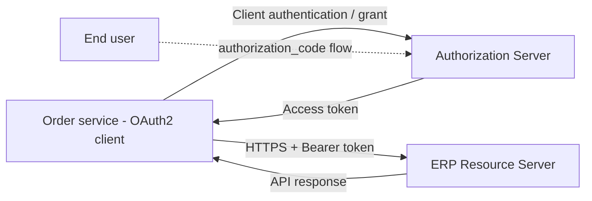
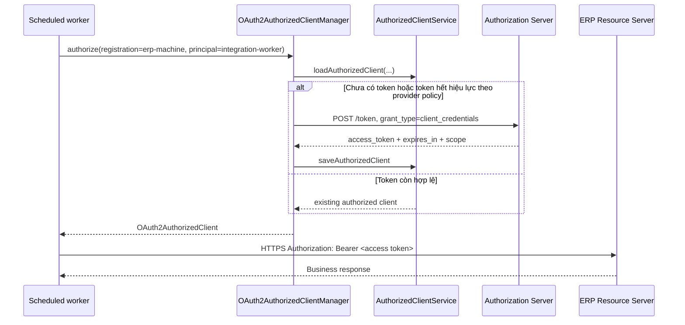
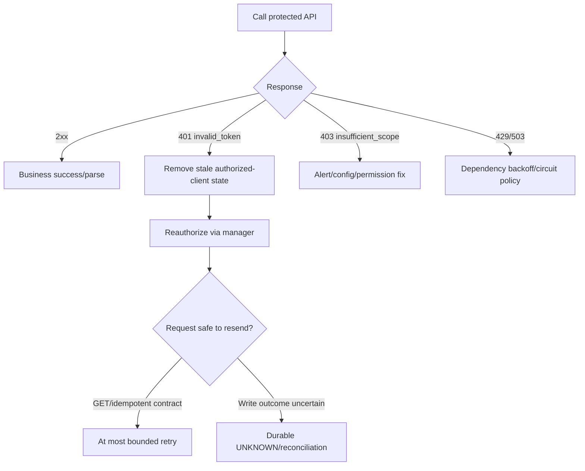
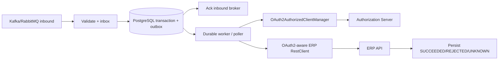
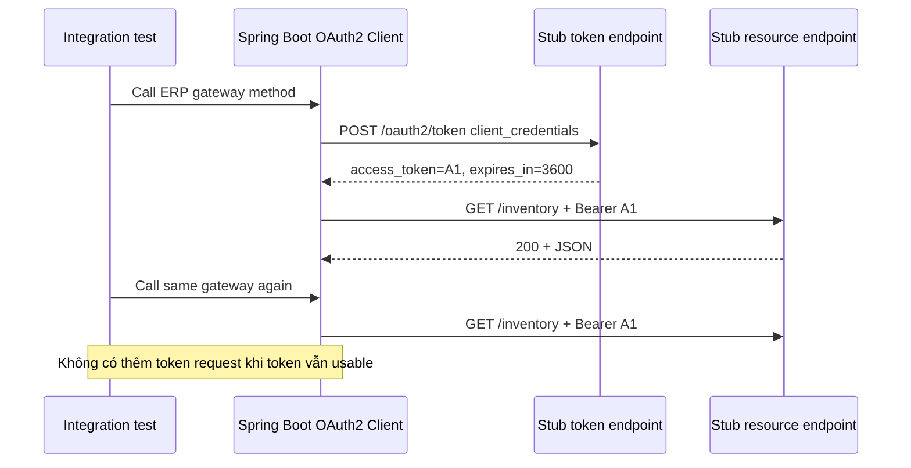

# Lấy và làm mới access token bằng thành phần Spring Security phù hợp

## 1. Vì sao lấy access token là một phần của thiết kế tích hợp?

Một dịch vụ Spring Boot nhận lệnh từ HTTP hoặc Kafka, tra PostgreSQL rồi gọi API của ERP. ERP bảo vệ endpoint bằng OAuth 2.0 Bearer access token. Khi token hết hạn, lỗi tích hợp không chỉ là `401 Unauthorized`: service có thể đang giữ một message cần acknowledgment, một database transaction đã commit hoặc một lệnh ghi có kết quả chưa xác định.

Một thiết kế thủ công thường mắc lỗi:

```java
// Phản mẫu: lấy token mới cho MỌI lần gọi và lưu token bằng field mutable.
String token = loginByCallingTokenEndpoint(clientId, clientSecret);
return restClient.get()
        .uri("/inventory/{id}", inventoryId)
        .header("Authorization", "Bearer " + token)
        .retrieve()
        .body(InventoryView.class);
```

Đoạn trên đưa logic cấp token vào business handler, dễ tạo token-endpoint storm, lộ secret trong log, bỏ sót expiration, refresh, concurrent requests và error classification. Nếu API gọi qua nhiều threads hoặc replicas, cache tự viết có thể giữ token sai client, sai scope hoặc sai người dùng.

**Spring Security OAuth2 Client** cung cấp mô hình chuyên dụng cho `ClientRegistration`, `OAuth2AuthorizedClient`, `OAuth2AuthorizedClientManager` và các `OAuth2AuthorizedClientProvider`. Các thành phần này giúp chọn grant phù hợp, dùng lại token còn hạn, làm mới/ủy quyền lại khi cần và tích hợp vào HTTP client theo đúng context.

Bài **“Lấy và làm mới access token bằng thành phần Spring Security phù hợp”** thuộc chương **“Bảo mật kết nối”**, module **SPRING_BOOT_INTEGRATION**. Bối cảnh là Spring Boot tích hợp HTTP client, JDBC/JPA, cache, broker thông điệp và Spring Integration; trọng tâm gồm cấu hình, hợp đồng dữ liệu, giao dịch, lỗi, chống trùng, kiểm thử và quan sát flow.

Sau bài, bạn sẽ biết:

1. Chọn `client_credentials` hay `authorization_code` + `refresh_token` theo đúng đối tượng được ủy quyền.
2. Hiểu `OAuth2AuthorizedClientManager` khác `OAuth2AuthorizedClientService`, `Repository`, `Provider` ra sao.
3. Chọn manager cho **scheduled/background task**, **servlet HTTP request** hoặc **reactive WebFlux**.
4. Cấu hình `RestClient` và `WebClient` để bearer token được gắn tự động khi gọi HTTP downstream.
5. Phân biệt token hết hạn, token bị thu hồi, scope thiếu, token endpoint outage và resource server 401/403.
6. Bảo vệ token, secret, tenant/user isolation và xử lý retry an toàn với Kafka/RabbitMQ/ERP.
7. Kiểm thử vòng đời token, concurrency, HTTP headers, failure/recovery và observability.

**Nguyên tắc:** Spring Security chịu trách nhiệm quản lý **access-token authorization lifecycle** cho client; application vẫn chịu trách nhiệm tính đúng đắn của business command và durable retry.

## 2. Các vai trò OAuth 2.0 trong một cuộc gọi outbound



| Vai trò | Ví dụ | Trách nhiệm |
|---|---|---|
| **OAuth2 Client** | Order service. | Lấy và sử dụng token đúng registration/grant. |
| **Authorization Server** | Identity provider của tổ chức/đối tác. | Cấp access token, refresh token theo policy. |
| **Resource Server** | ERP Inventory API. | Kiểm tra bearer token, scope/audience/claims và authorization. |
| **Resource Owner** | Người dùng hoặc chủ thể cấp quyền tùy grant. | Có thể tham gia consent/redirect trong authorization code. |
| **Client registration** | `erp-machine`, `crm-user`. | Định nghĩa client ID, secret/auth method, token URI, grant, scopes. |

**Phân biệt hai chiều:** Spring Boot nhận và **xác thực JWT/Bearer inbound** với OAuth2 Resource Server là một nhiệm vụ; Spring Boot **lấy Bearer outbound** với OAuth2 Client là nhiệm vụ khác. Một ứng dụng có thể thực hiện cả hai, nhưng cấu hình `spring.security.oauth2.resourceserver.jwt.issuer-uri` **không** tự cấp token cho `RestClient`.

### 2.1. Access token không đồng nghĩa refresh token

- **Access token**: credential có phạm vi và thời hạn để gọi API; thường gửi dưới `Authorization: Bearer <token>`.
- **Refresh token**: credential được authorization server cấp tùy grant/policy, dùng tại token endpoint để lấy access token mới, **không** gửi tới resource server.
- **Client secret/private key**: credential xác thực OAuth2 client với authorization server; không dùng như Bearer cho API nghiệp vụ trừ khi hợp đồng API chỉ định cơ chế khác.
- **ID token**: OpenID Connect trả danh tính người dùng cho client; **không** mặc định dùng làm access token tới ERP.

Không suy ra access token luôn là JWT; nó có thể là opaque token. Client không nên tự parse payload JWT làm nguồn duy nhất cho expiry/scope/business identity khi authorization server có contract khác.

## 3. Chọn đúng grant: máy–máy khác “thay mặt người dùng”

| Trường hợp | OAuth2 flow phổ biến | Token gắn với ai? | Cách tái cấp |
|---|---|---|---|
| Scheduled job, Kafka consumer, outbox dispatcher gọi ERP bằng quyền ứng dụng. | `client_credentials`. | Confidential client/application. | Xin **access token mới bằng client credentials** khi hết hạn; thông thường không có refresh token. |
| Web app gọi CRM **thay mặt người dùng đã đăng nhập**. | `authorization_code` + PKCE/ủy quyền phù hợp. | Người dùng + client + scopes. | Dùng `refresh_token` **nếu** server cấp và client được phép; có thể phải xác thực lại. |
| Service cần gọi API của đối tác bằng user delegation từ upstream. | On-behalf-of/token exchange theo provider contract. | User/delegated authority. | Phụ thuộc authorization server; không thay bằng client credentials một cách âm thầm. |
| Ứng dụng chỉ xác thực incoming API token. | Resource Server JWT/opaque introspection. | Caller của API. | Không lấy outbound token tự động. |

### 3.1. Vì sao `client_credentials` thường không có refresh token?

Trong `client_credentials`, client vẫn có credential để yêu cầu access token mới, nên refresh token không phải cơ chế chuẩn cần thiết. Khi token sắp hết hạn, `ClientCredentialsOAuth2AuthorizedClientProvider` có thể thực hiện **authorization mới** tại token endpoint. Cố tìm `refresh_token` trong response rồi viết loop refresh cho client credentials có thể tạo logic không bao giờ chạy hoặc lỗi sai contract.

Một số authorization server có extension riêng; phải tuân theo tài liệu provider nhưng không coi extension là OAuth2 default.

### 3.2. Authorization code có ràng buộc request/user

Authorization code yêu cầu tương tác trình duyệt/redirect và context người dùng phù hợp; không dùng callback URL và `HttpServletRequest` của một web user để giả lập background batch job. Nếu token của user hết hạn và refresh token không còn hiệu lực, workflow cần chính sách reauthorization; không được tự chuyển sang token ứng dụng với quyền rộng hơn mà không có phép.

## 4. Các thành phần Spring Security và trách nhiệm riêng

| Thành phần | Vai trò | Câu hỏi nó trả lời |
|---|---|---|
| `ClientRegistration` | OAuth client configuration cho một provider/grant. | Gọi token URI nào, client ID, scope và auth method nào? |
| `ClientRegistrationRepository` | Tra cứu registrations bằng `registrationId`. | `erp-machine` tương ứng cấu hình nào? |
| `OAuth2AuthorizedClient` | Registration + access token hiện tại, có thể kèm refresh token. | Token đã được cấp cho principal/registration nào? |
| `OAuth2AuthorizedClientService` | Lưu/tải authorized clients, thường keyed theo registration/principal. | Token hiện có ở đâu, dùng lại sau request được không? |
| `OAuth2AuthorizedClientRepository` | Lưu/tải authorized clients theo web/servlet request context. | Token của user hiện hành nằm ở session/request backing nào? |
| `OAuth2AuthorizedClientProvider` | Thực thi một hoặc nhiều grants/re-authorizations. | Nếu token thiếu/hết hạn, có thể cấp lại bằng cơ chế nào? |
| `OAuth2AuthorizedClientManager` | Điều phối authorize/reauthorize và lưu kết quả. | Lần gọi này nên dùng authorized client nào? |
| `OAuth2AuthorizationFailureHandler` | Xử lý authorization failure và token invalidation. | Token cũ cần bị loại bỏ khi nào? |

**Không gộp hết vào một field `String bearerToken`**. Manager và authorized-client storage dùng principal/registration để giữ đúng phạm vi, còn provider quyết định điều kiện lấy token mới.

### 4.1. “Authorized client” là trạng thái cấp quyền, không phải user đăng nhập

`OAuth2AuthorizedClient` không phải Spring Security `Authentication`. Với client credentials, bạn vẫn cần một **principal identifier ổn định để manager lưu/tra authorized client**, dù không có một người dùng HTTP thật. Với delegated tokens, principal phải đại diện đúng người dùng để không trộn tokens.

## 5. Dependency và phiên bản cần xác định

Với Spring Boot 3.x / Spring Security 6.x tương thích qua Spring Boot BOM:

```kotlin
dependencies {
    implementation("org.springframework.boot:spring-boot-starter-oauth2-client")

    // Chỉ thêm HTTP stack thực sự dùng:
    implementation("org.springframework.boot:spring-boot-starter-web")
    // hoặc cho WebClient:
    // implementation("org.springframework.boot:spring-boot-starter-webflux")

    implementation("org.springframework.boot:spring-boot-starter-actuator")

    testImplementation("org.springframework.boot:spring-boot-starter-test")
}
```

Ở Spring Boot 3.x mới hơn, `RestClient` có mặt từ Spring Framework 6.1/Boot 3.2+, còn interceptor chuyên dụng `OAuth2ClientHttpRequestInterceptor` thuộc **Spring Security 6.4+**. Dùng đúng dependency management để tránh trộn Spring Security modules thuộc nhiều versions.

Nếu dự án chạy Spring Security cũ hơn, API cho `RestClient` OAuth2 interceptor có thể chưa có; khi đó có thể dùng `WebClient` + servlet filter hoặc adapter phù hợp. **Không copy import class mới rồi giả định mọi Spring Boot 3.x đều có.**

### 5.1. OAuth2 client và resource server khác starter

Nếu ứng dụng vừa nhận JWT từ inbound API vừa gọi outbound ERP, có thể cần thêm `spring-boot-starter-oauth2-resource-server` cho inbound validation. Nhưng hai starter không thể thay thế nhau: `client.registration` làm outbound grant, `resourceserver.jwt` kiểm tra inbound JWT.

## 6. Cấu hình `application.yml` cho client credentials

Một cấu hình máy–máy:

```yaml
spring:
  security:
    oauth2:
      client:
        registration:
          erp-machine:
            provider: erp-identity
            client-id: ${ERP_OAUTH_CLIENT_ID}
            client-secret: ${ERP_OAUTH_CLIENT_SECRET}
            client-authentication-method: client_secret_basic
            authorization-grant-type: client_credentials
            scope:
              - inventory.read
              - inventory.write
        provider:
          erp-identity:
            token-uri: https://identity.example.internal/oauth2/token

integration:
  erp:
    base-url: https://api.erp.example.internal
```

Ví dụ dùng `client_secret_basic` theo hợp đồng authorization server; provider khác có thể yêu cầu `client_secret_post`, private-key JWT hoặc mTLS client authentication. Không tự đổi authentication method chỉ để “server chấp nhận”.

| Property | Nghĩa |
|---|---|
| `registration.erp-machine` | Tên nội bộ dùng làm `clientRegistrationId`. |
| `provider: erp-identity` | Mapping tới authorization server configuration. |
| `client-id/client-secret` | OAuth client credentials, phải được bảo vệ. |
| `client-authentication-method` | Cách gửi/xác thực client với token endpoint. |
| `authorization-grant-type` | `client_credentials` để lấy token cho ứng dụng. |
| `scope` | Quyền yêu cầu; server quyết định quyền thực sự cấp. |
| `provider.erp-identity.token-uri` | Endpoint để xin access token. |
| `integration.erp.base-url` | Property riêng của ứng dụng; **không** do Spring Security tự gắn vào HTTP client. |

Không giả định thêm `spring.security.oauth2.client.registration.erp-machine` là mọi outbound HTTP request tự mang Bearer token; phải cấu hình **HTTP client interceptor/filter hoặc authorized client invocation**.

### 6.1. Phân biệt `issuer-uri` và `token-uri`

Một provider hỗ trợ OIDC/OAuth discovery có thể dùng `issuer-uri` để lấy metadata phù hợp; với authorization server không hỗ trợ discovery, có thể khai báo trực tiếp `token-uri` và các endpoints cần thiết. Với client credentials thuần, token URI thường đủ cho bước cấp token nếu metadata/registration khác đã rõ.

**Không lấy token URI từ Host header của người dùng** hoặc gọi một issuer URI tùy ý. Đó có thể gây SSRF hoặc lộ client secret qua token endpoint giả. Các endpoints phải đến từ trusted configuration.

## 7. Client credentials flow: token được dùng lại và cấp mới ra sao?



Quy trình này minh họa **một lần authorize**; hành vi chính xác về cache/expiry/re-authorization tùy `OAuth2AuthorizedClientManager`, provider chain và storage được cấu hình. Với `client_credentials`, khi cần token mới, client gửi lại grant và credentials; **không phải tự dùng refresh token**.

Khi token bị revoke trước `expiresAt` hoặc resource server trả `401 invalid_token`, cache có thể vẫn chứa token mà manager chưa biết bị vô hiệu. Vì vậy cần **authorization failure handling**, không chỉ dựa vào đồng hồ hết hạn.

## 8. Manager đúng cho scheduled job và Kafka consumer: service-based

Với những luồng **ngoài servlet request** như `@Scheduled`, Spring Integration poller, outbox dispatcher hoặc `@KafkaListener`, thường dùng `AuthorizedClientServiceOAuth2AuthorizedClientManager`. Nó không yêu cầu `HttpServletRequest`/`HttpServletResponse`.

```java
import org.springframework.context.annotation.Bean;
import org.springframework.context.annotation.Configuration;
import org.springframework.security.oauth2.client.OAuth2AuthorizedClientManager;
import org.springframework.security.oauth2.client.OAuth2AuthorizedClientProvider;
import org.springframework.security.oauth2.client.OAuth2AuthorizedClientProviderBuilder;
import org.springframework.security.oauth2.client.AuthorizedClientServiceOAuth2AuthorizedClientManager;
import org.springframework.security.oauth2.client.OAuth2AuthorizedClientService;
import org.springframework.security.oauth2.client.registration.ClientRegistrationRepository;

@Configuration(proxyBeanMethods = false)
class MachineOAuth2Configuration {

    @Bean("machineAuthorizedClientManager")
    OAuth2AuthorizedClientManager machineAuthorizedClientManager(
            ClientRegistrationRepository registrations,
            OAuth2AuthorizedClientService authorizedClients) {

        OAuth2AuthorizedClientProvider provider =
                OAuth2AuthorizedClientProviderBuilder.builder()
                        .clientCredentials()
                        .build();

        var manager =
                new AuthorizedClientServiceOAuth2AuthorizedClientManager(
                        registrations, authorizedClients);

        manager.setAuthorizedClientProvider(provider);
        return manager;
    }
}
```

Điểm quan trọng:

- `ClientRegistrationRepository` tra `erp-machine` từ Boot-managed config.
- `OAuth2AuthorizedClientService` lưu/tải token theo registration/principal.
- `clientCredentials()` là provider duy nhất nếu đây chỉ là machine-to-machine.
- Bean được đặt tên rõ để tránh nhầm với manager cho user-delegated web request.
- Không cần `authorizationCode()` hay `refreshToken()` cho machine-only client credentials thông thường.

### 8.1. Vì sao không dùng `DefaultOAuth2AuthorizedClientManager` cho mọi trường hợp?

`DefaultOAuth2AuthorizedClientManager` gắn với `OAuth2AuthorizedClientRepository` và servlet request context; phù hợp khi authorization diễn ra **trong một `HttpServletRequest`**. Gọi nó từ Kafka listener/scheduler mà không có request/response phù hợp có thể thất bại hoặc phụ thuộc dữ liệu request không tồn tại.

Service-based manager dành cho **chạy nền** giữ ownership rõ hơn. Không giả lập HTTP request từ một scheduled thread chỉ để làm client credentials.

## 9. Sử dụng `OAuth2AuthorizedClientManager.authorize(...)` có kiểm soát

Một adapter có thể chủ động lấy authorized client:

```java
import org.springframework.beans.factory.annotation.Qualifier;
import org.springframework.security.oauth2.client.OAuth2AuthorizeRequest;
import org.springframework.security.oauth2.client.OAuth2AuthorizedClient;
import org.springframework.security.oauth2.client.OAuth2AuthorizedClientManager;
import org.springframework.stereotype.Component;

@Component
class ErpTokenAccess {

    private final OAuth2AuthorizedClientManager manager;

    ErpTokenAccess(
            @Qualifier("machineAuthorizedClientManager")
            OAuth2AuthorizedClientManager manager) {
        this.manager = manager;
    }

    OAuth2AuthorizedClient authorizedClient() {
        OAuth2AuthorizeRequest request =
                OAuth2AuthorizeRequest
                        .withClientRegistrationId("erp-machine")
                        .principal("erp-integration-worker")
                        .build();

        OAuth2AuthorizedClient client = manager.authorize(request);
        if (client == null) {
            throw new IllegalStateException(
                    "OAuth2 client could not be authorized");
        }
        return client;
    }
}
```

`authorize(...)` có thể trả `null` khi provider không hỗ trợ request/grant hoặc không thể thực hiện reauthorization trong một số điều kiện; **đừng dereference ngay `client.getAccessToken()` mà không kiểm tra**.

### 9.1. Principal ổn định và trust boundary

`"erp-integration-worker"` là **principal name kỹ thuật** để phân vùng authorized-client cache của máy, không phải người dùng end-user và không mang quyền ứng dụng thông qua việc đặt tên. Dùng một tên ổn định cho cùng application identity; nếu mỗi Kafka message dùng `eventId` làm principal, bạn sẽ tạo nhiều cached entries và xin token mới không cần thiết.

Nếu nhiều OAuth2 registrations/tenants khác nhau, principal/registration và cache isolation phải được thiết kế để không phát token của tenant A sang API tenant B.

### 9.2. Không lưu bearer token vào domain event

Nếu cần gọi ERP sau khi Kafka redelivery hoặc outbox retry, lưu **business operation ID và ý định gọi**, không lưu access token vào outbox payload. Worker gọi `manager.authorize(...)` tại thời điểm gửi, vì token trong event có thể đã hết hạn và bị nhân bản sang nhiều broker/storage.

## 10. “Làm mới” token: hai cơ chế khác nhau

| Điều kiện | Machine `client_credentials` | User `authorization_code` |
|---|---|---|
| Chưa có authorized client. | Token request bằng client ID/secret/cert. | Cần authorization flow hoặc session đã được ủy quyền. |
| Access token gần hết hạn. | **Reauthorize bằng client credentials**. | `refresh_token` grant nếu có refresh token hợp lệ. |
| Refresh token không được cấp. | Bình thường. | Có thể cần người dùng đăng nhập/consent lại. |
| Refresh token invalid/revoked. | Thường không áp dụng. | Không retry vô hạn; remove stale auth, reauthorize qua user. |
| Resource server 401 trước expiry. | Xem invalidation/failure handler rồi xin token mới có kiểm soát. | Xem token của đúng user; có thể refresh hoặc buộc re-login. |
| 403 insufficient_scope. | Sửa scopes/permissions hoặc client registration. | Điều chỉnh consent/role; không retry chỉ vì 403. |

**Không tự tạo scheduled job “refresh token mỗi 5 phút” cho mọi registration.** Khi HTTP client/filter và manager được cấu hình đúng, access-token authorization lifecycle thường xảy ra **on demand** trước outbound call.

### 10.1. Clock skew và giới hạn thời gian

Access token có `expiresAt` nhưng network, issuer clock, HTTP latency và broker queue delay có thể khiến token vừa còn hạn ở client đã hết hạn khi resource server kiểm tra. Provider có thể dùng clock skew để coi token sắp hết hạn là cần cấp lại.

Chọn thời gian lệch theo độ trễ và tolerance thực, không tự đặt mọi token phải refresh khi còn nửa vòng đời. Đừng chỉ xem expiration claim của JWT bằng substring rồi tự quyết định, vì token có thể opaque hoặc bị revoke.

### 10.2. Token lifetime không bằng business job lifetime

Một `ReserveStock` job có thể nằm trong outbox hai giờ, còn bearer token chỉ sống 5 phút. **Lấy token ngay trước mỗi remote attempt** thông qua manager; không cố giữ token cũ suốt workflow hoặc làm token lifetime trở thành TTL của queue.

## 11. Làm mới access token bằng `refresh_token` cho delegated access

Với authorization code, authorization server có thể cấp refresh token nếu client/scopes/policy cho phép. Provider chain thường có:

```java
OAuth2AuthorizedClientProvider provider =
        OAuth2AuthorizedClientProviderBuilder.builder()
                .authorizationCode()
                .refreshToken()
                .build();
```

`RefreshTokenOAuth2AuthorizedClientProvider` sử dụng refresh token hiện có để xin access token mới khi cần. Spring Security lưu authorized client mới (bao gồm refresh token đã được **rotate** nếu server trả token mới) qua manager/service/repository được cấu hình.

### 11.1. Không có refresh token thì sao?

- Refresh token có thể chưa từng được cấp.
- Client đăng nhập qua flow không cho offline access hoặc server không cho phép.
- User đã revoke consent.
- Refresh token hết hạn, bị rotate và bản cũ không còn dùng được.
- Authorization server có policy yêu cầu interactive authentication.

Một lỗi `invalid_grant` ở refresh-token endpoint thường **không** được giải quyết bằng retry mãi một refresh token cũ. Cần xóa authorized-client state không còn dùng được, chuyển user sang interactive reauthorization hoặc durable job sang trạng thái cần xác thực lại.

### 11.2. Refresh-token rotation và concurrent requests

Khi provider rotate refresh token, hai requests cùng lúc dùng bản cũ có thể khiến một request thành công và request còn lại nhận `invalid_grant`. Storage/lifecycle cần hỗ trợ cập nhật state đúng, có thể cần đồng bộ theo principal+registration nếu có concurrency cao và provider policy nghiêm ngặt. Không tự dùng một khóa global cho **mọi user**, vì sẽ tạo bottleneck và nguy cơ trộn user tokens.

## 12. Manager cho servlet request và quyền của người dùng

Một controller gọi API thay mặt user đang đăng nhập thường có `HttpServletRequest`, `SecurityContext`, session-backed authorized client và `OAuth2AuthorizedClientRepository`. Khi đó có thể dùng `DefaultOAuth2AuthorizedClientManager`:

```java
import org.springframework.context.annotation.Bean;
import org.springframework.security.oauth2.client.DefaultOAuth2AuthorizedClientManager;
import org.springframework.security.oauth2.client.OAuth2AuthorizedClientManager;
import org.springframework.security.oauth2.client.OAuth2AuthorizedClientProviderBuilder;
import org.springframework.security.oauth2.client.registration.ClientRegistrationRepository;
import org.springframework.security.oauth2.client.web.OAuth2AuthorizedClientRepository;

@Bean("webUserAuthorizedClientManager")
OAuth2AuthorizedClientManager webUserAuthorizedClientManager(
        ClientRegistrationRepository registrations,
        OAuth2AuthorizedClientRepository authorizedClients) {

    var provider = OAuth2AuthorizedClientProviderBuilder.builder()
            .authorizationCode()
            .refreshToken()
            .build();

    var manager = new DefaultOAuth2AuthorizedClientManager(
            registrations, authorizedClients);
    manager.setAuthorizedClientProvider(provider);

    return manager;
}
```

Đây là cấu hình cho **servlet/web-user**. Nó giả định app có `oauth2Login()`/`oauth2Client()` và security filter chain/callback flow phù hợp; bean manager **không tự tạo login UI, redirect handler hoặc consent flow**.

Nếu ứng dụng có cả background manager và web-user manager, dùng bean names/`@Qualifier` trong HTTP client/gateway để tránh injection ambiguity.

### 12.1. Không dùng user token cho scheduled job ngoài phiên đăng nhập

Khi một yêu cầu HTTP kết thúc, user có thể logout hoặc revoke quyền; `SecurityContextHolder` không tự có user principal trong thread Kafka/scheduler. Nếu business operation cần delegated authority sau nhiều giờ, thiết kế explicit offline delegation/authorization contract và storage bảo mật có lifecycle. Không “mượn token user cuối cùng” từ singleton field.

## 13. `RestClient`: ưu tiên interceptor OAuth2 có sẵn

Với Spring Security 6.4+ có `OAuth2ClientHttpRequestInterceptor`, có thể kết hợp với **`RestClient.Builder` do Spring Boot cấu hình**, giữ các customizers/observation/HTTP transport chung.

```java
import org.springframework.beans.factory.annotation.Qualifier;
import org.springframework.beans.factory.annotation.Value;
import org.springframework.context.annotation.Bean;
import org.springframework.context.annotation.Configuration;
import org.springframework.security.oauth2.client.OAuth2AuthorizedClientManager;
import org.springframework.security.oauth2.client.web.client.OAuth2ClientHttpRequestInterceptor;
import org.springframework.web.client.RestClient;

@Configuration(proxyBeanMethods = false)
class ErpHttpClientConfiguration {

    @Bean("erpRestClient")
    RestClient erpRestClient(
            RestClient.Builder bootManagedBuilder,
            @Qualifier("machineAuthorizedClientManager")
            OAuth2AuthorizedClientManager manager,
            @Value("${integration.erp.base-url}") String erpBaseUrl) {

        var oauth2 = new OAuth2ClientHttpRequestInterceptor(manager);

        // Chỉ dùng registration này cho một endpoint/trust boundary.
        oauth2.setClientRegistrationIdResolver(
                request -> "erp-machine");

        return bootManagedBuilder
                .baseUrl(erpBaseUrl)
                .requestInterceptor(oauth2)
                .build();
    }
}
```

**Giới hạn phiên bản:** ví dụ dùng interceptor có sẵn ở Spring Security 6.4+; khi project chưa hỗ trợ, chọn `WebClient` integration phù hợp hoặc cập nhật BOM theo kế hoạch. Không tự copy class vào project cũ.

### 13.1. Vì sao phải dùng builder do Boot quản lý?

`new RestClient` hoặc `RestClient.create(...)` thuần có thể bỏ qua shared observation, proxy, TLS/timeouts, metrics hoặc customized request factory của ứng dụng. Đặc biệt, bearer token sẽ chỉ được gắn khi request đi qua client bean **có OAuth2 interceptor**; dùng một client khác trong service sẽ không tự có Authorization header.

### 13.2. Mỗi remote API nên có một trust boundary rõ

Ví dụ gateway:

```java
import org.springframework.beans.factory.annotation.Qualifier;
import org.springframework.stereotype.Component;
import org.springframework.web.client.RestClient;

@Component
class ErpInventoryGateway {

    private final RestClient erp;

    ErpInventoryGateway(
            @Qualifier("erpRestClient") RestClient erp) {
        this.erp = erp;
    }

    InventoryView find(String sku) {
        return erp.get()
                .uri("/inventory/{sku}", sku)
                .retrieve()
                .body(InventoryView.class);
    }
}
```

`InventoryView` là DTO do ứng dụng định nghĩa. Với **machine token**, OAuth2 interceptor có thể xin/tái cấp token dựa trên manager; gateway không cần tự nhận `String token` rồi set header.

Không cho người dùng nhập arbitrary URI vào `erpRestClient` đã có OAuth2 interceptor: request đến host ngoài allowlist có thể mang Bearer token của ERP. Với HTTP redirects, kiểm tra client transport không chuyển credentials sang origin khác.

## 14. `WebClient` trên ứng dụng Servlet: dùng OAuth2 ExchangeFilterFunction

Một ứng dụng Spring MVC vẫn có thể dùng `WebClient` để gọi remote API. Spring Security cung cấp `ServletOAuth2AuthorizedClientExchangeFilterFunction`:

```java
import org.springframework.beans.factory.annotation.Qualifier;
import org.springframework.beans.factory.annotation.Value;
import org.springframework.context.annotation.Bean;
import org.springframework.security.oauth2.client.OAuth2AuthorizedClientManager;
import org.springframework.security.oauth2.client.web.reactive.function.client.ServletOAuth2AuthorizedClientExchangeFilterFunction;
import org.springframework.web.reactive.function.client.WebClient;

@Bean("erpWebClient")
WebClient erpWebClient(
        WebClient.Builder bootManagedBuilder,
        @Qualifier("machineAuthorizedClientManager")
        OAuth2AuthorizedClientManager manager,
        @Value("${integration.erp.base-url}") String erpBaseUrl) {

    var oauth2 =
            new ServletOAuth2AuthorizedClientExchangeFilterFunction(manager);
    oauth2.setDefaultClientRegistrationId("erp-machine");

    return bootManagedBuilder
            .apply(oauth2.oauth2Configuration())
            .baseUrl(erpBaseUrl)
            .build();
}
```

Ví dụ này dùng **Servlet filter function** với service-based manager cho client credentials; dù ứng dụng dùng WebClient API, `OAuth2AuthorizedClientManager` vẫn là **imperative/servlet** variant. Với một `ReactiveOAuth2AuthorizedClientManager`, dùng **reactive** filter class khác ở phần sau.

### 14.1. `setDefaultClientRegistrationId(...)` có rủi ro gì?

Default registration giúp client dedicated ERP luôn lấy token đúng. Nhưng nếu một WebClient được dùng cho nhiều domains, **mọi request** có thể gửi token tới host ngoài dự định. Nên tạo một bean client theo partner/base URL; nếu muốn chọn registration per request, dùng request attributes/security API của đúng filter và allowlist registration ID từ trusted configuration.

### 14.2. Filter không làm business response trở thành thành công

Dù WebClient tự gắn Bearer token, nó vẫn có thể nhận 401/403/429/503. `retrieve()` có status-to-error mapping riêng; bearer acquisition không quyết định idempotency của POST hay tổng retry budget. Service gateway phải phân loại outcomes theo HTTP contract và lưu trạng thái `UNKNOWN` nếu write timeout sau khi request có thể đến server.

## 15. WebFlux thuần reactive: chọn reactive authorized-client manager

Trong WebFlux, use-case và storage khác servlet. Spring Security có `ReactiveOAuth2AuthorizedClientManager` và providers tương ứng; ví dụ background `client_credentials` có thể dùng service-backed reactive manager:

```java
import org.springframework.context.annotation.Bean;
import org.springframework.security.oauth2.client.ReactiveOAuth2AuthorizedClientManager;
import org.springframework.security.oauth2.client.ReactiveOAuth2AuthorizedClientProviderBuilder;
import org.springframework.security.oauth2.client.AuthorizedClientServiceReactiveOAuth2AuthorizedClientManager;
import org.springframework.security.oauth2.client.ReactiveOAuth2AuthorizedClientService;
import org.springframework.security.oauth2.client.registration.ReactiveClientRegistrationRepository;

@Bean
ReactiveOAuth2AuthorizedClientManager machineReactiveManager(
        ReactiveClientRegistrationRepository registrations,
        ReactiveOAuth2AuthorizedClientService service) {

    var provider =
            ReactiveOAuth2AuthorizedClientProviderBuilder.builder()
                    .clientCredentials()
                    .build();

    var manager =
            new AuthorizedClientServiceReactiveOAuth2AuthorizedClientManager(
                    registrations, service);

    manager.setAuthorizedClientProvider(provider);
    return manager;
}
```

Đoạn code dùng **reactive variant của API**: nó không trả `OAuth2AuthorizedClient` đồng bộ, và WebFlux authentication flow nên dùng `ServerOAuth2AuthorizedClientExchangeFilterFunction` nếu phù hợp.

### 15.1. Tại sao không gọi blocking manager trên event loop?

Token acquisition có network I/O tới authorization server. Gọi một imperative `OAuth2AuthorizedClientManager.authorize(...)` đang chờ I/O ngay trên Reactor Netty event loop có thể block toàn bộ event loop. Ưu tiên reactive manager/filter, hoặc isolate blocking work trên scheduler thích hợp với backpressure rõ ràng trong ứng dụng imperative/reactive lai.

Trong Reactor, `ThreadLocal` security/tracing context không tự chạy qua mọi operator. User-delegated token và principal cần được giữ qua **Reactor Context**/framework supported security context; đừng dùng static field để nhớ current user.

## 16. Token expiry không đồng nghĩa resource server từ chối ngay

Dù `expiresAt` chưa đến, resource server có thể trả `401` vì:

- Token bị revoke hoặc không còn được issuer chấp nhận.
- Audience/issuer không hợp lệ với endpoint.
- Clock skew giữa AS/RS/client.
- Token signature/key rotation validation lỗi.
- Scope/tenant claim không khớp chính sách authorization.
- Bearer header không thực sự được gắn do HTTP client sai bean/config.
- API dùng một authentication scheme khác so với token bạn xin.

Ngược lại, `403 Forbidden` thường biểu thị request đã được nhận diện nhưng không đủ permission/scope hoặc resource policy từ chối. **Không coi mọi 403 là token hết hạn rồi lấy token mới vô hạn.**

### 16.1. Phản ứng với 401 và WWW-Authenticate

Theo bearer token conventions, resource server có thể dùng `WWW-Authenticate: Bearer error="invalid_token"` hoặc `insufficient_scope` kèm thông tin thích hợp. Hãy phân loại có kiểm soát: chỉ invalid token/authorization failure theo contract mới kích hoạt invalidation/re-authorize; 401 từ một proxy HTML hoặc lỗi khác cần xử lý riêng.

**Quan trọng:** việc lấy token mới sau một 401 là một việc; **gửi lại business request** là việc khác. Với GET idempotent có thể retry bounded. Với POST ghi tiền/đặt hàng đã được server xử lý một phần, retry có thể tạo duplicate nếu không có idempotency key và reconciliation.

## 17. `OAuth2AuthorizationFailureHandler` và xóa token stale

Spring Security cung cấp cơ chế authorization failure handling để loại authorized-client state khi token bị từ chối theo chính sách. Có các handler/utility phù hợp với servlet `OAuth2AuthorizedClientRepository` hoặc service-backed `OAuth2AuthorizedClientService`.

Với `OAuth2ClientHttpRequestInterceptor` hoặc OAuth2 WebClient filter, có thể cấu hình **authorization failure handler** thích hợp với storage đang dùng, để một `invalid_token` không tiếp tục dùng lại từ cache trên mọi request. **Không giả định tự động mọi overload/constructor đã cài handler giống nhau**: hãy kiểm tra defaults của phiên bản và constructor cụ thể.

Một workflow hợp lý:



Không tự gọi `authorizedClientService.removeAuthorizedClient(...)` cho registration/principal khác trong một shared token cache, hoặc xóa mọi users' tokens khi chỉ một resource server call bị từ chối. Failure handler phải nhận đúng registration/principal và reason.

### 17.1. Không lặp 401 vô hạn

Có thể đặt **tối đa một lần reauthorization có kiểm soát** rồi, nếu resource vẫn từ chối, chuyển lỗi ra gateway/operations. Thử mãi bằng cùng client credentials thường chỉ tăng tải authorization server và làm thông tin nguyên nhân bị che khuất.

## 18. Phân biệt lỗi token endpoint với lỗi ERP API

| Đường lỗi | Ví dụ | Hướng xử lý |
|---|---|---|
| **Authorization Server** | `invalid_client`. | Client ID/secret/auth method sai, cảnh báo cấu hình, không retry nóng. |
| Authorization Server | `invalid_scope`. | Registration yêu cầu scope sai/chưa được cấp, sửa policy. |
| Authorization Server | `invalid_grant` ở refresh. | Refresh token revoked/expired/rotated, reauthorize user theo flow. |
| Authorization Server | 429/503, connect/read timeout. | Retry/backoff bounded, giới hạn token requests, giữ durable job. |
| Authorization Server | TLS/certificate/issuer mismatch. | Chặn, sửa trust/config; không tắt verification. |
| **ERP Resource Server** | 401 `invalid_token`. | Invalidate đúng authorized client, xin token khác và cân nhắc retry. |
| ERP Resource Server | 403 `insufficient_scope`. | Sửa scope/audience/permission; không xin token mới liên tục. |
| ERP Resource Server | 429/503. | Downstream retry/backoff/quota, không nhầm token refresh. |
| ERP Resource Server | 200 nhưng business error DTO. | Xử lý theo business contract. |
| ERP Resource Server | POST write timeout. | `UNKNOWN`, query/reconcile bằng operation ID. |

**Token endpoint failure xảy ra trước khi outbound ERP request được gửi** trong nhiều trường hợp, nhưng không tự khẳng định mọi lỗi không có side effect nếu một request khác đã được gửi trước đó. Phân loại theo timeline và provider outcome thực tế.

### 18.1. Exception mapping

Một `OAuth2AuthorizationException` hoặc OAuth2 client exception nên được xử lý như **lỗi xác thực/ủy quyền tích hợp** với error code đã chuẩn hóa, không trả nguyên token response/secret ra public API. Những lỗi business/transport từ RestClient/WebClient lại có exception classes khác. Đặt adapter boundary để không trộn tất cả thành một `IllegalStateException("ERP failed")`.

## 19. Token storage: in-memory, session và persisted authorized clients

Spring Security có authorized-client services/repositories cho những mô hình lưu trữ khác nhau. Chọn nơi lưu theo context:

| Storage | Thích hợp | Điều cần chú ý |
|---|---|---|
| In-memory `OAuth2AuthorizedClientService` | Đơn giản, dev/test hoặc machine clients ít cần chia sẻ cache. | Token mất khi restart; mỗi pod có thể xin token riêng. |
| Session/request-backed repository | Web login/delegated tokens theo user. | Session lifecycle, logout, CSRF, multi-instance sessions. |
| JDBC/custom persistent authorized-client service | Nhiều instances/users cần giữ state qua restart theo policy. | Encrypt at rest, access control, backup/retention, token rotation concurrency. |
| Token caching đặc thù | Client credentials ở tải cao, nhiều replicas. | TTL/skew, principal/registration isolation, refresh storm và evictions. |

**Không khuyên lưu refresh token trong Redis cache chung như dữ liệu vô hại.** Token và secret là credentials; storage phải có encryption/TTL phù hợp, ACL, key rotation, audit và không để đi vào metrics/log/trace.

### 19.1. Nhiều pods đồng thời xin token có sai không?

Nếu mỗi replica chạy service-based manager + in-memory authorized-client service, chúng có thể xin token riêng. Điều này có thể chấp nhận tùy provider limits nhưng tăng token endpoint load; không có cache phân tán mặc định. Khi token endpoint có quota thấp, cân nhắc shared storage, rate-limit theo client registration hoặc warm-up có kiểm soát.

Không chia sẻ token giữa những tenants/registrations khác audiences chỉ vì cùng `clientId` tên na ná. Cache key phải phản ánh principal/registration và nếu contract yêu cầu thêm tenant/audience.

### 19.2. Cache expiration và secret rotation

Một refresh/new-token attempt có thể bắt đầu khi client secret vừa được rotate nhưng pods chưa reload configuration. Cần quy trình rotate secrets và redeploy/reload theo framework. Đừng hard-code secret trong `application.yml` rồi dựa vào `@RefreshScope` không có trong project; kiểm tra cơ chế reload thực sự được hỗ trợ.

## 20. Không truyền nguyên access token qua Kafka, RabbitMQ hoặc JMS

Một Kafka consumer nhận `OrderPaid(eventId=E42)` rồi gọi ERP sau vài giây hoặc vài giờ. Event envelope nên chứa **business intent** và stable IDs; nó không nên chứa Bearer access token:

```json
{
  "eventId": "E42",
  "operationId": "reserve-O-42",
  "type": "ReserveStock",
  "schemaVersion": 1,
  "orderId": "O-42",
  "quantity": 2
}
```

Worker lấy token thông qua manager ngay trước HTTP call; broker không cần có quyền đọc secret và token lifetime không trói buộc event retention/replay.

### 20.1. Không dùng caller token cho operation của application

Nếu event được phát từ người dùng A nhưng xử lý bởi worker sau khi user logout, **không tự lấy token A từ HTTP header và đính vào Kafka record**. Nếu workflow thật sự yêu cầu delegated authorization, thiết kế provider-specific delegation/offline access với consent, tenant segregation và audit; nếu không, sử dụng application-scoped `client_credentials` với quyền tối thiểu.

### 20.2. Kafka SASL/OAUTHBEARER không tự là OAuth2 HTTP Client

Một Kafka cluster dùng SASL/OAUTHBEARER có thể có cơ chế callback/login riêng trong Kafka client. Spring Security `OAuth2AuthorizedClientManager` cho HTTP resource requests **không** tự cấu hình token cho Kafka protocol, RabbitMQ connection hoặc JMS provider. Chọn đúng token/callback integration của broker và kiểm tra TLS/issuer/audience theo broker contract.

## 21. SOAP, HTTP interfaces và các SDK khác

Nếu `WebServiceTemplate` gửi SOAP qua HTTPS và đối tác yêu cầu OAuth2 Bearer ở **HTTP transport**, nó vẫn có thể cần access token. Nhưng interceptor của `RestClient` **không tự áp** lên `WebServiceTemplate` nếu SOAP dùng một `WebServiceMessageSender` khác.

Các phương án có kiểm soát:

- Cấu hình message sender HTTP hỗ trợ authentication/header injection phù hợp, dùng manager để lấy authorized client.
- Dùng transport/HTTP client đã được instrument và OAuth2-aware nếu Spring-WS/version cho phép cấu hình chung.
- Tách token handling vào một adapter chịu trách nhiệm một partner/trust boundary, không đặt vào transformer XML.
- Kiểm thử header ở **raw HTTP request**, đồng thời kiểm tra SOAPAction, WS-Security và mTLS không bị ảnh hưởng.

HTTP Service Interface `@HttpExchange`/`HttpServiceProxyFactory` có thể sử dụng `RestClientAdapter` hoặc `WebClientAdapter`; nếu underlying client đã có OAuth2 interceptor/filter, interface method hưởng cấu hình đó. Không chỉ tạo interface rồi kỳ vọng auth tự có.

### 21.1. OAuth Bearer khác WS-Security UsernameToken

SOAP header UsernameToken/signature, mTLS client certificate và HTTP Bearer là các lớp security khác nhau. Một đối tác có thể yêu cầu một hoặc nhiều lớp. Không gửi OAuth2 client secret trong SOAP body và không xem `SOAPAction` là authorization control.

## 22. Spring Integration flows: token cần được lấy ở gateway HTTP, không ở đầu flow

Một `IntegrationFlow` có thể nhận message từ Kafka/JMS/RabbitMQ, validate, ghi job bền vững rồi worker gọi HTTP/SOAP:



Ở mô hình này:

1. Inbound handler commit **durable intent** trước source ack.
2. Worker sử dụng **stable machine principal** và client registration, không cần giả lập servlet session.
3. Token acquisition/renewal xảy ra tại HTTP boundary.
4. Token endpoint lỗi tạm thời có thể đẩy job sang `RETRY_WAIT` theo policy.
5. ERP POST write timeout → `UNKNOWN`/reconciliation, không retry bằng operation ID mới.
6. Business result commit DB riêng, outbox publish event kết quả nếu cần.

**OAuth2 token management không thay thế transaction hoặc idempotency.** Sự cố authorization server không nên làm mất Kafka message đã được ack khi operation còn ở RAM.

## 23. HTTP retry, token reauthorization và idempotency có ngân sách chung

Giả sử:

- OAuth2 manager đang cố lấy token mới.
- RestClient/Resilience4j có retry HTTP.
- Spring Integration `RequestHandlerRetryAdvice` cũng retry.
- Kafka container có error handler và redelivery.

Nếu mỗi lớp tự retry ba lần, một business operation có thể phát sinh nhiều lần gọi token endpoint/ERP hơn dự kiến.

Thiết kế:

| Lớp | Chủ trách nhiệm |
|---|---|
| OAuth2 AuthorizedClientManager | Quyết định token còn usable hay phải authorize/reauthorize. |
| Token endpoint client | Bounded transport failure handling cho authorization request. |
| API gateway | HTTP status mapping, timeout, request safety, 401 invalidation. |
| Integration application service | Idempotency key, business outcomes, transaction. |
| Durable worker | Retry scheduling, total deadline, state `UNKNOWN`/quarantine. |
| Broker listener | Ack/commit sau durable handoff hoặc business commit. |

### 23.1. Đừng tự retry POST vì có token mới

Một `401` thường xảy ra trước khi resource server thực thi nghiệp vụ khi auth failed, nhưng qua proxies/complex workflows không được **mặc định** mọi request chưa tác động upstream. Đặc biệt, nếu request đầu tiên bị **read timeout**, không biết nó có commit hay chưa. Sử dụng same idempotency key và query-by-operation ID khi cần.

### 23.2. Backoff để tránh token endpoint stampede

Nếu authorization server tạm lỗi trong lúc 500 Kafka messages được xử lý song song, 500 requests có thể cùng cố lấy token. Giới hạn concurrency/connection pool/rate, circuit breaker và durable retry tại **dependency boundary**, không tạo 500 scheduled token refresh tasks độc lập.

## 24. Bảo vệ credentials, tokens và tenant isolation

Những nguyên tắc bắt buộc:

1. **Chỉ gọi token endpoint và resource server qua HTTPS với certificate/hostname verification đúng.**
2. Giữ `client-secret`/private keys trong secret manager/environment có kiểm soát, không commit vào Git.
3. Dùng client credentials grant chỉ với scopes/audience tối thiểu.
4. Không log `Authorization: Bearer ...`, token endpoint body, refresh token, cookies hoặc `Set-Cookie`.
5. Không đưa tokens/secret vào Kafka headers, outbox events, DLQ, tracing baggage, exception message hoặc telemetry.
6. Không copy inbound `Authorization` từ người dùng sang ERP nếu server yêu cầu token của ứng dụng.
7. Đặt allowlist cho ERP base URL và token URI, tránh SSRF và bearer token leakage.
8. Kiểm tra redirects: không forward token sang origin khác ngoài policy.
9. Encrypt authorized-client storage nếu có refresh token, giới hạn quyền và retention.
10. Có secret rotation/credential revocation runbook và khả năng xóa cached stale authorized clients.
11. Phân tách credentials của staging/prod và từng đối tác/trust boundary.
12. Không dùng token của tenant A cho tenant B vì default registration/manager bị dùng chung không đúng.

### 24.1. Scope và audience là hợp đồng an ninh

Token được cấp có thể có `scope=inventory.read`, nhưng resource server yêu cầu audience riêng hoặc role/tenant claim cụ thể. Không suy ra token hợp lệ cho **mọi** URL của nhà cung cấp cùng domain. Khi `403 insufficient_scope`, chỉnh OAuth client registration hoặc provider policy theo quy trình, không tăng scope toàn bộ ứng dụng một cách tùy tiện.

### 24.2. Resource server luôn phải validate token

Client có token không có nghĩa quyền API đã được chấp nhận. Resource server phải validate signature/introspection, issuer, audience, expiry, scopes và permission. Client **không thể** tự cấp quyền bằng cách đổi `Authorization` header hoặc sửa JWT payload.

## 25. Observability: đo token lifecycle nhưng không thu thập token value

Các tín hiệu nên đo (nhiều metric phải tự instrument; **không** là default chắc chắn của Spring Boot):

| Metric/trace signal | Câu hỏi |
|---|---|
| Token acquire/reauthorize success/failure | AS có cấp token ổn định không? |
| Token endpoint latency p95/p99 | Authorization có gây chậm HTTP calls không? |
| `invalid_client`/`invalid_scope`/`invalid_grant` counts | Lỗi cấu hình/consent/rotation nào đang tăng? |
| Resource server 401/403 rate | Bearer token bị từ chối hay thiếu quyền? |
| Tokens acquired per minute per registration | Có cache miss/refresh stampede bất thường? |
| Downstream HTTP latency/status | ERP có chậm ngay cả khi token hợp lệ? |
| Kafka lag / outbox oldest age | Token endpoint outage có làm kẹt business workflow? |
| Authorized-client cache entries/evictions (khi instrumented) | Principal key có đang bùng nổ? |
| Business operation UNKNOWN age | Request ghi đã timeout cần reconciliation bao lâu? |

Gợi ý metric labels hữu hạn: `registration=erp-machine`, `grant_type=client_credentials`, `outcome=success|failure`, `error_category=invalid_client|timeout`. Không dùng `accessToken`, `clientSecret`, `userId`, `orderId`, `traceId` làm high-cardinality tags.

### 25.1. Tracing qua token endpoint và ERP

Nếu HTTP transport được Micrometer Tracing instrumented, token request/ERP request có thể tạo spans theo hỗ trợ và cấu hình thực tế. Tuy nhiên, không mặc định mọi nội bộ OAuth2 token client đều được instrumented giống Boot RestClient. Trace backend và logs phải **lọc Authorization headers** và các response bodies nhạy cảm.

Một HTTP request kết thúc nhưng outbox worker chạy sau vài phút có thể là trace mới; sử dụng stable `operationId/eventId` cho business correlation. Không lưu `traceparent` như idempotency key.

## 26. Unit test vòng đời authorized client

Unit tests cho manager/provider có thể kiểm tra điều kiện lấy lại token mà không cần gọi ERP thật:

- Authorized-client tồn tại và access token còn hợp lệ → provider/manager có thể dùng lại, không xin token mới không cần thiết.
- Token thiếu hoặc gần expiration → client credentials provider reauthorize.
- Authorization server trả `invalid_client` → phân loại lỗi cấu hình.
- Refresh token valid/expired/rotated → provider phản hồi theo hợp đồng.
- Principal/registration khác nhau không dùng chung token.
- `manager.authorize(...)` có thể trả null khi không authorize được theo provider setup.
- Không log token trong exception/metrics.

Nhưng mock toàn bộ `OAuth2AuthorizedClientManager` rồi chỉ assert `RestClient` có header là **chưa chứng minh refresh flow**. Cần kiểm thử end-to-end với fake token endpoint và real OAuth2 client implementation để xác minh token acquisition, caching, grant type và headers.

### 26.1. Fixed clock giúp test expiration đáng tin cậy

Test expiration nên điều khiển `Clock`/provider clock nếu API version hỗ trợ hoặc trả token với `expires_in` ngắn qua token stub và dùng deterministic waiting/polling. Không dùng `Thread.sleep(60000)` để chờ token hết hạn thật vì test chậm/flaky.

## 27. Integration test bằng authorization-server stub + resource-server stub

Một test thực tế có thể sử dụng WireMock/MockWebServer hoặc HTTP stub trong Testcontainers:



Khung Spring Boot properties trong test:

```java
@SpringBootTest
class OAuth2ClientIntegrationIT {

    // Test HTTP stub định nghĩa:
    // /oauth2/token:
    //   xác minh client authentication + grant_type=client_credentials
    //   trả {"access_token":"test-token-A1",
    //         "token_type":"Bearer","expires_in":3600}
    //
    // /inventory/sku-42:
    //   assert Authorization: Bearer test-token-A1
    //
    // @DynamicPropertySource đăng ký:
    // spring.security.oauth2.client.provider.erp-identity.token-uri
    // integration.erp.base-url
    //
    // @Autowired ErpInventoryGateway gateway
    //
    // Kiểm tra 2 calls thành công và token endpoint chỉ nhận 1 call.
}
```

Đây là **khung**, không phải test class hoàn chỉnh có imports/fixtures/asserters. Chú ý đừng đưa một OAuth2 test token giả vào production profile. Nếu Spring Security có clock-skew lớn hơn `expires_in` stub, token vừa lấy có thể bị coi gần hết hạn; thiết lập lifetime/clock phù hợp để test reuse vs reauthorize độc lập.

### 27.1. Test refresh-token theo flow có user

Tạo authorized-client test fixture với access token sắp hết hạn và refresh token đã cấp, giả lập `grant_type=refresh_token` tại token endpoint; trả token mới và refresh token rotation nếu contract hỗ trợ. Assert stored authorized client đã được thay, bearer mới đi tới đúng user request và user B không dùng token của user A.

Không dùng client-credentials registration để test refresh token rồi kết luận “Spring Security không refresh được”, vì đó là hai mechanisms khác nhau.

## 28. Ma trận kiểm thử token và HTTP boundary

| Tình huống | Kết quả cần xác minh |
|---|---|
| App chưa có authorized client. | Manager gửi đúng grant tới trusted token URI và gắn Bearer. |
| Token còn usable. | Không xin token mới cho mọi request. |
| Token gần expiry. | Reauthorization/refresh theo đúng provider, có clock skew phù hợp. |
| Client credentials grant. | Xin token mới bằng credentials, không tìm refresh token không tồn tại. |
| Authorization code + refresh token. | Refresh đúng user, xử lý token rotation và storage. |
| Refresh token invalid/revoked. | Không loop mãi; reauthorization policy rõ. |
| Token endpoint 429/503/timeout. | Retry/backoff bounded, không tạo stampede. |
| Token endpoint `invalid_client`. | Không retry nóng và không log secret. |
| ERP trả 401 invalid_token. | Invalidate đúng authorized client, reauthorize có giới hạn. |
| ERP trả 403 insufficient_scope. | Phân loại lỗi quyền, không retry đổi token vô hạn. |
| ERP write timeout. | Durable UNKNOWN/reconciliation, không phát operation ID mới. |
| Hai users đồng thời. | Không trộn Bearer giữa users. |
| Hai tenants/partners. | Token/registration/audience được cô lập. |
| HTTP redirect cross-origin. | Không rò Bearer token sang host khác. |
| WebClient async/Reactive. | Không chặn event loop hoặc mất principal context. |
| Kafka/Integration poller. | Service-based manager hoạt động không cần servlet request. |
| Broker outage/replay. | Không lưu expired bearer trong message/outbox. |
| Retry after token rotation. | Mỗi attempt dùng authorization state đúng. |
| Application restart/multi-pod. | Authorized-client storage/caching theo thiết kế. |
| Logging/tracing. | Không thu token, refresh token, secret hoặc token response body. |

### 28.1. Đừng chỉ kiểm tra HTTP header mà bỏ token endpoint

Một test stub luôn trả Bearer header do bạn set thủ công sẽ không phát hiện manager thiếu provider `clientCredentials()`, sai `clientRegistrationId` hoặc cache-key dùng eventId. Cần assert cả **token grant request** lẫn **API request** và số lần token endpoint được gọi.

## 29. Kiểm thử Spring Integration/Kafka và idempotency khi token lỗi

Một luồng consumer Kafka gọi ERP bằng machine token:

1. Nhận `ReserveStock(eventId=E42, operationId=R42)`.
2. Commit inbox + durable job trước offset commit.
3. Worker bắt đầu HTTP attempt, manager lấy token; AS trả 503.
4. Worker ghi `RETRY_WAIT` với deadline/backoff và không đánh dấu job `SUCCEEDED`.
5. AS hồi phục; manager xin token và worker gọi ERP.
6. ERP xử lý nhưng response bị mất → worker ghi `UNKNOWN`, query-by-operation ID.
7. Reconciliation xác nhận operation đã thực hiện; commit `SUCCEEDED` rồi phát result outbox.
8. Kafka source event được replay: inbox ngăn tạo một operation mới.

Kiểm thử với PostgreSQL Testcontainers và Kafka Testcontainers nếu cần xác minh transaction/ack/offset. Authorization Server/ERP có thể là HTTP stubs với injected failures. Chỉ test bằng mock manager và mock KafkaTemplate không chứng minh các failure windows.

### 29.1. Token failure và broker acknowledgement

**Không ack message vì manager chỉ lấy được token.** Bearer token là điều kiện gọi API, không phải durable business completion. Nếu application đã lưu job bền vững, có thể ack source broker trước ERP; nếu chưa lưu mà chỉ enqueue RAM, crash sẽ làm mất công việc. Lựa chọn ack thuộc workflow, không thuộc Spring Security.

## 30. Troubleshooting: vì sao token không được lấy mới hoặc API vẫn 401?

| Triệu chứng | Nguyên nhân hay gặp | Cần kiểm tra |
|---|---|---|
| Không có Bearer header trong request ERP. | Client dùng sai bean, chưa gắn interceptor/filter. | RestClient/WebClient bean thực tế, filter/interceptor chain. |
| Token URI không được gọi. | Sai registration ID, provider không hỗ trợ grant, authorized client đã cache, authorize trả null. | Manager/provider, registration, token expiry/state. |
| Token endpoint luôn được gọi mỗi message. | Principal name bị tạo ngẫu nhiên, storage không dùng lại, token lifetime quá ngắn. | Principal+registration cache key, expiresAt/skew. |
| Background poller lỗi vì thiếu HttpServletRequest. | Dùng servlet request-based manager trong scheduled flow. | Service-based manager / reactive variant. |
| Authorization code chạy trong scheduler không redirect được. | Không có user interactive context. | Thiết kế grant đúng máy vs delegated user. |
| `invalid_client`. | Secret sai/rotate, auth method mismatch, client disabled. | Secret source, provider contract, mTLS/private-key requirement. |
| `invalid_scope`. | Client chưa được cấp permission, scope sai cú pháp. | Registered scopes và AS policy. |
| `invalid_grant` khi refresh. | Refresh token revoked/rotated/expired. | Authorized-client service, user reauthorization flow. |
| Resource trả 401 nhưng token chưa hết hạn. | Token bị revoke, audience/issuer không hợp lệ, bearer missing. | WWW-Authenticate, AS/RS policy, failure handler. |
| 401 lặp mãi sau khi reauthorize. | Stale client không bị invalidated hoặc scope/audience sai. | Correct failure handler storage key, bounded retry. |
| Resource trả 403. | Insufficient scope/role/tenant policy. | Scope granted, audience, authorization policy. |
| Hai users nhận quyền của nhau. | Default client registration/user principal bị dùng sai hoặc singleton token field. | User isolation, repository/manager scope. |
| ERP token bị gửi tới host khác. | Shared client + dynamic URL/redirect. | Fixed base URL, SSRF guard, HTTP redirect behavior. |
| WebFlux bị block/lỗi context. | Gọi blocking manager trên event loop hoặc dùng ThreadLocal sai. | Reactive manager/filter, Reactor security context. |
| Multi-pod tạo nhiều token requests. | In-memory cache mỗi pod, refresh stampede. | Registration-level rate/lock, shared storage nếu cần. |
| REST retry trùng side effect. | 401/timeout handling tự gửi lại POST không idempotent. | Stable operation ID, reconciliation, retry scope. |
| Kafka lag tăng khi AS outage. | Listener giữ poll thread chờ token/retry quá lâu. | Durable worker, max poll interval, backpressure. |
| Logs có Bearer token. | Interceptor/wire logging không redact. | HTTP logging and tracing redaction. |

### 30.1. Runbook điều tra theo thứ tự

1. Xác định **client registration ID**, grant type, scopes và token URI thực tế.
2. Kiểm tra manager instance và authorized-client store đang được HTTP client dùng.
3. Phân biệt background thread, servlet request và reactive chain.
4. Kiểm tra principal key, token expiry và authorized-client cache.
5. Phân loại lỗi ở authorization server hay resource server.
6. Nếu 401, xem `WWW-Authenticate` và failure-handler/token invalidation policy.
7. Nếu 403, xem scopes/audience/tenant permissions, không retry nóng.
8. Kiểm tra HTTP client base URL và có Bearer leakage qua redirect/host khác không.
9. So broker ack/outbox/inbox/operation states trước khi replay remote command.
10. Thêm integration test tại đúng authorization boundary gây lỗi.

## 31. Những phản mẫu cần tránh

1. Tự gọi token endpoint bằng `RestTemplate` cho mỗi business request rồi bỏ qua `OAuth2AuthorizedClientManager`.
2. Dùng `refresh_token` grant cho `client_credentials` trong khi AS không cấp refresh token.
3. Lưu token trong singleton mutable `String currentAccessToken` dùng chung cho mọi user/tenant.
4. Dùng `DefaultOAuth2AuthorizedClientManager` vốn cần servlet context trong Kafka poller không có request.
5. Coi resource-server JWT validation configuration là outbound token acquisition.
6. Gắn Bearer vào mọi request của global HTTP client, kể cả host ngoài ERP.
7. Log `Authorization`, refresh tokens, client secrets hoặc token endpoint response.
8. Persist access token trong outbox payload hoặc Kafka message để job sau dùng.
9. Sử dụng `eventId` làm principal cho machine token cache khiến tạo nhiều token không cần thiết.
10. Dùng token của người dùng cuối cùng để gọi ERP từ background job.
11. Bật OAuth2 interceptor của RestClient rồi nghĩ WebServiceTemplate/Kafka SASL tự có token.
12. Không xử lý `authorize() == null` hoặc authorization failure exception.
13. Coi 403 là expired token và retry vô hạn.
14. Retry POST ghi dữ liệu ngay sau timeout mà không giữ stable idempotency key.
15. Trộn servlet `OAuth2AuthorizedClientManager` với reactive manager và block event loop.
16. Tự refresh một token đang dùng bằng thread global không có storage/rotation correctness.
17. Không cân nhắc refresh-token rotation trong concurrent user requests.
18. Đổi scope/audience động từ user-supplied input không qua allowlist.
19. Tắt TLS hostname/certificate verification để token endpoint hoạt động.
20. Cho rằng token fetch thành công nghĩa là business command đã commit/được ack.
21. Tạo token cache phân tán không encryption, không TTL và không tenant isolation.
22. Chỉ test mock API 200 mà không test token issuance, expiry, 401, invalid_grant và concurrency.
23. Để token endpoint retry storm làm trễ Kafka poll loop và gây rebalance.
24. Gắn client secret/refresh token vào tracing baggage hoặc metrics tags.

## 32. Checklist triển khai access token lifecycle

- [ ] Đã xác định inbound resource server hay outbound OAuth2 client; không trộn hai vai trò.
- [ ] Chọn `client_credentials` cho application job hay `authorization_code`/delegated grant theo đúng contract.
- [ ] Client registration/provider/token URI/scopes/audience được cấu hình từ trusted source.
- [ ] Client authentication method, TLS và secret rotation được xác nhận với AS.
- [ ] Spring Boot/Spring Security versions tương thích qua BOM.
- [ ] Background app dùng service-based `OAuth2AuthorizedClientManager` đúng.
- [ ] Servlet web-user flow dùng repository/request-based manager có interactive configuration.
- [ ] WebFlux dùng reactive manager/filter, không block event loop.
- [ ] Provider chain gồm `clientCredentials()` hoặc `authorizationCode().refreshToken()` phù hợp grant.
- [ ] Machine principal ổn định, token cache không khóa theo từng eventId.
- [ ] Authorized-client store có isolation theo registration/principal/user/tenant.
- [ ] Refresh-token storage/rotation/revocation có bảo vệ và quy trình vận hành.
- [ ] HTTP RestClient/WebClient được build từ Boot-managed builder và gắn OAuth2 filter/interceptor.
- [ ] ERP base URL, redirect policy và registration selection không thể bị untrusted input chi phối.
- [ ] Token được xin gần lúc gửi, không nhúng vào durable job/broker payload.
- [ ] Authorization failure handler xử lý stale token/invalidation theo đúng storage.
- [ ] 401 invalid_token khác 403 insufficient_scope và token-endpoint invalid_client.
- [ ] Có tổng retry budget, backoff, deadline và circuit/rate limits cho AS/ERP.
- [ ] POST write timeout dùng `UNKNOWN`/reconciliation, không tự tạo operation ID mới.
- [ ] Source broker ack sau durable business outcome hoặc durable handoff.
- [ ] HTTP/SOAP/Integration adapter nào gửi thực tế đều dùng token đúng client.
- [ ] Kafka SASL/OAUTHBEARER không bị nhầm với OAuth2 HTTP client manager.
- [ ] Logs/traces/metrics không chứa token/secret/PII/high-cardinality values.
- [ ] Metrics có token acquisition errors, invalid_token, AS latency và backlog liên quan.
- [ ] Test token endpoint thực qua stub, reuse, expiry, refresh/reauthorize và rotation.
- [ ] Test 401/403, concurrent users/tenants, redirect và auth outage.
- [ ] Test broker/replay/outbox khi token unavailable, bảo vệ idempotency.
- [ ] Có runbook rotate secret, revoke authorized clients, reauthorize user và recovery.

## 33. Tổng kết

**Lấy và làm mới access token trong Spring Boot nên đi qua các thành phần Spring Security OAuth2 Client phù hợp**: `ClientRegistration` định nghĩa provider/grant; `OAuth2AuthorizedClientProvider` thực hiện cấp hoặc tái cấp token; `OAuth2AuthorizedClientManager` điều phối và lưu `OAuth2AuthorizedClient` theo registration/principal; `RestClient`/`WebClient` tích hợp interceptor/filter để tự gắn Bearer tại outbound HTTP boundary.

Điểm cần phân biệt là **`client_credentials` lấy một access token mới bằng client credentials khi cần**, còn **`authorization_code` có thể dùng `refresh_token` nếu được cấp và còn hiệu lực**. Background listener/worker ưu tiên service-based manager; servlet web request và reactive WebFlux dùng manager/context tương ứng. OAuth2 client không thay resource server validation, broker authentication, WS-Security hoặc business authorization.

Trong **SPRING_BOOT_INTEGRATION**, access token chỉ là credential cho một lời gọi có quyền. Độ tin cậy của flow vẫn cần **request contract, tenant isolation, TLS, idempotency key, transaction, inbox/outbox, retry bounded, reconciliation sau write timeout, broker acknowledgment đúng mốc, kiểm thử AS/ERP giả lập và observability an toàn**. Khi tách rõ token lifecycle khỏi business lifecycle, hệ thống có thể xử lý token hết hạn hoặc identity-provider outage mà không làm thất lạc lệnh tích hợp hay nhân đôi side effect.
