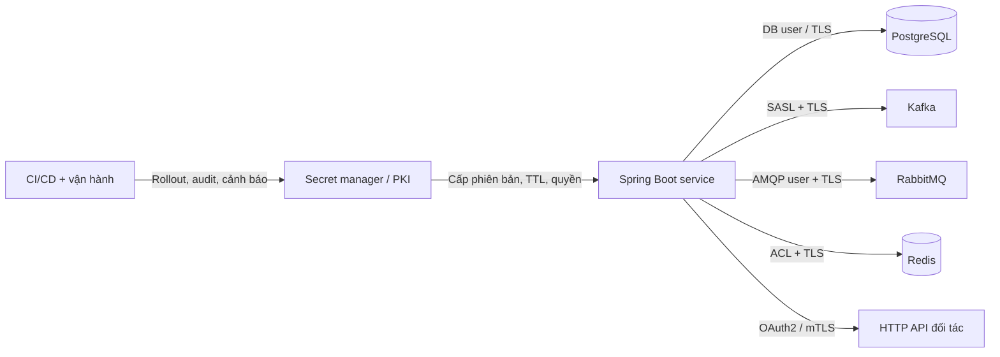
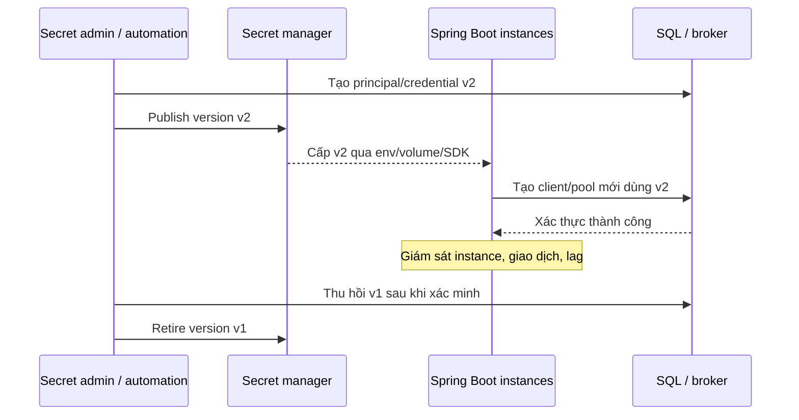

# Quản lý secret, luân chuyển mật khẩu và chứng thư

## 1. Bối cảnh: một kết nối an toàn cần nhiều hơn mật khẩu đúng

Trong mô-đun **SPRING_BOOT_INTEGRATION**, ứng dụng Spring Boot kết nối đến HTTP API, SQL database, Redis, Kafka, RabbitMQ và các adapter của Spring Integration. Mỗi kết nối đều có **danh tính**, **quyền truy cập**, **thông tin xác thực** và đôi khi là **chứng thư TLS**. Nếu đặt mật khẩu cố định trong repository rồi không thay đổi trong nhiều năm, hệ thống dễ gặp rủi ro rò rỉ bí mật, hết hạn chứng thư, không thể thu hồi khóa và gián đoạn khi phải đổi thông tin xác thực.

Chủ đề **“Quản lý secret, luân chuyển mật khẩu và chứng thư”** thuộc chương **“Bảo mật kết nối”** tập trung vào vòng đời các thông tin xác thực và cơ chế cập nhật **trong một hệ thống đang chạy**. Mục tiêu không chỉ là lưu bí mật ở chỗ an toàn, mà còn đảm bảo ứng dụng dùng **đúng phiên bản mới**, những kết nối cũ được thay thế đúng lúc, rollback có giới hạn và có thể chứng minh việc thay khóa không gây mất dữ liệu.

Ví dụ một dịch vụ xử lý đơn hàng:



Một vòng xoay credential có thể ảnh hưởng cả **driver**, **connection pool**, **consumer** và **giao dịch đang xử lý**. Do đó cần phân biệt: *bí mật đã đổi tại kho*, *ứng dụng đã nhận giá trị mới*, *thành phần kết nối đã dùng giá trị mới* và *credential cũ đã bị thu hồi*. Bốn mốc này có thể cách nhau nhiều phút hoặc lâu hơn.

## 2. Nhận diện các loại thông tin cần bảo vệ

| Loại thông tin | Ví dụ | Ai xác minh? | Cách thay thế |
| --- | --- | --- | --- |
| Mật khẩu tài khoản SQL | User/password cho PostgreSQL | Database server | Đổi mật khẩu hoặc đổi sang principal mới, thay pool kết nối |
| SASL credential | SCRAM user/password Kafka | Kafka broker | Cập nhật principal/credential, tạo lại client |
| AMQP credential | User/password RabbitMQ | RabbitMQ broker | Cấp tài khoản/quyền mới, kết nối lại |
| Redis ACL password | User/password của Redis | Redis server | Luân chuyển password hoặc user, reconnect client |
| API key hoặc client secret | HTTP partner, OAuth2 client credentials | API/gateway/authorization server | Cấp secret mới và cập nhật HTTP/OAuth client |
| Access token | OAuth2 bearer token ngắn hạn | Resource server | Đổi token theo expiry, retry 401 có kiểm soát |
| Chứng thư X.509 | Server cert / client cert cho TLS hoặc mTLS | TLS peer | Cấp chứng thư mới, cập nhật key/cert và TLS context |
| CA trust anchor | Root/intermediate CA được tin cậy | TLS client/server | Cập nhật truststore có giai đoạn chồng lấp |
| Khóa riêng | Private key của TLS/mTLS | Chủ sở hữu chứng thư | Sinh khóa mới, giữ quyền truy cập tối thiểu, thu hồi khóa cũ |

**Secret** là thông tin cần giữ kín; **certificate** thường chứa phần công khai của danh tính và chữ ký CA; **private key** đi kèm certificate mới là thành phần cực kỳ nhạy cảm. **Truststore** chứa những CA hoặc chứng thư được tin cậy để xác minh peer, còn **keystore** thường chứa certificate và private key dùng để chứng minh danh tính của chính ứng dụng.

### Ba câu hỏi trước khi triển khai

1. **Ai sở hữu credential?** Đội vận hành, secret manager, cloud IAM, Kafka admin, đối tác HTTP hay ứng dụng?
2. **Thành phần nào giữ bản sao hiện tại?** Biến môi trường, Spring `Environment`, bean `DataSource`, Hikari pool, Kafka client, TLS `SSLContext`, HTTP connection pool?
3. **Làm thế nào để nó thực sự có hiệu lực?** Đổi cấu hình rồi restart, gọi cơ chế reload được hỗ trợ, tạo client/pool mới hay phối hợp với một đợt rollout?

Một ứng dụng có thể nhận notification từ secret manager nhưng vẫn dùng connection cũ nếu pool chưa được thay hoặc kết nối đang tồn tại. Ngược lại, đổi password phía server **trước khi** client sẵn sàng có thể gây một đợt lỗi authentication hàng loạt.

## 3. Nguyên tắc quản lý vòng đời secret

Một giải pháp tốt phải hỗ trợ cả **tạo, phân phối, sử dụng, luân chuyển, thu hồi và kiểm toán**:

| Giai đoạn | Thực hành chính |
| --- | --- |
| Cấp phát | Tạo credential riêng cho ứng dụng và môi trường, scope/quyền tối thiểu, TTL phù hợp |
| Phân phối | Dùng secret manager, workload identity, volume được bảo vệ hoặc kênh provisioning được xác thực |
| Nạp vào ứng dụng | Không hardcode; không log; hạn chế đọc/truyền sang component không cần |
| Sử dụng | Xác thực server TLS, dùng timeout và cơ chế retry/idempotency phù hợp |
| Luân chuyển | Ưu tiên có giai đoạn hai phiên bản cùng hợp lệ nếu backend cho phép; thay client/pool |
| Thu hồi | Loại credential cũ sau khi kiểm chứng mọi instance; xử lý nhanh hơn nếu nghi lộ khóa |
| Kiểm toán | Ghi ai yêu cầu thay, phiên bản (không ghi giá trị), thời điểm rollout, lỗi và kết quả |

**Không xem Base64 là mã hóa.** Kubernetes Secret lưu dữ liệu biểu diễn bằng Base64 trong manifest; muốn bảo vệ dữ liệu còn cần RBAC, bảo vệ etcd/encryption at rest, kiểm soát quyền cấp phát workload và giới hạn truy cập node. Tương tự, biến môi trường tiện cấu hình nhưng vẫn có thể bị lộ qua diagnostic dump, quyền trên host, công cụ quản lý tiến trình hoặc log nếu ứng dụng vô tình in toàn bộ environment.

Thực hành thường dùng:

- Kho chuyên dụng: HashiCorp Vault hoặc cloud secret manager có IAM, audit, version và rotation workflow.
- Cấp cho workload bằng identity thay vì dùng một *bootstrap secret* rộng quyền và sống lâu.
- Bí mật ngắn hạn/dynamic credential nơi backend hỗ trợ, cùng cơ chế renew và xử lý lease expiry.
- Phân quyền theo **service + môi trường + mục đích**; tách quyền đọc secret của ứng dụng khỏi quyền tạo/thu hồi của automation.
- Không đưa secret vào Git, image Docker, artifact WAR/JAR, commit history, URL query, exception message, MDC hoặc tracing tags.
- Quét rò rỉ secret trong CI và có quy trình revoke ngay khi phát hiện, vì xóa dòng khỏi commit mới không làm secret cũ biến mất.

## 4. Nạp secret vào Spring Boot từ môi trường triển khai

Spring Boot hỗ trợ externalized configuration và thứ tự ưu tiên các property sources. Ví dụ **local demo** có thể lấy password qua biến môi trường; file `application.yml` chỉ tham chiếu tên biến:

```yaml
spring:
  datasource:
    url: ${ORDERS_JDBC_URL}
    username: ${ORDERS_DB_USER}
    password: ${ORDERS_DB_PASSWORD}
  rabbitmq:
    host: ${RABBIT_HOST}
    username: ${RABBIT_USER}
    password: ${RABBIT_PASSWORD}
```

Các placeholder trên phải được cấp bởi runtime/CI deployment, không đặt credential thật ngay trong YAML. Cần kiểm tra startup fail rõ ràng khi thiếu giá trị bắt buộc, tránh fallback sang tài khoản dùng chung hoặc môi trường sai.

### Nạp từ mounted files bằng config tree

Trong container/Kubernetes, có thể gắn một volume chứa file secret. Spring Boot hỗ trợ import **configuration tree**, trong đó tên file có thể tương ứng tên property:

```yaml
# application-container.yml
spring:
  config:
    import: "configtree:/run/secrets/orders/"
  datasource:
    url: ${ORDERS_JDBC_URL}
    username: ${ORDERS_DB_USER}
```

Ví dụ thư mục do môi trường chuẩn bị:

```text
/run/secrets/orders/
  spring.datasource.password       # Nội dung: mật khẩu, chỉ đọc bởi tiến trình
```

`configtree:` giúp đọc secret **khi Spring khởi tạo cấu hình**, nhưng **không tự bảo đảm tự động làm mới một bean hoặc pool khi file đổi**. Trên Kubernetes, projected Secret volume thường được cập nhật bất đồng bộ, trong khi secret dùng qua **environment variable** của container không tự đổi khi Secret object cập nhật. Mount qua `subPath` cũng không nhận cập nhật tự động giống projected volume thông thường. Vì vậy phải thiết kế rõ phần **phát hiện thay đổi + reload thành phần + rollout**.

Ở production, đừng dùng tiền tố `optional:` cho một nguồn secret bắt buộc chỉ để che lỗi: bỏ qua việc không tìm thấy nguồn cấu hình có thể khiến ứng dụng dùng credentials không mong muốn hoặc lỗi muộn khi mượn kết nối.

### Tích hợp secret manager

Một nền tảng có thể đưa secret đến ứng dụng theo nhiều mô hình:

| Mô hình | Điểm mạnh | Điều cần lưu ý khi rotate |
| --- | --- | --- |
| CI/CD lấy secret rồi set env lúc khởi động | Đơn giản, tương thích nhiều framework | Muốn cập nhật thường phải rollout/restart |
| Secret manager CSI/sidecar ghi vào volume | Không phải nhúng secret trong image, có thể cập nhật file | Ứng dụng/pool/TLS context vẫn cần reload hoặc restart |
| Spring Cloud Vault / ConfigData integration | Spring có thể lấy cấu hình từ Vault theo cơ chế tích hợp | Phụ thuộc starter/version, lease renewal và refresh semantics cụ thể |
| Cloud SDK lấy secret qua workload identity | Kiểm soát IAM và cache chủ động | Phải thiết kế retry, cache TTL, fail-closed và làm mới client |
| Credentials động gắn lease | Giới hạn thời gian credential bị lộ | Không được tiếp tục dùng secret đã hết lease; cần thay trước expiry |

Không có một cơ chế refresh chung áp dụng cho mọi `DataSource`, `KafkaConsumer`, `RabbitTemplate` và HTTP client. Khi thay version secret, cần phân tích đối tượng giữ secret và hành vi của thư viện tương ứng.

## 5. Quy trình luân chuyển mật khẩu an toàn

Ưu tiên chiến lược **có thời gian chồng lấp**: tạo credential mới vẫn hợp lệ đồng thời với credential cũ, cho ứng dụng chuyển sang mới, xác minh, rồi mới thu hồi cũ. Đổi ngay password của **một tài khoản duy nhất** có thể khiến những kết nối mới từ instance chưa cập nhật bị lỗi, dù connection cũ vẫn tạm sống.



### Các bước thực hiện

1. **Chuẩn bị:** kiểm kê consumer/producer/HTTP client/DB pool, phiên bản secret hiện hành, quyền, expiry và thời gian thay đổi tối đa có thể chấp nhận.
2. **Cấp mới:** tạo principal hoặc secret phiên bản `v2` và cấp **quyền tương đương mức cần thiết**, không thêm quyền quản trị để thử cho nhanh.
3. **Phân phối:** xuất bản `v2` qua secret manager; đặt cơ chế kiểm tra version/metadata, không log giá trị.
4. **Chuyển từng đợt:** rollout một instance/canary, kiểm tra authentication, tạo connection mới, consumer behavior và lỗi transaction.
5. **Mở rộng rollout:** thay toàn bộ client/pool còn dùng `v1`, dành thời gian cho các giao dịch đang chạy kết thúc và connection cũ được đóng.
6. **Xác minh:** đo authentication failures, số instance đã dùng `v2`, connections đang sống, Kafka consumer lag, broker redelivery và HTTP lỗi 401/403.
7. **Thu hồi `v1`:** chỉ sau khi không còn client phụ thuộc và đã kiểm tra rollback plan; nếu khóa bị lộ cần quy trình thu hồi khẩn cấp với ưu tiên an toàn.
8. **Kiểm toán:** lưu mã lần rotate, thời điểm, người/phân hệ phê duyệt, phiên bản, kết quả health check và thời điểm revoke; không lưu plaintext credential.

Không thể suy ra mọi kết nối đang dùng `v2` chỉ từ việc Secret object đã đổi. Việc thu hồi `v1` nên dựa trên **thông tin phiên bản đã deploy + quan sát xác thực thực tế**, và khi khả thi, telemetry của chính backend.

## 6. Database: thay credential và làm mới connection pool

Giả sử Spring Boot dùng `spring-boot-starter-jdbc` hoặc JPA với HikariCP. `HikariDataSource` giữ cấu hình xác thực để **tạo kết nối vật lý mới**. Một connection đang nằm trong pool có thể vẫn làm việc sau khi database đổi mật khẩu tùy cơ chế backend. Đó không phải bằng chứng pool đã chuyển sang password mới.

### Thay user thay vì chỉ đổi password ngay trên một user

Với PostgreSQL, một chiến lược giảm gián đoạn là chuẩn bị `orders_app_v2`, cấp quyền đúng cho schema/table/sequence và kiểm tra login; sau đó rollout ứng dụng sang user mới, cuối cùng thu hồi `orders_app_v1`. Quyền trên database objects cần rà soát cụ thể; cấp quyền database `CONNECT` không mặc nhiên cho phép `SELECT/INSERT/UPDATE` trên toàn bộ bảng.

```text
T0: orders_app_v1 hoạt động; hệ thống ổn định.
T1: cấp orders_app_v2 và quyền tương đương, kiểm thử SQL tối thiểu.
T2: chuyển canary/pool mới sang v2; cả v1 và v2 tạm hợp lệ.
T3: rollout tất cả instance, đóng kết nối cũ có kiểm soát.
T4: kiểm tra transaction và connection metrics.
T5: revoke/disable v1, xác minh không còn login v1.
```

**Đừng thay password trong transaction nghiệp vụ** và kỳ vọng Spring tự đồng bộ credential. Một `DataSource` mới hoặc một pool được reload cần có kế hoạch thay thế phù hợp với cách ứng dụng được cấu hình. Với HikariCP, thay thuộc tính cấu hình không đồng nghĩa tất cả connection vật lý đang tồn tại đã được tạo lại; cần quản lý eviction/retirement và rollback an toàn theo API được hỗ trợ trong phiên bản đang dùng.

Với **JNDI DataSource do Tomcat/application server quản lý**, nơi sở hữu pool và secret là **container**, không phải `spring.datasource.hikari.*` của ứng dụng. Quy trình rotate phải cập nhật tài nguyên JNDI và buộc pool của container dùng credential mới theo cách server hỗ trợ. Nếu app có nhiều datasource, cần theo dõi riêng từng pool và transaction manager để không cập nhật nhầm.

### Ranh giới transaction khi thay pool

Trong một đơn hàng đang xử lý, không nên thay/đóng cứng connection khi transaction chưa hoàn tất. Có thể:

- Dừng tiếp nhận yêu cầu mới trên instance canary, chờ xử lý dở hoàn tất trong khoảng drain hữu hạn.
- Tạo instance với credential mới, kiểm tra health và cho nhận tải.
- Rút instance cũ khỏi load balancer, cho consumer xử lý hết hoặc chuyển partition theo chính sách rebalance, sau đó dừng có kiểm soát.
- Kiểm tra commit/rollback, unique constraint và idempotency trong trường hợp request/record phải thực hiện lại.

Với Kafka/RabbitMQ consumers, việc restart sau rotate có thể dẫn đến **redelivery** do offset chưa commit hoặc ACK chưa gửi. Bảo vệ business side effect bằng inbox/unique event ID trước khi coi quá trình rotation là thành công.

### Mẫu cấu hình DB

```yaml
spring:
  datasource:
    url: ${ORDERS_JDBC_URL}
    username: ${ORDERS_DB_USERNAME}
    password: ${ORDERS_DB_PASSWORD}
    hikari:
      maximum-pool-size: 12
      connection-timeout: 3000
```

Các giá trị Hikari ở đây là **minh họa cho pool do Boot tạo**; kích thước pool phải dựa trên số replica, giới hạn DB và kết quả đo tải. Credential mới được nạp vào instance mới khi rollout; ví dụ này **không khẳng định hot reload**.

## 7. RabbitMQ, Kafka và Redis: password rotation khác gì database?

### RabbitMQ

`spring.rabbitmq.username` và `spring.rabbitmq.password` thường được dùng để mở kết nối AMQP. Nên cấp user mới có đúng vhost/permissions rồi cho ứng dụng reconnect. Việc đổi Secret chỉ trên filesystem không bảo đảm `CachingConnectionFactory` hay các connection đã mở lập tức đổi credentials.

```yaml
spring:
  rabbitmq:
    host: ${RABBIT_HOST}
    port: 5671
    username: ${RABBIT_USERNAME}
    password: ${RABBIT_PASSWORD}
    ssl:
      enabled: true
```

Ví dụ cổng `5671` thường dành cho AMQPS nhưng phải khớp hạ tầng thật. Cần xác minh CA trust và hostname, không tắt kiểm tra certificate để khắc phục nhanh lỗi khi rotate.

Khi rolling restart consumer:

- Những message chưa ACK có thể được phân phối lại; consumer cần idempotent.
- Publisher confirms và consumer acknowledgments là hai loại xác nhận độc lập.
- Phải đo connection failures, queue ready/unacked, redelivery và DLQ.
- Khi thu hồi user cũ, xác minh vhost quyền của user mới và không có node nào đang dùng connection/auth cũ.

### Apache Kafka

Với Kafka SASL/SCRAM qua TLS, client cần danh tính SASL hợp lệ và trust được chứng thư của broker. Cấu hình minh họa:

```yaml
spring:
  kafka:
    bootstrap-servers: ${KAFKA_BOOTSTRAP_SERVERS}
    properties:
      security.protocol: SASL_SSL
      sasl.mechanism: SCRAM-SHA-512
      sasl.jaas.config: 'org.apache.kafka.common.security.scram.ScramLoginModule required username="${KAFKA_USERNAME}" password="${KAFKA_PASSWORD}";'
```

JAAS config có chứa secret sau khi resolve, nên **không in toàn bộ configuration/exception dumps**. Kafka broker phải hỗ trợ cơ chế SASL đã chọn; nếu cluster dùng mTLS hoặc OAuth, cấu hình sẽ khác. Truststore/SSL configuration cũng cần được cấp riêng theo CA của broker. Ví dụ trên chỉ thể hiện authentication, **không mặc định giải quyết trust chain**.

Khi rotate:

1. Cấp principal mới và ACL phù hợp để đọc/ghi đúng topics, consumer group và transactional IDs (nếu có).
2. Đưa secret mới vào cấu hình deployment, tạo client/instance mới với principal mới.
3. Thực hiện rolling restart, theo dõi consumer group rebalance, lag, lỗi authorization và offset.
4. Chỉ xóa principal cũ sau khi xác nhận tất cả producer/consumer và Kafka Streams instances đã chuyển.

**Đổi username/password trong Spring `Environment` không chắc làm KafkaProducer/KafkaConsumer đang tồn tại dùng credential mới**. Hãy xem rotation như một thay đổi vòng đời Kafka client; restart có kiểm soát thường đơn giản và dễ chứng minh hơn khi không có cơ chế refresh được thư viện hỗ trợ rõ ràng.

### Redis

Redis có thể dùng ACL username/password. Với Redis client Lettuce/Jedis, phải kiểm tra cách client giữ connection và có tái xác thực/tạo kết nối mới khi credential đổi hay không. Khi có ACL, có thể cấp một user mới với quyền đúng và rollout dần.

```yaml
spring:
  data:
    redis:
      host: ${REDIS_HOST}
      port: ${REDIS_PORT:6379}
      username: ${REDIS_USERNAME}
      password: ${REDIS_PASSWORD}
      ssl:
        enabled: true
```

Các thuộc tính trên minh họa cấu hình theo hệ Spring Boot 3.x; cần đối chiếu version nếu stack đang dùng khác. Nếu dùng TLS, phải cấu hình trust phù hợp với chứng thư Redis và kiểm chứng hostname. Không mở rộng ACL sang `+@all` hoặc dùng tài khoản admin chỉ để bài thử dễ kết nối.

## 8. HTTP API key, OAuth2 và short-lived token

API key dài hạn, OAuth2 client secret và access token có **vòng đời khác nhau**:

- **API key:** thường rotate bằng cách cấp key mới, chấp nhận cả hai key trong một khoảng ngắn, chuyển client và thu hồi key cũ.
- **OAuth2 client secret:** là bí mật dùng để xin token; thay secret cần phối hợp authorization server và cấu hình client. Các access token đã cấp có thể còn hiệu lực đến expiry tùy chính sách revoke.
- **Access token:** nên có TTL ngắn, được refresh/re-acquire theo token manager; đừng hardcode token vào bean một lần rồi dùng suốt đời ứng dụng.
- **mTLS client certificate:** không dùng header bearer token, nhưng vẫn cần cập nhật certificate, private key và SSL context của HTTP client.

Nếu API trả `401 Unauthorized` sau rotation, kiểm tra identity/secret/token expiry trước khi retry hàng loạt. Không retry vô hạn request không idempotent như tạo thanh toán; sau timeout hoặc 5xx có thể đã có side effect tại API đích. Dùng **idempotency key** ổn định, truy vấn trạng thái hoặc cơ chế đối soát.

Một HTTP client đang chạy có thể giữ connection pool và TLS session. Đổi client certificate ở secret manager **chưa chắc** làm connection đang mở được handshake lại với certificate mới. Cần tạo lại hoặc reload client đúng API của framework, đồng thời thực hiện drain để không ngắt request đang chạy.

## 9. TLS, mTLS, keystore và truststore

TLS giúp **mã hóa đường truyền** và xác minh danh tính server. Với **mTLS**, cả client và server đều cung cấp certificate để bên còn lại xác minh.

```mermaid
sequenceDiagram
    participant C as Spring Boot client
    participant S as API / broker server
    C->>S: TLS ClientHello + SNI
    S-->>C: Chứng thư server + chain
    Note over C: Kiểm tra CA, hostname, hiệu lực, policy
    S-->>C: Yêu cầu client certificate (mTLS)
    C->>S: Client certificate + chứng minh sở hữu private key
    Note over S: Kiểm tra CA, policy và danh tính client
    C<->>S: Kênh TLS đã xác thực
```

| Thành phần | Chức năng | Lưu ý khi rotate |
| --- | --- | --- |
| Server certificate | Chứng minh hostname/danh tính endpoint | SAN phải chứa hostname thực; hạn dùng phù hợp |
| Client certificate | Chứng minh danh tính workload với peer | Server cần tin CA phát hành và ánh xạ đúng quyền |
| Private key | Dùng ký/chứng minh sở hữu khóa công khai | Không xuất private key vào log; bảo vệ file/HSM |
| Certificate chain | Nối leaf certificate tới CA được tin cậy | Cung cấp chain phù hợp, tránh thiếu intermediate |
| Truststore | Danh sách CA/cert được tin | Có thể cần tin cậy CA cũ và mới trong thời gian chuyển tiếp |
| Keystore | Certificate/private key của client hoặc server | Cập nhật đồng bộ key với cert, tránh mismatch |

**PEM** là định dạng biểu diễn thường chứa certificate/key; **PKCS#12** có thể đóng gói certificate, chain và private key. Không phải mọi thư viện tự động reload các file này khi chúng được ghi lại.

### Không tắt xác minh để “sửa” lỗi certificate

Các mẹo như `trustAll`, `InsecureTrustManagerFactory`, tắt hostname verification, bỏ kiểm tra chain hoặc ép truststore chứa certificate bất kỳ tạo lỗ hổng MITM. Khi handshake thất bại, phải chẩn đoán **nguyên nhân đúng**: SAN mismatch, CA mới chưa được tin, chain thiếu intermediate, thời gian hệ thống lệch, certificate hết hạn, EKU/KeyUsage sai, protocol/cipher không tương thích hoặc private key không khớp.

Với cùng một DNS name, certificate mới cần có SAN hợp lệ. Đặt Common Name (CN) đúng nhưng thiếu SAN không đủ cho nhiều TLS client hiện đại. Dùng thời gian/đồng hồ được đồng bộ và giám sát `notBefore`/`notAfter`.

## 10. Spring Boot SSL bundle: tách cấu hình TLS theo kết nối

Ở các phiên bản Spring Boot hỗ trợ **SSL bundles**, có thể mô tả certificate, private key và trust material trong cấu hình ngoài ứng dụng. Ví dụ PEM cho một HTTP client cần xác minh CA đối tác và dùng mTLS:

```yaml
spring:
  ssl:
    bundle:
      pem:
        partner:
          keystore:
            certificate: file:/run/tls/partner/client.crt
            private-key: file:/run/tls/partner/client.key
          truststore:
            certificate: file:/run/tls/partner/ca-chain.crt
```

Đây là ví dụ dành cho Spring Boot có tính năng PEM SSL bundles (phổ biến từ nhánh 3.x); phải xác nhận property support và client integration theo đúng version đang dùng. `client.key` là **private key**, cần mount chỉ đọc với quyền tối thiểu; `ca-chain.crt` chỉ là trust material, không chứa private key.

Một ứng dụng dùng `RestClient` từ Spring Framework 6.1+/Spring Boot 3.2+ có thể áp dụng bundle khi tạo HTTP client:

```java
import org.springframework.boot.autoconfigure.web.client.RestClientSsl;
import org.springframework.context.annotation.Bean;
import org.springframework.context.annotation.Configuration;
import org.springframework.web.client.RestClient;

@Configuration
public class PartnerHttpClientConfig {

    @Bean
    RestClient partnerRestClient(
            RestClient.Builder builder,
            RestClientSsl ssl) {
        return builder
                .baseUrl("https://api.partner.example")
                .apply(ssl.fromBundle("partner"))
                .build();
    }
}
```

Nếu dự án sử dụng `WebClient`, Apache HttpClient hoặc các connector khác, cách áp dụng bundle khác nhau; chỉ khai báo `spring.ssl.bundle.*` **không tự động** làm mọi client dùng bundle đó. Với API certificate validation riêng, cần test handshake bằng đúng client có cấu hình bundle.

### TLS cho HTTP server

Spring Boot embedded server ở phiên bản hỗ trợ có thể tham chiếu SSL bundle riêng:

```yaml
spring:
  ssl:
    bundle:
      pem:
        inbound:
          keystore:
            certificate: file:/run/tls/server/tls.crt
            private-key: file:/run/tls/server/tls.key
          truststore:
            certificate: file:/run/tls/server/client-ca.crt
server:
  port: 8443
  ssl:
    bundle: inbound
    client-auth: need
```

Trong cấu hình này, `client-auth: need` yêu cầu mTLS: client phải có certificate được server tin cậy. Không dùng `need` nếu endpoint dự kiến phục vụ client thông thường không có certificate. Nếu TLS kết thúc ở ingress/load balancer, quyền sở hữu server certificate có thể thuộc **ingress** thay vì Spring Boot container; khi đó rotation cần diễn ra ở ingress và chỉ cấu hình mTLS nội bộ nếu kiến trúc yêu cầu.

### SSL bundle có tự hot reload không?

Một số phiên bản Spring Boot và một số thành phần hỗ trợ tính năng **reload on update** cho PEM SSL bundles hoặc server connectors cụ thể. **Không suy ra hot reload luôn xảy ra** chỉ vì có SSL bundle và file được cập nhật. Cần đối chiếu tài liệu đúng phiên bản Spring Boot, thành phần dùng bundle, điều kiện mount file và thử handshake mới sau cập nhật. Client tự tạo `SSLContext` hoặc giữ pool có thể cần **rebuild** để sử dụng key/trust mới, dù metadata của file đã thay đổi.

Nếu không xác nhận được cơ chế reload end-to-end, chọn **rolling restart với instance mới** thường dễ kiểm soát hơn: chuẩn bị trust mới, deploy client mới, health check, sau đó rút dần client cũ.

## 11. Luân chuyển chứng thư và CA mà không làm đứt TLS

Thay certificate leaf cùng CA có thể đơn giản hơn **đổi CA**. Khi đổi CA, phía **xác minh** phải tin CA mới trước khi phía trình bày certificate chuyển sang certificate mới.

### Kịch bản A: thay certificate cùng CA

1. Kiểm tra SAN, EKU, thời gian hiệu lực và chain của chứng thư mới.
2. Sinh/nhận private key mới qua kênh an toàn; tốt nhất tránh tái sử dụng key không cần thiết.
3. Cập nhật certificate và private key **như một phiên bản logic nhất quán**; không để client đọc cert mới với key cũ.
4. Reload/restart thành phần TLS được hỗ trợ, tạo **kết nối mới** để test handshake.
5. Đo lỗi TLS, xác minh peer nhận đúng certificate và không còn phụ thuộc phiên bản cũ.
6. Thu hồi/xóa key cũ theo policy; nếu certificate cũ bị lộ key, ưu tiên revoke và xử lý sự cố.

### Kịch bản B: đổi từ CA cũ sang CA mới

```text
Giai đoạn 1: Bên xác minh tin CA-OLD + CA-NEW.
Giai đoạn 2: Bên trình bày chuyển certificate do CA-NEW ký.
Giai đoạn 3: Xác minh tất cả instance/client dùng trust + cert mới.
Giai đoạn 4: Bỏ CA-OLD khỏi truststore sau overlap window.
```

Trong mTLS, **hai hướng xác minh độc lập**: client tin server CA, server tin client CA. Khi đổi đồng thời cả hai, phải chuẩn bị trust ở **cả hai bên** trước khi thay certificate để tránh mất kết nối giữa các instance đang luân phiên deploy.

### Giao file certificate an toàn

Với secret mount hoặc sidecar, nên dùng cơ chế cập nhật file **nguyên tử** hoặc đường dẫn versioned, rồi đổi symlink/manifest nhất quán theo cơ chế nền tảng. Không ghi đè trực tiếp private key và certificate lần lượt trong lúc thư viện đang đọc; có thể tạo cửa sổ mà hai file không khớp nhau. Khi cần reload, hãy xác minh key và cert là một cặp trước khi đưa vào runtime.

Giữ private key trong vùng lưu trữ có quyền tối thiểu; không sao chép vào ticket/chat, không đặt trong image hoặc repository, không gửi sang hệ thống observability. Với yêu cầu bảo mật cao, cân nhắc HSM/KMS hoặc managed TLS theo nền tảng và khả năng của server/client.

## 12. Khi rotation đi sai: ma trận nguyên nhân và xử lý

| Dấu hiệu | Nguyên nhân có thể | Cách xử lý |
| --- | --- | --- |
| Sau đổi DB password, request mới lỗi authentication | Pool vẫn tạo connection bằng credential cũ | Xác nhận secret version đã deploy, refresh/recreate pool theo cơ chế hỗ trợ |
| Chỉ một vài replica bị lỗi | Rollout chưa đồng nhất hoặc mount/env ở node khác version | Kiểm tra version metadata trên từng replica, rollout status và quyền đọc secret |
| Kafka consumer lag tăng sau rotate | SASL credential/ACL thiếu, consumer rebalance hoặc client lỗi kết nối | Xem auth/authorization logs, group lag và tiến độ offset |
| RabbitMQ queue unacked tăng | Consumer không kết nối/ACK đúng khi rotate | Kiểm tra connection/channel, redelivery, idempotency và DLQ |
| `SSLHandshakeException` sau đổi cert | Trust chain, SAN, clock, client cert hoặc TLS context cũ | Kiểm tra hostname/CA/EKU/notAfter bằng handshake test |
| TLS chỉ lỗi sau restart | Connection sống cũ che việc truststore mới thiếu CA | Test **kết nối mới** và handshake từ mọi nhóm client |
| Env variable đã đổi ở deployment, process vẫn dùng cũ | Container chưa restart; env đã snapshot khi process chạy | Rolling restart/redeploy với readiness checks |
| File mounted đã đổi, Java vẫn dùng cert cũ | SSLContext/client pool không được reload | Rebuild/reload client hoặc rolling restart |
| API trả 401/403 sau OAuth secret rotation | Client secret không đúng hoặc token/scopes chưa cập nhật | Kiểm tra client auth, token endpoint và scopes; giới hạn retry |
| Hết hạn key cũ gây sự cố muộn | Instance/cron/background job dùng credential v1 bị bỏ sót | Kiểm kê workload, quan sát login version, xử lý job và revoke theo giai đoạn |

Tránh đổ lỗi ngay cho “TLS” khi request thất bại: tách **DNS → TCP → TLS handshake → authentication → authorization → transaction/business operation**. Chỉ khi xác định đúng lớp lỗi mới quyết định thay certificate, đổi secret hay sửa quyền.

## 13. Test rotation bằng môi trường staging

Kiểm thử nên tái hiện đúng thứ tự chuyển phiên bản, vì chạy một lần với credential mới chỉ chứng minh **nó hoạt động ở trạng thái cuối**, chưa chứng minh quá trình chuyển tiếp không gây gián đoạn.

### Bộ tình huống tối thiểu

| Tình huống | Thiết lập | Kết quả cần chứng minh |
| --- | --- | --- |
| Mật khẩu v1 hợp lệ | Tất cả instance dùng v1 | Kết nối và side effect bình thường |
| Cấp v2 song song | Backend chấp nhận cả v1/v2 | v2 kết nối được trước khi thu hồi v1 |
| Canary dùng v2 | Một instance được rollout | New connections xác thực bằng v2; transaction đúng |
| Thu hồi v1 sau rollout | Không còn instance v1 | Không phát sinh authentication failures mới |
| Đổi secret khi DB transaction dài | Có request đang xử lý | Drain/commit/rollback có kiểm soát, không lộ trạng thái dở |
| Restart Kafka/RabbitMQ consumer | Record đang xử lý chưa hoàn tất | Có thể redelivery; idempotency giữ side effect duy nhất |
| Certificate leaf mới cùng CA | Client/server TLS test | Handshake mới thành công, hostname được kiểm chứng |
| CA mới chưa được trust | Client chỉ tin CA cũ | Kết nối thất bại như kỳ vọng, không silently trust-all |
| Cập nhật trust rồi đổi CA | Overlap CA cũ và mới | Handshake với hai phiên bản qua giai đoạn rollout |
| Secret hết hạn/không khả dụng | Secret manager tạm lỗi hoặc lease đã expiry | Hệ thống có cảnh báo, fail-closed phù hợp, recovery an toàn |
| Key/cert mismatch | Test fixture có key không khớp certificate | Startup/reload thất bại rõ ràng, không dùng cấu hình không hợp lệ |

### Bài thử tích hợp Spring Boot

Với `DataSource`, có thể chạy PostgreSQL Testcontainers và hai principal có quyền nghiệp vụ tương đương. Trong mỗi đợt rollout, query qua **instance/pool thực** thay vì chỉ lấy một secret mới từ manager:

```java
import static org.assertj.core.api.Assertions.assertThat;
import javax.sql.DataSource;
import org.junit.jupiter.api.Test;
import org.springframework.beans.factory.annotation.Autowired;
import org.springframework.boot.test.context.SpringBootTest;

@SpringBootTest
class DatabaseConnectionSmokeTest {
    @Autowired DataSource dataSource;

    @Test
    void usesValidDatabaseIdentity() throws Exception {
        try (var connection = dataSource.getConnection()) {
            assertThat(connection.isValid(3)).isTrue();
            assertThat(connection.isReadOnly()).isFalse();
        }
    }
}
```

Đây chỉ là một **smoke test cho connection**, chưa chứng minh credential version hoặc permission chính xác. Trong bài test thực tế cần thêm fixture/SQL kiểm tra current user, quyền thật, rollback và thao tác nghiệp vụ; tuyệt đối không lấy password từ connection rồi ghi log.

### Kiểm chứng TLS từ môi trường test

Từ container/test machine có trust chain tương ứng, dùng lệnh kiểm tra **server TLS**:

```bash
openssl s_client \
  -connect api.partner.example:443 \
  -servername api.partner.example \
  -verify_hostname api.partner.example \
  -verify_return_error </dev/null
```

Nếu dùng private CA, cung cấp CA file đúng trong môi trường kiểm thử bằng `-CAfile`; kiểm tra `Verify return code`, SAN, validity và chain. Lệnh này **không mô phỏng đầy đủ mTLS client authentication** nếu không chỉ định client certificate/key từ test fixture. Để chứng minh mTLS, cần test thông qua client tương ứng hoặc cấu hình certificate thử nghiệm với quyền phù hợp, tránh đưa private key production vào shell history.

Không chỉ test một kết nối đã mở từ trước: **rotation được xác nhận qua handshake mới, tạo connection vật lý mới và đường nghiệp vụ sau rollout**.

## 14. Quan sát, cảnh báo và phản ứng khi bí mật bị lộ

Không ghi giá trị secret vào log; thay vào đó ghi **metadata có giới hạn**:

- Tên service/instance, môi trường, tên resource logic, version ID hoặc fingerprint *không nhạy cảm* của certificate.
- Thời điểm bản mới được nạp, thời điểm kết nối mới thành công, số lần rollback/reconnect và thời điểm thu hồi bản cũ.
- Tỷ lệ authentication failure, TLS handshake failure, connection pool acquisition timeout, Kafka lag, RabbitMQ unacked, Redis authentication failures, HTTP 401/403.
- Số ngày/giờ tới certificate expiry, dynamic credential lease TTL và kết quả refresh.
- Sự kiện audit: ai tạo, đọc, rotate, revoke và thay đổi quyền truy cập; kết hợp alert cho truy cập secret ngoài giờ/phạm vi.

Ví dụ log không chứa secret:

```text
service=orders-api resource=orders-db event=ROTATION_STARTED target=v2
service=orders-api instance=pod-7 event=CONNECTION_READY version=v2
service=orders-api resource=orders-db event=CANARY_PASS version=v2
service=orders-api resource=orders-db event=ROTATION_COMPLETED version=v2
service=orders-api resource=orders-db event=OLD_VERSION_REVOKED version=v1
```

**Lưu ý về fingerprint:** fingerprint công khai của certificate có thể hữu ích khi xác nhận bản mới, nhưng không thay thế xác thực TLS và không nên lấy hash/giá trị suy ra trực tiếp từ password/token rồi phát tán vào hệ thống log.

### Nếu nghi secret bị lộ

Quy trình xử lý khác với luân chuyển định kỳ:

1. Xác định secret/principal, phạm vi quyền, môi trường và nơi bị lộ; khoanh vùng quyền đọc bất thường.
2. Cấp credential thay thế qua kênh đáng tin, ưu tiên vô hiệu hóa nhanh credential cũ dựa trên mức độ rủi ro.
3. Kiểm tra truy cập/audit logs, thao tác trái phép, dữ liệu bị đọc và side effect có thể đã phát sinh.
4. Đưa ứng dụng sang bản mới; khi cần, tạm dừng connector để tránh hoạt động không xác thực hoặc gây tác hại.
5. Thu hồi key/secret/certificate cũ, rà soát tokens và những secrets phái sinh, sửa nguồn gây lộ.
6. Kiểm chứng khả năng phục hồi, lưu incident record và bổ sung ngăn ngừa tái diễn.

Với **private key bị lộ**, giữ cả key cũ và mới cùng hoạt động lâu để tránh downtime có thể không chấp nhận được; cần đánh giá thu hồi certificate và tác động tới peer theo chính sách ứng phó sự cố.

## 15. Những sai lầm thường gặp

1. **Đưa password vào Git rồi chỉ xóa dòng mới:** lịch sử commit, artifact và cache vẫn có thể chứa bí mật.
2. **Base64 hóa là đã an toàn:** Base64 chỉ mã hóa biểu diễn, không cung cấp bí mật.
3. **Đổi secret manager là app tự nhận:** bean/pool/client đang giữ giá trị cũ.
4. **Thu hồi credential cũ trước khi rollout:** connection mới từ instance v1 không xác thực được.
5. **Chỉ test connection đã mở:** không phát hiện cấu hình trust/key mới sẽ lỗi khi reconnect.
6. **Bỏ qua quyền ACL của principal mới:** authentication thành công nhưng authorization vẫn thất bại.
7. **Đổi certificate server trước khi đổi trust của client:** lỗi TLS hàng loạt khi đổi CA.
8. **Tắt hostname verification hoặc trust-all để “sửa nhanh”:** làm mất bảo đảm danh tính peer.
9. **Ghi đè cert và key độc lập trong lúc reload:** có thể đọc một cặp khóa/chứng thư không khớp.
10. **Restart consumer mà thiếu idempotency:** redelivery có thể tạo double charge hoặc event duplication.
11. **Xem DLT/retry là giải pháp cho credential sai:** xác thực lỗi diện rộng cần điều tra và dừng/recover phù hợp, retry vô hạn chỉ gây áp lực.
12. **Không phân biệt token expiry với credential rotation:** token còn hạn và client secret cũ có thể có vòng đời khác nhau.
13. **Quên workload phụ:** batch, scheduled job, worker, migration, consumer và connector phụ vẫn giữ v1.
14. **Không có owner của certificate:** chứng thư hết hạn vào ngày nghỉ rồi mới phát hiện từ lỗi production.

## 16. Bài thực hành tổng hợp

**Bối cảnh:** dịch vụ xử lý đơn hàng dùng PostgreSQL, RabbitMQ, Kafka và HTTP partner có mTLS. Secret manager là nơi cấp secret; Spring Boot lấy cấu hình từ môi trường và file certificate đã mount. Cần rotate DB password và client certificate mà không gây sai lệch nghiệp vụ.

**Yêu cầu thiết kế:**

1. Lập bảng liệt kê credential theo tài nguyên: owner, nơi cấp, version, expiry, permissions, nơi cache và cơ chế reload.
2. Đề xuất quy trình `v1 → v2` cho PostgreSQL với hai principal chồng lấp, canary rollout, drain và revoke.
3. Xác định cách restart Kafka/RabbitMQ consumer để không mất record chưa ACK hoặc offset chưa commit; thiết kế deduplication theo event ID.
4. Thiết lập PEM SSL bundle cho HTTP partner; mô tả thứ tự trust CA mới, cập nhật client cert, kiểm thử handshake và retire CA cũ.
5. Viết runbook xử lý lỗi authentication/TLS sau rollout: phân biệt missing secret, quyền sai, SAN mismatch, pool chưa refresh và private key không khớp.
6. Tạo dashboard theo dõi auth failures, TLS errors, certificate expiry, Kafka lag, RabbitMQ unacked, DB connection pool và request latency.
7. Diễn tập rollback trước khi thu hồi v1, rồi kiểm tra một lần **thu hồi thật** trong staging; ghi nhận xác thực thành công bằng v2 sau khi v1 bị vô hiệu hóa.

### Tiêu chí chấp nhận

| Bằng chứng | Kết quả mong đợi |
| --- | --- |
| Cấu hình ứng dụng | Không chứa plaintext credential; secret cấp từ đúng nguồn và phạm vi |
| Canary mới | SQL, broker và HTTP tạo **kết nối mới** thành công với v2 |
| Transaction | Không commit dở dang và không tạo side effect trùng khi restart/retry |
| Certificate | Handshake TLS/mTLS thành công; hostname/chain và identity được xác minh |
| Thu hồi v1 | Không còn instance/job dùng v1; không tăng authentication failures |
| Quan sát | Có tín hiệu rõ tại từng mốc và alert trước expiry/lease failure |
| Rollback/incident | Có điều kiện rollback trước khi revoke; có quy trình khẩn cấp nếu secret bị lộ |

## 17. Câu hỏi tự kiểm tra

1. Vì sao việc cập nhật Secret trong Kubernetes không mặc nhiên thay password mà `HikariDataSource` đang dùng?
2. Sự khác nhau giữa **secret đã phân phối**, **bean đã refresh** và **kết nối thực đã xác thực bằng secret mới** là gì?
3. Khi đổi database password, vì sao tạo principal `v2` thường ít gián đoạn hơn đổi password ngay trên một user?
4. Vì sao việc restart Kafka consumer trong quá trình rotation đòi hỏi idempotency ở database?
5. Trong mTLS, vì sao phía server và phía client phải phối hợp **trust** trước khi thay certificate?
6. `keystore` và `truststore` khác nhau thế nào? Private key có nên nằm trong truststore không?
7. Tại sao một certificate có CN đúng nhưng SAN sai vẫn có thể gây `SSLHandshakeException`?
8. Trường hợp nào chọn hot reload, trường hợp nào nên rolling restart?
9. Làm sao chứng minh credential cũ đã được thu hồi mà không gây gián đoạn các workload còn lại?
10. Khi private key bị lộ, chiến lược thu hồi khác gì so với rotation định kỳ?

## Tổng kết

Quản lý secret và luân chuyển mật khẩu/chứng thư là một **quy trình thay đổi danh tính kết nối**, không chỉ là thao tác sửa cấu hình. Trong Spring Boot, secret có thể đến từ environment, mounted files, secret manager hoặc JNDI/container; từng SQL pool, Kafka/RabbitMQ client, Redis connection và HTTP TLS context có cơ chế nạp lại khác nhau. Một rotation đáng tin cậy cần cấp credential mới có quyền đúng, kiểm chứng kết nối thực tế, rollout có chồng lấp khi cho phép, giữ an toàn transaction và idempotency, sau đó thu hồi credential cũ. Với TLS/mTLS, cần phối hợp **certificate + private key + trust chain**, xác minh hostname và triển khai trust theo đúng thứ tự. Cảnh báo expiry, audit và diễn tập recovery giúp hệ thống tích hợp vận hành an toàn dài hạn.

### Tài liệu tham khảo

- [Spring Boot Reference — Externalized Configuration](https://docs.spring.io/spring-boot/reference/features/external-config.html)
- [Spring Boot Reference — SSL](https://docs.spring.io/spring-boot/reference/features/ssl.html)
- [Spring Boot Reference — SQL Databases](https://docs.spring.io/spring-boot/reference/data/sql.html)
- [Spring for Apache Kafka Reference](https://docs.spring.io/spring-kafka/reference/)
- [Spring AMQP Reference](https://docs.spring.io/spring-amqp/reference/)
- [Kubernetes — Secrets](https://kubernetes.io/docs/concepts/configuration/secret/)
- [OWASP — Secrets Management Cheat Sheet](https://cheatsheetseries.owasp.org/cheatsheets/Secrets_Management_Cheat_Sheet.html)
