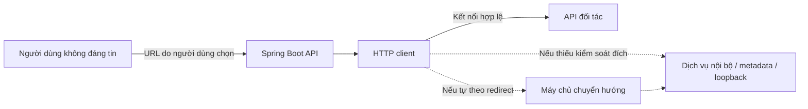
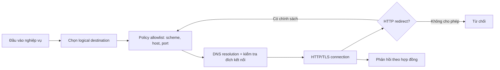
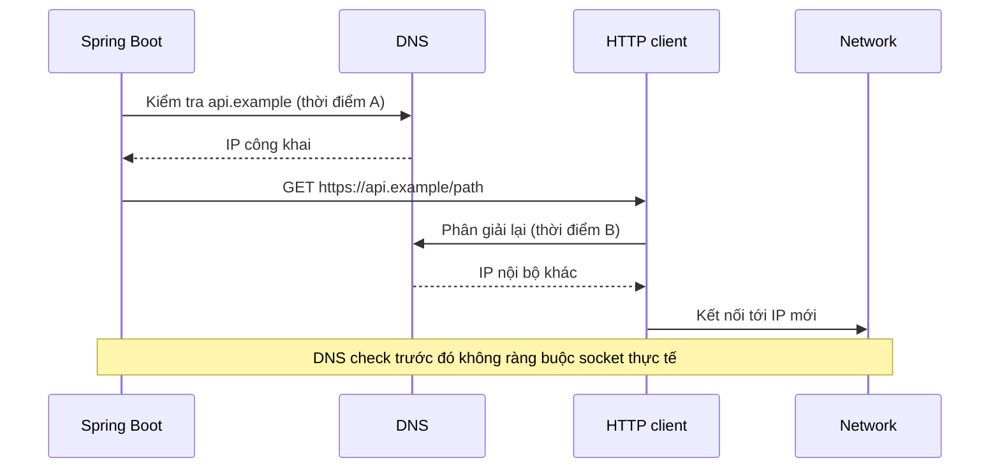

# Giới hạn địa chỉ đích, chuyển hướng và nguy cơ SSRF

> **Chương:** Bảo mật kết nối  
> **Phạm vi:** `SPRING_BOOT_INTEGRATION` — tích hợp hệ thống trong Spring Boot qua HTTP client, cơ sở dữ liệu, cache, broker thông điệp và các adapter Spring Integration. Bài này tập trung vào **điểm xuất phát của kết nối HTTP**, hợp đồng dữ liệu đầu vào, cấu hình, xử lý lỗi, kiểm thử và khả năng quan sát để phòng ngừa Server-Side Request Forgery (SSRF).

Một ứng dụng Spring Boot có thể cần gọi API đối tác, tải tài liệu từ URL, kiểm tra webhook, lấy ảnh đại diện hoặc chuyển tiếp yêu cầu tới một dịch vụ. Nếu người gọi có thể điều khiển **máy chủ đích** mà backend kết nối đến, một chức năng tích hợp tưởng như hợp lệ có thể trở thành cổng truy cập mạng nội bộ. Đó là vấn đề cốt lõi của **Server-Side Request Forgery (SSRF)**.

Phòng vệ SSRF không dừng ở việc kiểm tra chuỗi `https://` trong URL. Cần xác định **đích nào được phép gọi**, **IP nào thực sự được kết nối**, **chuyển hướng có được theo hay không**, **thông tin xác thực có bị gửi sai nơi không**, và **hệ thống mạng có chặn được kết nối không hợp lệ dù ứng dụng bị qua mặt**.

## 1. Mục tiêu học tập

Sau bài này, bạn có thể:

1. Giải thích SSRF trong luồng tích hợp Spring Boot và phân biệt nó với lỗi CORS hoặc thiếu xác thực ở API bên ngoài.
2. Nhận diện các nguồn đầu vào có thể ảnh hưởng đến destination của `RestClient`, `WebClient`, thư viện tải file và adapter HTTP.
3. Thiết kế **allowlist đích đến** theo định danh nghiệp vụ, scheme, hostname và port; tránh kiểm tra hostname bằng phép so khớp chuỗi không an toàn.
4. Hiểu cách redirect, DNS rebinding, nhiều địa chỉ IPv4/IPv6 và connection pooling làm thay đổi đích kết nối thực tế.
5. Cấu hình HTTP client Spring không tự động theo redirect, đồng thời giữ URL gốc và đường dẫn do backend kiểm soát.
6. Thiết kế phòng thủ nhiều lớp: application policy, DNS/connection policy, proxy/egress firewall, quyền của workload, timeout và logging.
7. Kiểm thử hành vi bị từ chối, chuỗi redirect và lỗi phân giải địa chỉ mà không cần gọi đến địa chỉ nội bộ nhạy cảm trong môi trường thật.

## 2. SSRF xuất hiện như thế nào?

Giả sử ứng dụng có API tải ảnh từ URL người dùng cung cấp:

```text
GET /api/images/preview?url=https://images.example.com/avatar.png
```

Nếu backend triển khai kiểu:

```java
// Không an toàn: userUrl quyết định hoàn toàn endpoint backend sẽ kết nối.
String preview(String userUrl) {
    return RestClient.create()
        .get()
        .uri(userUrl)
        .retrieve()
        .body(String.class);
}
```

Kẻ tấn công có thể thay `userUrl` bằng một địa chỉ mà **trình duyệt của họ không truy cập được nhưng server có thể**: một dịch vụ chỉ mở trong private network, loopback của container, endpoint quản trị, hoặc địa chỉ metadata của môi trường cloud. Đây là request được thực hiện **từ vị trí mạng của server**, nên quyền truy cập mạng của server trở thành yếu tố tấn công.



SSRF có thể gây ra nhiều hậu quả, tùy quyền mạng và quyền truy cập của ứng dụng:

- **Đọc dữ liệu:** lấy phản hồi từ endpoint nội bộ hoặc thông tin cấu hình mà ứng dụng không có lý do truy cập.
- **Thực hiện hành động:** gửi request đến dịch vụ quản trị, nội bộ hoặc hệ thống có side effect dù người bên ngoài không được phép kết nối trực tiếp.
- **Khảo sát mạng:** dùng status code, thời gian phản hồi hoặc sự khác biệt lỗi để suy luận dịch vụ/port đang mở.
- **Làm lộ credential:** gửi header `Authorization`, token, cookie hoặc header nội bộ sang đích không được ủy quyền.
- **Tạo chi phí/từ chối phục vụ:** buộc server tải tài nguyên lớn, đợi kết nối rất lâu hoặc thực hiện quá nhiều request ngoài dự kiến.

Một SSRF có thể là **blind SSRF**: kẻ tấn công không thấy trực tiếp response body nhưng vẫn kích hoạt được request, thu thập tín hiệu qua thời gian, callback hoặc tác dụng phụ. Vì vậy “API không trả nội dung phản hồi” không tự loại bỏ rủi ro.

### 2.1. SSRF có thể đi vào hệ thống qua đâu?

| Nguồn đầu vào | Ví dụ | Ranh giới cần kiểm tra |
|---|---|---|
| Query/body HTTP | `url`, `callbackUrl`, `imageUrl` | Người dùng có thể thay hostname, port, scheme và đường dẫn. |
| Webhook/callback | Endpoint khách hàng đăng ký để nhận sự kiện | Một khách hàng có thể khai báo đích nội bộ hoặc thay đổi DNS sau khi đăng ký. |
| Message từ broker | JSON chứa `documentUrl` hoặc `endpoint` | Message đến từ broker không có nghĩa dữ liệu bên trong đáng tin; producer có thể bị ảnh hưởng. |
| Bản ghi database/cache | URL do người dùng lưu từ trước | Truy vấn DB không làm sạch hoặc xác thực URL tự động. |
| Header/redirect | `Location` từ server bên ngoài, host header do client nhập | Đích được chuyển tiếp hoặc chuyển hướng có thể nằm ngoài allowlist ban đầu. |
| Cấu hình có thể thay đổi | Base URL lấy từ giao diện quản trị, feature flag | Cần phân quyền thay đổi và kiểm tra trước khi cấu hình có hiệu lực. |
| HTTP adapter/gateway | Dynamic URI trong Spring Integration | Dữ liệu message header không đáng tin không được quyết định toàn bộ URI đích. |

**Điểm mấu chốt:** nguồn dữ liệu có thể là HTTP request, message JMS/Kafka, cache hoặc database; độ tin cậy phụ thuộc **ai kiểm soát giá trị cuối cùng**, không phụ thuộc kênh truyền tải.

## 3. Mô hình ranh giới tin cậy của kết nối

Để kiểm soát SSRF, phân biệt ba thành phần:

1. **Destination policy:** dịch vụ nghiệp vụ nào được phép liên lạc, qua scheme/host/port nào.
2. **Connection decision:** sau DNS và redirect, socket thực tế kết nối đến IP nào; địa chỉ đó có được chấp thuận không.
3. **Request authority:** credential, method, body và header nào được phép gửi tới destination đó.

Một URL đi qua nhiều bước:



Với một đối tác cố định, giải pháp đơn giản và mạnh nhất là **không để đầu vào không đáng tin xác định URL tuyệt đối**. Thay vì nhận `https://...`, API chỉ nhận `partnerId`, `orderId` hoặc loại tài liệu; backend ánh xạ nó đến endpoint đã phê duyệt.

## 4. Giới hạn đích bằng allowlist cụ thể

### 4.1. Ưu tiên định danh nghiệp vụ thay cho URL

Thiết kế tốt:

```json
{
  "partner": "WAREHOUSE_A",
  "orderId": "ORD-10027"
}
```

Backend lấy `WAREHOUSE_A` từ registry/config do tổ chức kiểm soát:

| Logical destination | Scheme | Host | Port | Đường dẫn cho phép |
|---|---|---|---|---|
| `WAREHOUSE_A` | HTTPS | `api.warehouse-a.example` | 443 | `/v1/orders/{id}` |
| `CATALOG_B` | HTTPS | `catalog-b.example` | 443 | `/v2/items/{sku}` |

Ở đây người dùng kiểm soát **giá trị dữ liệu** như `orderId`, còn backend kiểm soát **origin**, method và API path template. Khi cần thêm đối tác, cập nhật cấu hình có xét duyệt và triển khai chính sách mạng tương ứng.

Thiết kế dễ rủi ro:

```json
{
  "targetUrl": "https://some-host.example/v1/orders/ORD-10027"
}
```

Nếu API buộc phải nhận URL đầy đủ, cần một chính sách chấp thuận riêng (phần 6) và thường phải dùng egress proxy có kiểm soát. Không nên mở tính năng “fetch bất kỳ URL công khai nào” chỉ vì muốn cho người dùng chọn ảnh hoặc tài liệu linh hoạt.

### 4.2. So khớp allowlist theo origin

**Origin** thường được xét theo bộ ba `scheme + host + port`. Ví dụ chính sách chỉ cho phép `https://api.partner.example:443`:

| URL thử nghiệm | Chấp thuận? | Lý do |
|---|---|---|
| `https://api.partner.example/v1/orders/42` | Có, khi path phù hợp | Host, scheme và port đúng. |
| `http://api.partner.example/v1/orders/42` | Không | HTTP không được chấp thuận; có thể lộ dữ liệu trên đường truyền. |
| `https://api.partner.example:8443/v1/orders/42` | Không | Port 8443 không nằm trong policy. |
| `https://api.partner.example.attacker.invalid/v1/orders/42` | Không | Đây là hostname khác. |
| `https://attacker.invalid/?next=api.partner.example` | Không | Host thật là `attacker.invalid`; chuỗi allowlist chỉ nằm trong query. |
| `https://api.partner.example@attacker.invalid/x` | Không | Phần trước dấu `@` là userinfo, không phải hostname thật. |
| `https://127.0.0.1/x` | Không | Không phải đích được cấp phép; còn là loopback. |
| `https://[::1]/x` | Không | Loopback IPv6. |

Không dùng:

```java
// SAI: chỉ kiểm tra chuỗi con/suffix tùy ý.
if (rawUrl.contains("partner.example")) { ... }
if (rawUrl.startsWith("https://")) { ... }
if (rawUrl.endsWith(".example")) { ... }
```

Lý do: URL có cấu trúc, không thể xác định authority an toàn bằng phép tìm chuỗi. Một chính sách cho phép cả subdomain cần quy tắc ranh giới nhãn DNS rõ ràng, kiểm soát việc tạo subdomain và nguy cơ subdomain takeover. Với endpoint đối tác cố định, **danh sách hostname chính xác** dễ bảo vệ và kiểm thử hơn wildcard.

### 4.3. Đừng đưa host/port vào URL template do người dùng chọn

Trong Spring, `RestClient` hoặc `WebClient` có `baseUrl` không có nghĩa mọi lời gọi đều bị khóa vào base URL. Khi mã truyền một **URI tuyệt đối** vào `uri(...)`, client có thể gọi origin khác.

```java
// Rủi ro: rawUserUrl có thể là URI tuyệt đối, ghi đè mục tiêu mong muốn.
client.get().uri(rawUserUrl).retrieve().body(String.class);

// An toàn hơn: origin và path template cố định, chỉ giá trị path do caller cung cấp.
client.get()
    .uri(builder -> builder.pathSegment("v1", "orders", "{id}").build(orderId))
    .retrieve()
    .body(String.class);
```

Giá trị `orderId` cũng cần validation theo hợp đồng nghiệp vụ (độ dài, ký tự, định dạng). Dùng URI template/path segment để framework encode tham số; không nối chuỗi thành path, query hoặc URL rồi tự đoán trường hợp ký tự đặc biệt.

## 5. Cấu hình Spring HTTP client với redirect bị tắt

Ví dụ Spring Boot có `RestClient` (Spring Framework 6.1 trở lên). Với lời gọi API đối tác cố định, tạo client riêng và yêu cầu JDK HTTP client **không tự theo redirect**.

```java
import java.net.http.HttpClient;
import java.time.Duration;

import org.springframework.beans.factory.annotation.Qualifier;
import org.springframework.context.annotation.Bean;
import org.springframework.context.annotation.Configuration;
import org.springframework.http.ResponseEntity;
import org.springframework.http.client.JdkClientHttpRequestFactory;
import org.springframework.stereotype.Service;
import org.springframework.web.client.RestClient;

@Configuration(proxyBeanMethods = false)
class PartnerClientConfiguration {
    @Bean
    RestClient warehouseRestClient(RestClient.Builder builder) {
        HttpClient jdkClient = HttpClient.newBuilder()
            .connectTimeout(Duration.ofSeconds(2))
            .followRedirects(HttpClient.Redirect.NEVER)
            .build();

        var requestFactory = new JdkClientHttpRequestFactory(jdkClient);
        requestFactory.setReadTimeout(Duration.ofSeconds(4));

        return builder
            .baseUrl("https://api.warehouse-a.example")
            .requestFactory(requestFactory)
            .build();
    }
}

@Service
class WarehouseApiClient {
    private final RestClient client;

    WarehouseApiClient(@Qualifier("warehouseRestClient") RestClient client) {
        this.client = client;
    }

    String getOrder(String orderId) {
        ResponseEntity<String> response = client.get()
            .uri(builder -> builder.pathSegment("v1", "orders", "{id}")
                .build(orderId))
            .retrieve()
            .toEntity(String.class);

        if (response.getStatusCode().is3xxRedirection()) {
            throw new IllegalStateException("Unexpected warehouse redirect");
        }
        return response.getBody();
    }
}
```

Mã ví dụ cố định destination và không để `orderId` quyết định host, scheme hoặc port. Trong production, cấu hình endpoint nên lấy từ nguồn cấu hình **đáng tin cậy** và được xác thực khi khởi động; ví dụ hardcode giúp nhìn rõ ranh giới. `retrieve()` thường ném exception với nhiều phản hồi lỗi `4xx/5xx`, cần phân loại riêng theo hợp đồng API. Không log toàn bộ URL, request body hoặc header nếu chúng có credential hay dữ liệu nhạy cảm.

Điểm quan trọng trong ví dụ là `HttpClient.Redirect.NEVER`. Nếu chuyển sang request factory khác (Apache HttpClient, Reactor Netty, OkHttp...), hãy kiểm tra chính sách redirect riêng của implementation đó; không giả định mọi client và mọi phiên bản đều có cùng mặc định.

### 5.1. Trường hợp dùng WebClient

Với ứng dụng WebFlux, có thể cấu hình Reactor Netty HTTP client tương tự:

```java
import java.time.Duration;
import org.springframework.context.annotation.Bean;
import org.springframework.http.client.reactive.ReactorClientHttpConnector;
import org.springframework.web.reactive.function.client.WebClient;
import reactor.netty.http.client.HttpClient;

@Bean
WebClient warehouseWebClient(WebClient.Builder builder) {
    HttpClient netty = HttpClient.create()
        .followRedirect(false)
        .responseTimeout(Duration.ofSeconds(4));

    return builder
        .baseUrl("https://api.warehouse-a.example")
        .clientConnector(new ReactorClientHttpConnector(netty))
        .build();
}
```

`followRedirect(false)` làm rõ ý định đối với phản hồi 3xx. Với WebClient, `baseUrl` cũng **không phải security boundary**: đừng lấy một URL tuyệt đối do người dùng nhập rồi chuyển thẳng vào `uri(...)`. Cần timeout kết nối, tổng thời gian request, TLS trust hợp lệ và resource limit thích hợp với workload thực tế.

## 6. Nếu bắt buộc nhận URL động, cần kiểm tra những gì?

Có những yêu cầu thật sự cần nhận URL động, ví dụ dịch vụ lấy dữ liệu từ nhiều website hoặc nền tảng webhook do khách hàng đăng ký. Khi đó một allowlist cố định có thể không đáp ứng chức năng. Chính sách cần chặt hơn ở **cả giai đoạn nhận URL và giai đoạn tạo kết nối**.

### 6.1. Kiểm tra cấu trúc URI trước khi dùng

- Parse bằng thư viện URI có hiểu scheme/authority/host/port, ví dụ `java.net.URI`; reject cú pháp mơ hồ, URI không tuyệt đối khi giao diện yêu cầu URL tuyệt đối.
- Chỉ cho phép scheme cần thiết, thường `https`. Không hỗ trợ tùy tiện `file:`, `jar:`, `ftp:` hoặc các scheme khác vì chúng có semantics và bề mặt tấn công riêng.
- Từ chối `userinfo` trong URI và fragment không cần thiết; không chấp nhận URL chứa credential hoặc token trong query nếu contract không cho phép.
- Chuẩn hóa hostname theo chính sách (DNS case-insensitive, IDN/Punycode khi cần), xác thực port cụ thể, và **so khớp host đã parse**. Không kiểm tra substring.
- Xác định rõ các IP literal có được hỗ trợ không. Nhiều hệ thống nên từ chối IP literal và chỉ cho phép hostname được đăng ký/kiểm soát.
- Giới hạn kích thước URL, độ dài path/query, method, kiểu nội dung, kích thước body/response và tổng thời gian xử lý.

Ví dụ về một **lớp kiểm tra origin cố định** trong Java; nó chỉ minh họa allowlist đầu vào, chưa bảo đảm IP kết nối cuối cùng:

```java
import java.net.URI;
import java.util.Locale;

final class PartnerOriginPolicy {
    private PartnerOriginPolicy() {}

    static URI requireAllowed(URI destination) {
        if (destination == null
                || destination.isOpaque()
                || destination.getRawUserInfo() != null
                || destination.getRawFragment() != null
                || destination.getHost() == null) {
            throw new IllegalArgumentException("Invalid destination URI");
        }

        String scheme = destination.getScheme();
        String host = destination.getHost().toLowerCase(Locale.ROOT);
        int port = destination.getPort() == -1 ? 443 : destination.getPort();

        if (!"https".equalsIgnoreCase(scheme)
                || !"api.warehouse-a.example".equals(host)
                || port != 443) {
            throw new SecurityException("Destination not permitted");
        }

        return destination;
    }
}
```

Ví dụ trên loại bỏ nhiều trường hợp thay origin, nhưng nó **không thay thế cấu hình client cố định** và không phải bộ lọc URL Internet tổng quát. Một hệ thống nhận URL bất kỳ còn phải xử lý dạng hostname quốc tế, host có dấu chấm cuối, IP biểu diễn bất thường, DNS, proxy và redirect theo policy chặt hơn. Với tích hợp đối tác cố định, thường nên **không nhận URL động** ngay từ thiết kế API.

### 6.2. Kiểm tra IP thực tế, không chỉ hostname

Ngay cả khi hostname được chấp thuận, DNS có thể trả địa chỉ ngoài dự kiến:

- IPv4 loopback `127.0.0.0/8`, private `10.0.0.0/8`, `172.16.0.0/12`, `192.168.0.0/16`.
- Link-local `169.254.0.0/16`, gồm các địa chỉ được một số môi trường dùng cho metadata; địa chỉ không định tuyến ra Internet nhưng có thể truy cập từ workload.
- IPv6 loopback `::1`, link-local `fe80::/10`, unique-local `fc00::/7`.
- Các địa chỉ không phải đích Internet hợp lệ cho ứng dụng: unspecified, multicast, địa chỉ dành riêng/special-use, các dải định tuyến nội bộ khác theo môi trường.
- Đích private được công bố qua DNS của cluster, service discovery, split-horizon DNS hoặc service mesh.

Danh sách này chỉ là **ví dụ minh họa**, không phải bộ nhận diện đầy đủ địa chỉ public. Còn phải xét IPv4-mapped IPv6, NAT, dải địa chỉ đặc biệt khác và chính sách riêng của tổ chức. Chỉ dựa vào `InetAddress.isSiteLocalAddress()` hay `isLoopbackAddress()` không đủ để phủ hết các địa chỉ không được phép kết nối.

**DNS rebinding / time-of-check to time-of-use (TOCTOU):** ứng dụng có thể kiểm tra DNS tại thời điểm A, thấy IP hợp lệ, nhưng HTTP client phân giải lại khi kết nối tại thời điểm B và nhận IP khác. Nếu ứng dụng **kiểm tra một IP rồi kết nối theo hostname mà không ràng buộc hai hành động**, bước kiểm tra đó có thể bị bỏ qua.



Với endpoint động, **điểm thực thi kết nối** phải thực sự áp dụng policy: một egress proxy có khả năng kiểm tra DNS/IP tại lúc kết nối, hoặc một HTTP transport được thiết kế để chỉ nối tới địa chỉ đã được thẩm định và không tự resolve lại ngoài kiểm soát. Phải xét **tất cả** địa chỉ A/AAAA có thể được lựa chọn, mọi lần retry, connection pool, proxy và redirect. Việc tự phân giải rồi gửi `Host` header/TLS SNI thủ công có thể phá xác thực TLS hoặc gây bypass; không dùng như một “mẹo sửa” vội.

Nếu cấu hình mạng cho phép truy cập các endpoint nội bộ cần thiết (database, service discovery), cần cấp quyền **theo từng workload**. Một service chuyên tải URL bên ngoài nên có quyền egress nhỏ hơn service nghiệp vụ nội bộ.

## 7. Redirect là một lần ra quyết định về đích mới

HTTP `3xx` có thể kèm `Location` yêu cầu client đi tới URL khác. Nguy cơ không chỉ nằm ở URL ban đầu:

1. Người dùng nhập URL có vẻ được phép.
2. Máy chủ ngoài trả `302 Found` hoặc `307 Temporary Redirect` với `Location` trỏ sang đích khác.
3. HTTP client tự động đi tiếp, vô tình kết nối tới địa chỉ ngoài allowlist.

Ví dụ mô tả:

```text
Ứng dụng được phép gọi:
  https://api.warehouse-a.example/order-status/42

Server trả:
  HTTP/1.1 302 Found
  Location: http://internal-service.invalid/admin

Nếu client tự theo Location:
  URL được kiểm tra ban đầu không còn là đích cuối cùng.
```

Tên hostname trong ví dụ là tên minh họa; không cần truy cập endpoint thực để kiểm thử logic. Điều phải xác thực là **response 3xx không làm client kết nối sai đích**.

### 7.1. Chính sách redirect khuyến nghị

**Với API server-to-server cố định:** mặc định **không tự theo redirect**. Khi API đối tác bất ngờ đổi địa chỉ, cần cập nhật registry/config sau khi xác nhận, thay vì mù quáng theo mọi `Location`.

**Nếu nghiệp vụ bắt buộc theo redirect:** triển khai xử lý thủ công hoặc HTTP transport có hook kiểm soát chặt; mỗi hop phải được:

- Resolve `Location` tương đối theo URI hiện tại theo semantics HTTP/URI, rồi parse và áp dụng **đầy đủ** policy scheme/host/port, IP và TLS như request đầu tiên.
- Chấp thuận đúng origin hoặc một tập origin cụ thể được ủy quyền; nếu không có hợp đồng rõ, chỉ cho phép same-origin.
- Giới hạn số hop (ví dụ 2–3 lần), phát hiện vòng lặp và giữ deadline chung cho toàn chuỗi.
- Không chuyển `Authorization`, cookie, API key hay header nhạy cảm sang origin khác; mỗi origin có tập credential riêng và cần chính sách explicit. Không dựa vào hành vi tự xóa header mặc định của client.
- Xem lại method/body: `301`/`302`/`303` và `307`/`308` có ngữ nghĩa redirect khác nhau; không tự phát lại POST chứa dữ liệu nhạy cảm hoặc tạo tác dụng phụ không idempotent.
- Không cho chuyển từ HTTPS xuống HTTP (downgrade) khi đang xử lý dữ liệu cần bảo mật.

**Nhận diện đủ dạng `Location`:** có thể là URI tuyệt đối, đường dẫn tương đối, hoặc URL dạng `//host/path` mượn scheme hiện tại. Regex chỉ tìm `http://` thường bỏ lọt trường hợp thứ ba.

### 7.2. Redirect còn gây rò rỉ credential

Một client gọi đối tác bằng bearer token có thể nhận redirect sang một host khác. Nếu policy cho phép client tự theo và gửi nguyên header, token có thể đi sai nơi. Kể cả thư viện HTTP mặc định hạn chế forward header nhạy cảm, **quyết định cấp credential phải ràng buộc với origin đã được cấp phép**. Trong trường hợp nhiều đối tác, dùng client/credential riêng cho từng destination.

Không đưa access token vào query string để “dễ redirect”, vì URL có thể xuất hiện trong log, history, gateway, monitoring hay `Referer` ở các ngữ cảnh phù hợp.

## 8. Phòng thủ nhiều lớp ngoài mã Java

Không có bộ lọc đầu vào nào thay thế hoàn toàn chính sách mạng, đặc biệt khi ứng dụng cho phép URL động và DNS có thể đổi sau khi kiểm tra.

| Lớp | Biện pháp | Vai trò |
|---|---|---|
| Thiết kế API | Người dùng chỉ chọn `partnerId`/resource ID thay vì URL tự do | Loại bỏ quyền điều khiển host ở tầng nghiệp vụ. |
| Application | Allowlist origin; URI parser; path/query validation; redirect mặc định tắt | Chặn yêu cầu sai đích trước khi tạo request. |
| HTTP transport | Thực thi policy ở bước kết nối thực tế, timeout, TLS validation, kiểm soát proxy | Bảo vệ trước DNS/IP thay đổi và redirect ngoài dự kiến. |
| Network egress | Firewall, Kubernetes NetworkPolicy/CNI, security group, egress gateway/proxy | Giới hạn máy chủ nào workload có thể liên lạc ngay cả khi application có bug. |
| Cloud metadata | Chặn truy cập metadata từ workload không cần; dùng cơ chế bảo vệ metadata do nền tảng hỗ trợ | Giảm thiểu khả năng truy cập credential/metadata nội bộ. |
| Identity | Service account/token quyền tối thiểu, credential riêng theo đối tác | Giảm tác động khi request sai đích hoặc token bị lộ. |
| Quan sát | Log quyết định policy, số request bị từ chối, đích kết nối và redirect | Phát hiện cấu hình lỗi, probing và tấn công. |
| Kiểm thử | Test URL, redirect, DNS race, egress policy trong môi trường cô lập | Chứng minh policy hoạt động đến ranh giới kết nối. |

**Chú ý:** `NetworkPolicy` trong Kubernetes chỉ có tác dụng khi plugin mạng thực sự thực thi chính sách đó; một rule L3/L4 không nhất thiết hiểu hostname hoặc chặn DNS rebinding. Egress policy theo domain có thể được triển khai qua proxy/gateway hay tính năng CNI cụ thể; cần xác nhận semantics sản phẩm đang dùng. Không coi “đã thêm YAML policy” là bằng chứng kết nối trái phép đã bị chặn.

Khi service gọi database, cache, broker hoặc Spring Integration adapter nội bộ, hãy tách danh sách egress cần thiết khỏi quyền tải URL bên ngoài. Một pod phải truy cập DB nội bộ không đồng nghĩa nó cũng nên có khả năng fetch URL tùy ý do người dùng cung cấp.

## 9. Liên hệ với Spring Integration, message broker và webhook

SSRF trong module tích hợp không chỉ nằm ở REST controller.

### 9.1. Header message không phải nguồn chính sách đáng tin

Một flow có thể nhận message:

```json
{
  "orderId": "ORD-10027",
  "callbackUrl": "https://somewhere.example/callback"
}
```

Sau khi transform sang Spring Integration `Message<?>`, field `callbackUrl` vẫn là dữ liệu từ bên ngoài. Nếu HTTP outbound gateway tính URI bằng payload hoặc message header không đáng tin, attacker có thể điều khiển đích kết nối. Tách rõ:

- **Business payload:** order ID, loại sự kiện, customer ID và các giá trị đã validation.
- **Routing decision:** logical partner/tenant ID ánh xạ tới destination registry có phê duyệt.
- **Transport configuration:** scheme, host, port, credential, redirect policy và network access do hệ thống kiểm soát.

Với Spring Integration HTTP outbound gateway hoặc adapter tùy biến, cần kiểm tra cách endpoint xác định URL cuối cùng, URI variables và cơ chế redirect của client delegate. Đừng chỉ bảo vệ controller đầu vào rồi bỏ qua message đến từ broker, retry queue hoặc database.

### 9.2. URL từ DB/cache không đương nhiên tin cậy

Nếu ứng dụng lưu URL để xử lý sau, dữ liệu có thể đã được nhập khi chính sách cũ còn lỏng hoặc đã bị sửa qua một luồng khác. **Kiểm tra lại ở thời điểm thực hiện kết nối** chứ không chỉ khi ghi bản ghi. Điều này đặc biệt quan trọng với job theo lịch, batch import, worker JMS/Kafka và replay message.

### 9.3. Webhook đa tenant

Webhook thường bắt buộc callback đến endpoint do khách hàng quản lý. Khi đó hãy thiết kế một hệ thống đăng ký:

1. Tenant đăng ký URL HTTPS và xác thực quyền kiểm soát endpoint bằng quy trình phù hợp.
2. Dịch vụ kiểm tra cú pháp và policy đích, lưu phiên bản cấu hình đã duyệt.
3. Worker gửi qua egress proxy có chặn private/special-use addresses tại lúc kết nối; không tự theo redirect.
4. Credential dùng ký webhook do hệ thống quản lý; payload không chứa secret nội bộ của service.
5. Retry hữu hạn với backoff, idempotency key/event ID ổn định, audit và khả năng vô hiệu hóa endpoint có dấu hiệu rủi ro.

Việc xác minh quyền sở hữu domain một lần không bảo vệ trước DNS thay đổi sau đó. Egress policy tại mỗi kết nối vẫn cần có hiệu lực.

## 10. Khi có lỗi thì phản hồi ra sao?

Một bộ lọc quá lỏng sẽ mở SSRF; một bộ lọc quá chặt nhưng không giải thích được sẽ khiến vận hành khó xử lý.

| Tình huống | Hành vi phù hợp | Có nên tự retry? |
|---|---|---|
| URL không hợp lệ, scheme bị cấm | Từ chối input; ghi mã lỗi validation an toàn | Không. |
| Host/port không có trong allowlist | Từ chối trước khi kết nối; ghi nhận violation | Không. |
| DNS trả địa chỉ bị chặn | Không tạo socket; báo lỗi policy đích | Không retry mù quáng theo IP khác. |
| Redirect ra origin khác | Không theo redirect; ghi status và origin đã được làm sạch | Không theo cho đến khi hợp đồng cho phép. |
| API đối tác trả `401`/`403` | Kiểm tra credential/quyền cấu hình và cảnh báo | Không retry liên tục. |
| API đối tác trả `429`/`503` | Retry có điều kiện, hữu hạn, backoff và deadline | Có thể, nếu method/idempotency an toàn. |
| Timeout khi gọi API ghi dữ liệu | Kiểm tra trạng thái nghiệp vụ với request ID | Chỉ retry khi có idempotency key hoặc đối soát. |
| Proxy/egress gateway báo từ chối | Điều tra policy và đích, không bypass proxy | Không tìm đường kết nối vòng qua gateway. |

Lỗi bị chặn bởi policy không phải “sự cố hạ tầng cần retry”. Đặc biệt không thêm fallback “nếu proxy từ chối thì gọi trực tiếp” vì như vậy vô hiệu hóa lớp kiểm soát đã xây dựng.

Trong API công khai, không nhất thiết đưa IP nội bộ, tên service, cấu trúc mạng hoặc secret vào response. Nên trả mã lỗi nghiệp vụ ổn định và correlation ID, còn chi tiết phục vụ điều tra nằm trong log bảo vệ truy cập.

## 11. Kiểm thử SSRF an toàn và có bằng chứng

Cần kiểm thử **không tạo request trái phép**, thay vì chỉ kiểm tra phương thức validator trả `false`.

### 11.1. Ma trận test đầu vào

| Nhóm | Mẫu thử | Kỳ vọng |
|---|---|---|
| Allowed destination | HTTPS đúng hostname và port, path hợp lệ | Request thành công đến mock partner. |
| Sai scheme | `http:`, `file:` hoặc scheme không được hỗ trợ | Bị từ chối trước khi gọi network. |
| Sai hostname | Host chứa hostname hợp lệ trong subdomain, query hoặc userinfo | Không bị đánh lừa bởi chuỗi gần giống. |
| Sai port | Đúng hostname nhưng port ngoài allowlist | Không được gọi. |
| IPv4/IPv6 nội bộ | Loopback, private, link-local, ULA và địa chỉ đặc biệt | Bị chặn bởi policy mạng/transport phù hợp. |
| URL bất thường | URL dài, percent-encoding, Unicode hostname, dấu chấm cuối, URL thiếu host | Parse/normalize nhất quán hoặc từ chối. |
| Redirect | `302`/`307` tới same-origin và cross-origin | Theo chính sách; mặc định không theo. |
| Chuỗi redirect | Nhiều hop, relative `Location`, vòng lặp | Không vượt giới hạn và không rời allowlist. |
| DNS thay đổi | Bản ghi DNS đổi từ IP được phép sang IP bị cấm giữa các lần kết nối | Enforcement tại connection vẫn chặn IP bị cấm. |
| Header | Server trả redirect sang host khác | Credential không bị forward sang origin không được duyệt. |
| Message/background job | `callbackUrl` trong broker/DB không hợp lệ | Worker áp cùng policy như HTTP đầu vào. |

### 11.2. Cách dựng bài test

- **Unit test:** kiểm tra parsing, origin registry, route selection và từ chối URL không hợp lệ. Test này nhanh nhưng không chứng minh transport đã kết nối đúng IP.
- **HTTP integration test:** dựng mock server là endpoint đối tác; trả `302 Location` đến một **mock server khác**. Xác minh mock server thứ hai không nhận request khi redirect bị tắt.
- **Network integration test:** trong môi trường cô lập, dùng DNS/egress gateway kiểm soát được để mô phỏng thay đổi A/AAAA và xác minh socket tới IP ngoài policy bị từ chối.
- **Runtime test:** xác minh cấu hình HTTP client được dùng thực tế bởi service, adapter và background worker; không có đường code khác tạo client tùy ý làm bypass.
- **Observability test:** xác minh log/metric có “destination denied”, “redirect rejected” và correlation ID mà không lộ query có secret hoặc dữ liệu nhạy cảm.

Không cần gọi metadata service thật hoặc quét cổng nội bộ để chứng minh SSRF. Dùng server/dải mạng mock thuộc môi trường test với cấu hình route đã biết và assertions tại egress gateway.

Ví dụ integration test đơn giản (pseudocode có chủ đích):

```text
Given:
  allowed.example là HTTP test server A
  blocked.example là HTTP test server B
  A trả 302 Location: https://blocked.example/private

When:
  warehouseClient gọi một path hợp lệ trên A

Then:
  client thấy redirect bị từ chối hoặc xử lý như response 3xx
  B nhận 0 request
  không có Authorization/token gửi tới B
```

Để test đúng, client dưới kiểm thử phải chạy với **cùng request factory/connector, redirect policy và egress proxy** như môi trường triển khai. Nếu unit test dùng fake client khác, nó có thể bỏ sót cấu hình tự theo redirect trong production.

## 12. Quan sát và vận hành chính sách đích

Phòng vệ SSRF cần quan sát được, nhưng ghi mọi URL nguyên văn có thể vô tình lộ credential hoặc thông tin cá nhân.

| Tín hiệu | Cách sử dụng |
|---|---|
| `destination_policy_denied_total` theo nhóm nguyên nhân | Phát hiện đường code bị gọi với scheme/host/port không hợp lệ. |
| `redirect_rejected_total` | Phát hiện đối tác đổi endpoint hoặc redirect bất thường. |
| `egress_denied_total` và log proxy/gateway | Xác định request bị từ chối ở tầng mạng dù ứng dụng đã cho đi. |
| Request latency, connection timeout, DNS errors | Phân biệt lỗi policy với lỗi hệ thống ngoài đang chậm. |
| Logical destination ID, normalized hostname, correlation ID | Tìm được luồng lỗi nhưng không cần log raw URL chứa secret. |
| Cấu hình allowlist thay đổi, người phê duyệt và thời điểm | Audit xem vì sao một origin được mở quyền truy cập. |

Hạn chế **cardinality** của metric: không gắn URL, query, user-supplied hostname hay mỗi giá trị `orderId` vào metric label tùy tiện. Log chi tiết phải có rate limit/redaction và phân quyền. Với nhiều tenant, tránh để lỗi trả về vô tình tiết lộ một hostname nội bộ hoặc lý do chính xác tầng mạng chặn request.

Sử dụng allowlist là một quy trình có vòng đời: đăng ký đích → thẩm định quyền/need → triển khai cấu hình và rule egress → test → theo dõi → thu hồi khi không còn nhu cầu. Không “tạm mở toàn bộ egress” lâu dài để xử lý một sự cố tích hợp.

## 13. Những sai lầm thường gặp

**“URL có `https://` là an toàn.”** HTTPS bảo vệ tính xác thực của **đích mà TLS đang kết nối**, nhưng không chứng minh đích đó được ứng dụng cho phép truy cập. Một HTTPS endpoint nội bộ hoặc host của attacker vẫn có thể là SSRF.

**“Chỉ cho host chứa `trusted.example` là đủ.”** Kiểm tra chuỗi có thể bị qua mặt bởi userinfo, hostname dài hơn hoặc query string. Parse URI và so khớp origin chính xác.

**“Đã có `baseUrl` nên `uri(rawUrl)` không thoát được.”** URI tuyệt đối có thể ghi đè base URL. Chỉ truyền dữ liệu vào URI template/path segment đã được kiểm soát.

**“DNS check một lần ở lúc nhập URL là đủ.”** Địa chỉ có thể đổi trước khi kết nối, sau redirect hoặc sau khi cache DNS hết hạn. Cần enforcement tại connection và egress network.

**“Tắt redirect là chặn toàn bộ SSRF.”** Redirect chỉ là một đường đổi đích. URL ban đầu do attacker chọn vẫn có thể là nội bộ, và DNS có thể đổi sau validation.

**“Chặn IPv4 private là đủ.”** Còn loopback, link-local, IPv6, dải special-use, hostname nội bộ và các cách biểu diễn IP khác. Dựa trên chính sách địa chỉ có thẩm định và tầng mạng thực thi.

**“Webhook URL được khách hàng xác thực quyền sở hữu nên luôn an toàn.”** Quyền kiểm soát hostname không đồng nghĩa IP hiện tại/lúc kết nối không phải private network; DNS còn có thể đổi sau đăng ký.

**“CORS bảo vệ được SSRF.”** CORS là chính sách trình duyệt về việc JavaScript được đọc phản hồi cross-origin trong ngữ cảnh nhất định. HTTP client server-to-server không nhận được lớp bảo vệ SSRF từ CORS.

**“Nếu request bị policy chặn thì retry qua direct client.”** Việc bypass egress proxy/firewall phá vỡ ranh giới bảo mật. Cần sửa policy có phê duyệt hoặc sửa destination.

## 14. Bài thực hành tổng hợp

Giả sử ứng dụng Spring Boot nhận yêu cầu kiểm tra trạng thái đơn hàng tại một trong hai đối tác kho đã đăng ký.

1. Định nghĩa API nhận `partnerId` và `orderId`, không nhận URL tuyệt đối. Registry ánh xạ đúng hai `partnerId` đến scheme/host/port có phê duyệt.
2. Tạo mỗi partner một `RestClient` hoặc `WebClient` với base URL cố định, redirect tắt, TLS validation và timeout phù hợp; chỉ truyền `orderId` vào path template.
3. Viết test gửi URL/partner giả mạo, hostname gần giống, port sai, đường dẫn chứa ký tự đặc biệt. Xác nhận không có kết nối ra ngoài.
4. Dựng mock server đối tác trả redirect tới mock server khác; xác nhận không theo `Location` và không làm lộ credential.
5. Áp policy egress tại môi trường test; mô phỏng DNS trả địa chỉ không được phép và xác nhận connection bị chặn, kể cả sau DNS thay đổi.
6. Cho một message broker chứa `callbackUrl` bất hợp lệ vào background worker; xác nhận worker áp cùng destination policy, không chỉ lớp REST đầu vào.
7. Thêm log/metric đếm policy violation và redirect rejection với logical destination/correlation ID, đồng thời không log raw secret.
8. Tạo kịch bản lỗi thật của đối tác (`503`, timeout) và bảo đảm retry có deadline/idempotency nhưng không bypass quy tắc địa chỉ đích.

**Điều kiện nghiệm thu:**

- Chỉ những destination được cấp quyền mới được ứng dụng tạo kết nối; tham số nghiệp vụ không thể thay scheme, hostname hoặc port.
- HTTP redirect bị từ chối theo mặc định; nếu một flow có ngoại lệ, mọi hop được kiểm tra và cấp credential riêng.
- Kiểm tra DNS/IP được áp dụng tại connection/egress boundary, kể cả với IPv6 và khi DNS thay đổi.
- Người kiểm thử chứng minh được **zero request** đến mock endpoint bị cấm; không dựa duy nhất vào kết quả validator.
- Có metric/log an toàn cho các request bị chặn và quy trình sửa allowlist qua phê duyệt.

## 15. Câu hỏi tự đánh giá

**1. Vì sao `https://trusted.example.attacker.invalid` không thuộc allowlist `trusted.example`?**  
Vì hostname được xác định theo toàn bộ authority đã parse; chuỗi `trusted.example` chỉ là một phần của hostname khác. Phép `contains`/`startsWith` trên URL không bảo vệ ranh giới.

**2. Dùng `RestClient.Builder.baseUrl("https://api.partner.example")` có khóa cứng mọi request vào host đó không?**  
Không. Nếu code khác được phép truyền URI tuyệt đối qua `uri(...)`, nó có thể đổi origin. Cần kiểm soát nơi tạo URI và dùng path template cố định.

**3. Vì sao không thể kiểm tra hostname bằng DNS rồi gửi request theo cùng hostname mà coi là đã an toàn?**  
Vì HTTP client có thể resolve lại và chọn IP khác; đó là khoảng cách giữa kiểm tra và kết nối (TOCTOU). Policy phải được thực thi tại điểm chọn IP/socket hoặc tại egress gateway.

**4. Ứng dụng cần cho webhook redirect sang host khác; phải làm gì?**  
Phải có hợp đồng cho phép origin mới, xác thực lại mỗi hop (kể cả IP), giới hạn redirect/deadline, quyết định rõ method/body và không forward credential nhạy cảm sang origin chưa được ủy quyền.

**5. CORS có ngăn SSRF do ứng dụng Spring Boot gọi nội bộ không?**  
Không. SSRF xảy ra ở HTTP client phía server; CORS không giới hạn đích mạng mà backend có thể truy cập.

**6. Nếu kiểm thử thấy request bị từ chối ở application nhưng proxy egress vẫn cho phép truy cập mạng nội bộ thì đã đủ chưa?**  
Chưa. Một bug/đường code khác có thể bỏ qua application validator. Cần kiểm soát egress tương ứng với quyền thực tế của workload và kiểm thử nó ở tầng mạng.

**7. Khi một API đối tác trả `302` sang hostname khác, có nên tự động theo để giữ tương thích không?**  
Không mặc định. Cần đánh giá thay đổi hợp đồng, origin, TLS, credential và quyền egress; với API tích hợp cố định thường nên từ chối và cập nhật destination registry có kiểm soát.

Bảo vệ SSRF trong Spring Boot là bảo vệ **quyền quyết định đích kết nối**. Thiết kế tốt bắt đầu bằng logical destination và allowlist cụ thể, tiếp tục với HTTP client không tự theo redirect, xác nhận IP tại thời điểm kết nối và chính sách egress độc lập. Khi áp dụng đồng bộ cho HTTP, database-driven job, webhook, broker consumer và Spring Integration adapter, các luồng tích hợp có thể mở rộng mà không vô tình biến quyền truy cập mạng của backend thành quyền do người dùng bên ngoài điều khiển.
