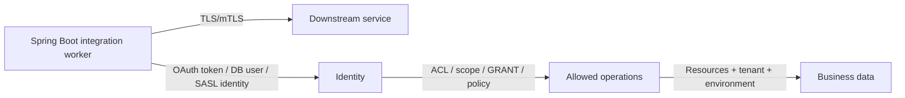
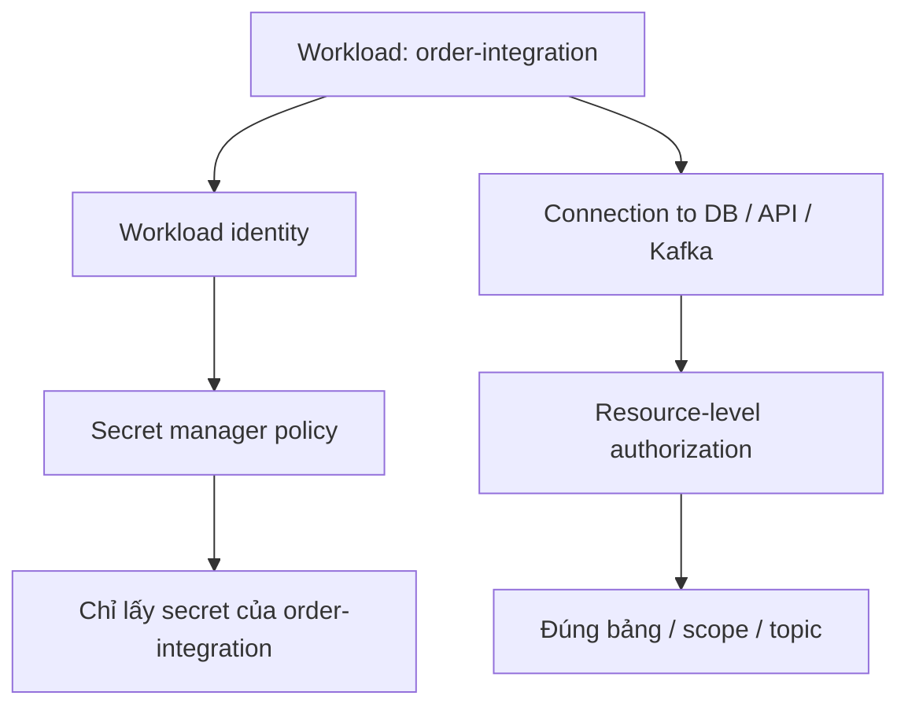
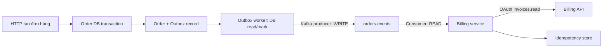
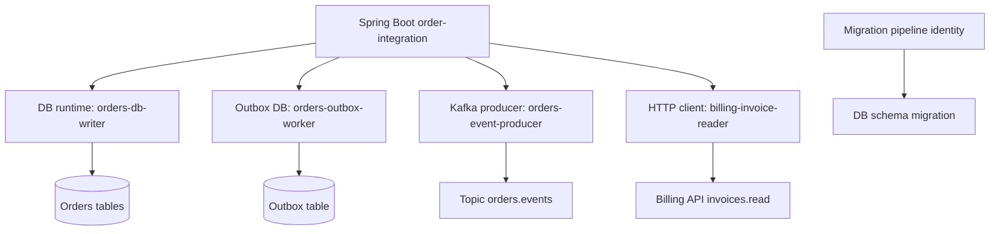

# Phân quyền tối thiểu cho tài khoản tích hợp

## 1. Vì sao tài khoản tích hợp cần quyền tối thiểu?

Trong **SPRING_BOOT_INTEGRATION**, một ứng dụng Spring Boot có thể vừa gọi HTTP API, đọc/ghi cơ sở dữ liệu, thao tác cache, vừa sản xuất hoặc tiêu thụ thông điệp từ Kafka/RabbitMQ thông qua các adapter của Spring Integration. Mỗi lần kết nối thường mang một **danh tính kỹ thuật**: database user, OAuth2 client, API key, Redis user, Kafka principal, RabbitMQ user hoặc workload identity.

**Phân quyền tối thiểu (principle of least privilege)** nghĩa là mỗi danh tính chỉ có những quyền cần thiết để hoàn thành công việc được giao, trên đúng tài nguyên, trong đúng môi trường và trong khoảng thời gian phù hợp. Mục tiêu không chỉ ngăn thao tác vô tình mà còn giới hạn phạm vi thiệt hại (*blast radius*) nếu credential bị lộ hoặc code bị khai thác.

Ví dụ, một service chỉ cần lấy dữ liệu đơn hàng và phát sự kiện `orders.created` không có lý do sở hữu quyền quản trị toàn bộ database, đọc mọi topic Kafka hoặc xóa dữ liệu cache thuộc hệ thống khác.

| Thành phần | Tài khoản quá quyền | Quyền tối thiểu phù hợp |
| --- | --- | --- |
| HTTP API đối tác | Token quản trị với mọi scope | Token có đúng audience, scope đọc hóa đơn và giới hạn tenant |
| Cơ sở dữ liệu | DB superuser, quyền DDL và DML trên mọi schema | `SELECT` vào bảng cần đọc, `INSERT/UPDATE` vào bảng phải cập nhật |
| Redis | User mặc định có quyền mọi lệnh/mọi key | Quyền truy cập prefix key và nhóm lệnh cần dùng |
| Kafka | Principal có quyền toàn cluster hoặc mọi topic | `WRITE` topic đích; hoặc `READ` topic và consumer group được giao |
| RabbitMQ | User quản trị tất cả vhost | Quyền `configure/write/read` đúng resource trong vhost nghiệp vụ |
| Hạ tầng | Workload mang quyền đọc mọi secret | Chỉ đọc secret cần thiết cho chính workload |

### Mục tiêu bài học

- Phân biệt **xác thực (authentication)**, **phân quyền (authorization)** và **bảo vệ kênh truyền**.
- Thiết kế danh tính, quyền và phạm vi tài nguyên cho từng connector.
- Cấu hình và vận hành Spring Boot mà không để lộ secret hoặc vô tình dùng lại tài khoản quyền cao.
- Kiểm thử **cả quyền được cấp lẫn quyền phải bị từ chối**; nhận diện lỗi quyền và tránh retry không cần thiết.
- Kết hợp phân quyền với hợp đồng dữ liệu, giao dịch, idempotency, xử lý lỗi và observability trong luồng tích hợp thực tế.

## 2. Ba ranh giới: kết nối, danh tính và quyền



Ba câu hỏi cần trả lời riêng:

1. **Kênh truyền có an toàn không?** TLS giúp mã hóa kết nối và xác thực máy chủ; không cấp quyền đọc topic hay bảng.
2. **Hệ thống nhận biết ai đang gọi?** OAuth client credentials, DB user, SASL principal hoặc chứng chỉ client xác định danh tính, không tự cho phép mọi hành động.
3. **Danh tính này được làm gì với tài nguyên nào?** Resource server, database, broker hoặc hệ thống IAM mới là nơi phải thực thi quyền; việc chỉ ẩn nút UI hoặc kiểm tra trong Spring Boot caller là không đủ.

Từ đó hình thành mẫu quyền:

> `principal + action + resource + context → allow/deny`

**Context** có thể là môi trường `dev/staging/prod`, tenant, topic prefix, database schema, HTTP endpoint, phạm vi token hoặc thời hạn phiên truy cập. Nếu một principal có quyền rất rộng, các biện pháp khác như TLS và secret manager vẫn không hạn chế được hành động của kẻ sở hữu hợp lệ credential ấy.

### 2.1. Tài khoản tích hợp và tài khoản người dùng

- **User identity:** Danh tính người dùng cuối cùng, có thể đi kèm OAuth token với quyền phụ thuộc vai trò và tenant.
- **Service identity:** Danh tính của ứng dụng hoặc workload, ví dụ `svc-order-publisher`, chạy không cần người dùng tương tác.
- **Administrative identity:** Dùng cho migration, thay ACL, quản trị cluster hoặc provisioning; nên tách khỏi runtime identity.
- **Emergency identity:** Quyền đặc biệt để xử lý sự cố, cần quy trình cấp tạm thời và audit; không đưa vào cấu hình runtime thường ngày.

Không tự ý chuyển tiếp token của người dùng cuối sang API khác nếu token có `audience` không dành cho API đó. Ngược lại, token `client_credentials` của service không tự đại diện cho danh tính/quyền của người dùng cuối. Nếu downstream phải biết người dùng nào đang thực hiện, cần thiết kế **ủy quyền và truyền ngữ cảnh danh tính** rõ ràng (chẳng hạn token exchange/on-behalf-of khi hệ thống identity hỗ trợ), không giả mạo bằng cách đặt header tùy ý.

### 2.2. Những lỗi thiết kế thường gặp

| Thiết kế | Vấn đề |
| --- | --- |
| Mọi microservice cùng dùng một database user | Không tách được quyền, trách nhiệm và log truy cập |
| Dùng account DBA trong `spring.datasource` | Lỗi SQL injection hoặc RCE có thể trở thành xóa/sửa toàn DB |
| Cấp OAuth scope `*` để “đỡ lỗi 403” | Đường lộ token trở thành đường gọi mọi API |
| Một Kafka principal dùng chung producer/consumer/admin | Không thể cô lập quyền đọc, ghi và quản trị |
| Redis user có quyền `+@all ~*` | Có thể đọc/sửa/xóa mọi key và chạy lệnh quản trị |
| Dùng service account production ở môi trường test | Mất ranh giới môi trường và nguy cơ dữ liệu thật bị chỉnh sửa |
| Log nguyên token/JAAS/connection string | Mở đường cho người xem log dùng lại danh tính quyền cao |

**Quyền tối thiểu phải được xác minh tại hệ thống đích.** Chỉ gắn một role tên “readonly” vào cấu hình ứng dụng, hoặc ghi chú rằng service “chỉ đọc”, không chứng minh database/API đã chặn quyền ghi.

## 3. Bắt đầu bằng kiểm kê luồng và ma trận quyền

Trước khi cấp tài khoản, đọc hợp đồng tích hợp ở góc độ thao tác:

1. **Trigger:** HTTP handler, scheduled task, consumer Kafka/RabbitMQ hay Spring Integration gateway nào kích hoạt?
2. **Input/output:** Loại dữ liệu gì đi qua? Có PII, token, thông tin thanh toán hoặc dữ liệu nhiều tenant không?
3. **Đích:** API, database/schema/table, cache key namespace, broker/topic/queue/vhost nào?
4. **Hành động:** Đọc, ghi, cập nhật, xóa, publish, consume, tạo tài nguyên hay sửa cấu hình?
5. **Ranh giới:** Prod hay staging; tenant nào; người dùng hay workload; quyền cần lâu dài hay tạm thời?
6. **Khả năng phục hồi:** Khi timeout/retry/crash, service có cần thêm quyền để truy vấn trạng thái hoặc xử lý lại không?

Ví dụ luồng `order-service` ghi đơn hàng, publish sự kiện và gọi API thanh toán:

| Actor/identity | Đích | Quyền cần | Quyền không cấp |
| --- | --- | --- | --- |
| `orders-api-db` | `orders_db.orders` | `SELECT, INSERT, UPDATE` ở các bảng phục vụ xử lý đơn hàng | `DROP, ALTER, CREATE ROLE`, schema hệ thống khác |
| `orders-outbox-worker` | `orders_db.outbox_event` | `SELECT` các event pending; `UPDATE` trạng thái/checkpoint | `DELETE` mọi event và quyền DDL |
| `orders-event-producer` | Kafka `orders.events` | `WRITE` và quyền metadata cần thiết | `READ` mọi topic, chỉnh ACL |
| `billing-consumer` | Kafka `orders.events` và group `billing-sync` | `READ` topic/group cùng quyền metadata cần thiết | `WRITE` topic khác, cluster admin |
| `orders-billing-client` | Billing API | Scope `payments.read` và audience billing API | Scope `payments.admin`, gọi API khách hàng khác |
| `orders-cache-worker` | Redis `orders:summary:*` | `GET, SET` trên namespace được giao | `FLUSHALL`, lệnh quản trị, mọi key |

Đây là **bản nháp quyền**, cần so với các thao tác thật của driver, framework và hợp đồng hệ thống đích. Ví dụ Kafka client có thể cần quyền `DESCRIBE` hoặc ACL metadata liên quan; RabbitMQ có thể cần quyền configure khi ứng dụng thực sự khai báo queue, nhưng một consumer chỉ nhận queue đã provision thì không nên tự động có quyền tạo/xóa tùy ý.

### 3.1. Quyền tối thiểu phải tính cả thao tác phụ

Đừng chỉ tính đoạn code trong happy path. Một consumer có thể cần quyền gửi message sang dead-letter topic hoặc cập nhật bảng idempotency; một outbox worker cần đọc và đánh dấu đã gửi; một HTTP adapter có thể gọi endpoint kiểm tra trạng thái giao dịch sau timeout. **Quyền phụ** phải được ghi rõ theo hợp đồng, không mở rộng toàn hệ thống chỉ vì xuất hiện một lỗi runtime.

Mỗi quyền nên có người sở hữu, mục đích, môi trường, resource chính xác, ngày cấp/ngày rà soát và dấu vết approval khi tổ chức yêu cầu. Khi một job hoặc integration adapter bị gỡ bỏ, quyền không còn được dùng cũng phải được thu hồi.

## 4. HTTP API và OAuth2: scope, audience, endpoint, tenant

### 4.1. Tách danh tính OAuth2 client cho từng downstream

Giả sử Spring Boot gọi API đối tác để đọc hóa đơn. Với OAuth2 `client_credentials`, client ứng dụng lấy access token từ authorization server. Token có thể mang `scope` và `audience` tùy hệ thống IAM. Resource server là nơi phải **xác thực token và kiểm tra quyền**.

| Thành phần | Nguyên tắc |
| --- | --- |
| `client_id` | Đại diện cho một integration/workload cụ thể, không dùng chung toàn công ty |
| `client_secret` hoặc client certificate | Secret cấp riêng, lưu trong secret manager, có vòng đời thay/thu hồi |
| `scope` | Chỉ những hành động cần, ví dụ `invoices.read` |
| `audience` | Token dành cho đúng API; một số provider dùng resource indicator hoặc tham số riêng |
| Đích HTTP | HTTPS và host/port allowlist; không gửi bearer token tới URL người dùng nhập |
| Tenant/object | API server kiểm tra quyền trên từng tenant/object, không chỉ trên route |
| Expiry | Token có hạn và refresh/acquire theo cơ chế provider; không log token |

Ví dụ cấu hình khai báo **registration riêng** trong Spring Boot/Spring Security OAuth2 Client:

```yaml
spring:
  security:
    oauth2:
      client:
        registration:
          invoice-reader:
            provider: partner-identity
            client-id: ${INVOICE_CLIENT_ID}
            client-secret: ${INVOICE_CLIENT_SECRET}
            authorization-grant-type: client_credentials
            scope:
              - invoices.read
        provider:
          partner-identity:
            token-uri: https://identity.partner.example/oauth2/token
```

**Lưu ý:** Đây là cấu hình registration để Spring Security biết cách lấy token, chưa tự động gắn token vào mọi request. Cần cấu hình authorized-client manager/filter phù hợp Servlet hoặc Reactive stack và chọn rõ registration `invoice-reader` cho lần gọi tương ứng. Yêu cầu `audience` không có một property Spring OAuth2 thống nhất áp dụng cho mọi provider; thiết lập resource indicator/audience theo hợp đồng của identity provider. Không giả định scope client yêu cầu luôn được cấp nguyên vẹn hoặc downstream sẽ tự kiểm tra.

Khi có nhiều downstream, **không bật cơ chế tự gắn access token hiện hành lên mọi WebClient request** mà thiếu kiểm soát đích. Một token phục vụ API A không nên được gửi tới API B chỉ vì cùng một WebClient hoặc filter được tái sử dụng.

### 4.2. Gắn token vào một request đến đúng đích

Ví dụ adapter chỉ nhận mã hóa đơn, còn API endpoint là cố định:

```java
import org.springframework.http.HttpHeaders;
import org.springframework.web.reactive.function.client.WebClient;
import reactor.core.publisher.Mono;

record InvoiceDto(String id, String status) {}

interface InvoiceAccessTokenProvider {
    // Tạo/lấy token cho đúng OAuth registration, audience, scope.
    Mono<String> tokenForInvoiceRead();
}

class PartnerInvoiceGateway {
    private final WebClient invoiceClient;
    private final InvoiceAccessTokenProvider tokens;

    PartnerInvoiceGateway(WebClient invoiceClient,
                          InvoiceAccessTokenProvider tokens) {
        this.invoiceClient = invoiceClient;
        this.tokens = tokens;
    }

    Mono<InvoiceDto> getInvoice(String invoiceId) {
        if (invoiceId == null ||
            !invoiceId.matches("[A-Za-z0-9_-]{1,64}")) {
            return Mono.error(new IllegalArgumentException("Invalid invoiceId"));
        }

        return tokens.tokenForInvoiceRead()
            .flatMap(token -> invoiceClient.get()
                .uri(uri -> uri.pathSegment("v1", "invoices", invoiceId)
                    .build())
                .headers(headers -> headers.setBearerAuth(token))
                .retrieve()
                .bodyToMono(InvoiceDto.class));
    }
}
```

`InvoiceAccessTokenProvider` là interface minh họa do ứng dụng triển khai bằng cơ chế OAuth2 authorized-client phù hợp. `invoiceClient` phải là WebClient chuyên dụng có `baseUrl` tin cậy, xác thực host/scheme/port ở request cuối và kiểm soát redirect; **`baseUrl` một mình không chặn được URI tuyệt đối** được truyền vào `uri(...)`. Không chuyển token trong URL, query, log hoặc exception.

**Quyền tối thiểu được kiểm tra ở hai nơi:** caller chỉ yêu cầu token có scope hẹp và gọi endpoint cần thiết; resource server kiểm tra audience, scope và ownership/tenant của `invoiceId`. Nếu downstream không kiểm tra tenant, token chỉ có scope `invoices.read` vẫn có thể đọc hóa đơn của người khác.

### 4.3. Lỗi 401/403 không phải lý do nâng quyền tự động

- `401 Unauthorized`: kiểm tra token thiếu, hết hạn, sai issuer/audience hoặc vấn đề xác thực khác; token provider có thể làm mới đúng hạn theo chính sách. Không lặp vô hạn cùng token lỗi.
- `403 Forbidden`: nhận diện thiếu scope, policy hoặc không đủ quyền tài nguyên. Xem lại hợp đồng; không tự chuyển sang account quyền cao.
- `429` hoặc `503`: lỗi tải/tạm thời có thể retry hữu hạn theo idempotency và `Retry-After`, **không liên quan đến việc xin thêm scope**.

Nếu một endpoint cần quyền mới thật sự, thay đổi hợp đồng và chính sách được review, cập nhật ma trận quyền và thêm kiểm thử. Không cấp `admin` chỉ để “chạy được”.

## 5. Cơ sở dữ liệu: tài khoản runtime tách khỏi migration/admin

Một ứng dụng Spring Boot thường dùng pool JDBC/HikariCP hoặc R2DBC. Quyền thực tế của kết nối là quyền của **database principal** mà datasource đăng nhập. `@Transactional` điều phối transaction nhưng không giới hạn quyền database nếu tài khoản đã có `DROP` hoặc `ALTER`.

### 5.1. Tách ít nhất hai loại identity

| Identity | Nhiệm vụ | Quyền thường cần |
| --- | --- | --- |
| Migration/provisioning | Tạo/sửa schema, bảng, index, grant | DDL theo phạm vi migration; không dùng làm runtime |
| Runtime business service | Đọc/ghi bảng phục vụ hợp đồng ứng dụng | `SELECT/INSERT/UPDATE/DELETE` chính xác theo bảng/operation |
| Reporting integration | Đọc dữ liệu tổng hợp | `SELECT` các view/bảng được cho phép, hạn chế PII |
| Outbox publisher | Đọc event và cập nhật trạng thái gửi | `SELECT` + `UPDATE` đúng bảng/column liên quan |

Với PostgreSQL, ví dụ bảng outbox đã được migration tạo sẵn trong schema `integration`; database principal `svc_outbox_pub` đã được tạo và cấp credential bằng hệ thống provisioning:

```sql
-- Thực thi bởi account provisioning có quyền cấp GRANT.
GRANT CONNECT ON DATABASE appdb TO svc_outbox_pub;
GRANT USAGE ON SCHEMA integration TO svc_outbox_pub;

GRANT SELECT ON TABLE integration.outbox_event TO svc_outbox_pub;
GRANT UPDATE (state, sent_at, attempt_count)
    ON TABLE integration.outbox_event TO svc_outbox_pub;

-- Không GRANT quyền DDL, DELETE, TRUNCATE hay các bảng khác.
```

Quyền `UPDATE` theo column chỉ cho phép sửa các cột được liệt kê. Cần kiểm tra query thực dùng và quyền trên đối tượng liên quan (sequence, view, function, row-level security) theo thiết kế. Nếu worker còn cần `INSERT` hoặc các cột khác, hãy chứng minh bằng use case và bổ sung đúng phạm vi.

**Đây chỉ là ví dụ cấp quyền**, không phải công thức áp dụng trực tiếp cho mọi database. Database cần có chính sách thu hồi các quyền không mong muốn từ `PUBLIC` hoặc role kế thừa khi thích hợp. Một principal có quyền qua role khác vẫn có thể vượt phạm vi dự kiến dù GRANT bên trên trông hẹp. Kiểm tra **effective permissions** bằng chính tài khoản runtime.

### 5.2. Tối thiểu theo tenant, dòng dữ liệu và SQL operation

Giới hạn quyền theo bảng chưa chắc đủ: nếu bảng `invoices` chứa dữ liệu của nhiều tenant, một DB user có `SELECT` trên toàn bảng có thể đọc nhiều tenant khi code sai điều kiện `WHERE`.

Cân nhắc một hoặc nhiều lớp bảo vệ:

- Tách database/schema hoặc role theo tenant khi yêu cầu cô lập mạnh.
- Dùng view chỉ lộ cột cần thiết; kiểm soát quyền trên view và bảng gốc.
- Dùng **row-level security (RLS)** khi database hỗ trợ và policy được kiểm thử.
- Thực hiện authorization tại tầng nghiệp vụ khi truy cập theo user/tenant, không lấy service account làm bằng chứng mọi người dùng đều có quyền.
- Dùng parameterized query/ORM binding để giảm SQL injection; phân quyền không thay thế phòng chống injection.

Không lưu user/password DB vào `application-prod.yml` được commit. Ví dụ cấu hình:

```yaml
spring:
  datasource:
    url: ${ORDERS_DB_JDBC_URL}
    username: ${ORDERS_DB_RUNTIME_USER}
    password: ${ORDERS_DB_RUNTIME_PASSWORD}
```

Hệ thống cần đưa giá trị qua secret store hoặc cơ chế inject runtime được bảo vệ. JDBC URL/username cũng nên được coi là cấu hình nhạy cảm về hạ tầng, tránh ghi nguyên vào log công khai. Với môi trường có IAM database auth hoặc dynamic credentials, quy trình acquire/refresh và pool lifetime cần được cấu hình tương ứng.

### 5.3. Quyền database và bảo đảm giao dịch là hai vấn đề

Worker có quyền `SELECT + UPDATE` outbox chưa có nghĩa publish Kafka và cập nhật DB là một transaction phân tán an toàn. Cần trạng thái event, idempotency key, claim/lease, deduplication hoặc transactional outbox phù hợp. Tránh giải pháp cấp thêm quyền DBA chỉ để “sửa lỗi retry”; hãy thiết kế quyền phục hồi theo những thao tác thực sự cần.

## 6. Cache: hạn chế command và namespace key

Redis thường được xem là hạ tầng phụ, nhưng cache có thể lưu session, token, dữ liệu cá nhân hoặc trạng thái chống trùng. Nếu một service có credential chạy được `FLUSHALL` hoặc truy cập key mọi dịch vụ, sự cố ở service đó có thể ảnh hưởng toàn bộ hệ thống.

Với Redis ACL, có thể hạn chế hai chiều:

- **Key patterns**: user chỉ đọc/ghi `orders:summary:*`; không đụng `sessions:*`, `auth:*` hay `payments:*`.
- **Command permissions**: chỉ những lệnh cần như `GET`, `SET`, `DEL`; không cho lệnh quản trị hoặc toàn bộ nhóm `@all`.

Mẫu **minh họa ACL đã được provisioning bởi quản trị viên**:

```text
user svc_orders_cache
keys: orders:summary:*
commands: GET, SET, DEL, PING (nếu client cần)
authentication: mật khẩu hoặc phương thức auth do Redis deployment cấp
```

Cú pháp tạo user, đặt password và ACL chi tiết phải dùng quy trình quản trị Redis/managed provider phù hợp. Không đưa password trực tiếp vào command shell, script git hoặc lịch sử CLI chỉ để thử nhanh. Một số Redis client có thể cần thêm lệnh connection/metadata; kiểm tra bằng integration test rồi chỉ bổ sung quyền cần thiết.

Với Spring Boot:

```yaml
spring:
  data:
    redis:
      host: ${ORDERS_REDIS_HOST}
      port: ${ORDERS_REDIS_PORT:6379}
      username: ${ORDERS_REDIS_USER}
      password: ${ORDERS_REDIS_PASSWORD}
```

Nếu dùng TLS, cấu hình Redis SSL/TLS phù hợp với phiên bản Spring Boot và provider; kiểm tra CA/hostname và không hạ cấp kênh truyền để xử lý lỗi. Đừng nghĩ chỉ thêm prefix trong Java key generator đã khóa được client; **Redis server phải thực thi ACL** với principal ấy.

**Đặc biệt:** Luồng Spring Cache có thể gọi lệnh khác tùy cache manager, serializer, TTL và cách invalidate; cần xác nhận lệnh thực dùng trước khi chốt ACL. Thực hiện phủ định bằng một key ngoài namespace để chứng minh truy cập bị từ chối.

## 7. Broker thông điệp: topic, group, queue và quyền quản trị

### 7.1. Apache Kafka

Kafka client xác thực bằng SASL hoặc mTLS tùy listener, còn quyền đọc/ghi phải được broker/managed platform thực thi qua ACL hoặc cơ chế tương đương.

| Principal | Resource | Quyền chính | Không cấp |
| --- | --- | --- | --- |
| `orders-producer` | Topic `orders.events` | `WRITE` cùng quyền metadata cần thiết | `READ` mọi topic, xóa topic, sửa ACL |
| `billing-consumer` | Topic `orders.events` | `READ` cùng quyền metadata cần thiết | `WRITE` topic không liên quan |
| `billing-consumer` | Consumer group `billing-sync` | Quyền group cần cho join/consume | Quyền mọi consumer group |
| `operations-admin` | Cluster/resources đã định nghĩa | Chỉ các quyền quản trị phục vụ vận hành | Không dùng credential này cho app runtime |

Nếu consumer dùng dead-letter topic `orders.events.dlt`, cần mô tả luồng rõ ràng: consumer/recoverer nào **publish** DLT và principal nào có quyền `WRITE`. Không cấp quyền `ALL` lên mọi topic vì thiếu một ACL nhỏ.

Trong Spring Boot, cấu hình producer và consumer có thể tách identity qua `spring.kafka.producer.properties` và `spring.kafka.consumer.properties` nếu cùng ứng dụng phải làm hai vai trò. Nếu một JVM chứa nhiều integration adapter có ranh giới quyền khác nhau, cân nhắc cấu hình factory riêng hoặc tách ứng dụng để mỗi principal có blast radius nhỏ.

```yaml
spring:
  kafka:
    bootstrap-servers: ${KAFKA_BOOTSTRAP}
    producer:
      properties:
        "[security.protocol]": SASL_SSL
        "[sasl.mechanism]": SCRAM-SHA-512
        "[sasl.jaas.config]": ${KAFKA_PRODUCER_JAAS}
    consumer:
      group-id: billing-sync
      properties:
        "[security.protocol]": SASL_SSL
        "[sasl.mechanism]": SCRAM-SHA-512
        "[sasl.jaas.config]": ${KAFKA_CONSUMER_JAAS}
```

Đây là ví dụ tách credential **trong cùng ứng dụng**; broker phải hỗ trợ mechanism, principal và ACL phù hợp. Nên cấu hình trust CA/hostname theo chính sách TLS thực tế (JVM truststore hoặc Kafka client SSL properties), không giả định `SASL_SSL` tự giải quyết chứng chỉ. Tránh ghi chuỗi JAAS chứa mật khẩu vào log. Việc tách producer/consumer trong YAML không thay đổi quyền của principal ở broker nếu cả hai credential cùng map đến một account.

### 7.2. RabbitMQ

RabbitMQ sử dụng **vhost** làm ranh giới tài nguyên quan trọng. Quyền thông thường gồm ba regex `configure` (khai báo/sửa resource), `write` (publish) và `read` (consume) trong một vhost, cộng với topic permissions khi nền tảng cần phân quyền routing key.

| Vai trò | Vhost | Ví dụ quyền |
| --- | --- | --- |
| Order event publisher | `/orders` | `write` tới exchange phục vụ phát đơn hàng, `read` không cần |
| Billing consumer | `/orders` | `read` queue `billing.orders`; chỉ `configure` nếu ứng dụng phải khai báo topology |
| Provisioning service | `/orders` | Quyền tạo exchange/queue/binding đã được quản trị | 

Không đưa user có tag `administrator` vào application container. Nếu Spring AMQP tự khai báo queue/exchange/binding qua `RabbitAdmin`, hãy cân nhắc provision topology trước bằng deployment thay vì cấp `configure` rộng cho tất cả consumer. Cần kiểm thử nhu cầu thực của adapter, đặc biệt khi ứng dụng sử dụng retry queue, dead-letter exchange hoặc reply queue.

### 7.3. Spring Integration adapters cũng sử dụng credential

Spring Integration cung cấp các inbound/outbound adapter và gateway cho HTTP, JMS, AMQP, Kafka, database, FTP/SFTP và các hệ thống khác. **Adapter không tự cấp quyền**; nó dùng connection factory, data source, HTTP client hoặc session factory đã cấu hình.

Ví dụ:

- Outbound HTTP gateway gọi đối tác chỉ cần scope/resource cho endpoint đó.
- Inbound JMS/Kafka adapter chỉ cần consume destination được giao và quyền xử lý ack/group tương ứng.
- Outbound JDBC adapter chỉ cần DML vào bảng đích.
- SFTP inbound poller thường cần `LIST/READ` ở thư mục nguồn; nếu có thao tác move/delete file sau xử lý thì phải nêu rõ nhu cầu thêm quyền.

Nếu một flow vừa **đọc** từ hệ thống A, vừa **ghi** tới hệ thống B, đừng mặc định dùng một identity chung. Tách connector credential để sự cố ở một adapter không trở thành quyền truy cập không hạn chế đối với mọi adapter còn lại.

## 8. Workload identity, secret và quyền hạ tầng

Tài khoản tích hợp không chỉ là username/password lưu trong Spring. Một workload chạy trên Kubernetes, VM hoặc cloud có thể mang danh tính ở hạ tầng, cho phép đọc secret, gọi cloud API hoặc kết nối managed database/broker.

### 8.1. Chia quyền theo từng ranh giới



Nếu service account Kubernetes có quyền đọc mọi Secret trong namespace, việc đặt mật khẩu DB trong secret store vẫn chưa giới hạn nguy cơ lộ credential của các ứng dụng khác. Cần kiểm soát đồng thời:

- Quyền workload đọc secret/config, token mounting, IAM role của pod/VM.
- Quyền dùng credential ở hệ thống downstream.
- Egress network policy, DNS, TLS và host đích được phép.
- Quyền xem log, trace, process dump, backup và dashboard vận hành.
- Khả năng tách `dev`, `staging`, `prod` bằng identity, secret và hạ tầng độc lập.

NetworkPolicy, service mesh hoặc firewall chỉ hỗ trợ hạn chế đường mạng; chúng **không thay thế** ACL/GRANT/scope ở hệ thống nhận. Ngược lại, ACL hẹp không bảo vệ credential nếu secret bị log ra môi trường rộng người xem.

### 8.2. Vòng đời credential

1. **Provision:** Tạo identity riêng cho integration và môi trường; cấp quyền từ ma trận đã review.
2. **Distribute:** Inject bằng secret manager, workload identity hoặc file mount được bảo vệ; không commit vào repository, image hay pipeline output.
3. **Use:** Gắn credential vào đúng connector; bảo vệ TLS và tránh gửi sang đích ngoài allowlist.
4. **Observe:** Theo dõi lỗi xác thực/phân quyền, lần truy cập bất thường và hạn chứng chỉ/token; không log secret.
5. **Rotate:** Đổi credential có kế hoạch, kiểm tra client load lại, connection pool/reconnect và thời gian chồng lấp nếu nền tảng cho phép.
6. **Revoke:** Thu hồi quyền/credential khi flow bị loại bỏ, service đổi chức năng hoặc nghi ngờ lộ.

Mật khẩu bị lộ trong Git dù đã xóa khỏi file hiện tại vẫn có thể nằm trong lịch sử commit hoặc bản fork. Phải **rotate/revoke credential**, kiểm tra log, image, CI artifact và những nơi từng đồng bộ secret. Giảm quyền của identity bị lộ cũng hạn chế hậu quả, nhưng không thay thế thu hồi secret.

### 8.3. Thời hạn và cấp quyền tạm thời

Quyền dài hạn cần rà soát định kỳ. Các tác vụ migration, backfill dữ liệu nhạy cảm hoặc hỗ trợ sự cố có thể cần **quyền tạm thời** (just-in-time) với hạn dùng, người phê duyệt và audit. Không để quyền quản trị tạm thời trở thành quyền cố định của runtime service sau khi vận hành.

Nếu dùng dynamic database credentials/token ngắn hạn, cần xác minh connection pool, token refresh, thời gian sống, khả năng thu hồi và hành vi khi credential hết hạn giữa transaction. Thiết kế đúng phải cho phép các connection cũ kết thúc trong giới hạn phù hợp mà không liên tục đổi sang account quyền cao.

## 9. Quyền tối thiểu trong giao dịch, retry và xử lý trùng lặp

Một thiết kế phân quyền tốt phải phản ánh **luồng thực tế**, kể cả lúc lỗi:



Trong ví dụ này:

- API ghi order dùng database role phục vụ tạo/cập nhật đơn hàng, không cần quyền quản trị schema.
- Outbox publisher dùng role riêng để đọc event pending và cập nhật trạng thái, Kafka principal riêng chỉ được publish topic nghiệp vụ.
- Consumer có ACL cho topic/group và quyền dữ liệu xử lý của chính nó; việc gọi API đối tác dùng token có scope/audience riêng.
- Idempotency store yêu cầu thao tác đọc/ghi tối thiểu; Kafka redelivery hoặc HTTP timeout không được xử lý bằng cách dùng tài khoản quản trị.

**Phân quyền không bảo đảm exactly-once.** Khi publish thành công nhưng client mất ACK, retry có thể gửi cùng sự kiện lần nữa. Cần event ID ổn định, outbox/inbox, unique constraint và xử lý trùng lặp. Nếu downstream API có idempotency key, caller cần giữ nguyên key giữa các lần retry. Khi giao dịch DB thành công còn HTTP/Kafka thất bại, cần trạng thái phục hồi hoặc saga phù hợp; mở rộng quyền không giải quyết tính nhất quán.

### 9.1. Không “fallback admin” khi lỗi

| Lỗi | Nguyên nhân thường gặp | Hành động phù hợp |
| --- | --- | --- |
| HTTP `401` | Token thiếu/hết hạn/sai audience/issuer | Kiểm tra cấu hình token provider; refresh theo chính sách |
| HTTP `403` | Thiếu scope/quyền object/tenant | Xem hợp đồng và policy, cấp đúng quyền nếu có yêu cầu hợp lệ |
| SQL `permission denied` | Thiếu quyền bảng/schema/column/sequence | Kiểm tra role hiệu lực và câu SQL; sửa GRANT nhỏ nhất |
| Redis `NOPERM` | Lệnh hoặc key ngoài ACL | Đối chiếu command/key với ma trận quyền, không cấp `@all` |
| Kafka `TopicAuthorizationException` | Topic ACL không đủ | Kiểm tra principal thực và quyền topic |
| Kafka group authorization | ACL consumer group không đủ | Kiểm tra group ID và quyền group |
| RabbitMQ `ACCESS_REFUSED` | User thiếu vhost/resource permission | Kiểm tra configure/write/read đúng queue/exchange |
| TLS handshake failure | Chứng chỉ/CA/hostname/truststore sai | Sửa chain/hostname/cấu hình, không tắt kiểm tra TLS |

Lỗi phân quyền thường **bền vững** cho đến khi thay đổi cấu hình/policy, vì vậy không nên retry ồ ạt như lỗi mạng tạm thời. Khi thiếu quyền thực sự, phát hiện qua kiểm thử và quy trình cấp quyền, không dùng secret fallback với account quyền cao. Nếu message bị đưa vào dead-letter queue/topic vì lỗi quyền, cần kiểm soát retention, replay và quyền truy cập nội dung nhạy cảm ở đây.

### 9.2. Phân biệt quyền nghiệp vụ và quyền kết nối

Một service có quyền mở kết nối tới DB hoặc HTTP API chưa có quyền truy cập mọi dữ liệu ở đó. Thực hiện authorization theo tenant, user ownership và đối tượng ở resource server hoặc DB khi thích hợp. Ví dụ `invoices.read` là quyền đọc hóa đơn, nhưng cần thêm kiểm tra invoice thuộc đúng tenant; `SELECT` trên bảng DB chưa thay thế kiểm tra authorization theo user ở tầng nghiệp vụ.

## 10. Thiết kế kiểm thử: phải chứng minh cả bị từ chối

Một integration test xác nhận “gửi sự kiện thành công” mới chứng minh **đường được cấp quyền**. Nó không chứng minh tài khoản không có quyền ngoài phạm vi. Cần kiểm thử phủ định với đúng runtime identity trong môi trường cách ly.

| Test | Dàn dựng | Kết quả cần xác nhận |
| --- | --- | --- |
| HTTP đúng scope/audience | Token có `invoices.read` gọi endpoint hóa đơn của tenant được phép | `200` và dữ liệu đúng |
| HTTP thiếu quyền | Token chỉ có `invoices.read` gọi thao tác admin/ghi | Resource server trả `403`; không tự nâng scope |
| HTTP sai audience/tenant | Token cho API A gọi API B hoặc invoice tenant khác | Bị từ chối theo policy của resource server |
| HTTP redirect host lạ | API trả `Location` sang host ngoài allowlist | Không gửi token sang host lạ |
| DB chỉ đọc | Dùng role reporting để `INSERT/DELETE` | DB từ chối; view/schema khác không bị đọc |
| DB outbox worker | Thử `UPDATE` đúng cột và `DROP TABLE` | UPDATE cần thiết thành công; DDL bị từ chối |
| Redis namespace | Dùng runtime Redis user `GET orders:summary:42` và `GET sessions:admin` | Chỉ key trong namespace được phép |
| Redis command | Dùng runtime user thử lệnh quản trị nguy hiểm | Redis từ chối |
| Kafka producer | Publish topic `orders.events` và thử topic `payments.private` | Chỉ topic được cấp quyền nhận event |
| Kafka consumer | Join đúng group và group ngoài phạm vi | Chỉ group được phép sử dụng |
| RabbitMQ | Consume queue đúng vhost và thử queue/vhost khác | Bị từ chối ngoài phạm vi |
| Secret store | Workload của order-service thử đọc secret billing-service | IAM từ chối, không xuất secret |
| Rotate credential | Đổi secret trong môi trường test theo quy trình | Client tiếp tục dùng identity đúng quyền, kết nối cũ được xử lý an toàn |
| Log/trace | Dùng secret giả có chuỗi nhận dạng độc nhất | Không tìm thấy secret trong log, trace, exception, metric, dead-letter |

### 10.1. Cách kiểm tra quyền hiệu lực

- Kết nối tới **đúng hệ thống đích** bằng credential/identity mà ứng dụng runtime sẽ sử dụng.
- Dùng tài nguyên test an toàn, được cô lập; tránh cố ý chạy lệnh phá hoại trên DB/cache production.
- Phân biệt lỗi authorization với lỗi resource không tồn tại, network timeout hoặc authentication thất bại; mỗi lỗi cần điều kiện dựng test khác nhau.
- Tạo ít nhất một test *allow* và một test *deny* cho từng loại connector quan trọng.
- Khi policy thay đổi, lưu test hồi quy để quyền không mở rộng âm thầm.

Kiểm thử unit mock DAO/WebClient chỉ xác nhận code gọi đúng method; **không chứng minh DB GRANT, OAuth scope, Kafka ACL hoặc Redis ACL đang hoạt động trên server**. Kết hợp unit test với integration test dùng môi trường có policy tương tự production.

### 10.2. Kiểm tra code và configuration review

Trước khi merge hoặc triển khai:

1. Rà soát các secret không được hardcode trong `application.yml`, source, Dockerfile, CI config và test fixtures.
2. Kiểm tra đường đi của token: WebClient nào gửi, host nào nhận, có redirect hoặc URL tuyệt đối hay không.
3. So sánh quyền mới với ma trận quyền được phê duyệt; phát hiện quyền wildcard, admin và quyền ở môi trường khác.
4. Kiểm tra identity thực dùng trên producer/consumer, migration/runtime, HTTP client và cache client; tránh vô tình kế thừa role đặc quyền.
5. Kiểm tra retry, dead-letter, backfill và quy trình khôi phục không yêu cầu quyền quản trị ẩn.
6. Đảm bảo log/tracing không hiển thị `Authorization`, API key, `sasl.jaas.config`, DB password và payload nhạy cảm.

## 11. Quan sát, audit và rà soát quyền

Vận hành cần biết ai đang dùng quyền nào mà không tiết lộ credential. Một log hữu ích:

```text
flow=orders-outbox
connector=kafka-producer
principal=orders-event-producer
resource=orders.events
operation=publish
result=authorization_denied
error_type=TopicAuthorizationException
```

Không log token, mật khẩu, connection string đầy đủ, private key, nguyên request body hoặc message có dữ liệu cá nhân. Principal và resource name cũng có thể nhạy cảm ở một số tổ chức; điều chỉnh phạm vi truy cập log và retention.

Các chỉ số đáng theo dõi:

- Số lần lỗi `authentication_failed`, `authorization_denied` theo connector/resource logic.
- Credential sắp hết hạn, lỗi rotate hoặc client vẫn dùng credential cũ.
- Truy cập tài nguyên ngoài ma trận dự kiến và thay đổi policy/ACL/GRANT.
- Các principal không còn được dùng, quyền wildcard, account dùng chung hoặc quyền admin còn nằm trong runtime.
- Mức độ lặp lại lỗi quyền vì retry; độ trễ khôi phục sau khi cập nhật chính sách.

Metric tag nên có cardinality hữu hạn như `connector_type`, `target_system` và `error_category`; không gắn token, URL đầy đủ hoặc user ID động vào metric. Audit ở phía resource server/DB/broker thường là nguồn đáng tin cậy hơn log từ client về việc quyền đã được dùng hay bị từ chối.

### 11.1. Quy trình rà soát quyền định kỳ

Cho mỗi integration account, lưu:

| Thuộc tính | Câu hỏi cần kiểm tra |
| --- | --- |
| Owner | Đội nào chịu trách nhiệm và duyệt quyền? |
| Service/flow | Flow hoặc adapter nào còn dùng identity này? |
| Resources | Endpoint, schema, table, key prefix, topic, queue cụ thể? |
| Actions | Đọc, ghi, cập nhật, delete, quản trị hay chỉ metadata? |
| Environment | Quyền có bị dùng chéo giữa dev/staging/prod không? |
| Credential lifecycle | Ngày cấp, rotate gần nhất, chính sách hết hạn/thu hồi? |
| Evidence | Test allow/deny gần nhất và dấu vết truy cập thực tế? |
| Expiration/review | Quyền tạm thời đã hết hạn hoặc không còn cần thiết chưa? |

Nếu phát hiện principal không còn được dùng, lên kế hoạch thu hồi bằng cách xác minh dependency trước, kiểm thử với staging, sau đó revoke và quan sát. Việc cấp quyền mới cần được theo dõi bằng chính sách/IaC hoặc quy trình có kiểm soát để không bị mất sau khi deploy lại hạ tầng.

## 12. Mẫu triển khai theo ranh giới quyền

Giả sử một ứng dụng ban đầu dùng chung principal `integration-admin` cho DB, Kafka và HTTP. Nên chuyển sang các identity:



Mỗi connector phải dùng riêng identity/configuration. Nếu ứng dụng vẫn chạy chung một JVM, kẻ khai thác hoàn toàn JVM có thể tiếp cận nhiều credential trong tiến trình; tách credentials giúp giảm quyền từng lần gọi và làm rõ audit, còn khi yêu cầu cô lập mạnh hơn cần **tách workload/process**, runtime permission và network policy tương ứng.

### 12.1. Các bước triển khai thực tế

1. **Inventory:** Liệt kê flow, hành động và tất cả credential được dùng. Gắn owner và môi trường.
2. **Define:** Viết ma trận quyền theo tài nguyên và thao tác, bao gồm retry, dead-letter, replay, migration và quan sát.
3. **Provision:** Tạo principal mới với policy hẹp. Cấp secret qua cơ chế an toàn; tránh chia sẻ identity giữa môi trường.
4. **Wire:** Cấu hình Spring Boot dùng đúng identity cho từng client/factory, không có fallback admin.
5. **Verify:** Chạy allow/deny integration tests, kiểm thử lỗi quyền không retry ồ ạt và không leak secret.
6. **Cut over:** Thay kết nối với giám sát lỗi auth/authz và khả năng rollback được kiểm soát.
7. **Revoke:** Thu hồi tài khoản/quyền cũ sau khi xác minh không còn phụ thuộc. Rà soát định kỳ.

**Không cần làm yếu TLS hoặc tắt xác thực để phân quyền dễ hơn.** Nếu client nhận lỗi SSL handshake, sai grant hoặc ACL, xử lý tại ranh giới tương ứng rồi kiểm thử lại.

## 13. Checklist đưa tài khoản tích hợp vào production

- [ ] Mỗi flow/connector có principal được định danh rõ và owner chịu trách nhiệm.
- [ ] Runtime account tách khỏi migration/admin; không dùng superuser hay quyền wildcard không cần thiết.
- [ ] Quyền được mô tả theo action, resource, environment và tenant; kiểm tra effective permissions.
- [ ] OAuth token dùng audience/scope phù hợp; downstream thực thi kiểm tra object/tenant.
- [ ] DB user chỉ có DML cần thiết trên đúng schema/table/column; kiểm soát quyền kế thừa và RLS nếu cần.
- [ ] Redis ACL giới hạn command và key prefix; Kafka ACL giới hạn topic/group; RabbitMQ giới hạn vhost/queue/exchange.
- [ ] Spring Integration adapter dùng identity của connector tương ứng; không tái sử dụng credential quyền cao.
- [ ] Secret được inject và rotate an toàn, không xuất hiện trong Git, image, log, trace hoặc metric.
- [ ] TLS/hostname verification và giới hạn egress được cấu hình phù hợp.
- [ ] Có test allow và deny trên hệ thống đích bằng đúng principal runtime.
- [ ] Lỗi `401/403`, DB permission denied, Redis `NOPERM`, broker ACL fail không tự động fallback admin hay retry vô hạn.
- [ ] Outbox, idempotency, checkpoint, DLQ và cơ chế phục hồi có quyền tối thiểu riêng.
- [ ] Policy/ACL/GRANT có nguồn quản lý và audit; quyền tạm thời/không còn dùng được thu hồi.

### Câu hỏi tự kiểm tra

1. Một client dùng HTTPS và OAuth2 token hợp lệ có thể vẫn đọc dữ liệu tenant khác không? Lớp nào phải từ chối?
2. Vì sao chỉ tách `client_id` theo service nhưng để cả hai có scope `admin` vẫn không đạt least privilege?
3. Account runtime của Spring Boot và account chạy Flyway/Liquibase nên khác nhau ra sao?
4. Nếu outbox worker cần cập nhật `state`, có lý do gì để cấp `DELETE` hoặc `ALTER TABLE`?
5. Vì sao Kafka consumer cần xem xét cả ACL topic lẫn consumer group? Điều gì xảy ra nếu consumer publish DLT?
6. Redis user chỉ truy cập key prefix trong Java đã an toàn chưa? Hệ thống nào phải thực thi giới hạn ấy?
7. Khi thấy `403`, `NOPERM` hoặc `TopicAuthorizationException`, vì sao retry liên tục thường không giúp ích?
8. Làm thế nào chứng minh credential từ môi trường staging không thể truy cập dữ liệu production?

**Ghi nhớ:** Phân quyền tối thiểu phải được thiết kế từ **hợp đồng luồng tích hợp**, cấp tại **hệ thống đích**, kiểm tra bằng **principal runtime thực tế** và duy trì trong suốt vòng đời secret/quyền. Kết hợp nó với TLS, quản lý cấu hình, giao dịch, idempotency và observability mới tạo được kết nối Spring Boot vừa vận hành được vừa giới hạn được rủi ro.
