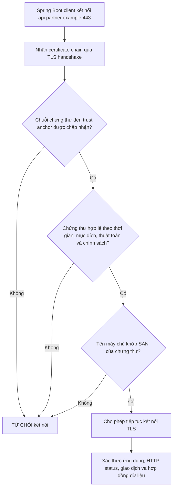
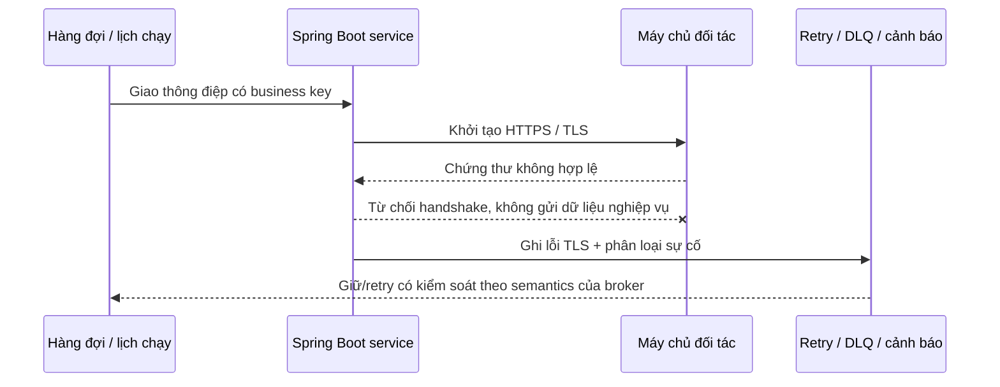
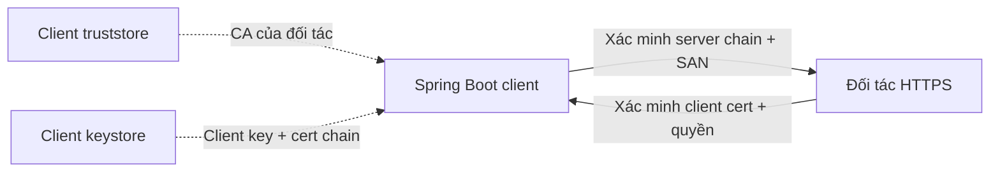
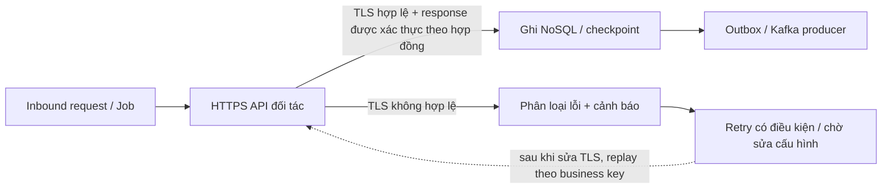

# Từ chối kết nối không hợp lệ thay vì bỏ kiểm tra chứng thư

Một dịch vụ Spring Boot có thể kết nối đến HTTP API, cơ sở dữ liệu, cache, broker thông điệp và các adapter của Spring Integration. Khi một kết nối TLS tới đối tác báo lỗi `PKIX path building failed` hoặc `No subject alternative DNS name matching`, có người sẽ đề xuất bật chế độ “trust all certificates”, bỏ xác minh tên máy chủ hoặc chuyển tạm sang HTTP để hệ thống chạy lại. Những thay đổi ấy có thể làm lỗi biến mất, nhưng đồng thời xóa bỏ khả năng xác nhận máy chủ mà ứng dụng thực sự đang kết nối.

Bài học thuộc chương **Bảo mật kết nối** trong module **SPRING_BOOT_INTEGRATION**. Mục tiêu là hiểu **khi nào phải từ chối kết nối**, tìm đúng nguyên nhân khiến chứng thư không hợp lệ và sửa cấu hình tin cậy theo cách có kiểm soát. Nguyên tắc này phải được duy trì xuyên suốt luồng tích hợp: từ HTTP client, cơ sở dữ liệu, cache và broker đến các inbound/outbound adapter, bao gồm xử lý lỗi, retry, giao dịch, chống xử lý trùng lặp, kiểm thử và quan sát.

## 1. Vì sao TLS phải kiểm tra cả chứng thư lẫn tên máy chủ?

TLS bảo vệ dữ liệu trên đường truyền và, khi được cấu hình đúng, xác thực danh tính của đầu bên kia. Mã hóa mà **không xác minh danh tính máy chủ** vẫn có thể tạo ra một đường truyền mã hóa đến một kẻ trung gian (*man-in-the-middle*). Vì vậy, “handshake có mã hóa thành công” chưa đủ để kết luận kết nối an toàn.



Các lớp kiểm tra quan trọng:

| Kiểm tra | Câu hỏi ứng dụng phải trả lời | Lỗi tiêu biểu |
| --- | --- | --- |
| **Certificate chain / trust anchor** | Chuỗi chứng thư có được xác minh đến một CA hoặc trust anchor mà ứng dụng chủ động tin cậy không? | `PKIX path building failed`, `unable to find valid certification path`. |
| **Thời hạn chứng thư** | Chứng thư đã có hiệu lực và chưa hết hạn theo đồng hồ đáng tin cậy chưa? | `CertificateExpiredException`, `CertificateNotYetValidException`. |
| **Tên máy chủ** | DNS name/IP trong URL kết nối có khớp mục `subjectAltName` (SAN) thích hợp không? | `No subject alternative DNS name matching`, `No subject alternative names present`. |
| **Ràng buộc CA và mục đích sử dụng** | Chuỗi, basic constraints, key usage, extended key usage và thuật toán được phép có phù hợp không? | Lỗi validation hoặc algorithm constraints. |
| **Thu hồi** | Chính sách bảo mật có yêu cầu xác minh CRL/OCSP không, và client đã cấu hình thực hiện chưa? | Có thể xuất hiện lỗi revocation khi kiểm tra được bật. |
| **Mutual TLS (nếu dùng)** | Bên server có xác minh chứng thư client và phân quyền đúng danh tính không? | Handshake bị từ chối hoặc lỗi client certificate. |

**Lưu ý:** kiểm tra thu hồi (CRL/OCSP) **không mặc nhiên được bật hoặc thực thi đồng nhất** trong mọi JVM, driver và cấu hình. Nếu hệ thống yêu cầu kiểm tra thu hồi, phải xác minh chính sách và hành vi của đúng TLS provider/client đang chạy; không tuyên bố “đã kiểm tra chứng thư” là tương đương “đã kiểm tra trạng thái thu hồi”.

Trong triển khai phổ biến, SAN là nguồn danh tính cho DNS/IP. Nếu URL truy cập bằng `https://10.20.30.40`, chứng thư cần có SAN kiểu **IP address** phù hợp; DNS SAN chứa tên máy chưa đủ để xác minh địa chỉ IP. Nếu truy cập bằng `https://api.partner.example`, DNS SAN phải phù hợp với tên đó. Không đổi URL sang `localhost`, địa chỉ IP hoặc alias tùy tiện rồi tắt hostname verification để che sự không khớp.

## 2. Fail closed: kết nối sai phải thất bại rõ ràng

*Fail closed* nghĩa là **không tiếp tục thực hiện thao tác qua một kết nối khi xác minh chứng thư hoặc tên máy chủ thất bại**. Trong luồng tích hợp, điều này thường thể hiện bằng exception, đánh dấu giao dịch là thất bại theo thiết kế và chuyển sự kiện vào cơ chế xử lý lỗi phù hợp.



Không được suy ra rằng mọi loại lỗi kết nối đều có cùng chính sách retry:

- **Sai trust anchor, sai hostname, chứng thư hết hạn hoặc bị từ chối vì chính sách:** lỗi thường cần **sửa chứng thư, CA, URL hoặc cấu hình**. Retry liên tục với cùng cấu hình không làm kết nối hợp lệ và có thể gây bão request.
- **Timeout mạng, mất kết nối tạm thời, server quá tải:** có thể retry với giới hạn, backoff, jitter và circuit breaker tùy tính chất thao tác.
- **HTTP 401/403/4xx sau khi TLS thành công:** đây thường là lỗi xác thực/phân quyền hoặc hợp đồng API, **không phải** bằng chứng chứng thư TLS sai.
- **HTTP 5xx sau khi TLS thành công:** xử lý theo hợp đồng API và idempotency, không sửa truststore để “chữa”.

Với message broker, cách ACK/NACK, requeue hoặc đưa vào dead-letter queue phải theo semantics của adapter và giao dịch thực tế. Không ACK thành công một thông điệp chưa được ghi/gửi thành công chỉ vì đã ghi log lỗi TLS. Nếu upstream có thể giao lại, đích cần hỗ trợ idempotency key hoặc cơ chế đối soát chống xử lý trùng lặp.

## 3. Những “cách sửa” nguy hiểm cần loại bỏ

| Cách làm sai | Vì sao nguy hiểm | Phương án đúng |
| --- | --- | --- |
| Tạo `TrustManager` luôn chấp nhận mọi chứng thư. | Không kiểm tra chuỗi CA, hạn dùng và các ràng buộc của server identity. | Xây truststore với CA/trust anchor được phê duyệt, giữ PKIX validation. |
| Dùng `NoopHostnameVerifier` hoặc `HostnameVerifier` luôn trả `true`. | Một chứng thư hợp lệ cho **máy khác** vẫn có thể được chấp nhận. | Dùng URL trùng DNS/IP SAN, giữ hostname verification. |
| Dùng `InsecureTrustManagerFactory` cho client kết nối thật. | Bỏ quá trình xác minh chứng thư máy chủ. | Cung cấp trust material chính xác và kiểm tra trong test. |
| Chuyển `https://` sang `http://` khi TLS thất bại. | Mất bảo vệ mã hóa và xác thực trên đường truyền. | Giữ HTTPS; trả lỗi hoặc tạm ngừng luồng cho đến khi xử lý nguyên nhân. |
| Tự động tải chứng thư do endpoint đang trả về rồi đưa ngay vào truststore. | Nếu đang bị MITM, ứng dụng có thể “tin” chính chứng thư của kẻ tấn công. | Xác minh CA hoặc fingerprint từ kênh độc lập đã được phê duyệt trước khi import. |
| Tắt validation trong môi trường test rồi giữ nguyên khi đưa lên production. | Test không phát hiện được lỗi trust chain, hostname hoặc chứng thư quay vòng. | Test bằng chứng thư test hợp lệ và test âm tính với chứng thư sai. |
| Bật `javax.net.ssl.trustStore` trỏ tới truststore dùng chung quá rộng. | Mở rộng phạm vi CA tin cậy cho toàn bộ client trên JVM, khó kiểm soát từng đối tác. | Ưu tiên truststore/SSL bundle riêng cho từng kết nối khi thư viện hỗ trợ. |

Không có “ngoại lệ tạm thời” an toàn nếu để nguyên trust-all trong binary production. Đối với thử nghiệm có máy chủ tự ký (*self-signed*), có thể **chủ động tin cậy một chứng thư/trust anchor cụ thể đã xác minh ngoài băng**, đồng thời vẫn kiểm tra SAN và các ràng buộc cần thiết. “Tin cậy chứng thư test cụ thể” khác hoàn toàn với “chấp nhận bất kỳ chứng thư nào”.

## 4. Xác định truststore, keystore và SSL bundle

Ba khái niệm thường dễ nhầm:

| Khái niệm | Thông thường chứa gì? | Ai dùng? |
| --- | --- | --- |
| **Truststore** | Chứng thư CA/trust anchor được dùng xác minh phía đối diện. | Client xác minh server; server xác minh client nếu bật mTLS. |
| **Keystore (identity)** | Private key + certificate chain của **chính bên đang kết nối**. | Server trình chứng thư của server; client trình chứng thư client trong mTLS. |
| **SSL bundle** | Cấu hình và vật liệu TLS được Spring Boot đặt tên, có thể gồm truststore/keystore. | Những client/server/adapter **được cấu hình sử dụng bundle đó**. |

Ứng dụng gọi REST API đối tác **chỉ cần xác minh server** thì thường cấu hình truststore; chưa cần private key hay client certificate. Nếu đối tác yêu cầu **mutual TLS (mTLS)**, ứng dụng còn phải có client private key và certificate chain phù hợp. mTLS không thay thế bearer token, OAuth hoặc phân quyền nghiệp vụ nếu hệ thống còn yêu cầu chúng.

Sơ đồ mTLS:



**Phạm vi tin cậy:** root CA hoặc intermediate CA được import vào truststore có thể cấp chứng thư cho **nhiều tên khác nhau**. Hostname verification vẫn là bước độc lập bắt buộc để hạn chế kết nối đúng host. Nếu chỉ có một đối tác yêu cầu CA nội bộ, nên cô lập truststore của đối tác thay vì đưa CA đó vào truststore toàn bộ JVM.

## 5. Cấu hình Spring Boot với truststore riêng cho đối tác

Giả sử ứng dụng gọi `https://api.partner.example`, còn CA nội bộ của đối tác được cung cấp qua kênh đáng tin cậy. Ví dụ dành cho **Spring Boot phiên bản có hỗ trợ SSL Bundles** (Spring Boot 3.1+; với phiên bản khác cần đối chiếu API/tên property).

### 5.1. Chuẩn bị truststore

Trước tiên, xác minh fingerprint và chủ thể của chứng thư CA do đối tác bàn giao bằng kênh độc lập. Có thể dùng lệnh:

```bash
# Chỉ xem thông tin; không tự coi file vừa tải từ endpoint là đáng tin cậy.
keytool -printcert -file partner-root-ca.pem

# Tạo một truststore riêng; keytool sẽ hỏi mật khẩu tương tác.
keytool -importcert \
  -alias partner-root-ca \
  -file partner-root-ca.pem \
  -keystore partner-truststore.p12 \
  -storetype PKCS12

# Xác minh truststore sau khi import.
keytool -list -v \
  -alias partner-root-ca \
  -keystore partner-truststore.p12 \
  -storetype PKCS12
```

Đưa truststore vào cơ chế secret/mount của môi trường chạy, cấp quyền đọc tối thiểu cho tiến trình. Không commit private key, mật khẩu thật hoặc truststore chứa dữ liệu nhạy cảm vào Git. Mật khẩu truststore được quản lý qua secret; tránh đưa mật khẩu vào tham số CLI vì dễ lọt vào history/process listing. Fingerprint phải được đối chiếu với thông tin từ bên có thẩm quyền, không chỉ lấy từ một TLS handshake đang báo lỗi.

### 5.2. Khai báo named SSL bundle

```yaml
spring:
  ssl:
    bundle:
      jks:
        partner:
          truststore:
            location: file:/run/secrets/partner-truststore.p12
            password: "${PARTNER_TRUSTSTORE_PASSWORD}"
            type: PKCS12
```

Tên bundle ở đây là `partner`. Property được cấu hình để Spring Boot có thể tạo SSL context từ trust material của đối tác. **Khai báo bundle chưa đồng nghĩa mọi HTTP client, JDBC driver hoặc messaging adapter tự động sử dụng bundle đó.** Phải gắn bundle vào đúng client/driver và kiểm thử kết nối thật.

Nếu sử dụng hệ thống CA công cộng đã có trong truststore mặc định của JDK, có thể không cần truststore tùy biến. Chỉ thêm trust anchor khi có căn cứ và phạm vi tin cậy rõ ràng. Khi dùng bundle chứa truststore riêng, cần xác nhận toàn bộ chuỗi CA mà client muốn tin cậy vẫn được giải quyết đúng; đừng mặc định rằng bundle tự hợp nhất mọi root CA mặc định của JVM.

### 5.3. Dùng bundle trong một HTTPS client Java 17+

Ví dụ Spring Boot cấu hình một `java.net.http.HttpClient` riêng cho đối tác. Client này dùng `SSLContext` do bundle cung cấp và giữ việc xác minh danh tính server mặc định:

```java
import java.net.http.HttpClient;
import java.time.Duration;
import javax.net.ssl.SSLContext;

import org.springframework.boot.ssl.SslBundles;
import org.springframework.context.annotation.Bean;
import org.springframework.context.annotation.Configuration;

@Configuration(proxyBeanMethods = false)
public class PartnerTlsConfiguration {

    @Bean
    HttpClient partnerHttpClient(SslBundles sslBundles) {
        SSLContext sslContext =
                sslBundles.getBundle("partner").createSslContext();

        return HttpClient.newBuilder()
                .sslContext(sslContext)
                .connectTimeout(Duration.ofSeconds(5))
                .build();
    }
}
```

Lời gọi sử dụng bean `HttpClient`:

```java
import java.io.IOException;
import java.net.URI;
import java.net.http.HttpClient;
import java.net.http.HttpRequest;
import java.net.http.HttpResponse;
import java.time.Duration;
import javax.net.ssl.SSLException;

public class PartnerApiClient {
    private final HttpClient client;

    public PartnerApiClient(HttpClient partnerHttpClient) {
        this.client = partnerHttpClient;
    }

    public String fetchStatus() throws IOException, InterruptedException {
        HttpRequest request = HttpRequest.newBuilder()
                .uri(URI.create("https://api.partner.example/status"))
                .timeout(Duration.ofSeconds(10))
                .GET()
                .build();

        try {
            HttpResponse<String> response =
                    client.send(request, HttpResponse.BodyHandlers.ofString());
            if (response.statusCode() != 200) {
                throw new IOException(
                        "Unexpected partner response: " + response.statusCode());
            }
            return response.body();
        } catch (SSLException e) {
            // Thất bại kiểm tra TLS: báo lỗi, giữ cause để chẩn đoán.
            // Tuyệt đối không tạo client trust-all để gọi lại.
            throw new IOException("Partner TLS validation failed", e);
        }
    }
}
```

Đây là mẫu minh họa nguyên tắc; khi dùng `RestClient`, `WebClient`, Apache HttpClient, OkHttp hoặc driver database/broker, cách gắn SSL bundle/trust manager có API riêng theo phiên bản. Không thay cấu hình bảo mật bằng cách tạo một `SSLContext` luôn chấp nhận mọi server. Đặc biệt, không đặt thuộc tính JDK nội bộ để tắt hostname verification của Java HTTP client.

Đoạn ví dụ chỉ mô tả thao tác GET; đối với POST/PUT phát sinh side effect, việc retry sau `IOException` cần xác định liệu request đã đến server chưa và dùng idempotency key. Ngoài connect timeout, cần có request deadline và chính sách retry/breaker phù hợp với SLA.

### 5.4. Nếu sử dụng Spring `RestClient` hoặc `WebClient`

Spring Boot có tích hợp SSL bundle với một số client builder, nhưng tên API có thể thay đổi giữa các major version. Chẳng hạn với các dòng Spring Boot 3.x có hỗ trợ `RestClientSsl`, có thể áp dụng named bundle vào `RestClient.Builder`. Với WebClient dựa trên Reactor Netty, phải cấu hình TLS qua lớp connector/Netty theo API của phiên bản đang dùng. Dù dùng cách nào, kiểm thử phải chứng minh **đúng bean client gọi đối tác** sử dụng truststore dự kiến và hostname verification vẫn bật.

## 6. Chứng thư nội bộ, reverse proxy và sự khác biệt của hostname

Các lỗi cấu hình phổ biến:

| Tình huống | Kết nối có thể thất bại vì | Cách sửa đúng |
| --- | --- | --- |
| Gọi `https://api.partner.example` nhưng server trả cert cho `app.internal`. | SAN không khớp hostname được gọi. | Cấp chứng thư có DNS SAN phù hợp hoặc sửa endpoint để gọi hostname được chứng thư bảo vệ. |
| Gọi server qua IP nhưng cert chỉ có DNS SAN. | IP không khớp danh tính chứng thư. | Dùng DNS hợp lệ hoặc cấp cert có IP SAN phù hợp. |
| Backend trả thiếu intermediate certificate. | Client không xây dựng được đường trust chain đầy đủ. | Cấu hình server/proxy gửi full chain đúng thứ tự; không import bừa leaf từ kết nối lỗi. |
| Proxy TLS termination trình cert riêng. | Client xác minh cert của proxy, không phải backend phía sau. | Quản lý chứng thư của đúng hostname public/internal mà client thực sự kết nối. |
| Đồng hồ máy chạy lệch. | Cert bị hiểu là chưa hiệu lực hoặc đã hết hạn. | Đồng bộ thời gian an toàn và sửa chứng thư nếu thực sự hết hạn. |
| CA nội bộ chưa được tin cậy. | PKIX path validation không tìm được trust anchor hợp lệ. | Xác minh CA ngoài băng rồi thêm vào truststore riêng đúng phạm vi. |
| Load balancer có nhiều node với cert khác nhau. | Một số lần handshake thành công, một số lần thất bại. | Kiểm tra toàn bộ node/ingress với đúng SNI, chain và SAN. |

**SNI (Server Name Indication)** giúp client thông báo hostname cần phục vụ trong quá trình TLS handshake, để máy chủ nhiều tên có thể chọn chứng thư phù hợp. SNI không thay thế hostname verification. Một lần kiểm tra bằng IP, không chỉ định SNI, có thể nhận cert mặc định của proxy và dẫn tới kết luận sai về endpoint ứng dụng thực sự gọi.

Khi dùng Kubernetes/service mesh, cần xác định rõ **TLS kết thúc ở đâu**, danh tính máy chủ nào được client kiểm tra và lớp nào thực hiện mTLS. Một sidecar hoặc ingress có chứng thư hợp lệ không tự chứng minh toàn bộ đoạn kết nối bên trong đã được bảo vệ như yêu cầu.

## 7. TLS với database, cache, broker và Spring Integration adapter

Tư duy fail closed áp dụng ở mọi kết nối outbound/inbound, nhưng cách đưa truststore vào từng thư viện không đồng nhất:

| Kênh tích hợp | Kiểm tra tối thiểu | Sai lầm thường gặp |
| --- | --- | --- |
| HTTP `RestClient` / `WebClient` / Java HttpClient | CA chain, SAN của host, request timeout, proxy, chứng thư quay vòng. | Trust-all/hostname verifier tắt chỉ ở một client dùng chung. |
| JDBC | Driver có dùng TLS không; `sslmode` hoặc cơ chế xác minh server identity của driver; CA/truststore. | Bật mã hóa nhưng dùng chế độ không xác minh danh tính, tưởng là đã an toàn. |
| MongoDB/Cassandra/Elasticsearch/Couchbase | TLS settings của driver/SDK, CA, hostname, DNS discovery và cluster node names. | Kết nối seed node hợp lệ nhưng node khác trình chứng thư sai SAN. |
| Redis | TLS client mode, CA, hostname verification và chế độ cluster/Sentinel. | Tắt kiểm tra chứng thư khi failover tới node khác. |
| Kafka/JMS/AMQP | TLS truststore, hostname verification, client certificate nếu mTLS; broker advertised listeners. | Chỉ xác minh bootstrap endpoint, bỏ qua broker mà client được điều hướng tới. |
| Spring Integration adapter | TLS do HTTP client, listener container, SDK hoặc driver bên dưới đảm nhiệm. | Nghĩ rằng cấu hình Spring Integration endpoint tự bật TLS validation cho thư viện transport. |

Với một số JDBC driver, chế độ “require SSL” chỉ đòi hỏi kết nối được mã hóa, nhưng không nhất thiết kiểm tra đầy đủ danh tính server; phải đọc tài liệu của **đúng driver và phiên bản**. Với Kafka, hostname verification là một cấu hình riêng trong client; đừng làm trống endpoint identification algorithm như một biện pháp sửa lâu dài. Với database cluster hoặc broker, xác minh từng địa chỉ node mà client thực tế kết nối sau discovery/failover.

Một hệ thống có các adapter Spring Integration nối HTTP → database → broker cần duy trì chứng thư hợp lệ ở **từng hop**, đồng thời quản lý lỗi sao cho sự kiện chưa hoàn tất không bị ghi nhận thành công. Mối quan hệ giữa TLS và giao dịch phải được đánh giá theo cách xử lý message: ví dụ không commit offset trước khi database đã ghi đúng hoặc HTTP downstream đã phản hồi theo hợp đồng.

## 8. Quy trình chẩn đoán khi TLS handshake thất bại

Khi client từ chối một chứng thư, giữ nguyên validation đang bật và đi theo thứ tự:

1. **Xác định endpoint thực:** URL/scheme, hostname, port, proxy, SNI, môi trường, instance và các node được client khám phá. Đặc biệt phân biệt hostname cấu hình với IP cuối cùng khi DNS hoặc load balancer tham gia.
2. **Lấy nguyên nhân gốc:** đọc `SSLHandshakeException`, `CertificateException`, `CertPathValidatorException` và các `cause` bên dưới. Không gom toàn bộ lỗi thành “network error”.
3. **Kiểm tra chứng thư server:** SAN, issuer, thời hạn, key usage, chain intermediate, thuật toán, SNI, tình trạng chứng thư trên mọi node.
4. **Kiểm tra trust material client:** file mount có tồn tại, định dạng JKS/PKCS12 đúng, alias/trust anchor đúng, secret/password được cung cấp, SSL bundle có thực sự gắn vào client đó không.
5. **Xác minh điều kiện vận hành:** đồng hồ hệ thống, DNS, proxy, TLS protocol/cipher được chấp nhận, chính sách revocation nếu bắt buộc.
6. **Sửa cấu hình hoặc phát hành lại chứng thư từ nguồn có thẩm quyền:** kiểm thử âm tính và dương tính trước khi phục hồi luồng. Không auto-import một chứng thư vừa thấy trong kết nối thất bại.

Một số lệnh hỗ trợ kiểm tra **ngoài ứng dụng**:

```bash
# Trình bày chuỗi mà server trả về, dùng SNI theo hostname thực tế.
openssl s_client \
  -connect api.partner.example:443 \
  -servername api.partner.example \
  -showcerts

# Kiểm tra chain với CA đã được xác minh, đồng thời kiểm tra DNS hostname.
openssl s_client \
  -connect api.partner.example:443 \
  -servername api.partner.example \
  -CAfile partner-root-ca.pem \
  -verify_hostname api.partner.example \
  -verify_return_error

# Kiểm tra metadata của một certificate file tại chỗ.
openssl x509 -in partner-server.pem \
  -noout -subject -issuer -dates -ext subjectAltName
```

**Giới hạn:** lệnh `openssl s_client` sử dụng trust configuration của OpenSSL theo tham số cung cấp, trong khi ứng dụng Java có truststore/SSL bundle và provider riêng. OpenSSL xác nhận được một số thuộc tính của endpoint, **chưa chứng minh** JVM/driver production đã cấu hình đúng. Phiên bản OpenSSL và TLS có thể khác nhau; đặc biệt kiểm tra đầy đủ SAN, chain, SNI và thuật toán bằng đúng ứng dụng sau khi sửa.

Khi cần debug JSSE ở môi trường kiểm soát, Java hỗ trợ tùy chọn `-Djavax.net.debug=ssl,handshake` (và debug cert path theo tài liệu JDK). Dùng trong thời gian ngắn, giới hạn quyền truy cập log: dữ liệu handshake có thể chứa hostname, chứng thư và chi tiết hạ tầng. Không ghi private key, bearer token, mật khẩu truststore/keystore hoặc payload nghiệp vụ nhạy cảm vào log.

### Bảng phân loại lỗi

| Log/lỗi quan sát | Kiểm tra trước tiên | Hành động nên làm |
| --- | --- | --- |
| `PKIX path building failed` | CA trong truststore, intermediate chain, bundle gắn vào đúng client. | Bổ sung chain/trust anchor đã xác thực; sửa server nếu thiếu intermediate. |
| `No subject alternative DNS name matching` | Hostname URL và DNS SAN của cert. | Sửa URL/cert; giữ hostname verifier. |
| `CertificateExpiredException` | Ngày hết hạn ở server/proxy, clock skew. | Gia hạn/cấp lại chứng thư, bảo đảm chain mới. |
| `CertificateNotYetValidException` | `notBefore`, đồng hồ hệ thống. | Sửa lệch giờ hoặc cert triển khai sai lịch. |
| `handshake_failure` | TLS version, cipher, auth, mTLS, SNI, server logs. | Đối chiếu chính sách hai phía; không hạ bảo mật tùy tiện. |
| `bad_certificate` / `certificate_required` | Chứng thư client nếu mTLS, quyền và CA server tin cậy. | Kiểm tra keystore identity và server truststore. |
| Timeout hoặc connection reset | Mạng, proxy, tải server, firewall hoặc TLS middlebox. | Phân biệt với lỗi PKIX; retry có giới hạn nếu phù hợp. |

## 9. Kiểm thử dương tính và âm tính: chứng minh ứng dụng biết từ chối

Một bài test “kết nối HTTPS trả về 200” chỉ chứng minh nhánh thành công. Yêu cầu quan trọng hơn là **chứng minh không thể kết nối khi chứng thư không hợp lệ**. Dùng một TLS test server cục bộ hoặc test environment với PKI riêng; tránh phụ thuộc chứng thư production hoặc truy cập endpoint Internet ngẫu nhiên trong CI.

| Test case | Cách chuẩn bị | Kỳ vọng |
| --- | --- | --- |
| **Hợp lệ** | Chain dẫn đến CA test đã tin cậy, SAN đúng hostname, cert trong thời hạn. | Handshake thành công; request xử lý theo hợp đồng. |
| **CA không tin cậy** | Server dùng cert từ CA khác với truststore client. | Handshake thất bại; không có request nghiệp vụ được xác nhận thành công. |
| **Sai hostname** | Cert hợp lệ với `other.test` nhưng client truy cập `api.test`. | TLS bị từ chối dù CA được tin cậy. |
| **Hết hạn/chưa có hiệu lực** | Cert test có hạn dùng sai thời gian. | Kết nối bị từ chối trong chính sách validation. |
| **Thiếu intermediate** | Test server không gửi chain cần thiết và client không có sẵn intermediate phù hợp. | Client từ chối nếu không dựng được chuỗi đến trust anchor. |
| **Bị thay truststore** | Khởi động ứng dụng với truststore khác hoặc file không hợp lệ. | Startup/call thất bại theo cấu hình, không tự fallback trust-all. |
| **Đổi chứng thư hợp lệ** | Deploy cert mới có SAN đúng, chain tin cậy trong cửa sổ rotation. | Kết nối vẫn thành công qua từng giai đoạn rotation. |
| **mTLS thiếu identity** | Server yêu cầu client cert, client không cung cấp cert hợp lệ. | Handshake/authentication bị từ chối. |

Với `HttpClient` của Java hoặc client sử dụng JSSE, lỗi TLS có thể biểu hiện dưới các lớp `SSLHandshakeException`, `SSLException` hoặc exception client bọc phía ngoài. Test nên xác minh **nguyên nhân bảo mật và thất bại của thao tác**, tránh khẳng định chỉ có một lớp exception bất biến giữa các HTTP client.

Ví dụ hướng kiểm thử JUnit khi đã dựng sẵn TLS test server không được client tin cậy:

```java
import static org.assertj.core.api.Assertions.assertThatThrownBy;

import java.net.URI;
import java.net.http.HttpClient;
import java.net.http.HttpRequest;
import java.net.http.HttpResponse;
import java.time.Duration;
import org.junit.jupiter.api.Test;

class PartnerTlsRejectionTest {

    // Client được cấu hình với truststore test KHÔNG tin server dưới đây.
    private final HttpClient client = createStrictTestClient();
    private final URI wrongCertificateEndpoint = URI.create(
            "https://localhost:8443/test");

    @Test
    void rejectsUntrustedServerCertificate() {
        HttpRequest request = HttpRequest.newBuilder()
                .uri(wrongCertificateEndpoint)
                .timeout(Duration.ofSeconds(3))
                .GET()
                .build();

        assertThatThrownBy(() ->
                client.send(request, HttpResponse.BodyHandlers.ofString()))
                .isInstanceOf(java.io.IOException.class);
        // Trong test đầy đủ: xác nhận cause có lỗi TLS validation
        // và server handler chưa xử lý yêu cầu nghiệp vụ.
    }

    private static HttpClient createStrictTestClient() {
        // Fixture của test cung cấp SSLContext với CA test xác định.
        // Không trả về SSLContext trust-all.
        return HttpClient.newBuilder().build();
    }
}
```

**Đây là khung test mang tính mô tả:** `createStrictTestClient()` cần được thay bằng fixture tạo client với truststore test, và test server phải được khởi động thật tại URL tương ứng. Không nên copy nguyên khung vào CI rồi xem đó là bằng chứng đã kiểm tra TLS; cần kiểm thử tích hợp có test certificate cụ thể, assert đúng exception chain và chứng minh request không được xử lý. Ví dụ dùng `HttpClient.newBuilder().build()` trong phần khung chưa gắn named bundle riêng; triển khai test thực tế phải sử dụng cấu hình TLS giống client production.

Với Spring Integration, còn cần test tại **adapter thật**: khi chứng thư downstream sai, thông điệp được đưa vào error flow/retry/DLQ như thiết kế và không được ghi “đã đồng bộ”. Khi sửa chứng thư, sự kiện có thể phát lại an toàn nhờ idempotency key, transactional outbox hoặc checkpoint phù hợp.

## 10. Quay vòng chứng thư mà không mở cửa tin cậy

Chứng thư, intermediate CA và đôi khi cả root CA sẽ được thay đổi. Để đổi chứng thư an toàn mà không dẫn tới việc tắt validation giữa chừng:

1. **Kiểm kê phụ thuộc:** liệt kê các client dùng chứng thư, hostnames, CA, truststore, ngày hết hạn và trách nhiệm cấp/renew. Nhắc riêng các node sau load balancer, database cluster hoặc broker advertised listeners.
2. **Chuẩn bị chain mới:** xác minh CA/fingerprint ngoài băng, kiểm tra SAN, thời hạn và policy. Nếu CA thay đổi, lên kế hoạch giai đoạn tin cậy chồng lắp **CA cũ và mới đã phê duyệt**.
3. **Cập nhật client trước theo kế hoạch:** phân phối truststore/bundle có thêm trust anchor cần thiết, triển khai theo từng phần và test kết nối với cả chain cũ/mới trong giai đoạn chuyển tiếp.
4. **Chuyển chứng thư server:** đảm bảo mọi node/proxy phục vụ chain đúng; xác nhận SNI và hostname trong kết nối thật.
5. **Thu hẹp lại phạm vi tin cậy:** sau khi toàn bộ server/client đã đổi, loại bỏ CA cũ nếu không còn cần, tránh giữ quyền tin cậy rộng vô hạn.
6. **Xác nhận luồng nghiệp vụ:** kiểm tra rate lỗi handshake, request success, latency, retry và backlog; đối soát các sự kiện bị trì hoãn trong thời gian chuyển đổi.

Tránh tin rằng đổi file `partner-truststore.p12` trong volume sẽ khiến **mọi SSLContext/client hiện hữu nạp lại ngay**. Khả năng reload phụ thuộc Spring Boot version, SSL bundle và client/driver. Nếu không hỗ trợ reload an toàn, cần rolling restart có kế hoạch và kiểm thử cả giai đoạn chứng thư cũ/mới.

### Quan sát và cảnh báo

Nên thu thập: tỷ lệ bắt tay TLS thất bại theo đích và nguyên nhân, chứng thư sắp hết hạn, `connection refused` so với lỗi PKIX/hostname, số message thất bại, retry đang chờ, backlog/DLQ và thời gian phục hồi. Gắn correlation ID của luồng nghiệp vụ vào lỗi client khi thích hợp, nhưng không ghi private key, secret hoặc payload chứa dữ liệu cá nhân.

Với một đối tác đang thay CA, thông báo vận hành nên trả lời: **đích nào bị ảnh hưởng, chứng thư/CA nào đang dùng, phiên bản truststore nào đã triển khai, ứng dụng nào đã xác minh thành công và sự kiện nào phải xử lý lại**. Cảnh báo chỉ ghi “SSL error” thường không đủ để khắc phục nhanh.

## 11. Tình huống thực tế: HTTP → NoSQL → broker

Giả sử Spring Boot nhận yêu cầu đồng bộ đơn hàng rồi gọi HTTPS API đối tác, lưu kết quả vào Cassandra và phát thông điệp Kafka:



Trong tình huống chứng thư của API đối tác sai hostname:

- Client **từ chối handshake**; hệ thống không coi giao dịch nghiệp vụ là hoàn tất.
- Không ghi kết quả thành công giả vào NoSQL và không phát event “đã đồng bộ” nếu đối tác chưa xác nhận.
- Ghi trạng thái lỗi có khả năng điều tra, hạn chế retry vô ích trong khi chứng thư chưa được sửa; gửi cảnh báo đến người phụ trách kết nối.
- Sau khi đối tác cấp chứng thư có SAN đúng và client xác minh thành công, chạy lại theo business key; dùng idempotency để giảm nguy cơ lặp nếu trước đó có lần gọi không xác định kết quả.

Không phải mọi `SSLException` đều bảo đảm request chưa tới server trong mọi kiểu client và mọi giai đoạn kết nối; vì thế chính sách replay của thao tác **có side effect** vẫn phải dựa trên idempotency/đối soát, đặc biệt nếu lỗi xảy ra sau khi một kết nối đã thiết lập trước đó hoặc trong lúc trao đổi dữ liệu.

## 12. Checklist trước khi phát hành

- [ ] Không có trust-all `TrustManager`, `NoopHostnameVerifier`, `InsecureTrustManagerFactory` hoặc fallback HTTP trong đường chạy production.
- [ ] URL/hostname thật khớp DNS/IP SAN; TLS chain đến CA được phép, thời hạn và chính sách chứng thư hợp lệ.
- [ ] CA nội bộ/trust anchor được xác minh qua kênh độc lập; truststore và SSL bundle có phạm vi tối thiểu.
- [ ] Đúng HTTP client/SDK/driver/adapter đã được cấu hình sử dụng truststore; không chỉ khai báo property nhưng bỏ gắn client.
- [ ] mTLS, nếu có, dùng identity key/cert riêng và server vẫn xác minh client; secret được quản lý an toàn.
- [ ] Có test **thành công** và test **từ chối** cho CA sai, hostname sai, cert hết hạn, thiếu chain cùng tình huống rotation.
- [ ] Lỗi TLS được phân loại và quan sát; retry có giới hạn, không ACK thành công khi nghiệp vụ chưa hoàn tất.
- [ ] Luồng tích hợp có idempotency/outbox/checkpoint khi cần; có phương án xử lý backlog sau khi sửa lỗi chứng thư.
- [ ] Có kế hoạch rotate cert/CA, kiểm tra expiry, rolling update/reload, rollback và thu hồi trust anchor cũ.

### Tài liệu tham khảo

- [Spring Boot — SSL](https://docs.spring.io/spring-boot/reference/features/ssl.html): SSL bundles và cách quản lý vật liệu TLS.
- [Spring Boot — Calling REST Services](https://docs.spring.io/spring-boot/reference/io/rest-client.html): cấu hình HTTP client phù hợp với phiên bản Spring Boot.
- [Java Secure Socket Extension (JSSE) Reference Guide](https://docs.oracle.com/en/java/javase/21/security/java-secure-socket-extension-jsse-reference-guide.html): TLS, trust manager và chứng thư trong Java.
- [RFC 5280 — X.509 Public Key Infrastructure](https://www.rfc-editor.org/rfc/rfc5280): profile chứng thư, path validation và các extension.
- [RFC 9525 — Service Identity in TLS](https://www.rfc-editor.org/rfc/rfc9525): các nguyên tắc xác minh danh tính dịch vụ TLS.
- [OWASP — Transport Layer Security Cheat Sheet](https://cheatsheetseries.owasp.org/cheatsheets/Transport_Layer_Security_Cheat_Sheet.html): thực hành TLS an toàn ở phía client và server.

**Điểm cần ghi nhớ:** Khi lỗi PKIX, SAN hoặc chứng thư xuất hiện, phản ứng đúng là **từ chối kết nối và sửa nguyên nhân**. Vô hiệu hóa kiểm tra chứng thư có thể khiến ứng dụng hoạt động trở lại trong ngắn hạn nhưng phá vỡ xác thực danh tính server. Một luồng Spring Boot đáng tin cậy cần truststore đúng phạm vi, hostname verification luôn hoạt động, các test từ chối rõ ràng và chính sách retry/idempotency phù hợp với hợp đồng dữ liệu.
