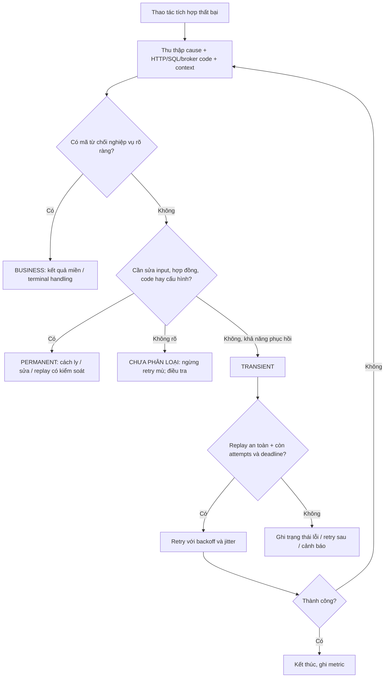
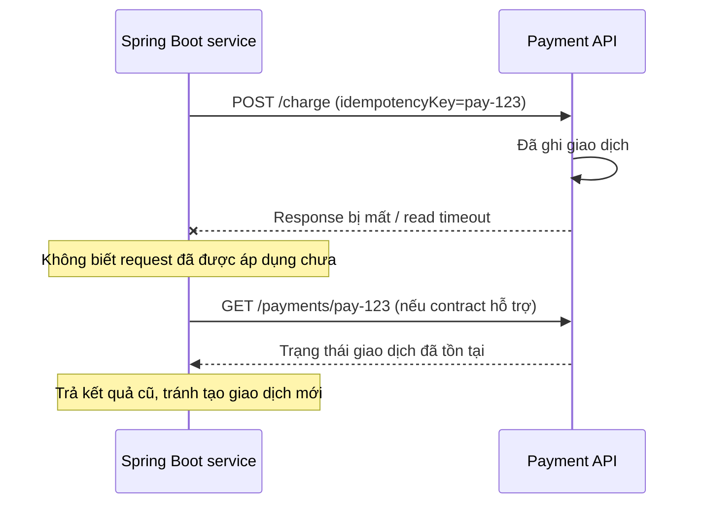
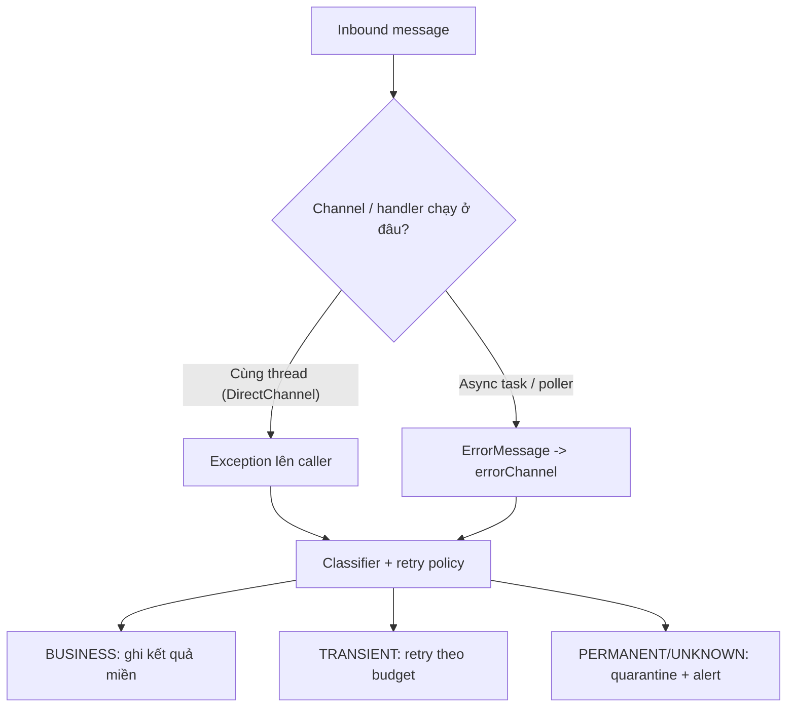

# Phân loại lỗi tạm thời, lỗi vĩnh viễn và lỗi nghiệp vụ

> **Chương:** Phục hồi khi lỗi  
> **Phạm vi:** SPRING_BOOT_INTEGRATION — tích hợp HTTP client, cơ sở dữ liệu, cache, broker thông điệp và Spring Integration; tập trung vào hợp đồng dữ liệu, giao dịch, lỗi, xử lý trùng lặp, kiểm thử và khả năng quan sát.

## 1. Tại sao phải phân loại lỗi trước khi phục hồi?

Trong hệ thống Spring Boot, một yêu cầu đặt hàng có thể ghi PostgreSQL, kiểm tra Redis, gọi HTTP API thanh toán và phát sự kiện sang RabbitMQ hoặc Kafka. Khi một bước thất bại, cách xử lý phải phụ thuộc vào **nguyên nhân**, **khả năng nguyên nhân biến mất**, **ý nghĩa nghiệp vụ** và **tác dụng phụ của lần thử trước**.

Ví dụ:

- HTTP `503 Service Unavailable` do đối tác đang bảo trì có thể phục hồi sau một khoảng ngắn.
- Payload thiếu `orderId` hoặc schema không tương thích sẽ tiếp tục sai nếu gửi lại nguyên trạng.
- Yêu cầu rút tiền vượt số dư là kết quả từ chối hợp lệ theo quy tắc nghiệp vụ; không nên tự động thử lại liên tục.
- HTTP timeout sau khi gửi yêu cầu thanh toán **không chứng minh giao dịch chưa xảy ra**. Nếu thử lại mà không dùng idempotency key, khách hàng có thể bị tính tiền hai lần.

Vì thế, không thể viết một quy tắc duy nhất kiểu “bất kỳ `Exception` nào cũng retry ba lần”. Đầu tiên phải chuẩn hóa lỗi theo ba nhóm; sau đó mới chọn hành động phù hợp với loại thao tác và ngân sách phục hồi.

### 1.1. Ba loại lỗi

| Loại | Định nghĩa để ra quyết định | Ví dụ | Hành động mặc định |
| --- | --- | --- | --- |
| **Tạm thời** (*transient*) | Nguyên nhân có khả năng biến mất mà không cần sửa input hoặc code; thao tác có thể thành công khi thử lại **trong điều kiện thích hợp** | Timeout mạng, HTTP 429/503, deadlock DB, broker quá tải | Retry có giới hạn **nếu an toàn**, backoff + jitter; hết ngân sách thì phục hồi hoặc chuyển trạng thái lỗi |
| **Vĩnh viễn** (*permanent*) | Với cùng input/cấu hình hiện tại, thử lại ngay không giải quyết được; phải sửa dữ liệu, code, hợp đồng hoặc cấu hình | JSON sai schema, đường dẫn API sai, SQL sai cú pháp, thiếu quyền cố định | Không lặp lại tự động; thông báo/ghi nhận, cách ly bản tin lỗi, sửa nguyên nhân rồi replay có kiểm soát |
| **Nghiệp vụ** (*business*) | Hệ thống hiểu yêu cầu nhưng một quy tắc miền quyết định **không thực hiện** hoặc chọn một kết quả nghiệp vụ khác | Hết hàng, vượt hạn mức, đơn đã hủy, yêu cầu trùng theo quy tắc domain | Trả kết quả miền rõ ràng, ghi trạng thái từ chối/đã xử lý và kết thúc thông điệp theo hợp đồng |

Một lỗi có thể mang đồng thời khía cạnh “nghiệp vụ” và “tạm thời theo thời gian”. Chẳng hạn hết hàng có thể thay đổi sau khi nhập kho, nhưng **retry kỹ thuật ngay trong vài mili giây không phải cách chờ nhập kho**. Thay vào đó, mô hình miền có thể nhận đơn chờ, phát sự kiện bổ sung hàng, hoặc yêu cầu người dùng đặt lại.

**Quan trọng:** Nhãn “tạm thời” không tương đương với “an toàn để retry”. Quyết định retry còn phụ thuộc thao tác có idempotent hay không, có khóa chống trùng không, thời gian còn lại và số lần đã thử.

### 1.2. Hai câu hỏi riêng biệt

**Câu hỏi A — Bản chất lỗi là gì?**

- Nguồn lỗi ở tầng kết nối, hợp đồng dữ liệu, cấu hình, giao dịch hay quy tắc miền?
- Giữ nguyên request và môi trường thì lần thử sau có cơ hội thành công không?
- Có mã lỗi ổn định từ hệ thống đích để xác định tình huống không?

**Câu hỏi B — Có được thực hiện lại không?**

- Thao tác là đọc, ghi có tính idempotent, hay ghi có thể tạo tác dụng phụ mới?
- Lần trước đã được hệ thống đích áp dụng chưa? Có thể kiểm tra trạng thái hoặc dùng idempotency key không?
- Retry có vượt deadline của HTTP request, độ trễ cho phép, giới hạn broker/DB hoặc số lần thử tối đa không?

Nếu thiếu dữ kiện để trả lời A, đánh dấu **CHƯA PHÂN LOẠI** để điều tra và xử lý an toàn. Đây là một **trạng thái triage**, không phải loại lỗi thứ tư có thể tự ý retry.

## 2. Quy trình phân loại từ tín hiệu đến hành động

Một bộ phân loại hữu ích không chỉ xem tên exception mà còn dùng ngữ cảnh nghiệp vụ và cấu trúc phản hồi:

1. **Nhận diện thao tác:** gọi HTTP `GET` hay `POST`; đọc hay ghi DB; consume hay publish message; có transaction và idempotency key không?
2. **Xác định nguồn lỗi gốc:** unwrap `CompletionException`/`ExecutionException`, kiểm tra chuỗi `cause`, mã HTTP, SQLState, lỗi client/broker; phân biệt lỗi transport với thông báo nghiệp vụ trong response.
3. **Ưu tiên hợp đồng domain:** mã như `INSUFFICIENT_BALANCE` hoặc `ORDER_CANCELLED` có thể thuộc lỗi nghiệp vụ dù HTTP status là 409/422.
4. **Xác định tính khôi phục:** lỗi hạ tầng có thể tạm thời; input sai hoặc cấu hình sai không tự sửa; dữ kiện mơ hồ cần điều tra.
5. **Đánh giá độ an toàn và ngân sách:** chỉ retry khi nguyên nhân có thể phục hồi và thao tác replay an toàn, còn attempts, còn deadline.
6. **Chọn lối thoát bền vững:** hoàn thành, trả phản hồi nghiệp vụ, retry có kiểm soát, cách ly vào DLT/parking lot, hoặc báo động xử lý vận hành.



Trong thực tế, các điều kiện có thể phức tạp hơn sơ đồ: lỗi vĩnh viễn chưa được nhận biết có thể trông giống một HTTP 500. Vì vậy cần giới hạn retry, lưu mã lỗi và theo dõi tỷ lệ thất bại kéo dài thay vì giả định “5xx luôn tạm thời”.

## 3. Lỗi tạm thời: cách nhận diện và retry an toàn

### 3.1. Các tín hiệu thường gặp

| Tầng | Tín hiệu điển hình | Khi nào có thể thử lại? | Lưu ý |
| --- | --- | --- | --- |
| HTTP | `408`, `429`, `502`, `503`, `504` | Hệ thống đích sẵn sàng lại hoặc hết rate limit | Ưu tiên `Retry-After` nếu có; timeout có thể khiến trạng thái kết quả **không rõ** |
| HTTP | Lỗi DNS tạm, kết nối bị reset, connection timeout | Sự cố mạng ngắn hạn tự hồi phục | Sai hostname, proxy hoặc chứng chỉ lại là cấu hình cần sửa |
| SQL | Deadlock, serialization failure, kết nối DB rơi | Thử lại **toàn bộ đơn vị giao dịch** sau backoff | Không retry một câu lệnh đơn lẻ khi transaction đã ở trạng thái thất bại |
| Cache | Redis timeout, server quá tải, failover | Khi Redis/cluster phục hồi | Có thể fallback nếu cache chỉ là dữ liệu tăng tốc |
| Broker | Không kết nối được broker, leader/partition đổi, quota/backpressure | Khi kết nối/điều phối hồi phục | Có thể producer đã gửi được trước khi mất response; kiểm tra xác nhận và idempotency |
| Spring Integration | Adapter gửi/nhận lỗi kết nối tạm | Retry policy ở endpoint/handler nếu phù hợp | Tránh retry ở nhiều tầng cùng lúc |

Những ví dụ trên là **tín hiệu ban đầu**, không phải bản đồ cứng. HTTP 500 lặp lại vì bug hoặc dữ liệu làm lộ lỗi code không thể chữa bằng retry; `UnknownHostException` do viết sai DNS cũng không thể biến mất chỉ vì chờ.

### 3.2. Backoff, jitter, timeout và giới hạn số lần

Chính sách retry thường cần bốn thành phần:

- **Giới hạn lần thử:** ví dụ tối đa 3 lần thực hiện (1 lần đầu + 2 retry). Phải ghi rõ đang đếm *attempts* hay *retries*.
- **Backoff:** tăng khoảng chờ giữa các lần, thường theo hàm mũ. Ví dụ cơ sở 200 ms và hệ số 2 cho 200 ms, 400 ms trước các lần thử tiếp theo.
- **Jitter:** thêm ngẫu nhiên có kiểm soát để nhiều instance không đồng loạt dồn tải vào hệ thống đang lỗi.
- **Deadline:** tổng thời gian chờ, thời gian mạng và xử lý phải phù hợp với SLA của operation; không cho retry vượt timeout của người gọi.

Một dạng công thức tham khảo:

```text
capDelay(n) = min(maxDelay, initialDelay * 2^(n - 1))
sleep(n)    = random(0, capDelay(n))      // full jitter

n: số thứ tự lần retry (bắt đầu từ 1)
```

**Ví dụ:** request HTTP có deadline còn 900 ms thì không thể dành 5 giây cho retry ngay trong thread yêu cầu. Với các công việc dài, nên đưa vào hàng đợi hoặc scheduler có cơ chế phục hồi bền vững, không chặn request quá hạn.

HTTP `429 Too Many Requests` có thể đi kèm `Retry-After` (giây hoặc HTTP date). Cần parse theo chuẩn, giới hạn theo deadline và phân phối tải; không mặc định dùng backoff của ứng dụng nếu server yêu cầu chờ lâu hơn.

### 3.3. Retry storm và các lỗi cần tránh

Nếu HTTP client retry 3 lần, service layer retry 3 lần và broker redelivery 3 lần, một sự kiện có thể làm tối đa **27 lượt gọi downstream** dù người dùng chỉ gửi một yêu cầu. Quy ước một tầng làm chủ ngân sách retry, hoặc phối hợp tổng ngân sách giữa các tầng.

Các dấu hiệu cần ngăn sớm:

- Circuit breaker mở sau chuỗi thất bại để giảm áp lực; khi mở, hệ thống trả kết quả fallback/từ chối theo chính sách.
- Bulkhead và giới hạn concurrency để một downstream chậm không chiếm toàn bộ thread/connection.
- Timeout đọc/kết nối cụ thể; retry không được thay thế timeout.
- Giới hạn queue, số sự kiện retry theo thời gian, số lần redelivery và alert khi backlog tăng.
- Retry chỉ cho thao tác đọc/idempotent hoặc thao tác ghi có **cơ chế idempotency thực sự**.

Ví dụ `POST /payments` bị read timeout: đối tác có thể đã ghi nhận thanh toán. Muốn thử lại, API phải hỗ trợ một idempotency key ổn định hoặc cho phép truy vấn kết quả bằng transaction reference. Việc thêm header “Idempotency-Key” vô nghĩa nếu đối tác không áp dụng hợp đồng chống trùng.

## 4. Lỗi vĩnh viễn: không lặp lại khi chưa sửa nguyên nhân

Lỗi vĩnh viễn có nghĩa **trong điều kiện hiện tại**, tự gửi lại cùng yêu cầu sẽ tiếp tục thất bại:

| Dấu hiệu | Tình huống | Hành động phù hợp |
| --- | --- | --- |
| Payload sai schema, thiếu trường bắt buộc, kiểu dữ liệu không hợp lệ | Consumer đọc event với version không hỗ trợ | Đưa vào quarantine/DLT, lưu nguyên nhân, cập nhật schema hoặc sửa producer rồi replay |
| HTTP `400`, `415`, nhiều trường hợp `404` | Sai cấu trúc request, media type, endpoint | Sửa contract/URL; không retry ngay |
| HTTP `401`, `403` do credential/quyền sai | Token bị từ chối hoặc thiếu role cố định | Sửa credential/quyền; phân biệt token có thể refresh theo cơ chế chuẩn |
| SQL sai cú pháp, cột không tồn tại, migration chưa áp dụng | Code không tương thích database | Sửa code/schema/migration trước khi chạy lại |
| Lỗi mapping dữ liệu, serializer, codec | Producer và consumer bất đồng kiểu/schema | Nâng cấp phiên bản contract hoặc điều chỉnh mapping |
| Chứng chỉ TLS không tin cậy, cấu hình host không hợp lệ | Môi trường triển khai sai | Sửa TLS/DNS/secret rồi khởi động hoặc khôi phục kết nối |

**Không đồng nhất HTTP 4xx với lỗi vĩnh viễn.** `408` và `429` thường là tín hiệu tạm thời; `409 Conflict` có thể phản ánh optimistic locking tạm thời hoặc từ chối nghiệp vụ; `404` đôi khi chỉ là resource chưa được tạo trong hệ thống eventually consistent. Cần có hợp đồng với upstream trước khi kết luận.

Với bản tin lỗi dữ liệu (*poison message*), nếu consumer cứ requeue mãi, mọi lần phát lại sẽ chiếm tài nguyên và cản trở các bản tin hợp lệ. Giải pháp là retry có giới hạn, đưa bản tin tới DLT/quarantine, gắn mã lỗi/version, tạo quy trình điều tra, sửa dữ liệu và replay **chỉ sau khi xử lý nguyên nhân**.

Nếu lỗi vĩnh viễn là cấu hình **dùng chung cho cả dịch vụ**, như thiếu secret hoặc URL sai, thường nên báo unhealthy/fail startup hoặc dừng nhận việc; đẩy hàng nghìn message vào DLT không giải quyết gốc lỗi này.

## 5. Lỗi nghiệp vụ: biểu diễn kết quả miền và dừng vòng lặp kỹ thuật

Lỗi nghiệp vụ xảy ra khi hệ thống hiểu yêu cầu hợp lệ về mặt kỹ thuật nhưng quy tắc miền không cho phép trạng thái mong muốn. Chúng có thể là một **kết quả có chủ đích**, thay vì một sự cố hạ tầng.

Ví dụ:

| Mã nghiệp vụ | Ngữ cảnh | Kết quả mong đợi |
| --- | --- | --- |
| `INSUFFICIENT_STOCK` | Đơn vượt lượng tồn khả dụng | Trả từ chối/giữ trạng thái chờ, không tự gọi lại API liên tục |
| `INSUFFICIENT_BALANCE` | Số dư không đủ | Thông báo khách hàng; chờ nạp tiền/đổi phương thức |
| `ORDER_CANCELLED` | Yêu cầu giao hàng cho đơn đã hủy | Không giao hàng; đánh dấu event đã xử lý theo chính sách |
| `LIMIT_EXCEEDED` | Hạn mức nghiệp vụ, không phải rate limit kỹ thuật | Trả trạng thái từ chối theo domain |
| `DUPLICATE_ORDER` | Cùng yêu cầu được gửi lại với ID ổn định | Trả về kết quả cũ nếu đó là idempotent replay; hoặc kết quả conflict theo hợp đồng |
| `VERSION_CONFLICT` | State thay đổi giữa đọc và ghi | Phân biệt cạnh tranh kỹ thuật có thể retry với conflict nghiệp vụ cần người dùng giải quyết |

Mã lỗi nghiệp vụ cần được công bố bằng **error code ổn định**, kèm trạng thái, mô tả có thể hiển thị và correlation ID. Không nên trộn mã xử lý nghiệp vụ với raw exception message, stack trace hay câu SQL.

### 5.1. Lỗi validate khác lỗi từ chối miền

- **Validation kỹ thuật:** JSON không parse được, thiếu header bắt buộc, sai định dạng ngày. Thường thuộc lỗi dữ liệu/contract và có thể trả HTTP 400.
- **Validation nghiệp vụ:** số dư không đủ, đơn đã đóng, vượt hạn mức khách hàng. Thường trả lỗi miền, có thể biểu diễn bằng HTTP 409 hoặc 422 tùy API contract.
- **Điều kiện thay đổi theo thời gian:** hết hàng ở thời điểm hiện tại có thể trở thành còn hàng sau đó; **không** có nghĩa consumer được phép retry vô hạn cùng message.

Không dựa **duy nhất** vào HTTP status để xác định business: nhiều API trả HTTP 200 kèm `success=false` hoặc mã nghiệp vụ bên trong body. Khi tích hợp, cần chuẩn hóa ở adapter thành một domain result có type/code rõ ràng. Với API hỗ trợ Problem Details, có thể dùng `ProblemDetail` để trình bày lỗi nhất quán.

### 5.2. Quy tắc quyết định cho business error

1. Phát hiện domain error theo mã có trong hợp đồng, không suy từ chuỗi message tự do.
2. Xác định nó là kết quả cuối cùng, trạng thái chờ nghiệp vụ, hay cần thao tác người dùng.
3. Ghi trạng thái nghiệp vụ bền vững **trước khi ack** một event nếu xử lý bất đồng bộ.
4. Phản hồi cho người gọi hoặc xuất một *business event* phù hợp, không tự retry tầng transport.
5. Chỉ chạy lại khi có **tín hiệu nghiệp vụ mới**: khách hàng đổi phương thức thanh toán, kho nhập hàng, hạn mức được nâng, hoặc người vận hành duyệt.

## 6. Ma trận phân loại theo kênh tích hợp Spring Boot

| Kênh | Lỗi tạm thời thường gặp | Lỗi vĩnh viễn thường gặp | Lỗi nghiệp vụ | Phương án phục hồi |
| --- | --- | --- | --- | --- |
| HTTP `RestClient` / `WebClient` | Timeout, 429, 502/503/504 | URL sai, payload không hợp đồng, auth sai kéo dài | Từ chối thanh toán, hết quota nghiệp vụ | Map status + error code, deadline, retry an toàn, idempotency key |
| JDBC/JPA | Deadlock, serialization failure, connection dropped | SQL/schema sai, dữ liệu không hợp lệ | Unique business key, số dư/trạng thái không cho phép | Retry **toàn transaction** khi thích hợp; constraint + xử lý domain |
| Redis/cache | Timeout, failover, pool quá tải | Serializer không tương thích, key mapping hỏng | Cache miss thường **không phải lỗi nghiệp vụ** | Fallback DB khi cache optional, circuit breaker và metric |
| RabbitMQ/AMQP | Broker mất kết nối, consumer tạm không nhận | Message không deserialize được | Event yêu cầu trạng thái đã bị cấm | Giới hạn requeue, dead-letter exchange, ack/nack theo kết quả |
| Kafka/Pulsar | Broker/partition tạm thời không sẵn sàng, timeout | Schema registry/deserialize sai; config/topic sai | Domain rule reject trên event | Retry/backoff, DLT, checkpoint/ack đúng, idempotent consumer |
| Spring Integration | Adapter bị timeout, lỗi kết nối tới endpoint | Transformer/mapping không hợp đồng | Handler từ chối theo quy tắc miền | Error channel/advice/recoverer, phân loại trước khi quyết định phát lại |

### 6.1. Một vài ngoại lệ quan trọng với JDBC

Trong hệ sinh thái Spring, các exception `TransientDataAccessException` và `NonTransientDataAccessException` giúp định hướng phân loại theo tầng database. Tuy nhiên, exception translator **không hiểu toàn bộ quy tắc nghiệp vụ**:

- `DeadlockLoserDataAccessException` (ở các phiên bản hỗ trợ) hoặc dạng concurrency exception có thể là lỗi tạm thời; transaction thất bại phải rollback trước khi thử lại.
- `DuplicateKeyException` có thể là idempotent duplicate, conflict nghiệp vụ **hoặc bug tạo dữ liệu trùng**. Chỉ chuyển nó thành kết quả domain nếu biết rõ unique constraint nào và hợp đồng xử lý ra sao.
- SQLState nhóm lỗi kết nối, transaction rollback hoặc constraint violation chỉ là thông tin gợi ý; mapping phụ thuộc database, driver và translator thực tế.
- Không retry riêng phần SQL sau khi giao dịch đã ở trạng thái rollback-only hoặc phiên làm việc không còn hợp lệ.

### 6.2. Với HTTP, lỗi transport không đồng nghĩa kết quả nghiệp vụ chưa xảy ra

Sau `POST /charge`, client có thể gặp:



Nếu đối tác không có API tra cứu nhưng hỗ trợ idempotency key, có thể retry với **cùng key** và payload tương đương theo contract. Nếu không có cả hai, cần trạng thái `UNKNOWN/RECONCILIATION_REQUIRED` và quy trình đối soát thay vì tự phát một yêu cầu thanh toán mới.

## 7. Mẫu triển khai bộ phân loại lỗi với Spring Boot

Ví dụ dưới đây dùng Java 17 và các lớp của Spring Web + Spring JDBC. Mục tiêu là tách **phân loại** khỏi **chính sách thực hiện lại**: phân loại dựa trên exception và error code; lớp gọi mới quyết định có retry an toàn hay không. Các class minh họa có thể đặt chung package và tách ra file riêng khi đưa vào dự án.

### 7.1. Mô hình quyết định và domain error

```java
public enum FailureKind {
    TRANSIENT, PERMANENT, BUSINESS, UNCLASSIFIED
}
```

```java
public record FailureDecision(FailureKind kind, String code) {
}
```

```java
public final class BusinessRejectionException extends RuntimeException {
    private final String code;

    public BusinessRejectionException(String code, String message) {
        super(message);
        this.code = code;
    }

    public String code() {
        return code;
    }
}
```

`UNCLASSIFIED` ở đây là **trạng thái chờ triage**, ngăn code vô tình retry lỗi chưa hiểu. Sau khi xác minh có đủ bằng chứng, ứng dụng ánh xạ nó sang một trong ba loại chính. Exception nghiệp vụ chứa mã ổn định và message để chẩn đoán; HTTP adapter không nên làm lộ dữ liệu nội bộ khi trả cho người dùng.

### 7.2. Classifier: ưu tiên domain code rồi mới xét lỗi hạ tầng

```java
import java.net.ConnectException;
import java.net.SocketTimeoutException;
import java.net.UnknownHostException;
import java.util.concurrent.CompletionException;
import java.util.concurrent.ExecutionException;
import javax.net.ssl.SSLHandshakeException;

import org.springframework.dao.NonTransientDataAccessException;
import org.springframework.dao.TransientDataAccessException;
import org.springframework.web.client.HttpStatusCodeException;
import org.springframework.web.client.ResourceAccessException;

public final class IntegrationFailureClassifier {

    public FailureDecision classify(Throwable error) {
        Throwable failure = unwrapAsync(error);

        if (failure instanceof BusinessRejectionException business) {
            return new FailureDecision(
                    FailureKind.BUSINESS, business.code());
        }

        if (failure instanceof HttpStatusCodeException http) {
            int status = http.getStatusCode().value();

            if (status == 408 || status == 429 ||
                    status == 502 || status == 503 || status == 504) {
                return new FailureDecision(
                        FailureKind.TRANSIENT, "HTTP_" + status);
            }
            if (status == 409 || status == 422) {
                // Cần phân tích error code của upstream trước khi kết luận.
                return new FailureDecision(
                        FailureKind.UNCLASSIFIED, "HTTP_CONTRACT_" + status);
            }
            if (status >= 500) {
                // Có thể retry có giới hạn; 5xx kéo dài có thể là bug cố định.
                return new FailureDecision(
                        FailureKind.TRANSIENT, "HTTP_SERVER_" + status);
            }
            if (status >= 400) {
                return new FailureDecision(
                        FailureKind.PERMANENT, "HTTP_CLIENT_" + status);
            }
        }

        if (failure instanceof ResourceAccessException) {
            Throwable root = rootCause(failure);
            if (root instanceof SSLHandshakeException) {
                return new FailureDecision(
                        FailureKind.PERMANENT, "TLS_CONFIG_REVIEW");
            }
            if (root instanceof SocketTimeoutException) {
                return new FailureDecision(
                        FailureKind.TRANSIENT, "NETWORK_TIMEOUT_OUTCOME_UNKNOWN");
            }
            if (root instanceof ConnectException) {
                return new FailureDecision(
                        FailureKind.TRANSIENT, "CONNECTION_FAILURE_CHECK_ENDPOINT");
            }
            if (root instanceof UnknownHostException) {
                return new FailureDecision(
                        FailureKind.UNCLASSIFIED, "DNS_CONFIG_OR_OUTAGE");
            }
            return new FailureDecision(
                    FailureKind.UNCLASSIFIED, "HTTP_TRANSPORT_UNKNOWN");
        }

        if (failure instanceof TransientDataAccessException) {
            return new FailureDecision(
                    FailureKind.TRANSIENT, "DB_TRANSIENT");
        }
        if (failure instanceof NonTransientDataAccessException) {
            // DuplicateKeyException thuộc nhóm này, nhưng cần
            // xác định unique constraint trước khi map thành BUSINESS.
            return new FailureDecision(
                    FailureKind.PERMANENT, "DB_NON_TRANSIENT_REVIEW");
        }

        return new FailureDecision(
                FailureKind.UNCLASSIFIED, "UNMAPPED_FAILURE");
    }

    private static Throwable unwrapAsync(Throwable error) {
        Throwable current = error;
        while ((current instanceof CompletionException ||
                current instanceof ExecutionException)
                && current.getCause() != null) {
            current = current.getCause();
        }
        return current;
    }

    private static Throwable rootCause(Throwable error) {
        Throwable current = error;
        while (current.getCause() != null &&
                current.getCause() != current) {
            current = current.getCause();
        }
        return current;
    }
}
```

**Giới hạn cố ý của ví dụ:**

- `HTTP 409/422` chưa tự chuyển thành business: cần phân tích error code/body trong adapter dựa trên hợp đồng. Chỉ khi code nằm trong danh mục đã biết mới tạo `BusinessRejectionException`.
- `HTTP 401` đôi khi có thể khắc phục bằng quy trình refresh token đúng chuẩn; nếu adapter biết refresh được và chỉ retry một lần, nó có thể xử lý riêng. Không đưa mọi 401 vào vòng retry chung.
- `ConnectException` có thể do một sự cố ngắn hạn **hoặc** host/port sai. Mã `CONNECTION_FAILURE_CHECK_ENDPOINT` chỉ là tín hiệu ban đầu; cần báo động khi lỗi kéo dài.
- `SSLHandshakeException` được coi là cấu hình cần điều tra trong ví dụ. Một số sự cố TLS có tính tạm thời nhưng không nên retry mù khi chứng chỉ, truststore hoặc thời gian hệ thống sai.
- `TransientDataAccessException` là gợi ý của Spring translator, không chứng minh retry toàn transaction không có side effect bên ngoài.
- Khi thất bại xảy ra từ library reactive hoặc client khác, exception types có thể khác. Cần viết adapter chuẩn hóa lỗi riêng thay vì ép mọi hệ thống dùng chung class HTTP ở trên.

Nếu event bị trùng theo nghiệp vụ, mã kiểu `DUPLICATE_EVENT_ALREADY_APPLIED` nên do service phát ra sau khi kiểm tra unique key/processed-event; đừng tự biến **mọi** `DuplicateKeyException` thành thành công.

### 7.3. Chính sách retry tách khỏi classifier

```java
public record RetryContext(
        boolean replaySafe,
        int attemptsDone,
        int maxAttempts,
        boolean withinDeadline) {
}
```

```java
public final class RetryDecisionPolicy {

    public boolean shouldRetry(FailureDecision failure,
                               RetryContext context) {
        return failure.kind() == FailureKind.TRANSIENT
                && context.replaySafe()
                && context.attemptsDone() < context.maxAttempts()
                && context.withinDeadline();
    }
}
```

Ví dụ `attemptsDone=1, maxAttempts=3` cho phép tối đa hai lần retry nữa. `replaySafe=true` chỉ khi yêu cầu thực sự **idempotent** hoặc hệ thống đích bảo đảm xử lý trùng theo key/hợp đồng. Biến `withinDeadline` do tầng gọi tính từ deadline tổng, không phải một giá trị cố định luôn đúng. Khi dùng thư viện retry (Spring Retry, Resilience4j, Spring Integration retry advice...), cùng nguyên tắc phải được mã hóa vào retry predicate, max attempts và backoff cụ thể.

Chính sách trên mới trả lời **có retry hay không**; nó chưa thực hiện chờ, scheduling, parse `Retry-After`, kết nối hay xuất metric. Không thay thế bằng vòng lặp bận hoặc `Thread.sleep` trong mọi HTTP request. Ở tầng broker, dùng retry của container/recoverer hoặc một retry topic/queue có độ trễ và giới hạn rõ ràng.

### 7.4. Công bố lỗi nghiệp vụ theo hợp đồng HTTP

Ví dụ sử dụng `ProblemDetail` trong Spring Framework 6 / Spring Boot 3.x:

```java
import org.springframework.http.HttpStatus;
import org.springframework.http.ProblemDetail;
import org.springframework.http.ResponseEntity;
import org.springframework.web.bind.annotation.ExceptionHandler;
import org.springframework.web.bind.annotation.RestControllerAdvice;

@RestControllerAdvice
public class IntegrationExceptionAdvice {

    @ExceptionHandler(BusinessRejectionException.class)
    public ResponseEntity<ProblemDetail> business(
            BusinessRejectionException ex) {
        ProblemDetail problem = ProblemDetail.forStatus(
                HttpStatus.UNPROCESSABLE_ENTITY);
        problem.setTitle("Yêu cầu không đạt quy tắc nghiệp vụ");
        problem.setProperty("code", ex.code());
        return ResponseEntity.unprocessableEntity().body(problem);
    }
}
```

HTTP 422 ở đây là **lựa chọn hợp đồng ví dụ**; với trạng thái xung đột tài nguyên, API có thể chọn 409. Tránh ánh xạ mọi exception thành 200 vì sẽ che khuất lỗi và gây khó khăn cho monitoring/caller. Đồng thời không trả raw stack trace, SQL text hoặc credential.

## 8. Áp dụng ở message consumer và Spring Integration

Trong hệ thống bất đồng bộ, câu hỏi không chỉ là “retry không?” mà còn là **khi nào xác nhận hoàn tất message/offset**. Một consumer bị lỗi có thể được broker giao lại cùng event nhiều lần; việc chọn DLT cũng là một bước xử lý cần đảm bảo bền vững.

| Kết quả phân loại | Hành vi consumer gợi ý | Điều kiện trước khi ack/commit offset |
| --- | --- | --- |
| Thành công | Hoàn tất xử lý | Side effect cần thiết đã commit |
| **BUSINESS** | Ghi kết quả từ chối/trạng thái cuối, có thể phát sự kiện domain | Kết quả business đã được lưu bền vững |
| **TRANSIENT** | Retry/backoff có giới hạn; khi hết budget đưa vào luồng recovery | Chỉ đánh dấu hoàn tất khi xử lý thành công hoặc recovery bền vững |
| **PERMANENT** | Cách ly/đưa DLT, mở ticket sửa dữ liệu/contract | Bản ghi lỗi/DLT đã được xác nhận lưu thành công theo cơ chế đang dùng |
| **CHƯA PHÂN LOẠI** | Parking/quarantine hoặc tạm dừng consumer và cảnh báo | Không ack bỏ qua thông điệp khi chưa có phương án giữ dữ liệu an toàn |

**Đừng giả định việc publish DLT và ack message gốc tự động là một transaction nguyên tử.** Nếu lỗi xảy ra giữa hai thao tác, có thể có bản ghi DLT trùng hoặc message gốc bị phát lại. Cần thiết kế DLT idempotent hoặc tận dụng transaction của broker khi được hỗ trợ, kiểm thử crash window và áp dụng chính sách recoverer tương ứng.

### 8.1. RabbitMQ và Spring AMQP

Với `@RabbitListener`, exception có thể khiến container reject/requeue theo cấu hình. Hành vi mặc định và cơ chế dead-letter phụ thuộc phiên bản container, loại queue và các thuộc tính như `defaultRequeueRejected`. Hai công cụ cần hiểu:

- `AmqpRejectAndDontRequeueException` cho phép từ chối không requeue theo cơ chế tương ứng; message chỉ đi vào DLX khi broker/queue đã cấu hình dead-letter.
- `ImmediateRequeueAmqpException` dùng khi muốn yêu cầu requeue bất chấp một số cấu hình chung.

Không nên ném `AmqpRejectAndDontRequeueException` một cách mù quáng nếu chưa khai báo DLX hoặc quy trình lưu lỗi; như vậy có thể làm mất thông điệp theo chính sách broker. Các hàng đợi quorum có thể hỗ trợ delivery limit ở broker, nhưng vẫn cần xác minh số lần redelivery và cách đếm của phiên bản RabbitMQ đang chạy.

### 8.2. Kafka và Spring for Apache Kafka

`DefaultErrorHandler` hỗ trợ backoff, recoverer và phân loại exception; có thể dùng `DeadLetterPublishingRecoverer` để chuyển record lỗi sang topic DLT. Một số ngoại lệ deserialize/conversion mặc định được xem là **fatal/not retryable**, vì thử lại cùng bytes thường không sửa được payload. Quy tắc có thể tùy chỉnh bằng `addNotRetryableExceptions(...)` hoặc phân loại khác theo API của phiên bản Spring Kafka đang dùng.

Khi dùng DLT, consumer có thể xử lý lại bản ghi trùng nếu crash/commit thất bại hoặc replay. DLT không tự bảo đảm exactly-once cho side effect ở database, HTTP hay email. Nếu dùng retry topic hoặc DLT, phải xác định cách tính tổng số attempts, key, partition/order và giám sát lag.

### 8.3. Pulsar

Với Pulsar listener, phân biệt **ack**, **negative acknowledgment**, ack timeout/redelivery và dead-letter policy. Hỗ trợ DLT và số lần retry phụ thuộc subscription type, phiên bản client/broker và cấu hình Spring Pulsar. Thông điệp được redeliver vẫn có thể từng hoàn tất một phần thao tác trước đó; cần dùng `eventId`/idempotency key để tránh lặp side effect.

### 8.4. Spring Integration: đồng bộ và bất đồng bộ khác nhau

Một `DirectChannel` thường thực thi handler trên cùng thread người gửi: exception có thể lan trực tiếp lên caller, nơi retry advice hoặc tầng gọi xử lý. Với channel sử dụng executor, queue, poller hoặc các luồng bất đồng bộ, exception không thể đơn giản ném ngược về thread đã gửi.

Spring Integration biểu diễn lỗi bằng `ErrorMessage`, tìm header `errorChannel` hoặc channel toàn cục tên `errorChannel` theo cấu hình. Có thể định tuyến lỗi bằng error handler/router để phân loại và đưa đến flow phục hồi. Tuy nhiên, **không được mặc định mọi exception đều đi qua errorChannel**, vì hành vi khác nhau giữa synchronous và asynchronous flow.



Đối với Spring Integration, có thể sử dụng `RequestHandlerRetryAdvice` cùng recoverer phù hợp để retry tại endpoint; đối với lỗi bất đồng bộ, `ErrorMessageSendingRecoverer` có thể phát lỗi ra channel phục hồi. Dù chọn cơ chế nào, cần kiểm tra xem adapter nguồn đã ack/checkpoint thông điệp ở bước nào.

### 8.5. Thời điểm ack và idempotent consumer

Ví dụ consumer nhận `PaymentConfirmed(eventId, orderId)`, cập nhật trạng thái đơn trong PostgreSQL rồi ack message:

1. Bắt đầu transaction database; chèn cặp `(consumerName, eventId)` có unique constraint để chống xử lý trùng.
2. Nếu insert thành công, cập nhật đơn và commit **trong cùng transaction**.
3. Nếu khóa đã tồn tại theo đúng quy tắc inbox, xác định event đã xử lý xong rồi kết thúc mà không phát sinh side effect lần hai.
4. Sau khi database commit, ack/commit offset. Nếu ack thất bại, redelivery sau đó sẽ bị unique key chặn.

Một bảng minh họa:

```sql
CREATE TABLE processed_event (
    consumer_name VARCHAR(120) NOT NULL,
    event_id VARCHAR(120) NOT NULL,
    processed_at TIMESTAMP NOT NULL,
    PRIMARY KEY (consumer_name, event_id)
);
```

Đây là **mô hình idempotency cho dữ liệu DB**. Nếu xử lý đồng thời gọi đối tác HTTP hoặc gửi email, unique constraint đơn độc không bảo đảm exactly-once ở phía đối tác; cần idempotency key của downstream, outbox hoặc giao thức đối soát.

## 9. Giao dịch, timeout và các kết quả chưa xác định

Ba trường hợp “trông như lỗi” nhưng cần giải pháp khác nhau:

| Thời điểm thất bại | Có thể xác định side effect không? | Hướng xử lý |
| --- | --- | --- |
| Validation fail **trước** khi gọi downstream | Chưa gửi yêu cầu | Trả lỗi permanent/business; không retry |
| Read timeout **sau** khi gửi thao tác ghi | Có thể bên kia đã commit | Không replay nếu thiếu idempotency; tra cứu/đối soát |
| DB commit thành công, crash **trước** ack broker | Side effect DB đã có | Redelivery + processed-event unique key; sau đó ack |
| Publish broker thành công, DB rollback | Broker có sự kiện nhưng DB thiếu dữ liệu | Thiết kế outbox, transaction boundary và reconciliation |
| DLT publish thành công, crash trước commit offset | Có thể có hai bản sao lỗi ở DLT | DLT consumer/replayer idempotent, nhận diện theo original event ID |

### 9.1. Vì sao cần transactional outbox?

Giả sử API tạo đơn:

```text
BEGIN DB TRANSACTION
  INSERT orders(...)
COMMIT

publish OrderCreated to broker
```

Crash giữa commit và publish làm thiếu sự kiện; publish trước commit làm consumer nhận đơn chưa tồn tại nếu DB rollback. **Transactional outbox** ghi dữ liệu đơn và bản ghi outbox trong **cùng transaction DB**, sau đó một publisher riêng đọc outbox và gửi broker. Publisher có thể gửi trùng khi mất confirmation, nên consumer phải idempotent.

Outbox không sửa được mọi lỗi nghiệp vụ hoặc lỗi hợp đồng; nó giải quyết ranh giới **DB transaction → publish** bằng cách cho phép phục hồi từ trạng thái bền vững.

## 10. Quan sát, cảnh báo và quy trình vận hành

Với mỗi failure decision, nên ghi thông tin có cấu trúc:

```json
{
  "service": "order-integration",
  "operation": "POST payment",
  "dependency": "payment-api",
  "failureCategory": "TRANSIENT",
  "failureCode": "NETWORK_TIMEOUT_OUTCOME_UNKNOWN",
  "attemptsDone": 1,
  "replaySafe": false,
  "recoveryAction": "RECONCILE",
  "correlationId": "req-9f2",
  "eventId": "evt-42"
}
```

Trường hợp payment timeout ở đây có `replaySafe=false` vì chưa có hợp đồng idempotency; action `RECONCILE` là quyết định an toàn. Không log số thẻ, token, password, credential, full PII hay payload nhạy cảm.

### 10.1. Các metric nên tách rõ

| Metric | Câu hỏi cần trả lời |
| --- | --- |
| Failure rate theo `category/code/dependency` | Lỗi kỹ thuật, lỗi hợp đồng hay từ chối nghiệp vụ đang tăng? |
| Retry attempts, retry exhausted | Hệ thống có đang dồn tải vì retry storm? |
| Timeout và latency percentile | Downstream có chậm tới mức timeout/vi phạm SLO? |
| DLT/quarantine count + tuổi bản tin | Có poison message đang tồn đọng, quá hạn xử lý? |
| Consumer lag/backlog/redelivery | Consumer có chậm hoặc nhận lại quá nhiều event? |
| Business rejection rate theo mã | Hết hàng/hạn mức tăng do quy tắc miền hay input bất thường? |
| Unknown outcome/reconciliation pending | Bao nhiêu thao tác thanh toán/gửi sự kiện chưa được xác nhận? |

Nên tách `business rejection` khỏi tỷ lệ lỗi kỹ thuật trong dashboard. Một tỷ lệ `INSUFFICIENT_STOCK` tăng có thể cần thay đổi tồn kho, không phải tăng số retry HTTP.

### 10.2. Runbook theo từng nhóm

**TRANSIENT:** xác minh host/broker/DB đang hoạt động, rate-limit/quota và kết nối; xem retry exhausted, concurrency, backlog, circuit breaker; giảm áp lực và phục hồi theo budget đã định.

**PERMANENT:** xác định phiên bản contract/schema, URL, TLS, authentication, migration và message lỗi; cách ly dữ liệu, sửa producer/consumer/config, thử replay trên môi trường kiểm soát rồi mới chạy hàng loạt.

**BUSINESS:** đọc mã domain, trạng thái đơn hoặc khách hàng; cập nhật trạng thái và thông báo đúng cho người dùng/quy trình; không biến từ chối hợp lệ thành lỗi hạ tầng.

**CHƯA PHÂN LOẠI:** lưu dấu vết, ngừng retry mù, báo người chịu trách nhiệm; đối soát hệ thống đích trước khi phát lại thao tác có tác dụng phụ.

## 11. Kiểm thử chiến lược phân loại và phục hồi

Kiểm tra không chỉ đúng enum mà còn đúng **hành vi bên ngoài**: tổng số lần gọi, trạng thái DB, broker offset/ack, DLT và output của API.

| Tình huống kiểm thử | Nhóm kỳ vọng | Điều cần assert |
| --- | --- | --- |
| `GET` trả 503 một lần rồi 200 | TRANSIENT | Có retry theo budget, trả kết quả 200 sau phục hồi, không vượt deadline |
| `POST` trả 429 kèm `Retry-After` | TRANSIENT | Tôn trọng lịch chờ; không replay khi không idempotent |
| `POST /charge` read timeout sau khi đối tác commit | TRANSIENT nhưng trạng thái chưa rõ | Không tạo charge thứ hai; tra cứu hoặc dùng cùng idempotency key |
| JSON thiếu trường bắt buộc | PERMANENT | Không retry; trả 400 hoặc đưa DLT/quarantine có nguyên nhân |
| Schema message không tương thích | PERMANENT | Không tạo vòng redelivery vô hạn; DLT/parking an toàn |
| Số dư không đủ | BUSINESS | Domain error code đúng, không có retry tự động |
| Optimistic lock conflict | Tùy hợp đồng | Nếu cho retry, chỉ retry **toàn transaction**, có giới hạn và bảo đảm idempotency |
| DB deadlock | TRANSIENT | Rollback, retry toàn transaction; không nhân đôi side effect |
| Một event được broker giao hai lần | Không phải luôn là lỗi | Side effect DB chỉ xuất hiện một lần nhờ unique event ID |
| DLT publish thất bại | Recovery thất bại | Không ack bỏ qua message gốc khi chưa có cơ chế lưu an toàn |
| `401` do credential sai cố định | PERMANENT | Không lặp vô hạn; phát cảnh báo cấu hình |
| Exception không nằm trong classifier | CHƯA PHÂN LOẠI | Không retry mù; ghi triage event/metric |

### 11.1. Mẫu unit test cho classifier

Các kiểm thử dưới dùng JUnit 5/AssertJ và Spring Web exception; chỉ cần dependency test phù hợp với dự án:

```java
import org.junit.jupiter.api.Test;
import org.springframework.http.HttpStatus;
import org.springframework.web.client.HttpServerErrorException;
import static org.assertj.core.api.Assertions.assertThat;

class IntegrationFailureClassifierTest {
    private final IntegrationFailureClassifier classifier =
            new IntegrationFailureClassifier();

    @Test
    void businessRejectionDoesNotRetry() {
        FailureDecision decision = classifier.classify(
                new BusinessRejectionException(
                        "INSUFFICIENT_STOCK", "Không đủ hàng"));
        assertThat(decision.kind()).isEqualTo(FailureKind.BUSINESS);
        assertThat(new RetryDecisionPolicy().shouldRetry(
                decision, new RetryContext(true, 1, 3, true)))
                .isFalse();
    }

    @Test
    void serviceUnavailableMayRetryWhenReplayIsSafe() {
        FailureDecision decision = classifier.classify(
                new HttpServerErrorException(
                        HttpStatus.SERVICE_UNAVAILABLE));
        assertThat(decision.kind()).isEqualTo(FailureKind.TRANSIENT);
        RetryDecisionPolicy policy = new RetryDecisionPolicy();
        assertThat(policy.shouldRetry(
                decision, new RetryContext(true, 1, 3, true))).isTrue();
        assertThat(policy.shouldRetry(
                decision, new RetryContext(false, 1, 3, true))).isFalse();
        assertThat(policy.shouldRetry(
                decision, new RetryContext(true, 3, 3, true))).isFalse();
    }
}
```

Đây là ví dụ **thiết kế test**, không phải kết quả chạy build trong repository. Integration test cần dùng mock HTTP server hoặc broker/database container để xác nhận timeout, redelivery, commit, DLT, idempotency và kết quả quan sát được khi lỗi xảy ra thật.

## 12. Bài tập và câu hỏi tự kiểm tra

**Bài tập:** triển khai một service đặt hàng Spring Boot dùng HTTP client gọi dịch vụ thanh toán, JDBC lưu đơn và listener nhận sự kiện từ broker. Thiết kế `FailureDecision`, RetryPolicy, DLT/recovery và dashboard lỗi theo mã. Kịch bản bắt buộc: (a) thanh toán timeout sau khi phía đối tác ghi thành công, (b) đối tác trả `INSUFFICIENT_BALANCE`, (c) SQL deadlock, (d) message lỗi JSON và (e) cùng event giao hai lần. Ghi rõ kết quả nghiệp vụ, số lần gọi và trạng thái sau recovery.

Câu hỏi:

1. Vì sao một lỗi được gắn nhãn `TRANSIENT` vẫn có thể phải **không retry**?
2. Phân biệt HTTP `429` với mã nghiệp vụ `LIMIT_EXCEEDED`. Mỗi trường hợp xử lý thế nào?
3. HTTP `409` có phải lúc nào cũng là lỗi nghiệp vụ không? Cần thông tin nào từ contract?
4. Đối với deadlock DB, vì sao phải thử lại đơn vị transaction thay vì lặp một câu SQL?
5. Khi broker gửi lại message sau khi DB đã commit nhưng trước ack, idempotency key giúp gì?
6. Tại sao không thể mặc định đưa mọi exception Spring Integration vào `errorChannel`?
7. Vì sao việc ghi DLT rồi ack message gốc vẫn có thể tạo duplicate? Cần biện pháp gì?
8. Nếu một `POST /charge` bị read timeout và đối tác không hỗ trợ idempotency key, ứng dụng cần làm gì trước khi tạo yêu cầu mới?

**Ghi nhớ:** phân loại lỗi bằng **ngữ cảnh và hợp đồng**, không chỉ exception/status; **TRANSIENT** mới có thể retry và chỉ khi thao tác replay an toàn; **PERMANENT** cần sửa nguyên nhân; **BUSINESS** cần kết quả miền; trường hợp **CHƯA PHÂN LOẠI** phải giữ dữ liệu và điều tra. Bất kỳ chiến lược phục hồi nào cũng phải gắn với transaction boundary, idempotency, giới hạn retry, kiểm thử và giám sát.

### Tài liệu tham khảo

- [Spring Framework — REST Clients và error handling](https://docs.spring.io/spring-framework/reference/integration/rest-clients.html)
- [Spring Framework — Data Access Exception Hierarchy](https://docs.spring.io/spring-framework/reference/data-access/dao.html)
- [Spring Integration — Error Handling](https://docs.spring.io/spring-integration/reference/error-handling.html)
- [Spring AMQP — Exception Handling](https://docs.spring.io/spring-amqp/reference/amqp/exception-handling.html)
- [Spring AMQP — Resilience: Recovering from Errors and Broker Failures](https://docs.spring.io/spring-amqp/reference/amqp/resilience-recovering-from-errors-and-broker-failures.html)
- [Spring Kafka — Handling Exceptions](https://docs.spring.io/spring-kafka/reference/kafka/annotation-error-handling.html)
