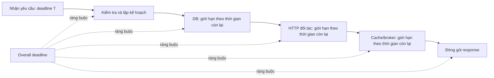
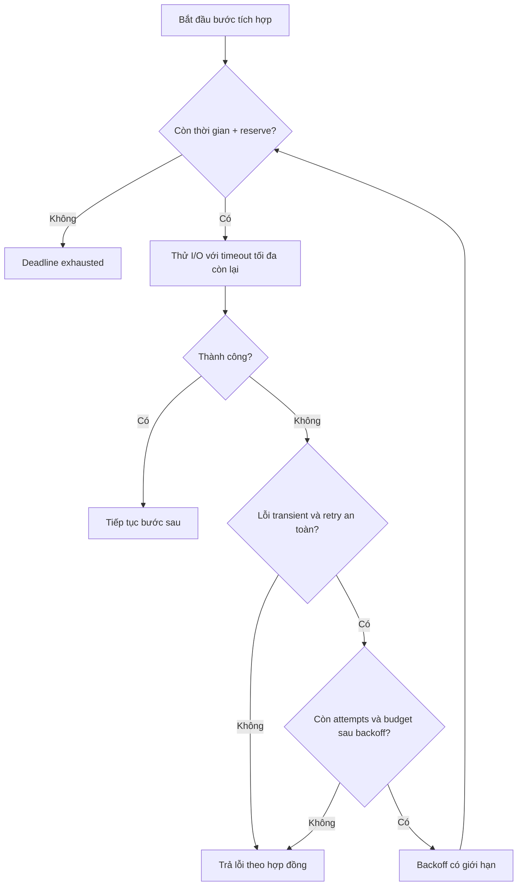
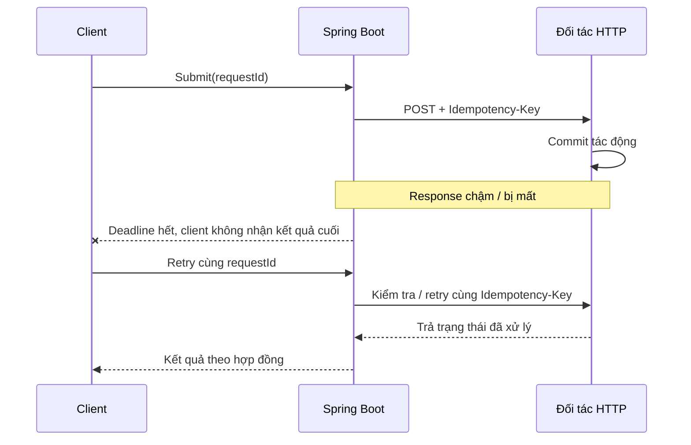

# Giới hạn thời gian cho từng bước và cho toàn bộ thao tác tích hợp

Trong **SPRING_BOOT_INTEGRATION**, một yêu cầu có thể đi qua HTTP controller, truy vấn cơ sở dữ liệu, đọc cache, gọi HTTP API của đối tác, gửi thông điệp qua broker và xử lý tiếp bằng các adapter của Spring Integration. Mỗi bước có thể chậm, chờ tài nguyên hoặc không trả lời. Nếu chỉ đặt timeout riêng cho từng client, tổng thời gian chờ vẫn có thể vượt xa thời hạn mà người gọi chấp nhận.

Bài thuộc chương **Phục hồi khi lỗi** trình bày cách thiết lập **giới hạn thời gian cho từng bước** (*per-step timeout*) và **giới hạn cho toàn bộ thao tác tích hợp** (*overall timeout/deadline*), đồng thời phối hợp các giới hạn đó với cấu hình, hợp đồng dữ liệu, transaction, retry, xử lý trùng, kiểm thử và quan sát. Mục tiêu là xác định rõ **đến lúc nào một thao tác phải dừng chờ** và **điều gì xảy ra với tác động nghiệp vụ nếu việc chờ kết thúc**.

## 1. Mục tiêu học tập

Sau bài học, bạn có thể:

1. Phân biệt connection timeout, pool-acquisition timeout, response/read timeout, query timeout, lock timeout, gateway reply timeout và deadline của toàn tác vụ.
2. Phân bổ một **time budget** cho các bước HTTP, JDBC, cache, broker và Spring Integration mà vẫn có thời gian dự phòng.
3. Thiết kế một deadline dùng đồng hồ đơn điệu, được kiểm tra lại trước mỗi bước và mỗi lần retry.
4. Lựa chọn timeout phù hợp với cơ chế đồng bộ, bất đồng bộ, giao dịch và yêu cầu idempotency.
5. Xử lý chính xác tình huống client timeout nhưng hệ thống đích có thể đã thực hiện tác động.
6. Kiểm thử giới hạn thời gian, retry budget, phản hồi lỗi và các tín hiệu quan sát khi hệ thống chậm hoặc gặp sự cố.

## 2. Timeout của một bước khác deadline toàn luồng

Giả sử API tích hợp nhận yêu cầu **đồng bộ** và phải trả kết quả trong tối đa 3 giây. Nó lần lượt kiểm tra DB, gọi đối tác, cập nhật cache rồi ghi trạng thái hoàn thành. Nếu DB được cho chờ 2 giây, HTTP client được chờ 3 giây và cache được chờ 1 giây, tổng thời gian có thể lên tới **6 giây hoặc hơn**, chưa tính serialization, queueing, retry và scheduling.

Một per-step timeout trả lời: *một hoạt động riêng lẻ được phép chờ tối đa bao lâu?* Một overall deadline trả lời: *toàn bộ yêu cầu còn được phép tiêu tốn bao nhiêu thời gian kể từ điểm bắt đầu?* Hai giới hạn phải cùng tồn tại.

| Khái niệm | Phạm vi | Lỗi thường gặp nếu hiểu nhầm |
| --- | --- | --- |
| **Connection timeout** | Thời gian thiết lập kết nối TCP/transport đến đích | Không bao gồm mọi thời gian thực thi câu SQL hoặc xử lý nghiệp vụ của đối tác. |
| **Pool acquisition timeout** | Thời gian chờ lấy một connection từ pool | Tăng pool timeout không làm câu truy vấn nhanh hơn. |
| **Read/response timeout** | Chờ dữ liệu phản hồi; ngữ nghĩa chi tiết phụ thuộc HTTP client/driver | Có client đo khoảng im lặng giữa các lần đọc, có client đo toàn phản hồi. |
| **SQL statement timeout** | Giới hạn thời gian chạy câu lệnh tại JDBC driver hoặc DB | Không đồng nghĩa với việc client đã có đủ ngân sách thời gian. |
| **Lock timeout** | Thời gian chờ lock của database | Một query không chờ lock vẫn có thể chậm vì nguyên nhân khác. |
| **Send/reply timeout của channel/gateway** | Chờ gửi message vào channel hoặc chờ nhận reply của một gateway | Có thể chỉ giới hạn một thao tác messaging, không chặn handler đồng bộ đang chạy. |
| **Broker delivery/ack timeout** | Chờ broker nhận/confirm hoặc tiến trình phân phối | Timeout ở producer không chứng minh broker chưa nhận message. |
| **Overall deadline** | Giới hạn của toàn request/job theo hợp đồng | Không tự xuất hiện chỉ nhờ cấu hình timeout riêng cho từng adapter. |

**Hạn chót (*deadline*)** phù hợp hơn timeout cố định khi nhiều bước liên tiếp. Nếu yêu cầu đã dùng 1,6 giây, một HTTP call có cấu hình 2 giây không nên tiếp tục được chờ đủ 2 giây nếu toàn luồng chỉ còn 1,4 giây.



## 3. Lập time budget có dự phòng

Với một thao tác đồng bộ có **deadline nội bộ 2.800 ms** (ví dụ chừa 200 ms trong SLA HTTP 3 giây cho proxy/network), có thể lập ngân sách ban đầu như sau:

| Hạng mục | Ngân sách tối đa ví dụ |
| --- | ---: |
| Chờ phân phối và lấy thread xử lý | 100 ms |
| Deserialize, xác thực và ánh xạ DTO | 100 ms |
| Kết nối/truy vấn/cập nhật database | 450 ms |
| Gọi HTTP đối tác | 1.200 ms |
| Truy cập cache | 150 ms |
| Serialize và chuẩn bị phản hồi | 100 ms |
| **Dự phòng cho biến động, cleanup, commit/overhead** | **700 ms** |
| **Tổng** | **2.800 ms** |

Các con số trên là **minh họa để diễn giải nguyên tắc**, không phải cấu hình phù hợp cho mọi hệ thống. Cần đo latency theo phân vị như p95/p99, giới hạn connection/pool và SLA của từng đối tác, rồi điều chỉnh. Một bước không sử dụng hết ngân sách thì các bước sau có thể hưởng phần thời gian còn lại; nhưng không được đợi quá deadline chung.

Quy tắc tại thời điểm bắt đầu bước:

\[
\text{timeout thực tế của bước}
= \min(\text{timeout cấu hình cho bước},\ \text{deadline còn lại} - \text{thời gian dự phòng})
\]

Nếu vế phải không còn dương thì **không khởi động bước mới**. Không cố “thử thêm một lần” khi đã hết deadline. Trong công thức này, dự phòng là thời gian để ghi nhận trạng thái hoặc hoàn tất các hoạt động bắt buộc; không phải bảo đảm tuyệt đối rằng mọi loại cleanup sẽ luôn hoàn thành trong khoảng dự phòng.

### Dòng thời gian minh họa

```mermaid
gantt
    title Minh họa ngân sách nội bộ 2,8 giây
    dateFormat X
    axisFormat %L
    section Xử lý
    Queue và validate        :a1, 0, 200
    Database                  :a2, 200, 450
    HTTP đối tác              :a3, 650, 1200
    Cache và serialize        :a4, 1850, 250
    Dự phòng                  :a5, 2100, 700
```



Trên thực tế, các bước có thể chạy song song, thay đổi thứ tự hoặc bỏ qua cache. Time budget lúc đó phải dựa trên **đường găng (critical path)** và chi phí đồng thời, không chỉ cộng mọi timeout. Nếu hai HTTP call chạy song song, thời gian tường của nhánh song song xấp xỉ thời gian nhánh chậm hơn, nhưng cả hai đều tiêu tốn tài nguyên và cần cơ chế hủy/kiểm soát khi deadline hết.

## 4. Tạo deadline bằng đồng hồ đơn điệu

Để đo thời gian **đã trôi qua trong một process Java**, dùng `System.nanoTime()`. Nó được thiết kế cho phép đo khoảng thời gian; `System.currentTimeMillis()` hoặc `Instant.now()` có thể bị ảnh hưởng bởi điều chỉnh đồng hồ hệ thống. Không so sánh giá trị nanoTime lấy từ hai process hoặc truyền trực tiếp chúng cho hệ thống khác.

Ví dụ một lớp chứa ngân sách còn lại, có thể kiểm thử bằng clock giả:

```java
import java.time.Duration;
import java.util.Objects;
import java.util.function.LongSupplier;

public final class DeadlineBudget {
    private final LongSupplier nanos;
    private final long startedAt;
    private final long totalNanos;

    public DeadlineBudget(Duration total, LongSupplier monotonicNanos) {
        if (total == null || total.isZero() || total.isNegative()) {
            throw new IllegalArgumentException("total must be positive");
        }
        this.nanos = Objects.requireNonNull(monotonicNanos);
        this.startedAt = nanos.getAsLong();
        this.totalNanos = total.toNanos();
    }

    public static DeadlineBudget start(Duration total) {
        return new DeadlineBudget(total, System::nanoTime);
    }

    public Duration remaining() {
        long elapsed = Math.max(0L, nanos.getAsLong() - startedAt);
        return Duration.ofNanos(Math.max(0L, totalNanos - elapsed));
    }

    // Dành một khoảng reserve cho các bước cuối bắt buộc.
    public Duration forStep(Duration maximum, Duration reserve) {
        if (maximum.isNegative() || maximum.isZero() || reserve.isNegative()) {
            throw new IllegalArgumentException("Invalid step budget");
        }
        long available = remaining().minus(reserve).toNanos();
        if (available <= 0) {
            throw new DeadlineExceededException();
        }
        return Duration.ofNanos(Math.min(maximum.toNanos(), available));
    }
}

final class DeadlineExceededException extends RuntimeException {
    DeadlineExceededException() {
        super("Integration deadline exhausted");
    }
}
```

Ví dụ dùng:

```java
DeadlineBudget budget = DeadlineBudget.start(Duration.ofMillis(2800));

Duration dbTimeout = budget.forStep(
        Duration.ofMillis(450), Duration.ofMillis(400));
// Sau khi DB hoàn tất, tính lại: không dùng lại dbTimeout cho HTTP.
Duration partnerTimeout = budget.forStep(
        Duration.ofMillis(1200), Duration.ofMillis(250));
```

Trong ứng dụng thực, phải gọi `forStep(...)` **ngay trước khi bắt đầu từng I/O**, vì mọi công việc nằm giữa hai lần gọi đều tiêu tốn thời gian. Kiểm tra lại khi retry, chuyển queue, xử lý response và trước việc đòi hỏi commit/side effect tiếp theo.

Lớp trên là ví dụ cho deadline ngắn trong cùng process, giả định `Duration.toNanos()` nằm trong phạm vi `long` và monotonic clock hoạt động đúng. Khi deadline phải **đi qua HTTP/broker giữa các process**, gửi một timestamp thời hạn theo hợp đồng (ví dụ ISO-8601 UTC hoặc epoch milliseconds) hoặc budget tương đối với metadata phù hợp, rồi tạo lại deadline đơn điệu ở bên nhận. Đồng hồ giữa các máy có thể lệch: thiết kế độ dung sai và ưu tiên deadline **ngắn hơn** giữa hạn của upstream và hạn bảo vệ của dịch vụ hiện tại.

### Phân biệt deadline với timeout khởi tạo từ lúc bắt đầu gọi

Nếu chỉ cấu hình timeout 800 ms trên client HTTP, 300 ms đã tiêu tốn ở queue trước khi gọi HTTP vẫn chưa được trừ. Deadline phải bắt đầu ở **entrypoint có ý nghĩa với người dùng** (hoặc được kế thừa từ upstream), không tự khởi động lại ở mỗi adapter và vô tình kéo dài SLA.

## 5. HTTP client: connect, response và toàn request

Một lời gọi HTTP ra đối tác có nhiều pha: DNS, lấy connection từ pool, TCP connect, TLS handshake, gửi request, đợi response, nhận body và deserialize. API cấu hình của từng HTTP client có thể đo các pha khác nhau. Cần đọc đúng ngữ nghĩa của **client implementation** đang dùng trong Spring Boot.

Đối với Spring Boot dùng `RestClient` (Spring Framework 6.1+), có thể cấp `ClientHttpRequestFactory` được cấu hình để kiểm soát transport. Ví dụ minh họa với HTTP client của JDK:

```java
import java.net.http.HttpClient;
import java.time.Duration;
import org.springframework.context.annotation.Bean;
import org.springframework.context.annotation.Configuration;
import org.springframework.http.client.JdkClientHttpRequestFactory;
import org.springframework.web.client.RestClient;

@Configuration(proxyBeanMethods = false)
public class PartnerHttpConfiguration {

    @Bean
    RestClient partnerRestClient(RestClient.Builder builder) {
        HttpClient jdkHttp = HttpClient.newBuilder()
                .connectTimeout(Duration.ofMillis(250))
                .build();

        var factory = new JdkClientHttpRequestFactory(jdkHttp);
        factory.setReadTimeout(Duration.ofMillis(900));

        return builder.requestFactory(factory)
                .baseUrl("https://partner.example.org")
                .build();
    }
}
```

`connectTimeout` ở đây kiểm soát pha thiết lập kết nối của JDK client; `setReadTimeout` đặt giới hạn chờ phản hồi qua request factory của Spring. Ý nghĩa chính xác của read/response timeout có thể khác giữa JDK, Apache HttpComponents và Reactor Netty. Ví dụ sử dụng giá trị **cố định** để bảo vệ transport; để thực sự tuân theo **deadline còn lại của từng request**, client wrapper phải áp thêm giới hạn toàn operation được tính từ `budget.forStep(...)` hoặc dùng API timeout theo request của HTTP client cụ thể.

Nếu cần giới hạn **động theo từng lời gọi** bằng Java HTTP client chuẩn, có thể dùng `HttpRequest.Builder.timeout(Duration)` cho mỗi request:

```java
import java.net.URI;
import java.net.http.HttpClient;
import java.net.http.HttpRequest;
import java.net.http.HttpResponse;
import java.time.Duration;

public final class PartnerLookup {
    private final HttpClient client;

    public PartnerLookup(HttpClient client) {
        this.client = client;
    }

    public String fetch(String orderId, DeadlineBudget budget) throws Exception {
        Duration allowed = budget.forStep(
                Duration.ofMillis(900), Duration.ofMillis(150));

        String encoded = java.net.URLEncoder.encode(
                orderId, java.nio.charset.StandardCharsets.UTF_8);
        HttpRequest request = HttpRequest.newBuilder(
                    URI.create("https://partner.example.org/api/orders/" + encoded))
                .timeout(allowed)
                .GET()
                .build();
        HttpResponse<String> response = client.send(
                request, HttpResponse.BodyHandlers.ofString());
        if (response.statusCode() >= 500) {
            throw new IllegalStateException("Partner temporarily unavailable");
        }
        return response.body();
    }
}
```

`HttpRequest.timeout` giới hạn thời gian nhận phản hồi của request theo semantics của Java HTTP client; đây không phải một giới hạn cưỡng bức đối với mọi side effect phía server. Nếu request dùng connection pool khác hoặc callback không chấp hành interrupt/cancellation, cần đánh giá các giới hạn bổ sung tương ứng. Với `WebClient`, Reactor Netty có cấu hình connect/response timeout và reactive `timeout(Duration)` cho pipeline, nhưng hết timeout cũng không thể chứng minh đối tác chưa ghi dữ liệu.

**Trường hợp quan trọng:** client timeout sau khi gửi `POST /payments` không biết đối tác đã commit hay chưa. Retry chỉ an toàn nếu hợp đồng cho phép xử lý lặp, ví dụ dùng `Idempotency-Key`/`requestId` ổn định hoặc tra cứu kết quả theo ID trước khi thử lại. Đừng biến timeout thành “thất bại chắc chắn” trong sổ nghiệp vụ.

## 6. Database: chờ pool, chạy SQL, chờ lock và transaction

Với JDBC/HikariCP, cần phân biệt ít nhất ba lớp:

| Giới hạn | Cấu hình ví dụ | Chức năng |
| --- | --- | --- |
| **Chờ connection trong pool** | `spring.datasource.hikari.connection-timeout` | Nếu không có connection rảnh trong thời gian này, thao tác lấy connection thất bại. |
| **Thực thi SQL** | `JdbcTemplate.setQueryTimeout(...)`, JDBC statement timeout hoặc cấu hình DB | Giới hạn thực thi câu lệnh theo khả năng driver/database. |
| **Chờ lock** | PostgreSQL `lock_timeout` hoặc thiết lập tương đương DB đang dùng | Tránh chờ transaction khác vô hạn khi cạnh tranh dữ liệu. |
| **Transaction timeout** | `@Transactional(timeout = ...)` hoặc cấu hình transaction manager | Giới hạn cho transaction theo cơ chế hỗ trợ của Spring/DB, không tự hủy mọi I/O ngoài DB. |

Ví dụ cấu hình Boot:

```yaml
spring:
  datasource:
    url: jdbc:postgresql://db.internal:5432/integration
    username: app_integration
    password: "PLACEHOLDER_FROM_SECRET_MANAGER"
    hikari:
      maximum-pool-size: 12
      connection-timeout: 500
      validation-timeout: 250
```

Giá trị password trên chỉ là placeholder; production lấy từ secret manager hoặc biến môi trường, không commit mật khẩu thật. `connection-timeout: 500` tính bằng **milliseconds**. `maximum-pool-size` là giới hạn connection của một pool trong **một instance**; phải cân đối tổng connection của mọi instance và giới hạn phía database.

Ví dụ với PostgreSQL, có thể giới hạn theo session/transaction ở database:

```sql
BEGIN;
SET LOCAL statement_timeout = '700ms';
SET LOCAL lock_timeout = '250ms';

UPDATE payment
SET status = 'CONFIRMED'
WHERE event_id = 'evt-123';

COMMIT;
```

`SET LOCAL` có hiệu lực trong transaction hiện tại; nếu dùng JDBC trong Spring thì phải đặt nó **trên cùng connection và cùng transaction** trước câu SQL cần giới hạn. `statement_timeout` chặn câu statement quá thời hạn phía PostgreSQL; `lock_timeout` chặn chờ lock vượt giới hạn. Cần kiểm tra lại loại exception driver trả về, trạng thái transaction sau lỗi và cách Spring rollback.

`@Transactional(timeout = 2)` dùng đơn vị **giây** và hoạt động theo khả năng của transaction manager/resource; không phải một công tắc đảm bảo tất cả SQL, HTTP call và broker publish kết thúc vật lý trong đúng 2 giây. Nếu cần thời hạn ở mức **mili giây** cho SQL ngắn, có thể dùng timeout tại database hoặc API driver hỗ trợ độ phân giải phù hợp.

**Đừng cấu hình pool timeout dài hơn ngân sách còn lại** nếu request đang chờ connection. Một request chỉ còn 250 ms mà sẵn sàng đợi connection 5 giây sẽ vượt deadline trước khi chạy SQL. Nếu thư viện không hỗ trợ chỉnh pool acquisition timeout theo từng request, hãy thiết kế giới hạn bảo vệ ở tầng caller, kiểm soát concurrency và giữ giới hạn pool đủ ngắn với SLA của nhóm request.

## 7. Cache/Redis: kết nối, lệnh truy cập và TTL dữ liệu

Redis có thể đóng vai trò cache, kho trạng thái idempotency hoặc message infrastructure. Các nhu cầu này có yêu cầu khác nhau, nhưng đều cần timeout cho **kết nối và lệnh Redis**. Spring Boot với Spring Data Redis và Lettuce có những thuộc tính cấu hình hạ tầng tương ứng, chẳng hạn:

```yaml
spring:
  data:
    redis:
      host: redis.internal
      port: 6379
      connect-timeout: 300ms
      timeout: 400ms
```

`spring.data.redis.connect-timeout` dùng cho thiết lập kết nối; `spring.data.redis.timeout` cấu hình timeout của các thao tác đọc/chờ phản hồi theo client và phiên bản Boot tương ứng. Nếu dùng Redis cluster, replica hoặc connection pool, kiểm tra thêm thời gian lấy connection, chuyển hướng và khả năng failover. Những timeout này cần phù hợp budget còn lại của yêu cầu, không thay thế deadline ở service.

**Phân biệt timeout của truy cập cache với TTL của dữ liệu cache:**

- **Command timeout 400 ms:** caller ngừng chờ một lệnh Redis lâu hơn giới hạn.
- **TTL 10 phút:** key hết hạn tự động sau khoảng lưu giữ đã định, phục vụ freshness/eviction.
- **Overall deadline 2,8 giây:** toàn bộ request không được vượt quá hạn được cam kết.

TTL dài hơn hoặc ngắn hơn không quyết định lệnh Redis chờ bao lâu. Nếu Redis chậm, service cần hợp đồng fallback rõ: có thể truy vấn DB trực tiếp khi **cache chỉ là tối ưu hiệu năng**, nhưng không tự bỏ qua Redis nếu nó là **kho khóa phân tán hoặc nguồn trạng thái idempotency** có tác dụng bảo vệ tính đúng đắn.

Đối với cache-aside, ví dụ chiến lược: tìm cache, nếu timeout và còn đủ thời gian thì đọc nguồn chuẩn DB; khi DB cũng quá chậm, kết thúc với lỗi có kiểm soát. Đảm bảo fallback không khiến nhiều request đồng thời tạo **cache stampede** đổ dồn vào database. Có thể áp dụng bulkhead/rate limit hoặc cơ chế giới hạn đồng thời theo nguồn.

## 8. Broker: timeout khi gửi, chờ xác nhận và khi tiêu thụ

Giao thức broker có nhiều pha khác nhau. Không nên lấy một tham số timeout duy nhất rồi suy ra “message đã hoặc chưa được xử lý”.

### 8.1. Kafka producer

Với Spring Kafka, `KafkaTemplate.send(...)` thường là lời gọi bất đồng bộ trả về một `CompletableFuture<SendResult<K,V>>`. Kafka producer có một số giới hạn tiêu biểu:

| Cấu hình Kafka producer | Mục đích |
| --- | --- |
| `max.block.ms` | Giới hạn thời gian lời gọi send có thể chờ metadata hoặc bộ nhớ buffer trong một số tình huống. |
| `request.timeout.ms` | Thời gian chờ phản hồi từ broker cho một request giao thức. |
| `delivery.timeout.ms` | Giới hạn thời gian báo kết quả giao message của producer bao gồm khả năng retry của client theo cơ chế cấu hình. |
| `linger.ms` | Thời gian gom batch trước khi gửi khi phù hợp; cũng tiêu tốn ngân sách độ trễ. |

Thông thường cần bảo đảm `delivery.timeout.ms` đủ lớn so với `request.timeout.ms + linger.ms` theo ràng buộc producer. Khi cấu hình:

```yaml
spring:
  kafka:
    producer:
      properties:
        max.block.ms: 300
        request.timeout.ms: 900
        delivery.timeout.ms: 1300
        linger.ms: 10
```

Các giá trị chỉ minh họa và cần đối chiếu mức broker, ISR/acks, thời gian vận hành và yêu cầu thực tế. Khi gọi `future.get(timeout, unit)`, timeout đó **chỉ giới hạn việc thread hiện tại chờ kết quả**; không chứng minh producer đã hủy yêu cầu hoặc broker chưa ghi message. Tương tự, hủy future không đồng nghĩa có thể thu hồi message broker đã nhận.

Nếu một HTTP request đồng bộ còn 400 ms nhưng cấu hình producer có thể mất 1,3 giây, không nên đợi producer ack cho đến lúc vượt deadline. Với luồng **ghi DB rồi phát event**, ưu tiên **transactional outbox** để ghi ý định phát cùng DB transaction, sau đó publisher độc lập gửi broker trong ngân sách/lifecycle riêng. Nếu API cần cam kết broker đã nhận trước khi trả lời, hợp đồng HTTP và ngân sách phải được xây tương ứng.

### 8.2. Kafka consumer

Ở consumer, `max.poll.interval.ms` giới hạn khoảng cách giữa các lần gọi `poll()` để tránh consumer bị coi là không tiến triển; `session.timeout.ms` liên quan phát hiện thành viên consumer group không còn hoạt động. Đây **không phải** deadline của một đơn hàng nghiệp vụ.

Một consumer xử lý chậm, không `poll()` đủ thường xuyên hoặc bị mất quyền sở hữu partition có thể gặp rebalance và message được giao lại. Cần thiết kế thời gian xử lý/batch, chế độ ack, retry và idempotency phù hợp. Đừng tăng `max.poll.interval.ms` thật lớn để che một handler mắc kẹt mà không theo dõi thời gian xử lý thật.

### 8.3. RabbitMQ/AMQP và request–reply

Trong Spring AMQP, `RabbitTemplate` có giới hạn chờ cho mẫu request–reply (ví dụ `replyTimeout`). Hết reply timeout **không chứng minh** queue chưa nhận message hoặc consumer chưa xử lý; có thể response đã đến trễ hoặc bị thất lạc. Publisher confirm, consumer ack, retry và dead-letter có ý nghĩa khác nhau và cần cấu hình/test riêng.

Đối với lệnh có side effect qua broker, yêu cầu phải chứa **message ID hoặc business key ổn định**. Consumer ghi dấu idempotency cùng transaction với tác động nghiệp vụ khi có thể. Timeout/retry ở producer hoặc gateway chỉ thay đổi **thời gian chờ của caller**; chính sách xử lý trùng mới bảo vệ dữ liệu.

## 9. Spring Integration: reply timeout chưa chắc là tổng thời gian handler

Khi dùng Spring Integration, `@MessagingGateway`, `MessageChannel`, `Poller`, `ExecutorChannel` và các adapter có các tham số thời gian riêng. Cần hiểu chúng đang giới hạn **send**, **reply**, **poll** hay **business processing**.

Ví dụ:

```java
import org.springframework.integration.annotation.MessagingGateway;

@MessagingGateway(
        defaultRequestChannel = "pricing.requests",
        defaultReplyTimeout = "700")
public interface PricingGateway {
    PricingResponse calculate(PricingRequest request);
}
```

Trong đó `PricingRequest` và `PricingResponse` là DTO/command ứng dụng tự khai báo. `defaultReplyTimeout` tính bằng **mili giây** khi dùng dạng số như ví dụ. Tham số này giới hạn thời gian chờ reply ở phần cơ chế gateway có thực hiện chờ reply; nó **không tự cưỡng chế giới hạn 700 ms lên mọi handler**.

Nếu request đi qua một `DirectChannel` đồng bộ, handler có thể chạy trực tiếp trong thao tác `send` và chặn caller trước khi gateway bắt đầu chờ reply theo cơ chế channel. Khi đó chỉ cấu hình reply timeout vẫn có thể khiến caller chờ lâu hơn kỳ vọng. Nếu chuyển qua `ExecutorChannel` hoặc queue bất đồng bộ, gateway có thể trả timeout sau một khoảng chờ reply, nhưng handler có thể **tiếp tục chạy ở thread khác**.

| Thành phần | Cần kiểm tra | Không nên suy ra |
| --- | --- | --- |
| `defaultRequestTimeout` | Giới hạn một thao tác gửi message khi channel hỗ trợ timeout gửi | Không phải timeout toàn service. |
| `defaultReplyTimeout` | Chờ reply của gateway khi có cơ chế reply channel phù hợp | Không dừng handler đồng bộ/async một cách chắc chắn. |
| `Pollers.fixedDelay(...)` | Khoảng cách giữa các lần poll | Không giới hạn thời gian xử lý của mỗi message. |
| `maxMessagesPerPoll` | Số message lấy trong một lượt | Không giới hạn thời gian xử lý của từng message. |
| `ExecutorChannel` | Chuyển việc xử lý sang executor | Không tự giới hạn deadline, queue size, retry hay persistence. |
| HTTP/Kafka/JDBC outbound adapter | Timeout thuộc client/driver bên dưới | Không tự hợp nhất các timeout thành overall deadline. |

Vì vậy, khi cần **giới hạn thời gian của nghiệp vụ qua nhiều bước**, application service nên giữ `DeadlineBudget` hoặc metadata deadline và **tính lại thời gian cho từng I/O**. Adapter/gateway cũng phải định nghĩa chính sách khi không kịp: trả lỗi, ghi trạng thái đang chờ hay chuyển sang luồng async bền vững.

### Truyền deadline qua thread và hệ thống

Nếu flow chuyển thread, không chỉ lưu deadline trong `ThreadLocal` và hy vọng nó tự truyền sang worker. Truyền metadata rõ ràng bằng command/message header có kiểm soát. Qua broker, không truyền `System.nanoTime()` của process này sang process khác; nên truyền **deadline theo thời gian UTC được chuẩn hóa** hoặc ngân sách còn lại có biên bảo vệ và kiểm tra đồng hồ lệch.

Không cho upstream kéo dài deadline tùy ý: bên nhận phải áp một **giới hạn cục bộ tối đa**, đồng thời từ chối hoặc điều chỉnh deadline âm/quá lớn theo hợp đồng. Đối với job kéo dài hàng phút/giờ, nên dùng **deadline của công việc được lưu bền vững** và trạng thái công việc; deadline của một HTTP connection không còn phù hợp sau khi request đã trả `202 Accepted`.

## 10. Retry phải nằm bên trong deadline

Retry khiến một bước có thể chiếm nhiều lần timeout riêng. Với hai lần gọi HTTP, mỗi lần tối đa 800 ms và backoff 200 ms, thời gian chờ lý thuyết có thể lên tới:

\[
T_\text{retry} \le 800\text{ ms} + 200\text{ ms} + 800\text{ ms} = 1.800\text{ ms}
\]

Đó là thời gian của **một bước**, chưa tính DB, cache và serialization. Nếu overall deadline còn 900 ms, không được cấp đủ 1.800 ms chỉ vì policy có `maxAttempts=2`.

Quy tắc retry an toàn hơn:

1. **Trước lần thử đầu:** kiểm tra deadline còn lại và dành dự phòng bắt buộc; giới hạn duration cho chính lần thử.
2. **Sau lỗi:** phân loại lỗi có khả năng phục hồi. Không retry mù quáng validation, SOAP Fault nghiệp vụ, unique constraint hợp lệ hoặc kết quả từ chối rõ ràng.
3. **Trước backoff:** tính xem còn đủ thời gian ngủ và thử tiếp hay không; nếu không, dừng retry.
4. **Trước lần thử kế:** gọi lại `budget.forStep(...)` với thời gian thực sự còn lại, không sao chép timeout của lần thử trước.
5. **Giới hạn tổng:** đặt max attempts, backoff có jitter khi phù hợp, concurrency/rate limit và deadline chung.



Khi dùng Spring Retry, Resilience4j Retry hoặc một client có retry nội bộ, phải tính **cả retry do chính client/driver** (Kafka producer, HTTP transport, DB) và retry do ứng dụng. Tránh lồng nhiều lớp retry khiến thời gian thực thi nhân lên ngoài dự kiến. Một budget được kiểm tra ở **mỗi lớp có thể chờ**, cùng với chính sách giới hạn ở caller, giúp tránh retry storm khi đối tác quá tải.

### Circuit breaker, bulkhead và TimeLimiter

- **Circuit breaker** từ chối sớm lời gọi tới đích đang gặp lỗi liên tiếp; nó không thay thế timeout cho cuộc gọi đã bắt đầu.
- **Bulkhead/concurrency limit** hạn chế số yêu cầu đồng thời đang dùng tài nguyên đích; giúp bảo vệ pool và tránh hàng đợi quá lớn.
- **Time limiter** giới hạn thời gian caller chờ một future/reactive chain khi thư viện hỗ trợ; việc future hoàn tất với timeout **không đảm bảo tác vụ bên ngoài đã ngừng**.

Với xử lý blocking, cancellation qua `Future.cancel(true)` chủ yếu yêu cầu interrupt và phụ thuộc code/driver có hợp tác hay không. Với HTTP/DB/broker, remote side effect có thể đã xảy ra. Vì thế, **timeout là giới hạn chờ và quyết định phục hồi**, không phải cơ chế rollback xuyên hệ thống.

## 11. Deadline cho thao tác đồng bộ và công việc bất đồng bộ

Không phải luồng nào cũng cần chờ toàn bộ các bước trước khi trả HTTP response:

| Kiểu thao tác | Kết quả HTTP/API có ý nghĩa | Cách quản lý thời gian |
| --- | --- | --- |
| **Đồng bộ hoàn chỉnh** | Caller nhận kết quả sau khi các bước bắt buộc xong | Overall deadline ngắn, từng I/O phải trừ ngân sách còn lại. |
| **Nhận lệnh và xử lý async** | Trả `202 Accepted` cùng job/request ID khi đã tiếp nhận theo hợp đồng | Deadline HTTP chỉ bao phần tiếp nhận; job có thời hạn xử lý, retry và trạng thái bền vững riêng. |
| **Ghi DB + outbox** | Có thể trả sau khi transaction DB commit và outbox được lưu | Publisher broker có deadline/lifecycle riêng; API không khẳng định message đã được consume. |
| **Saga/long-running workflow** | Trạng thái tiến trình, có thể hoàn tất hoặc bù trừ sau nhiều phút | Deadline từng bước và deadline tổng workflow; lưu tiến độ, timeout state và hành động bù trừ. |

Ví dụ: nếu nhận HTTP request đã lưu job vào database và trả `202`, **đừng tiếp tục dùng thời gian 2,8 giây còn lại của HTTP** để hạn chế Kafka publisher chạy sau đó trong background. Publisher cần chính sách độc lập về retry, lease, expiration và khả năng khôi phục, trong khi client có API kiểm tra trạng thái theo job ID.

Ngược lại, nếu API trả `200 OK` với ý nghĩa “đã hoàn tất toàn tuyến”, thì cần thực sự đợi và xác minh những bước đã hứa trong deadline, hoặc thay đổi hợp đồng API cho phản ánh hành vi bất đồng bộ.

## 12. Timeout không bảo đảm hủy tác động và rollback

Xét ba dòng thời gian:

**Trường hợp A – timeout trước khi kết nối:** client không kết nối được với đối tác; vẫn cần phân loại lỗi rõ nhưng khả năng side effect phía đích thấp hơn so với khi đã gửi dữ liệu.

**Trường hợp B – request đã gửi, mất response:** đối tác có thể đã commit, còn client chỉ thấy timeout. Retry cùng lệnh mà không có khóa idempotency có thể nhân đôi giao dịch.

**Trường hợp C – DB commit xong, broker ack bị trễ:** client timeout khi chờ broker và trả lỗi, nhưng dữ liệu đã ghi trong DB và event có thể đã được broker nhận. Cần đối soát/trạng thái thay vì tự động “undo” dữ liệu trong DB nếu không có cơ chế bù trừ được thiết kế.



**Mẫu bảo vệ dữ liệu**:

- Ở inbound API, nhận `requestId` ổn định và lưu dấu xử lý trong database có unique constraint; cùng ID với payload khác phải được phát hiện xung đột.
- Ở outbound API, yêu cầu đối tác hỗ trợ idempotency key hoặc truy vấn lại kết quả theo business ID khi status mơ hồ.
- Với broker, xem xét transactional outbox/inbox; có thể phát/giao trùng, nhưng bảo đảm tác động nghiệp vụ không bị nhân đôi.
- Với Redis/cache, phân biệt dữ liệu có thể bỏ qua khi cache chậm với trạng thái khóa/đồng bộ không được phép âm thầm bỏ qua.
- Khi transaction đã commit, timeout response không tự tạo ra quyền rollback/compensation; phải có quy tắc nghiệp vụ hoặc saga cụ thể.

Đặc biệt, đừng xử lý mọi timeout bằng `500` và đánh dấu “thao tác thất bại chắc chắn”. Khi tình trạng **chưa xác định**, API có thể cung cấp tra cứu theo ID hoặc trạng thái `PENDING/UNKNOWN` phù hợp với hợp đồng. Nếu đóng vai trò gateway và chờ upstream quá hạn, HTTP `504 Gateway Timeout` có thể phù hợp; nếu chính dịch vụ đang quá tải hoặc dependency không sẵn sàng, `503 Service Unavailable` có thể phù hợp. `408 Request Timeout` thường liên quan việc server chờ **client hoàn tất request**, không phải mã mặc định cho mọi lời gọi downstream chậm.

## 13. Quan sát để biết deadline bị tiêu tốn ở đâu

Nếu chỉ ghi log “timeout”, rất khó phân biệt DB pool cạn, một query chờ lock, API đối tác phản hồi chậm hay message nằm trong queue quá lâu. Với các luồng Spring Boot tích hợp nhiều hệ thống, cần theo dõi **tổng thời gian, thời gian mỗi bước và ngân sách còn lại**.

| Tín hiệu | Ví dụ thông tin | Câu hỏi vận hành |
| --- | --- | --- |
| Tổng latency của thao tác | HTTP request duration, flow duration, p50/p95/p99 | Luồng có đáp ứng SLA/overall deadline hay không? |
| Thời gian còn lại trước mỗi bước | `remainingBudgetMs` tại lúc bắt đầu HTTP/JDBC/broker | Bước nào đã dùng phần lớn ngân sách? |
| Timeout theo loại | `connect_timeout`, `pool_acquire_timeout`, `db_statement_timeout`, `partner_response_timeout`, `deadline_exhausted` | Lỗi tập trung ở tầng mạng, pool, DB hay policy của ứng dụng? |
| Retry và backoff | Số attempts, nguyên nhân retry, độ trễ backoff | Retry có thực sự tăng tỷ lệ thành công hay đang kéo dài sự cố? |
| Queue/backlog | Kafka lag, outbox pending, scheduler queue length | Yêu cầu đã chờ quá lâu trước khi handler bắt đầu chưa? |
| Pool/connection | Hikari active/pending/timeout, HTTP connection pool | Có cần giới hạn concurrency hoặc xử lý query chậm không? |
| Kết quả nghiệp vụ | `SUCCESS`, `TIMED_OUT_UNKNOWN`, `FAILED_PERMANENTLY` | Deadline hết nhưng tác động đã commit hay vẫn đang chờ đối soát? |

Spring Boot Actuator/Micrometer có thể thu thập metric hạ tầng, và tracing (nếu đã cấu hình) giúp xác định chuỗi span HTTP → service → database → broker. Không mặc định mọi client tự có cùng một metric với mọi phiên bản Boot. Có thể tạo metric nghiệp vụ như `integration_deadline_exhausted_total{step="partner_http"}` hoặc histogram thời gian xử lý theo operation, nhưng **không dùng requestId, customerId hay payload làm metric label** vì cardinality cao và rủi ro tiết lộ thông tin.

Mỗi request/job nên có một **correlation ID** ổn định, được đưa qua log và trace ở các adapter phù hợp. Trong log, ghi `operation`, `step`, `durationMs`, `remainingBudgetMs`, `attempt`, `outcome` và loại lỗi; che token, credential và dữ liệu cá nhân. Nếu một flow chuyển sang thread khác hoặc broker, bối cảnh tracing/MDC cần được truyền có chủ đích và có giới hạn thông tin công bố.

### Cảnh báo có hành động

Ngoài biểu đồ p95/p99, nên cảnh báo khi tỷ lệ `deadline_exhausted` tăng, số request chờ pool tăng hoặc outbox tồn đọng liên tục. Cảnh báo phải chỉ ra dependency/step liên quan để nhóm vận hành biết nên giảm concurrency, dừng retry storm, xử lý slow query hay liên hệ đối tác.

Đừng chỉ tăng mọi timeout khi gặp cảnh báo: điều đó có thể tăng số kết nối và thread bị giữ, tạo backlog sâu hơn, đẩy cả hệ thống vào lỗi dây chuyền.

## 14. Kiểm thử deadline, timeout và khả năng hồi phục

Mục tiêu của kiểm thử là chứng minh **điều kiện dừng chờ**, **giới hạn retry**, **không nhân đôi tác động**, **kết quả sau timeout** và **khả năng quan sát**. Một bài test gọi HTTP thành công nhanh không chứng minh chính sách timeout đã được cài đúng.

### 14.1. Unit test ngân sách bằng đồng hồ giả

Lớp `DeadlineBudget` đã nhận `LongSupplier` làm nguồn nanoTime để test không cần ngủ. Ví dụ:

```java
import static org.junit.jupiter.api.Assertions.assertEquals;
import static org.junit.jupiter.api.Assertions.assertThrows;

import java.time.Duration;
import java.util.concurrent.atomic.AtomicLong;
import org.junit.jupiter.api.Test;

class DeadlineBudgetTest {

    @Test
    void clampsStepTimeoutToRemainingBudgetMinusReserve() {
        var nanos = new AtomicLong(0L);
        var budget = new DeadlineBudget(
                Duration.ofMillis(1000), nanos::get);

        assertEquals(Duration.ofMillis(400),
                budget.forStep(Duration.ofMillis(400),
                               Duration.ofMillis(100)));

        nanos.addAndGet(Duration.ofMillis(850).toNanos());
        assertEquals(Duration.ofMillis(50),
                budget.forStep(Duration.ofMillis(400),
                               Duration.ofMillis(100)));

        nanos.addAndGet(Duration.ofMillis(60).toNanos());
        assertThrows(DeadlineExceededException.class,
                () -> budget.forStep(
                        Duration.ofMillis(400),
                        Duration.ofMillis(100)));
    }
}
```

Test chứng minh một bước bị **cắt xuống 50 ms** nếu chỉ còn 150 ms và phải giữ 100 ms dự phòng. Khi remaining chỉ còn 90 ms, `forStep` ném lỗi trước khi bắt đầu I/O. Đây là **unit test** cho phép tính budget, không kiểm tra một HTTP client thực có tôn trọng timeout hay không.

### 14.2. Integration test từng dependency

| Ranh giới | Tình huống cần giả lập/kiểm chứng | Kết quả mong đợi |
| --- | --- | --- |
| HTTP client với server stub | Đối tác kết nối được nhưng chậm trả response; timeout sau khi đã nhận request | Client kết thúc chờ trong giới hạn hợp lý, phân loại timeout, giữ idempotency key qua retry. |
| JDBC với PostgreSQL thật | Pool cạn, query chậm, chờ row lock, statement timeout | Thấy exception phù hợp; transaction rollback và giải phóng connection đúng cách. |
| Redis thật | Redis phản hồi chậm/ngắt kết nối; cache miss đồng thời | Timeout hoặc fallback đúng hợp đồng, không làm DB bị quá tải. |
| Kafka producer + broker | Broker không ack đúng hạn, metadata không sẵn sàng | Caller không chờ quá budget; outbox/publisher tiếp tục xử lý có kiểm soát. |
| Spring Integration gateway | Handler đồng bộ rất chậm, sau đó thử `ExecutorChannel` | Biết reply timeout có giới hạn gì; handler không bị coi là đã bị hủy chỉ vì caller timeout. |
| Consumer redelivery | Giao lại message sau crash/ack thất bại | Tác động nghiệp vụ chỉ được áp dụng một lần theo idempotency key. |

Với HTTP, dùng WireMock/MockWebServer để tạo delay có kiểm soát và assert cả **nội dung request**, **timeout**, **loại lỗi** và **số lần gửi**. Với JDBC, dùng Testcontainers PostgreSQL và migration/schema thực; test H2 không đủ chứng minh hành vi `statement_timeout` và row lock của PostgreSQL. Với Kafka/Redis, dùng container hoặc môi trường integration riêng để tránh kiểm tra bằng mock client rồi kết luận hạ tầng thật an toàn.

Một integration test về timeout nên có thời hạn chờ đủ rộng cho biến động CI nhưng vẫn hữu hạn; cần phân biệt **giới hạn ứng dụng** với **độ trễ phép đo của test**. Tránh assert thời gian chính xác đến từng milli giây trên máy CI và tránh kéo dài `Thread.sleep` cố định chỉ để che test flaky.

### 14.3. End-to-end test với deadline chung

Ví dụ một kiểm thử E2E của phạm vi HTTP → DB → HTTP đối tác:

1. Khởi động ứng dụng trên cổng thực, PostgreSQL test và HTTP stub server; cấu hình ngân sách nội bộ 2.800 ms.
2. Gửi yêu cầu có `requestId` ổn định; stub làm một bước downstream chậm hơn timeout được cấp cho bước đó.
3. Xác minh API phản hồi trạng thái timeout/đang chờ theo hợp đồng trong một **khoảng thời gian chấp nhận được**.
4. Kiểm tra bước downstream không được retry quá số lần hoặc vượt retry budget.
5. Gửi lại cùng `requestId` sau tình huống response mất, kiểm tra không nhân đôi payment/order và kết quả cuối cùng có thể tra cứu.
6. Đọc log/trace/metrics của bài test để xác minh bước gây hết budget được ghi nhận đúng.

Nếu toàn bộ workflow còn gửi Kafka/AMQP hoặc cập nhật cache bất đồng bộ, cần thêm các dịch vụ tương ứng vào phạm vi E2E và **chờ một điều kiện nghiệp vụ quan sát được**. Dùng Awaitility có deadline để đợi DB/outbox/cache thay đổi, thay vì kết luận sự kiện mất chỉ vì chưa thấy phản hồi ngay lập tức.

### 14.4. Kiểm thử các “đường đua” theo thời điểm

Các tình huống thường chỉ xuất hiện dưới tải hoặc lỗi kết nối:

- Timeout **trước** khi request rời client.
- Timeout **sau** khi đối tác đã commit nhưng **trước** khi caller nhận response.
- Hết deadline trong lúc chờ connection pool hoặc queue.
- Hết deadline trước khi bắt đầu retry thứ hai.
- Hết deadline khi handler Spring Integration đã chạy ở executor khác thread.
- DB đã commit, event đã publish, nhưng producer chưa nhận ack.
- Hai client gửi trùng cùng business key đúng lúc; một bên bị timeout và thực hiện retry.

Những kiểm thử này giúp xác định phần nào **có thể dừng/hủy thực tế**, phần nào cần đối soát về sau, và phần nào phải dựa vào constraint/idempotency thay vì deadline.

## 15. Các sai lầm thường gặp

**“Đặt 3 giây cho mọi client là tổng request tối đa 3 giây.”** Sai: các bước tuần tự có thể cộng dồn, và retry/backoff tăng thời gian. Dùng deadline chung, trừ ngân sách còn lại và dành dự phòng.

**“Hikari connection timeout kiểm soát thời gian SQL.”** Sai: nó giới hạn chờ lấy connection rảnh; SQL cần query/statement/lock timeout tương ứng.

**“Gateway reply timeout chắc chắn dừng handler sau 700 ms.”** Sai: handler đồng bộ có thể đang chặn thread gửi, còn handler bất đồng bộ có thể tiếp tục chạy sau khi caller hết thời gian chờ.

**“Kafka send future timeout nghĩa là broker chưa nhận message.”** Sai: caller chỉ hết thời gian chờ xác nhận; có thể cần outbox, retry và idempotency.

**“Cancel future hoặc reactive timeout sẽ rollback thao tác ở đối tác.”** Sai: tác động ngoài process không tự được rollback; phải đối soát hoặc dùng hợp đồng hỗ trợ khóa idempotency.

**“Retry giúp phục hồi nên cứ dùng hết số lần.”** Sai: retry phải nằm trong budget, có max attempts và chỉ áp dụng cho lỗi có khả năng phục hồi và thao tác an toàn để lặp.

**“Cache chậm thì luôn bỏ qua được.”** Sai: có thể bỏ qua cache tối ưu đọc, nhưng không được bỏ qua trạng thái khóa/idempotency nếu nó là thành phần bảo đảm đúng dữ liệu.

**“Timeout càng dài càng an toàn.”** Sai: timeout dài có thể tích tụ thread/connection, tăng backlog và làm sự cố lan rộng. Cần đo phân vị độ trễ, giới hạn đồng thời và phát hiện nghẽn gốc.

**“Chỉ cần test elapsed time một lần.”** Sai: phải test các pha timeout khác nhau, cạnh tranh dữ liệu, commit/ack và khả năng retry sau khi tình trạng kết quả không rõ ràng.

## 16. Checklist áp dụng vào một luồng Spring Boot Integration

1. **Định nghĩa hợp đồng:** API/job hứa kết quả đồng bộ hay chỉ tiếp nhận; overall deadline thực tế và mã lỗi/trạng thái khi timeout là gì?
2. **Xác định đường găng:** những bước nào nối tiếp, bước nào chạy song song, thời gian queueing và serialization có được tính chưa?
3. **Phân bổ ngân sách:** per-step timeout, retry budget và dự phòng cuối đã hợp lý theo dữ liệu latency thực tế chưa?
4. **Tính lại trước I/O:** code dùng deadline chung và trừ thời gian đã trôi qua, thay vì cấp mới toàn bộ timeout cho mỗi adapter?
5. **Cấu hình hạ tầng:** connect/pool/read timeout HTTP, Hikari acquire, SQL/lock timeout, Redis connect/command và broker delivery/ack đã được kiểm tra đúng ngữ nghĩa?
6. **Spring Integration:** gateway request/reply timeout, channel đồng bộ/async, poller, executor và error flow có đúng kỳ vọng không?
7. **Retry/cancellation:** các lớp retry có bị chồng lặp, có giới hạn, backoff và dừng khi hết budget không? Caller timeout có để tác vụ tiếp tục gây side effect không?
8. **Tính đúng đắn:** transaction DB, outbox/inbox, unique constraint, idempotency key và tra cứu trạng thái sau timeout đã được thiết kế chưa?
9. **Kiểm thử:** có unit test clock giả, HTTP delay, DB lock/pool, broker ack/redelivery, concurrent duplicate và E2E deadline chưa?
10. **Quan sát:** có số đo latency, deadline exhausted, retry, queue backlog, pool saturation, correlation ID và phân biệt kết quả `UNKNOWN` với lỗi đã xác định chưa?

**Ghi nhớ:** một **per-step timeout** bảo vệ một lời gọi hoặc tài nguyên cụ thể; **overall deadline** bảo vệ cam kết thời gian của toàn bộ thao tác tích hợp. Chúng phải được nối với nhau bằng ngân sách được tính lại trước mỗi I/O và mỗi lần retry. Trong Spring Boot, giới hạn của HTTP client, JDBC, Redis, broker và Spring Integration có ngữ nghĩa khác nhau; hết thời gian chờ **không đồng nghĩa đã hủy side effect**. Kiểm soát transaction, idempotency, trạng thái sau lỗi, kiểm thử và observability là những phần bắt buộc để phục hồi an toàn.
