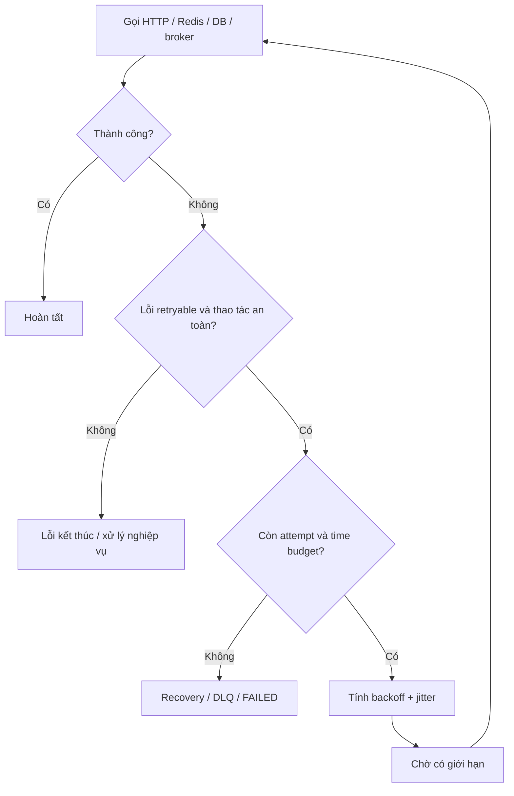
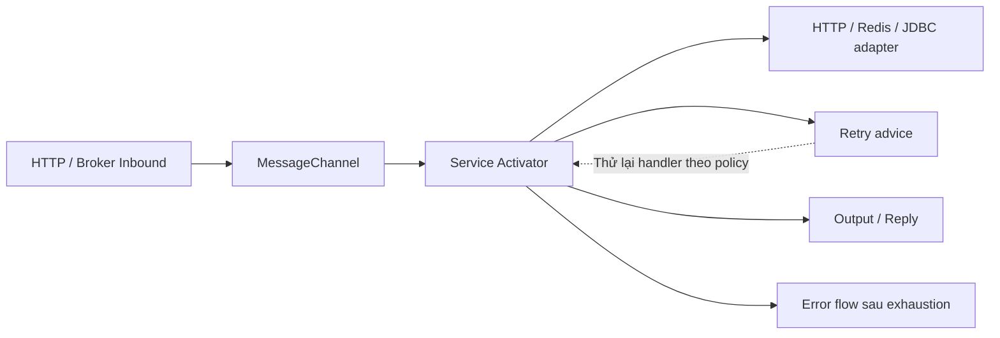
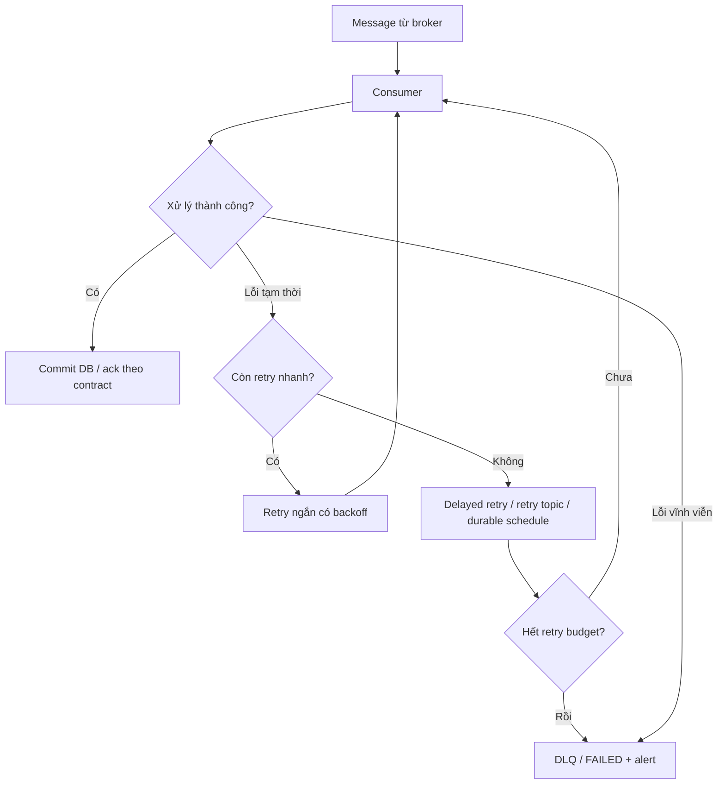
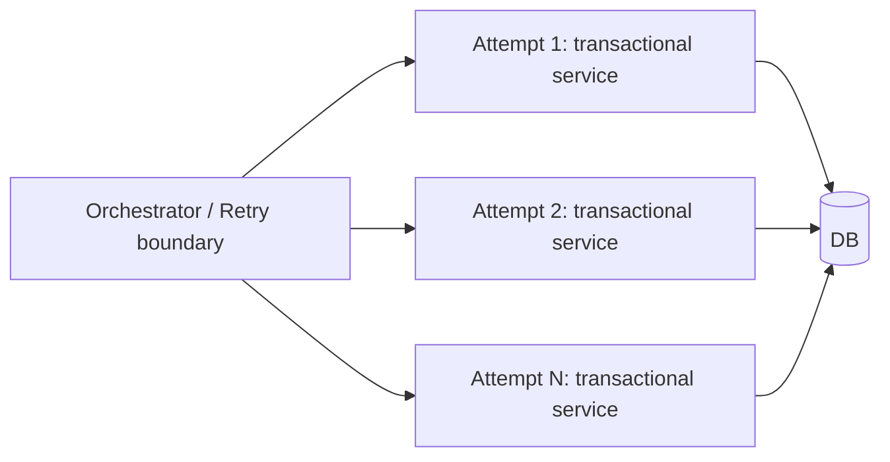
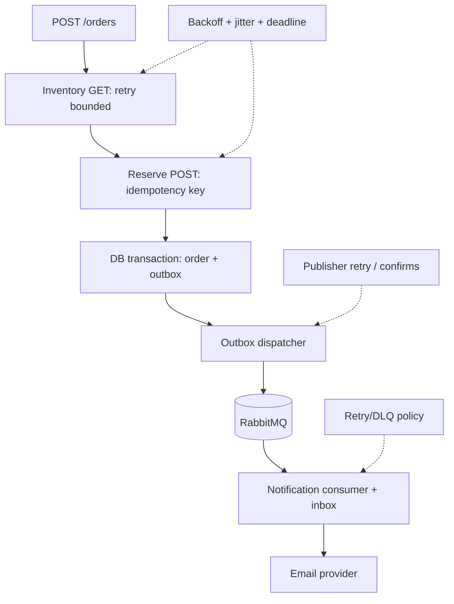

# Retry với backoff, jitter và giới hạn số lần thử

## 1. Retry là một chính sách phục hồi, không phải nút “thử lại mọi lỗi”

Trong mô-đun **SPRING_BOOT_INTEGRATION**, ứng dụng Spring Boot kết nối HTTP API, cơ sở dữ liệu, Redis cache, message broker và adapter của Spring Integration. Một lỗi tạm thời có thể xuất hiện khi Inventory API trả HTTP 503, Redis đang failover, broker ngắt kết nối hoặc database từ chối một transaction vì deadlock. Retry đúng cách có thể giúp một thao tác thành công mà người dùng không cần gửi lại yêu cầu.

Nhưng một retry thiếu giới hạn có thể biến sự cố nhỏ thành sự cố lớn:

- Hàng trăm instance cùng gọi lại một HTTP API đang quá tải, tạo **retry storm**.
- Retry một lệnh tạo đơn hàng sau timeout làm tạo **hai đơn hàng** nếu không có idempotency.
- Message listener retry vô hạn một payload sai schema, chiếm hết thread và ngăn các message hợp lệ.
- Transaction giữ lock trong lúc `sleep` giữa các lần thử, kéo dài tắc nghẽn database.
- Một tầng đã retry ba lần, tầng bên dưới lại retry ba lần, làm số lượt gọi thực tế tăng ngoài dự tính.

**Retry** chỉ nên dùng khi lỗi có khả năng hồi phục và thao tác có thể lặp lại an toàn. **Backoff** tạo khoảng chờ giữa các lần thử. **Jitter** làm khoảng chờ khác nhau giữa các client, giúp giảm đồng loạt gọi lại. **Giới hạn số lần thử và deadline** đặt trần cho công việc, bảo vệ nguồn lực của cả hệ thống.



Bài tập trung vào cách thiết kế và áp dụng retry với Spring Boot, Spring Retry, Reactor/WebClient và Spring Integration, cùng tác động đến database, cache, broker, idempotency, kiểm thử và quan sát thực tế. Ví dụ dùng Java 17+, Spring Boot 3.x và các dependency tương thích; khi nâng cấp framework phải đối chiếu API của phiên bản cụ thể.

## 2. Phân loại lỗi trước khi thiết lập retry

Quyết định retry không nên chỉ dựa vào câu “có exception”. Cần hiểu **nguyên nhân lỗi**, **khả năng phục hồi** và **hệ quả khi gửi lại thao tác**.

| Nguồn | Lỗi ví dụ | Retry thường phù hợp? | Lưu ý |
| --- | --- | --- | --- |
| HTTP upstream | 502, 503, 504 | Có thể | Chỉ khi còn ngân sách thời gian và request an toàn |
| HTTP upstream | 429 Too Many Requests | Có điều kiện | Tôn trọng `Retry-After`/rate-limit policy của provider |
| HTTP upstream | 400, 422 | Không | Payload/validation sai sẽ không tự sửa sau khi chờ |
| HTTP upstream | 401, 403 | Thường không | Cần kiểm tra credentials/quyền; refresh token có chính sách riêng |
| HTTP upstream | 404 | Tùy hợp đồng | Thường là kết quả nghiệp vụ hoặc cấu hình route sai |
| HTTP client | Connect timeout, connection reset | Có thể | Chưa chắc server chưa nhận/commit yêu cầu |
| Redis | Failover, connection reset, timeout | Có thể | `INCR` và các command có side effect phải được đánh giá idempotency |
| Redis | NOAUTH, NOPERM | Không | Lỗi credentials/ACL cần sửa cấu hình |
| Database | Deadlock, serialization failure | Có điều kiện | Thường retry **toàn transaction** theo policy |
| Database | Unique constraint violation | Thường không | Có thể là duplicate hợp lệ hoặc lỗi nghiệp vụ |
| Broker | Connection temporarily unavailable | Có thể | Dựa trên producer confirms/ack và dedupe |
| Broker | Payload không deserialize được | Không | Poison message → xử lý lỗi/DLQ |
| Spring Integration | Handler lỗi do downstream 503 | Có thể | Retry tại handler có giới hạn; tránh lặp các bước đã commit |
| Spring Integration | Validation sai, thiếu field bắt buộc | Không | Không thể tự hồi phục nếu input không đổi |

**Quan trọng:** lỗi network có thể xảy ra **sau khi hệ thống đích đã xử lý**. Ví dụ Payment Service đã ghi thanh toán nhưng response bị thất lạc; client nhìn thấy timeout. Retry một lệnh `POST` không có idempotency key có thể trừ tiền lần hai. Phân loại transient/permanent không đủ: còn cần **độ an toàn khi thực thi lại**.

### 2.1. Một hàm phân loại lỗi nên thuộc adapter

Business service không nên biết mọi exception của Lettuce, Netty, JDBC hay Kafka. Tại ranh giới tích hợp, adapter có thể chuyển lỗi thành loại rõ nghĩa:

```java
public class TransientInventoryException extends RuntimeException {
    public TransientInventoryException(String message, Throwable cause) {
        super(message, cause);
    }
}

public class PermanentInventoryException extends RuntimeException {
    public PermanentInventoryException(String message) {
        super(message);
    }
}
```

Ví dụ adapter có thể ánh xạ HTTP 503 thành `TransientInventoryException`, còn JSON sai hợp đồng thành `PermanentInventoryException`. Khi viết retry policy, chỉ retry nhóm transient đã được cho phép. Đừng gom tất cả `RuntimeException` vào một quy tắc “thử lại”.

## 3. Thuật ngữ: attempt, retry, backoff, jitter, deadline

Bốn con số rất dễ bị nhầm:

- **Attempt**: một lần thực sự gọi thao tác. Lần gọi đầu là **attempt 1**.
- **Retry**: một lần gọi thêm **sau khi** một attempt thất bại. Hai retries nghĩa là tối đa **ba attempts**.
- **Backoff**: thời gian chờ trước lần gọi lại, thường tăng dần theo số lần thất bại.
- **Jitter**: thành phần ngẫu nhiên làm lệch thời gian chờ nhằm tránh các client thức dậy cùng lúc.
- **Deadline/time budget**: tổng thời gian được phép dùng, bao gồm thời gian gọi, thời gian chờ và mọi lần thử lại.

Ví dụ một policy “**tối đa 4 attempts**”:

```text
Attempt 1 → thất bại
   chờ backoff/jitter lần 1
Attempt 2 → thất bại
   chờ backoff/jitter lần 2
Attempt 3 → thất bại
   chờ backoff/jitter lần 3
Attempt 4 → thất bại
   HẾT attempts → recovery/throw/DLQ
```

Không có lần chờ sau attempt cuối. Với `maxAttempts=4`, số retries tối đa thường là **3**. Nhưng nhiều API lại nhận tham số “số retries”; chẳng hạn Reactor `Retry.backoff(3, ...)` nghĩa là cho phép **3 lần thử lại sau lần gọi đầu**.

**Luôn ghi vào tài liệu và metric rõ tham số đang đếm attempts hay retries.** Một lỗi off-by-one có thể nhân tải và làm SLA xấu hơn dự kiến.

## 4. Fixed delay, exponential backoff và jitter

### 4.1. Fixed delay

Sau mỗi lỗi retryable, chờ cố định 200 ms:

```text
attempt 1 lỗi → chờ 200 ms
attempt 2 lỗi → chờ 200 ms
attempt 3 lỗi → chờ 200 ms
```

Cách này dễ dự đoán, nhưng nhiều instance bị lỗi cùng lúc có thể thử lại cùng một nhịp, nhất là khi cùng timeout.

### 4.2. Exponential backoff có giới hạn

Một công thức thông dụng cho **lần chờ sau thất bại thứ k** là:

\[
d_k = \min(d_{\max}, d_0 \times m^{k-1}), \quad k \ge 1
\]

Trong đó:

- `d0`: thời gian chờ khởi đầu, ví dụ 200 ms.
- `m`: hệ số nhân, ví dụ 2.
- `dmax`: trần chờ, ví dụ 3.000 ms.
- `k`: số lần thất bại đã xảy ra, bắt đầu từ 1.

| Lỗi thứ k | Backoff chưa jitter (d0 = 200 ms, m = 2, dmax = 3.000 ms) |
| --- | ---: |
| 1 | 200 ms |
| 2 | 400 ms |
| 3 | 800 ms |
| 4 | 1.600 ms |
| 5 | 3.000 ms |
| 6 | 3.000 ms |

**Không đặt backoff không có trần** khi hệ thống có thể bị lỗi kéo dài: thời gian chờ tăng rất lớn hoặc tổng thời gian vượt SLA. Thực thi code còn phải tránh tràn số khi nhân/gấp đôi.

### 4.3. Vì sao exponential backoff vẫn có thể tạo retry storm?

Giả sử 1.000 request đồng thời nhận 503 lúc 10:00:00. Nếu mọi instance dùng dãy 200, 400, 800 ms cố định, chúng có xu hướng gọi lại cùng các mốc:

```text
10:00:00.200 — 1.000 requests thử lại
10:00:00.600 — 1.000 requests thử lại
10:00:01.400 — 1.000 requests thử lại
```

Với **jitter**, các request được trải ra trong một khoảng thời gian thay vì cùng một thời điểm. Giảm đồng bộ giữa các retries thường quan trọng hơn việc chọn chính xác mỗi khoảng chờ.

### 4.4. Ba chiến lược jitter thường gặp

Giả sử `cap_k = min(dmax, d0 × m^(k−1))`.

| Chiến lược | Cách chọn delay minh họa | Đặc điểm |
| --- | --- | --- |
| **Full jitter** | Chọn ngẫu nhiên từ `0` đến `cap_k` | Phân tán tốt; đôi khi delay gần 0 |
| **Equal jitter** | `cap_k/2 + random(0, cap_k/2)` | Không giảm toàn bộ khoảng chờ xuống gần 0 |
| **Decorrelated jitter** | `min(dmax, random(d0, previousDelay × 3))` | Delay phụ thuộc lần trước, biến động mềm hơn |

Các công thức minh họa một nhóm thuật toán phổ biến, **không mặc nhiên là thuật toán chính xác của `@Backoff(random=true)` hoặc `Retry.jitter(...)`** trong mọi phiên bản thư viện. Khi dự án cần phân phối delay cụ thể, phải kiểm tra implementation hoặc tự cung cấp policy được kiểm thử.

Ví dụ tạo full jitter có trần theo mili-giây trong một helper thuần Java:

```java
import java.time.Duration;
import java.util.concurrent.ThreadLocalRandom;

public final class RetryDelayPolicy {
    private RetryDelayPolicy() {}

    public static Duration fullJitter(int retryIndex) {
        if (retryIndex < 1) {
            throw new IllegalArgumentException(
                "retryIndex must start at 1"
            );
        }

        long cap = 200L;
        for (int i = 1; i < retryIndex; i++) {
            cap = Math.min(3000L, cap * 2L);
        }

        long millis = ThreadLocalRandom.current()
            .nextLong(cap + 1L);

        return Duration.ofMillis(millis);
    }
}
```

Helper này chỉ **tính delay**, chưa thực hiện retry. Với giới hạn `maxAttempts=4`, nó được gọi tối đa sau các thất bại 1, 2 và 3. Trong unit test, nên dùng một nguồn random có seed hoặc một interface cấp delay để có thể kiểm tra deterministically thay vì phụ thuộc số ngẫu nhiên thực.

## 5. Đặt ba giới hạn cùng lúc: attempts, deadline và concurrency

Chỉ đặt `maxAttempts` vẫn có thể tạo hệ thống chậm hoặc quá tải. Một policy production nên có **ba lớp giới hạn**:

1. **Attempts/retries**: tổng số lần gọi tối đa cho một logical operation.
2. **Deadline/time budget**: tổng thời gian thao tác được phép tiêu tốn; nếu hết thời gian thì không thử nữa dù còn attempts.
3. **Concurrency/rate budget**: giới hạn số request đang chạy và tổng lượng retry tới downstream.

Ví dụ Order API có deadline tổng 2 giây:

```text
request bắt đầu                   0 ms
Inventory attempt 1             0–450 ms (503)
backoff có jitter              450–650 ms
Inventory attempt 2           650–1250 ms (timeout)
backoff dự kiến                400–800 ms
Inventory attempt 3           chỉ chạy nếu vẫn còn thời gian
deadline tổng                   2000 ms
```

Nếu attempt 3 cần timeout tối đa 1 giây nhưng chỉ còn 150 ms trước deadline, hệ thống phải **rút ngắn timeout còn lại hoặc bỏ attempt đó**. Không được “cứ retry đủ số lần” rồi làm HTTP request phía người dùng vượt SLA nhiều giây.

### 5.1. Retry amplification khi nhiều tầng cùng thử lại

Giả sử Gateway gọi Order Service, Order Service gọi Inventory, Inventory gọi Database; mỗi tầng có tối đa 3 attempts riêng:

```text
Gateway:       3 attempts
Order:         3 attempts / Gateway attempt
Inventory:     3 attempts / Order attempt
⇒ Có thể nhân lên tới 3 × 3 × 3 = 27 thao tác ở tầng sâu
```

Điều này là **upper bound minh họa** khi các lần retry lồng nhau đều được kích hoạt; tổng thực tế tùy đường lỗi. Để tránh amplification, nên xác định tầng nào có quyền retry, dùng retry budget chung hoặc truyền deadline; không bật mặc định retry ở mọi thư viện và mọi handler.

### 5.2. Rate limit, circuit breaker và bulkhead phối hợp thế nào?

- **Rate limiter**: giữ tốc độ gửi request trong quota.
- **Bulkhead/concurrency limit**: bảo vệ số thread/connection tối đa dùng cho downstream.
- **Circuit breaker**: tạm ngừng gọi khi upstream lỗi nghiêm trọng, giúp tránh lãng phí tài nguyên.
- **Retry**: thử lại lỗi tạm thời trong giới hạn.

Nếu circuit breaker đang `OPEN`, retry liên tục cùng một lỗi “call not permitted” thường không có ích. Thứ tự kết hợp retry/circuit breaker/bulkhead ảnh hưởng đến số lượt gọi và metric; cần thiết kế và test thực tế, không chỉ thêm annotation tùy tiện.

## 6. Spring Retry: retry đồng bộ với @Retryable và @Backoff

Spring Retry phù hợp khi một service imperative gọi database, HTTP client hoặc adapter đồng bộ và muốn cấu hình retry tại method boundary.

Một cấu hình Maven thường cần:

```xml
<dependency>
    <groupId>org.springframework.retry</groupId>
    <artifactId>spring-retry</artifactId>
</dependency>
<dependency>
    <groupId>org.springframework.boot</groupId>
    <artifactId>spring-boot-starter-aop</artifactId>
</dependency>
```

Bật proxy retry:

```java
import org.springframework.context.annotation.Configuration;
import org.springframework.retry.annotation.EnableRetry;

@Configuration
@EnableRetry
public class RetryConfiguration {
}
```

Ví dụ một service chỉ retry exception do adapter đã phân loại:

```java
import org.springframework.retry.annotation.Backoff;
import org.springframework.retry.annotation.Retryable;
import org.springframework.stereotype.Service;

@Service
public class InventoryLookupService {
    private final InventoryGateway gateway;

    public InventoryLookupService(InventoryGateway gateway) {
        this.gateway = gateway;
    }

    @Retryable(
        retryFor = TransientInventoryException.class,
        maxAttempts = 4,
        backoff = @Backoff(
            delay = 200,
            multiplier = 2.0,
            maxDelay = 2000,
            random = true
        )
    )
    public InventorySnapshot load(String sku) {
        return gateway.fetch(sku);
    }
}
```

`InventoryGateway` và `InventorySnapshot` là các type ứng dụng định nghĩa. Trong trường hợp này:

- `maxAttempts = 4` là **một lần gọi đầu + tối đa ba lần retry**.
- `delay = 200`, `maxDelay = 2000` tính bằng **mili-giây**.
- `multiplier = 2.0` làm backoff tăng theo policy.
- `random = true` yêu cầu cơ chế **randomized backoff của Spring Retry**; không nên diễn giải nó như full jitter `random(0, delay)` nếu chưa kiểm chứng implementation.
- Exception ngoài `TransientInventoryException` không thuộc nhóm được policy này cho phép thử lại.

### 6.1. @Retryable có proxy boundary

`@Retryable` thông thường được xử lý bởi Spring AOP. Vì vậy:

```java
@Service
class OrderService {
    public void createOrder() {
        loadInventory(); // self-invocation: có thể bỏ qua retry proxy
    }

    @Retryable(maxAttempts = 4)
    public void loadInventory() {
        // ...
    }
}
```

Đoạn này **không phải** cách khuyến nghị để dựa vào retry, vì gọi nội bộ `this.loadInventory()` không đi qua proxy trong chế độ proxy mặc định. Hãy đặt operation retry vào Spring bean riêng được inject hoặc cấu hình AOP có chủ đích.

Ngoài ra, code tự khởi tạo service bằng `new` ngoài Spring context cũng không nhận advice retry. Không dùng `@Retryable` để cố sửa một lỗi được phát ở thread khác sau khi method đã trả về.

### 6.2. Recovery khi hết attempts

Spring Retry có `@Recover` để xử lý sau khi exhaustion, phù hợp khi caller thực sự có thể nhận một kết quả dự phòng rõ nghĩa:

```java
import org.springframework.retry.annotation.Recover;

// Đặt trong cùng bean chứa method @Retryable tương ứng.
@Recover
public InventorySnapshot recover(
        TransientInventoryException failure,
        String sku) {
    throw failure; // Không tạo tồn kho giả để che lỗi.
}
```

Phương thức recovery phải có return type tương thích với method retryable và các tham số phù hợp theo cơ chế Spring Retry. Một recovery trả dữ liệu “stale” chỉ an toàn nếu hợp đồng nghiệp vụ **cho phép rõ**; trả tồn kho bằng 0 cho mọi 503 là sai ngữ nghĩa.

## 7. RetryTemplate: chủ động kiểm soát phạm vi và policy

Khi không muốn dùng annotation hoặc cần tạo policy một cách tường minh trong adapter, dùng `RetryTemplate`. Ví dụ với Spring Retry 2.x:

```java
import org.springframework.context.annotation.Bean;
import org.springframework.context.annotation.Configuration;
import org.springframework.retry.support.RetryTemplate;

@Configuration
class PartnerRetryConfiguration {

    @Bean
    RetryTemplate partnerRetryTemplate() {
        return RetryTemplate.builder()
            .maxAttempts(4)
            .exponentialBackoff(200, 2.0, 2000, true)
            .retryOn(TransientInventoryException.class)
            .build();
    }
}
```

Ở đây builder thiết lập tối đa 4 attempts, exponential randomized backoff, và retry exception được chọn. Cấu hình này **không phải** một thread pool và cũng không tự điều phối asynchronous job.

Sử dụng:

```java
import org.springframework.retry.support.RetryTemplate;
import org.springframework.stereotype.Component;

@Component
public class RetryingInventoryAdapter {
    private final RetryTemplate retryTemplate;
    private final InventoryGateway gateway;

    public RetryingInventoryAdapter(
            RetryTemplate retryTemplate,
            InventoryGateway gateway) {
        this.retryTemplate = retryTemplate;
        this.gateway = gateway;
    }

    public InventorySnapshot load(String sku) {
        return retryTemplate.execute(
            context -> gateway.fetch(sku)
        );
    }
}
```

`RetryTemplate.execute(...)` thực thi operation và có thể **chặn thread gọi** trong lúc chờ backoff. Nếu dùng với HTTP controller đồng bộ, tổng thời gian chờ ảnh hưởng thread request và latency. Nếu thao tác chạy trên worker của `ExecutorChannel`, backoff giữ worker đó bận trong thời gian chờ; với retry delay dài, có thể cần message broker/scheduler bền vững thay vì giữ thread.

### 7.1. RetryTemplate và @Retryable có nên dùng chồng?

Đừng đặt `@Retryable(maxAttempts=4)` bên ngoài một `RetryTemplate` cũng max 4 cho cùng operation mà không có lý do: trong đường lỗi xấu nhất có thể có **16 attempts**. Chọn **một tầng sở hữu retry** để đơn giản hóa số lần gọi, deadline và metrics. Nếu buộc phải retry ở nhiều tầng, cần mô tả rõ ngân sách và ngoại lệ được retry ở từng tầng.

## 8. HTTP synchronous: RestClient, status code và Retry-After

`RestClient` là HTTP client đồng bộ của Spring Framework 6.1+. Spring Boot có thể cung cấp `RestClient.Builder` đã được auto-configure để áp timeout, observability và các customizer phù hợp.

Ví dụ gateway nhận lỗi từ Inventory API:

```java
import org.springframework.http.HttpStatusCode;
import org.springframework.web.client.RestClient;
import org.springframework.web.client.RestClientResponseException;

public class InventoryGateway {
    private final RestClient client;

    public InventoryGateway(RestClient client) {
        this.client = client;
    }

    public InventorySnapshot fetch(String sku) {
        try {
            return client.get()
                .uri("/api/v1/inventory/{sku}", sku)
                .retrieve()
                .body(InventorySnapshot.class);
        } catch (RestClientResponseException ex) {
            HttpStatusCode status = ex.getStatusCode();
            if (status.value() == 503
                    || status.value() == 502
                    || status.value() == 504) {
                throw new TransientInventoryException(
                    "Inventory temporarily unavailable", ex
                );
            }
            throw ex;
        }
    }
}
```

Ví dụ giả định bean `RestClient` được tạo từ builder của Boot, có `baseUrl` và cấu hình kết nối theo upstream; `InventorySnapshot` là DTO nghiệp vụ. Những lỗi transport không có HTTP response, như DNS/connection failure, có thể đi qua exception khác; nếu muốn retry cần phân loại riêng thay vì chỉ bắt `RestClientResponseException`.

### 8.1. Xử lý HTTP 429 và Retry-After

HTTP 429 thường cho biết server đang giới hạn tốc độ. Header `Retry-After` có thể mang **số giây** hoặc **HTTP-date**. Khi provider công bố header này:

1. Parse theo chuẩn header và kiểm tra giá trị hợp lệ.
2. Tính thời gian chờ còn lại theo thời điểm hiện tại (với HTTP-date).
3. Chặn giá trị âm, vô lý hoặc quá lớn; áp trần chính sách client.
4. Tôn trọng giới hạn concurrency/rate quota và deadline chung.
5. Nếu còn quá ít deadline để chờ, trả lỗi có kiểm soát thay vì tiếp tục retry.

Không mặc định `@Backoff(delay=200)` hoặc `Retry.backoff(...)` tự tôn trọng `Retry-After`. Muốn xử lý theo header cần policy/customization riêng trong client hoặc retry layer; bản thân response exception thường cho phép truy cập response headers để triển khai điều đó.

### 8.2. GET và POST không có cùng độ an toàn

- `GET` thường là safe/idempotent theo HTTP semantics, nhưng vẫn phải xét upstream, deadline và tải.
- `PUT`/`DELETE` được định nghĩa idempotent về semantics HTTP, nhưng implementation thật có thể có side effect phụ; phải kiểm thử hợp đồng.
- `POST` thường **không idempotent mặc định**. Nếu retry sau timeout, cần `Idempotency-Key`/request ID ổn định và server xử lý duplicate theo hợp đồng.

Ví dụ gửi key cho thao tác giữ hàng:

```java
ReservationResponse response = client.post()
    .uri("/api/v1/reservations")
    .header("Idempotency-Key", reservationRequestId)
    .body(request)
    .retrieve()
    .body(ReservationResponse.class);
```

`reservationRequestId` phải được tạo **một lần cho logical operation**, rồi dùng lại qua mọi attempt, không tạo UUID mới trong từng callback retry. Server cần lưu kết quả/unique fingerprint đủ bền vững; chỉ gửi header từ client mà phía server không hỗ trợ **không bảo đảm idempotency**.

## 9. WebClient và Reactor Retry: non-blocking backoff

Với `WebClient`, các lời gọi thường trả `Mono` hoặc `Flux`. Reactor có toán tử `retryWhen` với `Retry.backoff` và `jitter`. Trái với `Thread.sleep`, các khoảng chờ trong pipeline reactive được lên lịch thông qua scheduler thay vì chặn thread I/O theo cách retry đồng bộ.

Ví dụ chỉ retry HTTP 502/503/504 tối đa hai lần:

```java
import java.time.Duration;

import org.springframework.web.reactive.function.client.WebClient;
import org.springframework.web.reactive.function.client.WebClientResponseException;
import reactor.core.publisher.Mono;
import reactor.util.retry.Retry;

public class ReactiveInventoryClient {

    private final WebClient client;

    public ReactiveInventoryClient(WebClient client) {
        this.client = client;
    }

    public Mono<InventorySnapshot> load(String sku) {
        return client.get()
            .uri("/api/v1/inventory/{sku}", sku)
            .retrieve()
            .bodyToMono(InventorySnapshot.class)
            .retryWhen(
                Retry.backoff(2, Duration.ofMillis(200))
                    .maxBackoff(Duration.ofSeconds(2))
                    .jitter(0.5)
                    .filter(this::isRetryableHttpFailure)
            );
    }

    private boolean isRetryableHttpFailure(Throwable throwable) {
        if (!(throwable instanceof WebClientResponseException ex)) {
            return false;
        }
        int status = ex.getStatusCode().value();
        return status == 502 || status == 503 || status == 504;
    }
}
```

Cần hiểu:

- `Retry.backoff(2, ...)` là tối đa **hai retries** sau attempt đầu, tức tối đa ba HTTP exchanges nếu các lỗi đều được phép retry.
- `jitter(0.5)` yêu cầu jitter factor theo implementation Reactor, **không đồng nghĩa full jitter**.
- `maxBackoff` đặt trần thời gian chờ theo cơ chế của thư viện.
- `filter` chỉ retry nhóm lỗi mong muốn; ở đây không retry 400/401/404/422, decode error hoặc các lỗi khác.
- `retryWhen` **resubscribe** nguồn publisher. Với WebClient cold publisher, điều đó thường phát lại HTTP request.

Nếu muốn retry một số connection failures, cần phân loại `WebClientRequestException` theo cause/operation và hiểu rủi ro request có thể đã được gửi. Không mở rộng filter thành “mọi exception” chỉ để vượt qua một test.

### 9.1. Timeout đặt ở đâu tạo khác biệt lớn

Xem hai pipeline:

```java
// A: mỗi attempt có timeout riêng; tổng thời gian có thể lớn.
Mono<InventorySnapshot> a = httpCall()
    .timeout(Duration.ofSeconds(1))
    .retryWhen(retrySpec);

// B: deadline cho toàn bộ pipeline bao gồm cả backoff.
Mono<InventorySnapshot> b = httpCall()
    .retryWhen(retrySpec)
    .timeout(Duration.ofSeconds(3));
```

`httpCall()` và `retrySpec` trong ví dụ là publisher/policy đã được cấu hình. Pipeline A có thể mất hơn một giây tổng cộng vì mỗi attempt lại được cấp timeout riêng. Pipeline B đặt **deadline bên ngoài retry**, nên cả những lần chờ backoff đều nằm trong giới hạn ba giây.

Trong một hệ thống quan trọng, có thể kết hợp **timeout từng attempt** và **deadline toàn thao tác**. Cần test thứ tự operator thay vì mặc định hai cách tương đương.

### 9.2. Retry một Flux streaming có thể làm lặp dữ liệu

Với SSE, NDJSON hoặc một stream `Flux`:

```java
Flux<Event> stream = client.get()
    .uri("/events")
    .retrieve()
    .bodyToFlux(Event.class)
    .retryWhen(retrySpec);
```

Nếu stream đã phát 100 event rồi lỗi, retry có thể **mở kết nối mới và phát lại một số event**. Consumer phải có offset/last-event-id, dedupe hoặc hợp đồng replay rõ ràng. Không coi retry của `Flux` là tiếp tục đúng vị trí cũ, và không dùng `collectList()` cho một stream vô hạn.

## 10. Spring Integration: retry trong handler khác retry việc dispatch

Spring Integration tổ chức message qua `MessageChannel`, transformer, router, service activator, gateway và adapter. Vị trí đặt retry rất quan trọng.



Nếu retry ở **handler**, một lần thử lại có thể chạy lại cả method handler. Nếu handler đã ghi database rồi mới gọi API và gặp lỗi, retry toàn handler có thể **ghi database lần nữa**. Hãy tách ranh giới retry ở phần thao tác an toàn hoặc có idempotency.

### 10.1. RequestHandlerRetryAdvice

Spring Integration cung cấp `RequestHandlerRetryAdvice` để áp Spring Retry cho một endpoint handler. Ví dụ:

```java
import org.springframework.context.annotation.Bean;
import org.springframework.context.annotation.Configuration;
import org.springframework.integration.handler.advice.RequestHandlerRetryAdvice;
import org.springframework.retry.support.RetryTemplate;

@Configuration
public class IntegrationRetryConfiguration {

    @Bean("partnerRetryAdvice")
    RequestHandlerRetryAdvice partnerRetryAdvice(
            RetryTemplate partnerRetryTemplate) {

        RequestHandlerRetryAdvice advice =
            new RequestHandlerRetryAdvice();
        advice.setRetryTemplate(partnerRetryTemplate);
        return advice;
    }
}
```

Áp vào service activator:

```java
import org.springframework.integration.annotation.ServiceActivator;
import org.springframework.stereotype.Component;

@Component
public class PartnerMessageHandler {

    @ServiceActivator(
        inputChannel = "partnerRequests",
        adviceChain = "partnerRetryAdvice"
    )
    public void handle(PartnerCommand command) {
        // Chỉ gọi thao tác được phép chạy lại.
        partnerGateway.send(command);
    }
}
```

`PartnerCommand` và `partnerGateway` là thành phần của ứng dụng. Bean `RetryTemplate` ở mục 7 có thể được dùng lại khi chính sách exception trùng nhau; nếu chính sách khác, tạo template riêng cho flow.

**Cần kiểm tra hai vấn đề:**

1. Advice chain áp trên **message handler**, không mặc nhiên bao phủ bất cứ thao tác nào diễn ra ngoài handler, ví dụ một thread tự tạo hoặc callback phát sau method trả về.
2. Khi hết retries, nếu không có recovery callback tùy chỉnh, lỗi có thể được ném lên. Trên `DirectChannel`, nó thường về caller. Trên `ExecutorChannel` hoặc poller, lỗi cần được route qua error channel, cơ chế quản lý lỗi của endpoint hoặc transport-specific recovery.

Không nhầm `RequestHandlerRetryAdvice` với broker consumer retry/redelivery. Một là xử lý **trong cùng invocation của Spring Integration**, một là **gửi lại message** sau reject/nack/rollback bởi broker/container.

### 10.2. Recovery callback và error channel

Nếu muốn chuyển message lỗi sang error flow sau exhaustion, có thể cấu hình recovery callback cho advice theo API Spring Integration của phiên bản tương ứng. Ví dụ loại recovery như `ErrorMessageSendingRecoverer` có thể xuất bản `ErrorMessage` tới channel được cấu hình.

Tuy nhiên **errorChannel không tự là durable queue**. Nếu chỉ gửi lỗi vào một `DirectChannel` trong bộ nhớ rồi app crash, không có bảo đảm reprocess. Với luồng quan trọng, cần lưu trạng thái lỗi, DLQ broker hoặc outbox/job store để có thể khôi phục.

## 11. Message broker: immediate retry, delayed retry và dead-letter queue

Với RabbitMQ, Kafka, JMS/Artemis hoặc một adapter Spring Integration, cần xác định **ai có quyền sở hữu retry**:

- Handler nội bộ dùng retry advice trong vài lần để vượt lỗi rất ngắn.
- Listener/container có cơ chế retry/redelivery theo giao thức và cấu hình.
- Broker có thể hỗ trợ retry queue/delay/backoff/dead-letter theo pattern riêng.
- Ứng dụng có job store để scheduler thử lại sau vài phút/giờ.

Một chiến lược thường gặp:



**Retry dài bằng `Thread.sleep` trong listener thường không phải giải pháp tốt**: thread consumer bị giữ, giảm concurrency và kéo dài việc ack/commit. Với lỗi kéo dài, nên dùng redelivery/delayed message được hỗ trợ hoặc scheduler bền vững, kèm idempotency.

### 11.1. Poison message phải có điểm dừng

Một message có JSON sai schema, unknown event type hoặc dữ liệu vi phạm business validation thường không tự sửa sau 100 lần retry. Đưa nó sang DLQ/parking queue kèm:

- Original event ID và nguồn message phù hợp.
- Error code đã phân loại, thời điểm và số attempts.
- Schema version và loại payload (được ẩn dữ liệu nhạy cảm).
- Quy trình xử lý thủ công/reprocess sau khi sửa lỗi.

Không tạo vòng requeue liên tục cùng một poison message; nó có thể chiếm toàn bộ năng lực consumer và làm tăng queue lag.

### 11.2. Phân biệt ack, commit và “đã xử lý”

Nếu consumer xử lý database thành công nhưng chết trước broker ack, broker có thể gửi lại message. Nếu consumer ack trước khi business side effect commit mà process chết, message có thể bị mất khỏi luồng xử lý.

Do đó phải thiết kế **inbox/deduplication** và ordering/transaction phù hợp, chứ không giả định retry giúp tạo “exactly once” end-to-end. Các chi tiết acknowledgment, offset commit, dead-letter và redelivery phụ thuộc Kafka, RabbitMQ hay JMS; không áp một cấu hình chung cho mọi broker.

## 12. Idempotency: điều kiện quan trọng trước khi retry

Retry một thao tác là **chạy lại hành vi**. Nếu hành vi có side effect, cần biết khi nào gọi lại an toàn.

| Thao tác | Rủi ro retry | Chiến lược |
| --- | --- | --- |
| GET sản phẩm qua HTTP | Tải tăng, dữ liệu có thể đổi | Retry bounded, cache/circuit breaker, deadline |
| POST tạo reservation | Tạo reservation trùng sau timeout | Idempotency key ổn định và server dedupe |
| Redis `INCR` counter | Tăng hai lần | Chọn operation idempotent hoặc script/unique key phù hợp |
| JDBC insert order | Insert trùng | Business key/unique constraint + đúng transaction boundary |
| Gửi email | Gửi hai email | Notification ID, trạng thái gửi/đối soát; API provider nếu hỗ trợ |
| Publish event lên broker | Gửi nhiều bản cùng event | Stable eventId, outbox, consumer inbox |
| Consume OrderCreated | Side effect lặp khi redelivery | Unique key trên `(consumerName, eventId)` |

### 12.1. Một key cho một logical operation

Ví dụ Order Service gọi Inventory Service để giữ hàng:

```text
Logical operation:
  reservationRequestId = reserve:ord-1024:sku-123

Attempt 1:
  POST /reservations
  Idempotency-Key: reserve:ord-1024:sku-123
  Response timeout, chưa biết server đã commit hay chưa

Attempt 2:
  POST /reservations
  Idempotency-Key: reserve:ord-1024:sku-123
  Server trả kết quả đã lưu hoặc trạng thái nhất quán
```

Nếu server tạo key chỉ để log mà không kiểm tra duplicate, không có bảo đảm. Một hợp đồng idempotency tốt cần xác định:

- Phạm vi key (theo tenant/user/operation).
- Fingerprint nội dung request để phát hiện cùng key nhưng payload khác.
- TTL lưu kết quả; retry sau TTL có thể không còn an toàn.
- Xử lý hai request cùng key đến đồng thời.
- Trạng thái khi một request đang `PROCESSING`.
- Response replay/semantic result và status code cụ thể.

### 12.2. Inbox/outbox và retry khi broker bị lỗi

Mẫu outbox:

```text
BEGIN DATABASE TRANSACTION
  INSERT order(...)
  INSERT outbox(event_id, payload, status='PENDING')
COMMIT

Dispatcher:
  Đọc outbox PENDING
  Gửi broker (có thể retry)
  Cập nhật trạng thái đã gửi theo policy
```

Nếu gửi thành công nhưng response/confirm thất lạc, dispatcher có thể publish lại **cùng event ID**. Consumer:

```text
BEGIN DATABASE TRANSACTION
  INSERT inbox(consumer_name, event_id) UNIQUE
  Nếu trùng: bỏ qua side effect
  Nếu mới: cập nhật business data
COMMIT
ACK BROKER (theo container)
```

Database và broker không tự chung một transaction chỉ vì Spring Boot có `@Transactional`. **Retry và idempotency phải được thiết kế cùng nhau**, đặc biệt khi đã có outbox, inbox, email/HTTP downstream và cache invalidation.

## 13. Transaction và retry ở database: chọn đúng ranh giới

Một lỗi transient như deadlock hoặc serialization conflict có thể retry an toàn nếu **toàn bộ transaction được bắt đầu lại**. Nhưng retry một method có `@Transactional` và `@Retryable` không tự bảo đảm thứ tự các advice tương ứng như bạn đang kỳ vọng trong mọi cấu hình.

Một mô hình dễ kiểm soát:



Đặt retry ở **bean orchestration** và transaction ở **bean nghiệp vụ riêng**, sao cho mỗi attempt gọi qua Spring proxy và tạo transaction mới theo propagation được thiết kế. Ví dụ cấu trúc:

```java
@Service
public class OrderRetryCoordinator {
    private final OrderTransactionalWriter writer;

    public OrderRetryCoordinator(OrderTransactionalWriter writer) {
        this.writer = writer;
    }

    @Retryable(
        retryFor = TransientOrderWriteException.class,
        maxAttempts = 3,
        backoff = @Backoff(delay = 100, multiplier = 2)
    )
    public void save(OrderCommand command) {
        writer.saveInTransaction(command);
    }
}

@Service
public class OrderTransactionalWriter {
    @Transactional
    public void saveInTransaction(OrderCommand command) {
        // Ghi order + outbox trong một transaction.
        // Map lỗi DB retryable sang TransientOrderWriteException.
    }
}
```

Ví dụ là **phác thảo ranh giới**, cần imports `@Service`/`@Transactional`/`@Retryable`/`@Backoff` và các DTO/exception do ứng dụng tạo. Lưu ý:

- `OrderRetryCoordinator` và `OrderTransactionalWriter` phải là Spring beans và được gọi qua proxy.
- Một attempt thất bại phải rollback hoàn toàn transaction trước attempt sau.
- Không đặt `sleep` giữa attempts **bên trong transaction đang giữ lock**.
- Không gửi email/broker event trực tiếp giữa transaction rồi retry toàn bộ; dùng outbox để side effect không bị nhân đôi.
- Unique business key vẫn quan trọng, vì hai request khác nhau có thể chạy đồng thời dù retry được cấu hình đúng.

## 14. Recovery khi hết lần thử: trả lỗi, fallback, DLQ hay trạng thái FAILED?

Khi policy hết attempts/deadline, không nên chỉ log “retry exhausted” rồi nuốt exception.

| Kiểu luồng | Recovery phù hợp | Không nên làm |
| --- | --- | --- |
| HTTP GET dữ liệu tham khảo | Fallback cache stale nếu nghiệp vụ cho phép, hoặc 503/504 tương ứng | Trả dữ liệu bịa mà không báo degraded |
| HTTP POST có side effect | Trả trạng thái chưa xác định + operation ID để đối soát | Gửi POST mới với idempotency key khác |
| Job bất đồng bộ | Ghi `FAILED`/`RETRY_PENDING` vào store, alert, reprocess | Trả `SUCCEEDED` chỉ vì đã dispatch |
| Message broker | DLQ/delayed retry theo policy, ack/commit đúng semantics | Requeue vô hạn |
| Database transaction | Rollback và báo lỗi có mã/trace ID | Tiếp tục dùng transaction đã thất bại |
| Redis chỉ làm cache | Fallback giới hạn sang DB có circuit breaker | Đánh sập DB bằng cache-miss storm |
| Redis giữ idempotency/lock | Fail-closed hoặc phương án an toàn đã được thiết kế | Giả vờ Redis lỗi đồng nghĩa chưa có side effect |

**Fallback không phải lúc nào cũng an toàn.** Với số lượng tồn kho hoặc giá thanh toán, dùng snapshot cũ có thể vi phạm nghiệp vụ. Cần công bố trong API contract nếu response là stale/degraded và không dùng stale data để ra quyết định không thể đảo ngược.

### 14.1. Lỗi vĩnh viễn không nên chờ hết retry budget

Khi phát hiện 400 validation hoặc message sai schema, xử lý ngay bằng error path thay vì dùng hết ba attempts. Ngoài tiết kiệm latency, điều này giúp giảm áp lực lên downstream và làm rõ metric lỗi.

### 14.2. Sau exhaustion vẫn phải giữ nguyên nguyên nhân gốc

Để vận hành, lưu:

- Logical operation ID, correlation ID và upstream.
- Lần thử thực tế, thời gian bắt đầu/kết thúc, error classification.
- Cause chain được rút gọn và **không chứa secrets/PII**.
- Trạng thái đã commit/chưa chắc chắn (nếu có) và kế hoạch reconciliation.
- Deadline còn lại và lý do dừng: hết attempts, hết time budget, non-retryable hay circuit open.

Không ghi raw request/response body hoặc Redis credentials chỉ để debug retry.

## 15. Kiểm thử retry với thời gian ảo và fake dependency

### 15.1. Kiểm thử Reactor bằng StepVerifier.withVirtualTime

Với reactive retry, dùng virtual time để test backoff mà không phải đợi thật:

```java
import static org.assertj.core.api.Assertions.assertThat;

import java.io.IOException;
import java.time.Duration;
import java.util.concurrent.atomic.AtomicInteger;
import org.junit.jupiter.api.Test;
import reactor.core.publisher.Mono;
import reactor.test.StepVerifier;
import reactor.util.retry.Retry;

class ReactiveRetryPolicyTest {

    @Test
    void retriesTwiceThenSucceeds() {
        AtomicInteger attempts = new AtomicInteger();

        StepVerifier.withVirtualTime(() ->
            Mono.defer(() -> {
                int n = attempts.incrementAndGet();
                if (n < 3) {
                    return Mono.<String>error(
                        new IOException("temporary outage")
                    );
                }
                return Mono.just("ok");
            }).retryWhen(
                Retry.backoff(2, Duration.ofMillis(100))
                    .jitter(0)
            )
        )
        .thenAwait(Duration.ofSeconds(1))
        .expectNext("ok")
        .verifyComplete();

        assertThat(attempts.get()).isEqualTo(3);
    }
}
```

`jitter(0)` chỉ dùng trong test này để khoảng chờ xác định; policy production có thể cần jitter dương. Chú ý **publisher được tạo bên trong supplier của `withVirtualTime`**, để scheduler ảo được cài trước khi toán tử liên quan được tạo.

Một bài test khác nên tạo một publisher luôn lỗi, rồi assert không có attempt thứ tư khi `Retry.backoff(2, ...)` đã hết budget. Nếu cần kiểm tra chính xác loại exception sau exhaustion, Reactor có thể bọc lỗi cuối trong một exception chỉ việc “retry exhausted”; đừng chỉ so sánh chuỗi error message.

### 15.2. Kiểm thử @Retryable/RetryTemplate có hiệu lực thật

Một số lỗi của retry annotation không phát hiện được bằng unit test:

- Bean được tạo bằng `new` thay vì inject từ Spring.
- Method gọi nội bộ trong cùng bean, bỏ qua AOP proxy.
- Exception đã bị adapter bắt và chuyển thành `null`/fallback nên không kích hoạt retry.
- Exception bị wrap nhưng `retryFor` chỉ nhận type ở ngoài không phù hợp.
- Transaction vẫn mở giữa attempts do cấu hình advice sai.

Do đó, viết integration test với Spring context thật: upstream fake thất bại hai lần rồi thành công; assert **tổng số lần gọi chính xác**, kết quả cuối và thời gian chờ trong phạm vi chấp nhận được. Với jitter, không assert một thời điểm mili-giây cố định; kiểm tra khoảng/trần, hoặc inject time/sleeper abstraction có thể điều khiển.

### 15.3. Matrix kiểm thử cần có

| Case | Kỳ vọng |
| --- | --- |
| Thành công ngay attempt 1 | Không retry |
| Hai lần 503, lần 3 thành công | Ba attempts, response đúng |
| 400/422 hoặc schema mismatch | Không retry |
| Hết maxAttempts | Dừng đúng số lần, giữ cause, chạy recovery |
| Deadline hết trước attempts | Dừng vì time budget |
| 429 có `Retry-After` hợp lệ | Tôn trọng policy và trần chờ |
| 429 với header quá lớn/sai format | Không chờ vô hạn, có fallback rõ |
| Hai client cùng outage | Jitter phân tán delay, không đồng loạt gọi |
| POST timeout sau server commit | Không tạo bản ghi thứ hai |
| Consumer redelivery cùng event ID | Side effect chỉ chạy một lần |
| Poison message | Chuyển DLQ, không requeue vô hạn |
| Executor shutdown/saturation | Phân biệt lỗi dispatch với lỗi handler |
| Redis failover/DB deadlock | Retry có giới hạn và transaction đúng |
| Circuit breaker OPEN | Không nhân retry khi call bị từ chối |

Trong test fault-injection, dùng MockWebServer/WireMock, Testcontainers hoặc network proxy test như Toxiproxy để giả lập lỗi, thay vì làm hỏng Redis/broker production. Các nhóm test này bổ sung cho contract testing; retry không giải quyết một thay đổi API schema breaking.

## 16. Quan sát retry trong production

Một retry policy có thể hoạt động đúng theo code nhưng vẫn làm tình hình xấu hơn khi downstream quá tải. Quan sát cần tách **logical operations** khỏi **physical attempts**.

Ví dụ một người dùng gọi `GET /inventory` một lần, backend thử ba lần: business request count là 1, HTTP outbound attempt count là 3. Nếu chỉ đo số success cuối, có thể bỏ sót upstream đang thường xuyên lỗi ở attempt đầu.

Những metric hữu ích:

- `retry.attempts` hoặc equivalent: số attempts theo upstream, operation, exception classification.
- `retry.exhausted`: số logical operations đã hết attempts/deadline.
- `retry.backoff.duration`: thời gian chờ thực giữa attempts và phân phối jitter.
- Latency tổng của logical operation, bên cạnh latency của từng HTTP/DB/Redis attempt.
- Số retry tới downstream trên mỗi phút và tỷ lệ retry/success.
- Circuit breaker state, rate-limiter reject và bulkhead saturation.
- Broker retry queue age, DLQ count, redelivery count, consumer lag.
- Idempotency duplicate-detected count và reconciliation backlog.

**Đừng đặt `eventId`, `userId` hoặc URL chứa ID làm metric tag** vì cardinality cao; dùng chúng trong structured logs/traces đã được kiểm soát và ẩn dữ liệu nhạy cảm. Các trace span cho từng attempt có thể làm tăng sampling cost; cần chính sách quan sát phù hợp.

### 16.1. Dashboard và cảnh báo theo tình huống

| Dấu hiệu | Khả năng | Hành động |
| --- | --- | --- |
| Retry attempts tăng, success ổn | Upstream suy giảm nhưng còn phục hồi | Kiểm tra latency/5xx và tăng tải do retry |
| Retry exhausted tăng | Outage kéo dài hoặc policy quá chặt | Xem nguyên nhân gốc, circuit breaker, contingency |
| p99 latency tăng sau bật retry | Backoff nằm trên critical path | Soát deadline, số attempts và fallback |
| DLQ tăng, lỗi schema phổ biến | Poison messages, contract drift | Kiểm tra schema/version, ngừng retry vô ích |
| Duplicate side effects tăng | Thiếu idempotency hoặc replay sai | Kiểm tra eventId/inbox/outbox và POST key |
| Thread pool bão hòa | Retry đồng bộ giữ threads lâu | Giảm concurrency, chuyển delayed retry bền vững |
| Redis timeout hàng loạt rồi DB quá tải | Cache fallback stampede | Rate limit, stale policy, phân tách nguồn lỗi |

Một cảnh báo “HTTP 5xx tăng” chỉ cho thấy triệu chứng; trace/correlation ID và số attempts giúp giải thích lỗi đến từ service nào, đang thử lại ở tầng nào và công việc cuối đã commit hay chưa.

## 17. Tình huống tổng hợp: Order Service, Inventory API và RabbitMQ

Giả sử Order Service dùng Spring Boot để:

1. Nhận `POST /orders`.
2. Gọi Inventory Service bằng WebClient để kiểm tra hàng.
3. Gọi endpoint reserve (side effect).
4. Lưu order và outbox vào PostgreSQL.
5. Publisher phát `OrderCreated` qua RabbitMQ.
6. Notification consumer gửi email và ghi trạng thái hoàn tất.



### 17.1. Chính sách theo từng bước

| Bước | Policy minh họa | Điều kiện an toàn |
| --- | --- | --- |
| Inventory GET | Tối đa 3 attempts, exponential backoff + jitter, deadline 2 giây | Chỉ retry 502/503/504/connection failures được cho phép |
| Reserve POST | Tối đa 2 attempts khi provider công bố idempotency | Giữ cùng request ID và payload qua mọi attempt |
| DB order + outbox | Retry lỗi transaction transient được chọn | Mỗi attempt mở transaction mới; unique business key |
| Outbox publish | Retry có backoff hoặc job reschedule | Giữ cùng `eventId`, xử lý publisher confirm không chắc chắn |
| Notification consumer | Retry ngắn cho lỗi SMTP/HTTP tạm thời; delayed retry/DLQ sau budget | Consumer inbox và chiến lược chống gửi email trùng |
| Redis cache | Fallback giới hạn nếu chỉ là cache đọc | Không fail-open nếu Redis giữ khóa/idempotency nghiệp vụ |

Các con số chỉ để minh họa. Nếu môi trường thật có SLA/throughput khác, điều chỉnh dựa trên đo đạc và contract của từng downstream.

### 17.2. Ba kịch bản quan trọng

**Kịch bản A — Inventory API trả 503 hai lần rồi 200:** client retry GET theo budget, log/metric ghi ba attempts, business request thành công. Tổng latency vẫn phải nằm trong deadline.

**Kịch bản B — Reserve POST thành công nhưng response mất:** client retry với **cùng idempotency key**; Inventory Service tra kết quả yêu cầu cũ thay vì tạo một reservation mới. Nếu trạng thái không chắc, Order Service thực hiện đối soát theo operation ID trước khi kết luận thất bại.

**Kịch bản C — RabbitMQ đã nhận event nhưng publisher confirm bị mất:** outbox dispatcher có thể publish lại **cùng eventId**; consumer dùng inbox unique constraint để không xử lý side effect hai lần. Nếu email provider không hỗ trợ idempotency, phải thiết kế notification state và quy trình đối soát thay vì tuyên bố bảo đảm exactly-once.

### 17.3. Checklist triển khai retry

- [ ] Đã phân loại transient/permanent errors theo hợp đồng của từng downstream?
- [ ] Đã xác định logical operation nào idempotent, có side effect và key chống trùng?
- [ ] Đã ghi rõ maxAttempts là tổng attempts hay số retries?
- [ ] Có exponential/fixed backoff với trần hợp lý và jitter trong production?
- [ ] Có deadline tổng và timeout từng attempt, không lồng retry vô hạn?
- [ ] Có giới hạn concurrency/rate và phối hợp circuit breaker/bulkhead?
- [ ] Với HTTP 429, có xử lý `Retry-After` theo policy được phép?
- [ ] Retry DB có tạo transaction mới ở đúng boundary, không giữ lock trong lúc chờ?
- [ ] Retry trong Spring Integration/consumer có phân biệt handler advice với broker redelivery?
- [ ] Có DLQ/recovery/FAILED state và công cụ reprocess an toàn khi hết attempts?
- [ ] Có kiểm thử exhaustion, timeout sau commit, duplicate, poison message và failover?
- [ ] Có metric logical requests vs attempts, retry exhausted, backlog và correlation trace?

**Kết luận:** Retry giúp ứng dụng Spring Boot phục hồi trước một số lỗi tạm thời, nhưng phải đi kèm **phân loại lỗi, giới hạn attempts, deadline, exponential backoff, jitter, giới hạn tải và idempotency**. `@Retryable`/`RetryTemplate` phù hợp với lời gọi đồng bộ; Reactor `retryWhen` phù hợp với reactive HTTP; `RequestHandlerRetryAdvice` hỗ trợ Spring Integration handler, còn redelivery/DLQ của broker có vòng đời riêng. Trong luồng tích hợp qua HTTP, database, cache và broker, một retry chỉ thực sự an toàn khi thao tác được phép lặp lại, có trạng thái để đối soát và có điểm dừng rõ ràng.
