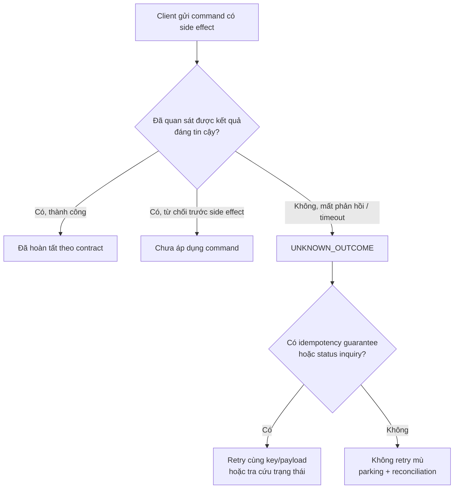
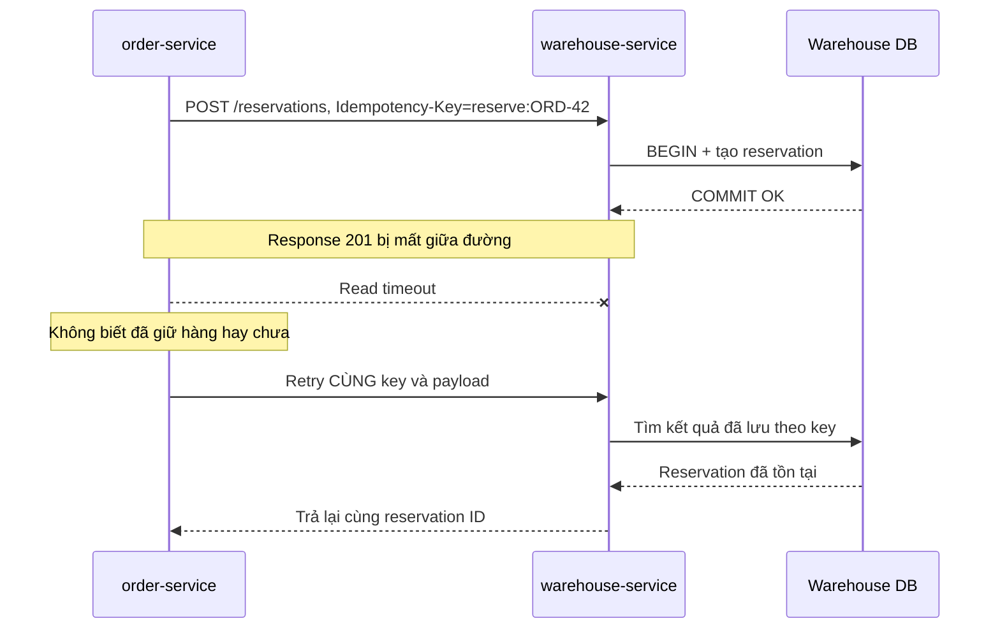
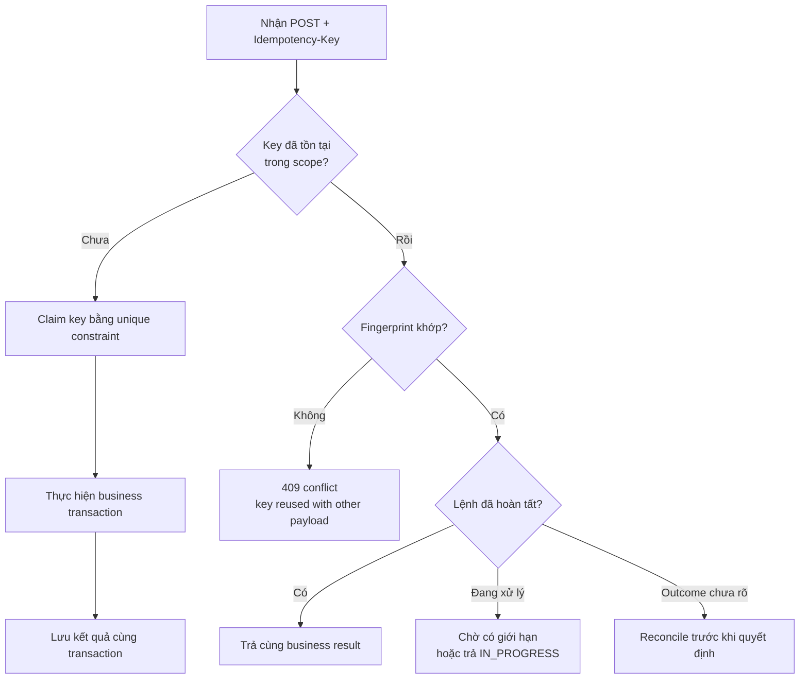
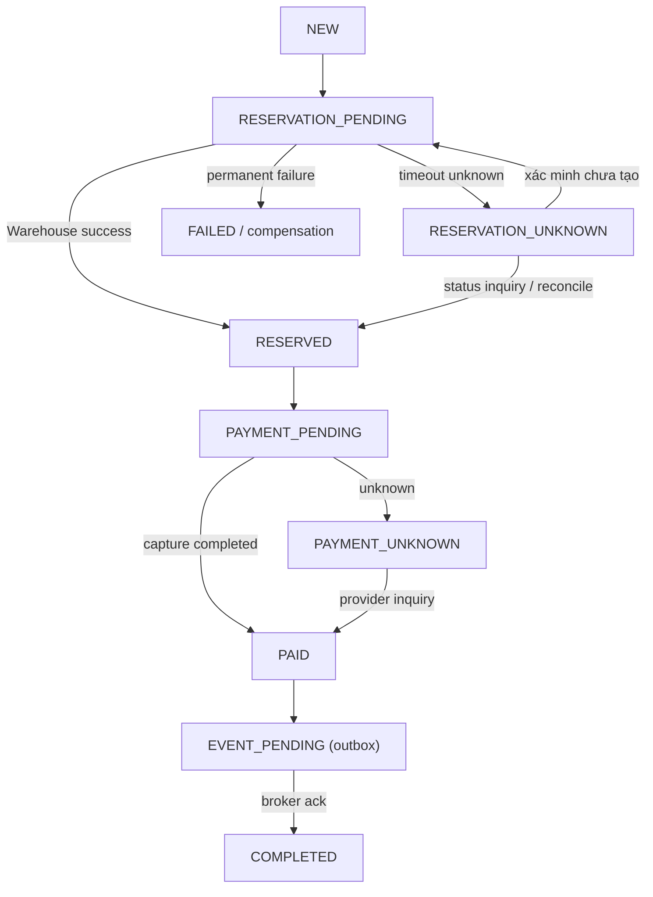
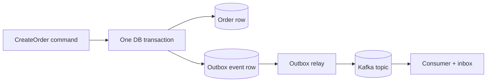
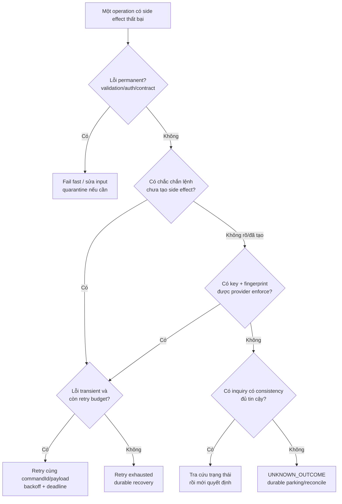

# Đánh giá tính lũy đẳng trước khi thử lại thao tác có tác dụng phụ

## 1. Vì sao quyết định retry có thể tạo ra lỗi nghiệp vụ nghiêm trọng?

Một dịch vụ Spring Boot nhận lệnh đặt hàng, gọi API Warehouse để giữ tồn kho rồi ghi kết quả vào database. Khi Warehouse trả `503 Service Unavailable`, retry có vẻ hợp lý. Nhưng nếu client bị **read timeout** sau khi Warehouse đã commit reservation, việc gửi lệnh thêm lần nữa có thể giữ hàng hai lần. Với payment API, tình huống tương tự có thể thu tiền hai lần; với email, có thể gửi nhiều thông báo; với Kafka, có thể phát một event nhiều lần.

Trong chương **Phục hồi khi lỗi** của module **SPRING_BOOT_INTEGRATION**, tính lũy đẳng (*idempotency*) là **điều kiện để ra quyết định thử lại**, không phải một thuộc tính chỉ cần bật trong retry framework. Nội dung liên hệ trực tiếp với HTTP client, database, cache, Kafka/RabbitMQ, adapter Spring Integration, giao dịch, hợp đồng dữ liệu, xử lý trùng và quan sát luồng tích hợp thực tế.

**Câu hỏi trọng tâm** không phải “ngoại lệ này có thể xảy ra tạm thời không?” mà là:

> Nếu thao tác trước **đã có tác dụng phụ**, rồi tôi gửi **cùng một lệnh** thêm lần nữa, kết quả nghiệp vụ có bị nhân đôi hoặc thay đổi trái ý muốn không?

**Mục tiêu học tập**

1. Phân biệt thao tác lũy đẳng, thao tác không lũy đẳng và thao tác chỉ an toàn nếu có điều kiện.
2. Nhận diện ba trạng thái: chắc chắn chưa thực hiện, chắc chắn đã thực hiện và **không biết đã thực hiện hay chưa**.
3. Đánh giá retry dựa trên ranh giới side effect, commit, idempotency key, kết quả quan sát và thời hạn dedup.
4. Thiết kế API với idempotency key, request fingerprint, unique constraint và lưu kết quả để trả nhất quán cho lệnh lặp.
5. Phân biệt idempotency ở HTTP, database, Redis/cache, Kafka/RabbitMQ, file adapter và API của đối tác.
6. Dùng retry có giới hạn, đối soát, outbox/inbox, version guard và compensation khi thao tác không thể thực hiện exactly once.
7. Kiểm thử các cửa sổ lỗi trước/sau commit, replay, concurrency và expiry; theo dõi duplicate/unknown outcome trong production.

> **Phạm vi phiên bản:** Ví dụ sử dụng Java 17+, Spring Boot 3.x, Spring Framework 6.x, Spring JDBC, Spring Integration 6.x và Spring Kafka 3.x. Spring Boot 4.x cùng các phiên bản driver/framework mới có thể thay đổi API hoặc auto-configuration; kiểm tra BOM thực tế trước khi sao chép. Ví dụ SQL dùng PostgreSQL; cú pháp `ON CONFLICT` không tương đương hoàn toàn với mọi database.

## 2. Lũy đẳng là tính chất của **hiệu ứng**, không phải của exception

Trong toán học, một phép biến đổi `f` là lũy đẳng khi áp dụng lần nữa không tạo ra kết quả khác:

```text
f(f(state)) = f(state)
```

Trong tích hợp, ta quan tâm **hiệu ứng nghiệp vụ có thể quan sát được** khi cùng *logical command* được thực hiện một hoặc nhiều lần. Ví dụ:

| Thao tác | Lặp lần thứ hai | Đánh giá sơ bộ |
| --- | --- | --- |
| `SET order.status = 'PAID'` | Trạng thái cuối vẫn PAID. | Có thể lũy đẳng ở mức field, nhưng event/audit phát kèm có thể bị lặp. |
| `INCREMENT stock_reserved BY 1` | Reserved tăng thêm 1 lần nữa. | Không lũy đẳng. |
| `INSERT order (command_id UNIQUE)` | Lần hai vi phạm unique constraint. | Ngăn bản ghi trùng, nhưng cần chuyển lỗi thành kết quả có ý nghĩa. |
| `PUT /orders/42/status = PAID` | Ghi cùng trạng thái. | Có thể lũy đẳng nếu server không lặp side effect khác. |
| `POST /payments/capture` | Có thể tạo một lần thu tiền mới. | Không an toàn nếu thiếu key/contract idempotency. |
| `KafkaTemplate.send(event)` | Có thể append thêm một record. | App-level publish lặp không tự lũy đẳng. |
| `Redis SET key value` | Giá trị cuối giống nhau. | Có thể lũy đẳng; TTL, notifications, version và side effects cần xét. |
| Gửi email | Người nhận có thể nhận nhiều bản. | Thường không thể giả định lũy đẳng. |

Một operation có thể lũy đẳng theo **trạng thái cuối** nhưng không lũy đẳng theo các hệ quả như audit, billing, event, email, notification hoặc số lần gọi API bị tính phí. Vì vậy, câu hỏi cần chính xác là:

**“Lũy đẳng đối với *những side effect nào*, trong *khoảng thời gian nào*, với *khóa định danh nào*?”**

### 2.1. Tạo lại cùng resource khác với tạo resource mới

```http
PUT /orders/ORD-42
Content-Type: application/json

{"status":"PENDING"}
```

và:

```http
POST /orders
Content-Type: application/json

{"customerId":"C-7","amount":150000}
```

Theo HTTP semantics, `PUT` là method có ngữ nghĩa lũy đẳng và `POST` không được định nghĩa lũy đẳng nói chung. **Nhưng** method không chứng minh implementation đáp ứng business guarantee: một `PUT` gây gửi email mỗi lần gọi vẫn có thể lặp side effect ngoài resource state; một `POST` có idempotency key bền vững lại có thể được thiết kế để retry an toàn.

Không quyết định retry chỉ từ tên method. Kiểm tra **hợp đồng service** và trạng thái thật.

### 2.2. Lũy đẳng không đồng nghĩa “không có lỗi”

Nếu `INSERT ... ON CONFLICT DO NOTHING` đã tồn tại bản ghi, thao tác thứ hai có thể không thay đổi database. Nhưng client vẫn cần biết:

- Bản ghi cũ là kết quả của **chính lệnh này** hay một lệnh khác?
- Payload có giống payload lần đầu không?
- Lần đầu đã hoàn tất, đang xử lý hay đã rollback?
- Response trả lại có cùng business ID/status không?

Một lệnh lặp có thể được xử lý bằng kết quả đã lưu, bằng error `409` do payload khác, hoặc trạng thái `IN_PROGRESS` cần tra cứu; không bắt buộc phải trả `200` cho mọi lần lặp.

## 3. Ba trạng thái kết quả khi gặp lỗi



### 3.1. Chắc chắn chưa thực hiện

Ví dụ ứng dụng tự phát hiện request thiếu field trước khi gọi upstream, hoặc chứng minh được connection hoàn toàn chưa được thiết lập và bytes request chưa được gửi. Khi đó không có side effect ở upstream. Tuy nhiên việc xác định ranh giới mạng này **khó hơn việc chỉ nhìn exception type**: một `ResourceAccessException` chung có thể bao cả connect timeout lẫn read timeout.

Nếu input không hợp lệ, retry cùng input vẫn vô ích. Chỉ thử lại khi nguyên nhân có khả năng phục hồi, không phải cứ “chưa thực hiện” là phải retry.

### 3.2. Chắc chắn đã thực hiện

Client nhận response thành công có contract rõ ràng: `201 Created` với reservation ID hoặc `200 OK` chứa kết quả command. Có thể lưu kết quả và trả cho caller. Nhưng việc client đã nhận response không chứng minh mọi side effect ở **các hệ thống khác** đã nhất quán nếu flow còn các bước tiếp theo (DB, Kafka, email).

### 3.3. Kết quả không chắc chắn: cửa sổ nguy hiểm nhất



Khi nhận read timeout sau một POST, **không thể kết luận server chưa thực hiện**. Nếu retry bằng key mới, server có thể thấy hai command độc lập và tạo hai reservation.

**Một kết quả không chắc chắn phải tồn tại như trạng thái nghiệp vụ**, ví dụ `UNKNOWN_OUTCOME` hoặc `PENDING_RECONCILIATION`, nếu không có bằng chứng đủ để kết luận thành công hay thất bại.

## 4. Quy trình đánh giá trước khi bật retry

Với **mỗi operation**, trả lời đầy đủ các câu hỏi:

1. **Logical command là gì?** Một lần bấm “đặt hàng” hay mỗi HTTP attempt? Có business command ID ổn định chưa?
2. **Tác dụng phụ ở đâu?** DB, broker, đối tác thanh toán, email, file, cache hay nhiều nơi?
3. **Tại thời điểm exception, side effect có thể đã commit chưa?** Có read timeout/connection reset/ACK lost không?
4. **Gọi lại cùng command có thay đổi trạng thái lần hai không?** Có lệnh increment/append/charge/callback không?
5. **Có idempotency key được provider thực sự thực thi không?** Scope, TTL, payload fingerprint và response replay là gì?
6. **Nếu không có key, có status inquiry bằng business ID không?** Status endpoint có nhất quán đủ để kết luận không?
7. **Có transaction/unique constraint/version check bảo vệ concurrency không?** Hai pod nhận cùng command cùng lúc thì sao?
8. **Nếu cần retry, lỗi nào thực sự transient?** Lỗi schema/validation/permission có được loại khỏi whitelist?
9. **Retry ở tầng nào?** HTTP client, `RequestHandlerRetryAdvice`, Kafka listener, broker redelivery hay scheduler?
10. **Khi hết retry budget, chuyển về đâu?** Durable parking, DLT, manual reconciliation hay compensation?
11. **Nếu replay sau nhiều ngày thì còn dấu dedup không?** TTL tương ứng với retry, retention và backfill?
12. **Kiểm thử cửa sổ lỗi nào xác nhận guarantee?** Không chỉ test happy path.

### 4.1. Bảng quyết định nhanh

| Kiểu operation | Ví dụ | Nếu lỗi tạm thời | Quyết định |
| --- | --- | --- | --- |
| Read-only | GET catalog | 503/timeout | Có thể retry bounded, nhưng vẫn cần latency budget. |
| Idempotent state set | `SET status = PAID` | DB unavailable | Retry được nếu side effect ngoài update cũng an toàn. |
| Conditional update | `UPDATE ... WHERE version=?` | Deadlock/timeout | Retry **transaction mới**; kiểm tra lại version/business rule. |
| Increment/decrement | Trừ tồn kho bằng `-quantity` | Timeout sau commit | Không retry nếu không có command ID/dedup. |
| Create resource | POST reservation | 502/503/read timeout | Chỉ retry với stable key và provider guarantee, hoặc inquiry. |
| External payment | Capture money | 5xx/timeout | Theo contract idempotency của payment provider; ưu tiên inquiry khi chưa rõ kết quả. |
| Publish Kafka | Send event | Ack timeout | Có thể phát lại ở tầng app; cần event ID + inbox/idempotency. |
| Send email/SMS | Gửi thông báo | Timeout | Cần dedup ở nhà cung cấp hoặc giới hạn/đối soát; không hứa exactly once. |
| File export | Ghi một file hoàn tất | I/O error | Có thể dùng temp file + deterministic name + atomic publish nếu filesystem/contract cho phép. |

**Đánh giá tính lũy đẳng và đánh giá retryability là hai bước khác nhau.** Một command idempotent vẫn có thể không đáng retry khi lỗi vĩnh viễn; một lỗi transient vẫn nguy hiểm với command không idempotent.

## 5. Phân loại lỗi theo khả năng retry và mức chắc chắn của side effect

### 5.1. Không dùng một danh sách HTTP status cho mọi command

| Lỗi/tín hiệu | Bản chất thường gặp | Với lệnh có side effect |
| --- | --- | --- |
| `400/422` | Payload vi phạm validation/schema. | Không retry nguyên payload. |
| `401/403` | Credential/permission sai. | Không retry cùng credential vô hạn; refresh/sửa quyền ở workflow riêng. |
| `404` | Resource/endpoint không tồn tại. | Theo contract; không biến mọi 404 thành retryable. |
| `409` | Business conflict, duplicate key khác payload hoặc concurrency. | Tra cứu trạng thái; không retry mù. |
| `412` | Precondition/ETag/version không thỏa. | Đọc lại state và tính lại command nếu được phép. |
| `429` | Quota/rate limit. | Có thể retry bounded theo `Retry-After` **nếu** operation idempotent. |
| `500` | Lỗi server có thể xảy ra trước/sau side effect. | Xử lý như unknown outcome nếu không chứng minh chưa commit. |
| `502/503/504` | Gateway/upstream không sẵn sàng. | Có thể transient; kết quả của write vẫn có thể không chắc chắn. |
| Connect timeout | Không thiết lập được kết nối trong trường hợp cụ thể. | Xác minh request đã gửi chưa; không suy ra từ exception rộng. |
| Read timeout/connection reset | Mất phản hồi sau khi đã gửi request. | **Unknown outcome** là mặc định an toàn. |
| JSON deserialize lỗi | Response sai schema. | Không retry cùng lỗi contract một cách vô hạn. |
| DB deadlock/lock timeout | Transaction bị rollback hoặc bị từ chối theo DB. | Retry toàn bộ transaction mới nếu side effect khác an toàn. |
| Unique violation | Bản ghi cùng business key đã tồn tại. | Đối chiếu fingerprint/result; không coi mọi duplicate là success. |

**Quan trọng:** HTTP `5xx` không chứng minh transaction trên provider đã rollback. Provider có thể commit DB rồi lỗi ở bước publish event hoặc lúc serialize response.

### 5.2. Có thể retry và an toàn để retry là hai trục độc lập

```text
                 Command an toàn khi lặp? 
               Có                     Không/Chưa biết
Lỗi transient   Retry bounded          Inquiry / idempotency / parking
Lỗi permanent   Fail fast              Fail fast + điều tra contract
```

Không viết kiểu chính sách “retry tất cả `RestClientException`” hoặc “retry mọi `RuntimeException`”. Mapping lỗi ở adapter nên phân biệt `TRANSIENT_SAFE`, `PERMANENT` và `UNKNOWN_OUTCOME` theo **operation**, rồi tầng retry mới quyết định hành động.

## 6. Idempotency key: nhận diện **một lệnh logic** xuyên nhiều lần thử

Giả sử API giữ hàng:

```http
POST /api/v1/reservations HTTP/1.1
Content-Type: application/json
Idempotency-Key: reserve:ORD-42:v1

{"orderId":"ORD-42","sku":"SKU-1","quantity":2}
```

Client có thể gửi lại **cùng key và cùng payload** khi mạng lỗi. Provider lưu quyết định cho key đó, thay vì lặp thao tác trừ tồn kho.

### 6.1. Định nghĩa contract cho khóa

| Thuộc tính | Điều cần quy định |
| --- | --- |
| Phạm vi (scope) | Theo tenant, merchant, endpoint, operation hay toàn service? |
| Độ duy nhất | Mỗi logical command có một key; không tái sử dụng cho command khác. |
| Ổn định | Mọi HTTP retry, worker retry và broker redelivery dùng **cùng** key. |
| Gắn payload | Cùng key nhưng body khác phải được từ chối, thường bằng business conflict. |
| Concurrency | Hai request cùng key đến đồng thời chỉ một lệnh được phép tạo side effect. |
| Trạng thái | `IN_PROGRESS`, `COMPLETED`, `FAILED_FINAL` hay trạng thái tương đương. |
| Kết quả lặp | Trả lại business result/status/headers quan trọng, hoặc chỉ dẫn tra cứu. |
| Thời hạn giữ key | Dài ít nhất bằng cửa sổ retries/replay do hợp đồng cam kết; có chính sách cho key cũ. |
| Bảo mật | Key có kích thước/format giới hạn, được scope theo principal; không coi key là credential. |

Idempotency key không nên phát sinh **mới** mỗi lần HTTP attempt:

```java
// SAI: mỗi retry là một command mới đối với provider.
headers.set("Idempotency-Key", UUID.randomUUID().toString());

// ĐÚNG: commandId được tạo một lần, giữ nguyên qua mọi attempt.
headers.set("Idempotency-Key", command.commandId());
```

### 6.2. Phân biệt event ID, command ID và aggregate ID

```text
orderId     = ORD-42         # entity/aggregate cần thay đổi
commandId   = reserve-42-v1  # một yêu cầu giữ hàng logic
eventId     = evt-42-001    # một sự kiện đã phát sinh
attemptId   = attempt-3     # một lần thử gửi, không dùng làm dedup key
traceId     = trace-xyz     # truy vết, không phải idempotency identity
```

Một order có thể có nhiều reservation commands hợp lệ theo nghiệp vụ; dùng `orderId` làm idempotency key cho **mọi** lệnh có thể vô tình chặn các thao tác hợp lệ sau đó. Dùng business command ID có phạm vi rõ ràng.

## 7. Request fingerprint: cùng key nhưng payload khác phải là conflict

Nếu provider chỉ lưu `Idempotency-Key` mà không đối chiếu nội dung, client có thể vô tình gửi:

```text
Key: reserve-42-v1; quantity=2  -> tạo reservation 2
Key: reserve-42-v1; quantity=5  -> server trả kết quả cũ 2
```

Người gọi có thể tưởng đã giữ 5 nhưng thực tế chỉ giữ 2. Vì vậy cần **fingerprint của các trường mang ý nghĩa nghiệp vụ**.

### 7.1. Hash phải dựa trên biểu diễn chuẩn hóa

- Bao gồm operation, tenant/scope, order ID, SKU, quantity, currency, đơn vị đo và trường quyết định side effect.
- Không dựa vào JSON whitespace, thứ tự thuộc tính hoặc timestamp/trace ID thay đổi ở từng attempt.
- Chuẩn hóa Unicode, case, loại số, múi giờ, null/absent theo hợp đồng.
- Dùng serialization canonical hoặc encoding có độ dài rõ ràng để tránh collision do ghép chuỗi không phân tách.
- Sử dụng hash đủ mạnh như SHA-256; không coi hash là biện pháp bí mật hóa dữ liệu.

Ví dụ `{"quantity":2}` và `{"quantity":2.0}` có được coi là cùng request hay không là **quyết định contract**. Không tự chuẩn hóa nếu hai giá trị có ngữ nghĩa khác nhau.

### 7.2. Khi key trùng



Lựa chọn cụ thể cho `IN_PROGRESS` (409/202/425 hay response theo API), status URI và thời gian chờ là một phần **hợp đồng**; không có một HTTP status mặc định đúng cho mọi nhà cung cấp.

## 8. Thiết kế database chống trùng bằng unique constraint và transaction

Với PostgreSQL, một ví dụ lệnh giữ hàng gồm:

1. Nhận command ID và fingerprint.
2. Claim cặp `(scope, idempotency_key)` bằng **unique constraint**.
3. Kiểm tra/giảm tồn kho bằng một UPDATE có điều kiện.
4. Ghi reservation và response status.
5. Commit **cùng transaction**.

### 8.1. Schema minh họa

```sql
CREATE TABLE warehouse_stock (
    sku         VARCHAR(80) PRIMARY KEY,
    available   INTEGER NOT NULL CHECK (available >= 0)
);

CREATE TABLE idempotency_requests (
    scope          VARCHAR(100) NOT NULL,
    idem_key       VARCHAR(120) NOT NULL,
    fingerprint    CHAR(64)     NOT NULL,
    result_status  INTEGER,
    reservation_id VARCHAR(80),
    error_code     VARCHAR(80),
    created_at     TIMESTAMPTZ NOT NULL DEFAULT CURRENT_TIMESTAMP,
    completed_at   TIMESTAMPTZ,
    PRIMARY KEY (scope, idem_key)
);

CREATE TABLE stock_reservations (
    reservation_id VARCHAR(80) PRIMARY KEY,
    command_id     VARCHAR(120) NOT NULL UNIQUE,
    order_id       VARCHAR(80)  NOT NULL,
    sku            VARCHAR(80)  NOT NULL,
    quantity       INTEGER NOT NULL CHECK (quantity > 0),
    status         VARCHAR(30) NOT NULL
);

INSERT INTO warehouse_stock(sku, available)
VALUES ('SKU-1', 10);
```

Trong thiết kế production, còn cần tenant scope, data ownership, index theo thời gian, kiểm soát retention, bề mặt quyền DB và audit. Bảng `idempotency_requests` ở ví dụ **không** cấp lease cho thao tác nhiều bước xuyên các hệ thống; nó phù hợp khi business effect có thể hoàn tất cùng transaction local.

### 8.2. Ghi giảm tồn kho bằng một câu SQL có điều kiện

```sql
UPDATE warehouse_stock
SET available = available - :quantity
WHERE sku = :sku
  AND available >= :quantity;
```

Nếu update trả **1 row**, lệnh đã giữ được số lượng trong transaction. Nếu trả **0 row**, SKU không tồn tại hoặc không đủ hàng; response business cần phân biệt nếu API contract yêu cầu. Điều kiện SQL tránh race “SELECT available rồi UPDATE” khi hai request đồng thời.

**Nhưng** nếu retry cùng câu UPDATE trừ tồn kho mà không có command claim, vẫn trừ nhiều lần. Atomic update bảo vệ số lượng không âm, **không tự tạo idempotency**.

### 8.3. Service Spring JDBC với kết quả được lưu

Ví dụ dưới đây dùng `JdbcTemplate` và `TransactionTemplate` để nhấn mạnh ranh giới commit local. Cần dependencies `spring-boot-starter-jdbc` và PostgreSQL JDBC driver theo BOM. Class Java dùng một số record/exception đơn giản tự định nghĩa:

```java
// ReserveCommand.java
public record ReserveCommand(
    String commandId, String orderId, String sku, int quantity
) {}

// ReservationResult.java
public record ReservationResult(
    int httpStatus, String reservationId, String errorCode
) {}

// IdempotencyConflictException.java
public class IdempotencyConflictException extends RuntimeException {
    public IdempotencyConflictException(String message) {
        super(message);
    }
}
```

Implementation:

```java
// ReservationService.java
import java.nio.charset.StandardCharsets;
import java.security.MessageDigest;
import java.security.NoSuchAlgorithmException;
import java.util.HexFormat;
import java.util.List;
import java.util.UUID;
import org.springframework.jdbc.core.JdbcTemplate;
import org.springframework.stereotype.Service;
import org.springframework.transaction.support.TransactionTemplate;

@Service
public final class ReservationService {
    private static final String SCOPE = "warehouse.reserve.v1";

    private final JdbcTemplate jdbc;
    private final TransactionTemplate tx;

    public ReservationService(
        JdbcTemplate jdbc, TransactionTemplate tx
    ) {
        this.jdbc = jdbc;
        this.tx = tx;
    }

    public ReservationResult reserve(ReserveCommand command) {
        validate(command);
        String fingerprint = fingerprint(command);

        return tx.execute(status -> {
            // Unique PK bảo vệ cả khi hai pod nhận cùng key đồng thời.
            int claimed = jdbc.update("""
                INSERT INTO idempotency_requests
                    (scope, idem_key, fingerprint)
                VALUES (?, ?, ?)
                ON CONFLICT (scope, idem_key) DO NOTHING
                """, SCOPE, command.commandId(), fingerprint);

            if (claimed == 0) {
                List<Existing> existing = jdbc.query("""
                    SELECT fingerprint, result_status,
                           reservation_id, error_code
                    FROM idempotency_requests
                    WHERE scope = ? AND idem_key = ?
                    """,
                    (rs, rowNum) -> new Existing(
                        rs.getString("fingerprint"),
                        (Integer) rs.getObject("result_status"),
                        rs.getString("reservation_id"),
                        rs.getString("error_code")
                    ),
                    SCOPE, command.commandId()
                );

                if (existing.isEmpty()) {
                    throw new IllegalStateException(
                        "Key không tìm thấy sau conflict; cần điều tra"
                    );
                }

                Existing old = existing.get(0);
                if (!old.fingerprint().equals(fingerprint)) {
                    throw new IdempotencyConflictException(
                        "Key đã dùng với payload khác"
                    );
                }
                if (old.status() == null) {
                    // Chỉ xuất hiện nếu có writer khác lưu PENDING
                    // hoặc dữ liệu bất thường ngoài thiết kế atomic này.
                    throw new IllegalStateException(
                        "Lệnh đang xử lý hoặc cần đối soát"
                    );
                }
                return new ReservationResult(
                    old.status(), old.reservationId(), old.errorCode()
                );
            }

            int updated = jdbc.update("""
                UPDATE warehouse_stock
                SET available = available - ?
                WHERE sku = ? AND available >= ?
                """,
                command.quantity(), command.sku(), command.quantity()
            );

            ReservationResult result;
            if (updated == 1) {
                String reservationId = UUID.randomUUID().toString();
                jdbc.update("""
                    INSERT INTO stock_reservations
                        (reservation_id, command_id, order_id,
                         sku, quantity, status)
                    VALUES (?, ?, ?, ?, ?, 'ACTIVE')
                    """,
                    reservationId,
                    command.commandId(),
                    command.orderId(),
                    command.sku(),
                    command.quantity()
                );
                result = new ReservationResult(
                    201, reservationId, null
                );
            } else {
                // Lưu lỗi business xác định dưới cùng key.
                result = new ReservationResult(
                    409, null, "INSUFFICIENT_STOCK"
                );
            }

            jdbc.update("""
                UPDATE idempotency_requests
                SET result_status = ?,
                    reservation_id = ?,
                    error_code = ?,
                    completed_at = CURRENT_TIMESTAMP
                WHERE scope = ? AND idem_key = ?
                """,
                result.httpStatus(),
                result.reservationId(),
                result.errorCode(),
                SCOPE, command.commandId()
            );

            return result;
        });
    }

    private record Existing(
        String fingerprint, Integer status,
        String reservationId, String errorCode
    ) {}

    private static void validate(ReserveCommand c) {
        if (c == null
            || c.commandId() == null || c.commandId().isBlank()
            || c.commandId().length() > 120
            || c.orderId() == null || c.orderId().isBlank()
            || c.sku() == null || c.sku().isBlank()
            || c.quantity() <= 0) {
            throw new IllegalArgumentException("Command không hợp lệ");
        }
    }

    private static String fingerprint(ReserveCommand c) {
        String encoded = lengthPrefix(c.orderId())
            + lengthPrefix(c.sku())
            + c.quantity();
        try {
            byte[] bytes = MessageDigest.getInstance("SHA-256")
                .digest(encoded.getBytes(StandardCharsets.UTF_8));
            return HexFormat.of().formatHex(bytes);
        } catch (NoSuchAlgorithmException ex) {
            throw new IllegalStateException("Thiếu SHA-256", ex);
        }
    }

    private static String lengthPrefix(String value) {
        return value.length() + ":" + value;
    }
}
```

**Đánh giá ví dụ**

- `ON CONFLICT ... DO NOTHING` và primary key bảo đảm chỉ một transaction claim một key. PostgreSQL xử lý xung đột đồng thời bằng cơ chế unique index/transaction; request đến sau có thể phải đợi transaction đầu hoàn tất.
- Giảm tồn kho, ghi reservation và lưu kết quả xảy ra **trong cùng transaction**. Nếu lỗi DB giữa chừng khiến transaction rollback, claim cũng rollback; lần sau có thể thực hiện lại vì lần trước chưa commit side effect local.
- Nếu transaction đầu commit, lần retry cùng key/payload sẽ đọc **kết quả đã lưu**, không giảm tồn kho lần nữa.
- Lỗi business thiếu hàng ở ví dụ được lưu `409`; việc cố định lỗi hay cho phép thử lại sau bổ sung hàng là **quyết định product contract**, không phải chân lý cho mọi service.
- Một số lỗi 409 do cùng key/payload khác phải tách rõ khỏi 409 “không đủ hàng”; không dùng mỗi status để suy luận loại xung đột.

**Giới hạn quan trọng:** Đây là trường hợp **một database local**; không tự mở rộng code thành “exactly once” cho HTTP payment, Kafka publish, email hay một transaction DB khác. Cần quản lý tenant scope thật, chuẩn hóa fingerprint chính xác và lưu full HTTP response/headers nếu contract yêu cầu replay nguyên kết quả. Các record `IN_PROGRESS` persistent không được hoàn tất trong transaction như ví dụ sẽ cần lease, expiry và reconciliation riêng.

### 8.4. Vì sao không dùng `SELECT EXISTS` rồi INSERT?

```text
Pod A: SELECT key -> chưa thấy
Pod B: SELECT key -> chưa thấy
Pod A: tạo side effect
Pod B: tạo side effect
```

Một check-then-act không có unique constraint/lock là race condition. Dùng **unique constraint làm nguồn chân lý cuối**, rồi xử lý conflict theo request fingerprint và trạng thái đã commit.

### 8.5. Đừng để khóa riêng tư hoặc fingerprint bị lạm dụng

Idempotency key được gắn với authenticated tenant/principal khi có multi-tenant. Không để tenant A đoán key của tenant B rồi lấy lại response chứa thông tin người khác. Sử dụng scopes bao gồm tenant và operation, giới hạn độ dài/format key và rate-limit tạo key mới. Không đưa các secret hoặc raw payment card data vào key.

## 9. HTTP client: retry cùng key, không retry vô điều kiện

Ở client Spring Boot, `RestClient` có thể gọi reservation API:

```java
// WarehouseReservationGateway.java
import org.springframework.http.MediaType;
import org.springframework.web.client.RestClient;

public final class WarehouseReservationGateway {
    private final RestClient client;

    public WarehouseReservationGateway(RestClient client) {
        this.client = client;
    }

    public ReservationReply reserve(ReserveCommand cmd) {
        ReservationReply reply = client.post()
            .uri("/api/v1/reservations")
            .contentType(MediaType.APPLICATION_JSON)
            .header("Idempotency-Key", cmd.commandId())
            .body(new ReserveBody(
                cmd.orderId(), cmd.sku(), cmd.quantity()
            ))
            .retrieve()
            .body(ReservationReply.class);
        if (reply == null || reply.reservationId() == null) {
            throw new IllegalStateException(
                "Warehouse trả body reservation không hợp lệ"
            );
        }
        return reply;
    }
}

// ReserveBody.java
public record ReserveBody(
    String orderId, String sku, int quantity
) {}

// ReservationReply.java
public record ReservationReply(String reservationId) {}
```

Các `public` type minh họa cần đặt trong file Java riêng đúng tên. `ReservationReply` là success DTO; response `409` có error body riêng, được `retrieve()` xử lý như HTTP error theo mặc định.

**Cần phân biệt:**

- `Idempotency-Key` giúp request có **cơ chế nhận diện cùng command** nếu provider hỗ trợ.
- Việc client gửi header này **không tự tạo bảo đảm** ở provider; phải có contract và kiểm thử.
- `RestClient` không tự retry chỉ vì gọi `retrieve()`.
- Khi tầng retry gọi lại `reserve(cmd)`, `cmd.commandId()` phải được giữ nguyên.

### 9.1. Client-side classification theo lệnh

```java
import org.springframework.web.client.HttpClientErrorException;
import org.springframework.web.client.HttpServerErrorException;
import org.springframework.web.client.ResourceAccessException;

public ReservationReply reserveWithClassification(
    ReserveCommand cmd
) {
    try {
        return reserve(cmd);
    } catch (HttpClientErrorException.TooManyRequests ex) {
        throw new RetryableWarehouseException("Rate limit 429", ex);
    } catch (HttpClientErrorException ex) {
        throw new NonRetryableWarehouseException(
            "Warehouse từ chối command: " + ex.getStatusCode(), ex
        );
    } catch (HttpServerErrorException ex) {
        int status = ex.getStatusCode().value();
        if (status == 502 || status == 503 || status == 504) {
            // An toàn để thử lại CHỈ NHỜ idempotency contract.
            throw new RetryableWarehouseException(
                "Warehouse tạm unavailable", ex
            );
        }
        throw new UnknownOutcomeException(
            "Lỗi upstream sau POST; cần xác minh kết quả", ex
        );
    } catch (ResourceAccessException ex) {
        // Read timeout sau POST: provider có thể đã commit.
        // Nếu không có guarantee key/inquiry, KHÔNG retry tự động.
        throw new UnknownOutcomeException(
            "Không xác định được kết quả reservation", ex
        );
    }
}
```

Đây là **đoạn minh họa policy**, đặt trong gateway có `reserve(cmd)`. Các exception `RetryableWarehouseException`, `NonRetryableWarehouseException` và `UnknownOutcomeException` là class ứng dụng tự định nghĩa (có thể kế thừa `RuntimeException` và lưu cause). Mức độ retry cho `ResourceAccessException` phải do caller quyết định: nếu đã xác minh provider có idempotency key bền vững, có thể cho phép retry cùng key; nếu chưa, chuyển sang inquiry/parking.

**Không mặc định `500` là “server đã rollback”.** Giữ unknown outcome khi hợp đồng không đủ thông tin.

### 9.2. Exponential backoff và tổng ngân sách thời gian

Ví dụ dùng `RetryTemplate` với whitelist:

```java
import java.util.Map;
import org.springframework.retry.backoff.ExponentialBackOffPolicy;
import org.springframework.retry.policy.SimpleRetryPolicy;
import org.springframework.retry.support.RetryTemplate;

SimpleRetryPolicy policy = new SimpleRetryPolicy(
    3, Map.of(RetryableWarehouseException.class, true), true
);

ExponentialBackOffPolicy backoff = new ExponentialBackOffPolicy();
backoff.setInitialInterval(250L);
backoff.setMultiplier(2.0);
backoff.setMaxInterval(2_000L);

RetryTemplate retryTemplate = new RetryTemplate();
retryTemplate.setRetryPolicy(policy);
retryTemplate.setBackOffPolicy(backoff);

// cmd phải được tạo sẵn với commandId không đổi.
ReservationReply result = retryTemplate.execute(
    ctx -> gateway.reserveWithClassification(cmd)
);
```

`maxAttempts=3` bao gồm **lần thử đầu tiên**. `RetryTemplate` không tự hiểu `Retry-After`, deadline của HTTP caller, kết quả không chắc chắn hoặc side effect ngoại vi. Giới hạn số lần, backoff/jitter, tổng thời gian và concurrency phải được thiết kế riêng theo SLO.

Nếu phía trên đã có Spring Integration `RequestHandlerRetryAdvice` và phía dưới có HTTP client retry, tránh để cả hai tầng retry cùng operation nhiều lần mà không kiểm soát tổng ngân sách.

### 9.3. Trường hợp cần inquiry thay vì retry

Nếu provider không có idempotent POST contract nhưng cho phép:

```http
GET /api/v1/reservations/by-command/reserve-42-v1
```

client có thể tra cứu:

1. Nếu kết quả reservation đã tồn tại đúng command → trả lại kết quả cũ, không POST thêm.
2. Nếu trạng thái đang xử lý → chờ/đọc lại theo poll budget.
3. Nếu provider chứng minh command chưa tồn tại **và tra cứu có consistency phù hợp** → cân nhắc gửi lại.
4. Nếu inquiry timeout hoặc kết quả chưa đủ tin cậy → giữ `UNKNOWN_OUTCOME`, đưa vào durable reconciliation.

Một `404` từ status endpoint **không nhất thiết** chứng minh POST trước không được xử lý: read replica có thể trễ, request đang in-flight, hoặc lookup dùng key không đúng. Inquiry cần contract về read consistency và trạng thái lệnh.

## 10. Khi một workflow có nhiều side effect

Một handler Spring Integration:

```text
1. Ghi DB order
2. Gọi Warehouse giữ hàng
3. Gửi Payment capture
4. Phát Kafka event
5. Gửi email xác nhận
```

Nếu bước 5 thất bại rồi `RequestHandlerRetryAdvice` retry **toàn bộ handler**, các bước 1–4 có thể bị gọi lại. Mỗi bước tự lũy đẳng không luôn tạo thành một workflow lũy đẳng: còn cần **thứ tự, điều kiện thực hiện, trạng thái chuyển tiếp và recovery**.

### 10.1. Chia thành state machine có thể tiếp tục



Mỗi command con có ID riêng nhưng ổn định:

```text
reserve:ORD-42:v1
capture:ORD-42:v1
publish:OrderPaid:ORD-42:v3
notify:OrderPaid:ORD-42:v3
```

Khi restart, worker đọc **trạng thái đã commit** để biết cần tiếp tục bước nào. Không chạy lại tất cả bước chỉ vì HTTP caller hoặc broker redelivery lặp message đầu vào.

### 10.2. Compensation không phải rollback phân tán

Nếu Warehouse đã giữ hàng nhưng Payment không thể thực hiện, bạn có thể gửi lệnh **release reservation**. Nhưng lệnh release cũng có thể timeout/được gửi lặp; nó cần idempotency và reconciliation riêng.

Compensation là một **business operation khác**, có thể thất bại, có quyền/điều kiện riêng. Nó không xóa dấu vết nghiệp vụ hoặc bảo đảm side effect ban đầu chưa từng xảy ra như rollback một local DB transaction.

## 11. Database: retry transaction và chống xử lý trùng

### 11.1. `@Transactional` chỉ bao transaction phù hợp

```java
@Transactional
public void process(ReserveCommand cmd) {
    orderRepository.save(...);
    warehouseGateway.reserve(cmd);
}
```

Giả sử local DB transaction rollback sau khi Warehouse đã commit. `@Transactional` **không rollback được** reservation bên Warehouse. Retry method này có thể tạo side effect mới nếu không có key.

Ngược lại, một deadlock trong local database cần **retry toàn bộ transaction mới**, không retry một query trong transaction PostgreSQL đã bị đánh dấu aborted.

### 11.2. Unique constraint và inbox

Consumer Kafka/RabbitMQ có thể nhận cùng event nhiều lần:

```sql
CREATE TABLE processed_events (
    consumer_name VARCHAR(100) NOT NULL,
    event_id      VARCHAR(120) NOT NULL,
    processed_at  TIMESTAMPTZ NOT NULL DEFAULT CURRENT_TIMESTAMP,
    PRIMARY KEY (consumer_name, event_id)
);
```

Trong một **local transaction**, thử claim event ID và áp dụng business update. Nếu insert marker thất bại vì trùng, đối chiếu trạng thái và không lặp side effect. Marker và business update phải cùng transaction; nếu marker commit trước nhưng update fail, replay có thể bị bỏ qua và mất việc.

### 11.3. Kiểm soát version và out-of-order

Event cùng aggregate được gửi theo thứ tự Kafka partition vẫn có thể xử lý trùng hoặc bị trễ do DLT/replay. Một update bảo vệ projection:

```sql
UPDATE order_projection
SET status = :newStatus,
    aggregate_version = :incomingVersion
WHERE order_id = :orderId
  AND aggregate_version < :incomingVersion;
```

Điều kiện này phù hợp với **snapshot đủ thông tin để bỏ qua version cũ**, không phù hợp với event delta cần đủ mọi bước. Với delta “trừ 100.000 khỏi số dư”, cần một quy trình gap detection/serialized apply và event inbox đúng semantics.

### 11.4. Outbox bảo vệ phát sự kiện sau local commit

Khi service vừa ghi order vừa cần publish Kafka:



Outbox giúp tránh lỗ hổng “DB đã commit nhưng process crash trước publish”. Tuy nhiên relay có thể publish rồi crash trước đánh dấu đã publish, dẫn tới **event được gửi lại**. Consumer vẫn cần xử lý trùng theo `eventId`.

Kafka producer idempotence giúp chống duplicate của **một số lần retry trong cùng producer protocol/session**, không tự loại duplicate khi application republish một event nhiều lần sau restart.

## 12. Các adapter tích hợp: lũy đẳng không đồng nhất

### 12.1. Kafka producer và consumer

| Vị trí | Rủi ro khi retry | Cách bảo vệ |
| --- | --- | --- |
| Producer `KafkaTemplate.send` | Record đã append nhưng ack mất; app gửi lại. | Event ID ổn định, outbox, producer idempotence đúng cấu hình, consumer inbox. |
| Consumer xử lý DB | Commit DB xong nhưng crash trước offset commit. | Unique `eventId`/business command ID trong DB transaction. |
| Consumer xử lý event delta | Event lặp tạo cộng/trừ thêm lần. | Inbox + version/sequence; không áp delta hai lần. |
| Consumer gửi HTTP/Email | Kafka redelivery gọi API ngoài lần nữa. | Provider key/inquiry hoặc workflow state machine. |
| Listener retry/DLT | Một event có thể được xử lý sau event mới hơn. | Version guard hoặc parking/gap handling. |

Một key Kafka như `orderId` có ích cho partition routing, **không** là idempotency key cho mỗi event: nhiều event khác nhau của cùng order phải được xử lý. Cần phân biệt `aggregateId` và `eventId`.

### 12.2. RabbitMQ

RabbitMQ có thể redeliver message khi consumer crash/chưa ack. `basic.ack` sau commit DB chưa tạo transaction ACID chung giữa broker và database. Dùng inbox/business unique key, và định nghĩa NACK/requeue/DLX rõ ràng. Một poison message không được requeue vô hạn khiến những message khác bị nghẽn.

### 12.3. Redis

- `SET key value` thường lũy đẳng theo value; nhưng TTL cập nhật lại mỗi attempt có thể thay đổi thời điểm hết hạn.
- `INCR`, `DECR`, `LPUSH`, `PUBLISH` có thể nhân đôi side effect khi gọi lặp.
- `SETNX`/`SET ... NX` có thể dùng claim key, nhưng **claim không đồng nghĩa business effect đã hoàn tất**. Nếu crash sau claim trước DB commit, retry có thể bị chặn sai.
- Redis TTL/eviction có thể xóa marker trước khi một message cũ được replay; lựa chọn persistence/quorum/atomicity phải phù hợp criticality.

Không dùng Redis cache-only với eviction tùy ý làm **nguồn chân lý duy nhất** cho idempotency của thanh toán nếu TTL và durability không đáp ứng hợp đồng.

### 12.4. File adapter

Một inbound file có thể bị poll lại sau restart; một outbound writer có thể để lại `.writing` hoặc ghi đè file chưa hoàn tất. Thiết kế:

1. Tên batch/file ID ổn định và checksum.
2. Import inbox row với unique batch ID, trạng thái `PROCESSING/DONE/FAILED`.
3. Ghi dữ liệu business theo transaction và chống trùng row/record.
4. Archive/quarantine chỉ sau khi xác định trạng thái commit.
5. Outbound viết file tạm rồi publish bằng atomic rename nếu filesystem hỗ trợ, tránh phát hai file khác tên cho cùng command.

`AcceptOnceFileListFilter` hoặc dấu “đã nhìn thấy” không chứng minh database import đã commit. Dùng metadata filter kết hợp business idempotency; không cho phép retry file bị xử lý nửa chừng mà nhân bản dữ liệu.

### 12.5. Elasticsearch và search index

Index cùng document ID với nội dung snapshot có thể idempotent hơn tạo document ID mới cho mỗi attempt. Nhưng việc xử lý event đến sai thứ tự có thể ghi lùi document. Dùng stable document ID, aggregate version/conditional update, reindex/replay và event ID khi side effect cần once-per-event.

### 12.6. Email, SMS và hệ thống bên thứ ba

Email/SMS thường **không thể thu hồi** sau khi gửi; cùng payload gửi lần hai không nhất thiết bị provider gộp. Nếu provider không hỗ trợ idempotency hoặc status inquiry đáng tin cậy, ứng dụng có thể phải chọn giữa rủi ro **trùng thông báo** và rủi ro **mất thông báo**, rồi mô tả rõ trong business SLA.

Đừng ghi “exactly-once email delivery” chỉ vì đã dùng Kafka transaction hoặc một bảng dedup trong DB.

## 13. Cửa sổ thời gian của idempotency key và nguy cơ replay muộn

Một API có thể chỉ giữ idempotency key trong 24 giờ. Nhưng Kafka DLT có thể được replay sau 7 ngày hoặc một payment reconciliation kéo dài vài tuần.

```text
T0     : Client POST key=cmd-42 -> provider commit
T0+1m  : Retry cùng key -> trả kết quả cũ
T0+24h : Provider xóa key theo TTL
T0+7d  : DLT replay event cmd-42 -> gửi POST cùng key
         Provider có thể coi là lệnh MỚI!
```

**Dedup retention phải tương thích với replay horizon.** Xác định:

- Retry của HTTP client, worker, broker/container và scheduler có thể kéo dài bao lâu?
- Event được giữ trong topic/DLT, object storage, file archive hoặc audit bao lâu?
- Có quy trình replay thủ công/backfill nhiều tháng sau không?
- Business entity có một unique key **vĩnh viễn** khác giúp nhận ra command cũ không?
- Sau khi TTL hết, provider có từ chối key cũ, tra cứu resource theo business ID hoặc cho phép tạo lệnh mới?

Không mặc định “TTL càng dài càng tốt”: dấu dedup tạo chi phí storage, index, cleanup và quyền riêng tư. Cần cân bằng bằng **cấu trúc định danh có vòng đời rõ** (chẳng hạn reservation ID không tái sử dụng), dữ liệu audit hoặc archived operation ledger.

### 13.1. Tính dung lượng dedup

Giả sử 100 command/giây, giữ marker 7 ngày:

```text
100 × 86.400 × 7 = 60.480.000 idempotency records
```

Nếu mỗi marker thô khoảng 200 byte thì dữ liệu thô khoảng 12 GB, **chưa** tính index, replication, WAL/redo log, backup, fragmentation và response body. Chọn partitioning/retention/archival, capacity planning và metrics từ đầu.

### 13.2. Không xóa trạng thái chưa rõ

Các trạng thái `IN_PROGRESS`, `UNKNOWN_OUTCOME` và `RETRY_WAIT` không nên bị cleanup như cache thông thường. Nếu chưa biết side effect đã commit hay chưa, xóa record rồi retry sẽ làm mất cơ sở chống trùng. Dùng deadline, lease, reconciliation, trạng thái dead/parking và operator action.

## 14. Khi nào cần trạng thái IN_PROGRESS và lease?

Trong transaction PostgreSQL của ví dụ ở mục 8, claim key và hoàn tất local side effect xảy ra atomically; transaction khác chưa nhìn thấy key đã claim cho đến lúc commit. Nhưng nếu workflow có HTTP payment, email hoặc xử lý kéo dài hàng phút, **không giữ một DB transaction mở** trong suốt thời gian đó.

Một workflow bền hơn cần state machine:

```text
NEW -> CLAIMED -> IN_PROGRESS -> COMPLETED
                           |
                           +-> UNKNOWN_OUTCOME -> RECONCILING
                           |
                           +-> FAILED_RETRYABLE -> RETRY_WAIT
                           |
                           +-> FAILED_FINAL / COMPENSATION_REQUIRED
```

Ở đây:

1. Claim bằng unique key/atomic compare-and-set.
2. Lưu `leaseOwner`, `leaseUntil`, `attemptCount`, `nextAttemptAt` và request fingerprint.
3. Worker chỉ thực hiện khi giữ lease hợp lệ; timeout của lease không tự chứng minh worker cũ đã ngừng thực thi.
4. Nếu lease hết, worker mới có thể điều tra; tránh hai worker cũ/mới cùng commit bằng **fencing token/version** khi tài nguyên cho phép.
5. External call vẫn cần idempotency key/inquiry; lease ở database local không thể ngăn đối tác xử lý trùng.
6. Chỉ chuyển `COMPLETED` khi kết quả thực sự được xác nhận và side effect cần thiết đã commit.

**Lease không đồng nghĩa khóa phân tán tuyệt đối:** process cũ có thể tạm dừng GC, mất kết nối rồi tiếp tục sau khi lease hết. Mọi thao tác có thể bị stale worker commit cần kiểm soát fencing/optimistic version hoặc idempotency ở đích.

## 15. Thiết kế retry budget và recovery

### 15.1. Retry ngắn hạn hay đưa vào hàng đợi trì hoãn?

| Tình huống | Cách xử lý |
| --- | --- |
| GET timeout ngắn, deadline còn nhiều | Retry đồng bộ bounded với backoff. |
| POST idempotent, upstream 503 vài giây | Retry cùng key/payload, giới hạn attempt và deadline. |
| HTTP 429 có `Retry-After` nhiều phút | Delayed retry/queue/scheduler bền vững; không giữ servlet thread chờ. |
| Payment timeout không có idempotency contract | Không retry mù; status inquiry hoặc manual reconciliation. |
| Schema invalid/permission denied | Fail fast/quarantine và sửa dữ liệu/cấu hình. |
| Đã hết retry budget | Ghi durable parking/DLT với command ID, payload reference, cause và status. |

**Retry budget** gồm số attempt, khoảng backoff, tổng deadline, tổng concurrency và số lần replay từ các tầng bên ngoài. Chỉ giới hạn ba attempt của `RequestHandlerRetryAdvice` chưa đủ nếu Kafka listener tự redeliver mười lần và caller HTTP lại thử lại.

### 15.2. Recoverer và acknowledgment

Nếu một handler retry exhausted rồi dùng `ErrorMessageSendingRecoverer` đẩy lỗi sang error channel:

- Error channel chỉ ở JVM **không tạo độ bền**.
- Nếu recoverer trả bình thường, upstream có thể coi message đã xử lý/ack/commit offset.
- Durable parking/DLT cần được **commit/ack thành công trước khi** coi trách nhiệm ở bước hiện tại đã hoàn tất.
- Nếu parking thất bại, không được nuốt lỗi làm message mất.

Với Kafka/RabbitMQ, quyết định ai retry (listener container, handler advice hay delayed topic/queue) và khi nào ack phải nhất quán với state machine.

### 15.3. Circuit breaker không thay idempotency

Circuit breaker giảm request tới hệ thống đang lỗi; nó **không** biết một POST đã commit trước khi response mất. Khi breaker đóng lại, replay các command cũ vẫn cần key/inquiry/version guard.

## 16. Kiểm thử các cửa sổ lỗi: bằng chứng quan trọng nhất

**Không chỉ test “gửi hai request liên tiếp thấy một row”.** Một thiết kế retry an toàn phải chịu được concurrency, crash, timeout và replay trong những thời điểm khó nhất.

### 16.1. Ma trận failure injection

| Cửa sổ lỗi | Kỳ vọng sau khi retry/recover |
| --- | --- |
| Client fail trước khi gửi HTTP | Chưa có side effect; có thể retry theo policy. |
| Server nhận request rồi crash trước DB commit | Transaction rollback; retry cùng key tạo **một** reservation. |
| Server commit DB nhưng response bị mất | Retry cùng key trả cùng reservation, **không trừ tồn kho lần hai**. |
| Hai request cùng key cùng payload đến đồng thời | Chỉ một transaction tạo side effect, request kia trả cùng kết quả hoặc trạng thái chờ. |
| Hai request cùng key khác payload | Không tạo side effect thứ hai; báo conflict có cấu trúc. |
| Retry sau timeout dùng key khác | Test phải chứng minh đây là **vi phạm thiết kế** và có guard ở business domain nếu cần. |
| Một worker crash sau claim trước external call | Lease/recovery không làm mất command hoặc tạo side effect sai. |
| External payment commit rồi worker crash trước update DB | Inquiry/idempotency key phục hồi trạng thái không thu tiền lần hai. |
| DB commit + outbox row, relay chưa publish | Event vẫn chờ publish. |
| Relay publish Kafka rồi crash trước mark sent | Replay có thể gửi record trùng; consumer inbox ngăn side effect trùng. |
| Consumer DB commit rồi crash trước Kafka offset commit | Event redeliver; unique marker/conditional update ngăn trùng. |
| DLT replay sau khi key TTL hết hạn | Business unique ID hoặc retention policy vẫn bảo vệ command. |
| Event phiên bản cũ đến sau bản mới | Không ghi lùi aggregate; xử lý gap nếu event delta. |
| Hai worker cùng xử lý sau lease expiry | Fencing/unique/version guard bảo vệ commit. |
| Parking/DLT unavailable | Không ack thành công giả; có alert và đường recovery. |

### 16.2. Unit test hợp đồng key và fingerprint

Với service `ReservationService`:

1. Cùng `commandId`, `orderId`, `sku`, `quantity` → fingerprint giống.
2. Cùng `commandId` nhưng khác `quantity` → conflict.
3. Trường `commandId` rỗng/độ dài vượt giới hạn → lỗi validation trước ghi DB.
4. Retry cùng một command object hoặc persisted command → không tạo key mới.
5. Nếu có tenant scope, cùng key ở hai tenant hợp lệ không trả nhầm dữ liệu cho nhau.

### 16.3. Integration test PostgreSQL concurrency

Sử dụng Testcontainers PostgreSQL với schema thật:

```java
// Pseudocode test outline: cần khởi động Spring context,
// chạy migration và inject ReservationService/JdbcTemplate.
//
// 1. Có 10 đơn vị tồn kho SKU-1.
// 2. Gọi reservationService.reserve(command) hai lần với cùng key.
// 3. Cả hai kết quả có cùng reservationId.
// 4. SELECT available còn 8, không phải 6.
// 5. SELECT COUNT(*) stock_reservations theo command_id = 1.
// 6. Gọi cùng key với quantity=3 => IdempotencyConflictException.
// 7. Chạy hai threads cạnh tranh cùng key và assert invariant.
```

Đây là **kịch bản test**, không phải đoạn JUnit đầy đủ; test cần thực thi cùng loại transaction isolation, unique index và database driver của production.

### 16.4. Mô phỏng mất phản hồi sau commit

Dùng WireMock/MockWebServer hoặc một provider test server kiểm soát response:

1. Server nhận POST và commit reservation vào database.
2. Server cố ý drop connection **trước khi trả response**.
3. Client nhận I/O error/timeout.
4. Client gửi lại **cùng key và payload**.
5. Server trả kết quả đã lưu, số reservation vẫn là 1 và tồn kho chỉ giảm một lần.

`MockRestServiceServer` phù hợp để xác minh client gửi cùng header/payload qua nhiều attempt, nhưng không tự chứng minh server đã commit rồi mất response. Đó là lý do cần **integration/fault-injection test với side effect thật**.

### 16.5. Kiểm thử retention và replay

Giả lập clock hoặc dùng dữ liệu có tuổi hợp lý để xác minh:

- Marker `DONE` không bị xóa trước replay horizon.
- `UNKNOWN_OUTCOME` không biến mất khi cleanup chạy.
- Khi key hết hạn, request cũ bị từ chối hoặc vẫn được nhận diện qua permanent business identity theo contract.
- DLT replay, Kafka redelivery và file reimport không nhân side effect.

Đừng dùng test chỉ chạy trong vài giây để kết luận chính sách TTL 24 giờ an toàn với replay sau 7 ngày.

## 17. Bảo mật, quyền riêng tư và lưu trữ kết quả idempotency

Lưu full request/response giúp trả lại kết quả cũ, nhưng có thể chứa thông tin cá nhân, payment details hoặc dữ liệu khách hàng. Cần:

- Scope key theo tenant/principal và operation; không trả kết quả của người khác chỉ vì trùng key.
- Chỉ lưu fingerprint và các field kết quả cần thiết; mã hóa/giới hạn quyền nếu lưu payload nhạy cảm.
- Giới hạn độ dài key/header và kích thước body trước khi lưu vào bảng dedup.
- Tách audit logs khỏi những secret như `Authorization`, session cookie, CVV/card number.
- Retention rõ ràng; không log tràn full error body của payment gateway.
- Dùng correlation ID riêng để truy vết; không coi trace ID là idempotency identity.
- Có rate limit để kẻ xấu không tạo vô hạn keys và làm đầy storage.

Khi response cũ được replay, cần xem lại **authorization ở thời điểm retry** theo contract. Idempotency không phải cơ chế bypass auth.

## 18. Quan sát: retry thành công chưa đủ để chứng minh dữ liệu đúng

### 18.1. Những chỉ số nên đo

| Chỉ số/tín hiệu | Ý nghĩa |
| --- | --- |
| Attempts per logical command | Biết một command đã thử bao nhiêu lần qua nhiều tầng. |
| Idempotency key hit/miss/conflict | Phát hiện replay hợp lệ, lỗi client dùng lại key khác payload. |
| Duplicate prevented count | Số side effect trùng đã được chặn. |
| `UNKNOWN_OUTCOME` count và age | Lệnh chưa kết luận thành công hay thất bại. |
| Reconciliation pending/failed/latency | Khả năng khôi phục khi API status không rõ. |
| External API 429/5xx/timeouts | Phân biệt rate limit, lỗi provider và I/O. |
| Retry exhausted và DLT/parking backlog | Không bỏ quên lỗi không tự phục hồi. |
| Outbox oldest age và publish retries | Độ trễ nhất quán DB → Kafka. |
| Inbox duplicate/version gap | Phát hiện redelivery hoặc ordering issue. |
| Unique constraint conflicts | Bằng chứng concurrency/dedup hoạt động hoặc client bug. |

Các metric trên **không tự xuất hiện** chỉ nhờ Spring Boot Actuator. Cần instrument business code/DB/worker, kết hợp Micrometer và tracing. Không dùng từng `commandId`, `eventId` hoặc email làm metric label cardinality cao; dùng operation, outcome, error category, service, tenant tier.

### 18.2. Ví dụ structured log

```json
{
  "operation": "warehouse.reserve",
  "attempt": 2,
  "outcome": "IDEMPOTENCY_REPLAY",
  "errorCategory": "READ_TIMEOUT",
  "businessState": "COMPLETED",
  "traceId": "trace-example"
}
```

Đây là **schema log minh họa** của ứng dụng, không phải log mặc định của `RestClient`. Cần log đủ để phân biệt “retry trả lại kết quả cũ” với “retry đã thực hiện side effect mới”.

### 18.3. Runbook cho lệnh kết quả không chắc chắn

1. Tìm command ID/operation scope, tra audit và response history.
2. Kiểm tra trạng thái ở nguồn chân lý của provider hoặc status inquiry đáng tin cậy.
3. Xác định side effect đã có hay chưa, so fingerprint/payload với command gốc.
4. Nếu đã có kết quả → cập nhật local command state, không thực hiện lại.
5. Nếu chứng minh chưa thực hiện → có thể retry cùng key theo contract.
6. Nếu vẫn không chắc chắn → giữ parking, escalate, không tự xóa dedup marker.
7. Với payment/stock, đối chiếu ledger/balance/available; không chỉ xem HTTP status.
8. Sau sự cố, bổ sung fault-injection test và sửa retry budget/retention nếu cần.

## 19. Những sai lầm thường gặp

| Sai lầm | Hậu quả | Cách khắc phục |
| --- | --- | --- |
| Coi read timeout là “server chưa nhận lệnh” | Có thể nhân đôi payment/reservation. | Mặc định unknown outcome cho write sau send. |
| Retry POST với UUID mới mỗi lần | Provider coi mỗi attempt là command mới. | Command ID ổn định qua mọi attempt. |
| Chỉ gửi Idempotency-Key nhưng provider không lưu/kiểm tra | Không có guarantee thật. | Contract + unique constraint + integration tests. |
| Không scope key theo tenant/operation | Trả nhầm kết quả hoặc chặn command hợp lệ. | Composite scope và authorization. |
| Dùng key giống nhau cho hai payload | Trả kết quả cũ không đúng lệnh. | Canonical fingerprint và conflict. |
| Check-then-insert không unique constraint | Hai pod cùng thực hiện side effect. | Atomic claim/unique index. |
| Commit dedup marker trước business DB update | Crash khiến retry bị bỏ qua dù business chưa hoàn tất. | Cùng local transaction hoặc state machine phục hồi. |
| Tin Redis SETNX là exactly once | Claim rồi crash có thể làm mất command. | Lease/transaction/inbox + external idempotency. |
| Coi HTTP 500/503 bảo đảm rollback | Side effect có thể đã commit. | Idempotency/inquiry và failure windows. |
| Retry mọi 4xx/5xx | Retry lỗi validation và quyền vô ích. | Exception taxonomy theo operation. |
| Retry bên trong DB transaction đã aborted | Không thể phục hồi transaction cũ. | Rollback rồi retry unit-of-work mới. |
| Retry cả IntegrationFlow có nhiều side effect | Bước trước thành công bị lặp. | Chia state machine, idempotency từng bước. |
| Coi Kafka idempotent producer là business exactly-once | App republish/restart vẫn trùng. | Outbox/inbox/eventId/version guard. |
| Coi cùng Kafka record key là dedup | Mọi event của aggregate bị gộp nhầm. | Tách aggregateId khỏi eventId/commandId. |
| DLT replay sau khi dedup TTL hết | Event cũ tạo side effect mới. | Retention tương ứng replay horizon. |
| Xóa `UNKNOWN_OUTCOME` theo TTL cache | Mất khả năng đối soát. | Durable tracking/owner/reconciliation. |
| Ghi email/SMS lặp sau timeout | Khách hàng nhận nhiều thông báo. | Provider inquiry/key nếu có, hoặc policy trade-off rõ. |
| “Recovery” bằng cách nuốt lỗi rồi ack | Mất command không thể replay. | Durable parking trước ack. |
| Chỉ test gửi hai request tuần tự | Không thấy race và crash window. | Concurrency + fault injection + replay test. |

## 20. Checklist quyết định **có được phép retry hay không**



**Checklist dùng trước production:**

1. Liệt kê các side effect ở HTTP, DB, broker, cache, file và notification; xác định điểm commit của từng hệ thống.
2. Gắn mỗi logical command với một business ID ổn định; tách biệt attempt ID, event ID và trace ID.
3. Kiểm tra contract idempotency của provider: scope, fingerprint, concurrent same-key handling, replay response và retention.
4. Khi có local DB update, dùng unique constraint/transaction; không chỉ check-then-act.
5. Chỉ retry operation an toàn; phân loại transient/permanent/unknown outcome theo từng endpoint.
6. Cấu hình max attempts, timeout, backoff/jitter và tổng retry budget trên mọi tầng.
7. Nếu kết quả chưa rõ và không có key, ưu tiên inquiry/reconciliation thay vì POST lặp mù.
8. Với multi-step workflow, lưu state và dùng outbox/inbox/compensation; không retry toàn bộ handler có nhiều side effect.
9. Bảo đảm dedup retention và business identity sống qua DLT replay, backfill và restart.
10. Kiểm thử các cửa sổ lỗi trước/sau commit, hai request đồng thời cùng key, key cùng payload khác và expiry.
11. Giám sát key conflict, duplicate prevented, unknown outcome, retry exhausted và đối soát.
12. Viết runbook có owner quyết định replay, compensation hoặc khóa lệnh cần điều tra.

**Tự kiểm tra kiến thức**

1. Lệnh `SET status='PAID'` có hoàn toàn lũy đẳng nếu mỗi lần gọi đều gửi email không?
2. Read timeout khác gì với response `400 Bad Request` khi xác định thao tác có thể đã commit?
3. Vì sao dùng idempotency key mới ở mỗi HTTP attempt là sai?
4. Cùng key nhưng quantity khác nên được xử lý thế nào?
5. Tại sao unique constraint cần thiết khi hai pod cùng nhận command?
6. PostgreSQL `ON CONFLICT DO NOTHING` có tự biến một workflow gọi payment + email thành lũy đẳng không?
7. Nếu DB commit nhưng Kafka relay publish rồi crash trước mark sent, ai phải chặn side effect trùng?
8. Tại sao `aggregateId` và `eventId` không nên đánh đồng?
9. DLT replay sau 7 ngày trong khi provider giữ key 24 giờ dẫn đến rủi ro gì?
10. Vì sao lease trong DB local không tự ngăn worker cũ gọi external API sau khi lease hết?
11. Khi nào cần trả `UNKNOWN_OUTCOME` thay vì retry ngay?
12. Test nào chứng minh được side effect không bị nhân đôi **sau khi provider commit nhưng response bị mất**?

## 21. Tài liệu tham khảo

- [RFC 9110 — HTTP Semantics](https://www.rfc-editor.org/rfc/rfc9110.html): khái niệm safe/idempotent methods và HTTP status semantics.
- [IETF Idempotency-Key HTTP Header Field — Draft](https://datatracker.ietf.org/doc/draft-ietf-httpapi-idempotency-key-header/): phạm vi contract, request fingerprint, replay và key reuse; kiểm tra trạng thái RFC/draft của phiên bản mới nhất khi áp dụng.
- [Spring Framework — REST Clients](https://docs.spring.io/spring-framework/reference/integration/rest-clients.html): `RestClient`, status/error handling và HTTP request.
- [Spring Framework — Transaction Management](https://docs.spring.io/spring-framework/reference/data-access/transaction.html): local transactions, transaction managers và rollback boundaries.
- [Spring Integration — Retry Advice](https://docs.spring.io/spring-integration/reference/handler-advice/classes.html#retry-advice): `RequestHandlerRetryAdvice` và `RetryTemplate`.
- [Spring Retry — Reference](https://docs.spring.io/spring-retry/reference/): retry policies, backoff, max attempts và recovery.
- [Spring for Apache Kafka — Reference](https://docs.spring.io/spring-kafka/reference/): producer/consumer, acknowledgment, retry và Kafka transactions.
- [Spring for Apache Kafka — Exactly Once Semantics](https://docs.spring.io/spring-kafka/reference/kafka/exactly-once.html): phạm vi EOS của Kafka, khác với DB+HTTP transaction.
- [Spring AMQP — Reference](https://docs.spring.io/spring-amqp/reference/): listener acknowledgment, error recovery, redelivery và DLX.
- [PostgreSQL — INSERT / ON CONFLICT](https://www.postgresql.org/docs/current/sql-insert.html): xử lý xung đột unique key ở database.
