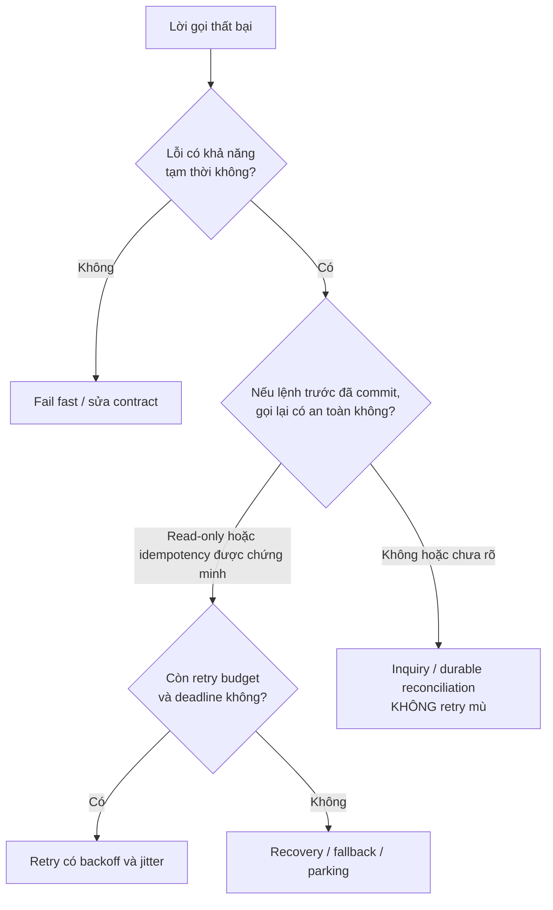
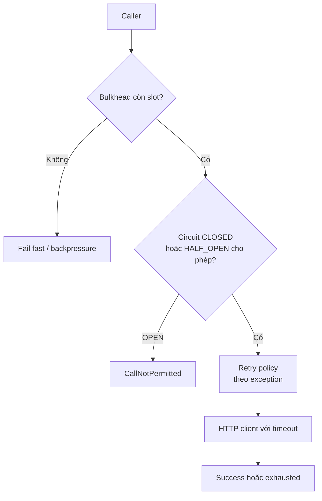
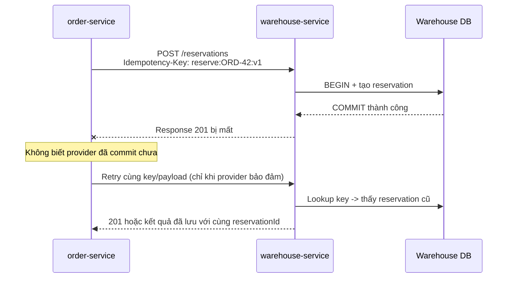
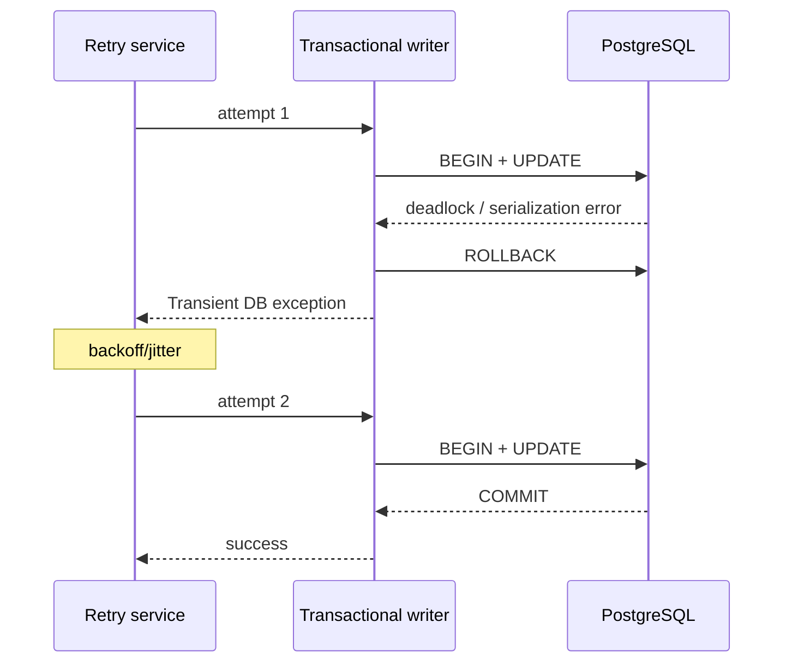
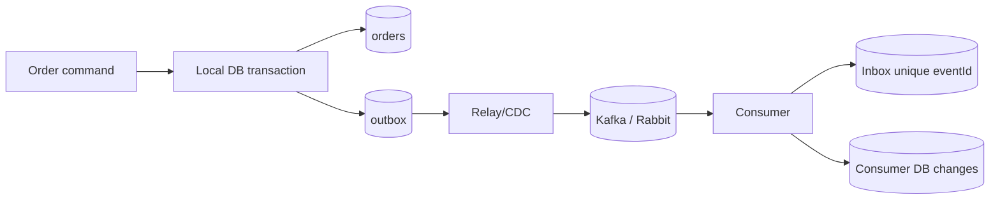

# Tích hợp Spring Retry hoặc Resilience4j bằng thư viện, cấu hình thích hợp

## 1. Bài toán và mục tiêu học tập

Một dịch vụ Spring Boot thường phải gọi hệ thống khác qua HTTP, JDBC/R2DBC, Redis, Kafka/RabbitMQ hoặc các adapter của Spring Integration. Những thao tác I/O đó có thể gặp lỗi mạng tạm thời, rate limiting, database deadlock, broker rebalance hoặc kết quả không rõ ràng sau timeout. Nếu không có chính sách phục hồi, một sự cố ngắn có thể làm hỏng một request. Nhưng nếu cứ thêm retry vô điều kiện, hệ thống có thể tạo **retry storm**, tăng độ trễ, gây xử lý trùng hoặc nhân đôi tác dụng phụ.

Ví dụ: `order-service` cần lấy số lượng tồn kho để hiển thị trang đặt hàng:

```text
GET /api/inventory/SKU-42
  -> warehouse-service
  -> response 200 / 503 / 429 / timeout
```

Với một phép tra cứu thực sự chỉ đọc, lỗi `503` có thể đáng thử lại một vài lần. Nhưng thao tác giữ hàng:

```text
POST /api/reservations
Idempotency-Key: reserve:ORD-42
{"sku":"SKU-42","quantity":2}
```

có thể **đã commit** ở Warehouse trước khi `order-service` nhận read timeout. Gửi lại bằng khóa mới có nguy cơ giữ hàng hai lần. Vì thế, retry là bài toán **phân loại lỗi + xác định tính an toàn + đặt giới hạn + phục hồi sau khi hết giới hạn**, không chỉ một annotation.

Bài thuộc chương **Phục hồi khi lỗi** của module **SPRING_BOOT_INTEGRATION**: tổ chức tích hợp trong Spring Boot qua HTTP client, database, cache, broker thông điệp và các adapter Spring Integration, nhấn mạnh cấu hình, hợp đồng dữ liệu, transaction, lỗi, xử lý trùng lặp, kiểm thử và quan sát luồng thực tế.

**Sau bài học, bạn có thể:**

1. Lựa chọn **Spring Retry** hoặc **Resilience4j** dựa trên hành vi ứng dụng, không dựa trên độ phổ biến.
2. Cài đặt dependencies và áp dụng `@Retryable`, `@Recover`, `RetryTemplate`; phân biệt proxy và programmatic retry.
3. Cấu hình `@Retry`, `@CircuitBreaker`, `@Bulkhead` và cấu hình instances trong Resilience4j.
4. Thiết kế timeout, exponential backoff, jitter, retry budget và exception whitelist.
5. Phân biệt retry thao tác đọc, ghi có idempotency key, trạng thái **UNKNOWN_OUTCOME** và operation không được retry tự động.
6. Tích hợp với `RestClient`/`WebClient`, Spring Integration, Kafka listener và local database transaction đúng ranh giới.
7. Viết tests chứng minh số attempts, recovery, backoff, transaction rollback, duplicate protection và behavior dưới outage.
8. Quan sát retries, circuit breaker, pool saturation, DLT/backlog và xây runbook tránh khuếch đại lỗi.

> **Phạm vi:** Ví dụ dùng Java 17+, Spring Boot 3.x, Spring Framework 6.x, Spring Retry 2.x, Resilience4j 2.x và các thư viện phù hợp với BOM thực tế. Spring Boot 4.x hoặc phiên bản dependency mới hơn có thể đổi starter, auto-configuration, thuộc tính hoặc API; đối chiếu tài liệu chính thức của phiên bản đang triển khai. Các snippets được tách theo tình huống; không nên lắp **cả hai thư viện retry lên cùng một method** mà không có chủ đích.

## 2. Retry giải quyết điều gì và không giải quyết điều gì?

Một retry policy mô tả:

```text
operation
  ├─ attempt #1
  │    ├─ success -> trả kết quả
  │    └─ retryable failure -> wait/backoff
  ├─ attempt #2
  │    ├─ success -> trả kết quả
  │    └─ retryable failure -> wait/backoff
  └─ attempt #3
       ├─ success -> trả kết quả
       └─ fail -> recovery/fallback/error
```

Các khái niệm:

| Thuật ngữ | Nghĩa |
| --- | --- |
| **Attempt** | Một lần gọi operation thật. Số attempts thường bao gồm lần gọi đầu. |
| **Retry** | Gọi lại sau failure, phải giữ nguyên logical command nếu đây là cùng thao tác. |
| **Transient failure** | Lỗi có thể biến mất khi chờ: 503 tạm thời, rate limit, deadlock sau rollback. |
| **Permanent failure** | Validation sai, auth/permission sai, SQL/schema contract sai; chờ không làm sửa lỗi. |
| **UNKNOWN_OUTCOME** | Đã gửi command có side effect nhưng không biết bên nhận đã commit chưa. |
| **Backoff** | Khoảng chờ giữa attempts; thường tăng theo cấp số nhân. |
| **Jitter** | Độ ngẫu nhiên của khoảng chờ, giảm các client retry cùng nhịp. |
| **Retry budget** | Giới hạn số attempts, thời gian, concurrency và chi phí retry ở toàn hệ thống. |
| **Recoverer / fallback** | Đường xử lý khi retry hết hoặc circuit đang mở; không nhất thiết là một kết quả thành công giả. |
| **Circuit breaker** | Ngăn tiếp tục gọi upstream khi tỷ lệ lỗi/độ chậm vượt ngưỡng; không tự thay retry. |
| **Bulkhead** | Giới hạn concurrency chạm vào một dependency để tránh lây nghẽn. |

**Retry có thể** giúp vượt qua transient failure hoặc chậm tạm thời. **Retry không thể**:

- Chữa lỗi hợp đồng JSON/schema, sai endpoint, thiếu credential hoặc dữ liệu bất hợp lệ.
- Chứng minh một POST trước đó chưa tạo tác dụng phụ chỉ vì client thấy timeout.
- Biến hai local transactions hoặc DB + Kafka thành atomic distributed transaction.
- Bảo đảm exactly-once khi broker redeliver hoặc process restart.
- Giải quyết upstream overload nếu tổng request+retry vượt năng lực.

### 2.1. Một điều kiện kép trước khi thử lại



**Một transient exception không đồng nghĩa một operation an toàn để retry.** Quyết định phải xét cả lỗi và side effect.

### 2.2. Phân loại lỗi theo hợp đồng của từng operation

| Tín hiệu | GET tồn kho (đọc) | POST giữ hàng (ghi) |
| --- | --- | --- |
| `200` và body hợp lệ | Thành công. | Thành công nếu provider xác nhận reservation. |
| `404` | SKU không tồn tại, thường fail/empty theo contract. | Resource/endpoint không tồn tại, không retry bừa. |
| `400/422` | Input/contract sai. | Không retry cùng payload. |
| `401/403` | Auth/permission: không retry cùng credentials vô hạn. | Tương tự. |
| `409/412` | Business conflict/conditional mismatch. | Đọc state, resolve conflict; không retry mù. |
| `429` | Có thể retry bounded, tôn trọng `Retry-After`. | Chỉ nếu provider bảo đảm idempotency hoặc chứng minh chưa thực hiện. |
| `502/503/504` | Thường có thể retry trong budget. | Side effect có thể đã commit: cần key/inquiry. |
| Read timeout | Có thể retry nếu GET thực sự không đổi state. | **UNKNOWN_OUTCOME** khi không có guarantee. |
| Deserialize/type lỗi | Không retry nguyên request trừ khi có bằng chứng transient. | Không retry lỗi contract. |
| DB deadlock | Retry một **local transaction mới** nếu side effect khác an toàn. | Không retry một transaction đã aborted hoặc một remote payment không idempotent. |

Ở HTTP, semantics của `GET` là an toàn theo chuẩn, nhưng phải **xác minh API implementation** không thực hiện một side effect nghiệp vụ đáng kể bất thường. Ở phía gateway, exception type cũng có thể che thời điểm sự cố: `ResourceAccessException` có thể bao lỗi kết nối và lỗi đọc response; không đủ để kết luận remote chưa commit.

## 3. Chọn Spring Retry hay Resilience4j?

| Tiêu chí | Spring Retry | Resilience4j |
| --- | --- | --- |
| Trọng tâm | Retry policy, backoff, recovery và stateful retry trong một số workflow. | Retry cùng circuit breaker, bulkhead, rate limiter, time limiter, metrics. |
| Annotation chính | `@Retryable`, `@Recover`, `@EnableRetry`. | `@Retry`, `@CircuitBreaker`, `@Bulkhead`, `@RateLimiter`, `@TimeLimiter`. |
| API imperative | `RetryTemplate`; dễ xác định một block được retry. | `Retry.decorateSupplier/Callable` hoặc annotations. |
| Cấu hình | Annotation, `RetryTemplate`, `RetryPolicy`/`BackOffPolicy`. | Named instances qua `resilience4j.*`, `RetryConfig`/Registry. |
| Reactor | Không áp dụng blocking template trực tiếp lên non-blocking publisher như một giải pháp reactive. | `resilience4j-reactor` cung cấp Reactor operators; Reactor-native retry cũng là lựa chọn. |
| Điều tiết hệ thống | Không tự cung cấp đủ circuit breaker/bulkhead. | Có modules tương ứng với policies có thể kết hợp. |
| Spring AOP | Annotation cần lời gọi qua proxy. | Annotation starter cũng cần AOP/proxy; hỗ trợ module theo runtime. |
| Khi phù hợp | Luồng service imperative đơn giản, một retry policy rõ ràng hoặc cần Spring Integration retry advice. | Nhiều downstream với circuit/bulkhead/rate limit/metrics theo từng dependency. |

**Khuyến nghị theo use case:**

- Một HTTP GET trong ứng dụng Spring MVC chỉ cần retry có giới hạn → **Spring Retry** là lựa chọn đơn giản.
- Nhiều upstream lỗi độc lập, cần tránh overload và quan sát circuit state → **Resilience4j** có mô hình cấu hình tập trung hơn.
- Ứng dụng WebFlux non-blocking → cân nhắc `Reactor Retry`/Resilience4j Reactor operators, không đặt blocking wait trong event loop.
- Spring Integration handler đã sử dụng `RequestHandlerRetryAdvice` và một `RetryTemplate` được kiểm soát → không thêm một lớp `@Retry` khác nếu không cần.

Không tồn tại “một thư viện luôn nhanh hơn/an toàn hơn”. Hợp đồng nghiệp vụ, điểm retry, timeout, concurrency và ranh giới giao dịch quan trọng hơn lựa chọn tên thư viện.

## 4. Thiết lập ví dụ Spring Boot chung

Ví dụ dùng một hệ thống Warehouse với:

```text
GET  /api/v1/stock/{sku}       -> đọc tồn kho
POST /api/v1/reservations      -> giữ tồn kho (write)
```

Các bản ghi demo:

```java
// StockView.java
package com.example.integration;

public record StockView(
    String sku,
    long available,
    long version
) {}
```

```java
// ReserveStockCommand.java
package com.example.integration;

public record ReserveStockCommand(
    String commandId,
    String orderId,
    String sku,
    long quantity
) {}
```

```java
// ReservationResult.java
package com.example.integration;

public record ReservationResult(
    String reservationId,
    String commandId
) {}
```

Exception nghiệp vụ/adapter phân biệt rõ policy:

```java
// WarehouseTemporaryException.java
package com.example.integration;

public class WarehouseTemporaryException
    extends RuntimeException {
    public WarehouseTemporaryException(
        String message, Throwable cause
    ) {
        super(message, cause);
    }
}
```

```java
// WarehousePermanentException.java
package com.example.integration;

public class WarehousePermanentException
    extends RuntimeException {
    public WarehousePermanentException(
        String message, Throwable cause
    ) {
        super(message, cause);
    }
}
```

```java
// WarehouseUnknownOutcomeException.java
package com.example.integration;

public class WarehouseUnknownOutcomeException
    extends RuntimeException {
    public WarehouseUnknownOutcomeException(
        String message, Throwable cause
    ) {
        super(message, cause);
    }
}
```

```java
// WarehouseUnavailableException.java
package com.example.integration;

public class WarehouseUnavailableException
    extends RuntimeException {
    public WarehouseUnavailableException(
        String message, Throwable cause
    ) {
        super(message, cause);
    }
}
```

Đây là **các class trong các file Java riêng**. Sử dụng exception cụ thể cho operation giúp policy retry chỉ nhận đúng lỗi cần xử lý. Không đưa tất cả lỗi mạng, SQL, validation, parsing và business conflict vào cùng một `RuntimeException` rồi retry toàn bộ.

### 4.1. RestClient có timeout cho từng attempt

Một cấu hình Spring Framework 6.1+ minh họa:

```java
// WarehouseHttpConfiguration.java
package com.example.integration;

import java.net.http.HttpClient;
import java.time.Duration;
import org.springframework.beans.factory.annotation.Value;
import org.springframework.context.annotation.Bean;
import org.springframework.context.annotation.Configuration;
import org.springframework.http.client.JdkClientHttpRequestFactory;
import org.springframework.web.client.RestClient;

@Configuration(proxyBeanMethods = false)
public class WarehouseHttpConfiguration {

    @Bean("warehouseRestClient")
    RestClient warehouseRestClient(
        RestClient.Builder builder,
        @Value("${warehouse.base-url}") String baseUrl
    ) {
        HttpClient httpClient = HttpClient.newBuilder()
            .connectTimeout(Duration.ofSeconds(1))
            .build();

        JdkClientHttpRequestFactory factory =
            new JdkClientHttpRequestFactory(httpClient);
        factory.setReadTimeout(Duration.ofSeconds(2));

        return builder
            .baseUrl(baseUrl)
            .requestFactory(factory)
            .build();
    }
}
```

```yaml
# application.yml — cấu hình theo môi trường.
warehouse:
  base-url: ${WAREHOUSE_BASE_URL:http://localhost:8089}
```

Ở đây connection timeout và response/read timeout giới hạn **một lần gọi HTTP**. Chúng không tự giới hạn toàn bộ thời gian sau khi retry nhiều attempts. Ví dụ ba attempts có read timeout 2 giây cùng backoff 0,3 và 0,6 giây có thể khiến caller chờ gần 7 giây, chưa tính kết nối và xử lý khác. Đặt tổng request/command deadline phù hợp SLA.

**Cảnh báo:** connection pool, TLS, proxy, DNS, hostname verification và tài nguyên client đều cần cấu hình cho production. Không trộn connect timeout với “chắc chắn request chưa gửi”: đôi khi exception ở tầng I/O không chứng minh trạng thái ở provider.

### 4.2. Gateway phân loại lỗi cho GET

```java
// WarehouseReadGateway.java
package com.example.integration;

import org.springframework.beans.factory.annotation.Qualifier;
import org.springframework.stereotype.Component;
import org.springframework.web.client.HttpClientErrorException;
import org.springframework.web.client.HttpServerErrorException;
import org.springframework.web.client.ResourceAccessException;
import org.springframework.web.client.RestClient;

@Component
public class WarehouseReadGateway {
    private final RestClient client;

    public WarehouseReadGateway(
        @Qualifier("warehouseRestClient") RestClient client
    ) {
        this.client = client;
    }

    public StockView getStock(String sku) {
        try {
            StockView body = client.get()
                .uri("/api/v1/stock/{sku}", sku)
                .retrieve()
                .body(StockView.class);

            if (body == null || !sku.equals(body.sku())
                || body.available() < 0) {
                throw new WarehousePermanentException(
                    "Warehouse trả response sai hợp đồng", null
                );
            }
            return body;
        } catch (HttpClientErrorException.TooManyRequests ex) {
            // 429 có thể retry, nhưng cần tôn trọng Retry-After.
            // Policy đơn giản ở đây chỉ thử lại trong budget cố định.
            throw new WarehouseTemporaryException(
                "Warehouse rate limited GET", ex
            );
        } catch (HttpClientErrorException ex) {
            throw new WarehousePermanentException(
                "Warehouse từ chối GET: " + ex.getStatusCode(), ex
            );
        } catch (HttpServerErrorException ex) {
            int status = ex.getStatusCode().value();
            if (status == 502 || status == 503 || status == 504) {
                throw new WarehouseTemporaryException(
                    "Warehouse tạm không sẵn sàng", ex
                );
            }
            throw new WarehousePermanentException(
                "Warehouse lỗi không thuộc whitelist retry", ex
            );
        } catch (ResourceAccessException ex) {
            // GET theo hợp đồng read-only nên có thể retry giới hạn.
            throw new WarehouseTemporaryException(
                "Warehouse GET gặp I/O timeout/lỗi mạng", ex
            );
        }
    }
}
```

Gateway không tự retry, chỉ **dịch lỗi hạ tầng thành nhóm nghiệp vụ** cho layer policy phía trên. Chỉ whitelist `502/503/504` là lựa chọn của ví dụ; service thật có thể phân loại thêm các trạng thái/lỗi cụ thể theo provider contract.

Ở đây xử lý `429` bằng retry bounded đơn giản; production nên đọc và parse `Retry-After` (giây hoặc HTTP-date), kiểm tra deadline và rate-limit budget. **Không** để mọi caller ngủ lâu trên servlet threads mà không có giới hạn.

## 5. Spring Retry — dependencies và cơ chế kích hoạt

Với Maven và Spring Boot BOM thích hợp:

```xml
<dependencies>
    <dependency>
        <groupId>org.springframework.boot</groupId>
        <artifactId>spring-boot-starter-web</artifactId>
    </dependency>
    <dependency>
        <groupId>org.springframework.retry</groupId>
        <artifactId>spring-retry</artifactId>
    </dependency>
    <dependency>
        <groupId>org.springframework.boot</groupId>
        <artifactId>spring-boot-starter-aop</artifactId>
    </dependency>
</dependencies>
```

Các annotations `@Retryable`/`@Recover` cần Spring Retry và cơ chế interception qua Spring AOP (hoặc cơ chế phù hợp khác được cấu hình rõ). `spring-boot-starter-aop` cung cấp AOP infrastructure phổ biến; **chỉ thêm dependency chưa chắc tự bật `@Retryable`** nếu không có `@EnableRetry`.

### 5.1. Bật annotation-driven retry

```java
// SpringRetryConfiguration.java
package com.example.integration;

import org.springframework.context.annotation.Configuration;
import org.springframework.retry.annotation.EnableRetry;

@Configuration(proxyBeanMethods = false)
@EnableRetry
public class SpringRetryConfiguration {
}
```

Không cần tự `new WarehouseReadGateway(...)` rồi gọi method trong một service khác nếu đang dựa vào annotations của Spring: bean phải được Spring quản lý và lời gọi đi qua proxy.

### 5.2. `@Retryable` với exception whitelist và exponential backoff

```java
// StockQueryWithSpringRetry.java
package com.example.integration;

import org.springframework.retry.annotation.Backoff;
import org.springframework.retry.annotation.Recover;
import org.springframework.retry.annotation.Retryable;
import org.springframework.stereotype.Service;

@Service
public class StockQueryWithSpringRetry {
    private final WarehouseReadGateway gateway;

    public StockQueryWithSpringRetry(
        WarehouseReadGateway gateway
    ) {
        this.gateway = gateway;
    }

    @Retryable(
        retryFor = WarehouseTemporaryException.class,
        noRetryFor = WarehousePermanentException.class,
        maxAttempts = 3,
        backoff = @Backoff(
            delay = 250L,
            multiplier = 2.0,
            maxDelay = 1500L,
            random = true
        )
    )
    public StockView getStock(String sku) {
        return gateway.getStock(sku);
    }

    @Recover
    public StockView recover(
        WarehouseTemporaryException cause,
        String sku
    ) {
        // Không trả dữ liệu tồn kho = 0 giả như một kết quả hợp lệ.
        throw new WarehouseUnavailableException(
            "Không lấy được tồn kho cho SKU: " + sku,
            cause
        );
    }
}
```

**Chú giải:**

- `retryFor` chỉ chấp nhận `WarehouseTemporaryException`. Các lỗi validation, parsing/contract hoặc `WarehousePermanentException` không nằm trong danh sách retry.
- `maxAttempts=3` thường là **ba lần gọi tổng cộng** (lần đầu + tối đa hai retries), không phải ba retries bổ sung.
- `delay=250ms` và `multiplier=2` tạo khoảng chờ tăng dần; `maxDelay` chặn tăng không giới hạn; `random=true` bổ sung ngẫu nhiên theo khả năng `@Backoff` của Spring Retry version này.
- `@Recover` được gọi sau khi attempts phù hợp đã hết, với return type và arguments khớp `getStock` cùng throwable tương ứng.
- Recoverer **ném exception domain** để caller trả 503, hoặc có thể dùng **dữ liệu dự phòng thật có giới hạn độ tươi** nếu hợp đồng cho phép. Không trả `StockView(available=0)` để “giả” upstream có 0 hàng: có thể gây lỗi nghiệp vụ.

Lưu ý rằng method có thể vẫn bị lỗi sau retry vì một error khác không thuộc whitelist; không nên giả định mọi error đều đi qua `@Recover` với cùng loại exception.

### 5.3. AOP proxy và self-invocation

```java
@Service
class BadStockService {
    public StockView handle(String sku) {
        return this.getStock(sku); // Lời gọi nội bộ, bỏ qua proxy retry.
    }

    @Retryable(retryFor = WarehouseTemporaryException.class)
    public StockView getStock(String sku) {
        return externalGateway.getStock(sku);
    }
}
```

Trong proxy-based AOP, `this.getStock(...)` không đi qua retry interceptor. Hãy để một bean khác gọi `StockQueryWithSpringRetry.getStock(...)`, hoặc dùng `RetryTemplate` theo chương trình khi cần retry trong cùng class.

Các lỗi cấu hình AOP khác:

- Method không nằm trong Spring-managed bean.
- Method `private`/không thể bị intercept bởi proxy đang dùng.
- Caller giữ instance được `new` trực tiếp thay vì Spring proxy.
- Retry annotation ở một tầng **sai scope**: method được retry lại gọi các side effect khác ngoài thao tác read-only.
- Method trả `CompletableFuture`/`Mono` nhưng interceptor chỉ thấy **đã tạo Future/Publisher**, không nhìn được lỗi xảy ra về sau theo cách bạn tưởng; cần tích hợp async/reactive policy đúng kiểu.

### 5.4. `@Recover` phải phù hợp type và signature

Spring Retry tìm recovery method theo return type, exception và các tham số phương thức:

```java
@Retryable(retryFor = WarehouseTemporaryException.class)
public StockView getStock(String sku) { /* ... */ }

@Recover
public StockView recover(
    WarehouseTemporaryException exception, String sku
) { /* ... */ }
```

Nếu recoverer trả `void` nhưng method gốc trả `StockView`, hoặc không có signature tương thích, kết quả có thể là exception khi attempts exhausted. **Integration test phải kiểm tra cả recovery path**, không chỉ số retry.

## 6. Spring Retry — `RetryTemplate` để điều khiển retry bằng code

`RetryTemplate` hữu ích khi:

- Chính sách retry thuộc **một lời gọi cụ thể** bên trong method, không nên retry toàn bộ method.
- Cần truyền context/attempt information và kiểm soát recovery ở caller.
- Spring Integration dùng `RequestHandlerRetryAdvice` hoặc một adapter nhận template.
- Test không muốn phụ thuộc vào AOP interceptors.

### 6.1. Cấu hình policy tường minh

```java
// StockRetryTemplateConfiguration.java
package com.example.integration;

import java.util.Map;
import org.springframework.context.annotation.Bean;
import org.springframework.context.annotation.Configuration;
import org.springframework.retry.backoff.ExponentialBackOffPolicy;
import org.springframework.retry.policy.SimpleRetryPolicy;
import org.springframework.retry.support.RetryTemplate;

@Configuration(proxyBeanMethods = false)
public class StockRetryTemplateConfiguration {

    @Bean("warehouseReadRetryTemplate")
    RetryTemplate warehouseReadRetryTemplate() {
        SimpleRetryPolicy retryPolicy =
            new SimpleRetryPolicy(
                3,
                Map.of(WarehouseTemporaryException.class, true),
                true
            );

        ExponentialBackOffPolicy backoff =
            new ExponentialBackOffPolicy();
        backoff.setInitialInterval(250L);
        backoff.setMultiplier(2.0);
        backoff.setMaxInterval(1500L);

        RetryTemplate template = new RetryTemplate();
        template.setRetryPolicy(retryPolicy);
        template.setBackOffPolicy(backoff);
        return template;
    }
}
```

Trong ví dụ này, `maxAttempts=3` bao gồm lần đầu. `true` ở constructor là traversal của cause chain theo chính sách sử dụng; cần phân loại chính xác vì nếu một exception bọc chứa `WarehouseTemporaryException` thì cũng có thể bị retry. Không biến traversal thành cách retry mọi exception có nested cause khó đoán trong production.

`ExponentialBackOffPolicy` ở đây **chưa cấu hình jitter**; nếu có nhiều client đồng thời, chọn chính sách random backoff phù hợp phiên bản Spring Retry hoặc tự thiết kế bounded jitter. `@Backoff(random=true)` ở mục trước là một cách đơn giản cho annotation.

### 6.2. Gọi `RetryTemplate.execute(...)`

```java
// StockQueryWithTemplate.java
package com.example.integration;

import org.springframework.beans.factory.annotation.Qualifier;
import org.springframework.retry.support.RetryTemplate;
import org.springframework.stereotype.Service;

@Service
public class StockQueryWithTemplate {
    private final WarehouseReadGateway gateway;
    private final RetryTemplate retry;

    public StockQueryWithTemplate(
        WarehouseReadGateway gateway,
        @Qualifier("warehouseReadRetryTemplate") RetryTemplate retry
    ) {
        this.gateway = gateway;
        this.retry = retry;
    }

    public StockView getStock(String sku) {
        return retry.execute(
            ctx -> gateway.getStock(sku),
            ctx -> {
                Throwable cause = ctx.getLastThrowable();
                throw new WarehouseUnavailableException(
                    "Warehouse hết retry budget: " + sku,
                    cause
                );
            }
        );
    }
}
```

Đây là **một phương án thay thế** `StockQueryWithSpringRetry`, không nên gọi cả template trong một method đã `@Retryable` trừ khi cố tình thiết kế hai cấp với budget chung.

### 6.3. Lắng nghe attempts

`RetryListener` có thể đo attempt count, lỗi cuối và duration; không log payload nhạy cảm ở mỗi attempt. Mỗi `RetryTemplate` có thể đăng ký listeners tùy phiên bản:

```text
retry attempt=1, outcome=503
retry attempt=2, outcome=timeout
retry attempt=3, outcome=success
```

Metrics nên gộp theo dependency/operation/error category, tránh mỗi SKU/order ID là một metric label. Đừng lấy retry count trong một JVM làm bằng chứng **tổng retry end-to-end** nếu caller, broker và API gateway đều có retry riêng.

## 7. Spring Retry — stateful retry và transaction boundaries

Spring Retry còn có khái niệm **stateful retry**: các lần thử có thể trải qua những invocation tách biệt, dựa trên key của một logical operation, phục vụ vài workflow có transaction rollback và message delivery. Đây là chức năng nâng cao, **không tự lưu trạng thái bền vững qua mọi process restart** và không thay idempotency ledger của nghiệp vụ.

Nếu message broker redeliver sau rollback, cần nhận diện cùng message bằng business/event ID ổn định, phối hợp đúng retry context cache, transaction boundary và broker acknowledgment. Chọn sai key hoặc xóa retry context không đúng có thể tạo attempt count không như mong muốn.

Một nguyên tắc quan trọng:

```text
An toàn hơn với local DB deadlock:
  Retry layer
    -> BEGIN transaction mới
       -> UPDATE DB
       -> COMMIT hoặc ROLLBACK
    -> retry lại transaction mới nếu transient

Nguy hiểm:
  BEGIN transaction
    -> retry SQL liên tục bên trong transaction đã aborted
    -> COMMIT thất bại hoặc trạng thái không còn hợp lệ
```

Đặc biệt với PostgreSQL, sau một số SQL errors transaction có thể ở trạng thái aborted; retry một câu query bên trong transaction cũ không phục hồi state. Với `@Transactional` và `@Retryable` cùng method, thứ tự advice quyết định retry có bọc transaction hay ngược lại. Default advisor order có thể khác khi project tùy chỉnh AOP; hãy **test actual transaction begin/rollback mỗi attempt**, không suy đoán từ thứ tự annotation hiển thị.

**Tốt nhất:** đặt một service retry ở ngoài, gọi service khác `@Transactional`:

```java
@Service
class RetryOrderWrites {
    private final TransactionalOrderWriter writer;
    private final RetryTemplate retry;

    RetryOrderWrites(
        TransactionalOrderWriter writer, RetryTemplate retry
    ) {
        this.writer = writer;
        this.retry = retry;
    }

    public void run(OrderCommand command) {
        retry.execute(ctx -> {
            writer.apply(command); // Mỗi invocation qua bean proxy.
            return null;
        });
    }
}

@Service
class TransactionalOrderWriter {
    @Transactional(transactionManager = "ordersTxManager")
    public void apply(OrderCommand command) {
        // Local DB updates, không gọi remote payment ở đây.
    }
}
```

Đây là **phác thảo cấu trúc**; `OrderCommand` và `ordersTxManager` là thành phần do dự án cung cấp, không phải classes trong Spring framework. Template dành cho DB nên có policy **riêng** với deadlock/serialization exceptions, không tái sử dụng `warehouseReadRetryTemplate` cho mọi loại lỗi.

## 8. Resilience4j — dependencies cho Spring Boot 3

Resilience4j cung cấp các module tách biệt: `retry`, `circuitbreaker`, `bulkhead`, `ratelimiter`, `timelimiter`, `micrometer` và tích hợp framework/reactive. Với Spring Boot 3, dùng starter tương thích:

```xml
<!-- pom.xml minh họa: Spring Boot 3.x, Java 17+. -->
<dependencyManagement>
    <dependencies>
        <dependency>
            <groupId>io.github.resilience4j</groupId>
            <artifactId>resilience4j-bom</artifactId>
            <version>2.2.0</version>
            <type>pom</type>
            <scope>import</scope>
        </dependency>
    </dependencies>
</dependencyManagement>

<dependencies>
    <dependency>
        <groupId>io.github.resilience4j</groupId>
        <artifactId>resilience4j-spring-boot3</artifactId>
    </dependency>
    <dependency>
        <groupId>org.springframework.boot</groupId>
        <artifactId>spring-boot-starter-aop</artifactId>
    </dependency>
    <dependency>
        <groupId>org.springframework.boot</groupId>
        <artifactId>spring-boot-starter-actuator</artifactId>
    </dependency>
    <!-- Nếu xử lý WebFlux / Reactor, thêm module Reactor phù hợp. -->
    <dependency>
        <groupId>io.github.resilience4j</groupId>
        <artifactId>resilience4j-reactor</artifactId>
    </dependency>
</dependencies>
```

Version `2.2.0` là **ví dụ về cách pin một release Resilience4j 2.x** tương thích với Spring Boot 3 trong nhiều cấu hình; không tự suy ra đây là version mới nhất hoặc phù hợp mọi BOM của tổ chức. Khi triển khai, chọn một release đã được kiểm chứng với Spring Boot, Spring Framework, Reactor và Java đang dùng; dùng một BOM để tránh trộn Resilience4j modules khác version.

Nếu ứng dụng chỉ dùng Spring MVC/imperative HTTP, `resilience4j-reactor` có thể bỏ. Nếu cần Prometheus, bổ sung Micrometer registry và exposure policy phù hợp; actuator không tự cung cấp mọi business metrics.

**Không thêm** `resilience4j-spring-boot2` vào project Spring Boot 3 chỉ vì một bài hướng dẫn cũ dùng tên đó. Với Spring Boot 4 cần tìm artifact tích hợp **đúng dòng framework** thay vì mặc định bê nguyên tên starter `spring-boot3`.

### 8.1. Resilience4j dùng named instances

Trong ứng dụng có nhiều external dependencies, đặt chính sách riêng:

```text
warehouseRead     -> GET stock: retry 3 attempts, circuit breaker
warehouseReserve  -> POST reservation: retry chỉ với idempotency guarantee
pricingRead       -> GET prices: retry 2 attempts
paymentCapture    -> POST payment: inquiry nếu outcome không rõ
orderDatabase     -> retry whole transaction cho deadlock, không HTTP retry
```

Một key `warehouseRead` trong `resilience4j.retry.instances` không có nghĩa giống key trong `resilience4j.circuitbreaker.instances`; mỗi module giữ registry/policy riêng, dù tên có thể giống nhau để nhóm dependency.

## 9. Resilience4j — cấu hình Retry, CircuitBreaker, Bulkhead

Ví dụ `application.yml`:

```yaml
resilience4j:
  retry:
    instances:
      warehouseRead:
        maxAttempts: 3
        waitDuration: 250ms
        enableExponentialBackoff: true
        exponentialBackoffMultiplier: 2
        retryExceptions:
          - com.example.integration.WarehouseTemporaryException
        ignoreExceptions:
          - com.example.integration.WarehousePermanentException

  circuitbreaker:
    instances:
      warehouseReadBreaker:
        slidingWindowType: COUNT_BASED
        slidingWindowSize: 20
        minimumNumberOfCalls: 10
        failureRateThreshold: 50
        slowCallDurationThreshold: 2s
        slowCallRateThreshold: 80
        waitDurationInOpenState: 10s
        permittedNumberOfCallsInHalfOpenState: 3
        recordExceptions:
          - com.example.integration.WarehouseTemporaryException
          - com.example.integration.WarehouseUnavailableException
        ignoreExceptions:
          - com.example.integration.WarehousePermanentException

  bulkhead:
    instances:
      warehouseReadBulkhead:
        maxConcurrentCalls: 12
        maxWaitDuration: 0ms
```

**Retry:**

- `maxAttempts=3` tổng cộng ba lần gọi, không phải thêm ba lần sau attempt đầu.
- `waitDuration=250ms` là thời gian chờ cơ sở; bật exponential backoff thì thời gian chờ các attempts sau tăng theo multiplier theo policy Resilience4j.
- `retryExceptions` là whitelist; `ignoreExceptions` giúp lỗi nghiệp vụ/contract không bị retry.
- Nếu muốn jitter, kiểm tra cấu hình hỗ trợ của chính release đang dùng (ví dụ randomization settings) hoặc dựng `IntervalFunction/IntervalBiFunction` rõ ràng; **đừng khẳng định exponential backoff mặc định có jitter**.

**Circuit breaker:**

- Cửa sổ COUNT_BASED ghi nhận kết quả các lời gọi có liên quan; chỉ đánh giá open khi đủ `minimumNumberOfCalls`.
- `failureRateThreshold=50` nghĩa là ngưỡng tỷ lệ lỗi 50%; `slowCallRateThreshold` cũng có thể mở circuit khi đủ slow calls.
- Khi OPEN, circuit từ chối lời gọi theo cơ chế `CallNotPermittedException` thay vì thử upstream, giúp tránh làm hệ thống lỗi quá tải thêm.
- Khi qua thời gian mở, circuit cho phép một số lời gọi HALF_OPEN để kiểm tra hồi phục; không mở tất cả traffic ngay.

**Bulkhead:**

- `maxConcurrentCalls=12` giới hạn số concurrent invocations trong scope instance.
- `maxWaitDuration=0ms` lựa chọn không chờ giành slot, phù hợp fail-fast/throttle; kết quả thất bại cần map thành response có thể hiểu được.
- Đây là **semaphore bulkhead**, không phải pool của database, không thay limit tại Web server hoặc Kafka consumer.

**Không sao chép các con số như “giá trị chuẩn”:** 12 calls, 20 samples, 10 giây và 50% chỉ là thông số minh họa. Cần hiệu chỉnh theo throughput, upstream quota, p95 latency, error budget và số pods.

### 9.1. Dùng `@Retry` trong một bean riêng

```java
// RetryingStockLookup.java
package com.example.integration;

import io.github.resilience4j.retry.annotation.Retry;
import org.springframework.stereotype.Service;

@Service
public class RetryingStockLookup {
    private final WarehouseReadGateway gateway;

    public RetryingStockLookup(WarehouseReadGateway gateway) {
        this.gateway = gateway;
    }

    @Retry(name = "warehouseRead")
    public StockView find(String sku) {
        return gateway.getStock(sku);
    }
}
```

Bean này thực hiện read-only GET; `@Retry` được áp bởi Resilience4j Spring AOP khi gọi qua proxy. Cùng `WarehouseReadGateway` ở mục 4 được dùng lại mà **không** bổ sung `@Retryable` của Spring Retry bên trong.

### 9.2. Thêm circuit breaker ở facade ngoài

```java
// ProtectedStockQuery.java
package com.example.integration;

import io.github.resilience4j.circuitbreaker.annotation.CircuitBreaker;
import org.springframework.stereotype.Service;

@Service
public class ProtectedStockQuery {
    private final RetryingStockLookup retrying;

    public ProtectedStockQuery(RetryingStockLookup retrying) {
        this.retrying = retrying;
    }

    @CircuitBreaker(
        name = "warehouseReadBreaker",
        fallbackMethod = "unavailable"
    )
    public StockView getStock(String sku) {
        return retrying.find(sku);
    }

    public StockView unavailable(String sku, Throwable error) {
        throw new WarehouseUnavailableException(
            "Warehouse đang lỗi hoặc circuit đang mở: " + sku,
            error
        );
    }
}
```

**Vì sao tách hai beans?** Facade circuit breaker bao **một logical GET** và nhìn thấy kết quả sau Retry; mỗi attempt bên trong không bị tính thành một invocation riêng của circuit breaker ở boundary này. Đây là cấu trúc dễ lý giải hơn việc chồng `@Retry` và `@CircuitBreaker` lên cùng một method rồi giả định chính xác advisor order.

Trong cấu hình ở mục 9, `WarehouseUnavailableException` được ghi nhận là lỗi của circuit. `WarehouseTemporaryException` có thể bị ghi nhận nếu không có mapping/fallback thành type khác; chính sách record/ignore tùy hợp đồng.

**Đừng để fallback tạo success giả.** Trả `StockView(sku, 0, 0)` khi circuit OPEN làm người dùng tưởng warehouse hết hàng, có thể gây quyết định sai. Fallback tốt có thể:

- Trả cache snapshot kèm `stale=true/asOf` nếu product cho phép.
- Trả `503 Service Unavailable` hoặc domain error để caller biết chưa thể đọc.
- Đưa command vào hàng đợi bền vững nếu đó là write async có cơ chế phục hồi.

### 9.3. Giới hạn concurrency bằng `@Bulkhead`

Nếu muốn đảm bảo chỉ 12 logical requests được đi vào facade ở một thời điểm, có thể tạo một wrapper riêng:

```java
// BoundedStockQuery.java
package com.example.integration;

import io.github.resilience4j.bulkhead.annotation.Bulkhead;
import org.springframework.stereotype.Service;

@Service
public class BoundedStockQuery {
    private final ProtectedStockQuery protectedQuery;

    public BoundedStockQuery(ProtectedStockQuery protectedQuery) {
        this.protectedQuery = protectedQuery;
    }

    @Bulkhead(name = "warehouseReadBulkhead")
    public StockView getStock(String sku) {
        return protectedQuery.getStock(sku);
    }
}
```

Ở đây lớp Bulkhead ở ngoài giữ slot **trong toàn bộ thời gian Retry + CircuitBreaker path** của một logical request, kể cả backoff khi được thực thi đồng bộ trong thread. Điều đó có thể làm slot bị chiếm lâu; một thiết kế khác đặt bulkhead quanh từng attempt để giới hạn active HTTP calls nhưng không chiếm slot khi ngủ. Không có thứ tự nào là tối ưu chung: chọn theo mục tiêu quản lý concurrency và latency, rồi kiểm thử.

Khi bulkhead đầy, exception loại `BulkheadFullException` có thể xuất hiện; không retry vô hạn ngay trong cùng bulkhead vì chỉ làm nhiều request cạnh tranh hơn. Cân nhắc trả 503/429 và `Retry-After` phù hợp nếu API hợp đồng cho phép.

### 9.4. Programmatic Resilience4j Retry

Đối với trường hợp không muốn phụ thuộc AOP:

```java
import io.github.resilience4j.retry.Retry;
import io.github.resilience4j.retry.RetryConfig;
import java.time.Duration;
import java.util.function.Supplier;

RetryConfig config = RetryConfig.custom()
    .maxAttempts(3)
    .waitDuration(Duration.ofMillis(250))
    .retryExceptions(WarehouseTemporaryException.class)
    .ignoreExceptions(WarehousePermanentException.class)
    .build();

// Trong ứng dụng thật, giữ Retry trong singleton Registry/bean.
Retry warehouseRetry = Retry.of("warehouseRead", config);

Supplier<StockView> guarded = Retry.decorateSupplier(
    warehouseRetry,
    () -> warehouseReadGateway.getStock(sku)
);
StockView result = guarded.get();
```

`warehouseReadGateway` và `sku` là các biến từ service/caller. Đừng tạo một `Retry.of(...)` mới **cho mỗi HTTP request**, vì metrics, circuit behavior và thống kê policy sẽ bị chia nhỏ. Dùng `RetryRegistry` singleton hoặc instances do Spring Boot integration cấu hình.

## 10. Circuit breaker khác retry và rate limiting



| Cơ chế | Câu hỏi cần trả lời | Không giải quyết |
| --- | --- | --- |
| Retry | “Một lần thử thất bại có đáng thử lại không?” | Upstream overload nếu retries không giới hạn. |
| Circuit breaker | “Upstream đang lỗi đến mức nên dừng gửi tạm thời?” | Chống xử lý trùng side effect. |
| Bulkhead | “Bao nhiêu calls được phép chạy đồng thời?” | Thứ tự nghiệp vụ và exactly-once. |
| Rate limiter | “Bao nhiêu calls được khởi động trong một khoảng thời gian?” | Kết quả không rõ của POST đã gửi. |
| Time limiter | “Một operation async được phép chờ bao lâu?” | Hủy side effect đã commit ở provider. |
| HTTP client timeouts | “Một connect/read attempt được chờ bao lâu?” | Tổng budget của chuỗi retries và broker redelivery. |

Một circuit OPEN có thể bảo vệ Warehouse, nhưng nếu 1.000 clients cùng tiếp tục retry lỗi `CallNotPermittedException`, retry storm chỉ chuyển sang lớp khác. Thông thường **không retry ngay** các lời từ chối do circuit OPEN/bulkhead full; trả degraded response hoặc delayed retry có kiểm soát.

### 10.1. Time limiter không có nghĩa remote operation dừng

Resilience4j `TimeLimiter` hữu ích cho `CompletionStage` hoặc reactive publishers tùy module tích hợp. Đặt annotation `@TimeLimiter` lên một method trả `StockView` blocking **không** tự ngắt một `RestClient` call như cách tương đương với `CompletableFuture`. Với HTTP sync, đặt connect/read timeouts ở request factory/client, kèm deadline tổng ở boundary phù hợp.

Với async:

```text
Caller hết 2 giây -> TimeLimiter phát timeout/cancel theo config
Upstream đã nhận POST -> có thể vẫn commit reservation sau 3 giây
```

**Timeout/cancellation không rollback được remote side effect.** Chính sách idempotency/inquiry vẫn bắt buộc cho write.

### 10.2. Khi nào cần `@RateLimiter`?

Nếu Warehouse cho phép 100 requests/giây trên mỗi API key, có thể cấu hình rate limiter và/hoặc distributed quota ở API gateway. Resilience4j local rate limiter trên mỗi pod **không tự chia quota toàn cluster**; 10 pods mỗi pod 100 rps có thể vượt rate limit đối tác. Cần tổng quota, coordination/distributed limiter hoặc cấu hình chia ngân sách theo số pods.

**Không xem rate limiter như retry policy.** Rate limiter từ chối/throttle cuộc gọi mới; retry tiêu thụ thêm quota và có thể khiến rate limiting trầm trọng hơn.

## 11. WebFlux / WebClient: retry phải nằm trong reactive pipeline

Nếu service dùng `WebClient` và trả `Mono<StockView>`, tránh:

```java
// SAI: biến reactive I/O thành blocking, không an toàn trên event loop.
StockView result = webClient.get()
    .uri("/api/v1/stock/{sku}", sku)
    .retrieve()
    .bodyToMono(StockView.class)
    .block();
```

### 11.1. Reactor-native `retryWhen` cho GET

```java
// ReactiveWarehouseReadGateway.java
package com.example.integration;

import java.time.Duration;
import org.springframework.stereotype.Component;
import org.springframework.web.reactive.function.client.WebClient;
import reactor.core.publisher.Mono;
import reactor.util.retry.Retry;

@Component
public class ReactiveWarehouseReadGateway {
    private final WebClient client;

    public ReactiveWarehouseReadGateway(WebClient.Builder builder) {
        this.client = builder
            .baseUrl("http://warehouse-service")
            .build();
    }

    public Mono<StockView> getStockOnce(String sku) {
        return Mono.defer(() -> client.get()
                .uri("/api/v1/stock/{sku}", sku)
                .retrieve()
                .onStatus(
                    code -> code.value() == 503,
                    response -> Mono.error(
                        new WarehouseTemporaryException(
                            "Warehouse 503", null
                        )
                    )
                )
                .bodyToMono(StockView.class)
            );
    }

    public Mono<StockView> getStock(String sku) {
        return getStockOnce(sku)
            .retryWhen(
                Retry.backoff(2, Duration.ofMillis(250))
                    .maxBackoff(Duration.ofSeconds(1))
                    .jitter(0.5)
                    .filter(ex ->
                        ex instanceof WarehouseTemporaryException)
            )
            .timeout(Duration.ofSeconds(4));
    }
}
```

Ý nghĩa:

- `Retry.backoff(2, ...)` trong Reactor có **tối đa hai retries sau lần đầu**, tức tổng ba subscriptions/attempts. Đây là khác biệt cú pháp với `maxAttempts=3` của Spring Retry/Resilience4j.
- `Mono.defer` đảm bảo mỗi subscription đi qua logic tạo reactive request tương ứng.
- `retryWhen` chỉ thử lại `WarehouseTemporaryException` (ở đây từ 503). Các response status khác theo default WebClient semantics có thể phát `WebClientResponseException`, **không** được retry bởi filter này.
- `timeout(4s)` **ở ngoài** `retryWhen` giới hạn toàn bộ chuỗi attempts/backoff trong ví dụ. Nếu đặt timeout bên trong request trước `retryWhen`, đó có thể là timeout của mỗi attempt.
- `timeout` làm downstream phát lỗi và cancel subscription, nhưng không chứng minh upstream đã dừng hoặc rollback.
- Các driver/reactive HTTP client cần cấu hình connect/read/pool timeouts riêng trong production; `Mono.timeout` không thay mọi socket timeout.

Mã giả định URI `http://warehouse-service` khả dụng trong môi trường cluster; production nên lấy base URL, TLS và authentication từ properties.

### 11.2. Resilience4j Reactor operator

Khi đã có Resilience4j Registry từ starter, có thể dùng module `resilience4j-reactor`:

```java
import io.github.resilience4j.retry.RetryRegistry;
import io.github.resilience4j.reactor.retry.RetryOperator;
import org.springframework.stereotype.Service;
import reactor.core.publisher.Mono;

@Service
class ReactiveStockQuery {
    private final ReactiveWarehouseReadGateway gateway;
    private final RetryRegistry registry;

    ReactiveStockQuery(
        ReactiveWarehouseReadGateway gateway,
        RetryRegistry registry
    ) {
        this.gateway = gateway;
        this.registry = registry;
    }

    Mono<StockView> find(String sku) {
        var retry = registry.retry("warehouseRead");
        // Dùng GET chưa retry; Resilience4j là policy owner duy nhất.
        return gateway.getStockOnce(sku)
            .transformDeferred(RetryOperator.of(retry))
            .timeout(java.time.Duration.ofSeconds(4));
    }
}
```

**Không áp dụng operator Resilience4j lên `gateway.getStock(...)` đã có `retryWhen(...)` trong mục 11.1.** Vì vậy ví dụ trên gọi `getStockOnce(...)` chưa retry, để `RetryOperator` là **một** owner của policy. Nếu chồng cả hai, operator Resilience4j bên ngoài có thể resubscribe cả chuỗi, làm tổng attempts bị nhân lên.

Tương tự có `CircuitBreakerOperator`, `BulkheadOperator` tùy module; chọn order của operators theo rõ scope concurrency và cách tính metrics. Không assume `@Retry` trên method reactive hoặc `retryWhen` chạy theo semantics imperative nếu thiếu module hỗ trợ Publisher.

### 11.3. Spring Retry blocking không phải Reactor Retry

`RetryTemplate.execute(ctx -> repository.findById(id))` chỉ retry **hành động tạo Mono**, nếu method đó không ném trước khi trả publisher. Lỗi DB/HTTP thường xảy ra **khi subscribe**, sau khi template đã return, nên policy không thực sự retry I/O.

Đối với reactive, compose operator như `retryWhen`/`RetryOperator` trên Publisher thực. Không chuyển `Mono` sang `block()` chỉ để tái sử dụng `RetryTemplate`.

## 12. Có tác dụng phụ: điều kiện tiên quyết trước khi bật retry

**Bài toán:** `order-service` gọi Warehouse giữ hai đơn vị SKU-42, rồi client bị read timeout. Có thể xảy ra:



Nếu provider **không thực sự lưu/so sánh idempotency key**, chỉ thêm header không tạo guarantee. Khi provider đã commit, một retry có thể trừ tồn kho lần hai. Một Resilience4j `@Retry` hoặc Spring Retry `@Retryable` trên POST không tự xử lý vấn đề này.

### 12.1. Hợp đồng idempotency đủ để retry write

| Thuộc tính | Câu hỏi bắt buộc |
| --- | --- |
| Stable command ID | Có phải mọi attempts cùng dùng một `commandId`? |
| Scope | Key được cô lập theo tenant/merchant/operation chưa? |
| Request fingerprint | Cùng key nhưng payload khác bị từ chối chứ không replay sai kết quả? |
| Atomic claim | Hai requests cùng key đến đồng thời có tạo một side effect không? |
| Result replay | Provider trả lại cùng business result/reservation ID hoặc status inquiry rõ ràng? |
| Retention | Provider giữ key lâu hơn retry/DLT/replay horizon chưa? |
| Expiry | Khi key hết TTL, retry cũ được xử lý thế nào? |
| Unknown outcome | Có endpoint tra cứu bằng business command ID khi response bị mất không? |
| Authorization | Key có bị truy cập chéo tenant hay được dùng như credential không? |

Ví dụ request:

```http
POST /api/v1/reservations HTTP/1.1
Content-Type: application/json
Idempotency-Key: reserve:ORD-42:v1

{"orderId":"ORD-42","sku":"SKU-42","quantity":2}
```

**Không làm:**

```java
// SAI: mỗi lần retry là một lệnh mới ở provider.
headers.set("Idempotency-Key",
    java.util.UUID.randomUUID().toString());
```

**Nên làm:**

```java
// commandId đã được tạo trước khi bước workflow bắt đầu.
headers.set("Idempotency-Key", command.commandId());
```

Một order có thể có nhiều reservation commands hợp lệ; không dùng `orderId` cho mọi idempotency key nếu mục đích là phân biệt các lệnh trong suốt vòng đời order. Key tốt thường gồm định danh logical operation và phiên bản/ngữ cảnh hợp đồng ổn định.

### 12.2. Gateway POST một lần, chưa retry

```java
// WarehouseReservationGateway.java
package com.example.integration;

import org.springframework.beans.factory.annotation.Qualifier;
import org.springframework.http.MediaType;
import org.springframework.stereotype.Component;
import org.springframework.web.client.HttpClientErrorException;
import org.springframework.web.client.HttpServerErrorException;
import org.springframework.web.client.ResourceAccessException;
import org.springframework.web.client.RestClient;

@Component
public class WarehouseReservationGateway {
    private final RestClient client;

    public WarehouseReservationGateway(
        @Qualifier("warehouseRestClient") RestClient client
    ) {
        this.client = client;
    }

    public ReservationResult reserveOnce(
        ReserveStockCommand command
    ) {
        if (command.commandId() == null
            || command.commandId().isBlank()
            || command.quantity() <= 0) {
            throw new IllegalArgumentException("Invalid reservation");
        }

        try {
            ReservationResult body = client.post()
                .uri("/api/v1/reservations")
                .contentType(MediaType.APPLICATION_JSON)
                .header("Idempotency-Key", command.commandId())
                .body(command)
                .retrieve()
                .body(ReservationResult.class);

            if (body == null || body.reservationId() == null
                || !command.commandId().equals(body.commandId())) {
                throw new WarehousePermanentException(
                    "Response không đúng contract", null
                );
            }
            return body;
        } catch (HttpClientErrorException ex) {
            // 409 cùng-key-khác-body khác với 409 không đủ hàng.
            // Mapping chi tiết theo error code của provider.
            throw new WarehousePermanentException(
                "Reservation bị từ chối: " + ex.getStatusCode(),
                ex
            );
        } catch (HttpServerErrorException ex) {
            // Một 5xx sau POST vẫn có thể xảy ra sau remote COMMIT.
            throw new WarehouseUnknownOutcomeException(
                "Warehouse 5xx sau request giữ hàng", ex
            );
        } catch (ResourceAccessException ex) {
            // Read timeout / reset có thể là sau remote COMMIT.
            throw new WarehouseUnknownOutcomeException(
                "Không biết reservation đã được tạo chưa", ex
            );
        }
    }
}
```

Hàm trên **không retry**. Nó trả `ReservationResult` khi xác nhận thành công, trả lỗi business khi provider từ chối rõ ràng, và ném `WarehouseUnknownOutcomeException` khi response của write không đủ tin cậy để kết luận.

Một số lỗi `HttpClientErrorException` (ví dụ 429) có thể cần phân loại khác nếu provider contract nói request chưa được xử lý; điều đó phải được xác minh trên từng endpoint. Ví dụ giữ chúng ở dạng permanent để **không tự retry write** khi chưa có guarantee.

### 12.3. Chỉ tạo retry policy cho POST nếu provider enforce idempotency

Sau khi có hợp đồng và integration test chứng minh provider:

1. Xử lý cùng key/payload atomically.
2. Replay kết quả cũ.
3. Giữ key đủ lâu.
4. Không tạo side effect thứ hai khi client gửi lại sau unknown outcome.

ta mới có thể chọn một wrapper retry cùng key:

```java
// IdempotentReservationService.java
package com.example.integration;

import org.springframework.retry.annotation.Backoff;
import org.springframework.retry.annotation.Retryable;
import org.springframework.stereotype.Service;

@Service
public class IdempotentReservationService {
    private final WarehouseReservationGateway gateway;

    public IdempotentReservationService(
        WarehouseReservationGateway gateway
    ) {
        this.gateway = gateway;
    }

    // CHỈ được bật khi contract provider ở mục 12.3 đã được chứng minh.
    @Retryable(
        retryFor = WarehouseUnknownOutcomeException.class,
        maxAttempts = 3,
        backoff = @Backoff(
            delay = 300L,
            multiplier = 2.0,
            maxDelay = 1200L,
            random = true
        )
    )
    public ReservationResult reserve(
        ReserveStockCommand command
    ) {
        // Cùng object/commandId/payload ở mọi attempts.
        return gateway.reserveOnce(command);
    }
}
```

Đây là **một lựa chọn có điều kiện**, không phải mẫu có thể dùng cho mọi POST. Trường hợp retry exhausted cần giữ durable state `RESERVATION_UNKNOWN`, thực hiện provider status inquiry hoặc mở reconciliation task. Không coi retry exhausted là “chắc chắn reservation chưa tồn tại”; không tự phát command mới với key khác.

### 12.4. Tại sao một timeout sau POST phải có trạng thái riêng?

```text
NEW -> RESERVATION_PENDING
          |
          +-> HTTP 201 -> RESERVED
          |
          +-> HTTP 4xx business failure -> REJECTED
          |
          +-> timeout / 5xx không chắc -> RESERVATION_UNKNOWN
                                            |
                                            +-> inquiry thấy reservation -> RESERVED
                                            +-> chứng minh chưa thực hiện -> retry same command
                                            +-> vẫn không rõ -> PARKED / MANUAL_RECONCILE
```

Nếu provider không có key/inquiry đủ tin cậy, không có công cụ resilience nào bảo đảm “safe retry” cho một remote side effect không lũy đẳng. Đó là ràng buộc **nghiệp vụ và giao thức**, không phải thiếu cấu hình library.

## 13. Database transaction: retry unit-of-work, không retry giữa transaction aborted

Một PostgreSQL transaction có thể bị rollback do deadlock/serialization failure. Nếu lỗi được phân loại transient và toàn bộ unit-of-work không có remote side effect chưa rõ, retry toàn bộ transaction **mới** có thể an toàn.



**Điều kiện:**

- Retry advice/template **bao ngoài** service `@Transactional`.
- Mỗi attempt gọi qua Spring proxy để mở transaction mới.
- Database state/invariants được kiểm tra lại, không replay một stale read ngoài transaction một cách mù.
- Lệnh có business ID và unique constraint nếu có khả năng caller/message redelivery.
- Không đặt HTTP payment hoặc Kafka publish không có outbox trong transaction để retry toàn bộ side effect đó.

Các loại lỗi JDBC/Spring thường cần xét như `CannotAcquireLockException`, `CannotSerializeTransactionException` hoặc các nhóm `TransientDataAccessException` có ý nghĩa phù hợp. **Không whitelist mọi `DataAccessException`** vì constraint/schema/permission có thể là permanent.

### 13.1. Không dùng một `TransactionTemplate` tùy tiện cho hai DB

Nếu có `ordersTxManager` và `auditTxManager` riêng, retry một outer service chứa:

```text
ordersTx COMMIT
auditTx FAIL
retry whole service
```

có thể tạo orders row trùng nếu không có idempotency. Nhiều local transaction managers không trở thành distributed atomicity chỉ vì một outer retry wrapper. Dùng transactional outbox trong nguồn chân lý rồi relay sang audit/Kafka khi cần đảm bảo không mất sự kiện.

### 13.2. Không giữ transaction DB trong lúc chờ backoff/HTTP

Một transaction giữ connection và locks lâu có thể làm DB quá tải:

```text
BEGIN DB transaction
  UPDATE order
  call HTTP 2s
  retry HTTP + sleep 500ms
  retry HTTP + sleep 1s
COMMIT
```

Tốt hơn:

```text
BEGIN DB transaction
  UPDATE order
  INSERT outbox event
COMMIT

worker:
  READ outbox
  CALL HTTP/Kafka với timeout + retry budget
  MARK outbox state/reconcile
```

Outbox không tự bảo đảm side effect remote exactly-once, nhưng làm **ý định thực hiện** bền vững qua crash và cho phép retry có kiểm soát sau DB commit.

## 14. Transactional outbox và inbox: đường phục hồi bền vững

Khi một operation cập nhật database rồi phát event:



Local transaction ghi order và outbox cùng lúc. Relay có thể dùng Spring Retry/Resilience4j cho **gửi broker**, nhưng phải:

- Gửi event với `eventId` ổn định, không tạo ID mới mỗi attempt.
- Chờ broker acknowledgment phù hợp trước khi mark published.
- Nếu crash sau broker ack trước mark published, **replay có thể publish trùng**.
- Consumer phải có inbox/unique eventId và xử lý business change trong cùng local transaction.
- Nếu consumer DB commit rồi crash trước offset commit, message redelivery vẫn không được nhân đôi side effect.
- Phân biệt broker transport retry với xử lý command nghiệp vụ; không coi producer idempotence là đủ cho app-level republish.

### 14.1. Lược đồ đơn giản

```sql
-- Trong nguồn chân lý:
CREATE TABLE order_outbox (
    event_id VARCHAR(160) PRIMARY KEY,
    command_id VARCHAR(100) NOT NULL,
    payload_json TEXT NOT NULL,
    published BOOLEAN NOT NULL DEFAULT FALSE,
    created_at TIMESTAMPTZ NOT NULL DEFAULT CURRENT_TIMESTAMP
);

-- Trong consumer database:
CREATE TABLE processed_events (
    consumer_name VARCHAR(100) NOT NULL,
    event_id VARCHAR(160) NOT NULL,
    processed_at TIMESTAMPTZ NOT NULL DEFAULT CURRENT_TIMESTAMP,
    PRIMARY KEY (consumer_name, event_id)
);
```

Đây là schema minh họa; production cần claim/lease, retention, payload schema version, tenant scope, poison-message handling, cleanup, trace/correlation ID và metrics. Marker inbox phải cùng transaction với DB business side effect; nếu marker commit trước còn business update thất bại, redelivery có thể bị bỏ qua sai.

### 14.2. Retry sau timeout không phải proof of failure

Ở outbound HTTP:

```text
provider COMMIT thành công
    -> response bị mất
    -> client hết attempts
```

Đừng chuyển business state thành `FAILED_NOT_EXECUTED`. Đặt `UNKNOWN_OUTCOME`, query provider theo stable command ID hoặc reconciliation theo business ledger. Với payment, nên đối chiếu provider payment intent/charge ID trước khi thu tiền lần nữa.

### 14.3. Durable retry khác in-process retry

Spring Retry/Resilience4j chủ yếu retry trong lifetime của một invocation/process. Nếu pod restart, attempt hiện tại biến mất. Một worker dựa trên bảng pending, delayed topic/queue hoặc durable scheduler mới có thể tiếp tục sau crash.

Tổng thể thường có hai cấp:

```text
Nhanh: 2-3 attempts in-process (vài giây)
Chậm: durable retry ở worker/queue (phút/giờ)
Cuối: DLT/parking + operator reconciliation
```

Tất cả cấp **dùng cùng logical command ID và idempotency contract**.

## 15. Spring Integration — `RequestHandlerRetryAdvice`

Spring Integration cho phép gắn retry advice vào một message handler. Điều này hữu ích cho synchronous service activator/outbound gateway, nhưng **không tự biến cả IntegrationFlow thành transaction**.

### 15.1. Dependencies và cấu hình

```xml
<dependency>
    <groupId>org.springframework.boot</groupId>
    <artifactId>spring-boot-starter-integration</artifactId>
</dependency>
<dependency>
    <groupId>org.springframework.retry</groupId>
    <artifactId>spring-retry</artifactId>
</dependency>
```

Ví dụ dùng cùng `warehouseReadRetryTemplate` ở mục 6:

```java
// WarehouseIntegrationConfiguration.java
package com.example.integration;

import org.springframework.beans.factory.annotation.Qualifier;
import org.springframework.context.annotation.Bean;
import org.springframework.context.annotation.Configuration;
import org.springframework.integration.dsl.IntegrationFlow;
import org.springframework.integration.handler.advice.RequestHandlerRetryAdvice;
import org.springframework.retry.support.RetryTemplate;

@Configuration(proxyBeanMethods = false)
public class WarehouseIntegrationConfiguration {

    @Bean
    RequestHandlerRetryAdvice warehouseReadAdvice(
        @Qualifier("warehouseReadRetryTemplate")
        RetryTemplate template
    ) {
        var advice = new RequestHandlerRetryAdvice();
        advice.setRetryTemplate(template);
        return advice;
    }

    @Bean
    IntegrationFlow stockLookupFlow(
        WarehouseStockHandler handler,
        RequestHandlerRetryAdvice warehouseReadAdvice
    ) {
        return IntegrationFlow.from("stockLookups")
            .handle(handler, "handle", endpoint ->
                endpoint.advice(warehouseReadAdvice)
            )
            .get();
    }
}
```

```java
// WarehouseStockHandler.java
package com.example.integration;

import org.springframework.stereotype.Component;

@Component
public class WarehouseStockHandler {
    private final WarehouseReadGateway gateway;

    public WarehouseStockHandler(
        WarehouseReadGateway gateway
    ) {
        this.gateway = gateway;
    }

    public StockView handle(String sku) {
        return gateway.getStock(sku);
    }
}
```

Flow nhận payload `String sku` trên channel `stockLookups` và gọi handler đọc tồn kho. `RequestHandlerRetryAdvice` retry invocation của **handler này** theo `RetryTemplate`, không retry mọi component trước/sau channel. Nếu upstream đang dùng `@Retryable`, bỏ một trong hai tầng để tránh attempts bị nhân.

### 15.2. Recovery callback và error channel

Khi retries exhausted, Spring Integration có thể chuyển lỗi qua error channel bằng recovery callback/recoverer được cấu hình. Nhưng:

- Một `errorChannel` in-memory không bảo đảm giữ message qua process crash.
- Nếu recoverer **trả bình thường** và inbound adapter coi handler thành công, message có thể được ack/commit.
- Nếu cần đảm bảo không mất work, phải publish/commit **durable parking/DLT** trước khi coi message đã được xử lý.
- Với command có side effect, retry advice không tự tạo idempotency key hay rollback remote HTTP.
- Thứ tự các advices và transaction advice/poller quyết định retry có bao một transaction mới ở mỗi attempt không.

**Test phải xác minh acknowledgment path và database side effect**, không chỉ kiểm tra số lần handler được gọi.

### 15.3. Poller transaction khác handler retry

```text
JDBC poller claims message
  -> DirectChannel -> handler retry -> handler returns
  -> poller transaction commit
```

Trong mô hình synchronous nếu cùng datasource/context, source claim và business update có thể thuộc poller transaction. Nhưng khi handler chuyển qua `ExecutorChannel`, `QueueChannel` hoặc outbound broker, transaction poller có thể commit trước khi task xử lý xong. Khi đó retry handler trong thread khác không thể rollback poller claim đã commit.

Không áp dụng lời khuyên “retry transaction mới mỗi attempt” một cách máy móc nếu source poller đang giữ một transaction bao ngoài toàn flow. Cần vẽ transaction boundaries thực tế và làm failure-injection test.

## 16. Kafka/RabbitMQ consumer retry khác HTTP client retry

Broker có thể **redeliver message** khi consumer crash hoặc không ack. Đây là một tầng retry khác ngoài các lần thử trong listener/service.

### 16.1. Spring Kafka: container error handler

Với Spring Kafka 3.x, có thể cấu hình `DefaultErrorHandler` cùng backoff và dead-letter recoverer:

```java
// KafkaFailureConfiguration.java
package com.example.integration;

import org.springframework.context.annotation.Bean;
import org.springframework.context.annotation.Configuration;
import org.springframework.kafka.listener.DefaultErrorHandler;
import org.springframework.kafka.listener.DeadLetterPublishingRecoverer;
import org.springframework.util.backoff.FixedBackOff;

@Configuration(proxyBeanMethods = false)
public class KafkaFailureConfiguration {

    @Bean
    DefaultErrorHandler kafkaErrorHandler(
        DeadLetterPublishingRecoverer recoverer
    ) {
        var handler = new DefaultErrorHandler(
            recoverer,
            new FixedBackOff(500L, 2L)
        );
        handler.addNotRetryableExceptions(
            InvalidEventContractException.class
        );
        return handler;
    }
}
```

`InvalidEventContractException` là exception ứng dụng định nghĩa cho invalid message/schema. `DeadLetterPublishingRecoverer` phải được cấu hình với producer/serializer/target DLT thích hợp và xác minh topic tồn tại; ví dụ inject nó như một bean do application cung cấp, **không giả định Spring Boot tự tạo bean recoverer** trong mọi cấu hình.

Ở `FixedBackOff(500ms, 2L)`, số `2` biểu thị **hai retries sau attempt đầu** theo semantics Spring BackOff, khác cách diễn đạt `maxAttempts=3`. Khi exhausted, recoverer được gọi theo Spring Kafka container configuration; behavior commit offset/DLT và acknowledgment còn phụ thuộc consumer container, transaction mode, exception handler settings và version. Kiểm thử end-to-end.

### 16.2. `@RetryableTopic` và non-blocking retries

Spring Kafka hỗ trợ retry topics nhằm delay xử lý message theo policy, thường kèm DLT. Nó chuyển record qua các topics/delays thay vì chỉ block listener thread. Đánh đổi: **ordering nghiệp vụ có thể bị thay đổi** nếu offset cũ được chuyển tới retry topic còn event version mới tiếp tục trên topic gốc.

Nếu xử lý ledger/event delta yêu cầu thứ tự nghiêm ngặt, chọn pause/parking theo key/partition hoặc version gap handling. Không bật `@RetryableTopic` như một giải pháp mặc định cho mọi domain.

### 16.3. Ack sau commit và idempotency

```text
Consumer nhận event e-42
  -> BEGIN orders DB transaction
  -> INSERT inbox marker e-42
  -> UPDATE business state
  -> COMMIT orders DB
  -> Kafka offset commit / Rabbit ACK
```

Nếu DB đã commit rồi process crash trước offset commit, event có thể được giao lại. `@Retryable` hoặc Resilience4j `@Retry` **không thay được** unique inbox marker. Ngược lại, nếu listener tự `subscribe()` reactive DB call rồi trả/ack ngay, DB có thể chưa hoàn tất; cần bridge completion và ack đúng framework contract.

### 16.4. RabbitMQ redelivery và DLX

Với RabbitMQ, retry có thể ở handler advice, listener container hoặc delayed queue/DLX. Nếu NACK/requeue vô hạn trên poison message, một bản ghi lỗi lặp chiếm tài nguyên và làm chậm các message khác. Chọn retry bounded, DLX/DLT, xác định khi nào ack/nack và lưu message ID/business command ID.

**Kafka producer idempotence** và **Rabbit publisher confirms** giải quyết vấn đề transport/delivery riêng; không chứng minh remote DB/business side effects exactly once.

## 17. Retry amplification, backoff và ngân sách độ trễ

### 17.1. Khi ba tầng cùng retry, số attempts nhân lên

Một command có thể đi qua:

```text
Kafka listener retry 2 times
  -> application service retries 3 times
     -> HTTP client retries 3 times
        -> Warehouse actual HTTP call
```

Nếu các con số là **tổng attempts** lần lượt 2, 3 và 3, trường hợp xấu có thể tạo:

```text
2 × 3 × 3 = 18 lời gọi Warehouse cho một logical command
```

Chưa kể API gateway, load balancer, service mesh hoặc provider client có retry mặc định. Vì vậy không cấu hình mỗi tầng riêng rồi kết luận “ba lần retry là ít”.

### 17.2. Một owner của retry trên một boundary

Đối với HTTP GET tồn kho:

```text
HTTP client gateway: 1 attempt (timeout, mapping errors)
Service policy: retry tối đa 3 attempts (Spring Retry HOẶC Resilience4j)
Caller HTTP: không lặp ngay request nếu vừa nhận 503,
             hoặc phải có global retry budget rõ ràng
```

Đối với Kafka event:

```text
Listener/container: retry transient DB failure có giới hạn
Application DB writer: 1 transaction/attempt
Kafka redelivery: expected, protected by inbox
DLT/parking: durable recovery sau retry exhausted
```

Nếu Kafka listener sở hữu việc retry DB và bên trong service còn `@Retryable` cùng policy, số attempts bị nhân. Chọn **một owner** ở boundary có thể nhìn thấy kết quả side effect và kiểm soát acknowledgment/transaction.

### 17.3. Tính gần đúng ngân sách cho GET

Giả sử:

- Tối đa 3 attempts.
- Mỗi HTTP attempt có read timeout 2 giây.
- Backoff lần 1 là 250ms, lần 2 là 500ms.

Nếu mọi attempt chờ tới read timeout, tổng thời gian có thể **xấp xỉ**:

```text
3 × 2s + 0.25s + 0.50s = 6.75s
```

Con số chưa tính connect, DNS, TLS, queuing, framework overhead và scheduling. Nếu API của bạn cam kết p99 3 giây thì cấu hình này **không phù hợp**: một response cuối sau gần 7 giây không được xem là đạt SLA.

Thực hành:

1. Xác định tổng deadline của logical request, không chỉ timeout từng attempt.
2. Dành thời gian cho caller/network/serialization ngoài HTTP client.
3. Cho phép ít attempts hơn khi deadline sắp hết.
4. Tránh giữ servlet thread/executor slot trong lúc backoff dài.
5. Đối với retry sau vài phút, chuyển thành durable delayed work thay vì ngủ trên request thread.

### 17.4. Exponential backoff và jitter

Một công thức đơn giản:

```text
baseDelay = 200ms
delay(k) = min(maxDelay, baseDelay × 2^(k-1))
maxDelay = 2s

retry #1 -> khoảng 200ms
retry #2 -> khoảng 400ms
retry #3 -> khoảng 800ms
```

Nếu 1.000 pods nhận `503` cùng lúc và đều retry chính xác sau 200ms, chúng có thể tiếp tục gây xung tải cùng nhịp. Jitter làm phân tán thời gian bắt đầu các attempts; kiểu full jitter, equal jitter hoặc decorrelated jitter có thống kê khác nhau. Chọn cơ chế đã được hỗ trợ trong version thư viện hoặc code policy riêng và **kiểm thử bounds**.

### 17.5. `Retry-After`, 429 và quota

Một HTTP response:

```http
HTTP/1.1 429 Too Many Requests
Retry-After: 20
```

thường muốn client chờ ít nhất 20 giây **nếu còn ngân sách và được phép thử lại**. `Retry-After` còn có dạng HTTP-date; cần parser phù hợp, chống giá trị âm/quá lớn, giới hạn theo SLA và policy của provider. Đừng hardcode retry lại sau 200ms nếu upstream vừa yêu cầu 20 giây.

Nếu 20 giây vượt deadline của synchronous HTTP request, trả kết quả lỗi/deferred operation và đưa công việc vào delayed queue/scheduler bền vững khi business contract cho phép. Không chiếm một thread 20 giây chỉ để chờ retry lệnh có thể xử lý sau.

### 17.6. Circuit breaker và bulkhead cũng có ngân sách

Khi circuit OPEN, trả lỗi nhanh có thể tốt hơn 3 attempts chắc chắn thất bại. Khi bulkhead đầy, retry ngay chỉ khiến queue/traffic tăng. Cân nhắc:

- Circuit OPEN → degrade/503; không retry `CallNotPermittedException` liên tục.
- Bulkhead full → fail fast/backpressure; không tự tạo 100 tasks queued.
- Timeout toàn luồng → hủy/chấm dứt attempts của client trong phạm vi API hỗ trợ; không khẳng định remote side effects đã rollback.
- Retry exhausted → phân loại durable parking/DLT và alert; không tự gắn success.

## 18. Kiểm thử Spring Retry bằng `RetryTemplate`

Unit test cần chứng minh **số lần gọi thật** và **đúng exception whitelist**, không chỉ kiểm tra annotation có mặt.

### 18.1. Hai transient failures rồi thành công

```java
// RetryTemplatePolicyTest.java
package com.example.integration;

import static org.junit.jupiter.api.Assertions.*;
import java.util.Map;
import java.util.concurrent.atomic.AtomicInteger;
import org.junit.jupiter.api.Test;
import org.springframework.retry.backoff.NoBackOffPolicy;
import org.springframework.retry.policy.SimpleRetryPolicy;
import org.springframework.retry.support.RetryTemplate;

class RetryTemplatePolicyTest {

    private static RetryTemplate fastTemplate() {
        var retry = new RetryTemplate();
        retry.setRetryPolicy(new SimpleRetryPolicy(
            3,
            Map.of(WarehouseTemporaryException.class, true),
            true
        ));
        // Không ngủ trong unit test của logic số attempts.
        retry.setBackOffPolicy(new NoBackOffPolicy());
        return retry;
    }

    @Test
    void twoTransientFailuresThenSuccess() {
        AtomicInteger attempts = new AtomicInteger();
        RetryTemplate retry = fastTemplate();

        String result = retry.execute(ctx -> {
            int attempt = attempts.incrementAndGet();
            if (attempt < 3) {
                throw new WarehouseTemporaryException(
                    "Warehouse 503", null
                );
            }
            return "OK";
        });

        assertEquals("OK", result);
        assertEquals(3, attempts.get());
    }

    @Test
    void permanentFailureIsNotRetried() {
        AtomicInteger attempts = new AtomicInteger();
        RetryTemplate retry = fastTemplate();

        assertThrows(WarehousePermanentException.class,
            () -> retry.execute(ctx -> {
                attempts.incrementAndGet();
                throw new WarehousePermanentException(
                    "Schema contract invalid", null
                );
            })
        );

        assertEquals(1, attempts.get());
    }

    @Test
    void exhaustedRetryTriggersRecovery() {
        AtomicInteger attempts = new AtomicInteger();

        String outcome = fastTemplate().execute(
            ctx -> {
                attempts.incrementAndGet();
                throw new WarehouseTemporaryException(
                    "Always 503", null
                );
            },
            ctx -> "RECOVERED"
        );

        assertEquals("RECOVERED", outcome);
        assertEquals(3, attempts.get());
    }
}
```

Trong ví dụ cuối, chuỗi `"RECOVERED"` chỉ là **sentinel trong test** nhằm xác minh callback được gọi. **Không dùng “RECOVERED” như một business success** khi Warehouse chưa thực sự trả dữ liệu. Recovery trong application phải trả kết quả dự phòng có nguồn/độ tươi rõ ràng hoặc throw domain exception/ghi durable parking.

### 18.2. Test annotation phải đi qua Spring proxy

Một unit test:

```java
new StockQueryWithSpringRetry(gateway).getStock("SKU-42");
```

**không kiểm tra `@Retryable`**, vì class được `new` trực tiếp và không qua Spring AOP proxy. Để test annotation:

1. Chạy Spring test context có `@EnableRetry`, AOP starter và bean `StockQueryWithSpringRetry`.
2. Thay `WarehouseReadGateway` bằng test double/mock bean phù hợp Spring Boot version.
3. Cho gateway ném `WarehouseTemporaryException` hai lần rồi trả `StockView`.
4. Gọi bean service được inject từ context.
5. Assert có **3 calls** đến gateway và return value đúng.
6. Với lỗi permanent, assert gateway chỉ có 1 call.
7. Với lỗi transient mãi, assert `@Recover` được gọi/exception domain đúng.

Nếu có `@Transactional`, kiểm tra transaction begin/rollback theo từng attempt bằng integration test với database thật.

### 18.3. Test `RestClient` status classification

Sử dụng `MockRestServiceServer` với `RestClient.Builder` hoặc một HTTP test server phù hợp:

| Tình huống HTTP | Gateway phát lỗi | Retry policy mong đợi |
| --- | --- | --- |
| 200 body hợp lệ | Trả `StockView`. | Một attempt. |
| 503 rồi 200 | `WarehouseTemporaryException` ở lần đầu. | Retry có backoff rồi success. |
| 429 rồi 200 | Temporary trong ví dụ, nhưng phải cân nhắc `Retry-After`. | Retry bounded phù hợp budget. |
| 404 | `WarehousePermanentException`. | Không retry. |
| 401/403 | Permanent/auth error. | Không retry cùng credential vô hạn. |
| 200 JSON sai schema | Contract/parsing error. | Fail fast; không retry vô hạn. |
| Read timeout GET | Temporary theo GET contract. | Retry có timeout và max attempts. |
| Read timeout POST | `WarehouseUnknownOutcomeException`. | Chỉ retry nếu provider idempotency guarantee. |

Mock HTTP response có thể xác minh attempts/header/body nhưng **không chứng minh provider đã commit trước khi mất response**. Cần fault-injection test với provider state thật để chứng minh idempotency.

## 19. Kiểm thử Resilience4j dưới lỗi liên tiếp

### 19.1. Các scenario bắt buộc

| Thử nghiệm | Kỳ vọng |
| --- | --- |
| Hai lỗi temporary rồi success | `@Retry` gọi tổng 3 attempts. |
| Permanent exception | Không retry; status/exception được map đúng. |
| 10/20 recent calls lỗi theo config | Circuit đánh giá threshold sau đủ minimum calls và có thể OPEN. |
| Circuit OPEN | Không gọi Warehouse; callback/fallback trả lỗi đúng hợp đồng. |
| Chuyển HALF_OPEN | Chỉ số trial calls có giới hạn, dựa trên kết quả để CLOSE/OPEN. |
| 12 active calls rồi call thứ 13 | Bulkhead từ chối hoặc chờ theo maxWaitDuration. |
| Retry ở facade và gateway | Test phát hiện retry amplification, bỏ policy thừa. |
| Reactive `retryWhen` + `RetryOperator` | Test chứng minh không bị nhân attempts ngoài ý định. |
| Timeout một attempt so với deadline tổng | Deadline tổng không bị vượt quá SLO do retries. |
| 429 kèm Retry-After lớn | Không retry ngay, không giữ thread vượt deadline. |
| Process restart | Retry in-process không tự sống qua restart; durable work còn trong outbox/queue. |

### 19.2. Test circuit breaker không nên phụ thuộc thời gian thực quá nhiều

Circuit breaker có state transitions và temporal behavior. Khi test OPEN/HALF_OPEN, có thể dùng API cấu hình của registry/state machine hoặc một clock/test harness phù hợp, tùy version. Tránh chỉ `Thread.sleep(10000)` rồi assert vì test chậm, dễ flaky khi CI quá tải.

Khi đo circuit ở facade ngoài retry, xác nhận số ghi nhận trong sliding window là **số logical calls**, không phải mọi HTTP attempt; nếu thay đổi advisor order, counter có thể khác. Đây là một trong các test dễ phát hiện lỗi cấu hình resilience thật.

### 19.3. Test bulkhead cần đủ concurrency

Tạo 12 lời gọi có thể chặn có kiểm soát bằng latch trong test double, rồi gọi lần thứ 13:

```text
requests #1 ... #12: giữ slot
request #13: bị từ chối khi maxWaitDuration=0ms
release latch: 12 calls hoàn tất
request #14: chạy lại được
```

Không tạo 1.000 threads hoặc chờ HTTP network ngoài ý muốn trong unit test. Đo actual active calls/threads hoặc stats để xác minh bulkhead semantics, và phân biệt semaphore bulkhead với thread-pool bulkhead.

## 20. Failure injection trong luồng tích hợp thực tế

### 20.1. Ma trận lỗi cần test với state thật

| Failure window | Có thể đã commit ở đâu? | Hành vi đúng |
| --- | --- | --- |
| GET gặp 503 trước body | Không có business write. | Retry bounded theo policy. |
| GET nhận 200 nhưng JSON sai schema | Không có write, nhưng contract sai. | Fail fast, không retry vô hạn. |
| POST chưa gửi, validation fail | Chưa có side effect. | Fail fast. |
| POST provider commit rồi response mất | Warehouse có reservation. | Same key/inquiry; **không trừ kho lần hai**. |
| Hai POST cùng key/payload đồng thời | Provider có thể nhận song song. | Một reservation, cùng result hoặc IN_PROGRESS theo contract. |
| Hai POST cùng key khác payload | Đã tồn tại một logical command khác. | Conflict; không replay kết quả cũ cho payload mới. |
| PostgreSQL deadlock | Transaction được rollback theo DB. | Retry **transaction mới** với đúng business ID. |
| Outbox insert fail trong DB transaction | Business write cùng DB chưa commit. | Rollback cả hai, retry unit-of-work nếu an toàn. |
| DB commit rồi crash trước Kafka send | Business row + outbox row còn. | Relay publish sau restart. |
| Kafka send ack mất | Broker có thể đã có record. | Stable event ID + consumer inbox. |
| Consumer DB commit rồi crash trước broker ack | DB có side effect, broker có thể redeliver. | Inbox marker chống trùng. |
| DLT replay sau nhiều ngày | Idempotency marker có thể hết TTL. | Business unique ID/retention đủ lâu hoặc reconcile. |
| Redis evict sau DB commit fail | DB đã đổi, cache có thể stale. | Retry DEL/outbox/TTL/alert, không giả DB rollback. |
| Circuit OPEN giữa workflow | External request chưa được gửi ở attempt này. | Degrade/park, không retry storm. |
| Spring Integration handler recovered rồi trả bình thường | Upstream có thể ack. | Chỉ trả bình thường sau durable parking hoặc success hợp đồng. |

### 20.2. Test double không thay proof of side effect

Các mức kiểm thử:

1. **Unit:** số attempts, exception whitelist, fallback semantics, logic retry budget.
2. **Spring context:** AOP annotations/proxy, properties binding, named instance registries và actuator health behavior.
3. **HTTP integration:** server 429/503/timeouts, header idempotency key được giữ nguyên giữa attempts.
4. **Database integration:** PostgreSQL Testcontainers, unique constraints, rollback, deadlocks/concurrency, outbox atomicity.
5. **Messaging integration:** Kafka/RabbitMQ Testcontainers/embedded test broker, redelivery, DLT, ack after DB commit, dedup.
6. **Fault injection:** provider commit rồi drop response; worker crash sau broker ack trước mark published; network partition/Redis outage.

Một test “hai POST liên tiếp chỉ tạo một row” chưa đủ: phải kiểm tra **hai requests đến đồng thời**, crash giữa commit/ack, TTL của idempotency key và replay sau restart.

## 21. Quan sát retry, circuit breaker và recovery

### 21.1. Các tín hiệu tối thiểu

| Thành phần | Metric/log/event cần đo | Ý nghĩa |
| --- | --- | --- |
| HTTP client | Requests, status groups, read/connect timeout, latency. | Xác định lỗi thực của upstream. |
| Retry | Attempts, retries exhausted, success-after-retry, backoff duration. | Chứng minh policy hữu ích hay gây tải. |
| Resilience4j retry | Registry instance/calls outcomes, failed with/without retry. | Theo dõi từng named policy. |
| Circuit breaker | CLOSED/OPEN/HALF_OPEN, failure/slow-call rates, rejected calls. | Phát hiện upstream unhealthy và thời gian recovery. |
| Bulkhead | Available/concurrent calls, rejected calls, queue/wait (nếu có). | Phát hiện saturation và overload. |
| DB transactions | Commit/rollback, lock waits, deadlocks, connection pool active/pending. | Phân biệt transient contention và cấu hình sai. |
| Outbox | Pending count, oldest unpublished event age, send attempts. | Phát hiện mất tiến độ phát sự kiện. |
| Consumer | Lag, redelivery, retry topics/DLT count, inbox duplicate count. | Phát hiện replay và lỗi xử lý. |
| Business | UNKNOWN_OUTCOME count, reconciliation age, duplicate prevented. | Bảo vệ tính đúng đắn side effect. |
| SLO | End-to-end command completion latency, error budget burn. | Biết retry có làm trải nghiệm tệ hơn không. |

Spring Boot Actuator + Micrometer có thể tích hợp metrics từ Resilience4j khi dependencies/configuration phù hợp. Một số metrics có dạng tiền tố như `resilience4j.retry.calls`, `resilience4j.circuitbreaker.calls` hoặc metrics bulkhead; **tên chính xác, tags và availability cần kiểm tra trong registry/version đang chạy**, không đoán từ snippet.

Spring Retry có hooks như `RetryListener` để instrument. Nó không tự tạo đầy đủ dashboard nghiệp vụ/unknown outcomes chỉ vì bật `@EnableRetry`.

### 21.2. Actuator exposure cần giới hạn

Ví dụ:

```yaml
management:
  endpoints:
    web:
      exposure:
        include: health,info,metrics
```

Đây chỉ là minh họa exposure; production cần authentication/authorization, TLS và hạn chế truy cập management endpoints. Circuit breaker registry/events endpoints nếu được bật có thể lộ thông tin hạ tầng; không mở rộng endpoint exposure không kiểm soát chỉ vì muốn xem state.

### 21.3. Cardinality và dữ liệu nhạy cảm

Tốt:

```text
dependency=warehouse
operation=getStock
result=retry_exhausted
errorCategory=HTTP_503
policy=warehouseRead
```

Không dùng từng `sku`, `orderId`, `eventId`, URL path chứa PII hoặc idempotency key làm metric tag có cardinality cao. Với structured logs/traces, có thể ghi correlation ID/command ID có kiểm soát quyền, sampling, redaction và retention phù hợp; không log Authorization, password, full payment body hoặc stack trace chứa secrets.

### 21.4. Phân biệt success-after-retry và silent failure

Nếu fallback luôn trả 200 với body mặc định:

```text
HTTP 200 count tăng
Warehouse unavailable không còn hiện trên dashboard
Khách hàng thấy tồn kho = 0 thay vì "Không thể tra cứu"
```

Policy này biến failure thành dữ liệu sai. Khi cung cấp fallback cache, response/event cần có thông tin `stale`/`asOf`, cùng business contract về độ tươi tối đa; error metric vẫn phải ghi nhận upstream failure.

## 22. Runbook khi một dependency liên tục thất bại

1. **Xác định policy owner:** Retry đang xảy ra ở HTTP client, service AOP, Spring Integration advice, Kafka listener, gateway hay mesh? Đếm tổng attempts theo logical command.
2. **Phân loại lỗi:** `503/429`, connect/read timeout, schema mismatch, auth, duplicate, DB deadlock hay provider business conflict.
3. **Xác minh side effect:** Nếu là POST/UPDATE không chắc kết quả, tra status theo idempotency key trước khi thêm attempts.
4. **Kiểm tra circuit/bulkhead:** Circuit OPEN/HALF_OPEN vì failure rate, slow calls hay cấu hình quá nhạy? Bulkhead có saturate không?
5. **Kiểm tra deadline:** Retry kéo dài có vượt SLA/HTTP caller timeout không? Caller có đang tự retry gây amplification không?
6. **Kiểm tra hạ tầng:** Upstream quota, Redis/DB connections, thread pool, Kafka lag, network/TLS/DNS, broker leader/ISR.
7. **Giảm tải an toàn:** Điều chỉnh concurrency, tắt retry thừa, tăng backoff/jitter đúng policy, không tăng maxAttempts vô hạn.
8. **Phục hồi durable:** Outbox/retry queue/parking/DLT có còn records và deadline/idempotency retention phù hợp không?
9. **Replay có kiểm soát:** Dùng cùng eventId/commandId, unique marker và version guard. Không reset offsets/xóa DLT tùy tiện.
10. **Đối soát nghiệp vụ:** Kiểm tra DB nguồn chân lý, provider reservation/payment và consumer state, không chỉ nhìn HTTP 200 hay Kafka lag về 0.
11. **Cập nhật tests:** Ghi lại failure window thực tế thành fault-injection/integration test.
12. **Cập nhật SLO/alert:** Phân biệt latency tăng do retry và mất business command do recovery sai.

Không coi circuit CLOSED hoặc retry success rate cao là bằng chứng mọi business side effect đúng. Một hệ thống có thể phục hồi transport nhưng vẫn nhân đôi tiền hoặc bỏ sót event nếu thiếu idempotency và reconciliation.

## 23. Những sai lầm thường gặp

| Sai lầm | Hậu quả | Cách khắc phục |
| --- | --- | --- |
| Retry mọi `RuntimeException` | Retry validation, permission và bug không thể tự hết. | Exception whitelist theo operation. |
| Retry GET 503 không có backoff | Retry storm làm upstream tệ hơn. | Max attempts + exponential backoff + jitter. |
| Chỉ có read timeout, không có tổng deadline | Nhiều attempts kéo dài vượt SLA. | Tổng timeout/retry budget end-to-end. |
| `maxAttempts=3` hiểu thành 4 calls | Số calls vượt dự kiến. | Test số attempts; phân biệt Reactor `retry(2)`. |
| Spring Retry `@Retryable` nhưng quên `@EnableRetry`/AOP | Method chỉ gọi một lần. | Bật infra và test qua Spring proxy. |
| Self-invocation `this.getStock()` | Không qua retry proxy. | Tách bean hoặc dùng `RetryTemplate`. |
| `@Recover` sai signature/return type | Không recover như kỳ vọng. | Test exhausted path. |
| Dùng `RetryTemplate` tạo `Mono` | Không retry I/O phát lỗi khi subscribe. | Reactor `retryWhen`/Resilience4j Reactor. |
| Chồng Spring Retry + Resilience4j Retry | Attempts bị nhân lên. | Một owner cho cùng boundary. |
| Circuit breaker OPEN vẫn retry ngay liên tục | Tăng load vào local service/logging. | Fail fast/park, không retry rejection. |
| Semaphore bulkhead quá nhỏ/lớn không đo | Throttle quá mức hoặc không bảo vệ upstream. | Capacity metrics + load tests. |
| `@TimeLimiter` trên blocking RestClient rồi tin remote đã dừng | Timeout không hủy remote commit. | HTTP client timeouts + idempotency. |
| POST read timeout được coi là chắc chắn chưa commit | Có thể duplicate reservation/payment. | UNKNOWN_OUTCOME và provider key/inquiry. |
| Mỗi retry tạo `Idempotency-Key` mới | Provider thấy command mới. | Stable logical command ID. |
| Chỉ có header key nhưng provider không enforce | Không có guarantee chống trùng. | Contract + unique constraints + concurrent tests. |
| Retry SQL trong transaction PostgreSQL aborted | Attempt tiếp vẫn fail, rollback-only. | Retry toàn bộ transaction mới ở outer boundary. |
| Retry whole workflow với DB/HTTP/Kafka side effects | Lặp các bước đã commit. | State machine, outbox/inbox, compensation. |
| Spring Integration recoverer trả bình thường nhưng parking chưa durable | Upstream ack, mất việc. | Durable handoff trước ack. |
| Kafka `@RetryableTopic` cho event cần strict order | Event sau được xử lý trước event lỗi. | Gap/version handling hoặc partition pause. |
| Đặt `Retry-After` nhưng policy vẫn retry ngay | Vượt quota đối tác. | Parse header, delay hoặc park theo deadline. |
| Fallback giả dữ liệu hợp lệ | Che lỗi và tạo quyết định business sai. | Trả domain error hoặc stale snapshot có hợp đồng. |
| Chỉ mock library, không test broker/provider commit windows | Không thấy duplicate/mất event. | Testcontainers + fault injection. |
| Dùng từng business ID làm metric label | Cardinality cao, có thể lộ dữ liệu. | Nhóm theo operation/policy/outcome. |

## 24. Checklist triển khai

1. **Inventory operations:** phân loại read-only, idempotent write, non-idempotent write, local transaction, broker ack, cache/file side effects.
2. **Error taxonomy:** chia transient, permanent, unknown outcome và business conflict cho từng endpoint.
3. **Chọn một resilience owner:** Spring Retry hoặc Resilience4j, không chồng vô tình nhiều retry layers.
4. **Pin dependencies đúng stack:** Spring Boot 3.x, Java 17+, Resilience4j release tương thích và AOP/Reactive modules chính xác.
5. **Timeouts:** connect/read/query, per-attempt và end-to-end deadlines; ngân sách còn lại trước retry.
6. **Backoff:** max attempts, exponential backoff, jitter, 429 `Retry-After` và concurrency/rate quota.
7. **Safety:** POST có stable command ID, fingerprint, provider idempotency/inquiry hoặc không retry tự động.
8. **Transaction:** retry **transaction mới** khi cần, không retry trong aborted transaction và không giữ DB lock qua network calls.
9. **Durability:** outbox/inbox, broker acknowledgment, delayed retry, DLT/parking và reconciliation sau crash.
10. **Resilience controls:** circuit breaker/bulkhead/rate limiting đặt đúng scope và test ngưỡng/rejected behavior.
11. **Kiểm thử:** AOP proxy, attempts count, recovery, error classification, timeout windows, concurrency, idempotency và replay.
12. **Observability:** metrics cho retry exhausted, circuit state, pool saturation, outbox age, duplicate prevented và UNKNOWN_OUTCOME.

## 25. Bài tập thực hành

**Bài A — chọn thư viện cho một HTTP GET**

Thực hiện hai phiên bản độc lập của `getStock("SKU-42")`:

1. Spring Retry: `@Retryable` ba attempts, chỉ retry 503/timeout, `@Recover` trả domain error.
2. Resilience4j: `@Retry` ba attempts và `@CircuitBreaker` ở facade khác bean.
3. Dùng test HTTP server trả 503 hai lần rồi 200; đo số attempts, latency và response.
4. Dùng response 404; chứng minh cả hai không retry.
5. Đo circuit OPEN khi liên tiếp lỗi và so số actual HTTP calls.

**Bài B — retry an toàn cho reservation**

1. Tạo provider test với bảng reservation có unique key.
2. Cố ý commit DB reservation rồi drop HTTP response.
3. Gửi lại cùng `Idempotency-Key` và payload.
4. Assert chỉ một reservation, một lần trừ tồn kho, cùng reservation ID.
5. Gửi lại key cũ nhưng quantity khác, assert conflict.
6. Tắt idempotency ở provider, chứng minh việc retry POST không còn an toàn.

**Bài C — recovery trong Spring Integration/Kafka**

1. Tạo Spring Integration handler gọi Warehouse GET với `RequestHandlerRetryAdvice`.
2. Assert advice retry **đúng handler**, không tự retry mọi service khác.
3. Tạo Kafka listener ghi PostgreSQL và inbox eventId.
4. Simulate DB commit rồi crash trước Kafka ack/offset commit.
5. Replay event, assert business row không bị ghi thêm và marker không sai.
6. Thử DLT replay với một delta event cần strict order; thiết kế gap handling.

## 26. Câu hỏi tự kiểm tra

1. Vì sao `503` của GET và `503` của POST reservation không luôn có cùng retry policy?
2. `@Retryable(maxAttempts=3)` khác `Retry.backoff(2, ...)` của Reactor ở cách đếm ra sao?
3. Khi nào dùng `@Recover`, khi nào ném domain error thay vì trả dữ liệu fallback?
4. Vì sao `this.methodWithRetry()` có thể không được intercept?
5. Ưu và nhược điểm của `RetryTemplate` so với `@Retryable` là gì?
6. Sự khác nhau giữa Resilience4j Retry, CircuitBreaker và Bulkhead là gì?
7. Nếu circuit breaker nằm ngoài retry bean, sliding-window result tính theo logical invocation hay từng HTTP attempt?
8. Vì sao `TimeLimiter` không bảo đảm remote POST chưa commit?
9. Tại sao `Retry-After: 20` có thể đòi hỏi delayed work thay vì thread sleep trong HTTP controller?
10. `Spring Retry RetryTemplate.execute(ctx -> Mono<T>)` có retry lỗi khi Publisher phát `onError` không?
11. Vì sao retry SQL trong PostgreSQL transaction đã aborted thường không giúp phục hồi?
12. Khi Kafka listener đã commit DB nhưng offset chưa commit, cơ chế nào ngăn side effect lặp?
13. Nếu ba lớp retry có lần lượt 2, 3, 3 total attempts, trường hợp xấu có bao nhiêu HTTP calls?
14. Khi broker DLT replay sau 7 ngày nhưng provider idempotency TTL là 24 giờ, cần điều chỉnh gì?
15. Những signal nào cho biết fallback đang che mất tình trạng upstream unavailable?

## 27. Tài liệu tham khảo

- [Spring Retry — Reference](https://docs.spring.io/spring-retry/reference/): `@Retryable`, `@Recover`, `RetryTemplate`, exception classification và backoff.
- [Spring Retry — API Javadoc](https://docs.spring.io/spring-retry/docs/current/apidocs/): `@Backoff`, `@EnableRetry` và policy interfaces.
- [Resilience4j — Getting Started](https://resilience4j.readme.io/docs/getting-started-3): Spring Boot 3 integration và module configuration.
- [Resilience4j — Retry](https://resilience4j.readme.io/docs/retry): RetryConfig, RetryRegistry và decorators.
- [Resilience4j — CircuitBreaker](https://resilience4j.readme.io/docs/circuitbreaker): sliding windows, OPEN/HALF_OPEN/CLOSED và threshold semantics.
- [Resilience4j — Bulkhead](https://resilience4j.readme.io/docs/bulkhead): semaphore/thread-pool bulkhead và giới hạn concurrency.
- [Resilience4j — TimeLimiter](https://resilience4j.readme.io/docs/timeout): async timeout và giới hạn cancellation.
- [Spring Framework — REST Clients](https://docs.spring.io/spring-framework/reference/integration/rest-clients.html): `RestClient` và HTTP status/error handling.
- [Spring Framework — WebClient](https://docs.spring.io/spring-framework/reference/web/webflux-webclient.html): reactive client, non-blocking request/response.
- [Project Reactor — Retry](https://projectreactor.io/docs/core/release/reference/coreFeatures/error-handling.html#_retrying): `retryWhen`, backoff, jitter và operator placement.
- [Spring Framework — Transaction Management](https://docs.spring.io/spring-framework/reference/data-access/transaction.html): local transaction boundaries và rollback.
- [Spring Integration — Retry Advice](https://docs.spring.io/spring-integration/reference/handler-advice/classes.html#retry-advice): `RequestHandlerRetryAdvice`, recoverer và advice chain.
- [Spring for Apache Kafka — Handling Exceptions](https://docs.spring.io/spring-kafka/reference/kafka/annotation-error-handling.html): `DefaultErrorHandler` và retry/recovery.
- [Spring for Apache Kafka — Non-Blocking Retries](https://docs.spring.io/spring-kafka/reference/retrytopic.html): retry topics/DLT và ordering trade-offs.
- [RFC 9110 — HTTP Semantics](https://www.rfc-editor.org/rfc/rfc9110.html): method idempotency, 429/503 và Retry-After.
- [IETF — Idempotency-Key Header Field](https://datatracker.ietf.org/doc/draft-ietf-httpapi-idempotency-key-header/): key scope, fingerprint và duplicate requests; kiểm tra trạng thái chuẩn hóa của draft theo thời điểm triển khai.
- [Testcontainers Java](https://java.testcontainers.org/): integration/fault-injection tests với database và broker thực.


