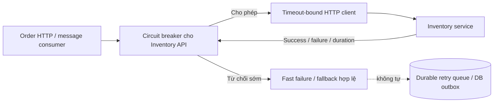
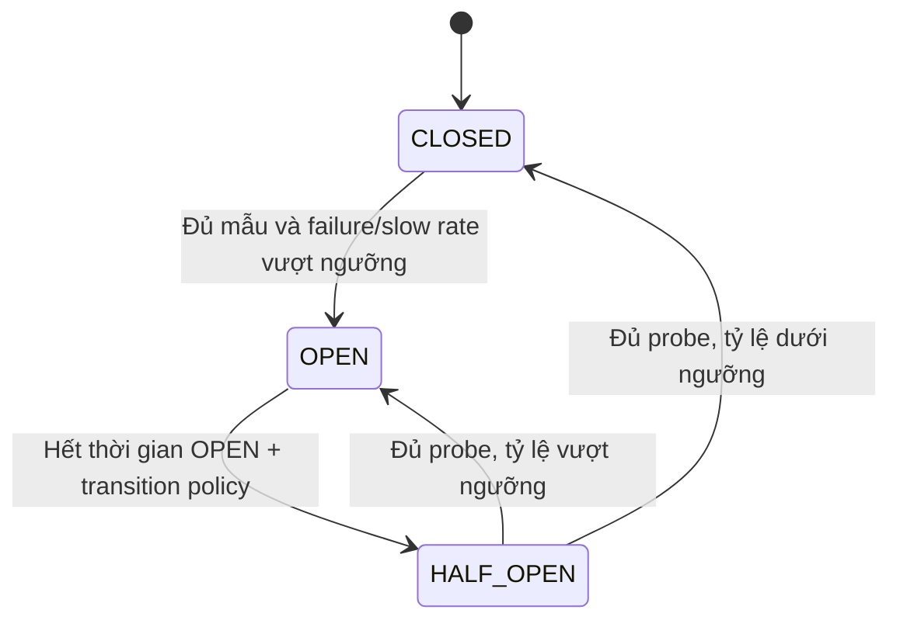
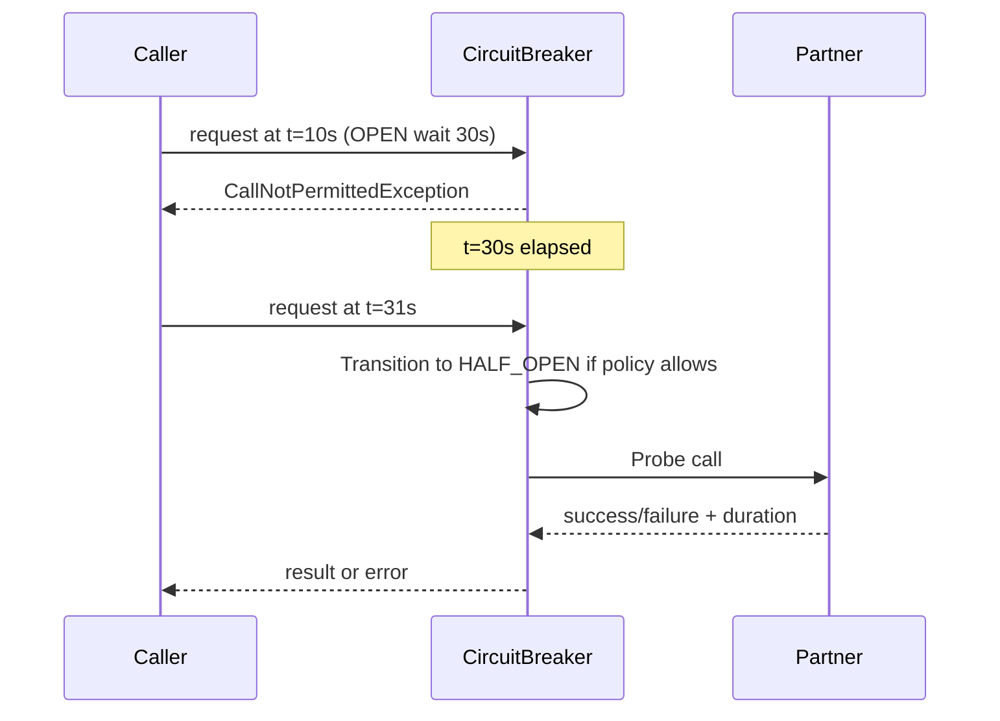
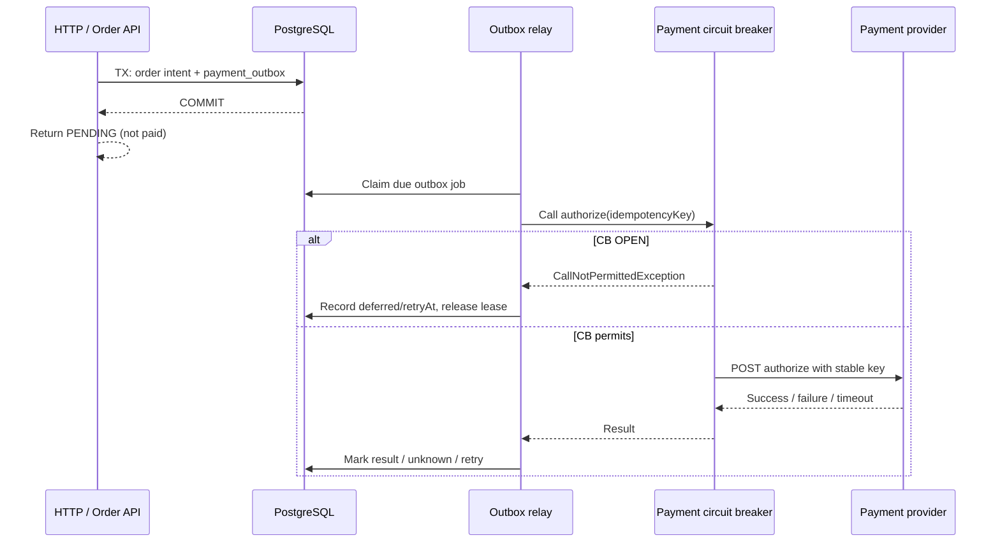
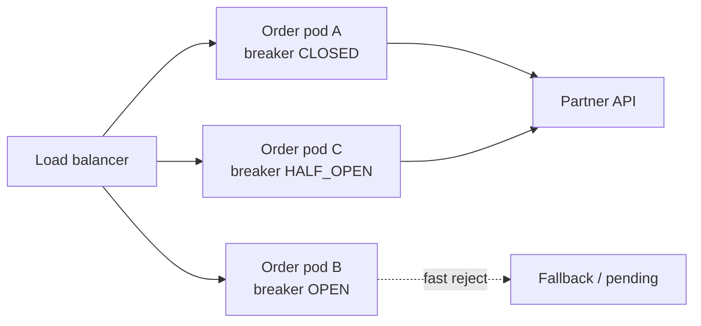
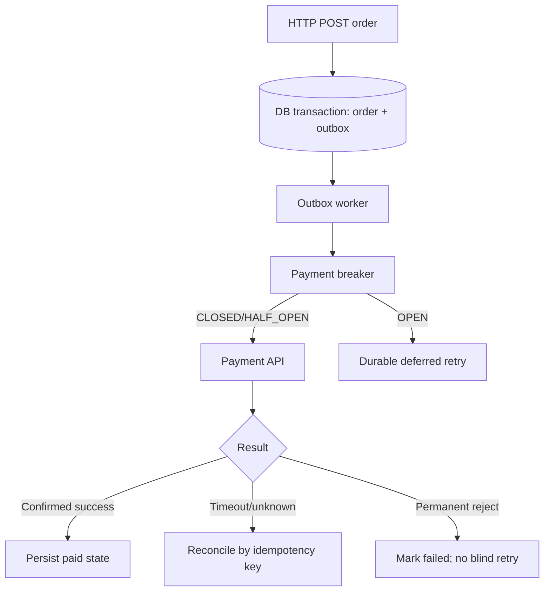
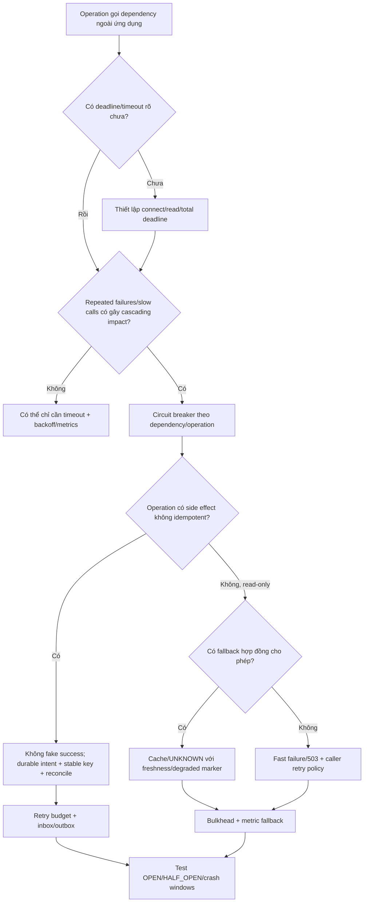

# Circuit breaker và điều kiện chuyển trạng thái

> **Chương:** Phục hồi khi lỗi  
> **Module:** `SPRING_BOOT_INTEGRATION` — tổ chức tích hợp hệ thống Spring Boot qua HTTP client, cơ sở dữ liệu, cache, broker thông điệp và các adapter Spring Integration. Trọng tâm là quản lý cấu hình, hợp đồng dữ liệu, giao dịch, lỗi, xử lý trùng lặp, kiểm thử và quan sát luồng tích hợp thực tế.
>
> **Phạm vi kỹ thuật:** Java 17+, Spring Boot 3.x, Spring Framework 6.x và Resilience4j dành cho các ví dụ. Tên API/configuration/metric có thể khác theo phiên bản Resilience4j, HTTP client và starter; khi triển khai cần pin phiên bản qua BOM/dependency management. Các class nghiệp vụ như `PartnerCatalogGateway`, `CatalogView` hoặc `PaymentCommand` do ứng dụng tự định nghĩa. Circuit breaker **không tự tạo tính bền vững, transaction đa hệ thống hoặc exactly-once**.

## 1. Tình huống thực tế: đối tác chậm, Order Service bị kéo sập

Một ứng dụng Spring Boot phục vụ đơn hàng phải gọi Inventory API để lấy tồn kho và Payment API để xác nhận giao dịch. Khi Inventory API mất kết nối, mỗi request bị giữ nhiều giây rồi timeout. Lượng request tăng khiến:

- HTTP worker threads hoặc client connection pool bị chiếm lâu.
- Latency p95/p99 tăng, thậm chí các API không liên quan cũng chậm.
- Retry đồng loạt gây thêm lưu lượng vào dịch vụ đang lỗi.
- Hikari pool bị gián tiếp nghẽn nếu transaction giữ connection trong khi đợi HTTP.
- Queue/outbox backlog tăng vì consumer cũng phụ thuộc upstream.
- Pod restart không giúp upstream phục hồi và có thể tạo thêm reconnect storm.

Một giải pháp là **circuit breaker**: khi có đủ bằng chứng gần đây rằng một dependency/operation liên tục thất bại hoặc quá chậm, hệ thống **ngừng chủ động gọi trong một khoảng thời gian**, trả thất bại nhanh hoặc một kết quả suy giảm đã được nghiệp vụ cho phép, sau đó cho **một số cuộc gọi kiểm tra** để quyết định mở lại lưu lượng.



**Câu hỏi chính:** Khi nào breaker chuyển `CLOSED → OPEN → HALF_OPEN → CLOSED`, dữ liệu nào dùng để quyết định, và điều gì phải xảy ra khi breaker từ chối một lời gọi vốn có thể tạo side effect?

### Mục tiêu học tập

Sau bài này, bạn có thể:

1. Giải thích trạng thái `CLOSED`, `OPEN`, `HALF_OPEN` và các trạng thái đặc biệt.
2. Tính failure rate/slow-call rate từ sliding window, hiểu ngưỡng `minimumNumberOfCalls` và các điều kiện chuyển trạng thái.
3. Phân biệt circuit breaker với timeout, retry, bulkhead, rate limiter, queue và cache fallback.
4. Cấu hình Resilience4j cho một HTTP client trong Spring Boot, cả annotation và programmatic API.
5. Phân loại 4xx/5xx, timeout, lỗi kết nối, lỗi nghiệp vụ và `CallNotPermittedException`.
6. Thiết kế fallback đúng hợp đồng cho đọc dữ liệu; không tự báo thành công cho payment/DB write.
7. Ghép breaker với transaction, inbox/outbox, broker ACK/redelivery và idempotency.
8. Quan sát state transitions, error/slow-call rates, rejected calls và business impact.
9. Kiểm thử threshold, half-open probes, concurrent calls, outage, recovery và nhiều replicas.
10. Xây runbook/rollback policy khi thay đổi threshold hoặc force breaker state.

## 2. Circuit breaker giải quyết vấn đề gì, và không giải quyết gì?

Circuit breaker là **cơ chế kiểm soát việc có cho một cuộc gọi đi qua hay không** dựa trên các phép đo gần đây của **đúng lời gọi được bảo vệ**. Nó giúp ngắt lan truyền lỗi (*cascading failures*) từ một dependency.

| Cơ chế | Câu hỏi chính | Không tự cung cấp |
|---|---|---|
| Circuit breaker | **Có nên thử gọi dependency lúc này?** | Timeout, durable queue, idempotency |
| Timeout/deadline | Một attempt được chờ bao lâu? | Ngừng gọi khi toàn dependency đang lỗi |
| Retry | Sau một thất bại có nên thử lại? | Chống side effect lặp |
| Bulkhead | Bao nhiêu lời gọi được chạy **đồng thời**? | Đánh giá dependency đang khỏe hay lỗi |
| Rate limiter | Cho phép bao nhiêu request trong một khoảng thời gian? | Phân loại response thành công/thất bại |
| Queue/outbox | Ý định xử lý có được lưu bền vững và retry sau restart? | Tự biết upstream khỏe hay không |
| Idempotency/inbox | Một business event lặp lại có nhân đôi tác động không? | Kiểm soát tải/chặn lời gọi lỗi |
| Cache fallback | Có thể trả giá trị khác khi upstream không sẵn không? | Tính đúng đắn cho dữ liệu cần thời gian thực |

Một breaker **không sửa DNS, TLS, credential, database lock hoặc broker ACL**. Nó chỉ thay đổi chiến lược tiếp tục gọi khi lỗi đã được quan sát. Cần giữ nguyên root-cause diagnostics và remediation.

### 2.1. Không nhầm circuit breaker với “cầu dao toàn bộ ứng dụng”

Một ứng dụng có thể có nhiều breaker:

```text
catalog-read       -> Inventory GET /items/{sku}
payment-authorize  -> Payment POST /authorizations
shipping-rate      -> Carrier GET /quotes
redis-cache-lookup -> Redis read (nếu quyết định dùng breaker)
```

Tên breaker định danh **một nhóm lời gọi có SLO và fallback tương đương**. Một breaker dùng chung cho mọi đối tác/operation khiến lỗi của API không quan trọng có thể chặn API quan trọng khác. Ngược lại, tạo breaker cho **từng customer ID** tạo cardinality/memory/metrics khó quản lý.

## 3. Ba trạng thái chính: CLOSED, OPEN và HALF_OPEN



- **`CLOSED`**: cho phép các lời gọi được thực thi, ghi kết quả thành công/thất bại và thời gian thực thi vào cửa sổ đo lường. “Closed” nghĩa **đường gọi đang mở**, không phải dependency chắc chắn khỏe.
- **`OPEN`**: từ chối những lời gọi được breaker bảo vệ, thường ném `CallNotPermittedException` ngay, **không gọi upstream**. Phần request bị từ chối này không phải một thất bại HTTP từ upstream.
- **`HALF_OPEN`**: cho phép một **số lượng probe calls giới hạn**. Sau khi có đủ kết quả theo policy, breaker đóng nếu điều kiện hồi phục đạt, hoặc mở lại nếu vẫn quá nhiều lỗi/chậm.

Resilience4j là một thư viện triển khai mẫu phổ biến; một implementation khác có thể có thêm trạng thái hoặc điều kiện transition khác.

### 3.1. “OPEN” không đồng nghĩa “server đang down”

Breaker có thể mở vì:

- Đối tác trả `503` liên tục.
- Socket timeout/TLS handshake failure lặp lại.
- Calls **thành công nhưng rất chậm**, vượt ngưỡng slow-call rate.
- Một predicate được cấu hình sai và **đếm cả lỗi nghiệp vụ 404** như lỗi hạ tầng.

Vì vậy, state `OPEN` chỉ nói **các phép đo và policy của breaker đã vượt ngưỡng**, không tự chứng minh nguyên nhân là server down.

## 4. State machine theo thời gian thực

Ví dụ cấu hình:

- `slidingWindowSize = 20` theo COUNT_BASED.
- `minimumNumberOfCalls = 10`.
- `failureRateThreshold = 50%`.
- `slowCallRateThreshold = 70%`.
- `slowCallDurationThreshold = 2s`.
- `waitDurationInOpenState = 30s`.
- `permittedNumberOfCallsInHalfOpenState = 4`.

```text
CLOSED:
  1..9 calls: ghi metrics, chưa đủ minimumNumberOfCalls để trip.
  Call 10 kết thúc:
    6 failed / 10 = 60% >= 50% => OPEN.
  Các call tới sau: bị reject nhanh, không gửi tới provider.

OPEN:
  Chờ 30 giây theo cấu hình.
  Nếu auto transition = false: lần request kiểm tra tiếp theo
  sau thời gian chờ có thể kích hoạt HALF_OPEN.
  Nếu auto transition = true: cơ chế scheduler có thể chuyển
  sang HALF_OPEN khi thời gian đã hết, không cần call mới.

HALF_OPEN:
  Cho tối đa 4 cuộc gọi probe theo permission budget.
  Khi đã có đủ 4 kết quả:
    3 success + 1 failure => failure rate 25% < 50%,
    slow-call rate dưới 70% => CLOSED.
    2 success + 2 failure => failure rate 50% >= 50% => OPEN.
```

Đây là trường hợp minh họa không có ignored exceptions và không có các trường hợp bất thường như probe bị treo hoặc race với manual force state. **Một probe thành công chưa đủ khẳng định dependency khỏe** nếu cấu hình yêu cầu tổng cộng 4 probes.

### 4.1. Ngưỡng là điều kiện “bằng hoặc vượt”

Trong Resilience4j, nếu tỷ lệ thất bại/slow call **bằng hoặc vượt** threshold đã cấu hình sau khi đủ mẫu, breaker có thể chuyển sang OPEN. Ví dụ threshold 50%, 5 failures trên 10 kết quả là **50%**, đủ điều kiện mở; không cần 51%.

## 5. CLOSED: trạng thái ghi nhận kết quả và quyết định mở

Ở `CLOSED`, breaker thường cho phép các lời gọi đi qua mà **không giới hạn số cuộc gọi đồng thời**. Nó đo kết quả được báo về:

- Success.
- Recorded failure.
- Slow success.
- Slow failure.
- Ignored exception theo policy (không tính như một success/failure bình thường).

Khi số lượng mẫu hợp lệ đạt `minimumNumberOfCalls`, breaker đánh giá **failure rate** và **slow-call rate** trên sliding window. Nếu một trong hai đạt ngưỡng, nó chuyển sang OPEN.

### 5.1. Cửa sổ và minimumNumberOfCalls

Giả sử `slidingWindowSize=20` và `minimumNumberOfCalls=10`:

| Số kết quả đã ghi | Kết quả lỗi trong cửa sổ | Failure rate | Chuyển OPEN với threshold 50%? |
|---:|---:|---:|---|
| 3 | 3 | 100% | **Chưa**, vì chưa đủ 10 calls |
| 9 | 8 | 88,9% | **Chưa**, vì chưa đủ 10 calls |
| 10 | 5 | 50% | **Có** nếu những lỗi này được ghi nhận |
| 10 | 4 | 40% | Chưa |
| 15 | 8 | 53,3% | **Có** |
| 20 | 9 | 45% | Chưa, xét failure-rate; có thể trip theo slow calls |

Cửa sổ đo **kết quả gần đây**, không phải số requests toàn thời gian từ khi application chạy. Mỗi khi số lượng vượt size, dữ liệu cũ được loại khỏi phép đo theo loại window.

### 5.2. Tỷ lệ lỗi không phải số exception log

Nếu một call thất bại và application có retry **bên trong** breaker, breaker có thể nhìn thấy một invocation cuối cùng thành công hoặc thất bại, thay vì ba attempts như developer nghĩ. Ngược lại, nếu breaker nằm **bên trong** retry, nó có thể ghi nhiều attempts thành nhiều results. Cần biết decorator/aspect order để diễn giải metrics.

## 6. Sliding window COUNT_BASED: đếm N lời gọi cuối

Resilience4j có `SlidingWindowType.COUNT_BASED`. Ví dụ:

```text
size = 5, minCalls = 5, failureThreshold = 60%

Results: S, S, F, F, F
         3/5 = 60% -> OPEN

Nếu không có trip mà có thêm call:
Results window trượt, bỏ kết quả cũ nhất.
```

Các đặc điểm:

- Phép đo dựa trên **N kết quả gần nhất**, không theo đơn vị thời gian.
- Dễ hiểu khi lưu lượng ổn định.
- Một service rất ít request có thể mất thời gian dài mới đạt minimumNumberOfCalls.
- Không tự giới hạn số call in-flight; sliding window là **cửa sổ thống kê**, không phải queue capacity.
- Kết quả từ các calls chậm đang chạy chỉ được ghi khi operation hoàn tất/exception được báo về.

### 6.1. Một burst nhỏ không nên lập tức mở breaker nếu minCalls lớn

Với `minimumNumberOfCalls=100`, ngay cả 10 calls đầu đều lỗi, breaker chưa đủ sample để tính threshold và trip theo chính sách bình thường. Đây là trade-off giữa **nhạy với sự cố** và **tránh false positive**. Đừng sao chép nguyên threshold của service 1000 rps sang service chỉ có 2 req/phút.

## 7. Sliding window TIME_BASED: đo theo các giây gần đây

`SlidingWindowType.TIME_BASED` dùng cửa sổ theo thời gian; ví dụ `slidingWindowSize=30` thường có nghĩa dữ liệu trong khoảng **30 giây gần đây** của window, không phải 30 calls.

```text
time-based size = 30 seconds, minimumNumberOfCalls = 20

Giây t=0..29:
  25 completed calls, 15 failures -> 60%.
  threshold = 50% => OPEN.

Giây t=0..29:
  4 completed calls, 4 failures -> 100% về mặt tỷ lệ,
  nhưng chưa đạt 20 calls => chưa trip.
```

Resilience4j tối ưu việc thống kê bằng các buckets theo thời gian; không suy rằng nó giữ toàn bộ Java objects của mọi call trong RAM. Time-based window phù hợp khi muốn đánh giá một khoảng thời gian vận hành cụ thể, nhưng lượng calls nhỏ vẫn bị giới hạn bởi `minimumNumberOfCalls`.

### 7.1. Window size không phải Open-state wait duration

- `slidingWindowSize`: phạm vi số liệu dùng để **đánh giá trip** khi CLOSED.
- `waitDurationInOpenState`: thời gian **ngăn lời gọi** trước khi đủ điều kiện cho HALF_OPEN.
- `slowCallDurationThreshold`: thời gian để một invocation được gắn nhãn “slow”.
- `maxWaitDurationInHalfOpenState`: thời hạn bổ sung để trạng thái HALF_OPEN không chờ probe hoàn tất vô hạn nếu được cấu hình.

Đây là **bốn khái niệm khác nhau**. Không thay `waitDurationInOpenState` để sửa việc breaker chưa thu đủ samples.

## 8. Failure-rate threshold: thế nào là failure?

Trong mô hình đơn giản:

\[
\text{Failure rate (\%)} =
\frac{\text{Số cuộc gọi được tính là thất bại}}
     {\text{Tổng số cuộc gọi hợp lệ được ghi trong cửa sổ}} \times 100
\]

Phân loại failure **không đồng nhất với mọi exception**. Với HTTP client:

| Kết quả operation | Nên tính là failure của upstream breaker? | Lý do |
|---|---|---|
| HTTP 200 và response hợp đồng hợp lệ | Thường không | Dependency hoàn tất yêu cầu |
| TCP connect timeout/read timeout | Thường có | Upstream/network không đáp ứng |
| TLS hostname/certificate mismatch | Có thể ghi nhận nhưng **không tự retry vô hạn** | Lỗi security/config, cần alert/fail closed |
| HTTP 500/502/503/504 | Thường có | Upstream/gateway lỗi hoặc quá tải |
| HTTP 429 | Tùy policy, thường cần backoff/rate-limit phối hợp | Có thể là overload/quota, không nên retry storm |
| HTTP 400/422 do client gửi dữ liệu sai | Thường **không** | Đổi circuit state không sửa payload |
| HTTP 401/403 do credentials/quyền sai | Thường không dùng breaker để che nguyên nhân | Cần sửa auth/ACL |
| HTTP 404 “không tìm thấy item” hợp lệ | Thường không | Kết quả nghiệp vụ dự kiến |
| JSON schema sai trong response upstream | Tùy contract, có thể là failure | Provider trả dữ liệu không hợp lệ |
| Local validation exception trước HTTP | **Không nên** tính cho upstream breaker | Không hề gọi provider |
| `CallNotPermittedException` từ OPEN | Từ chối bởi breaker, không phải HTTP failure | Không được nhầm với upstream error rate |

### 8.1. Một predicate được cấu hình sai có thể làm breaker tự hại hệ thống

Ví dụ 70% request tìm SKU không tồn tại, provider trả HTTP 404 đúng business contract. Nếu client ném exception và breaker **đếm toàn bộ 404 như failure**, nó có thể OPEN dù provider khỏe.

Một chính sách là:

- Chuyển 404 hợp lệ thành kết quả domain `NotFound` **bên trong adapter** trước khi breaker đo.
- Hoặc cấu hình `ignoreException`/`recordException` predicate để phân biệt.
- Không ignore mọi HTTP 4xx một cách mù quáng nếu 429 là overload cần đo.
- Không coi validation failure nội bộ là upstream failure.

## 9. Slow-call rate: thành công nhưng quá chậm vẫn có thể OPEN

Một dependency có thể trả HTTP 200 nhưng mất 8 giây thay vì SLO 500 ms. Nếu chỉ đo failure rate, breaker sẽ thấy “100% success” và tiếp tục giữ resources lâu.

Resilience4j có:

- `slowCallDurationThreshold`: ranh giới thời gian một completed call được coi là slow.
- `slowCallRateThreshold`: phần trăm slow calls đủ để OPEN, sau khi đạt minimumNumberOfCalls.

\[
\text{Slow-call rate (\%)} =
\frac{\text{Số cuộc gọi có thời gian vượt ngưỡng slow}}
     {\text{Tổng số cuộc gọi hợp lệ được ghi}} \times 100
\]

### 9.1. Slow-call rate và failure rate là hai phép đo riêng

Ví dụ 10 calls:

- 10 thành công, nhưng 8 calls mất hơn 2 giây → failure rate 0%, slow rate 80%; nếu threshold slow 70% thì **OPEN**.
- 6 calls lỗi nhanh, 4 calls thành công nhanh → failure rate 60%; nếu threshold failure 50% thì **OPEN**, dù slow rate 0%.
- Một call vừa lỗi vừa chậm có thể được tính trong **cả hai** metric. **Không cộng hai phần trăm** rồi so với một threshold tổng.

### 9.2. Timeout ngắn hơn slow threshold làm dữ liệu đổi nghĩa

Nếu HTTP read timeout được cấu hình 1 giây nhưng `slowCallDurationThreshold=2s`, nhiều calls sẽ thất bại ở khoảng 1 giây chứ không trở thành slow successful calls trên 2 giây. Điều này không sai, nhưng alert và breaker cần đọc **failure rate/timeout count**, không chỉ slow-call rate.

Không dùng slow threshold thay HTTP socket/response timeout. Breaker **quan sát** thời gian, không tự chấm dứt một blocking I/O vì nó đã chậm quá ngưỡng.

## 10. OPEN: từ chối nhanh, nhưng có ngữ nghĩa với nghiệp vụ

Khi OPEN, Resilience4j thường không thực thi supplier/call được bảo vệ mà ném:

```java
import io.github.resilience4j.circuitbreaker.CallNotPermittedException;
```

Caller phải hiểu rằng **breaker không cho thử dependency tại thời điểm này**:

- HTTP GET catalog có thể trả `503 Service Unavailable` hoặc cache snapshot nếu hợp đồng cho phép.
- HTTP POST thanh toán **không được giả vờ thành công**.
- Message consumer nhận lệnh có thể ghi durable pending/outbox rồi ACK nguồn, hoặc để source redeliver có backoff, tùy delivery contract.
- Một tác vụ chạy nền không được “bỏ message” chỉ vì fallback trả `null`.

### 10.1. OPEN không chặn mọi request của ứng dụng

Breaker chỉ bảo vệ đoạn code đã được decorate/AOP intercept. Những cuộc gọi đi vòng qua adapter, lời gọi nội bộ bypass proxy hoặc client khác dùng cùng hostname **vẫn có thể đi tới upstream**. Cần lập dependency/operation inventory, tránh tưởng mở một breaker đồng nghĩa toàn cluster ngừng mọi traffic.

### 10.2. Thời gian OPEN không phải lệnh chữa lỗi

`waitDurationInOpenState=30s` không bảo đảm upstream phục hồi sau 30 giây. Đó là thời gian tối thiểu trước khi breaker **thử kiểm tra lại**; một outage dài có thể tạo nhiều chu kỳ OPEN→HALF_OPEN→OPEN.

## 11. OPEN → HALF_OPEN: khi nào thực sự chuyển trạng thái?

Resilience4j thường hỗ trợ:

- `waitDurationInOpenState`: khoảng thời gian phải qua kể từ khi OPEN.
- `automaticTransitionFromOpenToHalfOpenEnabled=false`: **không có tự động chuyển chỉ vì đồng hồ trôi**; khi một caller đến xin permission sau khi hết thời gian, breaker có thể chuyển sang HALF_OPEN.
- `automaticTransitionFromOpenToHalfOpenEnabled=true`: sử dụng cơ chế scheduling/monitor để tự chuyển trạng thái sau thời gian chờ, ngay cả khi chưa có request mới.



### 11.1. Vì sao bật auto transition không có nghĩa health check thật?

Khi background transition đưa breaker vào HALF_OPEN, nó mới **sẵn sàng cho probes**. Không có lời gọi nào thì chưa có dữ liệu mới để quyết định đóng lại. Cờ này không tự gửi một HTTP request sức khỏe tới upstream.

Nếu muốn active probing, thiết kế một health-check mechanism riêng, dùng endpoint/cost phù hợp và không lạm dụng “readiness ping” để chứng minh business operation có quyền thực thi.

## 12. HALF_OPEN: giới hạn probes để kiểm tra hồi phục

`permittedNumberOfCallsInHalfOpenState` quyết định **số lời gọi có thể được phép thử** trong HALF_OPEN. Ví dụ 4 permits:

```text
4 permits:
  Probe A -> success (400ms)
  Probe B -> success (650ms)
  Probe C -> failure (503)
  Probe D -> success (300ms)
  Extra call while permits exhausted -> rejected until state decision.

Results: 1/4 failures = 25%.
If failure threshold = 50% and slow rate < threshold => CLOSED.
```

Điểm cần lưu ý:

- Permits trong HALF_OPEN là một **giới hạn thử nghiệm**, không phải hệ thống bulkhead toàn diện cho CLOSED.
- Nếu breaker yêu cầu 4 kết quả, một hoặc hai kết quả thành công **chưa đủ** để đóng.
- Nếu đủ probes và failure rate hoặc slow-call rate vượt ngưỡng, breaker **OPEN lại**.
- Nếu có probes treo/lâu không hoàn tất, HALF_OPEN có thể kéo dài; có `maxWaitDurationInHalfOpenState` để ràng buộc theo version/config.
- Với ignored exceptions, cancellation hoặc calls chưa hoàn tất, cần kiểm thử cách implementation tính completion/permits.
- Khi nhiều threads đồng thời xin permission, một số có thể bị từ chối vì hết permits dù upstream đang phục hồi; đây là hành vi bảo vệ chủ đích.

### 12.1. Không dùng HALF_OPEN làm khối lượng “warm-up” lớn

Probe nên là **các operation thực sự đại diện** cho endpoint được bảo vệ, nhưng phải có timeouts/idempotency. Nếu dùng một payment POST tạo side effect để kiểm tra sức khỏe mà retry/timeout khó kiểm soát, việc probe có thể tạo charge lặp. Cân nhắc biệt lập **read-only health path** hoặc giữ toàn bộ command idempotency phù hợp; không thay thế request nghiệp vụ bằng một ping không phản ánh dependency thực tế.

## 13. HALF_OPEN → CLOSED hay OPEN: cách tính

Giả sử:

```yaml
permittedNumberOfCallsInHalfOpenState: 4
failureRateThreshold: 50
slowCallRateThreshold: 75
slowCallDurationThreshold: 2s
```

| 4 kết quả probe | Failure rate | Slow rate | Chuyển tiếp |
|---|---:|---:|---|
| 4 success, tất cả nhanh | 0% | 0% | `CLOSED` |
| 3 success + 1 failure, tất cả nhanh | 25% | 0% | `CLOSED` |
| 2 success + 2 failure | **50%** | Tùy | `OPEN` |
| 4 success, 3 calls quá 2s | 0% | **75%** | `OPEN` |
| 1 failure chậm + 2 success chậm + 1 success nhanh | 25% | **75%** | `OPEN` |
| Chỉ 2/4 probes hoàn tất | Chưa đủ để kết luận theo ví dụ | Chưa đủ | Tiếp tục HALF_OPEN hoặc timeout policy |

**Không lấy dữ liệu CLOSED cũ ghép vào 4 probes để nói breaker đang khỏe.** HALF_OPEN có cơ chế thống kê đánh giá riêng theo số permits, và sau khi CLOSED lại, thống kê/chế độ cửa sổ được reset/tiếp tục theo implementation. Kiểm thử metrics theo version.

### 13.1. Phân biệt “permission denied” và “probe failed”

Một call bị từ chối vì HALF_OPEN hết permits là **not permitted**, không phải một 503 từ upstream. Nếu bạn dùng chung một counter “failure” cho cả hai, dashboard có thể tăng lỗi trong khi upstream chỉ được thử 4 lần theo thiết kế.

## 14. Trạng thái đặc biệt: DISABLED, FORCED_OPEN, METRICS_ONLY

Ngoài ba trạng thái thông thường, Resilience4j có những trạng thái điều khiển đặc biệt, tùy release:

| Trạng thái | Hành vi khái quát | Dùng khi nào |
|---|---|---|
| `DISABLED` | Cho phép lời gọi đi qua, bỏ cơ chế điều khiển bảo vệ/đo breaker theo semantics trạng thái đặc biệt | Khi tạm ngừng breaker vì lý do có kiểm soát |
| `FORCED_OPEN` | Từ chối mọi lời gọi được bảo vệ, không đợi đo threshold | Khi cần ngắt ngay một dependency nguy hiểm |
| `METRICS_ONLY` | Cho lời gọi đi qua và tiếp tục đo, **không OPEN do threshold** | Quan sát ngưỡng trước khi bật enforcement |

Lưu ý:

- Những trạng thái này được áp dụng theo **breaker instance trong JVM**, không phải global kill switch tự đồng bộ mọi replicas.
- Chuyển vào/ra special state là **thao tác vận hành có tác động**, cần owner, audit và rollback.
- Một breaker `DISABLED` có thể khiến upstream đang quá tải bị dồn requests trở lại.
- `FORCED_OPEN` vẫn cần business fallback hoặc durable retry; nếu không, việc “bảo vệ hệ thống” có thể biến thành mất công việc.
- `METRICS_ONLY` rất hữu ích trước rollout nhưng không bảo vệ khỏi cascading failures.

### 14.1. Đừng nhầm FORCED_OPEN với OPEN tự động

`OPEN` tự động có thời gian chờ và logic HALF_OPEN. `FORCED_OPEN` là trạng thái được ép; không giả định nó sẽ tự hồi phục theo `waitDurationInOpenState`. Muốn cho thử lại phải có thao tác chuyển trạng thái đúng policy.

## 15. Manual transition và reset: dùng rất thận trọng

Resilience4j có API cho các chuyển trạng thái thủ công ở cấp breaker instance, chẳng hạn:

```java
import io.github.resilience4j.circuitbreaker.CircuitBreaker;

// breaker được inject/tra từ CircuitBreakerRegistry.
breaker.transitionToForcedOpenState(); // Tạm chặn calls.
breaker.transitionToClosedState();     // Ép trở lại CLOSED khi đã xác minh.
breaker.reset();                       // Reset state/metrics theo API.
```

Đây là ví dụ **lệnh vận hành**, không phải flow business thông thường. Một reset xóa bối cảnh thống kê của instance, có thể tạo burst tới dependency còn đang lỗi. Khi xử lý incident:

1. Xác định breaker name, instance/pod và dependency cụ thể.
2. Xem reason, timeline, failure/slow-call rates và downstream impact.
3. Sửa lỗi gốc (TLS, credential, route, server outage, thread starvation).
4. Cho phép probes/canary theo policy, không đồng loạt force CLOSED mọi pod.
5. Quan sát 4xx/5xx, p95, queue/outbox backlog, duplicate effects.
6. Lưu dấu thao tác, người chịu trách nhiệm và điều kiện rollback.

Không expose API `transitionToClosedState()` cho người dùng thông thường hoặc gọi trong mỗi HTTP request khi thấy breaker OPEN.

## 16. Event publisher và thời điểm chuyển trạng thái

Resilience4j cung cấp `CircuitBreakerEventPublisher` để quan sát các sự kiện như state transition, success/error, not-permitted, ignored error theo implementation.

```java
import io.github.resilience4j.circuitbreaker.CircuitBreaker;
import io.github.resilience4j.circuitbreaker.CircuitBreakerRegistry;

public final class CircuitBreakerEvents {

    public static void attach(CircuitBreakerRegistry registry) {
        CircuitBreaker cb = registry.circuitBreaker("partnerCatalog");

        cb.getEventPublisher()
            .onStateTransition(event ->
                System.out.println("Breaker transition: "
                    + event.getStateTransition()))
            .onCallNotPermitted(event ->
                System.out.println("Breaker rejected an invocation"));
    }
}
```

Trong production, thay `System.out.println` bằng structured logging/metrics với tên breaker và state transition; không log request bodies, token, full URL query hoặc PII. Đăng ký subscriber **một lần** khi khởi động bean, không tạo listener mới cho mỗi request.

### 16.1. Transition event không chứng minh service đã hồi phục

Một transition HALF_OPEN→CLOSED chỉ chứng minh probes vượt qua các threshold hiện hành. Nó **không chứng minh**:

- Upstream đáp ứng đủ throughput production.
- Mọi region/tenant được cấp quyền.
- Các pending outbox messages đã được xử lý.
- Cache/DB/business state đã được reconciliation.
- Provider sẽ không lại quá tải khi full traffic trở lại.

Vì vậy, cần correlation với dependency latency/error rate và business SLA.

## 17. Chọn phạm vi breaker: theo dependency hay theo operation?

Ví dụ cùng một HTTP provider có:

```text
GET /inventory/{sku}                 read path, có thể fallback UNKNOWN
POST /reservations                  write path, cần idempotency
GET /reservations/{requestId}       status/reconciliation path
```

Một breaker duy nhất `inventoryApi` cho cả ba có thể không phù hợp:

- GET read latency 5xx làm OPEN, rồi chặn cả reconciliation cần thiết để xác định kết quả POST.
- POST timeout là outcome ambiguous, không nên tự biến thành một cached success.
- Health/status API có SLO khác create reservation.
- Rate-limit quota có thể chia theo tenant/operation.

Một thiết kế có thể dùng:

| Breaker | Bảo vệ | Policy |
|---|---|---|
| `inventoryRead` | Tra tồn kho | Short timeout, stale/unknown fallback nếu API cho phép |
| `inventoryReserve` | Tạo giữ hàng | Strict error handling, stable idempotency key, outbox |
| `inventoryReservationStatus` | Đối soát kết quả | Read-only query, budget riêng |
| `shippingQuote` | Tính giá vận chuyển | Có thể fallback “tạm không có báo giá” |

Không tạo breaker per customer/session khi số khách lớn; quản lý cardinality của registries và metrics. Với tenant có quota riêng biệt, cân nhắc policy theo nhóm/tier có giới hạn và theo quyền.

## 18. Spring Boot dependency: Resilience4j CircuitBreaker

Một dự án Spring Boot 3 có thể dùng:

```gradle
dependencies {
    implementation("org.springframework.boot:spring-boot-starter-web")
    implementation("org.springframework.boot:spring-boot-starter-aop")

    implementation("io.github.resilience4j:resilience4j-spring-boot3")
    implementation("io.github.resilience4j:resilience4j-micrometer")

    implementation("org.springframework.boot:spring-boot-starter-actuator")
    testImplementation("org.springframework.boot:spring-boot-starter-test")
}
```

Các phiên bản Resilience4j nên được pin/quản lý theo build BOM phù hợp; **Spring Boot BOM không nhất thiết quản lý mọi thư viện Resilience4j theo cách dự án đang dùng**. Với WebFlux/Reactor, có thêm module tích hợp phù hợp với reactive decorators/operator tùy Resilience4j version; ví dụ blocking RestClient dưới đây dành cho Servlet/app service truyền thống.

### 18.1. Resilience4j khác Spring Cloud CircuitBreaker

- **Resilience4j core/annotation**: cung cấp state machine, registry, decorators, annotations/config.
- **Spring Cloud CircuitBreaker**: abstraction cấp Spring Cloud có thể dùng Resilience4j backend, cách cấu hình và factory khác.
- **Spring Retry**: cơ chế retry riêng, không tự thay circuit breaker.
- **Micrometer/Actuator**: quan sát metrics/health theo integrations được bật.

Không trộn snippets cấu hình `spring.cloud.circuitbreaker.*` với `resilience4j.circuitbreaker.*` rồi giả định đều áp cùng một breaker. Hãy xác định adapter thực tế và test.

## 19. Cấu hình Resilience4j bằng application.yml

Ví dụ cấu hình một breaker `partnerCatalog`:

```yaml
resilience4j:
  circuitbreaker:
    instances:
      partnerCatalog:
        registerHealthIndicator: true
        slidingWindowType: COUNT_BASED
        slidingWindowSize: 20
        minimumNumberOfCalls: 10
        failureRateThreshold: 50
        slowCallRateThreshold: 70
        slowCallDurationThreshold: 2s
        waitDurationInOpenState: 30s
        permittedNumberOfCallsInHalfOpenState: 4
        automaticTransitionFromOpenToHalfOpenEnabled: false
        maxWaitDurationInHalfOpenState: 20s
```

Giải thích theo từng nhóm:

| Property | Nghĩa | Ảnh hưởng |
|---|---|---|
| `slidingWindowType` | Cửa sổ theo số calls hay thời gian | Chọn cách lấy mẫu |
| `slidingWindowSize` | Số calls hoặc số giây, tùy type | Phạm vi thống kê |
| `minimumNumberOfCalls` | Số results tối thiểu trước khi đánh giá threshold | Tránh trip quá sớm |
| `failureRateThreshold` | % failures làm OPEN | Độ nhạy với lỗi |
| `slowCallRateThreshold` | % slow calls làm OPEN | Độ nhạy với latency |
| `slowCallDurationThreshold` | Duration để đánh dấu call slow | Phải tương thích timeout/SLO |
| `waitDurationInOpenState` | Thời gian chờ trước khi thử HALF_OPEN | Nhịp kiểm tra hồi phục |
| `permittedNumberOfCallsInHalfOpenState` | Số probe được phép | Sample hồi phục |
| `automaticTransitionFromOpenToHalfOpenEnabled` | Có tự chuyển sau thời gian OPEN khi chưa có request mới không? | Lifecycle behavior |
| `maxWaitDurationInHalfOpenState` | Giới hạn thời gian HALF_OPEN chờ probes, nếu hỗ trợ | Tránh treo HALF_OPEN |
| `registerHealthIndicator` | Xuất health indicator khi integration hỗ trợ | Không tự quyết readiness toàn app |

Nếu `registerHealthIndicator=true` làm trạng thái OPEN bị biểu diễn như health DOWN tùy integration/settings, **đừng tự đưa nó vào Kubernetes liveness check** khiến pod restart liên tục vì dependency bên ngoài outage. Phân biệt health/info với readiness/liveness và khả năng phục vụ theo business contract.

### 19.1. Chỉ cấu hình breaker không tự bao bọc HTTP client

Một YAML `resilience4j.circuitbreaker.instances.partnerCatalog` chỉ tạo config/registry behavior. Method cần được decorate/annotation intercept hoặc gọi qua breaker programmatic. Nếu không, HTTP calls vẫn đi trực tiếp, và breaker metrics có thể trống.

### 19.2. Cách chọn giá trị ban đầu

Không sao chép `failureRateThreshold=50` và `wait=30s` cho mọi endpoint. Ước lượng từ:

- Traffic bình thường và burst size.
- Baseline failure rate, p50/p95/p99.
- HTTP connect/read timeout.
- Khả năng quá tải của upstream, quotas và error budgets.
- Điều kiện phục hồi trung bình và hiện tượng cold-start.
- Tỷ lệ lỗi business 404/validation phải được loại khỏi classifier.
- Mức độ nhạy với mất cơ hội gọi hợp lệ.
- Kế hoạch xử lý pending requests và retry khi OPEN.

Giá trị ban đầu nên được test trong staging/fault injection và điều chỉnh theo SLO.

## 20. Tạo breaker bằng Java API: kiểm soát đúng phạm vi lời gọi

Ngoài property YAML, có thể tạo `CircuitBreakerConfig` và `CircuitBreaker` bằng Java để điều khiển việc **đo lỗi nào, dùng clock nào, bao bọc supplier nào**.

```java
import java.time.Duration;

import io.github.resilience4j.circuitbreaker.CircuitBreaker;
import io.github.resilience4j.circuitbreaker.CircuitBreakerConfig;
import io.github.resilience4j.circuitbreaker.CircuitBreakerConfig.SlidingWindowType;

public final class PartnerBreakerFactory {

    private PartnerBreakerFactory() {}

    public static CircuitBreaker createCatalogReadBreaker() {
        CircuitBreakerConfig config = CircuitBreakerConfig.custom()
            .slidingWindowType(SlidingWindowType.COUNT_BASED)
            .slidingWindowSize(20)
            .minimumNumberOfCalls(10)
            .failureRateThreshold(50.0f)
            .slowCallRateThreshold(70.0f)
            .slowCallDurationThreshold(Duration.ofSeconds(2))
            .waitDurationInOpenState(Duration.ofSeconds(30))
            .permittedNumberOfCallsInHalfOpenState(4)
            .automaticTransitionFromOpenToHalfOpenEnabled(false)
            .build();

        return CircuitBreaker.of("partnerCatalog", config);
    }
}
```

Ví dụ này tạo breaker **độc lập**, phù hợp test hoặc một cấu hình Java do ứng dụng kiểm soát. Đừng vừa khởi tạo một breaker bằng `CircuitBreaker.of(...)`, vừa dùng `@CircuitBreaker(name="partnerCatalog")` từ registry khác, rồi nghĩ hai đối tượng chia sẻ state. **State và metrics thuộc instance thực sự được lời gọi sử dụng.**

### 20.1. Khi nào dùng CircuitBreakerRegistry?

`CircuitBreakerRegistry` giúp quản lý breaker instances theo tên, chia sẻ cấu hình base và đăng ký event consumers. Spring Boot/Resilience4j auto-configuration có thể cung cấp registry và tạo instances dựa trên `resilience4j.circuitbreaker.*`.

Trong ứng dụng một registry chung:

```java
import io.github.resilience4j.circuitbreaker.CircuitBreaker;
import io.github.resilience4j.circuitbreaker.CircuitBreakerRegistry;

public final class CatalogBreakerLookup {

    private final CircuitBreaker breaker;

    public CatalogBreakerLookup(CircuitBreakerRegistry registry) {
        this.breaker = registry.circuitBreaker("partnerCatalog");
    }

    public CircuitBreaker breaker() {
        return breaker;
    }
}
```

Code sử dụng `registry.circuitBreaker("partnerCatalog")` ở nơi adapter được tạo, **không tạo breaker mới mỗi request**; tạo mới mỗi lần sẽ xóa lịch sử thất bại và breaker gần như không bao giờ OPEN đúng ý định.

### 20.2. Không nhầm annotation và programmatic

Hai cách là **lựa chọn thay thế**:

- `@CircuitBreaker` dựa trên AOP/interceptor và bean wiring.
- `breaker.executeSupplier(...)`/decorator chủ động bao bọc code.
- Nếu bao bọc **cả hai** trên cùng lời gọi mà không có chủ đích, metrics/permissions có thể bị tính hai lần hoặc tạo hai breaker khác nhau.

Chọn một lớp instrumentation làm chủ để dễ suy luận thresholds và event logs.

## 21. Programmatic execution: bảo vệ đúng outbound adapter

Ví dụ dùng `RestClient` của Spring Framework 6.1+ (thường có trong Spring Boot 3.2+). Bản này dùng API blocking, phù hợp đường MVC/service đồng bộ; không gọi nó trên Reactor event-loop.

```java
import org.springframework.beans.factory.annotation.Qualifier;
import org.springframework.stereotype.Component;
import org.springframework.web.client.RestClient;

import io.github.resilience4j.circuitbreaker.CircuitBreaker;
import io.github.resilience4j.circuitbreaker.CircuitBreakerRegistry;

@Component
public class PartnerCatalogGateway {

    private final RestClient restClient;
    private final CircuitBreaker breaker;

    public PartnerCatalogGateway(
            @Qualifier("partnerCatalogRestClient") RestClient restClient,
            CircuitBreakerRegistry registry) {
        this.restClient = restClient;
        this.breaker = registry.circuitBreaker("partnerCatalog");
    }

    public CatalogView find(String sku) {
        return breaker.executeSupplier(() -> {
            CatalogView response = restClient.get()
                .uri("/v1/catalog/{sku}", sku)
                .retrieve()
                .body(CatalogView.class);

            if (response == null) {
                throw new IllegalStateException(
                    "Partner returned an empty catalog response");
            }
            return response;
        });
    }
}
```

`CatalogView` là DTO của ứng dụng, không phải JPA entity. `PartnerCatalogGateway` tập trung vào lời gọi outbound; transaction database và HTTP API controller nên ở lớp khác.

### 21.1. Cấu hình timeout tại HTTP client, không để breaker đo I/O vô hạn

```java
import org.springframework.context.annotation.Bean;
import org.springframework.context.annotation.Configuration;
import org.springframework.http.client.SimpleClientHttpRequestFactory;
import org.springframework.web.client.RestClient;

@Configuration(proxyBeanMethods = false)
class PartnerCatalogHttpConfiguration {

    @Bean("partnerCatalogRestClient")
    RestClient partnerCatalogRestClient(RestClient.Builder builder) {
        var requestFactory = new SimpleClientHttpRequestFactory();
        requestFactory.setConnectTimeout(1500); // milliseconds
        requestFactory.setReadTimeout(2500);    // milliseconds

        return builder
            .baseUrl("https://catalog.partner.example")
            .requestFactory(requestFactory)
            .build();
    }
}
```

`SimpleClientHttpRequestFactory` là lựa chọn dễ minh họa; production có thể dùng Apache HttpClient, JDK HttpClient hoặc connector được quản trị với TLS, pooling, proxy và timeout khác. Phải kiểm tra connection acquisition timeout, TLS handshake timeout và tổng retry deadline nếu sử dụng client khác.

**Breaker không timeout một blocking call đang chạy:** nếu upstream giữ socket lâu, method có thể chiếm thread. Luôn thiết lập timeout ở client/operation phù hợp, rồi cho breaker ghi result sau khi hoàn tất.

## 22. Đếm đúng exception: 404 thường khác 503

Mặc định, breaker có thể ghi nhận các exception không bị loại trừ là failures. Vì Spring HTTP clients ném `RestClientResponseException` cho một số 4xx/5xx theo `retrieve()`, cần business classification.

Một config programmatic **thay thế** cho ví dụ mục 20:

```java
import java.time.Duration;
import io.github.resilience4j.circuitbreaker.CircuitBreakerConfig;
import org.springframework.web.client.HttpClientErrorException;

CircuitBreakerConfig catalogConfig = CircuitBreakerConfig.custom()
    .slidingWindowSize(20)
    .minimumNumberOfCalls(10)
    .failureRateThreshold(50)
    .waitDurationInOpenState(Duration.ofSeconds(30))
    .ignoreException(error ->
        error instanceof HttpClientErrorException clientError
            && clientError.getStatusCode().value() != 429)
    .build();
```

Ý tưởng:

- HTTP 400/401/403/404/422 mà adapter phân loại là lỗi request/authorization, không nên góp vào thống kê hạ tầng của catalog dependency.
- HTTP 429 được giữ lại để policy breaker có thể tính overload; vẫn cần `Retry-After` và rate limiting riêng.
- HTTP 5xx, I/O errors/timeout và các exception khác tiếp tục có thể được ghi nhận theo default/record predicate.
- Một lỗi 401/403 **phải được alert/fail closed** ở tầng auth/ACL, dù không tính vào failure rate.

### 22.1. Phân loại business 404 thành domain outcome có thể rõ hơn

Nếu “SKU không tồn tại” là câu trả lời bình thường, client adapter có thể trả `Optional.empty()`/`NotFound` thay vì dùng exception. Khi đó breaker thấy một lời gọi HTTP hợp lệ đã hoàn tất.

Nếu `404` là dấu hiệu URL sai vì version API thay đổi, nó **không còn là kết quả hợp lệ**; cần phân loại theo contract chứ không theo mã status cứng.

### 22.2. Exception do local code tạo ra nên nằm ngoài vùng đo nếu không phải lỗi upstream

Ví dụ validate `sku`/tenant trước khi gọi `breaker.executeSupplier(...)`; không để invalid input bị ghi là lỗi catalog provider.

```java
public CatalogView findAuthorized(String sku, CallerIdentity caller) {
    validateSkuAndTenantAccess(sku, caller); // Ngoài breaker.
    return partnerCatalogGateway.find(sku);
}
```

`CallerIdentity`/`validateSkuAndTenantAccess` là thành phần nghiệp vụ. Thiết kế này tách security/business validation khỏi downstream transport failures.

### 22.3. Lưu ý giới hạn của exception predicate

Một exception có thể bị wrap bởi `CompletionException`, `ResourceAccessException` hoặc framework adapter. Predicate phải kiểm tra kiểu ngoại lệ thực tế và cause chain trong tests; không parse message string mong manh. Thay đổi cách ignore/record exceptions làm thay đổi mẫu số và tỷ lệ của breaker, nên cần regression tests trước rollout.

## 23. @CircuitBreaker annotation và AOP proxy

Một biến thể viết gọn bằng annotation:

```java
import io.github.resilience4j.circuitbreaker.annotation.CircuitBreaker;
import org.springframework.stereotype.Service;
import org.springframework.web.client.RestClient;
import org.springframework.web.client.HttpClientErrorException;

@Service
public class InventoryReadAdapter {

    private final RestClient client;

    public InventoryReadAdapter(RestClient client) {
        this.client = client;
    }

    @CircuitBreaker(name = "inventoryRead",
                    fallbackMethod = "fallbackRead")
    public AvailabilityView read(String sku) {
        AvailabilityView result = client.get()
            .uri("/inventory/{sku}", sku)
            .retrieve()
            .body(AvailabilityView.class);

        if (result == null) {
            throw new IllegalStateException("Empty inventory response");
        }
        return result;
    }

    public AvailabilityView fallbackRead(String sku, Throwable error) {
        // Lỗi 4xx (trừ rate-limit 429) phải được xử lý theo contract,
        // không được âm thầm biến thành dữ liệu tồn kho giả.
        if (error instanceof HttpClientErrorException clientError
                && clientError.getStatusCode().value() != 429) {
            throw clientError;
        }
        return new AvailabilityView(sku, "UNKNOWN", true);
    }
}

record AvailabilityView(
    String sku,
    String status,
    boolean degraded
) {}
```

Ví dụ này chỉ hợp lệ nếu **API cho phép trả UNKNOWN/degraded** và đã có fallback/error classification/alert phù hợp. Method fallback có **cùng tham số gốc và một `Throwable` cuối cùng**, trả cùng kiểu `AvailabilityView`. Đoạn phân loại chỉ minh họa các exception 4xx trực tiếp; nếu HTTP client bọc lỗi, cần inspect cause chain và kiểm thử theo phiên bản. Mã HTTP 429 vẫn cần policy rate-limit/backoff, không nên coi UNKNOWN là phương án duy nhất.

**Cảnh báo:** Fallback có thể chạy cho nhiều exception mà AOP intercept, bao gồm `CallNotPermittedException`. Với 401/403/404, payload sai hoặc security incident, **không tự động che lỗi thành UNKNOWN** nếu contract cần trả lỗi/NotFound; phải phân loại và cảnh báo riêng trước khi trả DTO.

### 23.1. AOP và self-invocation

Nếu code trong cùng bean gọi `this.read(sku)`, Spring proxy có thể bị bypass, làm breaker không ghi metrics/không OPEN. Một method `private`/`final` hoặc class final có thể không được proxy phù hợp tùy AOP mechanism.

Cách kiểm tra:

1. Bean có được quản lý bởi Spring không?
2. Có `resilience4j-spring-boot3`/AOP integration đúng build không?
3. Call đi qua proxy bean từ **một bean khác** hay self-invocation?
4. Tên `inventoryRead` khớp cấu hình registry?
5. Test với upstream trả 5xx đủ mẫu: breaker state có đổi không?

### 23.2. Custom fallback phải tránh recursion

Không để fallback gọi lại **cùng method được @CircuitBreaker bảo vệ** vô hạn. Nếu có secondary provider/cache, nó cần policy/timeout/breaker riêng; nếu primary breaker OPEN, fallback không được vô tình gọi chính primary endpoint bằng một client khác rồi gây storm.

## 24. Fallback là một quyết định nghiệp vụ, không phải một “catch all”

| Operation | Fallback có thể hợp lệ? | Thiết kế cẩn trọng |
|---|---|---|
| GET danh mục tham khảo | Có thể trả cache cũ với timestamp | Ghi rõ `stale/degraded`, TTL tối đa |
| GET quote vận chuyển | Có thể trả “tạm chưa có báo giá” | Không tự đặt phí vận chuyển = 0 |
| GET tồn kho | Có thể trả `UNKNOWN` | Không biến UNKNOWN thành “AVAILABLE” khi checkout |
| POST thanh toán | **Không giả vờ success** | Dùng stable idempotency key, pending state/reconciliation |
| Gửi email thông báo | Có thể đưa vào durable job/outbox | Không đánh dấu `DELIVERED` khi chỉ enqueue |
| Ghi PostgreSQL business state | Không “trả thành công” khi DB fail | Transaction, fail-fast/degraded intake theo contract |
| Redis cache miss vì Redis down | Có thể fallback DB theo quota | Bulkhead/rate-limit tránh stampede |
| Publish broker event | Chỉ ACK khi intent/commit bền vững | Outbox, broker confirmation, consumer dedup |

### 24.1. Fallback phải giữ semantics của response

Nếu API dự định `GET /inventory/A-1` trả `availableUnits=10` có tính thời gian thực, một cache snapshot 3 giờ cũ không nên được trả như dữ liệu mới. Có thể thay bằng DTO:

```json
{
  "sku": "A-1",
  "availability": "UNKNOWN",
  "degraded": true,
  "source": "cached",
  "asOf": "2026-11-21T08:00:00Z"
}
```

Timestamp là ví dụ. Client cần phân biệt nguồn/độ mới và biết có được phép tiếp tục giao dịch hay không.

### 24.2. Không biến resilience thành che khuất lỗi

Một fallback trả `200 OK` mặc dù upstream bị chặn có thể khiến metrics/error budgets trông tốt giả tạo. Vẫn phải phát metric `breaker_rejected/fallback_used` và business SLO degradation. Với một số contract, trả `503`/`Retry-After` minh bạch hơn silent fallback.

## 25. Retry + CircuitBreaker: thứ tự wrapper thay đổi mọi thứ

Hai cách kết hợp **không tương đương**:

```text
A. Retry(CircuitBreaker(HTTP call))
   Attempt 1 -> CircuitBreaker permission -> HTTP
   Attempt 2 -> CircuitBreaker permission -> HTTP
   Attempt 3 -> CircuitBreaker permission -> HTTP

B. CircuitBreaker(Retry(HTTP call))
   One breaker permission -> Retry can make multiple HTTP attempts
   Breaker records outer result/duration of entire retry operation
```

| Cách | Điều breaker quan sát | Rủi ro |
|---|---|---|
| Retry ở **ngoài**, breaker **trong** | Từng attempt qua breaker | Nếu Retry cứ retry cả `CallNotPermittedException`, tạo rejected storm vô ích |
| Breaker ở **ngoài**, retry **trong** | Kết quả và thời gian của cả chuỗi retry | Một call được phép có thể tạo nhiều requests tới upstream đang lỗi |
| Không retry | Một attempt/call | Trả lỗi nhanh hơn nhưng không tận dụng transient recovery |

### 25.1. Không mặc định dựa vào thứ tự aspect

Khi kết hợp `@Retry`, `@CircuitBreaker`, `@TimeLimiter` và `@Bulkhead` trên cùng method, **thứ tự aspect** có thể cấu hình và khác theo version. Cần kiểm tra effective aspect order/behavior bằng test thay vì đoán thứ tự decorator từ vị trí annotation trong source.

### 25.2. Retry policy nên loại CallNotPermittedException

Nếu breaker đang OPEN, retry ngay cùng một cuộc gọi thường chỉ tạo thêm `CallNotPermittedException` mà không có cơ hội upstream thay đổi trong vài mili giây. Retry policy nên nhận diện và **không lặp** not-permitted outcome, hoặc backoff/defer đúng lịch nếu nghiệp vụ cần durable retry.

### 25.3. Timeout không đồng nghĩa thao tác chưa xảy ra

Với HTTP POST, JDBC commit, Kafka publish hoặc JMS ACK, timeout có thể xuất hiện sau khi phía kia đã ghi nhận. Retry chỉ an toàn với **idempotency key/unique constraint/reconciliation** phù hợp. Circuit breaker không thêm idempotency.

## 26. Bulkhead + CircuitBreaker: cùng bảo vệ nhưng khác tài nguyên

Circuit breaker khi CLOSED không giới hạn đồng thời. Nếu Inventory API chậm nhưng chưa đạt `minimumNumberOfCalls` hoặc đang trong quá trình chuyển, vài trăm requests có thể cùng chiếm sockets/threads.

**Bulkhead** giải quyết giới hạn concurrency, ví dụ:

```text
HTTP client concurrency budget:
  max 20 inflight calls
  queue wait 0..small bounded duration

Circuit breaker:
  sample recent call outcomes
  OPEN when >= threshold and minCalls satisfied
```

Có thể dùng Resilience4j semaphore bulkhead hoặc thread-pool bulkhead tùy code blocking/async và version. Đừng thay semaphore bulkhead bằng `minimumNumberOfCalls`, vì minimum calls chỉ điều khiển **thời điểm thống kê đủ mẫu**, không phải cấp phát threads.

### 26.1. Khi full recovery xảy ra: tránh thundering herd

OPEN→HALF_OPEN cho ít probes. Khi đủ probes thành công, CLOSED cho phép traffic bình thường trở lại, có thể tạo spike lớn. Bulkhead/rate limiter phía client và server autoscaling/capacity controls giúp tránh breaker bị mở lại ngay.

### 26.2. Backpressure với message consumers

Một Kafka/JMS consumer không thể dùng breaker để thay broker flow control. Khi breaker OPEN, một listener exception liên tục có thể gây redelivery nóng. Hãy phối hợp:

- Pausing/backoff listener/container theo phiên bản.
- Durable inbox/outbox hoặc retry/DLQ topic/queue.
- Consumer max concurrency/poll settings.
- Timeouts và idempotency.
- Metrics broker lag/dead-letter backlog.

## 27. TimeLimiter và reactive calls: đo đúng kết quả cuối cùng

`TimeLimiter` thường dùng với các tác vụ bất đồng bộ (như `CompletionStage`) và có thể áp timeout ở mức completion. Với `WebClient`/Reactor, dùng `resilience4j-reactor`/operator hoặc integration tương ứng để breaker quan sát **terminal signal của Mono/Flux**, không phải chỉ lúc method tạo publisher.

```text
Sai ý tưởng:
  CircuitBreaker ghi success ngay khi nhận Mono<T> object,
  trong khi HTTP request thất bại sau vài giây.

Đúng mục tiêu:
  Decorate reactive publisher/CompletionStage theo integration hỗ trợ,
  quan sát onComplete/onError/cancel của operation thực tế.
```

### 27.1. Cancellation không luôn dừng I/O bên dưới

Ngay cả khi TimeLimiter/future timeout, tác vụ/blocking I/O có thể tiếp tục chạy nếu driver không hỗ trợ cancel thực. Một breaker ghi failure không đồng nghĩa upstream đã ngừng xử lý request; đối với payment POST vẫn cần idempotency và reconciliation.

### 27.2. Không gọi blocking RestClient trong Netty event-loop

Nếu ứng dụng dùng WebFlux, ưu tiên client reactive và decorator/operator tương thích. Việc `subscribeOn(boundedElastic())` chỉ chuyển blocking I/O sang worker pool, **không làm nó trở thành nonblocking** hay tạo durable retry. Cần giới hạn concurrency, timeout và phù hợp architecture.

## 28. Circuit breaker không tham gia database transaction

Ví dụ anti-pattern:

```java
@Transactional
public void reserveAndPay(OrderCommand command) {
    orderRepository.reserve(command);   // DB write in transaction.
    paymentPartnerClient.authorize(command); // Remote HTTP call.
    orderRepository.markPaid(command);  // DB write.
}
```

Nếu breaker trên `paymentPartnerClient.authorize(...)` đang OPEN, nó từ chối sớm. Database transaction thường rollback khi unchecked exception lan ra (theo Spring transaction rules), nhưng:

- Có thể đã có side effect trước đó ở transaction DB nếu code không rollback đúng.
- Nếu HTTP partner trả timeout thay vì not-permitted, phía partner có thể đã authorize.
- Một DB rollback **không thu hồi được payment authorization đã xảy ra ở HTTP provider**.
- Nếu method bắt exception rồi return bình thường, DB có thể commit trạng thái sai.

Một lựa chọn rõ:

1. Trong DB transaction: validate, tạo payment intent với idempotency key và outbox command.
2. Commit DB.
3. Outbox worker thử gọi payment adapter qua breaker.
4. Ghi response/correlation theo business state machine.
5. Nếu outcome không rõ, đối soát bằng status endpoint hoặc provider API, không charge lặp.
6. Consumer xử lý event với inbox/dedup.

**Circuit breaker đặt quanh outbound adapter**, không thay transaction model giữa DB và HTTP.

## 29. Durable outbox khi breaker OPEN: không làm mất công việc

Đối với business commands không được mất, thiết kế:



`CallNotPermittedException` không phải “job succeeded”. Worker phải cập nhật durable trạng thái đợi lại, hoặc để broker own redelivery theo backoff, chứ không ACK rồi làm mất ý định nếu chưa lưu.

### 29.1. Ví dụ trạng thái outbox

| State | Ý nghĩa |
|---|---|
| `PENDING` | Công việc đã commit, chưa được thử |
| `IN_PROGRESS` | Worker đang giữ lease/claim |
| `DEFERRED_BREAKER_OPEN` | Chưa được thử, chờ thời điểm dự kiến |
| `RETRYABLE_ERROR` | Đã thử, lỗi tạm thời |
| `UNKNOWN_OUTCOME` | Kết quả side effect chưa chắc chắn; cần reconcile |
| `SUCCEEDED` | Provider xác nhận theo contract, đã ghi state |
| `FAILED_PERMANENT` | Không được tự retry cho đến khi có hành động sửa |
| `QUARANTINED` | Payload/contract không hợp lệ hoặc cần operator review |

Tất cả trạng thái là **application-level design**, không phải Resilience4j tự tạo DB table hay job scheduler.

### 29.2. Khi breaker OPEN có nên trì hoãn tới đúng waitDuration?

`waitDurationInOpenState` gợi ý thời gian tối thiểu breaker chờ trước probe, nhưng outbox `next_attempt_at` còn phải tính batch backlog, jitter, quotas và business deadline. Không xếp lịch hàng triệu jobs đồng loạt đúng t+30s rồi gây spike.

## 30. Breaker trên broker producer: đừng nhầm enqueue với publish ACK

Với Kafka, RabbitMQ, Pulsar hay JMS producer, một API gửi có thể trả về `Future`/`CompletionStage` hoặc một giá trị cho biết đã nhận lệnh trong client buffer **trước khi broker xác nhận lưu message**.

Sai ý tưởng:

```text
CircuitBreaker.executeSupplier(() -> kafkaTemplate.send(...))
  -> trả CompletableFuture thành công ngay
  -> breaker ghi "success"
  -> Future hoàn tất lỗi vài giây sau
```

Lựa chọn đúng:

- Đo **kết quả của publish confirmation** khi một broker ACK thật được nhận.
- Dùng async decorator phù hợp với `CompletionStage`/Reactor publisher theo library version, hoặc quản lý completion callback rõ.
- Không block threads vô hạn bằng `future.get()` chỉ để làm breaker nhìn thấy ACK; đặt timeout/deadline phù hợp.
- Ghi outbox intent và eventId bền vững để relay retry khi broker down hoặc outcome chưa rõ.
- Consumer downstream vẫn dedup; broker ACK chưa chứng minh consumer business commit.

### 30.1. JMS listener khi một downstream breaker OPEN

Nếu JMS source gửi message vào handler, handler định gọi Payment API nhưng breaker OPEN:

- Nếu JMS session transacted và listener ném `CallNotPermittedException`, broker có thể redeliver theo policy. Không redeliver ngay trong vòng nóng.
- Nếu handler đã ghi durable inbox/outbox command, có thể ACK JMS sau DB commit; worker xử lý payment sau.
- Nếu handler chuyển message sang Spring Integration `QueueChannel` lưu RAM rồi return để ACK JMS, pod crash có thể làm mất message.
- Không dùng `errorChannel` nội bộ như một durable DLQ nếu chưa có store/adapter thực sự.

## 31. Circuit breaker với Redis cache: fallback cần bảo vệ database

Redis thường là cache, không phải source of truth cho order state. Khi Redis timeout:

```text
GET order summary:
  Redis read -> timeout / breaker OPEN
  -> fallback PostgreSQL query
  -> build DTO response
```

Cách này có thể hợp lệ cho read path, nhưng nếu 1000 RPS đều bypass Redis cùng lúc, PostgreSQL sẽ nhận thêm 1000 queries/giây. Một circuit breaker bảo vệ Redis có thể **làm lan sự cố sang DB** nếu fallback không có giới hạn.

Biện pháp:

- Bulkhead/rate limit database fallback.
- Chọn TTL/soft cache nếu dữ liệu cho phép.
- Không trả “order not found” chỉ vì Redis down.
- Phân biệt Redis miss (`key không tồn tại`) và Redis unavailable (`timeout/TLS/ACL`).
- Không dùng cached payment state không có version để thay câu trả lời authoritative.
- Gắn metric fallback load, DB pool pending và stale read count.

### 31.1. Redis breaker và database breaker không dùng chung một instance

Hai dependency có recovery, timeout và risk profile khác nhau; không dùng `orderDataBreaker` duy nhất để tính cả Redis GET lẫn PostgreSQL SELECT. Nếu Redis down mà DB còn khỏe, breaker chung có thể tự chặn database fallback.

## 32. Circuit breaker trong hệ nhiều pod: state không tự đồng bộ

Một ứng dụng Spring Boot thường chạy nhiều replicas:



Resilience4j circuit breaker mặc định lưu state/metrics **trong memory của instance**:

- Pod A có thể gặp ít lỗi và vẫn CLOSED.
- Pod B nhận nhiều lỗi, đạt threshold và OPEN.
- Pod C hết thời gian OPEN nên đang HALF_OPEN.
- Restart pod có thể reset local metrics/state và khiến traffic được thử lại.
- Config update/force state ở một pod không tự đồng bộ với các pod khác.
- Các consumer pods có thể mở/đóng breaker ở thời điểm khác nhau do lưu lượng partition/queue khác nhau.

### 32.1. Có cần distributed circuit breaker không?

Không phải lúc nào cũng cần. Local breakers giúp tránh global coordination và phản ứng theo đường mạng riêng của từng pod/AZ. Tuy nhiên, khi tất cả pods cùng đánh vào một provider với quota chung, local probe traffic có thể cộng dồn. Ví dụ 20 pods × 4 half-open permits là **tối đa khoảng 80 calls thử** trên toàn cụm trong một vòng, tùy timing/state.

Giải pháp cần xem xét theo nhu cầu:

- Rate limiter/quota toàn cụm nếu provider có shared quota.
- Bulkhead/connection limits mỗi pod.
- Global incident flag có TTL và owner quản trị, nếu thật sự cần tắt khẩn cấp.
- Canary phục hồi từng nhóm pods/availability zones.
- Metrics theo breaker **và instance/region**, rồi tổng hợp để xem blast radius.

Đừng mặc định cố chia sẻ một “global breaker state” qua Redis khi chưa đánh giá latency, SPOF, consistency và rủi ro Redis outage kéo theo dependency policy. Resilience4j core không tự biến breaker thành distributed consensus.

## 33. Phân loại lỗi theo tầng: DNS, TLS, auth, HTTP và timeout

Một runbook muốn dùng breaker hiệu quả cần biết **vì sao** các calls bị ghi failure.

| Triệu chứng | Stage | Breaker nên làm gì? | Hành động phục hồi |
|---|---|---|---|
| `UnknownHostException` | DNS | Có thể OPEN sau đủ samples | Sửa hostname/CoreDNS/private DNS; không retry dồn dập |
| `Connection refused` | TCP/listener | Record failure | Kiểm tra port, Service/EndpointSlice, listener |
| `Connect timed out` | Routing/firewall | Record failure; bounded retries | Kiểm tra NetworkPolicy, NAT, route |
| `SSLHandshakeException` | TLS | Fail closed, có thể OPEN | Sửa CA, SNI, hostname, mTLS; không trust-all |
| HTTP `401` | Authentication | Thường exclude khỏi upstream failure rate, vẫn alert | Refresh credentials/token/scope |
| HTTP `403` | Authorization | Không che bằng stale success | Kiểm tra principal, tenant/ACL, IP allowlist |
| HTTP `404` nghiệp vụ | Valid business outcome | Không trip provider breaker | Trả NotFound theo contract |
| HTTP `429` | Quota/rate limit | Cân nhắc record overload | Tuân thủ Retry-After/rate limiter |
| HTTP `503/504` | Upstream/gateway | Record failure | Kiểm tra provider health/deadlines |
| Hikari pool exhausted | Local/DB capacity | Không tự coi là HTTP upstream failure | Xem SQL, pool pending, DB limits |
| Kafka `TopicAuthorizationException` | Broker ACL | Không che bằng retry vô hạn | Sửa topic/group ACL |
| Redis `NOPERM` | Redis ACL | Không coi như Redis cache miss | Sửa command/key permissions |
| JMS listener rollback | Consumer/business | Đánh giá broker redelivery | Phân loại message, DLQ/inbox |

### 33.1. Breaker không tự phân biệt “sai cấu hình” với “outage thoáng qua”

Một TLS hostname mismatch có thể dẫn tới 100% recorded errors và OPEN. Khi đội vận hành sửa hostname/CA, cần cho phép thử lại phù hợp và quan sát transition. Nhưng không nên dùng `FORCED_OPEN`/fallback để che sự cố bảo mật khỏi alert lâu ngày.

### 33.2. Root cause có thể bị bọc qua nhiều exception layers

Ví dụ `WebClientRequestException` bọc `UnknownHostException` hoặc `RestClientException` bọc I/O errors. Một error classifier thực tế phải xem cause chain và hợp đồng HTTP client/version. Việc ignore tất cả `RuntimeException` sẽ làm breaker luôn thấy gần như success dù upstream chết; ngược lại record mọi local `IllegalArgumentException` làm nó OPEN sai.

## 34. Observability: metrics, state transitions và trạng thái nghiệp vụ

Theo dõi cả **quyết định breaker** lẫn **kết quả của integration**, không chỉ JVM health.

| Nhóm | Metric/event | Ý nghĩa |
|---|---|---|
| Breaker state | CLOSED/OPEN/HALF_OPEN, transitions | Khi nào bảo vệ kích hoạt? |
| Permit | Not-permitted calls | Bao nhiêu lời gọi không tới upstream? |
| Calls | Successful/failed/ignored | Mẫu số và classification |
| Latency | Slow call count/rate, duration p95 | Provider quá chậm dù ít exception? |
| Traffic | Calls/sec, request source/operation | Có đủ samples để trip không? |
| HTTP client | Connect/read timeout, 5xx, 429, 401/403 | Lỗi xảy ra ở đâu? |
| Bulkhead | Available/active permits, rejected | Cạn concurrency không? |
| Retry | Attempts, rejected by breaker, exhausted | Có storm hoặc retry vòng lặp? |
| Outbox | PENDING, DEFERRED, oldest age, retries | Công việc có được lưu/tiếp tục? |
| Broker | Consumer lag, queue depth, DLQ, publish ACK | Downstream có tiến triển? |
| DB | Hikari active/pending, transaction latency | Fallback có gây quá tải DB? |
| Business | Payment pending age, reconciliation rate | Người dùng có bị ảnh hưởng? |

Resilience4j Micrometer integration có các meter phổ biến như `resilience4j.circuitbreaker.calls` và `resilience4j.circuitbreaker.state`; những meter/tags cụ thể phụ thuộc Resilience4j/Actuator/Micrometer version và cấu hình binder. **Kiểm tra metrics thực tế**, đừng giả định chúng luôn có chỉ vì dependency đã thêm.

### 34.1. Log transition có cấu trúc

```text
service=order-service
breaker=inventoryRead
previousState=CLOSED
newState=OPEN
failureRate=55.0
slowCallRate=15.0
minimumNumberOfCalls=20
instance=order-7b...
reason=threshold
timestamp=...
```

Đây là **mẫu log thiết kế**, không phải format Resilience4j tự phát. Log không chứa body, API token, email, người dùng hoặc URL query có secrets. Có thể ghi trace ID/correlation ID ở request log, nhưng **không dùng ID có cardinality cao làm metric label**.

### 34.2. Alert nên phản ánh cả business impact

Một breaker OPEN vài giây đối với API danh mục có cache hợp lệ chưa chắc là critical. Nhưng payment authorization bị DEFERRED hơn SLA có thể cần ưu tiên cao, dù application HTTP error rate thấp vì trả `202 PENDING`.

Các alert hữu ích:

- `breaker=paymentAuthorize` OPEN liên tục vượt một thời hạn.
- Outbox oldest pending age vượt business deadline.
- Unknown payment outcomes tăng bất thường.
- Fallback rate cao hoặc stale cache vượt giới hạn.
- Half-open flapping lặp lại sau mỗi recovery interval.
- DB pool pending tăng khi Redis breaker OPEN.
- Broker consumer lag tăng vì upstream calls bị từ chối.

## 35. Actuator health, readiness và liveness khi breaker OPEN

Một hệ thống có thể đăng ký health indicator cho circuit breakers. Tuy nhiên **breaker OPEN không nhất thiết đồng nghĩa cả process nên bị restart**.

### 35.1. Ba khái niệm phải tách riêng

- **Liveness:** process còn có thể hoạt động không? Dependency outage bên ngoài thường **không** phải lý do restart liên tục.
- **Readiness:** instance có thể nhận loại công việc mà service cam kết phục vụ không?
- **Dependency health/observability:** upstream có lỗi hoặc bị breaker chặn không?

Ví dụ:

- Order API vẫn có thể ghi `PENDING` vào PostgreSQL khi Payment API down, nên vẫn có thể phục vụ một phần chức năng đúng contract.
- Payment-only worker không thể làm tiến độ khi breaker OPEN và queue không có durable retry policy; cần vận hành/alert riêng.
- Nếu dependency bị hết credential, việc restart pod không làm ACL đúng trở lại.

### 35.2. Không tạo restart storm

Nếu health indicator chuyển DOWN khi breaker OPEN và Kubernetes liveness phụ thuộc vào đó, pods có thể bị kill/restart đồng loạt. Sau restart, breaker state/metrics reset, pods lại đánh vào upstream đang lỗi, gây cascading failures mới.

Nên cấu hình readiness/liveness theo **ngữ nghĩa phục vụ thực tế**, không đưa mọi external dependency trực tiếp vào liveness. Nếu dùng actuator endpoints liên quan Resilience4j, bảo vệ bằng RBAC/network policy và tránh expose public.

## 36. Unit test: breaker chỉ OPEN sau khi đủ minimumNumberOfCalls

Ví dụ JUnit 5 + AssertJ với core API:

```java
import static org.assertj.core.api.Assertions.assertThat;
import static org.assertj.core.api.Assertions.assertThatThrownBy;

import java.time.Duration;
import java.util.concurrent.atomic.AtomicBoolean;

import io.github.resilience4j.circuitbreaker.CallNotPermittedException;
import io.github.resilience4j.circuitbreaker.CircuitBreaker;
import io.github.resilience4j.circuitbreaker.CircuitBreakerConfig;
import org.junit.jupiter.api.Test;

class CircuitBreakerFailureThresholdTest {

    @Test
    void opensAtThresholdOnlyAfterMinimumSampleCount() {
        CircuitBreakerConfig config = CircuitBreakerConfig.custom()
            .slidingWindowSize(4)
            .minimumNumberOfCalls(4)
            .failureRateThreshold(50)
            .waitDurationInOpenState(Duration.ofSeconds(30))
            .build();

        CircuitBreaker breaker = CircuitBreaker.of("threshold-test", config);

        assertThat(breaker.executeSupplier(() -> "ok")).isEqualTo("ok");
        assertThat(breaker.executeSupplier(() -> "ok")).isEqualTo("ok");
        assertThat(breaker.getState())
            .isEqualTo(CircuitBreaker.State.CLOSED);

        for (int i = 0; i < 2; i++) {
            assertThatThrownBy(() ->
                breaker.executeSupplier(() -> {
                    throw new IllegalStateException("upstream failed");
                })
            ).isInstanceOf(IllegalStateException.class);
        }

        // 2 failures / 4 completed calls = 50% => OPEN.
        assertThat(breaker.getState())
            .isEqualTo(CircuitBreaker.State.OPEN);

        AtomicBoolean upstreamExecuted = new AtomicBoolean(false);

        assertThatThrownBy(() ->
            breaker.executeSupplier(() -> {
                upstreamExecuted.set(true);
                return "should-not-run";
            })
        ).isInstanceOf(CallNotPermittedException.class);

        assertThat(upstreamExecuted.get()).isFalse();
    }
}
```

Test này chứng minh ba điều:

1. Chưa có đủ 4 kết quả thì breaker vẫn CLOSED.
2. Khi đủ 4 kết quả và tỷ lệ lỗi **bằng threshold**, breaker OPEN.
3. Khi OPEN, supplier **không được thực thi**, không chỉ trả exception sau khi HTTP đã chạy.

### 36.1. Vì sao không chỉ assert exception?

Một test chỉ assert method ném `IllegalStateException` chưa chứng minh **state transition**. Cần assert `breaker.getState()`, metrics/not-permitted và cờ upstreamExecuted. Với annotations, cần test **Spring proxy** thực sự được gọi để đảm bảo lời gọi đi qua breaker.

## 37. Unit test: HALF_OPEN cho probes và đóng khi đủ kết quả

Có thể test state machine không phụ thuộc đồng hồ bằng cách **chuyển trạng thái thủ công chỉ trong test**:

```java
import static org.assertj.core.api.Assertions.assertThat;

import io.github.resilience4j.circuitbreaker.CircuitBreaker;
import io.github.resilience4j.circuitbreaker.CircuitBreakerConfig;
import org.junit.jupiter.api.Test;

class CircuitBreakerHalfOpenTest {

    @Test
    void closesOnlyAfterPermittedSuccessfulProbeResults() {
        CircuitBreakerConfig config = CircuitBreakerConfig.custom()
            .slidingWindowSize(4)
            .minimumNumberOfCalls(4)
            .failureRateThreshold(50)
            .permittedNumberOfCallsInHalfOpenState(2)
            .build();

        CircuitBreaker breaker = CircuitBreaker.of("half-open-test", config);

        // Chỉ để cô lập logic HALF_OPEN; không kiểm tra timer OPEN.
        breaker.transitionToHalfOpenState();

        assertThat(breaker.executeSupplier(() -> "first"))
            .isEqualTo("first");
        assertThat(breaker.getState())
            .isEqualTo(CircuitBreaker.State.HALF_OPEN);

        assertThat(breaker.executeSupplier(() -> "second"))
            .isEqualTo("second");
        assertThat(breaker.getState())
            .isEqualTo(CircuitBreaker.State.CLOSED);
    }
}
```

Cần thêm các tests:

- Hai probes đều lỗi → chuyển OPEN.
- Một lỗi trên hai probes với threshold 50% → OPEN.
- Hai probes success nhưng chậm hơn slow threshold, slow rate đủ ngưỡng → OPEN.
- Một probe đang chạy dài; permits hết → call tiếp bị từ chối.
- `maxWaitDurationInHalfOpenState` khi một probe treo.
- Ignored exceptions trong HALF_OPEN theo version thực tế.
- Force state/reset và concurrent calls đúng design.

### 37.1. Test timer riêng, không giả bằng manual transition

Test trên **không kiểm tra `waitDurationInOpenState`**. Để kiểm tra timer thật, dùng thời gian chờ ngắn có kiểm soát/clock abstraction nếu API phiên bản hỗ trợ, hoặc Awaitility có deadline. Không sử dụng `Thread.sleep(30000)` trong suite rồi giả định mọi CI sẽ ổn.

### 37.2. Test concurrency với CountDownLatch

Một kịch bản hữu ích:

1. Chuyển breaker vào HALF_OPEN, permit count = 2.
2. Cho hai supplier vào rồi chờ `CountDownLatch` trước khi hoàn tất.
3. Gọi supplier thứ ba, assert `CallNotPermittedException` và upstreamExecuted=false.
4. Release hai supplier và assert state sau khi cả hai kết thúc.

Điều này chứng minh **limit trên probes đang chạy**, không chỉ số kết quả tuần tự.

## 38. Integration test HTTP: false positives, timeouts và fallback

Dùng một mock HTTP server có thể trả status/latency có kiểm soát (ví dụ WireMock, MockWebServer hoặc server fixture nội bộ), và gọi **Spring bean thật đã được @CircuitBreaker/AOP intercept**.

| Kịch bản | Dữ liệu stub | Xác minh |
|---|---|---|
| 10 lời gọi đều 200 nhanh | JSON hợp lệ | Breaker CLOSED |
| Chưa đạt minimum calls dù lỗi nhiều | 5xx trên vài requests | Không trip sớm |
| Đủ threshold failure | 503 đến khi tỷ lệ đạt ngưỡng | Breaker OPEN, upstream call count dừng tăng |
| 404 là business NotFound | 404 liên tục | Không OPEN nếu classifier ignore đúng |
| 401/403 do auth | Credential/ACL sai | Alert/auth error, không che thành success |
| Slow call | 200 sau delay vượt threshold | Slow rate tăng và có thể OPEN |
| Timeout | Response delay vượt HTTP deadline | Failure rate tăng, resources bounded |
| Breaker OPEN | Gọi thêm qua adapter | `CallNotPermittedException`/fallback, **không tới HTTP stub** |
| HALF_OPEN success | 4 probes nhanh, hợp lệ | CLOSED |
| HALF_OPEN fail | N probes chứa tỷ lệ lỗi cao | OPEN |
| Retry + breaker | 503 rồi 200 | Đúng số attempts và loại outcome |
| Bulkhead saturated | N calls đang giữ permits | Rejected/timeout rõ và không leak threads |

### 38.1. Test phải đếm HTTP requests thật

Nếu mock `PartnerCatalogGateway` và chỉ assert controller trả `UNKNOWN`, bạn chưa kiểm tra circuit breaker. Cần giữ adapter/client/proxy thật trong integration test, chỉ stub **upstream network**. Assert số requests upstream khi OPEN không tiếp tục tăng ngoài probes được phép.

### 38.2. Test về 404 là bắt buộc khi dùng exception-based client

Với Spring `RestClient.retrieve()`, mặc định một số 4xx có thể ném exception. Nếu classifier chỉ dựa vào Java exception là đủ mà không phân biệt status, breaker có thể mở vì “SKU không tồn tại” hợp lệ. Một test 404 dài hơn `minimumNumberOfCalls` có thể bắt lỗi phân loại này.

## 39. Failure injection end-to-end qua HTTP, DB và broker

Một bài test reliability đầy đủ phải chứng minh **state machine và business outcome**:



Ma trận kịch bản:

1. Payment API DNS không resolve và breaker mở sau đủ mẫu.
2. Trong OPEN, outbox jobs **không bị xóa** dù provider chưa được gọi.
3. Sau timeout OPEN, HALF_OPEN cho đúng số probes.
4. Các probes thành công → CLOSED; backlog xử lý lại theo rate limit.
5. Half-open vẫn thất bại → OPEN; không tạo retry storm.
6. Worker crash sau payment accepted nhưng trước DB mark-paid; reconciliation nhận diện đã charge.
7. Worker crash sau DB claim nhưng trước gọi partner; lease hết hạn rồi claim lại.
8. Duplicate Kafka/JMS event tạo cùng business key; inbox unique constraint chặn job lặp.
9. Redis cache down cùng lúc; fallback DB có bulkhead, không làm nghẽn outbox transactions.
10. 401/403 do credential rotation: không che như transient success; alert rõ.
11. API 429 có Retry-After/quota chung nhiều pods: không đồng loạt probe quá tải.
12. Rolling deploy thay threshold giữa hai versions: metrics và behavior được so sánh.

### 39.1. Không chạy fault injection trên đối tác production nếu chưa được phép

Dùng staging/sandbox hoặc provider test account có policy rõ. Không gửi payment thật hoặc tạo charge thử chỉ để “test circuit breaker”. Với production canary, phép thử phải không gây side effect hoặc có stable idempotency key và trách nhiệm đối soát.

## 40. Tuning theo traffic và failure budget

Một breaker cho API 500 req/s khác breaker cho API 1 req/giờ:

| Điều kiện | Rủi ro config | Gợi ý |
|---|---|---|
| Lưu lượng thấp | `minimumNumberOfCalls` không bao giờ đạt | Dùng mẫu nhỏ hơn có kiểm soát hoặc active health/recovery policy riêng |
| Lưu lượng burst | Một burst 5xx mở breaker nhanh | Đảm bảo classifier và minCalls phản ánh traffic |
| Latency cao thường xuyên | Slow threshold quá thấp gây OPEN liên tục | Đặt theo SLO/upstream baseline và timeout |
| Traffic nhiều pods | Mỗi pod tự mở/đóng theo samples | Theo dõi theo pod/zone, rate limit toàn cụm nếu cần |
| Provider phục hồi chậm | OPEN wait quá ngắn, flapping | Điều chỉnh wait/half-open permits cùng retry budget |
| Provider rất nhạy với spikes | CLOSED trở lại tạo peak | Bulkhead, rate limiter, ramp-up traffic |
| 404 nghiệp vụ phổ biến | Breaker tưởng provider lỗi | Ignore/convert 404 hợp lệ |
| 401/403 do config | Breaker mở nhưng không giải quyết | Fail-closed/alert, sửa secrets/ACL |
| API không idempotent | Probe/retry có thể tạo side effect | Idempotency key, status reconciliation |

### 40.1. Cần thống nhất slowCallDurationThreshold với timeout

Một cách đọc SLO:

```text
Business read SLO: p95 < 800ms
HTTP connect timeout: 1s
HTTP response timeout: 2s
slowCallDurationThreshold: 1.5s
slowCallRateThreshold: 60%
```

Đây là **ví dụ**, không phải công thức tối ưu. Slow threshold có thể lớn hơn SLO p95 tùy mục đích (không muốn OPEN vì vài tail latencies), nhưng phải đủ nhỏ để bảo vệ resources. Đừng để client timeout vô hạn khi breaker chỉ đo completed calls.

### 40.2. Flapping: OPEN ↔ HALF_OPEN ↔ CLOSED liên tục

Nguyên nhân:

- Wait duration quá ngắn so với upstream recovery time.
- Probes quá ít/không đại diện.
- Tất cả pods cùng probe sau outage, gây overload.
- Fallback/retry không có quota.
- Upstream deployment cold start, cache warm-up.
- Predicate đếm sai 404 hoặc xử lý 429 không hợp lý.

Không sửa bằng cách force CLOSED vô thời hạn. Điều chỉnh các ngưỡng cùng **capacity, concurrency và retry ownership** sau khi có metrics.

## 41. Troubleshooting: triệu chứng và hướng xử lý

| Triệu chứng | Nguyên nhân thường gặp | Hướng kiểm tra |
|---|---|---|
| Breaker luôn CLOSED dù HTTP liên tục lỗi | Method không qua AOP proxy, sai tên, registry khác, chưa đủ samples | Test proxy/wiring; metrics buffered calls |
| Breaker OPEN sau vài lỗi nhỏ | `minimumNumberOfCalls` quá thấp hoặc predicate tính cả business error | Xem 404/validation distribution |
| 200 responses nhiều nhưng vẫn OPEN | Slow-call rate vượt ngưỡng | Xem p95, slow threshold, timeout |
| Breaker OPEN không thấy chuyển HALF_OPEN | Chưa hết wait, auto=false và chưa có call mới, FORCED_OPEN, config khác | Kiểm tra state/time/policy |
| HALF_OPEN lâu không CLOSED | Probes chưa đủ, I/O treo, ignored exceptions, maxWait policy | Xem in-flight/probe completion |
| HALF_OPEN có rất nhiều rejections | Hết permitted calls | Xem permit count và concurrency |
| Breaker OPEN nhưng upstream vẫn bị gọi | Có code path khác hoặc breaker khác | Trace actual adapters/callers |
| Breaker được tạo mỗi request | Registry không dùng chung | Dùng singleton/registry bean |
| Fallback trả 200 làm user thấy dữ liệu sai | Silent stale data hoặc success giả | Contract degraded/UNKNOWN, 503 cho writes |
| 404 mở breaker | Exception classifier sai | Business NotFound/ignore predicate |
| 401/403 bị fallback che | Auth/ACL không được phân biệt | Fail closed, alert/rotation |
| Retry storm khi breaker OPEN | Retry lặp `CallNotPermittedException` | Retry policy ignore not-permitted |
| Provider vừa recover bị sập lại | Half-open release cùng burst lớn | Rate limiter/bulkhead/ramp-up |
| DB pool nghẽn sau Redis OPEN | Fallback traffic đổ vào DB | Bulkhead/cache quota/read replicas |
| Kafka producer breaker ghi success dù broker lỗi | Chỉ đo Future creation | Đo async completion/ACK |
| JMS queue bị redelivery nóng | Listener ném not-permitted ngay | Broker backoff, durable job, pause |
| Pod restart rồi breaker lại CLOSED | Local in-memory state reset | Canary + shared quota nếu cần |
| No Resilience4j metrics | Thiếu Micrometer binder/instrumented instance | Dependency/Actuator/config, test bean path |
| Liveness restart storm | Health mapping OPEN=DOWN gắn vào liveness | Sửa health groups/policy |
| Payment bị charge lặp sau timeout | Không có stable idempotency/reconciliation | Outbox key, provider lookup, inbox/dedup |

Không chữa một trạng thái OPEN bằng cách thay mọi exception thành success, vô hiệu hóa TLS verification hoặc reset state liên tục. Làm vậy chỉ thay signal, không chữa root cause.

## 42. Runbook vận hành khi breaker mở

Một quy trình có thể áp dụng:

1. **Xác định phạm vi:** tên breaker, dependency/operation, pod/region, thời điểm bắt đầu.
2. **Lấy phép đo:** failure rate, slow rate, buffered calls, threshold, number of not permitted, last transition.
3. **Phân loại nguyên nhân:** DNS/TCP/TLS, 5xx, 429, credential/ACL, local pool, serialization.
4. **Đo tác động:** requests degraded/failed, DB fallback load, outbox pending, broker lag, payment unknown outcomes.
5. **Ổn định hệ thống:** nếu cần pause intake, rate limit, giảm concurrency, không làm mất durable work.
6. **Sửa nguyên nhân gốc:** hạ tầng/network/secret/provider/capacity; có owner.
7. **Chọn recovery path:** chờ timer + HALF_OPEN probes, hoặc manual transition có phê duyệt.
8. **Quan sát probes:** đủ samples, latency, error classification, chưa có spike.
9. **Mở lại lưu lượng có giới hạn:** bulkhead/rate limiter/canary tránh thundering herd.
10. **Xử lý backlog:** outbox/broker retry theo thứ tự, quotas và idempotency.
11. **Đối soát side effects:** payment confirmations, shipment, email/broker ACK outcome chưa chắc.
12. **Đóng incident:** state ổn định, business SLA phục hồi và alert được giải quyết; làm postmortem/rollback plan.

### 42.1. Quyền quản trị state

Nếu cung cấp thao tác `FORCED_OPEN`, `DISABLED`, `reset` hoặc `transitionToClosedState` qua dashboard/internal API:

- Chỉ nhóm vận hành được cấp quyền.
- Ghi audit người thao tác, lý do, breaker name, TTL, trước/sau.
- Đảm bảo thao tác áp tới **đúng instances**; local state không tự đồng bộ toàn cụm.
- Có cơ chế hoàn nguyên và xác minh sau rollout.
- Không để untrusted HTTP request quyết định force một breaker toàn bộ service.

## 43. Sơ đồ ra quyết định: có nên dùng breaker và fallback?



**Circuit breaker là một quyết định giới hạn rủi ro khi dependency bất ổn**, không phải lời cam kết mọi request được xử lý. Nếu yêu cầu không mất công việc, durability phải nằm ở transaction/outbox/broker phù hợp.

## 44. Checklist trước khi production rollout

1. **Boundary:** breaker bảo vệ đúng downstream operation; không trộn read/write/tenants vô lý?
2. **Library:** Resilience4j, Spring Boot, Spring AOP/Reactor integration tương thích đúng version?
3. **Instrumentation:** annotation thực sự qua proxy hoặc programmatic decorator, registry dùng chung?
4. **Classifier:** 404/422/validation không mở breaker oan; 429/5xx/timeout được phân loại đúng?
5. **Minimum samples:** phù hợp traffic, không quá lớn với low-traffic service?
6. **Window:** COUNT_BASED/TIME_BASED và size được giải thích cho đội vận hành?
7. **Failure threshold:** test chính xác trường hợp bằng ngưỡng, không chỉ vượt ngưỡng?
8. **Slow threshold:** đặt tương thích HTTP timeout/SLO, không chờ blocking I/O vô hạn?
9. **OPEN wait:** có lý do về recovery period, tránh flapping?
10. **HALF_OPEN:** probe count, concurrent probe rejection và maxWait policy được test?
11. **Special states:** manual force/reset được RBAC/audit và không áp nhầm tất cả pods?
12. **Retry order:** đã biết decorator/aspect order và không retry `CallNotPermittedException` vô ích?
13. **Bulkhead:** bound concurrency/queues và fallback DB tải thêm không quá sức?
14. **Timeout:** connect/read/TLS/total request budget, async cancellation semantics rõ?
15. **Fallback:** chỉ trả giá trị đúng contract với degraded/staleness markers?
16. **Transaction:** remote HTTP/broker I/O không kéo dài DB transaction nếu tránh được?
17. **Idempotency:** payment/job/broker publish có stable key, inbox/unique constraint?
18. **Outbox:** khi breaker OPEN, intent bền vững không bị ACK/drop, retry theo lịch?
19. **Broker:** Kafka/JMS/Pulsar ACK và redelivery không tạo hot loop?
20. **Multi-pod:** state local, tổng số half-open probes, quota chung và canary recovery?
21. **Metrics:** failure/slow/not-permitted/fallback, Hikari/outbox/broker lag/unknown outcomes?
22. **Health:** không nối dependency breaker OPEN trực tiếp với liveness rồi restart storm?
23. **Testing:** unit threshold, half-open, HTTP failures, concurrent probes, forced states, failover?
24. **Security:** TLS/credential/ACL errors được alert, không bypass trust/authorization?
25. **Runbook:** owner của breaker, manual overrides, rollback và business reconciliation rõ?

## 45. Tự kiểm tra kiến thức

**Câu 1:** `CLOSED` có nghĩa upstream chắc chắn khỏe không?  
**Trả lời:** Không. Nó chỉ cho phép calls và đang ghi số liệu; khi đủ mẫu và vượt ngưỡng mới OPEN.

**Câu 2:** 8/8 calls thất bại, `minimumNumberOfCalls=10`, breaker có OPEN do failure rate ngay không?  
**Trả lời:** Chưa; mẫu chưa đủ theo điều kiện bình thường.

**Câu 3:** Failure threshold 50%, 10 completed calls có 5 failures thì sao?  
**Trả lời:** Tỷ lệ 50% **bằng** threshold, có thể OPEN khi đã đủ minimum calls.

**Câu 4:** 10/10 calls trả HTTP 200 nhưng 8 calls quá slow threshold, `slowCallRateThreshold=70` thì sao?  
**Trả lời:** Breaker có thể OPEN do slow-call rate 80% dù failure rate 0%.

**Câu 5:** `slidingWindowSize=30` theo TIME_BASED là 30 calls hay 30 giây?  
**Trả lời:** Khoảng 30 giây dữ liệu gần đây theo time-based window, không phải 30 calls.

**Câu 6:** `waitDurationInOpenState=30s` có tự gọi HTTP health check sau 30s không?  
**Trả lời:** Không. Nó điều khiển thời điểm sẵn sàng chuyển sang HALF_OPEN; probes phải đến từ lời gọi thực hoặc cơ chế riêng.

**Câu 7:** Vì sao breaker OPEN có thể vẫn gặp nhiều request 503 trên ứng dụng?  
**Trả lời:** Caller bị từ chối nhanh hoặc fallback trả 503; upstream không nhất thiết nhận những request đó.

**Câu 8:** HALF_OPEN cho 4 probes, mới có 2 success. Có nên CLOSED ngay không?  
**Trả lời:** Không nếu policy cần đủ 4 kết quả.

**Câu 9:** 4 probes có 2 failures, threshold 50% thì sao?  
**Trả lời:** 2/4 = 50%, đạt ngưỡng nên OPEN lại.

**Câu 10:** `FORCED_OPEN` có tự hồi sau `waitDurationInOpenState` không?  
**Trả lời:** Không nên giả định; đó là trạng thái ép vận hành, khác OPEN tự động.

**Câu 11:** Một `CallNotPermittedException` có là thất bại HTTP 503 từ upstream không?  
**Trả lời:** Không. Breaker từ chối trước khi gọi, nên phải đo riêng not-permitted.

**Câu 12:** Circuit breaker có giới hạn concurrent calls ở CLOSED không?  
**Trả lời:** Không; dùng bulkhead/connection pool/rate limiter để bound concurrency.

**Câu 13:** Vì sao HTTP 404 có thể làm breaker mở sai?  
**Trả lời:** Client ném exception cho kết quả NotFound hợp lệ, classifier đếm đó là upstream failure.

**Câu 14:** Retry ở bên ngoài breaker khác gì retry ở bên trong?  
**Trả lời:** Breaker bên trong có thể thấy từng attempt; breaker bên ngoài có thể chỉ thấy kết quả/tổng thời gian của cả chuỗi retry. Test order thực tế.

**Câu 15:** Circuit breaker có tự timeout một blocking socket read không?  
**Trả lời:** Không. Phải cấu hình timeout/deadline ở client hoặc cơ chế TimeLimiter/cancellation phù hợp.

**Câu 16:** Breaker OPEN khi worker cần publish Kafka, có nên đánh dấu outbox `PUBLISHED` không?  
**Trả lời:** Không; chưa có publish ACK, phải defer/retry bền vững.

**Câu 17:** POST payment bị timeout có chắc provider chưa charge không?  
**Trả lời:** Không. Cần idempotency key, trạng thái unknown và reconcile.

**Câu 18:** Ba replicas dùng một breaker name có cùng state không?  
**Trả lời:** Không mặc định. Mỗi JVM thường có registry/state riêng.

**Câu 19:** Có nên đưa breaker OPEN vào liveness probe gây restart pod không?  
**Trả lời:** Thường không. Upstream outage không có nghĩa process hỏng; restart có thể làm mất local state và tăng tải phục hồi.

**Câu 20:** Unit test breaker có cần assert upstream không được gọi khi OPEN không?  
**Trả lời:** Có. Chỉ assert exception chưa chứng minh supplier đã bị chặn trước khi gửi request.

**Câu 21:** Khi breaker từ HALF_OPEN sang CLOSED, toàn bộ outbox đã xử lý chưa?  
**Trả lời:** Chưa. Nó chỉ cho thấy probes dưới ngưỡng; backlog cần xử lý và quan sát riêng.

**Câu 22:** Một fallback trả `available=true` khi Inventory API không gọi được có an toàn không?  
**Trả lời:** Không nếu dữ liệu ảnh hưởng quyết định đặt hàng. Trả UNKNOWN/503 hoặc giá trị stale chỉ khi contract cho phép.

### Tài liệu tham khảo để đối chiếu theo phiên bản

- [Resilience4j — CircuitBreaker concepts and state machine](https://resilience4j.readme.io/docs/circuitbreaker).
- [Resilience4j — Spring Boot 2/3 integration](https://resilience4j.readme.io/docs/getting-started-3).
- [Resilience4j — Retry](https://resilience4j.readme.io/docs/retry).
- [Resilience4j — Bulkhead](https://resilience4j.readme.io/docs/bulkhead).
- [Spring Boot — Calling REST Services](https://docs.spring.io/spring-boot/reference/io/rest-client.html).
- [Spring Boot — Actuator endpoints](https://docs.spring.io/spring-boot/reference/actuator/endpoints.html).
- [Spring Framework — Transaction Management](https://docs.spring.io/spring-framework/reference/data-access/transaction.html).
- [Spring Kafka — Reference](https://docs.spring.io/spring-kafka/reference/).
- [Spring Integration — Reference](https://docs.spring.io/spring-integration/reference/).

Mỗi ví dụ cần được biên dịch/kiểm thử với đúng các phiên bản dependency và client của dự án. Các ngưỡng, timeout, state transitions, retry order và metrics phải được xác minh bằng test chứ không dựa vào tên property.

---

Trong chương **Phục hồi khi lỗi** của `SPRING_BOOT_INTEGRATION`, hãy nhớ: **CLOSED cho phép và đo lời gọi; OPEN từ chối nhanh sau khi đủ samples và vượt failure/slow-call thresholds; HALF_OPEN cấp một số probes hữu hạn để quyết định đóng lại hay tiếp tục mở**. Circuit breaker bảo vệ tài nguyên khi HTTP client, database, Redis hoặc broker phụ thuộc đang bất ổn, nhưng **không thay timeout, bulkhead, retry budget, transaction, inbox/outbox, ACK, idempotency hay quan sát kết quả nghiệp vụ**. Điều kiện chuyển trạng thái chỉ đáng tin khi chính sách đo lỗi, số mẫu, loại cửa sổ và phạm vi breaker được kiểm thử đúng ở cả một pod lẫn toàn hệ thống.


