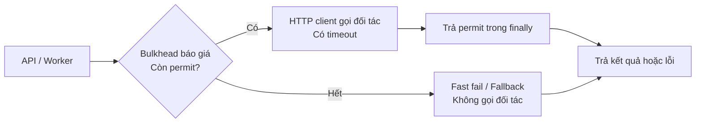

# Bulkhead, giới hạn đồng thời và cách ly hệ thống chậm

## 1. Bối cảnh: một đối tác chậm có thể làm nghẽn cả ứng dụng

Trong một ứng dụng **Spring Boot Integration**, một API thường phối hợp nhiều thành phần: dịch vụ HTTP bên ngoài, cơ sở dữ liệu, Redis, broker thông điệp và các luồng xử lý Spring Integration. Giả sử API đặt hàng phải gọi dịch vụ báo giá của đối tác trước khi xác nhận đơn:

1. Bình thường, dịch vụ báo giá phản hồi trong 200 ms.
2. Khi đối tác gặp sự cố, thời gian phản hồi tăng lên 5–10 giây.
3. Mỗi yêu cầu chờ đối tác giữ một luồng xử lý hoặc một tác vụ đang hoạt động, cùng các tài nguyên liên quan.
4. Nếu lượng yêu cầu đến vẫn tăng, pool xử lý, kết nối HTTP hoặc hàng đợi bị chiếm hết. Những API không sử dụng dịch vụ báo giá cũng bắt đầu bị chậm.

Tăng số luồng không giải quyết được nguyên nhân: nó có thể chỉ làm nhiều tác vụ cùng chờ lâu hơn. **Bulkhead** (vách ngăn) đặt giới hạn tài nguyên cho từng phụ thuộc hay nhóm công việc. Khi một nhóm quá tải, tác động được giữ trong phạm vi đã định thay vì lan sang toàn hệ thống.

Sau bài học, người học cần biết cách:

- Phân biệt bulkhead với timeout, rate limiting, circuit breaker và retry.
- Chọn giới hạn đồng thời, kiểu cách ly và chính sách khi hết chỗ.
- Triển khai bulkhead cho HTTP client Spring Boot, kiểm thử tải và quan sát dấu hiệu bão hòa.
- Kết hợp bulkhead với xử lý lỗi, giao dịch, cache, cơ sở dữ liệu và broker mà không tạo thêm áp lực lên phụ thuộc đang chậm.

## 2. Bulkhead thực sự giới hạn điều gì?

Một **bulkhead theo semaphore** giữ tối đa `N` lời gọi *đang thực thi* tại cùng một thời điểm. Lời gọi mới phải lấy một `permit` trước khi vào khu vực được bảo vệ; khi kết thúc, thành công hay thất bại, nó trả `permit`. Khi hết `permit`, hệ thống có thể từ chối ngay hoặc chờ tối đa một khoảng rất ngắn.

Ví dụ, dịch vụ báo giá có giới hạn 12 lời gọi đồng thời. Nếu 12 lời gọi đều bị chậm, lời gọi thứ 13 bị từ chối ngay theo chính sách fail-fast, thay vì tiếp tục chiếm tài nguyên để chờ. Dịch vụ kho hàng sử dụng bulkhead khác nên vẫn có thể hoạt động.



Bulkhead bảo vệ **số công việc cùng tồn tại**, không mặc nhiên bảo đảm rằng công việc sẽ hoàn thành nhanh. Nếu thiếu timeout, một số permit vẫn có thể bị giữ rất lâu. Nếu cấu hình hàng đợi vô hạn, chậm trễ chỉ chuyển từ phần gọi HTTP sang phần chờ trong queue.

### Phân biệt các cơ chế phục hồi

| Cơ chế | Kiểm soát | Khi phụ thuộc chậm hoặc lỗi |
| --- | --- | --- |
| **Bulkhead** | Số lời gọi đồng thời, hoặc thread pool/queue riêng | Giới hạn số tài nguyên bị giữ và cô lập phạm vi ảnh hưởng |
| **Timeout** | Thời gian tối đa chờ một thao tác | Kết thúc chờ khi vượt ngưỡng, giúp giải phóng tài nguyên |
| **Rate limiter** | Số yêu cầu được nhận trong một khoảng thời gian | Chặn lưu lượng vượt ngưỡng, nhưng không tự giới hạn số yêu cầu đang chờ |
| **Circuit breaker** | Trạng thái cho phép gọi dựa trên lỗi và lời gọi chậm | Tạm ngừng gửi yêu cầu khi phụ thuộc đang có dấu hiệu không khỏe |
| **Retry** | Số lần thử lại lỗi có khả năng tạm thời | Có thể tăng cơ hội thành công, nhưng cũng khuếch đại tải nếu dùng sai |
| **Backpressure / load shedding** | Khả năng tiếp nhận công việc của luồng xử lý | Làm chậm nguồn hoặc từ chối công việc vượt sức chứa |

**Ví dụ quan trọng:** Một đối tác nhận 100 yêu cầu/giây, mỗi yêu cầu kéo dài 5 giây. Rate limiter đặt mức 100 yêu cầu/giây vẫn có thể cho khoảng 500 yêu cầu đang thực thi đồng thời. Bulkhead 20 permit buộc ứng dụng chỉ cho tối đa 20 yêu cầu cùng đi vào phụ thuộc đó; các yêu cầu khác cần xử lý theo chính sách từ chối, đợi có giới hạn hoặc fallback.

## 3. Ba kiểu cách ly thường gặp

### 3.1. Semaphore bulkhead

- Chạy lời gọi trên luồng hiện tại và chỉ quản lý số `permit`.
- Hợp với lời gọi đồng bộ có timeout được cấu hình rõ, chẳng hạn RestClient, JDBC hoặc các adapter blocking.
- Ít overhead hơn việc tạo pool riêng; không tự tách luồng chờ, nên vẫn cần chú ý các luồng đang bị giữ bởi lời gọi chậm.
- `tryAcquire()` không chờ giúp fail-fast. `tryAcquire(timeout, unit)` tạo thời gian đợi có giới hạn; khoảng đợi này cộng vào tổng latency.

### 3.2. Thread-pool bulkhead

- Công việc được chuyển vào một executor **riêng** với số worker và queue có giới hạn.
- Tách các công việc blocking khỏi executor phục vụ những tính năng khác, nhưng bổ sung overhead, context switching và chi phí queue.
- Cần chính sách từ chối khi pool và queue đầy. Không sử dụng queue vô hạn hoặc mặc định `CompletableFuture.supplyAsync(...)` chạy trên common pool để thay thế cách ly rõ ràng.
- Với `Future.get(timeout)`, việc caller hết thời gian chờ **không chứng minh** tác vụ ở worker đã dừng. Cancellation và timeout ở tầng HTTP/JDBC vẫn cần thiết.

### 3.3. Giới hạn ở tầng tài nguyên và consumer

Bulkhead chỉ là một lớp trong giới hạn tổng thể. `HikariCP.maximumPoolSize`, kích thước connection pool HTTP, `@KafkaListener(concurrency = ...)`, cấu hình consumer/poller của Spring Integration và executor của từng flow đều quyết định số tác vụ thật sự có thể chạy. Pool kết nối dùng chung giữa nhiều phụ thuộc có thể vẫn gây ảnh hưởng chéo; nơi cần cách ly mạnh nên có pool hoặc executor riêng theo phụ thuộc.

Trong ứng dụng reactive, tránh dùng semaphore với thao tác chờ blocking ngay trên event-loop. Giới hạn đồng thời bằng toán tử điều phối phù hợp với Reactor, chẳng hạn tham số `concurrency` của `flatMap`, cùng timeout và backpressure. Virtual thread cũng không loại bỏ nhu cầu bulkhead: chúng giảm chi phí thread khi chờ, nhưng **không** tăng quota của đối tác, số kết nối cơ sở dữ liệu hoặc khả năng xử lý của dịch vụ phía sau.

## 4. Ví dụ triển khai trong Spring Boot: bảo vệ dịch vụ báo giá

Thiết kế ví dụ: dịch vụ đơn hàng gọi HTTP tới đối tác báo giá. Mỗi instance ứng dụng cho tối đa 12 request báo giá đồng thời, trả lỗi ngay nếu đã hết permit, và giới hạn thời gian kết nối/đọc dữ liệu.

### 4.1. Cấu hình được tách theo phụ thuộc

```yaml
# application.yml — giá trị minh họa, cần đo đạc trước khi dùng production
integration:
  partner:
    base-url: https://partner.example
    max-concurrent: 12
```

Tạo `RestClient` chuyên dùng cho đối tác, thay vì chia sẻ tùy tiện cấu hình và nguồn kết nối với các client khác:

```java
import java.net.http.HttpClient;
import java.time.Duration;

import org.springframework.beans.factory.annotation.Value;
import org.springframework.context.annotation.Bean;
import org.springframework.context.annotation.Configuration;
import org.springframework.http.client.JdkClientHttpRequestFactory;
import org.springframework.web.client.RestClient;

@Configuration
class PartnerHttpConfiguration {

    @Bean("partnerRestClient")
    RestClient partnerRestClient(
            @Value("${integration.partner.base-url}") String baseUrl) {
        HttpClient httpClient = HttpClient.newBuilder()
                .connectTimeout(Duration.ofMillis(500))
                .build();

        JdkClientHttpRequestFactory requestFactory =
                new JdkClientHttpRequestFactory(httpClient);
        requestFactory.setReadTimeout(Duration.ofSeconds(2));

        return RestClient.builder()
                .baseUrl(baseUrl)
                .requestFactory(requestFactory)
                .build();
    }
}
```

Ví dụ sử dụng `RestClient` và `JdkClientHttpRequestFactory` của Spring Framework 6.1+ trong hệ sinh thái Spring Boot 3.x. Hai mức timeout ở đây chỉ là giả định cho một API đồng bộ; cần chọn theo SLA, latency thực đo, tổng deadline của request và yêu cầu nghiệp vụ.

### 4.2. Bao lời gọi bằng semaphore

```java
import java.math.BigDecimal;
import java.util.Objects;
import java.util.concurrent.Semaphore;

import org.springframework.beans.factory.annotation.Qualifier;
import org.springframework.beans.factory.annotation.Value;
import org.springframework.stereotype.Component;
import org.springframework.web.client.RestClient;

record PriceQuote(String sku, BigDecimal amount) {}

class PartnerBusyException extends RuntimeException {
    PartnerBusyException() {
        super("Partner quote bulkhead is full");
    }
}

@Component
public class PartnerQuoteGateway {
    private final RestClient restClient;
    private final Semaphore permits;

    public PartnerQuoteGateway(
            @Qualifier("partnerRestClient") RestClient restClient,
            @Value("${integration.partner.max-concurrent:12}") int maxConcurrent) {
        if (maxConcurrent < 1) {
            throw new IllegalArgumentException("max-concurrent must be positive");
        }
        this.restClient = restClient;
        this.permits = new Semaphore(maxConcurrent);
    }

    public PriceQuote getQuote(String sku) {
        // Không xếp hàng trong request thread khi toàn bộ permit đã bận.
        if (!permits.tryAcquire()) {
            throw new PartnerBusyException();
        }

        try {
            PriceQuote quote = restClient.get()
                    .uri("/quotes/{sku}", sku)
                    .retrieve()
                    .body(PriceQuote.class);
            return Objects.requireNonNull(quote, "Empty partner quote");
        } finally {
            // Cả HTTP 5xx, timeout, lỗi parse body đều phải trả permit.
            permits.release();
        }
    }
}
```

Điểm cần kiểm tra trong ví dụ:

1. `Semaphore` là một field sống cùng singleton Spring bean, **không** tạo mới theo mỗi request; nếu tạo mới mỗi lần thì không có giới hạn chung.
2. `tryAcquire()` đặt **trước** lời gọi HTTP. Khi hết permit, không có request nào được gửi tới đối tác.
3. `release()` nằm trong `finally`, chỉ chạy sau khi đã lấy thành công permit; điều này tránh rò rỉ hoặc tăng sai số permit.
4. Semaphore có phạm vi **một JVM/instance**. Nếu chạy 5 replica, giới hạn lý thuyết toàn hệ thống là `5 × 12 = 60` lời gọi đồng thời, chưa tính service khác cùng gọi đối tác. Quota toàn hệ thống cần tính số replica, autoscaling và các caller khác.
5. `RestClient.retrieve()` sẽ phát sinh exception cho HTTP status lỗi theo cấu hình mặc định; timeout/connection error cũng có thể phát sinh exception. Tầng gọi cần chuyển chúng thành lỗi hoặc phương án dự phòng phù hợp với hợp đồng API.

Trong sản phẩm thực tế, nên đọc cấu hình qua `@ConfigurationProperties` có validation, thu thập metric và cân nhắc một thư viện bulkhead thay vì duy trì nhiều semaphore thủ công.

### 4.3. Phản hồi khi bulkhead đầy

Với API mà báo giá là **bắt buộc**, có thể chuyển `PartnerBusyException` thành HTTP `503 Service Unavailable` cùng mã lỗi ổn định, để client biết yêu cầu tạm thời không thể xử lý. `429 Too Many Requests` thường thích hợp hơn khi lỗi xuất phát từ quota/rate limit dành cho chính client. Có thể thêm `Retry-After` khi có chính sách retry và thời gian đợi hợp lý.

```java
import org.springframework.http.HttpStatus;
import org.springframework.http.ProblemDetail;
import org.springframework.http.ResponseEntity;
import org.springframework.web.bind.annotation.ExceptionHandler;
import org.springframework.web.bind.annotation.RestControllerAdvice;

@RestControllerAdvice
class PartnerFailureAdvice {
    @ExceptionHandler(PartnerBusyException.class)
    ResponseEntity<ProblemDetail> onPartnerBusy(PartnerBusyException exception) {
        ProblemDetail problem = ProblemDetail.forStatusAndDetail(
                HttpStatus.SERVICE_UNAVAILABLE,
                "Dịch vụ báo giá đang quá tải, vui lòng thử lại sau.");
        problem.setTitle("Partner quote temporarily unavailable");
        return ResponseEntity.status(HttpStatus.SERVICE_UNAVAILABLE).body(problem);
    }
}
```

Nếu báo giá chỉ phục vụ **thông tin bổ sung** và nghiệp vụ cho phép, có thể trả dữ liệu cache còn hợp lệ, giá trị được đánh dấu `stale`, hoặc bỏ qua trường bổ sung. Fallback phải bảo đảm rõ ràng về độ tin cậy dữ liệu; không được tự tạo giá, giả lập xác nhận thanh toán hoặc báo thành công cho một thao tác chưa hoàn tất.

Nếu thao tác có side effect (tạo đơn, trừ tiền, gửi sự kiện), phải xác định trạng thái thật của thao tác trước khi retry. Timeout từ phía client **không khẳng định** hệ thống phía sau đã hủy tác vụ. Dùng idempotency key, khóa nghiệp vụ hoặc cơ chế đối soát khi phù hợp.

## 5. Dùng Resilience4j Bulkhead khi cần quản lý tập trung

Resilience4j hỗ trợ cấu hình bulkhead, metric và tích hợp với Spring Boot. Ví dụ với tích hợp dành cho Spring Boot 3, thêm dependency tương thích với BOM/phiên bản dự án (cùng Spring AOP nếu dùng annotation):

```kotlin
// build.gradle.kts — phiên bản do BOM hoặc dependency management quản lý
implementation("io.github.resilience4j:resilience4j-spring-boot3")
implementation("org.springframework.boot:spring-boot-starter-aop")
```

```yaml
resilience4j:
  bulkhead:
    instances:
      partnerQuote:
        maxConcurrentCalls: 12
        maxWaitDuration: 0ms
```

Đặt annotation lên **phương thức public của Spring bean được gọi qua proxy**:

```java
import io.github.resilience4j.bulkhead.annotation.Bulkhead;
import org.springframework.stereotype.Service;

@Service
class ProtectedPartnerQuoteService {
    private final RawPartnerQuoteClient client;

    ProtectedPartnerQuoteService(RawPartnerQuoteClient client) {
        this.client = client;
    }

    @Bulkhead(name = "partnerQuote", type = Bulkhead.Type.SEMAPHORE)
    public PriceQuote getQuote(String sku) {
        return client.fetchQuote(sku);
    }
}
```

`RawPartnerQuoteClient` ở đây đại diện cho client HTTP đã đặt timeout như phần 4; đoạn mã minh họa điểm đặt annotation. Với lựa chọn Resilience4j, bulkhead được thư viện quản lý nên **không cần** bọc thêm semaphore thủ công cho cùng một lời gọi nếu hai giới hạn không có chủ đích riêng. Cần kiểm tra khả năng proxy/AOP: việc gọi trực tiếp một phương thức được annotate từ phương thức khác **trong cùng object** thường bỏ qua advice. Với `CompletableFuture`/tác vụ được thực thi trong thread pool riêng, xem xét `THREADPOOL` bulkhead và cấu hình pool/queue có giới hạn phù hợp với kiểu trả về.

Tên thuộc tính, annotation, thứ tự kết hợp với `@Retry`/`@CircuitBreaker` và các metric có thể khác theo phiên bản; kiểm tra phiên bản Resilience4j hiện dùng. Quan trọng hơn cú pháp annotation là xác nhận bằng kiểm thử rằng số lời gọi đi vào client **thực sự** bị chặn ở ngưỡng đặt ra.

## 6. Chọn số permit và thời gian chờ

Định luật Little cho hệ thống ổn định cho phép ước tính số thao tác đồng thời trung bình:

**Số thao tác đang thực thi trung bình ≈ throughput (request/giây) × latency trung bình (giây).**

Giả sử đối tác phải phục vụ khoảng 40 request/giây, thời gian phản hồi trung bình khỏe mạnh là 250 ms:

```text
L ≈ 40 × 0,25 = 10 lời gọi đang xử lý
```

Một mức ban đầu 12–16 permit có thể được đem đi thử tải nếu quota và khả năng thực tế của đối tác cho phép. Khi đối tác chậm xuống còn 2 giây, giữ nguyên 40 request/giây sẽ đòi hỏi khoảng 80 lời gọi đồng thời. Bulkhead 16 permit ngăn số lời gọi đang thực hiện tăng lên 80; lượng vượt ngưỡng bị từ chối hoặc được xử lý bằng phương án dự phòng. Trong trường hợp đơn giản khi mỗi lời gọi mất đều 2 giây, trần hoàn thành gần `16 / 2 = 8` request/giây; đây là phép minh họa, không phải cam kết throughput.

Hướng dẫn chọn cấu hình:

| Thông số | Cách xác định | Sai lầm thường gặp |
| --- | --- | --- |
| `maxConcurrentCalls` | Dựa trên tải cần phục vụ, latency đo được, quota đối tác, pool kết nối, số replica và ngân sách tài nguyên | Chọn đúng bằng lượng peak RPS mà không tính thời gian một lời gọi |
| `maxWaitDuration` | Mặc định cân nhắc 0 (fail-fast); chỉ cho phép đợi ngắn nếu tổng deadline còn đủ | Chờ lâu khiến request thread vẫn bị giữ và tăng tail latency |
| Timeout kết nối/đọc | Chọn theo hợp đồng upstream và deadline toàn request; phân bổ cả thời gian chờ bulkhead, retry, xử lý nội bộ | Có bulkhead nhưng không giới hạn thời gian I/O |
| Queue của executor | Kích thước nhỏ, bounded; có rejection policy và metric | Queue vô hạn che giấu quá tải cho tới khi cạn bộ nhớ |
| Retry/backoff | Chỉ retry lỗi tạm thời, có giới hạn, jitter, idempotency và deadline | Retry đồng loạt làm phụ thuộc đang chậm càng quá tải |

Không thể chọn kích thước tốt chỉ dựa trên `p95`; cần theo dõi cả **latency trung bình**, phân phối độ trễ, lượng request thực tế và số lời gọi đang chạy. Nếu nhiều instance chia sẻ quota đối tác, giới hạn ở mỗi instance phải tính tổng tải. Với autoscaling, giới hạn cố định theo instance có thể vượt quota khi tăng replica; có thể cần limiter/quota điều phối ở cấp chung.

### Ngân sách thời gian tổng thể

Một request có deadline 3 giây có thể dành 200 ms cho xử lý nội bộ, 300 ms cho truy vấn dữ liệu và khoảng 2 giây cho đối tác, phần còn lại cho overhead. Nếu lại cấu hình `maxWaitDuration=2s`, read timeout 2s và 3 lần retry thì tổng thời gian có thể vượt xa deadline ban đầu. Đặt **một ngân sách thời gian end-to-end**, kiểm tra thời gian còn lại trước khi gửi lời gọi và tránh retry khi không còn đủ thời gian.

## 7. Tương tác với các thành phần tích hợp khác

### HTTP và nhiều đối tác

Nếu hệ thống gọi hai đối tác vận chuyển A/B, hãy tạo giới hạn độc lập cho A và B, kèm timeout, client, metric và chính sách fallback riêng. Một semaphore dùng chung cho A và B có thể khiến B bị từ chối chỉ vì A chậm. Ngược lại, nếu cả A/B thực sự chia sẻ **một** tài nguyên khan hiếm (ví dụ quota chung), cần một giới hạn cấp tài nguyên chung bên cạnh các giới hạn riêng.

### JDBC, database và giao dịch

Bulkhead trước thao tác database giúp kiểm soát số nghiệp vụ đang cạnh tranh tài nguyên; giới hạn này phải tương thích với pool kết nối và tải từ flow khác. Tránh mở `@Transactional` bao quanh một lời gọi HTTP chậm: transaction có thể giữ connection/lock trong khi chờ mạng. Cố gắng đặt lời gọi ngoài transaction; khi cần phối hợp dữ liệu và sự kiện, cân nhắc transactional outbox, idempotency hoặc quy trình bù trừ thích hợp.

### Redis, cache và fallback

Cache có thể giảm số lượt đi vào bulkhead của đối tác. Nhưng nếu cache hỏng, fallback gọi trực tiếp hàng loạt về origin có thể gây **cache stampede**. Dùng TTL có jitter, single-flight/request coalescing theo key, stale-while-revalidate hoặc giới hạn tải miss; không để một sự cố cache phá vỡ giới hạn đối tác.

### Broker thông điệp và Spring Integration

Với listener/consumer, bulkhead đầy không đồng nghĩa thông điệp đã được xử lý. Phải quyết định **ack**, retry, delay, pause/resume, dead-letter và idempotency theo loại lỗi. Không ack thành công một thông điệp chưa xử lý; cũng không requeue ngay vô hạn tạo vòng lặp nóng. Trong `@KafkaListener`, RabbitMQ listener hoặc Spring Integration flow, giới hạn `concurrency`, `maxMessagesPerPoll`, executor/channel queue và khả năng backpressure ở nguồn cần đồng bộ với giới hạn downstream. Các handler async phải chắc chắn permit chỉ được trả **sau khi công việc thực sự hoàn tất**, không phải ngay khi vừa tạo `Future`.

## 8. Kết hợp retry, circuit breaker và bulkhead

Một cấu hình phục hồi hợp lý thường sử dụng cả:

1. **Timeout** cho từng thao tác I/O, giữ tài nguyên không bị chiếm vô hạn.
2. **Bulkhead** giới hạn công việc đang truy cập phụ thuộc.
3. **Circuit breaker** ngừng sớm lời gọi đến phụ thuộc đang liên tục lỗi/chậm.
4. **Retry** có chọn lọc với backoff, jitter, idempotency và tổng deadline.
5. **Fallback** chỉ khi nghiệp vụ thực sự chấp nhận dữ liệu hoặc kết quả thay thế.

**Thứ tự bọc có ảnh hưởng.** Nếu retry nằm *bên trong* semaphore, một request có thể giữ permit cả trong lúc sleep/backoff giữa các lần retry, làm giảm năng lực phục vụ. Nếu retry nằm *bên ngoài*, mỗi lần thử có thể phải xin permit lại, nhưng tổng lượt gọi đến đối tác có thể tăng. Khi dùng annotation hoặc aspect, xác minh thứ tự thực thi trong phiên bản/framework đang sử dụng và đo số attempts thực tế. Không retry `PartnerBusyException` ngay tại chỗ theo vòng lặp chặt; điều đó biến cơ chế fail-fast thành nguồn tăng tải.

Phân loại lỗi có ích:

| Tình huống | Hành vi ưu tiên |
| --- | --- |
| Bulkhead đã đầy | Từ chối sớm hoặc fallback, metric `rejected`; thường không retry tức thì |
| Kết nối không thiết lập được | Timeout ngắn; có thể retry hữu hạn nếu thao tác an toàn và deadline còn |
| HTTP 429 từ đối tác | Tôn trọng chính sách/thông tin `Retry-After`, giảm tốc độ gửi |
| HTTP 5xx hoặc gateway timeout | Circuit breaker, retry có backoff khi phù hợp và có idempotency |
| Lỗi 4xx do dữ liệu đầu vào | Trả lỗi hợp đồng, không retry mù |
| Timeout sau thao tác có side effect | Đối soát trạng thái/idempotency trước khi gửi lại |

## 9. Quan sát và kiểm thử để chứng minh cách ly hoạt động

Theo dõi tối thiểu **theo tên phụ thuộc và instance**:

- Số lời gọi `in-flight`, số permit còn trống và giới hạn tối đa.
- Số lượt được nhận, bị từ chối vì đầy, timeout, lỗi HTTP, fallback và retry.
- Độ trễ end-to-end, thời gian chờ permit/queue, latency thực tế của upstream.
- Mức sử dụng thread pool, queue, connection pool và độ trễ của **những API không gọi phụ thuộc đó**.

Có thể xuất metric qua Micrometer/Actuator. Nếu dùng Resilience4j, bật tích hợp metric tương thích phiên bản đang chạy và kiểm tra tên meter thực tế. Nên đặt cảnh báo dựa trên **tỷ lệ từ chối kéo dài**, latency, sai số lỗi, queue và mức sử dụng permit, thay vì chỉ cảnh báo khi permit đạt 0 tại một thời điểm.

### Kịch bản kiểm thử có ý nghĩa

| Kịch bản | Cách thực hiện | Tiêu chí chấp nhận |
| --- | --- | --- |
| Đối tác khỏe | Tải vừa phải, phản hồi nhanh | Request thành công, latency trong SLA, phần lớn thời gian còn permit |
| Đối tác chậm | Mock upstream cố ý giữ lời gọi lâu hơn bình thường | `in-flight` không vượt mức 12 trên một instance; phần vượt bị từ chối nhanh |
| Đối tác timeout/500 | Trả lỗi hoặc vượt timeout | Permit được trả, không giảm dần về 0 vì rò rỉ |
| Tải đồng thời cao | Phát hơn 12 yêu cầu báo giá cùng lúc, giữ các request đầu đang chạy | Tối đa 12 lời gọi thực sự tới upstream; các lời gọi còn lại tuân chính sách rejection |
| Tính cô lập | Gọi đồng thời endpoint không phụ thuộc dịch vụ báo giá | Latency/throughput endpoint độc lập không suy giảm quá mức cho phép |
| Nhiều replica | Tăng số instance và lặp lại kiểm thử | Tổng concurrency/quota đối tác vẫn trong ngân sách đã thiết kế |
| Retry có tải lỗi | Đồng thời lỗi 5xx và tạo traffic | Tổng số attempts, queue và latency không bùng nổ |

Đo số lời gọi đồng thời **ở phía mock upstream**, không chỉ đọc số lượng request tới API. Cần giữ các lời gọi đủ lâu để các request thật sự chồng lên nhau; nếu mock trả ngay, bài test không chứng minh được giới hạn. Với mã semaphore phần 4, bảo đảm sau cả success, exception và timeout, số permit được phục hồi đúng.

## 10. Các lỗi thiết kế thường gặp và checklist

- **Chung một pool cho tất cả phụ thuộc:** hệ thống chậm chiếm tài nguyên của hệ thống khỏe. Tách theo dependency, mức ưu tiên hoặc resource class khi có nhu cầu.
- **Chỉ giới hạn RPS:** không ngăn nhiều lời gọi chạy đồng thời khi latency tăng. Dùng thêm giới hạn concurrency.
- **Đặt queue quá lớn:** chuyển lỗi từ rejection sớm thành tích tụ yêu cầu và timeout muộn. Queue phải bounded, có deadline và metric.
- **Giữ permit qua thao tác không liên quan:** ví dụ giữ permit của HTTP partner khi còn xử lý dữ liệu nội bộ dài. Chỉ bảo vệ đúng đoạn chiếm tài nguyên.
- **Trả permit quá sớm trong async:** gọi `release()` ngay sau khi submit task khiến số task thực tế vượt giới hạn. Trả permit tại completion của task.
- **Bọc giao dịch quanh mạng chậm:** khiến connection và lock database bị giữ. Giảm phạm vi transaction.
- **Bỏ quên số replica và connection pool:** cấu hình trên một pod không phản ánh tải tổng.
- **Retry tại mọi lỗi:** retry bulkhead rejection hoặc 4xx có thể tạo vòng lặp và tăng tải.
- **Fallback sai ngữ nghĩa:** chỉ trả dữ liệu cũ/default khi API công khai chấp nhận trạng thái này.

Trước khi đưa vào production, hãy trả lời được: *Giới hạn áp dụng cho phụ thuộc nào? Đơn vị là số lời gọi đồng thời hay số luồng? Ai nhận lỗi khi hết chỗ? Có timeout và deadline? Permit có được trả trên mọi đường lỗi? Ở nhiều replica tổng quota là bao nhiêu? Metric và bài test nào chứng minh một đối tác chậm không làm nghẽn endpoint khác?*

Bulkhead hiệu quả khi nó là một giới hạn **đo được, kiểm thử được và gắn với chính sách lỗi rõ ràng**. Trong hệ sinh thái Spring Boot, hãy đặt giới hạn sát nơi tiêu thụ tài nguyên, giữ khoảng chờ hữu hạn, phối hợp với timeout/circuit breaker, và liên tục hiệu chỉnh theo tải thực tế.
