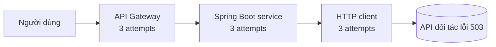
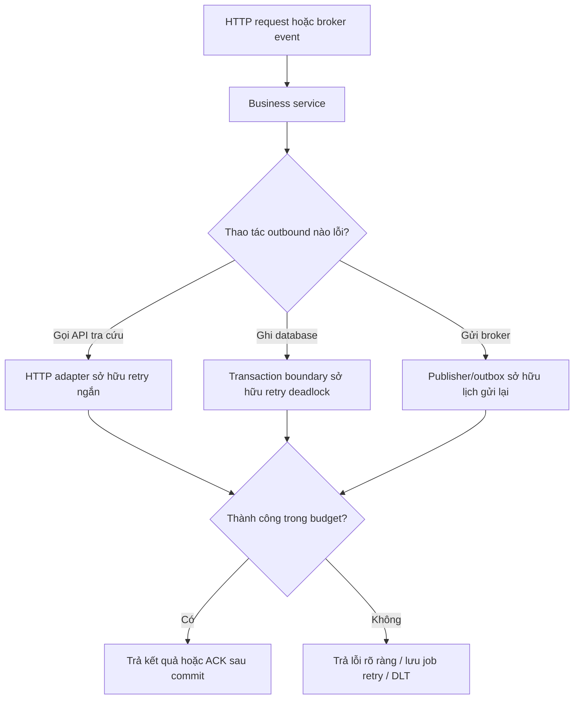
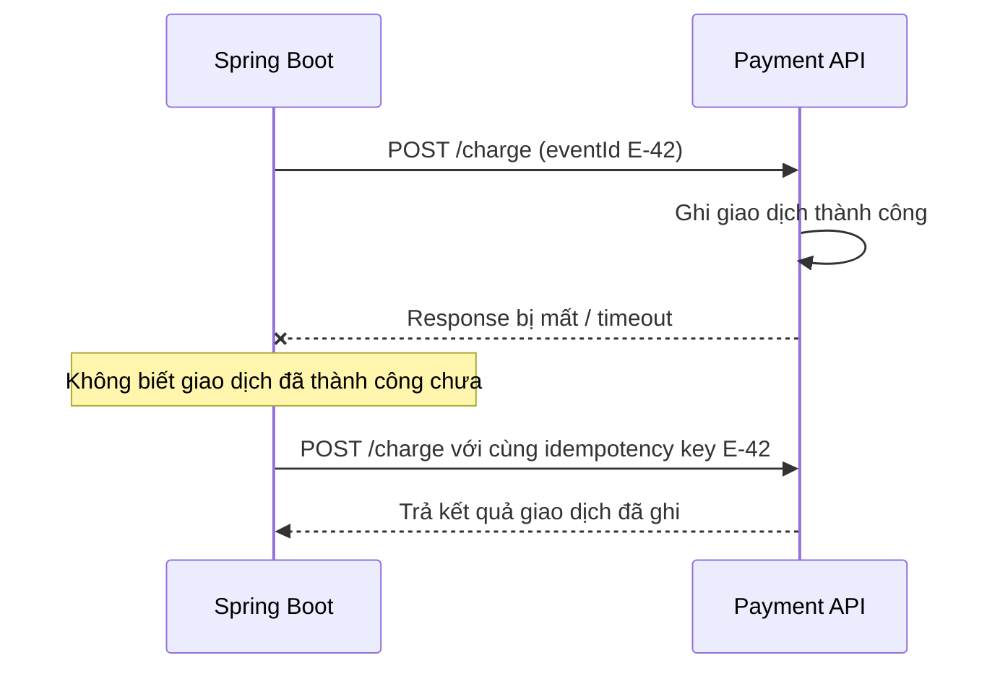

# Tránh retry nhiều tầng làm khuếch đại lưu lượng

## Bối cảnh và mục tiêu

Trong **Spring Boot Integration**, một yêu cầu có thể đi qua HTTP gateway, service nghiệp vụ, HTTP client, cơ sở dữ liệu, cache và broker thông điệp. Mỗi thành phần đều có thể tự thử lại khi gặp lỗi tạm thời. Nếu các tầng cùng retry mà không phối hợp, một lỗi nhỏ ở downstream có thể biến thành **bão request** (*retry storm*), làm dịch vụ đang quá tải càng khó phục hồi.

Chủ đề thuộc chương **Phục hồi khi lỗi** của module `SPRING_BOOT_INTEGRATION`: thiết kế retry cho luồng tích hợp HTTP, database, cache, messaging và Spring Integration với trọng tâm là **phân loại lỗi, ngân sách retry, deadline, idempotency, quan sát và kiểm thử**.

Sau bài này, người học có thể:

1. Giải thích và tính được hệ số khuếch đại khi nhiều tầng tự retry cùng một lỗi.
2. Phân biệt retry ở **cùng một lần xử lý đồng bộ** với **redelivery/reprocessing** từ broker hay tác vụ bền vững sau restart.
3. Chọn một chủ sở hữu retry rõ ràng, giới hạn số lần thử bằng **attempt budget** và **time budget**.
4. Cấu hình Spring Retry, Resilience4j hoặc Reactor theo đúng ranh giới cần retry; tránh lặp lại side effect không an toàn.
5. Kiểm thử bằng bộ đếm downstream thực và cảnh báo khi retry gây quá tải.

> **Phạm vi ví dụ:** Các API Java minh họa dùng Spring Boot 3.x / Spring Framework 6.x, Spring Retry 2.x, Resilience4j 2.x và Reactor 3.x. Với Spring Framework 7 / Boot 4 hoặc thư viện được nâng phiên bản, cần kiểm tra chính xác API và cấu hình trong BOM đang chạy. Chính sách retry phải được xác nhận bằng hành vi, không suy từ tên annotation.

## 1. Retry khuếch đại lưu lượng như thế nào?

Giả sử một request tra cứu danh mục đi qua ba tầng:



Nếu **mỗi lần thử của tầng ngoài đều khởi chạy đủ các lần thử của tầng trong**, số lần gọi HTTP đến API đối tác trong kịch bản **mọi attempt đều thất bại** có thể lên tới:

\[
N_{downstream}=N_{gateway}\times N_{service}\times N_{http-client}=3\times3\times3=27.
\]

Một yêu cầu logic có thể tạo **27 request** đến cùng downstream. Với lưu lượng đầu vào 100 yêu cầu/giây, mức tải ở downstream khi tất cả đều thất bại có thể tiến tới **2.700 attempt/giây**, chưa kể fan-out hoặc background retry. Đây là **giới hạn lý thuyết theo sơ đồ lồng nhau**, không phải khẳng định mọi hệ thống đều nhân chính xác 27 lần: circuit breaker, timeout, cancellation, cache, phân loại lỗi và retry policy có thể giảm hoặc thay đổi số attempt thực tế.

Tổng quát, nếu có `k` tầng retry độc lập, mỗi tầng cho tối đa `a_i` attempt tính cả lần đầu:

\[
N_{downstream,max}=\prod_{i=1}^{k} a_i.
\]

Ví dụ năm tầng, mỗi tầng ba attempt có thể tạo **3⁵ = 243** lần gọi tới đáy chuỗi. Điều nguy hiểm là retry thường xảy ra **đúng lúc downstream bị lỗi hoặc đã quá tải**: càng nhiều request thất bại, hệ thống càng gửi nhiều attempt; hàng đợi, connection pool và thread pool càng cạn kiệt.

### 1.1. Vì sao exponential backoff thôi vẫn chưa đủ?

Backoff giúp dàn trải attempt theo thời gian, nhưng **không xóa phép nhân số lần thử**. Nếu mỗi tầng đều retry ba lần, dù các attempt có độ trễ, tổng số vẫn có thể là 27. Nếu mọi instance dùng delay cố định giống nhau, chúng còn dễ thức dậy cùng lúc, tạo các đỉnh tải lặp lại. **Jitter** giảm đồng bộ thời điểm retry; **retry budget** giới hạn tổng số lần thử; **load shedding** và **circuit breaker** có thể ngăn tạo thêm công việc khi downstream không còn khả năng đáp ứng.

| Biện pháp | Vấn đề giải quyết | Không tự giải quyết |
|---|---|---|
| Giảm `maxAttempts` | Giảm tổng attempt tối đa của một tầng. | Cấu hình chồng retry ở các tầng khác. |
| Exponential backoff + jitter | Giảm tốc độ dồn retry và đồng bộ giữa client. | Tổng số attempt tích lũy nếu nhiều tầng vẫn tự retry. |
| Timeout/deadline | Chặn một yêu cầu giữ tài nguyên quá lâu. | Hủy side effect đã xảy ra ở server khi response bị timeout. |
| Circuit breaker | Chặn tạm lời gọi khi tỷ lệ lỗi vượt ngưỡng. | Thay thế thiết kế retry/idempotency hoặc bảo đảm phục hồi. |
| Rate limit / bulkhead | Giới hạn tải đồng thời/lưu lượng đến downstream. | Bảo đảm message không bị mất khi phải từ chối. |
| Idempotency | Làm cho xử lý lại cùng nghiệp vụ không tạo side effect trùng. | Giảm băng thông hoặc số request retry. |

## 2. Lập bản đồ mọi nguồn retry trước khi cấu hình

Trước khi bật một retry mới, hãy vẽ toàn bộ chuỗi từ nguồn sự kiện đến side effect cuối cùng. **Retry không chỉ nằm trong `@Retryable`**: nhiều client, proxy, broker và scheduler cũng có cơ chế riêng.

| Tầng trong luồng tích hợp | Cơ chế có thể lặp lời gọi | Sai lầm dễ gặp |
|---|---|---|
| Người dùng / frontend / API gateway | Client tự gửi lại, gateway retry khi 502/503/504. | Backend đã thử lại rồi nhưng gateway vẫn thử lại toàn bộ request. |
| Spring service | Spring Retry `@Retryable`, `RetryTemplate` hoặc Resilience4j Retry. | Gắn retry ở cả controller và service dù cùng một thao tác. |
| HTTP client | Resilience4j decorator, Reactor `retryWhen`, retry từ SDK/HTTP transport nếu được cấu hình. | Kết hợp retry của SDK với retry của service và gateway. |
| Spring Integration | `RequestHandlerRetryAdvice` trên handler, error channel/recoverer. | Broker redelivery kích hoạt lại cả advice retry trong mỗi lần nhận. |
| Truy cập database | Spring Retry quanh transaction, retry do driver hoặc framework, retry job. | Retry một phần transaction sau khi đã tạo side effect bên ngoài. |
| Message broker | Kafka listener error handler/retry topic, RabbitMQ requeue, Pulsar NACK/redelivery, JMS rollback/redelivery. | Một event được giao lại nhiều lần, mỗi lần lại gọi HTTP theo `maxAttempts` đầy đủ. |
| Scheduler / batch | Polling lại job thất bại, retry workflow sau restart. | Trạng thái attempt chỉ nằm trong RAM; mỗi lần restart reset ngân sách. |
| Hệ thống đối tác | Có thể xử lý request trước khi mất kết nối hoặc trả timeout. | Client gửi lại thao tác ghi mà thiếu idempotency key. |

Ví dụ một listener Kafka có tối đa **4 lần giao** cho cùng event và mỗi lần xử lý gọi một HTTP client tối đa **3 attempt**: một event lỗi có thể tạo **12 HTTP calls** trước khi sang dead-letter topic (DLT). Nếu gateway ngoài cùng còn retry ba lần cho mỗi HTTP attempt, số gọi tại tầng xa nhất có thể lên tới **36**. Con số này không đếm được chỉ bằng metric của `@Retryable`; phải quan sát **toàn bộ causal chain**.

### 2.1. Phân biệt attempt, retry, delivery và reprocessing

- **Attempt:** một lần thử thực thi thao tác. `maxAttempts=3` thường có nghĩa **một lần đầu + tối đa hai retry**, nhưng hãy xác nhận API được dùng.
- **Retry:** attempt tiếp theo của cùng thao tác trong phạm vi một retry policy.
- **Redelivery:** broker giao lại message vì chưa ACK, lỗi xử lý, seek/requeue hoặc timeout. Nó có thể tạo **một lần gọi handler mới** với retry policy mới.
- **Reprocessing:** vận hành chủ động chạy lại một event/job sau khi lỗi hoặc từ DLT; có thể diễn ra vài giờ/ngày sau và không nên dùng bộ đếm retry trong bộ nhớ làm ranh giới duy nhất.

Spring Retry 2.x `RetryTemplate.builder().maxAttempts(3)` và Resilience4j `RetryConfig.maxAttempts(3)` đều tính cả lần gọi ban đầu. Ngược lại, Reactor `Retry.backoff(2, ...)` nhận **số lần retry bổ sung**, nên tổng cộng có thể có **ba lần subscribe/attempt**. Cần đọc đúng ý nghĩa tham số của từng thư viện trước khi tính ngân sách.

## 3. Chọn nơi sở hữu retry: một chính sách cho một lỗi tại một ranh giới

Một quy tắc thiết kế hữu ích là: **mỗi thao tác outbound có một nơi chịu trách nhiệm retry**, các tầng còn lại nhận kết quả hoặc lỗi đã hết ngân sách để quyết định fallback, trả lỗi, DLT hoặc chờ lần xử lý mới.



**Chọn tầng gần lỗi hay tầng ngoài?** Retry ở outbound adapter thường tiết kiệm hơn vì chỉ lặp lại một phép gọi rẻ, không tái chạy parse/validate/giao dịch/phần công việc đã hoàn tất. Nhưng tầng ngoài mới có đủ ngữ cảnh để biết một thao tác có an toàn khi thử lại hay không. Tách rõ hai trách nhiệm: **business service quyết định thao tác nào được phép retry**, còn **adapter thực thi policy trong phạm vi lời gọi cụ thể**. Không có quy tắc tuyệt đối rằng mọi retry phải nằm thấp nhất hoặc cao nhất.

Một bản phân công điển hình:

| Hoạt động | Chủ sở hữu retry đề xuất | Các tầng khác nên làm gì? |
|---|---|---|
| `GET /catalog/{sku}` có thể thử lại an toàn | HTTP adapter của service: 2–3 attempt ngắn, có deadline. | Gateway tránh retry thêm toàn bộ nghiệp vụ đối với cùng lỗi; client transport không bật retry chồng. |
| POST tạo thanh toán | Workflow có `idempotencyKey`, tra cứu trạng thái khi timeout mơ hồ. | Không retry mù ở mọi HTTP layer; không tạo key mới cho mỗi attempt. |
| Deadlock hoặc serialization failure của database | Retry **toàn bộ transaction có thể lặp an toàn** ở ranh giới transaction. | Không retry một câu SQL lẻ trong transaction đã hỏng; tránh side effect HTTP nằm trong phần bị lặp. |
| Kafka/RabbitMQ/Pulsar consumer xử lý lỗi tạm thời | Một policy redelivery/retry topic với backoff, giới hạn, DLT. | Không nhân thêm retry dài bên trong handler; nếu có retry rất ngắn thì phải tính chung budget. |
| Spring Integration service activator | `RequestHandlerRetryAdvice` hoặc policy tại outbound adapter, chọn một. | Khi message được broker gửi lại, không mặc nhiên reset ngân sách xử lý vô hạn. |
| Outbox dispatcher gửi event | Dispatcher kiểm soát `attempt_count`, `next_attempt_at`, lease và trạng thái cuối. | Transport có thể retry kết nối nội bộ có giới hạn rất nhỏ nhưng không nhân retry logic không kiểm soát. |

### 3.1. Phân loại lỗi trước khi retry

| Lỗi/kết quả | Có nên retry? | Điều kiện/ghi chú |
|---|---|---|
| HTTP `400`, `401`, `403`, validation `422` | Thường **không**. | Dữ liệu/ủy quyền sai không tự cải thiện nhờ gọi lại cùng input. |
| HTTP `404` | Tùy hợp đồng. | Có thể là “không tồn tại” hợp lệ; retry chỉ khi có tính nhất quán trễ đã được thiết kế. |
| HTTP `408`, network timeout, connection reset | **Có điều kiện**. | Chưa rõ server có nhận/thực thi request hay không; cần idempotent operation hoặc key. |
| HTTP `429` | Có điều kiện, phải **tôn trọng `Retry-After`** khi có. | Giảm tốc độ; nếu deadline không cho phép chờ thì trả kết quả lỗi/hoãn sang job. |
| HTTP `502`, `503`, `504` | Thường có thể retry ngắn cho **read/idempotent call**. | Bounded retries, jitter; circuit breaker khi lỗi kéo dài. |
| HTTP `500` | Phụ thuộc semantics. | Không retry tất cả 500 vô điều kiện; có thể là lỗi logic cố định hoặc thao tác ghi đã áp dụng. |
| Deadlock/serialization conflict DB | Có thể retry **transaction hoàn chỉnh**. | Chỉ khi transaction rollback và side effect an toàn khi chạy lại. |
| Unique constraint/invalid SQL/schema | Thường **không**. | Retry không sửa lỗi dữ liệu/cấu trúc. |
| Message payload không parse được | **Không retry cùng payload vô hạn**. | Ghi DLT/quarantine với thông tin chẩn đoán và xử lý có kiểm soát. |

**Idempotent** không nhất thiết đồng nghĩa “chỉ có GET”. Một `POST` có thể an toàn nếu đối tác triển khai idempotency key ổn định và trả lại cùng kết quả cho việc gửi trùng. Ngược lại, một `GET` có thể kích hoạt side effect theo implementation lỗi hoặc không chuẩn; luôn dựa vào hợp đồng API thực tế.

## 4. Thiết kế retry budget và deadline cùng nhau

Số lần thử và thời gian chờ là **hai giới hạn khác nhau**. `maxAttempts=3` nhưng mỗi attempt chờ 30 giây vẫn có thể giữ request hơn một phút. Một timeout 2 giây nhưng retry không giới hạn có thể tạo tải lớn trong thời gian dài nếu mỗi attempt kết thúc ngay bằng 503.

### 4.1. Ngân sách số lần thử

Ví dụ với một request tra cứu catalog:

- `totalAttempts ≤ 3` **tính cả lần đầu** cho thao tác HTTP outbound.
- Chỉ retry network exception và HTTP 503 theo hợp đồng idempotent.
- Gateway và lớp service bên ngoài **không** lặp toàn bộ request với cùng lỗi vừa được adapter xử lý.
- Khi hết budget, trả lỗi có phân loại và theo dõi `retry_exhausted`; không tiếp tục retry ở một tầng khác mà không có budget chung.

Khi **bắt buộc** có retry ở nhiều tầng, hãy định nghĩa một **budget chung cho cả chuỗi** (chẳng hạn `attemptsRemaining` hoặc deadline trong request context) và bảo đảm từng tầng **tiêu hao đúng ngân sách**. Header kiểu `X-Retry-Attempt` tự tạo không đáng tin nếu gateway/SDK không hiểu; chỉ sử dụng khi các bên thống nhất hợp đồng và không để client không tin cậy tự chọn budget vô hạn. Nếu khó truyền budget xuyên tầng, lựa chọn an toàn hơn là **giảm một trong hai retry policy về một lần gọi**.

### 4.2. Ngân sách thời gian

Với deadline tổng `D`, latency của các attempt `t_i`, backoff `b_i` và overhead `o`:

\[
\sum_{i=1}^{n} t_i+\sum_{i=1}^{n-1} b_i+o \le D.
\]

Ví dụ một SLA yêu cầu dưới **2 giây** và mỗi HTTP attempt có timeout **600 ms**: ba attempt đã có thể dùng **1.800 ms**, chưa kể kết nối, backoff, serialize và xử lý nghiệp vụ. Vì vậy, bật ba attempt chỉ vì “mặc định là ba” có thể vi phạm SLA. Hệ thống nên ước lượng **remaining deadline** trước mỗi attempt, không bắt đầu attempt mới khi thời gian còn lại không đủ để chờ/hoàn tất hợp lý.

Lưu ý `Resilience4j Retry.maxAttempts` tự giới hạn **số attempt**, không thay thế một **deadline tổng** cho business operation. Timeout ở API gateway, HTTP client, DB driver, thread pool và Kubernetes có thể khác nhau; cần kiểm tra chúng có phối hợp đúng không.

### 4.3. Backoff và jitter

Một chính sách phổ biến cho lần retry thứ `k` sau lần đầu:

\[
b_k=\operatorname{random}\bigl(0,\min(b_{max},\; b_0\cdot2^{k-1})\bigr).
\]

Đây là ví dụ **full jitter**. Các thư viện có thuật toán jitter khác nhau (chẳng hạn tăng/giảm ngẫu nhiên quanh delay cơ sở), vì vậy không nên gọi mọi cấu hình `jitter(0.5)` là full jitter. Thêm giới hạn `maxBackoff`, giới hạn attempt và **không retry lỗi không thể hồi phục**. Nếu nhận được `Retry-After` hợp lệ từ upstream, nên ưu tiên chỉ dẫn đó trong phạm vi deadline và hạn mức chờ đã thống nhất.

Trong tải cao, có thể áp dụng **retry token bucket**: cấp một lượng token giới hạn cho các lần thử bổ sung, tiêu hao token khi retry, bổ sung theo chính sách khi dịch vụ ổn định. Một circuit breaker còn giúp ngừng gửi đến downstream lỗi triền miên; bulkhead giới hạn các request đang chiếm connection/thread. Những cơ chế này cần được đo tải và cấu hình theo downstream cụ thể.

## 5. Cấu hình một tầng retry trong Spring Boot

### 5.1. Ví dụ `RestClient` + Resilience4j cho HTTP GET

Mô hình minh họa: một adapter Spring Boot gọi `GET /products/{sku}` tới hệ thống đối tác. **Chỉ adapter này được retry**. Gateway, business service và transport phía dưới không có retry nghiệp vụ bổ sung cho cùng operation.

Dependency cần thiết theo BOM đang dùng: `spring-boot-starter-web` (cung cấp `RestClient`), `io.github.resilience4j:resilience4j-retry` (cùng module core tương thích). Spring Boot quản lý `RestClient.Builder` khi auto-configuration tương ứng hoạt động.

```java
import java.net.http.HttpClient;
import java.time.Duration;

import io.github.resilience4j.core.IntervalFunction;
import io.github.resilience4j.retry.Retry;
import io.github.resilience4j.retry.RetryConfig;
import org.springframework.context.annotation.Bean;
import org.springframework.context.annotation.Configuration;
import org.springframework.http.client.JdkClientHttpRequestFactory;
import org.springframework.web.client.HttpServerErrorException;
import org.springframework.web.client.ResourceAccessException;
import org.springframework.web.client.RestClient;

@Configuration(proxyBeanMethods = false)
class CatalogHttpConfiguration {

    @Bean("catalogReadRetry")
    Retry catalogReadRetry() {
        RetryConfig config = RetryConfig.custom()
                .maxAttempts(3) // Lần đầu + tối đa hai retry
                .intervalFunction(IntervalFunction.ofExponentialRandomBackoff(
                        200L, 2.0, 0.5, 1_000L))
                .retryOnException(ex ->
                        ex instanceof ResourceAccessException
                        || ex instanceof HttpServerErrorException.ServiceUnavailable)
                .build();

        return Retry.of("catalog-read", config);
    }

    @Bean("catalogRestClient")
    RestClient catalogRestClient(RestClient.Builder builder) {
        HttpClient nativeClient = HttpClient.newBuilder()
                .connectTimeout(Duration.ofMillis(250))
                .build();
        JdkClientHttpRequestFactory requestFactory =
                new JdkClientHttpRequestFactory(nativeClient);
        requestFactory.setReadTimeout(Duration.ofMillis(600));

        return builder.baseUrl("https://catalog.partner.example")
                .requestFactory(requestFactory)
                .build();
    }
}
```

```java
import java.util.function.Supplier;

import io.github.resilience4j.retry.Retry;
import org.springframework.beans.factory.annotation.Qualifier;
import org.springframework.stereotype.Component;
import org.springframework.web.client.RestClient;

record ProductDto(String sku, String name) {}

@Component
class CatalogGateway {
    private final RestClient client;
    private final Retry retry;

    CatalogGateway(
            @Qualifier("catalogRestClient") RestClient client,
            @Qualifier("catalogReadRetry") Retry retry) {
        this.client = client;
        this.retry = retry;
    }

    ProductDto findProduct(String sku) {
        Supplier<ProductDto> oneAttempt = () -> client.get()
                .uri("/products/{sku}", sku)
                .retrieve()
                .body(ProductDto.class);

        return Retry.decorateSupplier(retry, oneAttempt).get();
    }
}
```

**Đọc chính xác ví dụ:**

- `maxAttempts(3)` là **tối đa ba HTTP GET** cho một lần gọi `findProduct` trong trường hợp lỗi được phép retry; không phải ba lần retry cộng thêm lần đầu.
- Chỉ retry `ResourceAccessException` hoặc HTTP **503 Service Unavailable** được biểu diễn bằng subclass tương ứng. Ví dụ này **không tự xử lý `Retry-After`**; nếu đối tác trả 429/503 kèm thời gian chờ, cần chính sách đọc header và cân nhắc deadline trước khi retry.
- `IntervalFunction.ofExponentialRandomBackoff(...)` tạo độ trễ tăng theo số attempt và có ngẫu nhiên trong giới hạn, giúp hạn chế retry đồng thời. Khi áp dụng `Retry` cho lời gọi **đồng bộ**, thời gian backoff sử dụng thread đang gọi; với ứng dụng có WebFlux event loop cần chọn cơ chế non-blocking thích hợp.
- `connectTimeout` và `readTimeout` chỉ giới hạn một số giai đoạn I/O; chúng **không** tự cung cấp deadline tổng end-to-end. Các thư viện HTTP khác nhau có khái niệm response/request timeout khác nhau.
- Không gắn thêm `@Retryable(maxAttempts = 3)` lên `CatalogGateway.findProduct` hoặc bật retry tại gateway/SDK cho cùng lỗi nếu chưa điều chỉnh ngân sách chung.

Đường dẫn hostname trên là **ví dụ**, không phải endpoint có thật. Với production, base URL và timeout cần được đưa vào cấu hình externalized, có kiểm tra giá trị và quan sát theo từng đối tác.

### 5.2. Cách diễn đạt bằng Spring Retry nếu dự án dùng Spring Retry 2.x

Không cần dùng Resilience4j và Spring Retry cùng một thao tác. Nếu module hiện có `RetryTemplate`, chính sách tương đương ở mức **số attempt** có thể tạo như sau:

```java
import org.springframework.retry.support.RetryTemplate;

RetryTemplate template = RetryTemplate.builder()
        .maxAttempts(3)
        .exponentialBackoff(200, 2.0, 1000, true)
        .retryOn(TransientPartnerException.class)
        .build();

ProductDto product = template.execute(ctx -> partnerClient.getProduct(sku));
```

`TransientPartnerException` và `partnerClient` là **loại lỗi/adapter nghiệp vụ minh họa** phải được định nghĩa trong dự án. `maxAttempts(3)` ở đây gồm một lần đầu và hai retry; tham số `true` ở `exponentialBackoff` chọn backoff có randomization trong Spring Retry 2.x. Chỉ dùng **một** trong các ví dụ 5.1 hoặc 5.2 để kiểm soát một outbound call.

Nếu dùng `@Retryable`, phải bật infrastructure phù hợp (`@EnableRetry` trong Spring Retry 2.x và Spring AOP khi cần), và lời gọi phải đi qua Spring proxy. `this.someMethod()` tự gọi trong cùng bean thường **không** qua advice của proxy. Phân biệt cấu hình Spring Retry 2.x với retry native của Spring Framework 7 vì tên annotation và khả năng hỗ trợ có thể khác nhau.

### 5.3. `WebClient` và Reactor: retry đúng upstream publisher

Trong luồng WebFlux, đặt retry **trên một HTTP call** và chỉ với lỗi được phân loại:

```java
import java.time.Duration;
import reactor.core.publisher.Mono;
import reactor.util.retry.Retry;
import org.springframework.web.reactive.function.client.WebClient;
import org.springframework.web.reactive.function.client.WebClientRequestException;
import org.springframework.web.reactive.function.client.WebClientResponseException;

Mono<ProductDto> findProduct(WebClient client, String sku) {
    return client.get()
            .uri("/products/{sku}", sku)
            .retrieve()
            .bodyToMono(ProductDto.class)
            .retryWhen(Retry.backoff(2, Duration.ofMillis(200))
                    .maxBackoff(Duration.ofSeconds(1))
                    .jitter(0.5)
                    .filter(ex -> ex instanceof WebClientRequestException
                            || ex instanceof WebClientResponseException.ServiceUnavailable));
}
```

**`Retry.backoff(2, ...)` là tối đa hai lần retry sau lần subscribe đầu**, tương đương ba attempt. Reactor dùng scheduler cho backoff thay vì bắt event loop ngủ bằng `Thread.sleep`. Không đặt `.retryWhen(...)` ở **ngoài** chuỗi đã thực hiện cập nhật DB hoặc gửi message, vì resubscribe có thể lặp cả side effect. Cũng không gắn thêm một `Retry` operator thứ hai quanh cùng publisher nếu không chủ ý cộng ngân sách. Với 429, phải xử lý `Retry-After` riêng theo hợp đồng.

## 6. Retry giữa HTTP, transaction và message broker

### 6.1. Timeout không chứng minh thao tác chưa thành công

Xét thao tác thanh toán qua HTTP:



Nếu không có `idempotencyKey`, hai lần gọi có thể tạo **hai giao dịch**. Vì vậy “retry được vì timeout là lỗi tạm thời” là kết luận thiếu điều kiện. Với thao tác ghi:

1. Sinh **business operation ID ổn định**, đưa vào payload/header theo hợp đồng của đối tác.
2. Bên nhận phải thực sự **deduplicate** theo key và có TTL/vòng đời phù hợp; chỉ thêm header không khiến thao tác tự an toàn.
3. Khi kết quả không chắc chắn, ưu tiên **tra cứu trạng thái theo key** hoặc dùng API idempotent; không tạo order/payment ID mới ở mỗi lần retry.
4. Thực thi một **retry budget cho toàn operation**, kể cả lần khởi động lại của worker/outbox khi business yêu cầu giới hạn tổng thể.

### 6.2. Retry cơ sở dữ liệu tại ranh giới transaction

Database có thể yêu cầu retry khi deadlock hoặc serialization failure. Không nên retry một câu `UPDATE` đơn lẻ trong transaction đã bị rollback hoặc retry cả workflow đã gửi HTTP ra ngoài. Quy trình an toàn hơn:

```text
retry policy cho loại lỗi transaction được phép
    -> bắt đầu transaction MỚI
       -> đọc/validate trạng thái nghiệp vụ
       -> update database + ghi outbox trong CÙNG transaction
       -> COMMIT
    -> nếu lỗi có thể retry: rollback; chờ backoff; lặp toàn bộ transaction
```

Với Spring, có thể đặt `RetryTemplate` **bọc bên ngoài** `TransactionTemplate` để mỗi attempt tạo một transaction mới. Tránh phụ thuộc thứ tự AOP của `@Retryable` và `@Transactional` khi chưa xác nhận advice order. Không đặt HTTP side effect không thể rollback bên trong transaction bị lặp lại; hãy ghi outbox và gửi sau commit.

### 6.3. Broker redelivery có thể nhân retry trong handler

Ví dụ một event từ Kafka được broker chuyển tới listener tối đa bốn lần; handler dùng Resilience4j retry HTTP ba attempt. Khi downstream liên tục lỗi, một event có thể gọi đối tác **4 × 3 = 12** lần. Với RabbitMQ (requeue) và Pulsar (NACK/ack timeout), dù cách chuyển lại khác nhau, rủi ro khuếch đại cũng tương tự nếu handler lặp một outbound operation.

Trong Spring for Apache Kafka, `@RetryableTopic`/retry topics có thể đẩy message sang các topic trì hoãn rồi tới DLT sau khi hết attempt. Đây là **retry bất đồng bộ của quá trình xử lý message**, khác với retry đồng bộ của HTTP client. `DefaultErrorHandler` hoặc retry trong listener còn có thể làm tăng số attempt; phải kiểm tra việc **kết hợp blocking và non-blocking retries** trước khi bật cả hai. Retry topic có thể ảnh hưởng đến bảo đảm thứ tự xử lý của topic.

Hướng thiết kế:

- Chọn retry **ngắn** trong HTTP adapter nếu lỗi chập chờn và operation idempotent, sau đó **một** policy broker redelivery có giới hạn để chờ phục hồi dài hơn; tính tổng theo tích số attempt.
- Hoặc chọn **không retry HTTP trong listener** (`maxAttempts = 1`), giao lỗi cho cơ chế retry topic/backoff/DLT của broker để kiểm soát tải.
- Không giữ consumer thread ngủ hàng chục giây để backoff khi backlog lớn; cân nhắc retry topic/delayed queue/scheduler bền vững phù hợp broker.
- ACK/commit offset **sau khi** side effect an toàn hoặc trạng thái công việc được lưu bền; nếu đã ACK chỉ vì submit task vào executor RAM, lỗi có thể làm mất dữ liệu.
- Dùng **event ID và inbox/deduplication** để tránh side effect trùng khi broker redeliver sau crash, kể cả khi số attempt tổng bị reset ở một số cơ chế lưu trong RAM.

### 6.4. Spring Integration `RequestHandlerRetryAdvice`

Spring Integration cung cấp `RequestHandlerRetryAdvice` để áp chính sách retry quanh message handler. Đây có thể là đúng nơi kiểm soát retry một handler outbound, nhưng cần xét **message source**:

```text
RabbitMQ / JMS / Kafka inbound adapter
    -> Spring Integration flow
    -> service activator + RequestHandlerRetryAdvice (3 attempts)
    -> HTTP gateway/SDK (3 attempts)
    -> đối tác

Khi message bị requeue/redeliver 4 lần:
  Tối đa 4 x 3 x 3 = 36 lần gọi đối tác cho 1 event
```

`RequestHandlerRetryAdvice` có chế độ retry **stateless** (thử lại trong cùng một lần xử lý) và **stateful** (ghi nhớ tiến trình retry theo khóa khi nguồn message gửi lại). Statefulness của advice không tự làm thành **retry budget phân tán, bền vững qua mọi restart**. Khi dùng advice, phải định nghĩa retry policy, backoff, `RecoveryCallback`/error channel và broker ack/requeue rõ ràng; không để ba tầng tự chịu trách nhiệm một lỗi. Số attempt mặc định cũng phụ thuộc phiên bản retry support, vì vậy luôn cấu hình rõ ràng và đo thực tế.

## 7. Tránh bão retry khi downstream đang quá tải

Retry nên là **cơ hội phục hồi có giới hạn**, không phải cách tăng tải không điều kiện.

### 7.1. Tổ hợp bảo vệ đề xuất

1. **Timeout theo từng I/O và deadline tổng:** từ chối attempt mới khi không còn đủ thời gian.
2. **Error classifier:** chỉ retry lỗi thật sự có thể cải thiện; phân biệt lỗi mạng, 503, 429, validation và lỗi dữ liệu.
3. **Few attempts + capped exponential backoff + jitter:** ví dụ tối đa ba attempt, delay có ngẫu nhiên.
4. **Rate limiter / retry budget:** giới hạn tổng request và số request retry được phép tạo, đặc biệt khi tỷ lệ lỗi tăng.
5. **Circuit breaker:** ngừng gọi tạm thời khi downstream lỗi liên tiếp; phục hồi thử có kiểm soát.
6. **Bulkhead / concurrency cap:** giới hạn thread, connection, queue; đặt hành vi rõ ràng khi bị từ chối.
7. **Fallback và DLT:** trả lỗi rõ ràng, cache stale có điều kiện, hoặc chuyển công việc sang nguồn bền vững thay vì vòng retry vô hạn.

Đối với HTTP 429, ưu tiên **giảm lưu lượng từ upstream** hơn là để hàng nghìn instance tự đợi cùng một `Retry-After` rồi gọi lại đồng thời. Đối với HTTP 503 kéo dài, có thể mở circuit breaker, giảm concurrency và chủ động thông báo trạng thái tạm thời. Với tác vụ nghiệp vụ không thể bỏ, đưa vào hàng đợi/outbox bền vững, xử lý theo tốc độ downstream chịu được.

### 7.2. Phân biệt retry sync và retry bền vững

| Loại | Thời gian | Nơi giữ trạng thái | Hạn chế |
|---|---|---|---|
| Retry đồng bộ trong HTTP adapter | Mili giây đến vài giây | Memory của một request | Giữ tài nguyên request; bị mất khi process chết. |
| Retry reactive `retryWhen` | Mili giây đến vài giây hoặc theo thiết kế | Subscription/Reactor pipeline | Hủy subscription có thể ngừng retry; không phải nguồn công việc bền vững. |
| Broker retry topic / delayed redelivery | Giây đến phút/giờ | Broker và metadata theo cơ chế | Cần kiểm tra retry count, ordering, retention, DLT, ack. |
| Outbox / job scheduler bền vững | Phút đến ngày | Database/job store | Có thể thử lại sau restart nhưng cần idempotency, lease, giám sát và giới hạn. |

Một policy hữu hạn ở tầng HTTP không thay thế chính sách xử lý các event tồn tại sau restart. Ngược lại, việc một event sẽ được broker gửi lại không phải lý do bật thêm nhiều retry đồng bộ trong mọi lời gọi outbound.

## 8. Kiểm thử phát hiện retry bị nhân tầng

Kiểm thử chỉ nhìn response cuối có thể bỏ sót số lần gọi thực. Khi downstream luôn trả 503, hệ thống vẫn báo “thất bại” như mong đợi, nhưng có thể đã gọi đối tác 27 lần thay vì 3.

### 8.1. Chứng minh phép nhân bằng unit test tối giản

Đoạn JUnit sau minh họa **nguyên nhân logic** của khuếch đại: ba tầng cùng thực hiện ba attempt và mỗi lần đều thất bại. Không có thời gian chờ để việc kiểm thử ổn định:

```java
import static org.junit.jupiter.api.Assertions.assertEquals;
import static org.junit.jupiter.api.Assertions.assertThrows;

import java.util.concurrent.atomic.AtomicInteger;
import org.junit.jupiter.api.Test;

class NestedRetryTest {
    static class TemporaryFailure extends RuntimeException {}

    static void atMostThreeAttempts(Runnable action) {
        for (int i = 1; i <= 3; i++) {
            try {
                action.run();
                return;
            } catch (TemporaryFailure ex) {
                if (i == 3) throw ex;
            }
        }
    }

    @Test
    void threeNestedPoliciesProduceTwentySevenCalls() {
        AtomicInteger downstreamCalls = new AtomicInteger();
        Runnable downstream = () -> {
            downstreamCalls.incrementAndGet();
            throw new TemporaryFailure();
        };

        assertThrows(TemporaryFailure.class, () ->
                atMostThreeAttempts(() ->
                        atMostThreeAttempts(() ->
                                atMostThreeAttempts(downstream))));

        assertEquals(27, downstreamCalls.get());
    }
}
```

Đây là minh họa công thức, **không thay thế** test thật với Spring AOP, HTTP transport, Spring Integration hoặc broker. Test nghiệp vụ cần gắn một mock HTTP server/WireMock ở sát downstream và đếm số request thực nhận, vì SDK có thể còn retry ngầm.

### 8.2. Ma trận integration test cần có

| Mã | Lỗi được tạo | Điều kiện chấp nhận |
|---|---|---|
| **R01** | HTTP GET trả 503 liên tục. | Tối đa ba HTTP attempt cho một logical operation; không có retry thêm ở controller/gateway. |
| **R02** | HTTP 503, 503, rồi 200. | Trả dữ liệu thành công sau đúng ba attempt; backoff được áp dụng. |
| **R03** | HTTP 400/422. | Chỉ một attempt; trả lỗi validation phù hợp. |
| **R04** | HTTP 429 kèm `Retry-After`. | Tôn trọng thời gian chờ hoặc dừng theo deadline; không gây burst vượt rate limit. |
| **R05** | HTTP read timeout sau khi đối tác đã tạo giao dịch. | Retry cùng idempotency key/tra cứu trạng thái; chỉ một side effect. |
| **R06** | Kafka/RabbitMQ/Pulsar redelivery ba lần. | Tổng HTTP attempt cho một event không vượt ngân sách đã tài liệu hóa; ACK/DLT đúng policy. |
| **R07** | Spring Integration advice + retry ở HTTP adapter cùng bật. | Test phát hiện số attempt nhân tầng; sau khi sửa, chỉ một owner retry hoặc có budget chung. |
| **R08** | DB deadlock/serialization conflict. | Retry transaction mới theo giới hạn, không gửi trùng event bên ngoài transaction. |
| **R09** | Downstream chậm vượt deadline. | Không bắt đầu attempt mới khi không còn thời gian; caller nhận timeout có kiểm soát. |
| **R10** | Nhiều instance đồng loạt nhận 503. | Throughput retry có jitter/budget; không xuất hiện đỉnh tải lớn do đồng bộ backoff. |
| **R11** | Process restart giữa retry workflow. | Job/event vẫn phục hồi từ nguồn bền vững; tổng attempts tuân thủ business policy nếu yêu cầu. |
| **R12** | Circuit breaker mở hoặc bulkhead đầy. | Không tạo thêm HTTP attempt đến downstream; fallback/rejection quan sát được. |

**Cách kiểm thử:** dùng HTTP mock server cho số lần gọi và mã lỗi; Testcontainers cho broker/DB thật khi cần ACK, transaction và restart; Awaitility/StepVerifier cho hành vi bất đồng bộ; fault injection qua proxy cho mất kết nối. Kiểm tra **số lần gọi đến downstream thật**, không chỉ số lần chạy method Java (proxy, client SDK và retry trong transport có thể làm khác nhau). Với test timing, dùng khoảng sai số hợp lý, tránh `Thread.sleep()` cố định để làm điều kiện pass.

## 9. Quan sát retry amplification trong production

Một hệ thống có retry tốt cần biết không chỉ “có bao nhiêu lỗi” mà còn “một request logic tạo bao nhiêu lần thử”.

| Chỉ số / thuộc tính | Ý nghĩa |
|---|---|
| `logical_operations_total` | Số thao tác nghiệp vụ đến hệ thống, tách theo endpoint hoặc loại message. |
| `downstream_attempts_total` | **Tổng attempt HTTP/DB/broker** thực sự gửi, gắn `downstream`, `operation`, `outcome`. |
| `retry_attempts_total` | Attempt phụ thêm sau lần đầu, tách `retry_owner`, `reason`, `outcome`. |
| `retry_exhausted_total` | Số logical operation hết ngân sách và bị đưa vào fallback/error/DLT. |
| Tỷ lệ 429/5xx/timeout | Cho biết lỗi do throttling, quá tải hoặc I/O; phân biệt lỗi ổn định với lỗi thoáng qua. |
| P95/P99 end-to-end latency | Kiểm tra retry có làm vượt timeout, SLA hay không. |
| In-flight requests, connection pool, worker queue | Phát hiện bão retry làm cạn tài nguyên trước khi throughput giảm mạnh. |
| Broker redelivery, backlog, retry/DLT volume | Phát hiện message bị xử lý lặp và dồn theo thời gian. |
| `traceId`, `operationId`, `eventId`, `attempt`, `retryOwner` | Nối các attempt vào **một** nghiệp vụ; xác minh không có retry ẩn. |

Với cùng cửa sổ thời gian và phạm vi operation:

\[
\text{amplification ratio} =
\frac{\text{downstream attempts}}{\text{logical operations}}.
\]

Khi mỗi logical operation bình thường gọi downstream đúng một lần, tỷ lệ gần **1** là mốc cơ sở; tỷ lệ 3 có thể phản ánh giới hạn retry một tầng, còn tỷ lệ 9/27 cần xem xét retry lồng nhau hoặc fan-out. **Không dùng ratio một cách máy móc** nếu một nghiệp vụ vốn gọi nhiều downstream hoặc cache hit khiến một số nghiệp vụ không phát sinh HTTP; khi đó cần định nghĩa baseline theo operation và vị trí đo.

Không đưa `eventId`, `userId` hoặc `traceId` làm nhãn metric có cardinality cao. Chúng phù hợp cho trace/log có sampling; metric chỉ nên gắn nhãn ổn định như service, endpoint, dependency, exception type đã chuẩn hóa.

### 9.1. Đặt ngưỡng cảnh báo dựa trên ngân sách

Ví dụ chính sách tối đa ba HTTP attempts cho một `catalog-read`, có thể cảnh báo khi:

- P95 amplification ratio cho operation tăng bất thường so với baseline trong nhiều cửa sổ liên tiếp.
- Retry exhaustion và error rate cùng tăng, trong khi downstream CPU/latency đang xấu đi.
- Số request bị từ chối bởi circuit breaker/bulkhead tăng, hoặc broker backlog/DLT tích lũy.
- Có operation với nhiều hơn **ba attempt tại cùng retry owner**, đặc biệt sau một lần deploy thay đổi interceptor, gateway hoặc client SDK.

Không nên mặc định lấy `3` làm ngưỡng chung cho mọi nghiệp vụ: chính sách retry, fan-out, timeout và SLO phải được công bố riêng theo dependency.

## 10. Checklist khi rà soát một luồng tích hợp

1. **Vẽ call graph**: inbound, service, HTTP SDK, DB, Spring Integration advice, broker, scheduler; đánh dấu từng tầng có thể lặp thao tác.
2. **Đếm đúng đơn vị**: `attempts` có gồm lần đầu không, redelivery có khởi tạo ngân sách mới không, retry có chạy lại cả transaction không?
3. **Phân loại lỗi**: lỗi transient, throttling, validation, poison message và lỗi không xác định trạng thái side effect.
4. **Chọn retry owner** cho mỗi outbound operation và tắt/giảm retry chồng ở các tầng không sở hữu.
5. **Đặt số attempt, backoff + jitter, deadline** và timeout I/O phù hợp; tôn trọng `Retry-After` khi có.
6. **Giới hạn tải khi downstream lỗi** bằng retry budget, rate limiter, bulkhead hoặc circuit breaker phù hợp.
7. **Bảo vệ idempotency và transaction**: cùng business ID cho retry, không ACK sớm, dùng inbox/outbox khi cần xử lý lại sau crash.
8. **Kiểm thử lỗi thực tế** và đo số lần gọi downstream, không chỉ kiểm tra kết quả cuối.
9. **Quan sát hệ số khuếch đại** theo operation/downstream và đặt cảnh báo theo SLO.

Một nguyên tắc dễ nhớ: **retry giúp phục hồi khi lỗi có xác suất biến mất**, nhưng phải có giới hạn về **số lần, thời gian và tải**, đồng thời không được làm lặp side effect ngoài ý muốn. Khi downstream đang quá tải, hành vi an toàn thường là **giảm lượng công việc gửi sang nó** và chuyển phần việc cần bảo toàn sang hàng đợi bền vững có nhịp xử lý được kiểm soát.

## Tài liệu tham khảo

- [Amazon Builders’ Library – Timeouts, retries, and backoff with jitter](https://aws.amazon.com/builders-library/timeouts-retries-and-backoff-with-jitter/): mô hình khuếch đại retry nhiều tầng, timeouts, jitter, retry budget.
- [Resilience4j – Retry](https://resilience4j.readme.io/docs/retry): `maxAttempts`, phân loại exception/result, interval/backoff và decorator.
- [Resilience4j – `IntervalFunction` source](https://github.com/resilience4j/resilience4j/blob/master/resilience4j-core/src/main/java/io/github/resilience4j/core/IntervalFunction.java): các hàm exponential/random backoff và giới hạn độ trễ.
- [Spring Retry 2.x – `RetryTemplateBuilder`](https://docs.spring.io/spring-retry/docs/2.0.x/apidocs/spring.retry/org/springframework/retry/support/RetryTemplateBuilder.html): cách đếm attempts và cấu hình random exponential backoff.
- [Spring Retry 2.x – `@Retryable`](https://docs.spring.io/spring-retry/docs/current/apidocs/spring.retry/org/springframework/retry/annotation/Retryable.html): cấu hình retry declarative.
- [Spring Integration – Retry Advice](https://docs.spring.io/spring-integration/reference/handler-advice/classes.html): `RequestHandlerRetryAdvice`, stateless/stateful retry, recovery channel.
- [Spring Kafka – Non-blocking retries](https://docs.spring.io/spring-kafka/reference/retrytopic.html): retry topics, DLT và các giới hạn của retry theo message.
- [Project Reactor – `RetryBackoffSpec`](https://projectreactor.io/docs/core/3.7.18/api/reactor/util/retry/RetryBackoffSpec.html): `Retry.backoff`, backoff scheduler, `filter`, `jitter`, `maxBackoff`.
- [Spring Framework – `JdkClientHttpRequestFactory`](https://docs.spring.io/spring-framework/docs/6.2.x/javadoc-api/org/springframework/http/client/JdkClientHttpRequestFactory.html): cấu hình read timeout cho RestClient dùng Java HTTP client.
