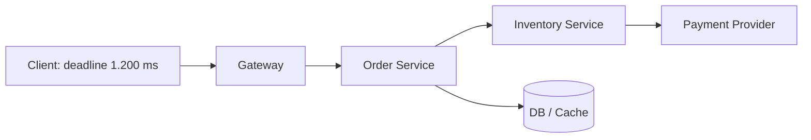
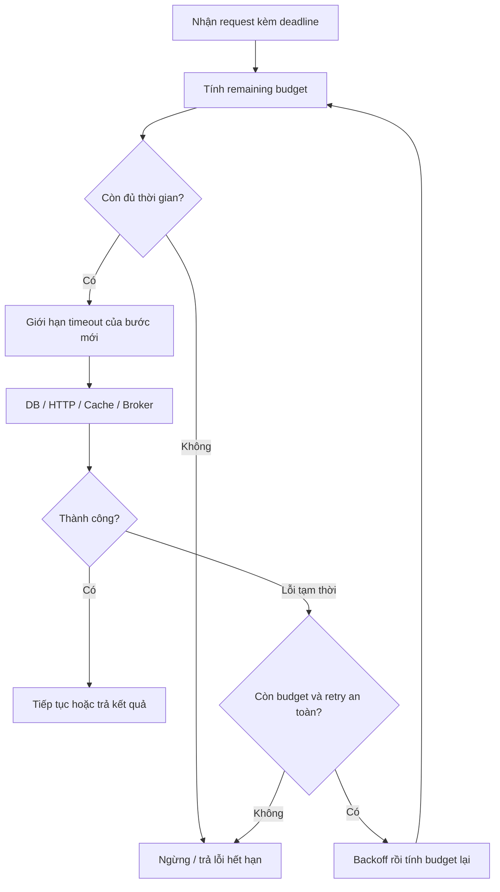
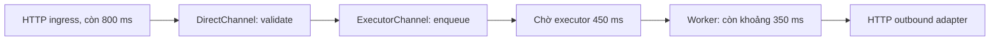
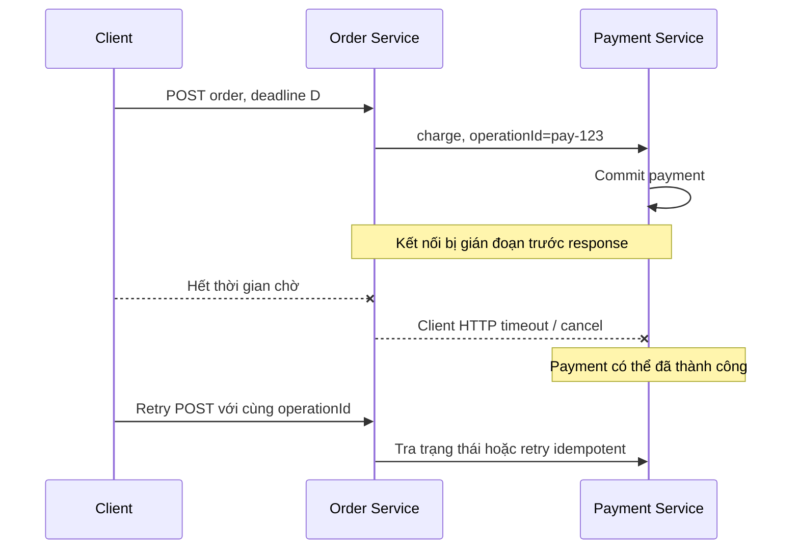

# Tôn trọng thời gian còn lại khi truyền yêu cầu qua nhiều dịch vụ

## 1. Vì sao timeout riêng từng dịch vụ vẫn có thể làm cả chuỗi quá hạn?

Trong **SPRING_BOOT_INTEGRATION**, một yêu cầu có thể đi từ HTTP gateway vào Spring Boot, kiểm tra cache, đọc database, gọi HTTP client sang dịch vụ khác, rồi phát message tới broker hoặc adapter của Spring Integration. Dù mỗi bước có timeout riêng, **không có gì bảo đảm cả chuỗi kết thúc trong thời gian người gọi cho phép**.

Giả sử khách hàng chờ tối đa 1.200 ms cho thao tác đặt hàng. Gateway cấp 1.000 ms cho Order Service; Order Service lại cấp 1.000 ms cho Inventory Service; Inventory tiếp tục cấp 1.000 ms cho cổng thanh toán. Nếu mỗi bước khởi động bộ đếm timeout mới, thời gian thực tế có thể vượt 1.200 ms rất xa. Kết quả dù thành công cũng có thể đến khi client đã bỏ cuộc, trong khi các thread, connection và hệ thống đích vẫn đang làm việc.



Để kiểm soát, ta dùng **deadline đầu-cuối** (*end-to-end deadline*): mốc thời gian muộn nhất mà kết quả còn hữu ích cho yêu cầu. Mỗi bước phải sử dụng **remaining budget** (thời gian còn lại), không tự làm mới thời hạn khi gọi service tiếp theo.

| Khái niệm | Nghĩa | Ví dụ |
|---|---|---|
| Timeout của thao tác | Thời gian tối đa cho một hoạt động riêng | HTTP attempt tối đa 350 ms |
| Deadline của yêu cầu | Mốc sau đó kết quả đã quá thời hạn | Trước 14:00:01.200 UTC |
| Remaining budget | Thời gian từ hiện tại đến deadline | Còn 420 ms sau khi đọc DB |
| Retry budget | Phần thời gian còn đủ cho thử lại và backoff | Chỉ thử lại nếu vẫn kịp deadline |
| Safety margin | Phần dự phòng để ghi trạng thái, serialize và trả phản hồi | Chừa 40 ms cuối |

**Bất biến quan trọng:** deadline do một dịch vụ áp dụng cho request downstream phải **không muộn hơn** deadline mà dịch vụ đó đang thực thi. Dịch vụ có thể tự chọn hạn **sớm hơn** để bảo vệ tài nguyên, nhưng không được kéo dài thời hạn người gọi đã đặt.

## 2. Budget giảm khi yêu cầu đi qua các bước

Giả sử gateway nhận một request có budget 1.200 ms:

| Thời gian đã dùng | Công việc hoàn thành | Budget còn lại |
|---:|---|---:|
| 0 ms | Gateway nhận yêu cầu | 1.200 ms |
| 100 ms | Kiểm tra token, validate payload | 1.100 ms |
| 150 ms | Request đến Order Service | 1.050 ms |
| 350 ms | Order Service đọc DB/cache | 850 ms |
| 390 ms | Request đến Inventory Service | 810 ms |
| 840 ms | Inventory nhận kết quả từ provider | 360 ms |
| 900 ms | Kết quả về lại gateway/client | 300 ms |

Nếu truy vấn DB kéo dài thêm 600 ms, lúc gọi Inventory chỉ còn khoảng 210 ms. Khởi động một HTTP call có timeout tĩnh 1.000 ms lúc này thường vô ích. Service nên kiểm tra thời gian còn lại, giữ lại một phần dự phòng cho response và từ chối mở bước mới nếu không đủ.

```text
remaining      = max(0, deadline - now)
usable         = remaining - responseMargin
attemptTimeout = min(usable, perAttemptLimit)

Nếu usable <= 0: ngừng bước mới; trả lỗi deadline hoặc ghi trạng thái.
```



Đây là **ngân sách chung**, không phải bắt buộc phân phối một thời lượng cố định cho mỗi service. Bước hoàn thành sớm để lại nhiều thời gian cho bước sau; bước chạy lâu làm budget của các bước sau giảm theo.

## 3. Truyền deadline qua HTTP: hợp đồng, đồng hồ và tin cậy

### 3.1. Deadline tuyệt đối và timeout tương đối

Các dịch vụ HTTP nội bộ có thể thống nhất một header tùy biến, chẳng hạn:

```http
POST /internal/inventory/reserve HTTP/1.1
X-Request-Deadline-Epoch-Ms: 1795279201200
X-Correlation-Id: order-flow-8f2c
Idempotency-Key: reserve-order-123
Content-Type: application/json

{"orderId":"123","quantity":2}
```

`X-Request-Deadline-Epoch-Ms` là một deadline tuyệt đối theo Unix epoch milliseconds. Con số trên chỉ minh họa định dạng. Bên nhận lấy deadline trừ thời điểm hiện tại để ra budget còn lại. Cách này tính cả thời gian đã mất ở các hop mạng trước đó, nhưng phụ thuộc vào **đồng hồ các máy đủ đồng bộ**.

Cũng có thể truyền `X-Request-Timeout-Ms: 420` (thời lượng còn lại). Phía nhận chuyển giá trị đó thành deadline local khi nhận. Nếu chỉ chuyển nguyên con số đã tính **trước lúc gửi qua mạng**, độ trễ đường truyền có thể bị bỏ sót và tổng thời gian bị kéo dài qua nhiều hop. Cần có hợp đồng rõ ràng để trừ thời gian truyền hoặc dùng cơ chế của hạ tầng, chẳng hạn gRPC deadline/timeout propagation khi toàn bộ đường đi hỗ trợ.

| Hợp đồng | Lợi thế | Điều cần kiểm soát |
|---|---|---|
| Deadline tuyệt đối (UTC epoch) | Mỗi hop tính lại đúng mốc mục tiêu | Clock skew, nguồn header đáng tin cậy |
| Remaining duration (ms) | Dễ tính elapsed-time bằng đồng hồ đơn điệu trong từng tiến trình | Network transit time có thể bị bỏ sót |
| Deadline/timeout chuẩn của RPC framework | Hạ tầng có thể tự truyền budget | Phải biết semantics thực của framework và các adapter |

Một dịch vụ không nên tin deadline tùy ý do client công khai gửi. Gateway thường quyết định deadline theo loại API, xác thực/loại bỏ header không được phép rồi chuyển vào hệ thống nội bộ. Mỗi dịch vụ tiếp tục giới hạn thời lượng tối đa riêng của nó:

```text
effectiveDeadline = min(upstreamDeadline, receivedAt + localMaxDuration)
```

Nếu không có header, áp dụng timeout local mặc định; nếu header sai định dạng, trả `400 Bad Request` hoặc xử lý theo hợp đồng đã công bố. Nếu deadline đã qua, trả lỗi ngay theo quy tắc của API, không tiếp tục mở transaction hoặc gọi downstream dài.

### 3.2. Wall clock để truyền, monotonic clock để đo elapsed-time

Deadline dạng UTC cần thời gian thực của hệ thống để các node hiểu cùng mốc. Nhưng để đo **thời gian đã trôi qua trong một tiến trình**, `System.nanoTime()` phù hợp hơn `Instant.now()` gọi đi gọi lại, vì đồng hồ hệ thống có thể bị điều chỉnh bởi NTP/OS. Khi nhận request, hãy:

1. Parse và giới hạn deadline bằng thời gian UTC hiện tại.
2. Chuyển thời lượng còn lại thành một budget local đo bằng monotonic elapsed-time.
3. Giữ mốc deadline tuyệt đối để truyền downstream; khi gửi thì tính timeout local dựa vào budget còn lại.

Ví dụ mã Java dùng được trong ứng dụng Spring Boot (các import trong code được khai báo để độc lập):

```java
import java.time.Clock;
import java.time.Duration;
import java.time.Instant;
import java.util.function.LongSupplier;

final class RequestBudget {
    private final Instant deadlineUtc;
    private final long startedAtNanos;
    private final long initialBudgetNanos;
    private final LongSupplier ticker;

    private RequestBudget(
            Instant deadlineUtc,
            long startedAtNanos,
            long initialBudgetNanos,
            LongSupplier ticker) {
        this.deadlineUtc = deadlineUtc;
        this.startedAtNanos = startedAtNanos;
        this.initialBudgetNanos = initialBudgetNanos;
        this.ticker = ticker;
    }

    static RequestBudget start(
            Instant effectiveDeadline,
            Clock clock,
            LongSupplier ticker) {
        long remaining = Math.max(
            0L,
            Duration.between(clock.instant(), effectiveDeadline).toNanos());

        return new RequestBudget(
            effectiveDeadline, ticker.getAsLong(), remaining, ticker);
    }

    Duration remaining() {
        long elapsed = Math.max(0L, ticker.getAsLong() - startedAtNanos);
        return Duration.ofNanos(
            Math.max(0L, initialBudgetNanos - elapsed));
    }

    Instant deadlineUtc() {
        return deadlineUtc;
    }
}
```

`Duration.toNanos()` có thể overflow nếu deadline cách hàng trăm năm. Vì thế, **luôn clamp deadline ở policy ingress trước khi gọi `start()`**. Mã cố tình tách `Clock` và `LongSupplier` để test thời gian chính xác mà không cần `Thread.sleep()`.

### 3.3. Chính sách nhận deadline ở Spring Boot

Ví dụ giới hạn local tối đa 1.500 ms. Nếu upstream gửi mốc sớm hơn, dịch vụ giữ nguyên mốc sớm đó.

```java
import java.time.Clock;
import java.time.Duration;
import java.time.Instant;
import java.util.function.LongSupplier;

@Component
class DeadlinePolicy {
    static final String HEADER = "X-Request-Deadline-Epoch-Ms";
    private static final Duration LOCAL_MAX = Duration.ofMillis(1_500);

    private final Clock clock;
    private final LongSupplier ticker;

    DeadlinePolicy() {
        this(Clock.systemUTC(), System::nanoTime);
    }

    DeadlinePolicy(Clock clock, LongSupplier ticker) {
        this.clock = clock;
        this.ticker = ticker;
    }

    RequestBudget accept(String headerValue) {
        Instant now = clock.instant();
        Instant localDeadline = now.plus(LOCAL_MAX);
        Instant requested = localDeadline;

        if (headerValue != null && !headerValue.isBlank()) {
            try {
                requested = Instant.ofEpochMilli(
                    Long.parseLong(headerValue));
            } catch (RuntimeException invalid) {
                throw new IllegalArgumentException(
                    "Invalid deadline header", invalid);
            }
        }

        Instant effective = requested.isBefore(localDeadline)
            ? requested : localDeadline;
        return RequestBudget.start(effective, clock, ticker);
    }
}
```

Ở ứng dụng thực, nên cung cấp `Clock`/ticker qua DI để test, phân biệt header rỗng và thiếu header theo hợp đồng, kiểm tra chênh lệch đồng hồ và map lỗi rõ ràng. Với REST API, `IllegalArgumentException` vì header sai có thể map sang 400; budget đã hết thường có thể map sang 504 nếu service đang đóng vai trò gateway/downstream (hoặc một mã lỗi nghiệp vụ đã công bố).

**Không đặt budget mutable vào field singleton** hoặc giả định `ThreadLocal` luôn theo request qua `@Async`, Reactor hay Spring Integration channel. Truyền budget bằng tham số hoặc request context phù hợp với công nghệ đang dùng.

## 4. Áp dụng budget cho HTTP client và retry

### 4.1. Một HTTP attempt không được chiếm toàn bộ deadline

Trong Spring Boot, `RestClient`, `WebClient`, OpenFeign hoặc HTTP outbound adapter của Spring Integration có thể cấu hình connect/read/response timeout. Nhưng timeout tĩnh chỉ giới hạn một phần hoạt động của client; **budget phải được tính lại ngay trước mỗi lần gửi**.

Các giới hạn cần phân biệt:

| Giới hạn | Điều cần ngăn |
|---|---|
| Chờ lấy connection từ pool | Không để request chờ slot quá lâu lúc tải cao |
| DNS/connect/TLS handshake | Không mất hết deadline khi thiết lập kết nối |
| Response/read timeout | Không chờ service đích mãi sau khi đã kết nối |
| Per-attempt timeout | Không để một lần thử chiếm hết thời gian dành cho retry và phản hồi |
| Total retry deadline | Không cộng dồn nhiều attempt/backoff vượt quá thời gian upstream cho phép |

Nếu thư viện có timeout cho mỗi request, đặt `min(remaining, configuredTimeout)`; nếu không, dùng wrapper/deadline enforcement phù hợp, đồng thời cấu hình timeout tầng mạng. Không giả định một annotation về timeout bảo vệ cả connection pool, DNS, giao dịch database và mọi tác vụ blocking.

### 4.2. Ví dụ WebClient: giới hạn tổng retry và từng attempt

Ví dụ dưới đây dùng Spring WebFlux `WebClient` và Reactor. `OrderCommand` mang `operationId()` ổn định cho cùng một thao tác nghiệp vụ; `Reservation` là DTO phản hồi. Các import Spring/Reactor chuẩn được lược bỏ.

```java
record OrderCommand(String operationId, String orderId, int quantity) {}
record Reservation(String reservationId, String status) {}

@Service
class InventoryClient {
    private static final Duration RESPONSE_MARGIN =
        Duration.ofMillis(40);
    private static final Duration MAX_ATTEMPT =
        Duration.ofMillis(350);

    private final WebClient webClient;

    InventoryClient(
            WebClient.Builder builder,
            @Value("${integrations.inventory.base-url}") String baseUrl) {
        this.webClient = builder.baseUrl(baseUrl).build();
    }

    Mono<Reservation> reserve(
            OrderCommand command, RequestBudget budget) {
        return Mono.defer(() -> {
            Duration usable = budget.remaining().minus(RESPONSE_MARGIN);
            if (usable.isNegative() || usable.isZero()) {
                return Mono.error(new DeadlineExceededException());
            }

            return Mono.defer(() -> attempt(command, budget))
                .retryWhen(
                    Retry.backoff(1, Duration.ofMillis(80))
                        .jitter(0.2)
                        .filter(this::retryable))
                .timeout(usable)
                .onErrorMap(
                    TimeoutException.class,
                    DeadlineExceededException::new);
        });
    }

    private Mono<Reservation> attempt(
            OrderCommand command, RequestBudget budget) {
        Duration usable = budget.remaining().minus(RESPONSE_MARGIN);
        if (usable.isNegative() || usable.isZero()) {
            return Mono.error(new DeadlineExceededException());
        }

        Duration attemptLimit = usable.compareTo(MAX_ATTEMPT) < 0
            ? usable : MAX_ATTEMPT;

        return webClient.post()
            .uri("/internal/reservations")
            .header(
                DeadlinePolicy.HEADER,
                Long.toString(budget.deadlineUtc().toEpochMilli()))
            .header("Idempotency-Key", command.operationId())
            .bodyValue(command)
            .retrieve()
            .bodyToMono(Reservation.class)
            .timeout(attemptLimit);
    }

    private boolean retryable(Throwable cause) {
        return cause instanceof TimeoutException
            || (cause instanceof WebClientResponseException response
                && response.getStatusCode().value() == 503);
    }
}

class DeadlineExceededException extends RuntimeException {
    DeadlineExceededException() {
        super("Remaining request time exhausted");
    }

    DeadlineExceededException(Throwable cause) {
        super("Remaining request time exhausted", cause);
    }
}
```

Trong `@Value` trên, hãy dùng property của ứng dụng: `integrations.inventory.base-url`. Ví dụ URL chỉ lấy từ cấu hình môi trường, không hard-code hostname production. Các dependency cần thiết gồm Spring WebClient và Reactor Retry (có sẵn khi dùng stack tương ứng).

Các điểm kỹ thuật cần hiểu:

1. `Mono.defer()` đo lại thời gian ở **thời điểm subscribe** và ở **mỗi lần retry**, tránh đóng băng budget lúc xây dựng publisher.
2. `.timeout(usable)` được đặt **sau `retryWhen`** nên là giới hạn chung cho toàn bộ retry và backoff. Backoff dài hơn thời gian còn lại cũng bị chặn bởi timeout tổng.
3. `attemptLimit` giảm dần theo thời gian thực tế. Mỗi attempt được giới hạn bằng thời gian còn lại sau margin và trần cấu hình.
4. `command.operationId()` giữ **nguyên** giữa các lần retry. Phía Inventory phải xử lý key này idempotent, vì lần đầu có thể đã thành công nhưng response bị mất.
5. `.timeout(...)` hủy subscription khi quá hạn; phía HTTP đích **có thể đã nhận request và tiếp tục xử lý**. Timeout không chứng minh side effect chưa xảy ra.

Đoạn mã giới hạn retry còn **một lần** sau attempt đầu, chỉ với timeout hoặc HTTP 503. Trong production cần nhận diện thêm retry exhaustion của Reactor, mapping lỗi và chính sách cho 429/502/504 nếu phù hợp; các lỗi 4xx validation không nên tự retry. Retry có thể làm tăng tải lên hệ thống đang lỗi, nên số lần, backoff, jitter và circuit breaker cần được điều phối theo budget.

Đây là kiểm soát thời gian ở tầng reactive. Để vận hành đúng còn cần cấu hình connect timeout, response/read timeout, connection pool và tài nguyên Reactor Netty. `.timeout(...)` **không thay thế** mọi timeout của socket/driver hoặc bảo đảm hủy tác dụng phụ ở dịch vụ đích.

### 4.3. Vì sao retry phải dùng ngân sách còn lại?

Giả sử ở lúc bắt đầu gọi Inventory còn 650 ms:

| Thời điểm | Hoạt động | Thời gian còn lại |
|---|---|---:|
| T0 | Bắt đầu attempt 1, giới hạn 300 ms | 650 ms |
| T0 + 300 ms | Attempt 1 timeout | 350 ms |
| T0 + 400 ms | Backoff 100 ms kết thúc | 250 ms |
| T0 + 600 ms | Attempt 2 trả về | 50 ms |

Nếu sau backoff chỉ còn 20 ms mà service vẫn bắt đầu attempt mới với timeout tĩnh 300 ms, nó đang **gia hạn thời gian đã hứa với client**. Hãy dừng trước attempt đó và trả lỗi timeout sớm để giải phóng tài nguyên.

Với API có side effect (thu tiền, giữ hàng, gửi đơn), chỉ retry khi đầu nhận có **idempotency key hoặc hợp đồng lặp an toàn**. Một HTTP timeout có thể xảy ra *sau* khi hệ thống đích đã commit giao dịch. Cách phục hồi có thể là truy vấn trạng thái theo operation ID thay vì gửi lại một lệnh tạo mới.

## 5. Deadline ảnh hưởng thế nào đến database, cache và transaction?

### 5.1. Database query và chờ connection cũng tiêu budget

Một request HTTP dùng 400 ms chỉ để lấy connection DB từ pool thì budget dành cho truy vấn đã giảm 400 ms. Với transaction nhiều lệnh SQL, cần kiểm soát cả thời gian **chờ khóa**, **thực thi query** và **commit**, không chỉ thời gian gọi HTTP.

Trong Spring Boot, các cơ chế có thể kết hợp gồm:

- Timeout của connection pool (ví dụ HikariCP `connectionTimeout`) để giới hạn chờ một connection.
- Timeout ở JDBC driver, JPA query hoặc database (ví dụ statement timeout phía PostgreSQL) để tránh SQL kéo dài.
- `@Transactional(timeout = ...)` cho transaction có giới hạn tĩnh. Cơ chế áp dụng timeout phụ thuộc transaction manager và thao tác DB; không mặc nhiên ngắt mọi lời gọi hoặc hủy remote side effect.
- Kiểm tra `budget.remaining()` trước khi bắt đầu transaction/tác vụ tốn kém và sau các bước blocking dài.

Nếu ngân sách chỉ còn 90 ms nhưng một truy vấn thường cần 300 ms, hãy từ chối xử lý hoặc rẽ sang quy trình bất đồng bộ theo hợp đồng. Đừng mở transaction dài với hy vọng `@Transactional` tự ngăn mọi chi phí.

**Cảnh báo về rollback:** hết deadline của request **không đồng nghĩa transaction database tự rollback**. Nếu exception được ném trong transaction Spring và phù hợp rollback rule (mặc định là unchecked exception), transaction có thể rollback. Nhưng nếu một worker khác vẫn thực thi sau khi HTTP caller timeout, giao dịch worker có thể vẫn commit. Vì thế phải đặt ranh giới transaction và quy tắc cancellation theo từng bước rõ ràng.

### 5.2. Cache có thể nhanh, nhưng vẫn có thời gian chờ và lỗi

Cache hit thường ít tốn thời gian, nhưng cache Redis ở xa có thể mất thời gian để kết nối hoặc trả kết quả. Nếu cache không phản hồi, cần quyết định rõ:

- Dùng fallback sang DB chỉ khi **còn đủ budget** và dữ liệu DB đáp ứng yêu cầu.
- Dùng stale cache khi nghiệp vụ chấp nhận và đã có giới hạn độ cũ.
- Fail fast nếu fallback sẽ vượt deadline hoặc gây thêm tải lên DB đang quá tải.

Nếu failover từ cache sang DB rồi tiếp tục gọi HTTP, mọi bước vẫn tiêu **cùng một** budget. Không khởi tạo lại đồng hồ “1 giây cho DB” chỉ vì Redis timeout.

### 5.3. Không kéo dài transaction khi chờ downstream

Giữ một transaction database mở suốt lúc gọi HTTP khiến lock tồn tại lâu, tăng contention và rủi ro timeout. Ngay cả nếu transaction bị rollback, cổng thanh toán đã nhận yêu cầu HTTP vẫn có thể tạo side effect.

Một thiết kế thường an toàn hơn cho nghiệp vụ cần phục hồi:

1. Trong **transaction ngắn**, lưu dữ liệu nghiệp vụ và outbox event.
2. Commit database.
3. Publisher bền vững gửi event từ outbox sang broker, có retry.
4. Consumer thực thi công việc bên ngoài với idempotency và trạng thái riêng.

Deadline của HTTP request lúc tạo đơn dùng để quyết định **có đủ thời gian tiếp nhận và commit không**. Sau khi đã commit yêu cầu theo hợp đồng bất đồng bộ, công việc phía sau cần deadline/SLA riêng; không tự hủy một lệnh nghiệp vụ đã được chấp nhận chỉ vì client đã ngắt kết nối.

## 6. Truyền budget qua Spring Integration và các luồng bất đồng bộ

### 6.1. DirectChannel, ExecutorChannel và QueueChannel

Spring Integration sử dụng `Message<?>` có payload và headers. Thời hạn nghiệp vụ có thể nằm trong message header, ví dụ `requestDeadlineEpochMs`. Khi flow chỉ đi qua `DirectChannel`, handler thường chạy trong cùng thread; khi đi qua `ExecutorChannel`, `QueueChannel`, poller hoặc broker inbound adapter, phần sau có thể chạy trên thread khác và **trễ hơn đáng kể**.



Sai lầm phổ biến là quyết định “còn 800 ms” **trước khi enqueue**, rồi khi worker bắt đầu sau 450 ms vẫn cấp lại 800 ms cho HTTP outbound adapter. Budget phải được **tính lại lúc consumer bắt đầu**, dựa trên deadline gốc hoặc một thông tin thời gian truyền có hợp đồng rõ.

Một handler kiểm tra header trước khi xử lý:

```java
@Component
class DeadlineGuard {
    private final Clock clock = Clock.systemUTC();

    public void verify(Message<?> message) {
        String raw = message.getHeaders().get(
            "requestDeadlineEpochMs", String.class);
        if (raw == null) {
            throw new MessageHandlingException(
                message, "Missing deadline header");
        }

        final long deadlineEpochMs;
        try {
            deadlineEpochMs = Long.parseLong(raw);
        } catch (NumberFormatException invalid) {
            throw new MessageHandlingException(
                message, "Invalid deadline header", invalid);
        }

        if (clock.millis() >= deadlineEpochMs) {
            throw new MessageHandlingException(
                message, "Request deadline exceeded");
        }
    }
}
```

Đây chỉ là **cửa kiểm tra trước bước tiếp theo**; sau khi kiểm tra, handler phải giới hạn timeout riêng cho outbound call dựa trên remaining budget, vì thời gian vẫn tiếp tục trôi. Trong hệ thống thật, guard nên dùng cùng deadline policy/clock abstraction với ingress và được gắn vào flow theo đúng error channel, retry và dead-letter strategy. Cần cân nhắc cả việc làm gì khi message quá hạn thay vì ném lỗi rồi retry vĩnh viễn.

### 6.2. Deadline request khác thời hạn của nghiệp vụ bền vững

Giữa **HTTP request đồng bộ** và **message đã được chấp nhận** có khác biệt quan trọng:

| Ngữ cảnh | Deadline nên chi phối gì? | Sau khi hết hạn |
|---|---|---|
| HTTP request đang chờ reply | Thời điểm phải trả phản hồi hoặc bỏ chờ | Dừng các bước mới, trả lỗi theo hợp đồng |
| Request gửi tới executor/queue in-memory để có reply | Budget tính cả thời gian chờ trong queue | Có thể bỏ tác vụ đã vô ích nếu chưa tạo side effect |
| Event đã commit vào transactional outbox | Deadline của request tạo event | Event vẫn cần được giao nếu nghiệp vụ đã cam kết xử lý |
| Message broker cho quy trình lâu dài | Deadline/expiry riêng của tác vụ nghiệp vụ | Có thể chuyển FAILED, DLQ hoặc compensation theo policy |
| Job Quartz hoặc scheduler | Deadline/SLA của một lần chạy hoặc một kỳ nghiệp vụ | Có thể checkpoint và lên lịch tiếp, không mặc định “hủy” dữ liệu đã commit |

Ví dụ API trả `202 Accepted` sau khi ghi đơn và outbox. Client timeout lúc chờ response không có nghĩa đơn hàng không tồn tại. Consumer phải tiếp tục workflow hoặc dùng trạng thái nghiệp vụ bền vững để cho phép client tra cứu và tránh tạo đơn trùng khi retry.

Ngược lại, nếu message chỉ đại diện cho **một truy vấn đồng bộ đang chờ** và đã hết deadline trước khi worker bắt đầu, nó thường không còn giá trị. Worker nên nhận diện trước khi gọi hệ thống đích, ghi nhận timeout rồi dừng.

### 6.3. TTL của broker không thay thế deadline đầu-cuối

Message TTL/expiration ở broker có thể ngăn message nằm quá lâu trong hàng đợi, nhưng TTL của broker:

- Có semantics riêng theo broker và không nhất thiết ngắt consumer đã nhận message.
- Không giới hạn thời gian xử lý HTTP/DB của consumer sau khi message được lấy ra.
- Không bảo đảm rằng một side effect trước đó được rollback khi message hết TTL.

Vì vậy, đừng xem broker TTL là nguồn sự thật duy nhất của deadline nghiệp vụ. Cần quyết định **message được phép hết hạn hay bắt buộc phải xử lý bù**, và lưu trạng thái để có thể khôi phục sau crash.

## 7. Hết deadline, cancellation và side effect không tự biến mất

### 7.1. Ba mốc cần phân biệt

Khi một request vượt deadline, ba sự kiện sau **không đồng nghĩa**:

1. **Caller đã ngừng chờ.** HTTP client báo timeout hoặc người dùng đóng kết nối.
2. **Thao tác đang chạy đã được yêu cầu hủy.** Reactive subscription bị cancel, thread được interrupt hoặc library đã gửi tín hiệu hủy.
3. **Tác dụng phụ phía đích chắc chắn không xảy ra.** Đây là một đảm bảo khó hơn nhiều; không thể suy ra từ hai sự kiện trên.

Ví dụ Order Service gọi Payment Service để thu tiền:



Nếu service xử lý timeout bằng cách phát lại request mới với operation ID mới, người dùng có thể bị thu tiền hai lần. Cách đúng là giữ cùng khóa idempotency, lưu trạng thái giao dịch và tra cứu kết quả không chắc chắn trước khi tạo side effect mới.

### 7.2. Cancellation cần hợp tác ở mỗi tầng

Tùy stack, cancellation có giới hạn khác nhau:

| Thành phần | Điều cancellation có thể thực hiện | Điều không nên giả định |
|---|---|---|
| Reactor `Mono.timeout()` | Cancel subscription upstream khi đến hạn | Remote HTTP hoặc transaction phía đích sẽ rollback |
| Java thread interruption | Báo tín hiệu hủy cho code có kiểm tra interrupt | Mọi thao tác blocking đều dừng ngay |
| JDBC query cancellation/statement timeout | Có thể yêu cầu DB ngừng query đang chạy | Toàn bộ transaction luôn rollback theo mọi trường hợp |
| HTTP client timeout | Dừng đợi response/call phía client | Server đích chưa nhận request |
| Kafka/RabbitMQ consumer | Có thể dừng xử lý hoặc không ack tùy chính sách | Broker tự xóa mọi side effect đã commit |

Tại các điểm an toàn, handler nên kiểm tra budget trước thao tác mới và sắp xếp trạng thái dừng rõ ràng. Nhưng nếu đã commit một thao tác **không thể hoàn tác tự động**, ưu tiên hoàn thiện trạng thái phục hồi/compensation thay vì dừng đột ngột để lại dữ liệu không nhất quán.

### 7.3. “Fail fast” có thể là thành công về kiến trúc

Nếu request còn 20 ms, lựa chọn tốt đôi khi là trả deadline exceeded ngay thay vì mở một kết nối 500 ms tới dịch vụ đích. Như vậy giảm tải vô ích và cho upstream cơ hội xử lý lỗi có kiểm soát. Tuy nhiên:

- **Không đánh dấu thất bại hoàn toàn** khi downstream có thể đã hoàn tất side effect và phản hồi bị mất.
- **Không thử lại ngoài deadline** chỉ vì thư viện cho phép thêm attempt.
- **Không tự chuyển job đã tiếp nhận bền vững thành “hủy”** nếu hợp đồng yêu cầu hoàn tất sau khi trả `202 Accepted`.
- **Không dùng 504 cho mọi lỗi**: 429 là quá tải/rate limit, 503 là dịch vụ tạm thời không sẵn sàng, 400 là header sai, 504 phù hợp khi gateway/downstream không trả đúng hạn; phải map theo ngữ cảnh API.

## 8. Kiểm thử deadline propagation qua nhiều service

Kiểm thử đúng cần xác nhận **thời gian đã mất ở hop trước làm giảm budget ở hop sau** và **không có tác vụ không cần thiết khởi chạy khi budget đã hết**. Chỉ kiểm tra exception `TimeoutException` là chưa đủ.

### 8.1. Kiểm thử đồng hồ đơn điệu không cần sleep

`RequestBudget` nhận `LongSupplier` là ticker nên test có thể cho thời gian tiến lên tức thì:

```java
@Test
void budgetDecreasesAndNeverBecomesNegative() {
    Clock wallClock = Clock.fixed(
        Instant.parse("2026-11-21T08:00:00Z"),
        ZoneOffset.UTC);
    AtomicLong nanos = new AtomicLong(1_000_000L);

    RequestBudget budget = RequestBudget.start(
        wallClock.instant().plusMillis(500),
        wallClock,
        nanos::get);

    assertEquals(Duration.ofMillis(500), budget.remaining());

    nanos.addAndGet(Duration.ofMillis(400).toNanos());
    assertEquals(Duration.ofMillis(100), budget.remaining());

    nanos.addAndGet(Duration.ofMillis(150).toNanos());
    assertEquals(Duration.ZERO, budget.remaining());
}
```

Kiểm thử này chứng minh budget dựa trên elapsed-time và không thể âm. Nó không cần chờ 550 ms thực tế. Trong một test khác, có thể dùng `Clock.fixed(...)` cùng một deadline nhận từ header để xác minh `DeadlinePolicy.accept()` chọn mốc **sớm hơn** giữa upstream deadline và local limit.

### 8.2. Kiểm thử HTTP downstream bằng stub

Dùng WireMock, MockWebServer hoặc stub HTTP có thể điều khiển độ trễ và ghi lại request. Một bộ ca nên gồm:

| Ca kiểm thử | Cách mô phỏng | Kết luận cần khẳng định |
|---|---|---|
| Upstream còn 800 ms | Gửi header deadline tương ứng | Downstream nhận cùng deadline tuyệt đối hoặc thời lượng giảm đúng hợp đồng |
| Upstream còn 100 ms, attempt cap 350 ms | Stub giữ response lâu hơn 100 ms | Attempt không chiếm trọn 350 ms; kết thúc khi hết budget |
| Attempt 1 timeout, attempt 2 thành công | Stub timeout lần đầu, phản hồi nhanh lần sau | Retry dùng cùng idempotency key, tổng thời gian không vượt deadline đã dự phòng |
| Backoff dài hơn budget còn lại | Stub trả 503; giả thời gian tiến sát deadline | Không bắt đầu attempt tiếp theo khi hết budget |
| Client timeout nhưng server đã nhận lệnh | Stub ghi side effect trước khi ngắt kết nối | Hệ thống không mặc định xử lý lặp side effect |
| Header deadline đã quá hạn | Gửi deadline trong quá khứ | Trả lỗi sớm, không gọi HTTP downstream |
| Header sai hoặc quá lớn | Chuỗi không phải timestamp hoặc mốc quá xa | Parse/clamp hoặc trả 400 đúng policy, không cấp thời gian vô hạn |

Với Reactor `StepVerifier` dùng virtual time, cần chú ý timer của `timeout()`/`Retry.backoff()` và ticker custom phải được điều khiển **nhất quán**; nếu virtual scheduler tiến còn `System.nanoTime()` không tiến thì phép thử có thể sai. Có thể kết hợp `StepVerifier.withVirtualTime` với một ticker giả, hoặc dùng integration test thời gian thực có biên độ hợp lý. Tránh khẳng định chính xác tuyệt đối ở mức vài mili giây trong CI.

### 8.3. Kiểm thử liên dịch vụ thật

Một bài kiểm thử đầu-cuối nên chạy ít nhất hai Spring Boot service (hoặc một service thật và một stub downstream) và có các điểm đo:

1. Gateway cấp deadline D và gửi request kèm correlation ID.
2. Service A xử lý hoặc bị giữ khoảng thời gian có kiểm soát.
3. Service A gọi Service B, giữ deadline D thay vì tính lại D + timeout mặc định.
4. Service B nhận request, tính remaining budget từ D, rồi quyết định có nên mở cuộc gọi kế tiếp.
5. Thử tình huống B xử lý xong **sau khi A đã timeout**; xác nhận việc retry/cập nhật trạng thái an toàn.
6. Đo tổng thời gian caller quan sát, trạng thái ở B và số lần gọi hệ thống đích.

Nếu dùng Spring Integration `ExecutorChannel`, cho message nằm chờ trong executor queue rồi mới thả consumer. Assertion quan trọng: **time waiting in queue cũng bị trừ khỏi budget**. Nếu message vẫn có giá trị xử lý bền vững sau khi API trả `202`, phải kiểm tra SLA nghiệp vụ riêng thay vì áp deadline HTTP vào consumer.

### 8.4. Kiểm thử cơ sở dữ liệu, cache và transaction

Để xác minh ranh giới transaction thật, dùng DB test container và truy vấn sau khi transaction đã kết thúc. Ví dụ: làm query giữ lock lâu hơn budget, rồi kiểm tra phản hồi hết hạn và trạng thái commit/rollback. Tương tự, để Redis timeout rồi thử fallback DB; xác nhận fallback chỉ xảy ra nếu vẫn đủ budget và không tạo retry storm. Mock repository không thể chứng minh rằng driver, lock wait và transaction manager hoạt động đúng khi deadline đã hết.

## 9. Quan sát thời gian còn lại trong production

Một trace có thể cho thấy service B mất 400 ms, nhưng nếu không biết B nhận request khi chỉ còn 200 ms thì khó giải thích vì sao client đã timeout. Nên ghi nhận cả **elapsed-time** và **remaining budget** tại các điểm chuyển tiếp.

| Tín hiệu/metric | Lợi ích |
|---|---|
| `request_deadline_remaining_ms` lúc ingress | Phát hiện upstream đã tiêu gần hết budget trước khi gọi |
| `downstream_attempt_timeout_ms` | Biết từng attempt được cấp bao nhiêu thời gian |
| `retry_attempts_total` theo endpoint và outcome | Phát hiện retry đang khuếch đại tải |
| `deadline_exceeded_total` | Phân biệt hết deadline với lỗi 4xx/5xx thông thường |
| `queue_wait_duration` | Nhận biết budget bị mất trong executor/broker queue |
| `db_pool_wait_duration` và query/lock duration | Biết deadline bị chiếm ở tầng database |
| `accepted_to_completed_duration` | Đo SLA cho workflow bất đồng bộ sau `202 Accepted` |
| `side_effect_unknown_outcome_total` | Theo dõi giao dịch HTTP timeout nhưng kết quả bên đích chưa rõ |

Trong Spring Boot có thể kết hợp Spring MVC/WebFlux observations, Micrometer, Actuator và distributed tracing (OpenTelemetry hoặc hệ thống quan sát đang dùng). Khi ghi log theo từng hop, dùng `traceId`, `correlationId`, `operationId`, `upstreamDeadline`, `remainingMs`, `attemptNumber`, trạng thái retry/cancellation và kết quả nghiệp vụ. Tránh ghi thông tin nhạy cảm trong payload, token hoặc header xác thực.

Đừng dùng các giá trị nhiều biến thể như `orderId` làm **metric tag có cardinality rất cao**; dùng chúng trong log/trace để truy vết, còn metric tag nên dùng tên operation, trạng thái và nhóm dịch vụ có số lượng giới hạn.

### Những dấu hiệu thiết kế chưa tôn trọng deadline

- Service B luôn cấu hình 2 giây cho service C dù upstream chỉ còn 100 ms.
- Timeout của API là 1 giây nhưng tổng `retry * perAttemptTimeout + backoff` lớn hơn nhiều lần.
- Request chờ 800 ms trong executor queue rồi worker vẫn cấp lại timeout đầy đủ.
- Retry một lệnh thanh toán bằng operation ID mới sau khi response đầu tiên bị mất.
- `Mono.timeout()` đã hủy subscription nhưng hệ thống tuyên bố DB/HTTP phía đích chắc chắn chưa commit.
- Message đã cam kết xử lý bền vững bị xóa ngay khi kết nối HTTP gốc kết thúc, không có trạng thái bù trừ.
- Không có metric cho connection pool wait, queue wait, retry hoặc time remaining theo hop.

## 10. Checklist thiết kế trước khi triển khai

1. Xác định **deadline đầu-cuối** theo loại request và thỏa thuận giữa client/gateway.
2. Chọn một hợp đồng truyền deadline có timezone, đơn vị và chính sách header hợp lệ rõ ràng; đồng bộ đồng hồ các node nếu dùng timestamp tuyệt đối.
3. Mỗi dịch vụ chọn deadline **sớm nhất** giữa upstream và local policy, rồi dùng elapsed-time đơn điệu để tính remaining.
4. Trước **mỗi** HTTP attempt, DB query, cache fallback hoặc bước message mới, kiểm tra budget và chừa margin cho phản hồi/commit cần thiết.
5. Giới hạn cả connect/pool/read/attempt/total retry; dừng retry khi hết budget và giữ idempotency key không đổi.
6. Với Spring Integration, truyền deadline qua message headers và trừ cả thời gian nằm chờ ở executor/queue; xác định error channel, retry và DLQ cho message quá hạn.
7. Phân biệt deadline của request đồng bộ với **SLA nghiệp vụ** của công việc đã tiếp nhận qua outbox/broker/Quartz.
8. Kiểm thử tình huống hết hạn **trước khi gửi**, **đang chờ**, **sau khi side effect đã xảy ra**, khi retry và khi service downstream không phản hồi.
9. Ghi trace/metric cho remaining budget, attempt, queue wait, downstream timeout và kết quả xử lý để truy ra chặng tiêu tốn thời gian.

**Nguyên tắc cốt lõi:** một yêu cầu chỉ có **một quỹ thời gian đầu-cuối** được tiêu dần qua các dịch vụ. Timeout của từng client, database, cache, broker adapter và retry phải phục vụ quỹ thời gian đó. Khi deadline đã hết, hệ thống cần dừng các bước đồng bộ không còn giá trị, nhưng vẫn bảo đảm mọi side effect đã commit và mọi công việc bất đồng bộ đã cam kết được nhận diện, phục hồi hoặc bù trừ đúng hợp đồng.
