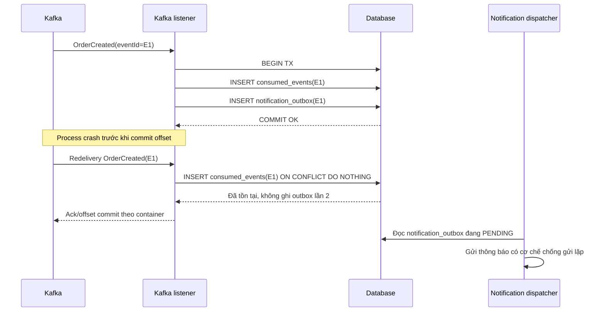
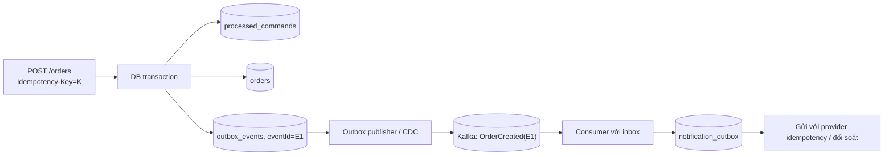
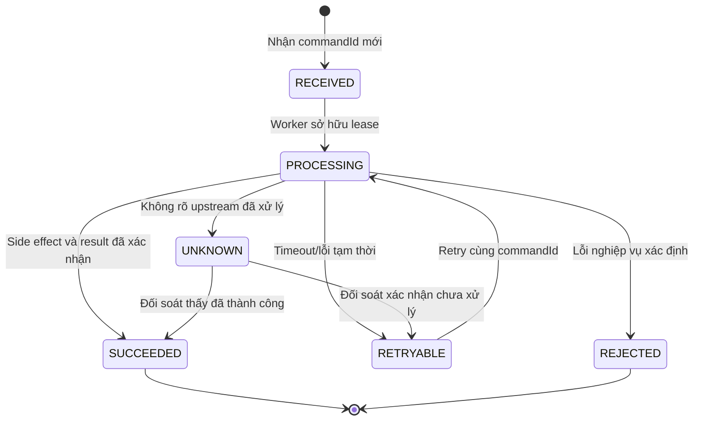

# Tính lũy đẳng của lệnh và sự kiện

## 1. Vì sao tính lũy đẳng là yêu cầu cốt lõi của tích hợp?

Một request HTTP có thể được gửi lại do client timeout; Kafka hoặc RabbitMQ có thể phát lại message sau khi consumer restart; một scheduler có thể chạy trùng job; một HTTP callback thanh toán có thể được nhà cung cấp gửi nhiều lần. Trong các trường hợp đó, **cùng một tác động nghiệp vụ có thể được yêu cầu hoặc quan sát nhiều lần**.

Ví dụ: khách hàng đặt một đơn hàng. `order-service` tạo đơn thành công nhưng kết nối với trình duyệt ngắt trước khi trả response. Trình duyệt retry `POST /orders`. Nếu server tạo thêm đơn mới thì một lỗi truyền thông đã biến thành lỗi nghiệp vụ. Tương tự, `inventory-service` nhận lại sự kiện `OrderCreated` và trừ kho lần thứ hai nếu không phát hiện trùng.

Trong module **SPRING_BOOT_INTEGRATION**, các luồng HTTP client, cơ sở dữ liệu, cache, broker thông điệp và adapter Spring Integration đều có thể gặp retry và redelivery. Tính lũy đẳng (*idempotency*) là một trong những công cụ quan trọng để giữ kết quả nhất quán khi một thao tác bị thực hiện lại.

**Mục tiêu học tập**

1. Phân biệt tính lũy đẳng với delivery guarantee, tính đúng một lần và kiểm soát đồng thời.
2. Thiết kế hợp đồng `Idempotency-Key` cho lệnh từ HTTP, scheduler hoặc message.
3. Xây dựng cơ chế chống trùng bằng ràng buộc duy nhất và transaction trong Spring Boot.
4. Thiết kế consumer có thể xử lý lại sự kiện với inbox, business key và aggregate version.
5. Phối hợp inbox/outbox với Kafka, RabbitMQ, Redis, cache và các lời gọi HTTP bên ngoài.
6. Kiểm thử race condition, crash, timeout, retry, replay và quan sát lỗi chống trùng.

> **Phạm vi ví dụ:** Java 17+, Spring Boot 3.x, Spring JDBC và PostgreSQL. Những ví dụ Kafka sử dụng mô hình `@KafkaListener` của Spring Kafka 3.x. Với hệ quản trị CSDL hoặc phiên bản Spring khác, cần thay cú pháp UPSERT và cấu hình tương ứng; các bất biến nghiệp vụ vẫn giữ nguyên.

## 2. Khái niệm và giới hạn bảo đảm

### 2.1. Định nghĩa idempotency

Một thao tác `f` là **lũy đẳng** nếu áp dụng nó thêm lần nữa trên kết quả đã đạt được không làm thay đổi kết quả cuối của hệ thống theo ngữ nghĩa đang xét:

\[
f(f(s, x), x) = f(s, x)
\]

Trong đó `s` là trạng thái, `x` là cùng một yêu cầu logic. Ví dụ:

- Đặt trạng thái đơn `ORD-42` thành `CANCELLED` có thể lũy đẳng nếu xử lý lần hai không tạo thêm side effect.
- Tăng số lượng hàng đã đặt `reserved = reserved + 1` **không** lũy đẳng; thực hiện hai lần sẽ tăng hai đơn vị.
- Chèn bản ghi với khóa duy nhất có thể lũy đẳng khi lệnh lặp được nhận diện và trả về kết quả cũ.
- Gửi email “đơn đã tạo” nhiều lần thường **không** lũy đẳng theo trải nghiệm người nhận, dù database không thay đổi.

Lũy đẳng không nhất thiết có nghĩa là mọi lần thực thi đều trả cùng timestamp hoặc HTTP header. Nhưng với API cho phép retry, **trả lại cùng kết quả nghiệp vụ**, cùng định danh resource và nhất quán về trạng thái phản hồi là một hợp đồng hữu ích.

### 2.2. Phân biệt các khái niệm dễ nhầm

| Khái niệm | Câu hỏi cần trả lời | Giới hạn |
| --- | --- | --- |
| Idempotency | Lặp lại cùng thao tác có tạo thêm tác động không? | Cần quy tắc xác định “cùng thao tác” và phạm vi bảo đảm. |
| At-most-once delivery | Message có thể được giao tối đa một lần không? | Có thể mất message, không đồng nghĩa xử lý thành công. |
| At-least-once delivery | Hệ thống cố gắng giao lại đến khi được ghi nhận? | Có thể có duplicate; consumer cần an toàn khi replay. |
| Exactly-once processing | Kết quả được ghi đúng một lần trong phạm vi được bảo đảm? | Luôn phải nêu rõ phạm vi: Kafka, DB, hay side effect nào. |
| Optimistic locking | Hai lệnh **khác nhau** có ghi đè nhầm nhau không? | Kiểm soát concurrent updates, không tự chống message trùng. |
| Deduplication | Có nhận diện và bỏ qua bản sao cùng một thao tác không? | Cần định danh, độ bền và thời gian giữ marker. |
| Ordering | Các sự kiện có áp dụng theo thứ tự nghiệp vụ không? | Chống trùng không tự xử lý sự kiện đến sai thứ tự. |

**Ví dụ phân biệt:** sự kiện `OrderPaid(eventId=E1)` được gửi hai lần. Dedup theo `E1` tránh ghi nhận tiền hai lần. Nhưng nếu `OrderCancelled(version=3)` đến trước `OrderPaid(version=2)`, chỉ dedup không đủ để ngăn trạng thái bị ghi lùi. Hệ thống cần thêm version, luật trạng thái và chính sách xử lý out-of-order.

### 2.3. HTTP method và lũy đẳng nghiệp vụ

Theo ngữ nghĩa HTTP, `GET` là phương thức an toàn, còn `PUT` và `DELETE` có ý nghĩa lũy đẳng đối với **tác động dự kiến trên resource**. `POST` không mặc nhiên lũy đẳng và `PATCH` cũng không được bảo đảm lũy đẳng trong mọi trường hợp.

Tuy nhiên, tên HTTP method không đảm bảo toàn bộ quy trình phía sau không có side effect trùng. Một lệnh `PUT /orders/42/status` có thể ghi lại event audit, thu tiền hoặc gọi webhook mỗi lần nếu business code không chống trùng. Khi một thao tác có nhiều hệ thống liên quan, phải xác định **đơn vị lũy đẳng ở mức nghiệp vụ**, không chỉ dựa trên REST method.

## 3. Nhận diện “cùng lệnh” và “cùng sự kiện”

Chọn định danh phù hợp là điều kiện đầu tiên. Không nên dùng một khái niệm `id` cho mọi mục đích.

| Định danh | Nguồn cấp | Dùng để làm gì? |
| --- | --- | --- |
| `Idempotency-Key` | Client hoặc upstream của **lệnh** | Nhận diện retry của cùng một lệnh logic. |
| `commandId` | Đi cùng lệnh nội bộ/scheduler/message command | Nhận diện cùng ý định thực thi khi vận chuyển qua nhiều bước. |
| `eventId` | Producer tạo **một lần cho một sự kiện logic** | Nhận diện cùng sự kiện khi broker redeliver hoặc publisher phát lại. |
| `orderId` | Domain/aggregate | Nhận diện đơn hàng; nhiều lệnh và nhiều sự kiện có thể cùng một order. |
| `aggregateVersion` | Domain model | Nhận diện thứ tự thay đổi trạng thái trên một aggregate. |
| `correlationId`/trace ID | Hệ thống quan sát | Nối các bước trong một request/flow; thường không đủ làm khóa dedup. |
| Kafka record offset | Broker, theo topic/partition | Định vị record trong Kafka; không đồng nhất với eventId nghiệp vụ. |

Các quy tắc:

1. **Khóa theo phạm vi**: kết hợp tenant/merchant/account, loại thao tác và idempotency key. Hai khách hàng dùng chung chuỗi khóa không được chặn nhau.
2. **Ràng buộc payload**: cùng khóa với payload khác là **xung đột**; không được lặng lẽ trả kết quả của thao tác cũ hoặc thực thi payload mới.
3. **Ổn định qua retry**: không tạo UUID mới mỗi khi HTTP timeout hoặc worker nhận lại message. ID phải tồn tại cùng ý định nghiệp vụ.
4. **Không dùng chỉ timestamp/trace ID** để quyết định trùng: hai giao dịch hợp lệ có thể có cùng thông tin phụ trợ và hai lần retry có thể mang trace ID khác nhau.
5. **Không dedup theo dữ liệu nghiệp vụ quá rộng**: hai đơn hàng hợp lệ có thể cùng customer, SKU và số tiền; chỉ hash payload mà không có định danh lệnh sẽ vô tình gộp hai lệnh thật.

### 3.1. Fingerprint của payload

Lưu một **request fingerprint** để xác nhận cùng khóa biểu thị cùng tham số nghiệp vụ. Có thể dùng SHA-256 của một biểu diễn dữ liệu đã chuẩn hóa. Phải thống nhất rõ các quy tắc như:

- Tên field được sắp thứ tự ổn định và kiểu dữ liệu nhất quán.
- Số tiền được chuẩn hóa (ví dụ `100.0` và `100.00` có coi là một không?).
- Phân biệt trường không có giá trị, `null`, chuỗi rỗng theo hợp đồng.
- Những trường như thời điểm nhận request, trace ID và access token không nằm trong fingerprint nếu không ảnh hưởng đến kết quả nghiệp vụ.
- Không dựa vào thứ tự field tùy ý của JSON parser hoặc `toString()` của object.

Fingerprint giúp phát hiện dùng lại khóa sai payload. Nó **không** thay thế xác thực, phân quyền và không phải proof rằng hai lệnh được người dùng cho phép giống nhau.

## 4. Thiết kế hợp đồng idempotent cho HTTP command

Giả sử client gọi:

```http
POST /api/orders HTTP/1.1
Authorization: Bearer <token>
Idempotency-Key: create-order-req-7f2c
Content-Type: application/json

{"customerId":"C-42","amount":125000,"currency":"VND"}
```

Khi xử lý thành công lần đầu:

```http
HTTP/1.1 201 Created
Content-Type: application/json
Location: /api/orders/550e8400-e29b-41d4-a716-446655440000

{"orderId":"550e8400-e29b-41d4-a716-446655440000","status":"CREATED"}
```

Client retry cùng khóa, payload giống nhau: trả lại **cùng orderId** và kết quả đã hoàn tất, không tạo thêm đơn hay event. Nếu retry cùng khóa nhưng khác payload, trả `409 Conflict` (hoặc mã lỗi được API quy định) và không thực hiện lệnh mới.

### 4.1. Ma trận trạng thái của một khóa

| Trạng thái quan sát | Server nên làm | Phản hồi cho client |
| --- | --- | --- |
| Chưa có khóa trong phạm vi đó | Giành quyền thực thi bằng thao tác atomic; ghi kết quả trong transaction. | Kết quả thực thi lần đầu. |
| Đã hoàn tất, fingerprint giống | Không gọi lại nghiệp vụ; đọc kết quả đã lưu. | Kết quả cũ, cùng resource ID. |
| Đã hoàn tất, fingerprint khác | Từ chối để lộ lỗi tái sử dụng khóa. | `409 Conflict`. |
| Lệnh cùng khóa đang chạy | Chờ có giới hạn, hoặc phản hồi “đang xử lý” theo hợp đồng. | `202` + URL tra trạng thái, hoặc `409/425` có chỉ dẫn retry. |
| Gặp lỗi chắc chắn rollback toàn bộ | Cho phép retry theo chính sách. | Lỗi có thể thử lại với cùng khóa. |
| Không chắc upstream đã thực thi | Tra trạng thái theo khóa trước khi gửi lệnh có side effect lần nữa. | Kết quả sau đối soát hoặc trạng thái chưa xác định. |
| Khóa đã hết thời gian giữ | Hành vi phải được tài liệu hóa; có thể xem như lệnh mới. | Cần cảnh báo rủi ro thực thi lại quá thời hạn. |

**Chính sách giữ khóa (TTL)** phải liên quan tới thời gian client có thể retry, thời gian job hồi phục và yêu cầu pháp lý/nghiệp vụ. Với thanh toán hoặc chuyển tiền, chỉ xóa marker sau 24 giờ theo thói quen có thể nguy hiểm nếu replay được thực hiện sau nhiều ngày. Có thể giữ khóa nghiệp vụ dài hạn bằng unique constraint trên mã giao dịch, ngay cả khi bảng cache phản hồi đã được dọn.

### 4.2. Điều kiện tiên quyết khi triển khai

- Phải lấy tenant/customer scope từ danh tính **đã xác thực**; không tin trực tiếp header tenant do client tự đặt.
- Chặn khóa quá dài hoặc có ký tự không được cho phép; giới hạn kích thước để tránh chiếm dụng storage.
- Ghi marker, dữ liệu nghiệp vụ và kết quả phản hồi trong **cùng transaction** nếu cùng một database.
- Kết quả đã hoàn tất phải **có thể tái tạo**: lưu response cố định hoặc lưu ID và truy xuất trạng thái kết quả theo hợp đồng.
- Với tác vụ dài, mô hình `IN_PROGRESS/COMPLETED/FAILED` cần lease, timeout, cơ chế lấy lại quyền và fencing để worker cũ không ghi đè worker mới.
- Nếu có tác động ngoài DB (gửi Kafka/email/HTTP), phải thêm outbox hoặc idempotency của bên nhận; database transaction tự nó chưa bao phủ những hệ thống đó.

## 5. Ví dụ Spring Boot: tạo đơn an toàn khi HTTP retry

Ví dụ dùng **PostgreSQL** và `JdbcTemplate` vì SQL có ràng buộc duy nhất và `INSERT ... ON CONFLICT DO NOTHING` biểu diễn rõ việc giành quyền theo khóa. Với MySQL/SQL Server cần thay bằng upsert/lock tương ứng và kiểm tra isolation thực tế.

### 5.1. Bảng dữ liệu và bất biến

```sql
CREATE TABLE orders (
    id UUID PRIMARY KEY,
    tenant_id VARCHAR(80) NOT NULL,
    customer_id VARCHAR(120) NOT NULL,
    amount NUMERIC(19, 2) NOT NULL CHECK (amount > 0),
    currency CHAR(3) NOT NULL,
    status VARCHAR(30) NOT NULL
);

CREATE TABLE processed_commands (
    tenant_id VARCHAR(80) NOT NULL,
    operation VARCHAR(60) NOT NULL,
    idem_key VARCHAR(128) NOT NULL,
    payload_hash CHAR(64) NOT NULL,
    order_id UUID NOT NULL,
    created_at TIMESTAMPTZ NOT NULL DEFAULT now(),
    PRIMARY KEY (tenant_id, operation, idem_key)
);
```

Ý nghĩa ràng buộc:

- `PRIMARY KEY(tenant_id, operation, idem_key)` bảo đảm chỉ một transaction có thể **thắng việc ghi marker** cho cùng lệnh.
- `payload_hash` phát hiện khóa được tái sử dụng với yêu cầu khác.
- `order_id` giúp trả lại cùng tài nguyên ở lần retry.
- Không đặt foreign key tức thời từ `processed_commands.order_id` đến `orders.id` trong ví dụ vì ta giành khóa trước khi chèn order; tính toàn vẹn của hai bản ghi được bảo đảm bởi transaction chung. Nếu muốn thêm FK, phải điều chỉnh thứ tự ghi hoặc dùng constraint deferrable.

Dependency tối thiểu khi dùng Spring Boot BOM:

```xml
<dependency>
    <groupId>org.springframework.boot</groupId>
    <artifactId>spring-boot-starter-jdbc</artifactId>
</dependency>
<dependency>
    <groupId>org.postgresql</groupId>
    <artifactId>postgresql</artifactId>
    <scope>runtime</scope>
</dependency>
```

Để thử logic riêng của service, có thể cấu hình `spring.datasource.*` bằng Testcontainers PostgreSQL và `spring-boot-starter-test`; không mặc định rằng H2 sẽ giống PostgreSQL về xử lý conflict hoặc lock.

### 5.2. DTO và exception

```java
// CreateOrderInput.java
public record CreateOrderInput(
    String customerId,
    java.math.BigDecimal amount,
    String currency
) {}

// CreateOrderResult.java
public record CreateOrderResult(
    java.util.UUID orderId,
    String status
) {}
```

Các record `public` cần đặt vào file Java tương ứng. Xử lý HTTP 409 cho khóa bị dùng lại sai nội dung:

```java
// IdempotencyKeyConflictException.java
import org.springframework.http.HttpStatus;
import org.springframework.web.bind.annotation.ResponseStatus;

@ResponseStatus(HttpStatus.CONFLICT)
public class IdempotencyKeyConflictException extends RuntimeException {
    public IdempotencyKeyConflictException() {
        super("Idempotency-Key đã được dùng cho yêu cầu khác");
    }
}
```

### 5.3. Thuật toán giao dịch an toàn

Các bước quan trọng:

1. Tính fingerprint từ các trường nghiệp vụ **đã chuẩn hóa**.
2. Thử `INSERT` marker với unique constraint, dùng `ON CONFLICT DO NOTHING`.
3. Nếu chèn thành công, chỉ transaction này được tạo order và kết quả.
4. Nếu trùng, đọc marker đã commit; đối chiếu hash; trả về cùng orderId hoặc báo 409.
5. Để database commit/rollback cả marker và order cùng nhau.

```java
import java.nio.charset.StandardCharsets;
import java.security.MessageDigest;
import java.security.NoSuchAlgorithmException;
import java.util.HexFormat;
import java.util.Locale;
import java.util.UUID;

import org.springframework.jdbc.core.JdbcTemplate;
import org.springframework.stereotype.Service;
import org.springframework.transaction.annotation.Isolation;
import org.springframework.transaction.annotation.Transactional;

@Service
public class CreateOrderCommandService {
    private static final String OPERATION = "create-order";
    private final JdbcTemplate jdbc;

    public CreateOrderCommandService(JdbcTemplate jdbc) {
        this.jdbc = jdbc;
    }

    @Transactional(isolation = Isolation.READ_COMMITTED)
    public CreateOrderResult execute(
        String authenticatedTenantId,
        String idempotencyKey,
        CreateOrderInput input
    ) {
        validate(authenticatedTenantId, idempotencyKey, input);

        String customerId = input.customerId().trim();
        String currency = input.currency().toUpperCase(Locale.ROOT);
        String amount = input.amount().stripTrailingZeros().toPlainString();
        String hash = sha256(
            part(customerId) + part(currency) + part(amount)
        );
        UUID candidateOrderId = UUID.randomUUID();

        int inserted = jdbc.update(
            """
            INSERT INTO processed_commands
              (tenant_id, operation, idem_key, payload_hash, order_id)
            VALUES (?, ?, ?, ?, ?)
            ON CONFLICT (tenant_id, operation, idem_key) DO NOTHING
            """,
            authenticatedTenantId,
            OPERATION,
            idempotencyKey,
            hash,
            candidateOrderId
        );

        if (inserted == 0) {
            SavedCommand previous = jdbc.queryForObject(
                """
                SELECT payload_hash, order_id FROM processed_commands
                WHERE tenant_id = ? AND operation = ? AND idem_key = ?
                """,
                (rs, rowNum) -> new SavedCommand(
                    rs.getString("payload_hash"),
                    (UUID) rs.getObject("order_id")
                ),
                authenticatedTenantId,
                OPERATION,
                idempotencyKey
            );

            if (previous == null || !previous.hash().equals(hash)) {
                throw new IdempotencyKeyConflictException();
            }
            return new CreateOrderResult(previous.orderId(), "CREATED");
        }

        jdbc.update(
            """
            INSERT INTO orders
              (id, tenant_id, customer_id, amount, currency, status)
            VALUES (?, ?, ?, ?, ?, 'CREATED')
            """,
            candidateOrderId,
            authenticatedTenantId,
            customerId,
            input.amount(),
            currency
        );

        // Nếu phải phát OrderCreated, ghi thêm outbox event
        // trong CÙNG transaction này, không gửi Kafka trực tiếp.
        return new CreateOrderResult(candidateOrderId, "CREATED");
    }

    private record SavedCommand(String hash, UUID orderId) {}

    private static String part(String value) {
        return value.length() + ":" + value;
    }

    private static String sha256(String canonicalPayload) {
        try {
            byte[] digest = MessageDigest.getInstance("SHA-256").digest(
                canonicalPayload.getBytes(StandardCharsets.UTF_8)
            );
            return HexFormat.of().formatHex(digest);
        } catch (NoSuchAlgorithmException e) {
            throw new IllegalStateException("SHA-256 không khả dụng", e);
        }
    }

    private static void validate(
        String tenantId,
        String key,
        CreateOrderInput input
    ) {
        if (tenantId == null || tenantId.isBlank()
            || key == null || !key.matches("[A-Za-z0-9._:-]{1,128}")
            || input == null
            || input.customerId() == null
            || input.customerId().isBlank()
            || input.amount() == null || input.amount().signum() <= 0
            || input.currency() == null
            || !input.currency().matches("(?i)[A-Z]{3}")) {
            throw new IllegalArgumentException("Dữ liệu tạo đơn không hợp lệ");
        }
    }
}
```

**Điều kiện sử dụng:** `@Transactional` phải được gọi qua Spring bean proxy (không tự gọi method trên `this`); dữ liệu chạy trên PostgreSQL với isolation `READ COMMITTED`. `IllegalArgumentException` cho đầu vào không hợp lệ cần được ứng dụng ánh xạ thành HTTP `400` qua validation/exception handler; nếu dùng code làm API trực tiếp, không để exception đó vô tình trở thành 500.

Với hai request đồng thời cùng khóa: request thứ hai có thể bị chặn tại unique index cho đến khi transaction đầu tiên commit hoặc rollback. Nếu transaction đầu commit, request thứ hai đọc được marker và trả kết quả cũ; nếu transaction đầu rollback, transaction thứ hai có cơ hội tạo order. Ở isolation khác hoặc khi gặp deadlock/lock timeout, cần có chiến lược retry **toàn transaction** có giới hạn, không vòng lặp vô hạn trong transaction đã lỗi.

**Tại sao không dùng cách “SELECT trước, rồi INSERT”?** Cả hai request có thể cùng thấy “chưa tồn tại” và đều chạy tác động. Việc dựa trên unique constraint để tranh quyền mới chặn được race ở database.

### 5.4. Tầng HTTP và hợp đồng response

Ví dụ method controller (giả định có thành phần `tenantResolver` đọc tenant từ security context đã xác thực):

```java
@PostMapping("/api/orders")
public ResponseEntity<CreateOrderResult> create(
    @RequestHeader("Idempotency-Key") String key,
    @RequestBody CreateOrderInput input
) {
    String tenantId = tenantResolver.currentTenantId();
    CreateOrderResult result = service.execute(tenantId, key, input);

    return ResponseEntity
        .created(URI.create("/api/orders/" + result.orderId()))
        .body(result);
}
```

Đoạn trên là **method minh họa**, được đặt trong `@RestController` đã inject `tenantResolver` và `service`; cần thêm import `java.net.URI`, `ResponseEntity`, `PostMapping`, `RequestBody`, `RequestHeader`. Không lấy tenant trực tiếp từ request body để làm phạm vi idempotency.

Ví dụ đơn giản lưu `orderId` và suy ra body/trạng thái `CREATED`. Với API có response phụ thuộc quota, giá tức thời hoặc kết quả từ nhiều hệ thống, hãy lưu response body, status và các header cần tái hiện **cùng transaction**, hoặc mô hình hóa command result để đọc lại kết quả chính xác. Không phát lại cùng side effect chỉ để tái tạo response.

## 6. Tính lũy đẳng của event consumer: transactional inbox

HTTP command có khóa từ client, còn event được producer phát với `eventId` ổn định. Broker có thể đưa lại **cùng event** vì consumer crash trước khi commit offset, network lỗi khi ack hoặc coordinator rebalance.

Ví dụ `notification-service` đọc `OrderCreated` để tạo yêu cầu gửi thông báo. Ta muốn cùng `eventId` chỉ tạo **một bản ghi thông báo**.

### 6.1. Thiết kế bảng inbox và outbox thông báo

```sql
CREATE TABLE consumed_events (
    consumer_name VARCHAR(100) NOT NULL,
    event_id UUID NOT NULL,
    consumed_at TIMESTAMPTZ NOT NULL DEFAULT now(),
    PRIMARY KEY (consumer_name, event_id)
);

CREATE TABLE notification_outbox (
    notification_id UUID PRIMARY KEY,
    source_event_id UUID NOT NULL UNIQUE,
    order_id UUID NOT NULL,
    customer_id VARCHAR(120) NOT NULL,
    state VARCHAR(20) NOT NULL DEFAULT 'PENDING',
    created_at TIMESTAMPTZ NOT NULL DEFAULT now()
);
```

`consumed_events` là **inbox marker**: mỗi consumer nghiệp vụ có tiến độ và dedup riêng. `notification_outbox` chứa **công việc cần gửi**; bản ghi thông báo chưa phải bằng chứng rằng bên nhận đã nhận email/SMS.

### 6.2. DTO và handler Spring Boot

```java
// OrderCreatedEvent.java
public record OrderCreatedEvent(
    java.util.UUID eventId,
    java.util.UUID orderId,
    String customerId,
    long aggregateVersion
) {}
```

```java
import java.util.UUID;
import org.springframework.jdbc.core.JdbcTemplate;
import org.springframework.stereotype.Service;
import org.springframework.transaction.annotation.Transactional;

@Service
public class NotificationEventHandler {
    private final JdbcTemplate jdbc;

    public NotificationEventHandler(JdbcTemplate jdbc) {
        this.jdbc = jdbc;
    }

    @Transactional
    public void handle(OrderCreatedEvent event) {
        int inserted = jdbc.update(
            """
            INSERT INTO consumed_events (consumer_name, event_id)
            VALUES (?, ?)
            ON CONFLICT (consumer_name, event_id) DO NOTHING
            """,
            "notification-service",
            event.eventId()
        );

        if (inserted == 0) {
            return; // Đã hoàn tất ghi inbox + outbox ở lần xử lý trước.
        }

        jdbc.update(
            """
            INSERT INTO notification_outbox
              (notification_id, source_event_id, order_id, customer_id)
            VALUES (?, ?, ?, ?)
            """,
            UUID.randomUUID(),
            event.eventId(),
            event.orderId(),
            event.customerId()
        );
    }
}
```

Listener gọi một **Spring bean khác** để `@Transactional` được kích hoạt:

```java
import org.springframework.kafka.annotation.KafkaListener;
import org.springframework.stereotype.Component;

@Component
public class OrderCreatedKafkaListener {
    private final NotificationEventHandler handler;

    public OrderCreatedKafkaListener(NotificationEventHandler handler) {
        this.handler = handler;
    }

    @KafkaListener(
        topics = "orders.created.v1",
        groupId = "notification-service-v1"
    )
    public void onOrderCreated(OrderCreatedEvent event) {
        handler.handle(event);
    }
}
```

Ví dụ giả định consumer đã được cấu hình JSON deserializer/message converter phù hợp với `OrderCreatedEvent`. Với Spring Kafka, cấu hình thông dụng là `enable-auto-commit=false` và container acknowledgment phù hợp, chẳng hạn `ack-mode=record`. Listener return sau khi database transaction thành công; container sau đó commit offset theo chính sách của nó.

**Bất biến quan trọng:** marker và tác động nghiệp vụ được commit cùng một transaction. Nếu chỉ ghi marker trước, sau đó gửi email thất bại, lần redelivery có thể bị bỏ qua và tác động bị mất. Nếu làm tác động trước, rồi mới ghi marker, crash giữa hai bước có thể gây tác động trùng. Mẫu ở trên lưu **ý định gửi** vào outbox cùng với marker; worker gửi thực tế phải có recovery và idempotency riêng.

### 6.3. Timeline khi consumer crash



Trong Kafka, `eventId` là ID nghiệp vụ, không phải `topic-partition-offset`. Nếu một outbox publisher gửi lại cùng sự kiện sang Kafka, nó có thể xuất hiện ở **offset mới**; dedup theo offset sẽ không nhận diện được bản sao logic.

## 7. Transactional outbox: từ lệnh sang sự kiện

Lệnh HTTP ở mục 5 tạo order trong database. Nếu sau commit database mới gọi Kafka:

1. Database commit thành công.
2. Ứng dụng crash trước khi `KafkaTemplate.send(...)`.
3. Order tồn tại nhưng event `OrderCreated` không bao giờ được gửi.

Nếu gửi Kafka trước khi commit database, consumer có thể nhận event của order sau đó bị rollback. Hai hệ thống không tự chia sẻ một ACID transaction.

**Transactional outbox** ghi `orders`, `processed_commands` và `outbox_events` trong **cùng database transaction**.

```sql
CREATE TABLE outbox_events (
    event_id UUID PRIMARY KEY,
    aggregate_id UUID NOT NULL,
    event_type VARCHAR(100) NOT NULL,
    payload JSONB NOT NULL,
    created_at TIMESTAMPTZ NOT NULL DEFAULT now(),
    published_at TIMESTAMPTZ
);
```

Trong nhánh `inserted == 1` của `CreateOrderCommandService.execute(...)`, sau khi ghi `orders` và **trước khi trả về**, thêm một dòng outbox với `event_id` được tạo một lần và payload có schema version. Worker/CDC connector đọc bảng outbox và publish Kafka. Đánh dấu phát thành công cần có retry; bản thân outbox publisher vẫn có thể gửi lại event sau crash, vì vậy consumer phải có inbox/dedup.



Các ranh giới:

- **Command → database:** unique constraint + transaction chống tạo order trùng.
- **Database → broker:** outbox giúp tránh mất ý định publish khi process crash.
- **Broker → consumer database:** inbox + business transaction chống áp dụng event trùng.
- **Consumer → HTTP/email/payment provider:** cần idempotency hoặc đối soát ở **chính** hệ thống nhận tác động; outbox/inbox không thể tự bảo đảm kết quả ngoài database.

Đây là một chuỗi bảo đảm có phạm vi rõ ràng, không nên gọi chung chung là “exactly-once toàn hệ thống”.

## 8. Event trùng và event đến sai thứ tự là hai bài toán khác nhau

Giả sử aggregate `ORD-42` phát:

```text
OrderCreated(eventId=E1, aggregateVersion=1)
OrderPaid(eventId=E2, aggregateVersion=2)
OrderCancelled(eventId=E3, aggregateVersion=3)
```

Consumer có thể nhận `E2` hai lần và `E3` trước `E2` nếu các event đến từ nhiều topic, producer hoặc hệ thống relay khác nhau. Dedup theo eventId giải quyết bản sao của `E2`, nhưng không giải quyết việc áp dụng `E2` sau `E3` làm trạng thái “PAID” đè “CANCELLED”.

### 8.1. Aggregate version và điều kiện cập nhật

Với projection tuần tự của một aggregate, có thể lưu `last_version` và chỉ áp dụng event kế tiếp khi đúng phiên bản:

```sql
-- Ví dụ bảng projection đã tồn tại cho một order.
UPDATE order_projection
SET status = 'PAID',
    last_version = 2
WHERE order_id = '550e8400-e29b-41d4-a716-446655440000'
  AND last_version = 1;
```

Nếu số hàng cập nhật bằng 0, cần phân loại:

- Version đã áp dụng hoặc mới hơn: event có thể cũ; không được ghi lùi projection.
- Version hiện tại nhỏ hơn `expectedVersion - 1`: thiếu sự kiện trung gian; có thể chờ/retry, giữ hàng đợi tạm hoặc tái xây projection theo snapshot.
- Aggregate chưa xuất hiện: cần sự kiện khởi tạo, buffer hoặc chiến lược upsert có kiểm soát.
- Cùng version nhưng eventId khác: có thể là lỗi hợp đồng hoặc phát nhánh trái phép; cảnh báo/đối soát.

Nếu cố ý cho phép ghi trạng thái cuối theo version lớn nhất, `WHERE last_version < incoming_version` có thể hợp lệ cho **last-write-wins projection**, nhưng sẽ bỏ qua sự kiện trung gian. Không dùng với nghiệp vụ cần áp dụng **từng thay đổi cộng dồn** như tính điểm, ghi sổ kế toán hoặc trừ kho.

### 8.2. Kafka key và partition

Producer thường dùng `orderId` làm Kafka record key để các event của một aggregate vào cùng partition, hỗ trợ thứ tự **trong partition**. Tuy nhiên:

- Kafka không bảo đảm thứ tự toàn topic trên nhiều partition.
- Consumer group có thể rebalance; retry/DLT có thể tạo đường đi xử lý khác.
- Gửi cùng aggregate lên nhiều topic không tạo thứ tự xuyên topic.
- Thay số partition hoặc logic phân vùng có thể thay đổi partition của các event sau.

Do đó, dùng Kafka key đúng là tốt nhưng vẫn cần version/sequence và logic cho replay khi dữ liệu đòi hỏi thứ tự nghiêm ngặt.

## 9. Lũy đẳng khi gọi các hệ thống bên ngoài

### 9.1. HTTP client và payment/warehouse provider

Luồng giữ hàng minh họa:

```text
order-service  --POST /reservations [Idempotency-Key=reserve:ORD-42]-->
warehouse-service
```

Nếu warehouse đã tạo reservation nhưng HTTP response mất trên đường về, `order-service` **không biết kết quả cuối**. Giải pháp cần hợp đồng hai bên:

1. Client duy trì cùng khóa `reserve:ORD-42` khi retry cùng thao tác logic.
2. Warehouse kiểm tra khóa theo phạm vi tenant/operation và fingerprint, trả reservation ID cũ nếu trùng hợp lệ.
3. Client có thể tra trạng thái reservation theo khóa/orderId sau timeout.
4. Nếu warehouse không hỗ trợ idempotency, client phải có đối soát và bù trừ; một khóa chỉ có ý nghĩa khi **bên nhận** thực thi hợp đồng.

Với command “thu tiền”, không dùng chuỗi hash của amount/customer để gộp nhiều lần thanh toán hợp lệ. Khóa phải gắn với một **payment attempt/intent** cụ thể. Nếu phát sinh thao tác thu tiền mới đã được cho phép, dùng khóa mới và lưu quan hệ với intent cũ.

### 9.2. Redis `SET NX` và lock có đủ không?

`SET key value NX EX ttl` có thể giúp một worker giành quyền xử lý nhanh trong Redis. Tuy nhiên:

| Trường hợp | Điều gì có thể xảy ra? |
| --- | --- |
| Ghi marker Redis trước, rồi DB transaction lỗi | Marker còn tồn tại, retry có thể bị bỏ qua dù business chưa hoàn tất. |
| DB commit xong, Redis marker chưa kịp ghi | Request đến lại có thể thực thi thêm side effect. |
| TTL hết trong lúc worker còn chạy | Worker thứ hai có thể giành khóa và chạy đồng thời. |
| Redis failover/eviction hoặc mất dữ liệu | Marker biến mất trong khi kết quả nghiệp vụ đã có. |
| Worker lấy lock quá hạn rồi tiếp tục ghi | Hai worker cùng ghi; cần fencing token/compare-and-set ở tài nguyên đích. |

Redis phù hợp làm **bộ lọc trùng tạm thời, cache kết quả hoặc điều phối** để giảm tải. Khi tính đúng đắn phụ thuộc vào việc không tạo đơn/thu tiền hai lần, ràng buộc duy nhất và transaction trong hệ thống ghi nghiệp vụ hoặc khả năng idempotency của provider phải là lớp bảo vệ cuối. Không tự coi distributed lock là transactional exactly-once.

### 9.3. Cache và read model

Thao tác `cache.put("order:42", latestState)` trông lũy đẳng nếu ghi cùng giá trị hai lần. Nhưng nếu event cũ đến muộn, cache có thể bị ghi lùi. Nên dùng version hoặc invalidation:

- Invalidation lặp lại của cùng key thường không gây sai khác trạng thái, nhưng cache miss phải đọc lại nguồn đáng tin cậy.
- Update cache dựa trên event nên chỉ áp dụng khi version mới hơn version hiện có, bằng cơ chế atomic compare-and-set/Lua hoặc tầng lưu trữ hỗ trợ.
- TTL chỉ là chiến lược làm tươi; không tự giải quyết dữ liệu đến sai thứ tự.

### 9.4. Spring Integration, RabbitMQ và scheduler

Một message đi qua `IntegrationFlow`, channel adapter, RabbitMQ listener hoặc scheduler vẫn cần nhận diện **cùng ý định nghiệp vụ** tại nơi ghi dữ liệu. Các framework cung cấp transport/retry/ack, nhưng không thể suy ra lũy đẳng của business handler từ việc message được vận chuyển thành công.

- RabbitMQ có thể redeliver khi listener không ack, connection mất hoặc consumer bị restart.
- Spring Integration `MessageHeaders.ID` hay ID phát sinh qua các bước transformation có thể thay đổi; ưu tiên commandId/eventId ổn định từ hợp đồng nguồn.
- Scheduler/job retry cần business job key (ví dụ chu kỳ + đối tượng), không chỉ lock tên job.
- Với cache, broker và DB hỗn hợp, ghi rõ **mỗi side effect được bảo vệ bằng khóa nào và ai là owner của khóa**.

## 10. Retry, giao dịch và “exactly once” trong Kafka

Trong Kafka, có nhiều lớp bảo đảm khác nhau:

| Cơ chế | Chống vấn đề gì? | Không giải quyết gì? |
| --- | --- | --- |
| Producer `enable.idempotence=true` | Tránh duplicate record do retry gửi ở cấp Kafka producer trong phạm vi giao thức của producer. | Hai lời gọi business `send(...)` độc lập với cùng payload. |
| Kafka transaction | Ghi các record và offset theo mô hình consume-process-produce trong Kafka một cách nguyên tử khi cấu hình đúng. | Commit database/HTTP/email bên ngoài Kafka. |
| Consumer `read_committed` | Không đọc record từ Kafka transaction đã abort. | Duplicate nghiệp vụ đến từ hai sự kiện logic hoặc replay ngoại vi. |
| Consumer group offset commit | Ghi vị trí đã đọc để tiếp tục sau restart. | Chứng minh database hoặc hệ thống ngoài đã ghi đúng một lần. |
| Inbox + database transaction | Không áp dụng cùng eventId hai lần cho side effect trong database. | Side effect đã đi ra HTTP/email mà provider không chống trùng. |
| Outbox | Lưu bền vững ý định publish sau DB commit. | Bảo đảm relay không bao giờ publish trùng. |

Một tình huống thường gặp:

```text
1. Consumer đọc Kafka record E1.
2. Consumer cập nhật DB và COMMIT thành công.
3. Process crash trước khi commit Kafka offset.
4. Kafka giao lại E1.
```

Nếu thao tác DB là `balance = balance + amount` và không có inbox hoặc unique business transaction ID, tiền có thể bị cộng hai lần. Bật Kafka producer idempotence không sửa được lỗi này. Cách tiếp cận đúng là transaction trong DB gắn với eventId/transactionId và chỉ commit Kafka offset sau khi xử lý thành công.

Đừng cấu hình error handler để **âm thầm bỏ qua record** chưa được xử lý chỉ nhằm tránh retry liên tục. Cần cơ chế phân loại lỗi: lỗi tạm thời retry có backoff, lỗi vĩnh viễn đưa DLT/quarantine có cảnh báo, và replay có cùng eventId để consumer dedup đúng.

## 11. Thiết kế vòng đời của khóa lũy đẳng

Ở ứng dụng nhỏ, một transaction ngắn ghi marker và order như mục 5 là đủ. Với workflow dài hàng phút hoặc phụ thuộc nhiều đối tác, thường cần trạng thái bền vững:



**Những điểm phải đặc tả:**

1. **Lease và fencing:** khi worker cũ mất quyền, worker mới phải có phiên xử lý mới; tài nguyên ghi kết quả phải từ chối cập nhật từ phiên cũ.
2. **Kết quả terminal:** nếu lệnh bị từ chối chắc chắn do quy tắc nghiệp vụ, có lưu kết quả từ chối theo khóa hay không? Lưu giúp retry nhất quán; không lưu có thể khiến lệnh thay đổi kết quả sau khi trạng thái nền biến động.
3. **Unknown outcome:** timeout sau khi gọi provider không được gán ngay thành FAILED, vì provider có thể đã hoàn tất. Cần inquiry/đối soát.
4. **TTL/retention:** cân đối khối lượng lưu trữ với khoảng thời gian retry, replay và dữ liệu cần phục vụ kiểm toán.
5. **Scope/multi-tenant:** key có cùng tên từ hai tenant không giao nhau; khi tenant bị thay đổi quyền, bản ghi idempotency vẫn phải tuân theo authorization hiện tại.
6. **Tái sử dụng khóa sau TTL:** document rõ ràng rằng server có thể coi đó là thao tác mới, hoặc áp một business unique key lâu dài.

Không tạo một hệ thống trạng thái phức tạp nếu giao dịch đơn giản đã đủ, nhưng khi có lời gọi ngoài DB, thời gian xử lý dài hoặc yêu cầu đối soát, cần mô hình hóa trạng thái một cách tường minh.

## 12. Kiểm thử tính lũy đẳng và tình huống lỗi

**Kiểm thử “gọi hai lần liên tiếp” là chưa đủ.** Lỗi chống trùng thường xuất hiện khi hai request chạy đồng thời, transaction rollback, broker redeliver hoặc network timeout đúng thời điểm.

### 12.1. Ma trận kiểm thử

| Test | Kịch bản | Kết quả bắt buộc |
| --- | --- | --- |
| HTTP retry tuần tự | Gửi cùng tenant/operation/key/payload hai lần. | Cùng orderId; đúng một row order và một kết quả nghiệp vụ. |
| Key conflict | Cùng key, payload khác. | `409`; không có order thứ hai. |
| Scope | Cùng key ở hai tenant hoặc hai loại operation. | Hai lệnh hợp lệ độc lập. |
| Concurrent duplicate | Hai request cùng key chạy song song. | Chỉ một request giành quyền tạo order; request còn lại đọc lại kết quả. |
| Transaction rollback | Lỗi chèn order sau khi ghi marker. | Cả marker và order rollback; retry có thể thực thi lại. |
| Response lost | Commit DB thành công nhưng client không nhận HTTP response. | Retry trả về orderId cũ. |
| Kafka redelivery | Cùng eventId đến hai lần. | Một inbox marker và một side effect trong DB. |
| Different event | EventId khác nhưng cùng orderId với hai thay đổi hợp lệ. | Không bị gộp sai chỉ vì cùng aggregate. |
| Reorder | Version 3 đến trước version 2. | Không ghi lùi trạng thái, có chính sách cho missing version. |
| Retry after crash | DB commit nhưng Kafka offset chưa commit. | Replay an toàn, không nhân side effect. |
| Outbox publish twice | Relay gửi lại cùng eventId sang broker. | Consumer xử lý đúng một tác động nghiệp vụ. |
| Provider ambiguous | HTTP provider đã xử lý nhưng client timeout. | Inquiry/retry dùng cùng key; không tạo giao dịch mới. |
| Dedup retention | Replay sau khi marker bị dọn. | Hành vi theo hợp đồng đã công bố; không phá bất biến lâu dài. |

### 12.2. Ví dụ kiểm thử race condition

Với PostgreSQL/Testcontainers, dùng hai transaction độc lập và một đồng bộ khởi động để gửi cùng command:

```java
// Mã minh họa: service và executor đã được tạo trong test.
ExecutorService pool = Executors.newFixedThreadPool(2);
CountDownLatch start = new CountDownLatch(1);

Callable<CreateOrderResult> call = () -> {
    start.await();
    return service.execute(
        "tenant-A",
        "test-key-001",
        new CreateOrderInput("C-42", new BigDecimal("125000"), "VND")
    );
};

Future<CreateOrderResult> first = pool.submit(call);
Future<CreateOrderResult> second = pool.submit(call);
start.countDown();

CreateOrderResult a = first.get(10, TimeUnit.SECONDS);
CreateOrderResult b = second.get(10, TimeUnit.SECONDS);

assertEquals(a.orderId(), b.orderId());
assertEquals(1, jdbc.queryForObject(
    "SELECT count(*) FROM orders WHERE tenant_id = ?",
    Integer.class,
    "tenant-A"
));
pool.shutdown();
```

Đây là **đoạn test minh họa**, cần đưa vào class JUnit và import `java.util.concurrent.*`, `BigDecimal`, `assertEquals`; đồng thời dọn dữ liệu test giữa các lần chạy. Không đặt toàn bộ test trong một `@Transactional` của thread JUnit rồi giả định hai worker sẽ dùng chung transaction: transaction context của Spring thường gắn với thread, các worker mở transaction riêng. Kiểm thử concurrency nên chạy trên database thật với unique index và isolation phù hợp.

### 12.3. Kiểm thử fault injection

Các điểm cắt hữu ích:

1. Trước khi ghi marker.
2. Sau marker nhưng trước khi ghi dữ liệu nghiệp vụ.
3. Sau cập nhật nghiệp vụ nhưng trước DB commit.
4. Sau DB commit nhưng trước khi trả HTTP response.
5. Sau outbox DB commit nhưng trước khi Kafka xác nhận.
6. Sau Kafka consumer DB commit nhưng trước offset commit.
7. Sau provider bên ngoài nhận lệnh nhưng trước callback/response.

Với mỗi điểm, mô phỏng process crash/timeout rồi **replay cùng ID** và kiểm tra tổng số side effect, không chỉ xem HTTP status hoặc log. DLT, outbox pending và lag cũng phải được kiểm tra vì trạng thái “không trùng” nhưng mất thông điệp vẫn là lỗi tích hợp.

## 13. Quan sát và vận hành cơ chế chống trùng

Cơ chế idempotency cần số liệu để phát hiện client retry bất thường, event loop hoặc TTL sai:

- **Command:** số request mới, số retry trùng hợp lệ, số key conflict, số request chờ khóa, latency theo operation và tenant đã được tổng hợp an toàn.
- **Database:** unique-conflict rate, lock wait, deadlock, số marker, tuổi marker, rollback rate, tốc độ dọn và chi phí index.
- **Broker:** consumer lag, redelivery, retry, DLT, replay rate, thời gian từ event đến side effect, outbox backlog.
- **Outbox/side effects:** số intent chưa phát, publish thất bại, số kết quả UNKNOWN và thời gian đối soát, duplicate rejected by provider.
- **Audit:** liên kết commandId/eventId, orderId, correlationId, topic/partition/offset theo policy; tránh log toàn bộ payload, token hoặc dữ liệu cá nhân.

Không dùng từng `Idempotency-Key` hay `eventId` làm tag Micrometer/Prometheus vì cardinality rất cao. Có thể đưa ID vào structured log/tracing có kiểm soát và dùng metric label ít biến thể như operation, status, exception class, consumer group.

Khi vận hành, xác định rõ **ai có quyền replay DLT**, ai xử lý UNKNOWN outcome, ai quản lý TTL và ai chịu trách nhiệm duy trì tương thích schema. Replay thủ công phải giữ nguyên eventId/commandId khi đó vẫn là cùng sự kiện/lệnh logic; chỉ cấp ID mới nếu business thực sự yêu cầu **thao tác mới**.

## 14. Những sai lầm điển hình

| Sai lầm | Hệ quả | Hướng sửa |
| --- | --- | --- |
| Dùng `SELECT EXISTS` rồi mới `INSERT` mà thiếu unique constraint | Hai request đồng thời đều vượt kiểm tra. | Unique index + atomic insert/upsert. |
| Ghi marker “đã xử lý” ở Redis trước khi DB commit | Side effect thất bại nhưng retry bị bỏ qua. | Marker cùng DB transaction với nghiệp vụ. |
| Dùng hash payload làm khóa duy nhất | Hai thao tác hợp lệ cùng dữ liệu bị gộp. | Phân biệt command ID với fingerprint. |
| Dùng `orderId` làm dedup của mọi event | Chặn cả các event cập nhật hợp lệ khác trên cùng order. | EventId cho duplicate, version cho ordering. |
| Tạo eventId mới khi retry outbox | Consumer không phát hiện cùng event bị gửi lại. | EventId cố định lưu trong outbox. |
| Cho client tự đặt tenant scope | Có thể làm lộ kết quả hoặc chặn thao tác của tenant khác. | Scope lấy từ authenticated principal. |
| Retry POST provider với khóa mới | Có thể thu tiền/giữ kho hai lần. | Dùng lại khóa và inquiry khi timeout. |
| Bật Kafka producer idempotence rồi bỏ inbox | DB side effect vẫn có thể nhân đôi khi consumer replay. | Inbox + transaction ở consumer. |
| Dọn dedup record quá sớm | Replay lịch sử tạo side effect trùng. | Retention theo cửa sổ replay hoặc unique business key lâu dài. |
| Coi trùng và sai thứ tự là một | Event cũ ghi đè trạng thái mới. | Kiểm soát aggregate version và transition. |
| Lưu `IN_PROGRESS` không có lease/thu hồi | Crash khiến command kẹt mãi. | Lease, fencing, recovery và cảnh báo stuck command. |
| Trả lỗi chung cho mọi timeout | Không biết provider đã xử lý hay chưa. | Trạng thái UNKNOWN + đối soát. |

## 15. Checklist thiết kế cho một luồng tích hợp thực tế

1. **Chọn đơn vị nghiệp vụ:** lệnh, event, payment intent, reservation hay cập nhật aggregate; phân biệt retry với thao tác mới.
2. **Định nghĩa identity:** commandId/Idempotency-Key/eventId, scope tenant/operation, version và payload fingerprint.
3. **Chọn nguồn chân lý:** DB unique constraint/transaction, provider idempotency hoặc một hệ thống lưu có bảo đảm tương đương.
4. **Chỉ rõ ranh giới giao dịch:** marker, business update, event/outbox hoặc kết quả phản hồi có commit atomically được không?
5. **Định nghĩa lỗi:** key conflict, validation reject, retryable failure, unknown outcome, stuck processing và replay ngoài TTL.
6. **Bảo vệ toàn chuỗi:** DB → outbox → broker → inbox → external side effect; mỗi chặng cần quy tắc chống trùng hoặc phục hồi.
7. **Kiểm soát ordering:** partition key, aggregateVersion và chính sách xử lý event đến muộn/thiếu.
8. **Kiểm thử lỗi thực:** concurrent retry, rollback, crash trước ack, duplicate publish, DLT replay, provider timeout.
9. **Vận hành:** giám sát conflict/retry/lag/stuck/UNKNOWN, duy trì quy trình đối soát, retention và quyền replay.

**Tự kiểm tra kiến thức**

1. Vì sao “đã dùng `@Transactional`” chưa đủ để ngăn hai HTTP request cùng tạo một order?
2. Khi cùng `Idempotency-Key` được gửi với `amount` khác, tại sao không nên chỉ trả orderId cũ mà không báo lỗi?
3. Vì sao Kafka offset không thay thế `eventId` trong inbox?
4. Khi database consumer đã commit nhưng offset Kafka chưa commit, hệ thống cần giữ bất biến nào?
5. Có thể dùng Redis `SET NX EX 60` làm lớp chống thu tiền trùng duy nhất không? Điều gì xảy ra sau 60 giây?
6. Phân biệt cách xử lý một event trùng với một event có aggregateVersion cũ.
7. Ở luồng `orders → outbox → Kafka → inbox → email`, mỗi nơi còn có thể phát sinh duplicate ở đâu?

## 16. Tài liệu tham khảo

- [RFC 9110 — HTTP Semantics, Idempotent Methods](https://www.rfc-editor.org/rfc/rfc9110.html#section-9.2.2): ngữ nghĩa idempotent của HTTP method.
- [Spring Framework — Transaction Management](https://docs.spring.io/spring-framework/reference/data-access/transaction.html): giao dịch khai báo và ranh giới `@Transactional`.
- [Spring for Apache Kafka — Transactions](https://docs.spring.io/spring-kafka/reference/kafka/transactions.html): phạm vi Kafka transaction, offset và cấu hình Spring Kafka.
- [Spring for Apache Kafka — Handling Exceptions](https://docs.spring.io/spring-kafka/reference/kafka/annotation-error-handling.html): retry, dead-letter record và xử lý lỗi listener.
- [Apache Kafka — Documentation](https://kafka.apache.org/documentation/): producer idempotence, topic/partition, consumer groups và processing semantics.
- [PostgreSQL — INSERT / ON CONFLICT](https://www.postgresql.org/docs/current/sql-insert.html): xử lý xung đột unique constraint bằng UPSERT.
- [Transactional Outbox Pattern — microservices.io](https://microservices.io/patterns/data/transactional-outbox.html): lưu ý định publish trong cùng giao dịch cơ sở dữ liệu.
- [Idempotent Consumer Pattern — microservices.io](https://microservices.io/patterns/communication-style/idempotent-consumer.html): xử lý an toàn khi nhận lại cùng sự kiện.
