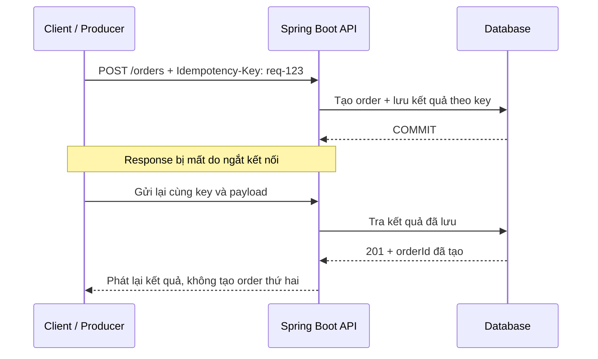
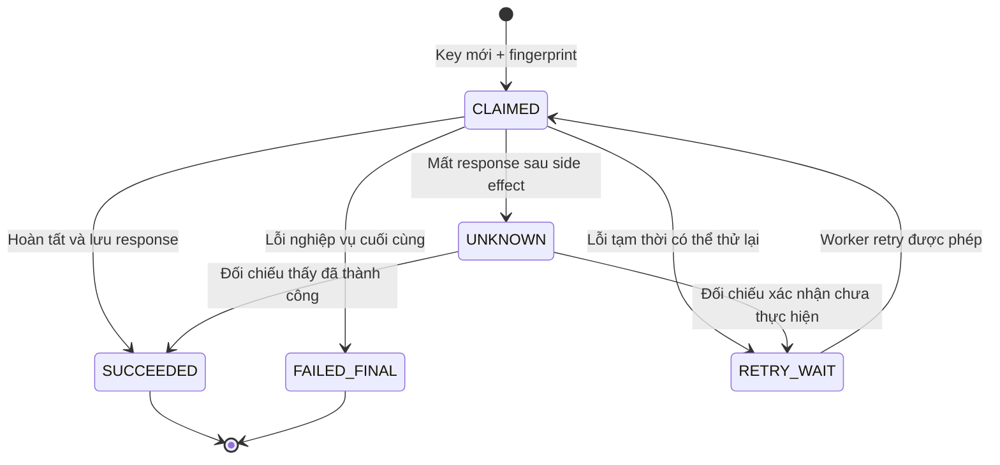
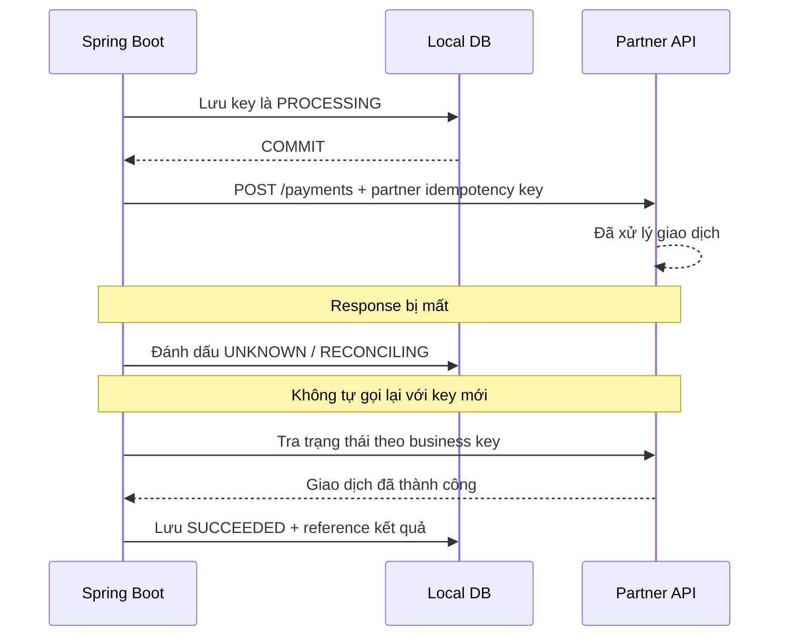

# Idempotency key, phạm vi định danh và thời hạn lưu kết quả

> **Chương:** Nhất quán và chống trùng  
> **Phạm vi:** Trong module **SPRING_BOOT_INTEGRATION**, một yêu cầu có thể đi qua HTTP client, cơ sở dữ liệu, cache, broker thông điệp và các adapter Spring Integration. Bài học tập trung vào cách dùng **idempotency key** để xử lý an toàn khi yêu cầu hoặc sự kiện đến lặp lại; xác định **phạm vi định danh** phù hợp; và quyết định **thời hạn lưu kết quả** đủ dài để chống xử lý trùng trong luồng tích hợp thực tế.

## 1. Bài toán: một thao tác có thể được gửi nhiều lần

Xét quy trình đối tác gửi yêu cầu tạo đơn hàng tới ứng dụng Spring Boot:

1. Client gửi `POST /orders` cùng một khóa nhận diện yêu cầu.
2. Server ghi đơn hàng vào database và commit.
3. Kết nối bị ngắt trước khi client nhận response.
4. Client không biết thao tác đã thành công hay chưa nên gửi lại.

Nếu lần gửi lại tạo một đơn mới, **cùng ý định nghiệp vụ đã tạo hai tác dụng phụ**. Vấn đề tương tự xảy ra với Kafka/RabbitMQ khi consumer ghi DB thành công nhưng chết trước khi commit offset/ack; broker có thể giao lại event.

**Idempotency** nghĩa là việc lặp lại *cùng một thao tác theo cùng hợp đồng* không tạo thêm tác dụng phụ ngoài dự kiến. Ứng dụng có thể trả lại kết quả đã ghi nhận hoặc xác định trạng thái đang xử lý, thay vì chạy lại một cách mù quáng.



**Không đồng nhất idempotency với “request chỉ được nhận một lần”.** Request vẫn có thể được gửi lại và xử lý qua nhiều tầng, nhưng thao tác nghiệp vụ phải đạt kết quả đúng theo hợp đồng.

## 2. Phân biệt idempotency key, business key và message ID

| Khái niệm | Ví dụ | Mục đích | Có thể thay thế nhau không? |
| --- | --- | --- | --- |
| **Idempotency key** | `req-20261121-abc` | Nhận diện **một lần thực hiện có chủ đích** khi retry | Không nhất thiết bằng mã đơn hay ID message |
| **Business key** | `externalOrderId=ORD-0042` | Nhận diện **thực thể hoặc thao tác nghiệp vụ** giữa các hệ thống | Có thể dùng để chống trùng dài hạn nếu ngữ nghĩa bảo đảm |
| **Event ID** | `eventId=evt-987` | Nhận diện một sự kiện cụ thể do producer phát | Phù hợp dedup consumer khi producer giữ ID ổn định |
| **Correlation ID / trace ID** | `corr-55` | Liên kết log và các bước xử lý trong một hành trình | Không dùng làm key chống trùng nếu nhiều thao tác dùng cùng correlation |
| **Broker offset / delivery tag** | Partition + offset, delivery tag | Quản lý vị trí/ack trong broker | Không thay thế định danh nghiệp vụ giữa các lần phát lại hoặc publish lại |

Một đơn hàng có thể trải qua nhiều thao tác hợp lệ như `create`, `confirm`, `cancel`. Nếu tất cả dùng duy nhất `orderId` làm key mà không có **operation**, thao tác confirm có thể bị coi nhầm là bản sao của create.

Ngược lại, hai HTTP request dùng **hai idempotency key khác nhau** nhưng cùng `externalOrderId` có thể vẫn là một yêu cầu tạo đơn trùng về nghiệp vụ. Vì thế, hệ thống quan trọng thường cần cả **idempotency record** lẫn **unique constraint trên business key**.

### Retry và redelivery khác nhau ở nguồn khóa

- **HTTP client retry:** client gửi **cùng idempotency key** cho các lần thử của **cùng một ý định**. Khi người dùng cố ý tạo một giao dịch mới, phải dùng key mới.
- **Broker consumer:** dùng `eventId` ổn định của producer và tên nguồn/consumer trong scope. Không tự sinh UUID mới mỗi lần nhận message vì sẽ phá khả năng phát hiện redelivery.
- **Batch/import:** nếu một file được nạp lại nhiều lần, có thể cần `importJobId + rowId` hoặc business key có tính ổn định, không dùng số thứ tự hàng một cách độc lập nếu các file khác nhau có thể trùng số.
- **Scheduled sync:** nếu muốn lần chạy sau được phép cập nhật cùng một thực thể, key nên gắn với **mốc thay đổi/version** hoặc khoảng xử lý có định nghĩa, thay vì cấm vĩnh viễn mọi thao tác trên thực thể đó.

## 3. Phạm vi định danh: key phải duy nhất *trong không gian nào*?

Một key đơn lẻ như `abc-123` thường chưa đủ để xác định một thao tác. Cần thiết kế **scope** là tập các thuộc tính phân biệt được những yêu cầu hợp lệ độc lập.

### 3.1. Đề xuất scope cho HTTP API

Một thiết kế thông dụng:

```text
(tenantId, operationCode, idempotencyKey)

tenantId          = tenant đã xác thực và được cấp quyền
operationCode     = order.create.v1
idempotencyKey    = giá trị client giữ ổn định khi retry
```

| Thuộc tính scope | Khi nào cần | Lý do |
| --- | --- | --- |
| **Tenant/account ID** | Ứng dụng đa khách hàng | Hai tenant có thể tình cờ sinh cùng chuỗi key mà vẫn có thao tác độc lập |
| **Operation code** | Có nhiều loại lệnh | `order.create` và `order.cancel` không vô tình chặn nhau |
| **Producer/client ID** | Nhiều ứng dụng độc lập dùng chung tenant, key không bảo đảm duy nhất toàn tenant | Tránh va chạm ngoài ý muốn; yêu cầu xác minh danh tính nguồn |
| **Version hợp đồng** | Khi thay đổi ngữ nghĩa thao tác | Phân biệt khi thật sự cần; tránh tự tách scope nếu phiên bản mới vẫn phải dedup cùng thao tác cũ |
| **Business key** | Dùng làm lớp bảo vệ nghiệp vụ độc lập | Chặn tạo trùng thực thể dù request gửi key mới |

**Không tin header `X-Tenant-Id` do client tự gửi để quyết định scope** nếu chưa xác thực và phân quyền. Tenant phải lấy từ ngữ cảnh xác thực đáng tin cậy hoặc so khớp nghiêm ngặt với identity của caller.

**Không mở rộng scope tùy tiện.** Ví dụ thêm `attemptNumber`, request timestamp hoặc connection ID vào scope làm mỗi lần retry trở thành một thao tác mới, khiến idempotency mất tác dụng. Ngược lại, scope quá hẹp sẽ chặn các thao tác hợp lệ của tenant/operation khác.

### 3.2. Đề xuất scope cho event consumer

Với consumer nhận event, một khóa inbox thường là:

```text
(consumerGroupOrHandlerId, producerId, eventId)
```

Nếu producer bảo đảm event ID duy nhất trên toàn hệ thống, `producerId` có thể không cần; nếu một event cần được **hai handler nghiệp vụ khác nhau** xử lý độc lập, cần tách scope theo handler/subscription. Không dùng chung một bản ghi “đã xử lý” toàn cục để ngăn handler B chỉ vì handler A đã nhận event.

**Ví dụ:** cùng `evt-41` cần cập nhật “order projection” và “analytics projection”. Cả hai consumer phải được thực thi một lần mỗi consumer; scope nên chứa danh tính handler tương ứng. Nếu consumer group đổi tên khi triển khai, cần có kế hoạch chuyển trạng thái inbox để tránh replay mọi event cũ không cần thiết.

## 4. Một key chỉ được gắn với một payload có ý nghĩa

Nếu client gửi cùng key nhưng **thay đổi nội dung yêu cầu**, server không nên âm thầm trả kết quả của payload cũ:

```text
Lần 1:
Idempotency-Key: req-123
POST /orders
{"externalOrderId":"ORD-0042","amountMinor":100000,"currency":"VND"}

Lần 2:
Idempotency-Key: req-123
POST /orders
{"externalOrderId":"ORD-0042","amountMinor":999999,"currency":"VND"}

Kết quả:
Phát hiện fingerprint khác nhau -> từ chối tái sử dụng key (ví dụ HTTP 409)
```

Giải pháp là lưu **request fingerprint/digest** cùng key. Fingerprint được tính từ các trường có **ý nghĩa nghiệp vụ** và phiên bản thuật toán chuẩn hóa đã thỏa thuận.

Quy trình đề xuất:

1. Xác thực nguồn gửi và scope.
2. Kiểm tra cú pháp, độ dài, kích thước request và schema dữ liệu.
3. Chuẩn hóa các trường có ý nghĩa: cách biểu diễn số tiền, enum, timestamp, ký tự, thứ tự field JSON nếu hợp đồng cho phép.
4. Tạo chuỗi/bytes canonical có tính ổn định qua retry rồi tính digest (ví dụ SHA-256).
5. Tra hoặc claim `(scope, key)`; nếu digest khác, phản hồi **key reused with different request**.

**Không đơn thuần hash raw JSON bytes** nếu client được phép thay đổi whitespace/thứ tự property nhưng vẫn là cùng một yêu cầu. Ngược lại, cũng không loại bỏ khác biệt có ý nghĩa nghiệp vụ khi canonicalize, ví dụ `amountMinor` khác nhau, `null` và field vắng mặt nếu chúng mang ngữ nghĩa khác.

Digest giúp so khớp yêu cầu và giảm nhu cầu lưu plaintext, nhưng **không phải cơ chế xác thực nguồn gửi**. Key vẫn cần kiểm tra quyền truy cập theo tenant và không được dùng để đọc kết quả của tenant khác.

### 4.1. Tạo key ở phía client

Với HTTP API, client thường tạo **giá trị ngẫu nhiên khó đoán, đủ entropy** như UUID v4 và giữ nguyên trong mọi lần retry của cùng thao tác. Không dùng timestamp đơn thuần hoặc số tự tăng cục bộ làm khóa toàn cục khi chúng có khả năng va chạm.

Giới hạn độ dài, charset và cách truyền key (ví dụ header `Idempotency-Key`) để tránh dữ liệu header không kiểm soát; có thể lưu digest/HMAC của key nếu cần không giữ key thô lâu dài. Khóa riêng lẻ không cấp quyền: authentication và authorization vẫn áp dụng ở mọi lần gửi.

## 5. Vòng đời một idempotency record

Tùy nghiệp vụ, hệ thống có thể lưu những trạng thái:

| Trạng thái | Ý nghĩa | Phản hồi khi cùng key được gửi lại |
| --- | --- | --- |
| **CLAIMED / PROCESSING** | Một worker đã nhận trách nhiệm, kết quả chưa rõ | Trả “đang xử lý”, chờ có giới hạn hoặc hướng dẫn retry sau |
| **SUCCEEDED** | Side effect và kết quả đã hoàn tất | Trả lại kết quả đã lưu nếu fingerprint khớp |
| **FAILED_FINAL** | Lỗi nghiệp vụ xác định và hợp đồng chọn lưu kết quả đó | Trả lại lỗi cuối cùng đã ghi nhận |
| **RETRY_WAIT** | Lỗi tạm thời; có thể xử lý lại có kiểm soát | Không khởi tạo một execution mới không được điều phối |
| **UNKNOWN / RECONCILING** | Có khả năng downstream đã xử lý nhưng mất xác nhận | Tra cứu trạng thái trước khi retry side effect |

**Đây là trạng thái nghiệp vụ do ứng dụng thiết kế**, không phải state machine Spring Boot tự tạo khi có một header. Đối với thao tác chỉ ghi trong **một database transaction**, có thể không cần lưu `PROCESSING` bền vững: insert key, ghi nghiệp vụ và lưu response cùng transaction. Với thao tác gọi hệ thống ngoài kéo dài, cần claim/lease và trạng thái phục hồi riêng.



Lưu `response status`, response body hoặc **tham chiếu kết quả bất biến** theo hợp đồng. Đừng mặc định mọi response đều đáng lưu: kết quả có token, dữ liệu cá nhân hoặc thông tin hết hạn có thể cần cơ chế mã hóa, redaction hoặc tái dựng từ trạng thái nghiệp vụ được chốt.

### Phát lại response hay chỉ trả cùng business result?

Có hai chính sách phổ biến:

- **Replay chính xác:** lưu HTTP status và một response đã chuẩn hóa; retry trả cùng status/body. Dễ giữ đúng hợp đồng khi client mất response.
- **Replay theo trạng thái nghiệp vụ:** lưu `orderId` và trạng thái cuối rồi tạo response mới (ví dụ vẫn cùng `orderId`). Phù hợp khi body chứa phần thay đổi theo thời gian, nhưng phải nêu rõ những field có thể khác và không làm tác dụng phụ xảy ra lần nữa.

Không chọn ngẫu nhiên cách trả lỗi. Một số lỗi validation xảy ra **trước khi nhận key**, có thể không lưu; lỗi nghiệp vụ cuối cùng sau claim có thể lưu theo hợp đồng. Lỗi tạm thời chưa xác định kết quả cần cơ chế retry/reconciliation chứ không nên lưu nhầm thành kết quả cuối.

## 6. Ví dụ Spring Boot + PostgreSQL: ghi kết quả cùng transaction DB

Giả sử API tạo đơn trong **cùng một database** với bảng idempotency. Mục tiêu là tránh race condition khi hai request giống nhau đến đồng thời, và có khả năng phát lại kết quả sau khi commit mà client mất response.

### 6.1. Migration và khóa duy nhất

```sql
CREATE TABLE orders (
    id VARCHAR(36) PRIMARY KEY,
    tenant_id VARCHAR(80) NOT NULL,
    external_order_id VARCHAR(80) NOT NULL,
    amount_minor BIGINT NOT NULL CHECK (amount_minor >= 0),
    currency VARCHAR(3) NOT NULL,
    CONSTRAINT uk_orders_tenant_external UNIQUE (tenant_id, external_order_id)
);

CREATE TABLE api_idempotency (
    tenant_id VARCHAR(80) NOT NULL,
    operation_code VARCHAR(80) NOT NULL,
    idempotency_key VARCHAR(160) NOT NULL,
    request_digest CHAR(64) NOT NULL,
    response_http_status INTEGER,
    response_json TEXT,
    created_at TIMESTAMPTZ NOT NULL DEFAULT CURRENT_TIMESTAMP,
    expires_at TIMESTAMPTZ NOT NULL,
    PRIMARY KEY (tenant_id, operation_code, idempotency_key),
    CONSTRAINT ck_response_both_or_none CHECK (
        (response_http_status IS NULL AND response_json IS NULL)
        OR (response_http_status IS NOT NULL AND response_json IS NOT NULL)
    )
);

CREATE INDEX idx_api_idempotency_expiry
    ON api_idempotency (expires_at);
```

Hai ràng buộc bảo vệ **hai điều khác nhau**:

- `PRIMARY KEY (tenant_id, operation_code, idempotency_key)` đảm bảo một lần thực thi cho cùng request identity trong khoảng bản ghi còn tồn tại.
- `UNIQUE (tenant_id, external_order_id)` bảo vệ bất biến **không tạo hai order cho cùng mã đối tác**, kể cả client tạo key mới.

Tạo bảng qua Flyway/Liquibase hoặc migration có version; không dựa vào `ddl-auto=update` cho thay đổi schema production. Thời gian `expires_at` dùng đồng hồ DB và kiểu `TIMESTAMPTZ` để tránh lệch timezone giữa nhiều instance.

### 6.2. Claim và ghi business result nguyên tử

Ví dụ service dùng Spring JDBC trên PostgreSQL. `requestDigest` đã được tính bằng một hàm canonicalization có phiên bản **sau khi validate DTO**; `tenantId` lấy từ ngữ cảnh người dùng đã xác thực. Ví dụ giả định request body đã được kiểm tra cú pháp và key đã vượt qua kiểm tra độ dài/charset.

```java
package com.example.integration.orders;

import java.util.Objects;
import java.util.UUID;
import org.springframework.jdbc.core.JdbcTemplate;
import org.springframework.stereotype.Service;
import org.springframework.transaction.annotation.Transactional;

record CreateOrder(String externalOrderId, long amountMinor, String currency) {}
record StoredHttpResult(int status, String json) {}
record SavedResponse(String digest, Integer status, String json) {}

@Service
public class CreateOrderService {
    private static final String OPERATION = "order.create.v1";
    private final JdbcTemplate jdbc;

    public CreateOrderService(JdbcTemplate jdbc) {
        this.jdbc = jdbc;
    }

    @Transactional
    public StoredHttpResult create(
            String tenantId,
            String key,
            String requestDigest,
            CreateOrder request
    ) {
        int claimed = jdbc.update("""
            INSERT INTO api_idempotency (
                tenant_id, operation_code, idempotency_key,
                request_digest, expires_at
            )
            VALUES (?, ?, ?, ?, CURRENT_TIMESTAMP + INTERVAL '72 hours')
            ON CONFLICT (tenant_id, operation_code, idempotency_key)
            DO NOTHING
            """,
            tenantId, OPERATION, key, requestDigest
        );

        if (claimed == 0) {
            SavedResponse existing = jdbc.queryForObject("""
                SELECT request_digest, response_http_status, response_json
                FROM api_idempotency
                WHERE tenant_id = ?
                  AND operation_code = ?
                  AND idempotency_key = ?
                """,
                (rs, index) -> new SavedResponse(
                        rs.getString("request_digest"),
                        (Integer) rs.getObject("response_http_status"),
                        rs.getString("response_json")
                ),
                tenantId, OPERATION, key
            );
            if (existing == null) {
                throw new IllegalStateException("Idempotency record missing");
            }
            if (!Objects.equals(existing.digest(), requestDigest)) {
                throw new IdempotencyConflictException(
                        "Key reused with different request"
                );
            }
            if (existing.status() == null) {
                throw new IllegalStateException(
                        "Result not yet finalized; retry with same key"
                );
            }
            return new StoredHttpResult(
                    existing.status(), existing.json()
            );
        }

        // Đây là thao tác DB cùng transaction với bản ghi idempotency.
        String orderId = UUID.randomUUID().toString();
        jdbc.update("""
            INSERT INTO orders (
                id, tenant_id, external_order_id, amount_minor, currency
            ) VALUES (?, ?, ?, ?, ?)
            """,
            orderId,
            tenantId,
            request.externalOrderId(),
            request.amountMinor(),
            request.currency()
        );

        String response = "{\"orderId\":\"" + orderId + "\"}";
        jdbc.update("""
            UPDATE api_idempotency
               SET response_http_status = 201, response_json = ?
             WHERE tenant_id = ? AND operation_code = ?
               AND idempotency_key = ?
            """,
            response, tenantId, OPERATION, key
        );
        return new StoredHttpResult(201, response);
    }
}

class IdempotencyConflictException extends RuntimeException {
    IdempotencyConflictException(String message) {
        super(message);
    }
}
```

**Giới hạn của ví dụ:** phần nối JSON bằng chuỗi chỉ minh họa một response chứa UUID do server tạo và không chứa ký tự tùy ý; trong ứng dụng thật, dùng `ObjectMapper` để serialize DTO theo hợp đồng. Nên giới hạn kích thước response lưu lại và xử lý thông tin nhạy cảm; mã trên tập trung vào cơ chế transaction và uniqueness.

Đối với PostgreSQL ở isolation mặc định `READ COMMITTED`, hai transaction cùng insert khóa duy nhất sẽ bị cơ chế unique index điều phối: một transaction có thể phải **chờ transaction kia kết thúc** rồi mới xác định insert thành công hay bị conflict. Nếu transaction đầu tiên commit, transaction sau thường đi vào nhánh đọc kết quả; nếu transaction đầu tiên rollback, transaction sau có thể claim và thực thi.

Khi **insert order** hoặc **lưu response** thất bại, cả transaction rollback; bản ghi idempotency chưa commit cũng rollback. Nhờ đó, database không lưu một order thành công mà thiếu kết quả idempotency trong mẫu thiết kế này.

**Không bảo đảm mọi request đồng thời luôn trả ngay:** một request có thể phải chờ khóa DB, hết lock timeout hoặc thấy lỗi kết nối. API phải phân biệt trường hợp kết quả đang được xử lý và hướng dẫn client retry cùng key; không tự tạo key mới chỉ vì chờ lâu.

### 6.3. Mapping kết quả HTTP

Controller nhận header `Idempotency-Key`, xác thực người gọi, chuẩn hóa/validate payload, tính digest, gọi `CreateOrderService` **thông qua Spring-managed bean** để `@Transactional` có hiệu lực, rồi trả status/body được lưu.

Hợp đồng có thể chọn:

| Trường hợp | Response ví dụ | Ghi chú |
| --- | --- | --- |
| Key mới, dữ liệu hợp lệ | `201 Created` + `orderId` | Chỉ xác nhận thành công sau khi DB commit |
| Retry cùng key, cùng digest, đã hoàn tất | `201 Created` + **cùng** `orderId` | Có thể gắn header riêng báo response được phát lại |
| Cùng key nhưng digest khác | `409 Conflict` + mã `IDEMPOTENCY_KEY_REUSED` | Không thực thi payload mới |
| Request đang được xử lý | `409`/`202` và `Retry-After`, theo hợp đồng | Không mở thêm execution độc lập |
| Thiếu key trong API bắt buộc dùng key | `400 Bad Request` | Trả mã lỗi có cấu trúc |
| Cùng business key nhưng key mới | Conflict hoặc kết quả cũ theo **quy tắc nghiệp vụ** | Unique constraint bảo vệ bất biến của order |

Không có một mã HTTP duy nhất bắt buộc cho mọi triển khai idempotency; chọn và tài liệu hóa mã lỗi, body và retry behavior để client không hiểu sai. Nếu xử lý bất đồng bộ, `202 Accepted` nên đi cùng resource/status URL hoặc cơ chế polling theo hợp đồng.

## 7. Khi thao tác đi qua HTTP đối tác, broker hoặc nhiều database

Giải pháp một transaction ở mục 6 chỉ áp dụng khi **side effect và bản ghi kết quả được lưu nguyên tử trong cùng một database transaction**. Nếu flow gọi HTTP API đối tác hay phát broker message, một `@Transactional` JPA/JDBC **không rollback được** side effect đã xảy ra ở hệ thống khác.

Ví dụ nguy hiểm:



Với tác vụ dài hoặc không có transaction chung, nên thiết kế:

1. **Claim atomically:** tạo record `PROCESSING` kèm chủ sở hữu/lease, request digest, deadline và số lần thử; unique key chặn worker khác claim cùng scope.
2. **Thực hiện tác vụ bên ngoài:** gọi partner với **chính idempotency key được partner chấp nhận**, hoặc dùng business key có thể tra cứu trạng thái; đặt timeout và giới hạn retry.
3. **Finalize:** ghi kết quả `SUCCEEDED`/`FAILED_FINAL` hoặc trạng thái cần đối chiếu.
4. **Recovery:** worker quét lease quá hạn; tra trạng thái thực tế trước khi tái thực thi side effect chưa xác định.
5. **Fencing/ownership:** chỉ worker đang giữ lease/token hợp lệ mới được cập nhật trạng thái hoặc phát bước tiếp theo. Nếu lease hết hạn giữa chừng, worker cũ có thể vẫn chạy; cần version/fencing token và thiết kế downstream chịu được request trùng.

**Không giữ transaction DB mở trong lúc chờ HTTP đối tác** vì tăng lock time và chiếm connection. Cũng không tự động xóa claim khi timeout: timeout thường chỉ phản ánh phía caller đã hết thời gian chờ, không chứng minh partner chưa xử lý.

### 7.1. Transactional outbox giúp phần “DB → broker”

Nếu một service cần vừa ghi order vừa phát `OrderCreated`:

- Trong **một transaction DB**, lưu order và bản ghi **outbox** có event ID ổn định.
- Sau commit, publisher riêng lấy outbox và publish tới broker.
- Publisher đánh dấu đã gửi, nhưng có thể publish lặp lại nếu broker nhận thành công còn acknowledgment mất.
- Consumer dùng inbox/dedup theo `consumerScope + producerId + eventId` để xử lý an toàn.

Outbox bảo đảm sự kiện có thể được phát sau khi DB commit theo thiết kế, **không tự tạo “exactly once” từ DB đến broker và mọi consumer**. Idempotency của API tạo order và idempotency của consumer sự kiện là hai phạm vi khác nhau, có thể cùng dùng một business ID nhưng có record/ownership riêng.

## 8. Inbox cho consumer: dedup phải cùng transaction với side effect

Giả sử consumer Kafka nhận `OrderCreated(eventId)` rồi ghi projection vào PostgreSQL. Mẫu inbox an toàn:

```sql
CREATE TABLE processed_events (
    consumer_id VARCHAR(100) NOT NULL,
    producer_id VARCHAR(100) NOT NULL,
    event_id VARCHAR(160) NOT NULL,
    processed_at TIMESTAMPTZ NOT NULL DEFAULT CURRENT_TIMESTAMP,
    PRIMARY KEY (consumer_id, producer_id, event_id)
);
```

Trong một transaction DB:

```text
BEGIN;
INSERT INTO processed_events(consumer_id, producer_id, event_id)
VALUES ('order-projection', 'checkout-service', :event_id)
ON CONFLICT DO NOTHING;

IF inserted = 1:
    apply business update to projection tables;
ELSE:
    skip duplicate business update;

COMMIT;
Sau DB commit, broker container mới ack/commit offset theo chính sách.
```

Đây là **pseudocode giao dịch**, không phải một khối SQL PostgreSQL thực thi trực tiếp vì có `IF` ở tầng ứng dụng. Nếu cập nhật projection thất bại, transaction rollback cả inbox record; lần redelivery sau có thể thử lại. Nếu DB commit nhưng broker ack thất bại, redelivery gặp inbox record và không chạy side effect lần nữa.

Không đặt thao tác gọi HTTP đối tác bên trong cùng DB transaction rồi cho rằng inbox bảo vệ remote side effect. Cần cơ chế idempotency của đối tác, lệnh có thể tra cứu trạng thái hoặc outbox/job trung gian.

### Key dùng cho event phải ổn định qua các lần phát lại

Ví dụ producer xử lý một yêu cầu rồi publish lại sự kiện do network lỗi: **eventId nên giữ nguyên nếu đây là cùng event**. Nếu mỗi lần publish tạo `UUID.randomUUID()` mới, inbox không thể nhận biết hai message là cùng sự kiện. Nếu doanh nghiệp cố ý phát **một event mới** cho phiên bản trạng thái khác, cần event ID mới và sequence/business version tương ứng.

## 9. Redis có thể dùng cho claim nhanh, nhưng hiểu giới hạn

Một số luồng tích hợp dùng Redis để giảm tải và tránh hai worker chạy đồng thời:

```text
SET "claim:order.create:<tenant>:<key>" "<unique-token>" NX EX 120
```

Thao tác `SET NX EX` là nguyên tử ở Redis cho việc đặt claim với TTL. Tuy nhiên:

- TTL có thể hết hạn khi worker đầu còn làm việc, tạo cơ hội worker thứ hai claim.
- Redis có thể bị eviction, failover hoặc mất dữ liệu tùy cấu hình persistence; claim có thể không còn trong khi business side effect đã xảy ra.
- Sau timeout Redis, client không biết chắc `SET` đã được server thực hiện hay chưa.
- Nếu giải phóng claim, phải **so sánh token rồi xóa nguyên tử**; gọi `DEL` trực tiếp có nguy cơ xóa claim đã thuộc worker khác.

Vì vậy, Redis claim là một **lớp điều phối/giảm cạnh tranh**, không phải chứng minh giao dịch nghiệp vụ “exactly once”. Với thao tác quan trọng, nên dựa vào database unique constraint, inbox/outbox và khả năng kiểm tra trạng thái bền vững.

Redis cache lưu kết quả idempotency cũng có thể hữu ích với request nhiều và deadline ngắn, nhưng nếu key bị evict/expire sớm thì request cũ có thể được chạy lại. Hãy xác định **nguồn sự thật cuối cùng** là DB hoặc hệ thống đã thực thi side effect, và cân nhắc Redis chỉ là cache trước khi cho phép tái chạy.

## 10. Thời hạn lưu kết quả: TTL là một cam kết nghiệp vụ

**Retention window** là khoảng thời gian hệ thống cam kết còn nhận diện được những lần gửi lại cùng thao tác. Nếu key hết hạn quá sớm, client có thể retry một lệnh cũ và tạo side effect mới. Nếu lưu mọi kết quả vô hạn, chi phí và rủi ro dữ liệu nhạy cảm sẽ tăng.

TTL nên xuất phát từ **hành vi retry/replay thực tế**, không chọn ngẫu nhiên vì Redis hoặc bảng DB có trường `expires_at`.

### 10.1. Các đầu vào cần tính

| Yếu tố | Tại sao ảnh hưởng TTL? |
| --- | --- |
| **Thời gian retry của HTTP client** | Client có thể giữ cùng key trong nhiều giờ hoặc ngày sau lỗi mạng |
| **Timeout và retry của gateway/load balancer** | Có thể có lần gửi lại tự động trước khi client quyết định retry |
| **Broker retention/replay window** | Consumer có thể nhận lại event sau restart, rebalancing hoặc replay có chủ đích |
| **DLQ và kế hoạch replay thủ công** | Event cũ có thể được đưa về topic/queue sau vài ngày hoặc vài tuần |
| **Thời gian xử lý tối đa/lease** | Không xóa claim/result khi một tác vụ chưa được xác định kết quả |
| **Lag khi hệ thống gián đoạn** | Partner outage có thể khiến message đến trễ hơn lịch trình bình thường |
| **Khả năng đối chiếu trạng thái bên ngoài** | Nếu có lookup đáng tin cậy, có thể thiết kế recovery ngay cả khi record cũ đã được dọn |
| **Chính sách dữ liệu và chi phí lưu trữ** | Response chứa PII/payment data có thể không được giữ vô hạn |

Một cách hình dung sơ bộ:

```text
Retention tối thiểu của key
  >= khoảng retry/replay dài nhất mà hợp đồng cần chống trùng
   + biên độ cho độ trễ vận hành / đồng hồ / xử lý trễ
```

Đây là **quy tắc thiết kế**, không phải công thức kỹ thuật chính xác cho mọi broker/consumer. Nếu một event có thể được replay từ bản lưu trữ lịch sử sau vài tháng, TTL inbox vài ngày sẽ không đủ để bảo đảm “không xử lý trùng” khi replay đó diễn ra.

### 10.2. Ví dụ chọn thời hạn có căn cứ

| Bối cảnh giả định | Lựa chọn tham khảo | Điều kiện kèm theo |
| --- | --- | --- |
| API tạo báo cáo, client chỉ retry trong một giờ | Giữ kết quả lâu hơn cửa sổ retry và thời gian job chạy | Nếu tạo báo cáo lại là tác vụ hợp lệ, client phải dùng key mới |
| API tạo đơn, đối tác có thể retry trong ba ngày | Giữ record ít nhất qua khoảng đó và có biên độ vận hành | Unique `externalOrderId` vẫn bảo vệ order sau khi record hết hạn |
| Consumer có DLQ replay sau hai tuần | Inbox cần bao phủ lịch replay hoặc có business-version/constraint bền vững độc lập | Không xóa dedup record chỉ vì TTL cache ngắn |
| Thanh toán/hoàn tiền có nghĩa vụ chống trùng dài hạn | Duy trì business ledger/reference và khóa duy nhất bền vững | Không dựa vào một Redis TTL ngắn làm bảo đảm cuối |

Các thời hạn trên chỉ để **minh họa cách suy luận**, không phải mặc định của Spring Boot, Kafka, Redis hay một tiêu chuẩn HTTP. Chốt SLA với producer/consumer và nhóm vận hành trước khi đặt retention.

### 10.3. Retention khác thời hạn xử lý và thời gian sống của lease

- **Request timeout:** một lần client đợi bao lâu.
- **Processing lease:** worker được sở hữu claim trong bao lâu trước khi cần gia hạn hoặc điều tra.
- **Result retention:** kết quả và fingerprint được giữ trong bao lâu để replay/dedup.
- **Business record retention:** đơn hàng/giao dịch có thể phải giữ lâu hơn nhiều vì nghĩa vụ nghiệp vụ hoặc pháp lý.

Không lấy timeout HTTP 30 giây làm TTL idempotency 30 giây. Một tác vụ đang chạy có thể vượt timeout client mà vẫn hoàn thành, và client có thể retry nhiều ngày sau.

## 11. Xử lý key hết hạn và dọn dẹp kết quả

### 11.1. Khi record hết hạn, điều gì xảy ra?

Giả sử `expires_at` đã qua nhưng bản ghi vẫn nằm trong database. Với unique index, key **vẫn xung đột** cho đến khi bản ghi được xóa/di chuyển. Vì vậy:

1. Định nghĩa rõ `expires_at` là **mốc đủ điều kiện dọn**, hay mốc API **chấp nhận key như mới**.
2. Nếu cần reuse sau expiry, phải phối hợp dọn record và xử lý cạnh tranh bằng cơ chế atomically safe, không chỉ kiểm tra `now() > expires_at` rồi tự ý chạy lại.
3. Không xóa record đang `PROCESSING`/`UNKNOWN` chỉ vì đồng hồ qua một mốc TTL; cần đối chiếu trạng thái và lease.
4. Trước khi xóa record cuối, xác nhận có **business invariant** hoặc policy rõ ràng cho việc retry/replay sau retention.

Với bảng chỉ chứa bản ghi đã hoàn tất như mẫu transaction đơn ở mục 6, một job cleanup có thể xóa theo `expires_at` từng batch nhỏ, giới hạn lock/I/O và quan sát số lượng bản ghi bị xóa. Với flow đa hệ thống có trạng thái trung gian, cleanup phải dựa trên trạng thái và quy tắc recovery.

### 11.2. TTL không đồng nghĩa “thao tác được phép chạy lại”

Sau khi idempotency record đã bị dọn, cùng key có thể được xem là key mới theo chính sách. Điều đó **không biến một business operation lẽ ra chỉ xảy ra một lần thành hợp lệ**. Với order có external ID duy nhất hoặc payment ledger, business constraint vẫn phải chặn side effect lần thứ hai.

Nếu hợp đồng yêu cầu chống trùng **vĩnh viễn** theo một business ID, giữ một định danh/tombstone tối thiểu lâu dài (theo nghĩa vụ dữ liệu) hoặc cơ chế ledger có constraint bền vững. Có thể xóa response chứa dữ liệu nhạy cảm sớm hơn nhưng giữ hash/key nhận diện tối thiểu nếu phù hợp chính sách lưu trữ.

### 11.3. Dung lượng và tính toán sức chứa

Khi chọn retention, ước lượng:

```text
Số record tồn tại ổn định
  ≈ số thao tác có key mới mỗi ngày × số ngày giữ

Dung lượng lưu trữ thực tế
  ≈ số record × kích thước trung bình mỗi record
    + index, WAL, replication, backup, overhead
```

Nếu lưu toàn bộ body JSON lớn cho mọi request, retention dài có thể tạo ra nhiều dữ liệu và rủi ro bảo mật hơn cần thiết. Có thể lưu một `resultId` và một status code thay cho full response, miễn là khả năng phát lại kết quả đúng hợp đồng vẫn được đảm bảo.

Hệ thống nhiều instance nên chạy cleanup theo lịch có khóa/ownership hoặc dùng partitioning nếu dữ liệu lớn; giới hạn số bản ghi xóa mỗi đợt và tránh quét toàn bảng gây nghẽn sản xuất.

## 12. Các lỗi thiết kế làm idempotency mất hiệu lực

| Sai lầm | Hậu quả | Cách sửa |
| --- | --- | --- |
| Sinh key mới cho mỗi retry | Mọi lần gửi lại bị coi là thao tác mới | Client giữ key ổn định theo một ý định |
| Dùng mỗi `orderId` cho mọi operation | Create/confirm/cancel chặn lẫn nhau | Thêm operation code trong scope |
| Không có tenant/client scope | Va chạm key hoặc đọc chéo kết quả | Dùng identity đã xác thực và kiểm tra quyền |
| Không đối chiếu fingerprint | Cùng key có thể áp dụng payload khác | Hash canonical payload; conflict nếu không khớp |
| Chỉ `SELECT` rồi `INSERT` không unique constraint | Hai request song song cùng chạy side effect | Unique index + transaction/atomic claim |
| Lưu key và tạo order ở hai transaction không có recovery | Order đã commit nhưng record kết quả chưa có | Cùng DB transaction hoặc state machine/reconciliation |
| Chỉ dùng Redis TTL để chống trùng giao dịch quan trọng | Eviction/expiry/failover có thể cho phép chạy lại | Business unique constraint/inbox/ledger bền vững |
| TTL ngắn hơn khoảng retry/DLQ replay | Message cũ tạo side effect mới | Thiết kế retention theo replay SLA |
| Lưu vĩnh viễn response có dữ liệu nhạy cảm | Tăng rủi ro bảo mật và chi phí | Retention theo policy, mã hóa/redact/lưu tham chiếu |
| Ack broker trước khi DB commit | Crash có thể làm mất side effect | Điều phối ack sau commit; xử lý redelivery bằng inbox |
| Retry side effect sau timeout mà không đối chiếu | Partner có thể đã xử lý request lần đầu | Query status và dùng partner idempotency key |
| Dùng key làm metric tag | Cardinality khổng lồ, tốn chi phí metrics | Tag theo operation, result/replay/conflict, tenant group |

## 13. Quan sát và bảo mật

Một hệ thống idempotency tốt cần trả lời: *bao nhiêu request mới*, *bao nhiêu request được replay*, *bao nhiêu key bị tái sử dụng sai*, *bao nhiêu thao tác đang chờ không thể đối chiếu*.

Các metric gợi ý (tên do ứng dụng đặt):

- `idempotency_claim_new_total`: key mới được claim.
- `idempotency_replay_total`: yêu cầu cùng key và fingerprint nhận lại kết quả.
- `idempotency_conflict_total`: cùng key, payload khác.
- `idempotency_processing_wait_total`: request gặp tác vụ đang xử lý.
- `idempotency_unknown_total` và `idempotency_reconciliation_duration`: kết quả chưa xác định, thời gian đối chiếu.
- `idempotency_expired_removed_total` và `idempotency_storage_rows`: cleanup và sức chứa.
- `consumer_inbox_duplicate_total`: event được nhận lại nhưng side effect không chạy.

Không dùng `idempotencyKey`, `eventId`, `orderId` hoặc ID người dùng làm **metric tag**. Trong log/trace, có thể dùng digest của key hoặc correlation ID đã được xử lý theo chính sách bảo mật. Giới hạn quyền truy cập response đã lưu theo tenant, mã hóa khi cần, tránh xuất nguyên request body/credential/token ra log hoặc DLQ.

Key từ client là dữ liệu không tin cậy: giới hạn độ dài và ký tự, rate limit, không cho phép key lạ tạo storage vô hạn; luôn xác thực/quyền truy cập trước khi trả lại kết quả từ record cũ. Hash request để so khớp không thay kiểm tra schema, chữ ký, authentication hay authorization.

## 14. Kiểm thử các tình huống khó

| Kịch bản | Tiêu chí đạt |
| --- | --- |
| Một request mới | Side effect chạy một lần; lưu đúng key/digest/result |
| Retry cùng key, cùng payload sau commit | Trả lại cùng result hoặc business result; không tạo bản ghi thứ hai |
| Cùng key nhưng amount/currency khác | Conflict rõ; không cập nhật kết quả cũ |
| Hai request đồng thời cùng key | Chỉ một transaction claim; request còn lại chờ/trả kết quả hoặc trạng thái đang xử lý |
| Hai request khác key nhưng cùng externalOrderId | Unique business constraint ngăn tạo hai order |
| Commit DB thành công, HTTP response mất | Retry lấy kết quả đã lưu, không tái thực thi |
| Transaction DB rollback trước commit | Claim/side effect cùng rollback; lần sau được phép xử lý đúng |
| Broker redelivery sau DB commit nhưng trước ack | Inbox phát hiện duplicate; không cập nhật projection lần nữa |
| Side effect HTTP bên ngoài thành công nhưng reply mất | Recovery tra cứu remote status; không tự tạo lệnh mới |
| Key hết hạn ngay lúc nhiều request đến | Chính sách expiry/cleanup không cho phép hai side effect cạnh tranh |
| Replay từ DLQ sau retention | Có business constraint hoặc chính sách reconciliation độc lập |
| Sai tenant, key quá dài hoặc không có quyền | Từ chối an toàn, không lộ response của tenant khác |
| Cleanup khi worker đang xử lý | Không xóa claim chưa đối chiếu; không làm mất trạng thái recovery |

**Cách kiểm thử:** dùng Spring Boot integration test với PostgreSQL thật (có thể chạy qua Testcontainers) để xác minh unique index, transaction và behavior `ON CONFLICT` dưới concurrency. Mô phỏng mất response ở ranh giới HTTP, broker redelivery và trạng thái downstream “đã xử lý nhưng không phản hồi”. Unit test hash/canonicalization có ích, nhưng mock repository **không chứng minh** được tính nguyên tử của DB.

Để kiểm thử retention, kiểm soát đồng hồ bằng `Clock` ở code ứng dụng hoặc môi trường test tương ứng; với SQL dùng `CURRENT_TIMESTAMP`, cần thiết kế test rõ ràng cho mốc hết hạn và việc cleanup. Đừng dựa vào `Thread.sleep()` dài khiến test dễ chập chờn.

## 15. Quy trình thiết kế cho một luồng tích hợp mới

1. **Định nghĩa thao tác được chống trùng:** một API command, một event cho mỗi consumer, hay một business state transition.
2. **Chọn scope:** tenant/client/producer, operation và key ổn định; lập tài liệu về ý nghĩa của từng thành phần.
3. **Chốt contract của key:** ai tạo, độ dài, charset, khi nào giữ nguyên, khi nào sinh mới; có bắt buộc trong API hay không.
4. **Chốt fingerprint:** trường nghiệp vụ và canonicalization; quy tắc khi key dùng lại với payload khác.
5. **Chọn nguồn sự thật:** DB unique index/inbox/ledger; Redis cache/claim chỉ hỗ trợ khi phù hợp.
6. **Đặt transaction boundary:** nếu mọi side effect trong một DB thì ghi key + nghiệp vụ + kết quả cùng transaction; nếu đi ngoài DB, dùng claim/lease/reconciliation/outbox.
7. **Xác định result replay:** trả lại HTTP status/body nào, cách báo `PROCESSING`, `FAILED_FINAL` hoặc `UNKNOWN`.
8. **Tính retention:** retry/replay SLA, DLQ, outage, thời gian xử lý, chính sách dữ liệu; xác định khi nào cleanup và khi nào business constraint còn hiệu lực.
9. **Kiểm thử cạnh tranh và lỗi mạng:** commit rồi mất response, crash trước ack, retry sau downtime, expiry và replay cũ.
10. **Quan sát:** tỷ lệ replay/conflict, record chờ, reconciliation backlog, lỗi cleanup và storage growth.

### Câu hỏi tự kiểm tra

1. Vì sao `Idempotency-Key` khác `externalOrderId` và cần cả hai trong API tạo đơn?
2. Hai tenant cùng gửi `key=abc` có được tạo hai order độc lập không? Scope nào quyết định?
3. Nếu cùng key nhưng số tiền khác, trả lại kết quả cũ có nguy hiểm ở đâu?
4. Vì sao check-then-insert thiếu unique constraint không chống được hai request đồng thời?
5. Điều gì xảy ra khi database commit nhưng HTTP response bị mất?
6. Tại sao TTL idempotency 30 giây không đủ chỉ vì HTTP timeout 30 giây?
7. Vì sao replay DLQ sau vài tuần có thể vượt phạm vi chống trùng của một cache TTL vài ngày?
8. Khi nào có thể xóa response nhưng vẫn phải giữ business key/tombstone lâu dài?
9. Tại sao cùng transaction DB không thể rollback lệnh HTTP đã được đối tác thực hiện?
10. Với hai consumer khác nhau xử lý cùng một event, scope inbox phải thiết kế thế nào?

**Ghi nhớ:** Idempotency key chỉ có ý nghĩa khi đi cùng **scope đúng, fingerprint ổn định, thao tác claim nguyên tử, khả năng lưu/phát lại kết quả và retention phù hợp cửa sổ retry/replay**. Redis, cache và broker không tự mang lại exactly-once xuyên nhiều hệ thống. Với Spring Boot, nên bảo vệ bất biến nghiệp vụ bằng unique constraint/ledger bền vững, đặt transaction đúng ranh giới, xây cơ chế đối chiếu khi mất xác nhận và kiểm thử tình huống có thông điệp trùng thực sự.
