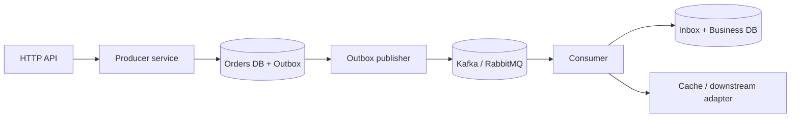
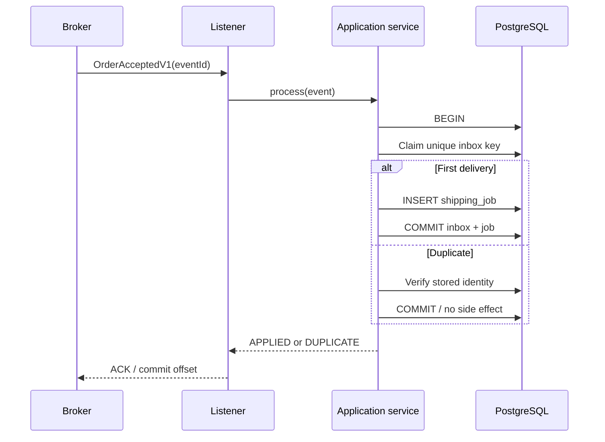

# Inbox, ràng buộc duy nhất và phát hiện thông điệp đã xử lý

Trong **SPRING_BOOT_INTEGRATION**, một thao tác có thể bắt đầu bằng HTTP request, được ghi vào PostgreSQL, phát qua Kafka/RabbitMQ, rồi được consumer đưa qua các adapter Spring Integration đến database, cache hoặc dịch vụ bên ngoài. Khi một phần luồng lỗi, hệ thống thường **gửi lại** thông điệp để tránh mất dữ liệu. Nhưng gửi lại cũng tạo nguy cơ ghi nhận cùng đơn hàng hai lần, trừ tiền hai lần, gửi hai email hoặc thay đổi trạng thái sai.

Chương **Nhất quán và chống trùng** giải quyết vấn đề này bằng một mẫu quan trọng: **inbox** (sổ ghi nhận thông điệp đã xử lý) kết hợp **ràng buộc duy nhất ở nơi lưu trữ bền vững** và **transaction bao quanh dấu đã xử lý cùng tác động nghiệp vụ**. Mục tiêu không phải ngăn broker giao trùng bằng mọi giá, mà là giữ **tác động nghiệp vụ đúng** dù một thông điệp xuất hiện nhiều lần.

Bài học tập trung vào **Inbox, ràng buộc duy nhất và phát hiện thông điệp đã xử lý**. Ví dụ minh họa dùng Java 17+, Spring Boot 3.x, Spring JDBC, PostgreSQL và các mô hình consumer của Kafka/AMQP. Với công nghệ hoặc phiên bản khác, nguyên tắc giữ nguyên nhưng syntax SQL, transaction và ack phải được kiểm tra riêng.

## 1. Mục tiêu học tập

Sau bài này, bạn có thể:

1. Phân biệt message ID, event ID, correlation ID, idempotency key và business key; xác định phạm vi khóa chống trùng đúng.
2. Giải thích vì sao **at-least-once delivery** thường dẫn đến xử lý lặp và vì sao “exactly once” không tự bao trùm database/HTTP.
3. Thiết kế bảng inbox, unique constraint và transaction để ghi dấu xử lý cùng side effect.
4. Cài đặt consumer idempotent bằng Spring JDBC và PostgreSQL `INSERT ... ON CONFLICT DO NOTHING`, xử lý xung đột ID/nội dung.
5. Phân biệt mô hình **ghi dấu khi hoàn tất** trong transaction ngắn với **claim/lease/state machine** cho công việc dài hoặc side effect ngoài database.
6. Xác định thứ tự ack Kafka/RabbitMQ, retry/DLQ, replay và cách dọn inbox mà không làm phát sinh lỗi trùng sau này.
7. Viết integration/concurrency test và thiết lập observability để chứng minh tính nhất quán qua các tình huống crash.

## 2. Vì sao message được xử lý nhiều hơn một lần?

Giả sử Kafka consumer nhận event `OrderAcceptedV1`, ghi một `shipping_job` vào database rồi xác nhận đã xử lý. Nếu process dừng **sau khi database commit nhưng trước khi commit offset**, lần khởi động sau có thể đọc lại event đó. Với RabbitMQ, một delivery đã xử lý DB nhưng chưa được **ack** cũng có thể được broker giao lại.

```mermaid
sequenceDiagram
    participant B as Broker
    participant C as Consumer
    participant D as PostgreSQL
    B->>C: OrderAccepted(eventId=evt-123)
    C->>D: BEGIN; INSERT shipping_job; COMMIT
    Note over C: Process crash trước ack
    B->>C: Redelivery cùng eventId
    C->>D: INSERT shipping_job lần nữa?
```

Những tình huống gây xử lý lặp:

- **Mất ack/commit offset** sau khi thao tác nghiệp vụ đã hoàn tất.
- **Retry của producer** khi broker đã nhận message nhưng producer chưa thấy confirm.
- **Client HTTP retry** vì phản hồi bị mất sau khi server đã commit.
- **Kafka rebalance**, consumer restart hoặc quy trình replay/reset offset.
- **RabbitMQ requeue**, dead-letter rồi redrive, hoặc chuyển giao delivery sau lỗi.
- **Outbox publisher** gửi được event rồi chết trước khi ghi dấu `published`.
- **Nhiều instance** cùng nhận một business command từ các nguồn khác nhau.

**Không nên diễn giải phát trùng là một lỗi triển khai đơn lẻ.** Nhiều hệ thống chủ động chọn *at-least-once delivery* để ưu tiên không mất dữ liệu; xử lý trùng là nhiệm vụ của thiết kế nghiệp vụ.

| Khái niệm | Giới hạn bảo đảm | Điều phải làm thêm |
| --- | --- | --- |
| **At-most-once delivery** | Có thể mất message khi lỗi, ít phát lại theo cơ chế đã chọn | Không phù hợp nếu không được phép mất công việc. |
| **At-least-once delivery** | Cố phát lại khi chưa xác nhận hoàn tất; có thể giao trùng | Consumer phải idempotent hoặc có inbox. |
| **Exactly-once trong phạm vi broker** | Có thể bảo đảm một số thao tác trong phạm vi transaction/broker cụ thể | Không tự biến HTTP, DB, Redis và email thành một transaction phân tán. |
| **Exactly-once business effect** | Dữ liệu nghiệp vụ cuối cùng không bị nhân đôi | Cần unique constraint, trạng thái, transaction và/hoặc idempotency tại điểm phát sinh side effect. |

Với Kafka, chức năng transactional producer và các bảo đảm exactly-once dành cho những luồng phù hợp **không thay thế** một unique constraint trên PostgreSQL nếu consumer tạo tác động ở database riêng. Với RabbitMQ, publisher confirms và consumer acknowledgements cũng không cấu thành một commit nguyên tử xuyên PostgreSQL và broker.

## 3. Inbox là gì và khác outbox như thế nào?

**Inbox** là tập dữ liệu bền vững ở **phía nhận** để ghi nhận một message/event/business operation đã được xử lý trong phạm vi đã xác định. Nó giúp consumer trả lời: “Thông điệp logic này đã từng tạo tác động thành công tại đây chưa?”.

**Outbox** nằm ở **phía phát**, giúp ghi thay đổi dữ liệu nghiệp vụ và ý định gửi event trong cùng transaction DB. Outbox có thể gửi lại message; inbox ở phía nhận chống tác động lặp.



| Câu hỏi | Outbox | Inbox |
| --- | --- | --- |
| Ở phía nào? | Producer | Consumer |
| Ghi lại điều gì? | Event/command **cần được phát** | Message/operation **đã tạo hiệu ứng theo định nghĩa** |
| Nguyên tử với dữ liệu nào? | Thay đổi nghiệp vụ ở DB phía phát | Tác động nghiệp vụ ở DB phía nhận, nếu dùng cùng transaction |
| Chịu được tình huống nào? | DB commit nhưng process chết trước publish | DB commit nhưng process chết trước ack/offset commit |
| Có thể phát/giao trùng không? | **Có**: publisher có thể gửi lại | **Có**: broker có thể giao lại, nhưng consumer bỏ qua tác động lặp |
| Thay thế được nhau không? | Không | Không |

Một luồng có cả outbox và inbox vẫn phải thiết kế **hợp đồng event**, khóa idempotency, transaction, retry, ack và khả năng khôi phục. Inbox không làm một lần gửi HTTP tới đối tác tự trở thành transaction cùng database.

## 4. Chọn đúng định danh chống trùng

**Message ID** do hạ tầng tạo và **business event ID** không nhất thiết giống nhau. Khi một event được publish lại, metadata vận chuyển như Kafka offset hoặc ID của `Message<?>` trong Spring Integration có thể thay đổi, nhưng **event ID logic phải ổn định**.

| Định danh | Ví dụ | Có dùng chống trùng được không? |
| --- | --- | --- |
| `eventId` | `evt-order-792` | **Có**, nếu producer cam kết giữ nguyên qua retry và duy nhất cho mỗi event logic. |
| `requestId` / `idempotencyKey` | `pay-req-551` | **Có** cho một lệnh nghiệp vụ khi hợp đồng quy định phạm vi/chu kỳ. |
| `businessKey` | `orderId=ORD-792` | Có thể bảo vệ một hành động “chỉ một lần trên mỗi đơn”, nhưng **không** dùng thay event ID khi nhiều event hợp lệ thuộc cùng đơn. |
| Kafka `topic + partition + offset` | `orders.v1 / 3 / 1045` | Nhận diện một **record cụ thể**; không nhận diện hai record phát lại từ cùng event logic. |
| RabbitMQ delivery tag | `deliveryTag=20` | Không: là định danh delivery theo channel, có thể thay đổi sau redelivery. |
| `correlationId` | `trace-abc` | Thường dùng truy vết nhiều bước, **không đủ** để định nghĩa tính duy nhất của event. |
| UUID của `MessageHeaders.ID` | UUID tạo khi chuyển thành Spring Message | Không mặc định ổn định qua serialize/recreate/redelivery. |
| Hash của raw JSON | SHA-256 của bytes | Dễ thay đổi do thứ tự trường, whitespace, biểu diễn số hoặc schema; không thay thế business key. |

**Phạm vi khóa** là một phần hợp đồng. Nếu cả `shipping-service` và `analytics-service` cần xử lý cùng event, chúng không nên dùng một bảng global chỉ có `event_id PRIMARY KEY` để khiến chức năng thứ hai bị xem là duplicate.

Một khóa inbox thường là:

```text
(consumer_name, event_id)
```

Trong hệ thống multi-tenant, cần quyết định liệu `eventId` có duy nhất toàn hệ thống hay chỉ trong tenant. Nếu chỉ duy nhất trong tenant, khóa phải mở rộng thành `(tenant_id, consumer_name, event_id)`. Không tự đưa tenant từ một header chưa được xác thực vào khóa rồi coi như đã bảo đảm cách ly tenant.

### Cùng ID nhưng payload khác nhau

Một event phát lại hợp lệ nên có **cùng ID và cùng ý nghĩa**. Nếu producer phát:

```json
{"eventId":"evt-1","orderId":"ORD-100","schemaVersion":1}
```

rồi phát:

```json
{"eventId":"evt-1","orderId":"ORD-999","schemaVersion":1}
```

đó **không** phải duplicate hợp lệ mà là **xung đột danh tính/hợp đồng**. Inbox nên lưu đủ trường định danh/phiên bản hoặc fingerprint được tính trên một canonical representation có quy tắc rõ, rồi kiểm tra trước khi trả kết quả `ALREADY_PROCESSED`. **Không bỏ qua xung đột chỉ vì unique key đã tồn tại.**

## 5. Thiết kế schema PostgreSQL cho inbox

Ví dụ hệ thống shipping nhận `OrderAcceptedV1` và tạo một công việc giao hàng. Ta dùng **hai bảng trong cùng PostgreSQL database** để có thể commit hoặc rollback nguyên tử.

```sql
CREATE TABLE consumer_inbox (
    consumer_name   VARCHAR(100) NOT NULL,
    event_id        VARCHAR(160) NOT NULL,
    order_id        VARCHAR(160) NOT NULL,
    schema_version  INTEGER NOT NULL CHECK (schema_version > 0),
    processed_at    TIMESTAMPTZ NOT NULL DEFAULT now(),
    PRIMARY KEY (consumer_name, event_id)
);

CREATE INDEX idx_consumer_inbox_processed_at
    ON consumer_inbox (processed_at);

CREATE TABLE shipping_job (
    order_id     VARCHAR(160) PRIMARY KEY,
    state        VARCHAR(40) NOT NULL,
    created_at   TIMESTAMPTZ NOT NULL DEFAULT now()
);
```

Ý nghĩa:

1. **`PRIMARY KEY (consumer_name, event_id)`** là hàng rào cạnh tranh ở database. Hai transaction cố ghi cùng khóa không thể cùng commit hai dòng.
2. **`order_id` và `schema_version`** giúp xác minh một delivery trùng có cùng nội dung cốt lõi hay là xung đột. Nếu event chứa thêm những trường quan trọng, hãy lưu/so sánh tất cả trường cần bảo vệ hoặc fingerprint được chuẩn hóa.
3. **`processed_at`** là thời điểm xử lý được ghi trong transaction, phục vụ truy vết và chính sách lưu trữ. Nó **không** tự cho biết broker đã ack.
4. **`shipping_job.order_id PRIMARY KEY`** bảo vệ thêm invariant nghiệp vụ “không tạo hai shipping job cho cùng một đơn”, ngay cả khi hai event ID khác nhau biểu thị cùng một hành động.
5. Index theo thời gian hỗ trợ truy vấn/retention, nhưng cũng tăng chi phí ghi. Cần thiết kế chính sách dọn dữ liệu thận trọng.

**Tách hai dạng chống trùng:** inbox chặn **cùng message/event logic** đã được xử lý trong phạm vi consumer; unique constraint ở bảng nghiệp vụ chặn **cùng tác động nghiệp vụ**. Chúng không hoàn toàn thay thế nhau. Ví dụ một message gửi lại bằng event ID mới sẽ không bị chặn bởi inbox khóa theo `eventId`, nhưng có thể vẫn bị ràng buộc `shipping_job.order_id` bảo vệ.

### Vì sao không chỉ “SELECT rồi INSERT”?

Một đoạn code có vấn đề:

```java
if (!repository.existsByEventId(eventId)) {
    repository.insertShippingJob(orderId);
    repository.markEventProcessed(eventId);
}
```

Hai consumer có thể cùng thấy “chưa tồn tại” trước khi cả hai insert; đó là **check-then-act race**. Nếu không có unique constraint và transaction, cả hai có thể tạo side effect. Thêm `synchronized` trong Java cũng không bảo vệ nhiều pod/container hoặc các ứng dụng khác dùng cùng database.

Để phòng race giữa các instance, **constraint ở database là nguồn quyết định cuối cùng**; logic ứng dụng dùng kết quả của atomic insert hoặc xử lý vi phạm constraint theo hợp đồng.

## 6. Mẫu transaction chuẩn: ghi inbox và business effect cùng nhau

Nguyên tắc:

```text
BEGIN TRANSACTION
  INSERT inbox key ON CONFLICT DO NOTHING
  IF inserted:
      APPLY business effect
  ELSE:
      CHECK identity/payload compatibility
COMMIT
ACK / COMMIT OFFSET AFTER DB transaction committed
```

Nếu **ghi inbox thành công rồi ghi business effect thất bại**, transaction rollback cả hai. Lần redelivery sau có thể thử lại đúng cách. Nếu **business effect và inbox cùng commit thành công nhưng ack thất bại**, lần redelivery chỉ kiểm tra inbox và không làm lại business effect.



Thứ tự trong sơ đồ là **mục tiêu thiết kế**: phải xác minh cách listener container, transaction manager, DB và ack được cấu hình thực tế. Không có transaction phân tán tự động giữa broker và PostgreSQL, nên vẫn có một khoảng thời gian giữa **DB commit** và **broker ack**; inbox tồn tại để xử lý chính khoảng đó.

## 7. Cài đặt inbox bằng Spring JDBC và PostgreSQL

Để thực hành, giả sử payload đã được xác thực về mặt JSON. Event có hai trường định danh và một phiên bản hợp đồng:

```java
public record OrderAcceptedV1(
        String eventId,
        String orderId,
        int schemaVersion
) {}

public enum InboxOutcome {
    APPLIED, DUPLICATE
}
```

Các `public` top-level type cần đặt vào file Java riêng. Ví dụ dùng `NamedParameterJdbcTemplate` và Spring-managed transaction; các bảng được tạo bởi migration trước khi chạy handler.

```java
import java.util.Objects;
import org.springframework.dao.DataIntegrityViolationException;
import org.springframework.jdbc.core.namedparam.MapSqlParameterSource;
import org.springframework.jdbc.core.namedparam.NamedParameterJdbcTemplate;
import org.springframework.stereotype.Service;
import org.springframework.transaction.annotation.Transactional;

@Service
public class ShippingInboxHandler {
    private static final String CONSUMER = "shipping-service";
    private final NamedParameterJdbcTemplate jdbc;

    public ShippingInboxHandler(NamedParameterJdbcTemplate jdbc) {
        this.jdbc = jdbc;
    }

    private record SavedIdentity(String orderId, int schemaVersion) {}

    @Transactional
    public InboxOutcome process(OrderAcceptedV1 event) {
        if (event == null
                || event.eventId() == null || event.eventId().isBlank()
                || event.orderId() == null || event.orderId().isBlank()
                || event.schemaVersion() != 1) {
            throw new IllegalArgumentException("Invalid event contract");
        }

        var params = new MapSqlParameterSource()
                .addValue("consumer", CONSUMER)
                .addValue("eventId", event.eventId())
                .addValue("orderId", event.orderId())
                .addValue("schemaVersion", event.schemaVersion());

        // PostgreSQL xử lý xung đột đồng thời bằng unique constraint.
        int inserted = jdbc.update("""
                INSERT INTO consumer_inbox
                    (consumer_name, event_id, order_id, schema_version)
                VALUES (:consumer, :eventId, :orderId, :schemaVersion)
                ON CONFLICT (consumer_name, event_id) DO NOTHING
                """, params);

        if (inserted == 0) {
            SavedIdentity saved = jdbc.queryForObject("""
                    SELECT order_id, schema_version
                    FROM consumer_inbox
                    WHERE consumer_name = :consumer AND event_id = :eventId
                    """, params, (rs, rowNum) ->
                    new SavedIdentity(
                            rs.getString("order_id"),
                            rs.getInt("schema_version")));

            if (saved == null
                    || !Objects.equals(saved.orderId(), event.orderId())
                    || saved.schemaVersion() != event.schemaVersion()) {
                throw new EventIdentityConflictException(event.eventId());
            }
            return InboxOutcome.DUPLICATE;
        }

        // Business effect thuộc CÙNG JDBC transaction với inbox.
        jdbc.update("""
                INSERT INTO shipping_job (order_id, state)
                VALUES (:orderId, 'REQUESTED')
                """, params);
        return InboxOutcome.APPLIED;
    }
}

class EventIdentityConflictException extends RuntimeException {
    EventIdentityConflictException(String eventId) {
        super("Different payload for eventId: " + eventId);
    }
}
```

Điểm cần quan sát trong đoạn mã:

1. `INSERT ... ON CONFLICT DO NOTHING` trả **1** nếu ghi dấu inbox mới, **0** nếu khóa đã tồn tại; unique constraint là nơi quyết định tranh chấp, không phải `existsById()` trước đó.
2. Khi `inserted == 0`, code **đọc lại nội dung đã ghi** để tránh coi cùng event ID nhưng order/phiên bản khác là một retry hợp lệ.
3. Khi `inserted == 1`, code tạo shipping job. **Hai lệnh insert thuộc cùng transaction** nên lỗi ở shipping job sẽ rollback cả dòng inbox vừa tạo.
4. Bảng `shipping_job` có `order_id PRIMARY KEY`. Nếu producer phát một **event khác ID** nhưng vẫn yêu cầu tạo shipping job thứ hai cho cùng order, câu `INSERT` sẽ vi phạm uniqueness và transaction rollback; ứng dụng cần phân loại lỗi này theo hợp đồng nghiệp vụ, **không retry vô hạn**.
5. Không catch rồi nuốt `DataIntegrityViolationException` bên trong transaction; như vậy có thể khiến transaction ở trạng thái lỗi (đặc biệt trên PostgreSQL) hoặc che nguyên nhân. Hãy để exception đi ra để transaction manager rollback và error handler quyết định bước tiếp theo.

**Điều kiện hoạt động:** `@Transactional` phải áp trên Spring bean được gọi **qua proxy Spring**, `DataSource`/`JdbcTemplate` phải tham gia cùng transaction manager, và handler phải dùng một database phù hợp để lưu cả inbox lẫn business effect. Tự gọi method cùng class qua `this.process(...)` có thể bỏ qua AOP proxy trong chế độ proxy thông thường.

### 7.1. Vì sao cách trên an toàn khi hai consumer cạnh tranh?

Hai instance có thể cùng chạy:

```text
Consumer A: INSERT inbox ("shipping-service", "evt-123")
Consumer B: INSERT inbox ("shipping-service", "evt-123")
```

PostgreSQL buộc hai transaction phải tuân theo unique constraint. Một insert sẽ thắng sau khi transaction liên quan kết thúc; insert còn lại không thể tạo hai bản ghi đã commit với cùng khóa. Nếu transaction thắng **commit**, transaction kia sẽ thấy xung đột và không tạo side effect. Nếu transaction thắng **rollback**, transaction đang chờ có thể tiến hành claim và xử lý event. Cần kiểm tra behavior theo isolation level và statement cụ thể của database được dùng; không coi điều này tự đúng cho mọi storage engine.

Điều quan trọng là **khóa đúng phạm vi và transaction đúng ranh giới**, không phải thứ tự may mắn của thread. Kiểm thử cạnh tranh trên PostgreSQL thật cần xác minh invariant cuối cùng: **một inbox row và một shipping job**, không nhất thiết consumer A hay B là bên thắng.

### 7.2. Khi nào không nên dùng `ON CONFLICT DO NOTHING`?

`ON CONFLICT` là syntax PostgreSQL; MySQL có cú pháp và semantics khác, còn JPA có thể cần native query hoặc xử lý exception. Đặc biệt không đặt `ON CONFLICT DO NOTHING` **không chỉ định conflict target** nếu nhiều unique constraint có ý nghĩa khác nhau: nó có thể làm ứng dụng tưởng đã xử lý trùng event trong khi thực chất có xung đột ở một constraint khác.

Ở ví dụ trên, dùng rõ `ON CONFLICT (consumer_name, event_id) DO NOTHING` để chỉ bỏ qua **khóa inbox**. Vi phạm uniqueness của `shipping_job.order_id` là một tình huống nghiệp vụ khác và cần được xử lý khác.

## 8. Inbox cho nhiều chức năng và tenant

Một event `OrderAcceptedV1` có thể đồng thời được xử lý bởi shipping, analytics và audit. Vì mỗi chức năng cần side effect riêng, khóa chống trùng phải được tách:

```text
("shipping-service",  "evt-123")  -> đã tạo shipping job
("analytics-service", "evt-123")  -> đã cập nhật báo cáo
("audit-service",     "evt-123")  -> đã lưu audit event
```

Nếu cùng bảng inbox được chia giữa các chức năng, mỗi consumer dùng **tên cố định theo chức năng**, không dùng tên pod/instance hoặc Kafka `group.id` do môi trường thay đổi tùy tiện. Nếu có cùng một chức năng nhưng hai thế hệ pipeline phải chạy song song để migrate, cần chủ động quyết định chúng có dùng chung idempotency scope hay cần scope version hóa.

Trong SaaS multi-tenant, ví dụ:

```sql
CREATE TABLE tenant_consumer_inbox (
    tenant_id       VARCHAR(80) NOT NULL,
    consumer_name   VARCHAR(100) NOT NULL,
    event_id        VARCHAR(160) NOT NULL,
    payload_digest  CHAR(64) NOT NULL,
    processed_at    TIMESTAMPTZ NOT NULL DEFAULT now(),
    PRIMARY KEY (tenant_id, consumer_name, event_id)
);
```

Chỉ dùng schema này nếu **event ID không bảo đảm unique toàn hệ thống**. Nếu tenant đã nằm trong business ID ở upstream, vẫn phải kiểm tra quyền sở hữu và tính nhất quán. `tenant_id` phải đến từ hợp đồng và nguồn đã xác thực, không dựa mù quáng vào header của message từ một publisher không tin cậy.

### 8.1. Fingerprint cho payload phức tạp

Khi event có nhiều trường quan trọng, lưu tất cả trường vào inbox có thể tốn chi phí. Có thể lưu **digest** của một biểu diễn đã được **canonicalize** (như schema version + các trường nghiệp vụ xác định, thứ tự và kiểu cố định), ví dụ SHA-256.

Không nên tính digest trực tiếp từ raw JSON rồi coi hai bytes khác nhau luôn là hai event khác nhau: thứ tự property, whitespace, định dạng timestamp, Unicode normalization và scale của số thập phân có thể thay đổi dù giá trị nghiệp vụ tương đương. Ngược lại, nếu hợp đồng quy định **bytes chính xác** mới là định danh, so sánh bytes theo đúng quy ước lại có thể phù hợp.

Digest không thay khóa idempotency: **khóa** xác định “một sự kiện logic”, **digest/fields** giúp xác minh “retry có cùng nội dung hay không”. Nếu cần chống lỗi dữ liệu ngầm từ hệ upstream, lưu cả schema version, producer identity và metadata an toàn để điều tra.

## 9. Ack và commit offset: chỉ xác nhận sau khi DB commit

Một mô hình consumer có tính nhất quán thường cố gắng giữ thứ tự:

```text
Parse + validate -> BEGIN -> Claim inbox -> Apply business -> COMMIT
  -> ACK RabbitMQ / commit Kafka offset
```

Nhưng **ack xảy ra ngoài DB transaction**. Có thể crash giữa commit và ack; đây chính là lúc inbox bảo vệ dữ liệu.

### 9.1. Kafka listener và manual acknowledgment

Ví dụ Spring Kafka với payload String JSON, deserialize bằng `ObjectMapper` rồi gọi service đã được Spring quản lý:

```yaml
spring:
  kafka:
    consumer:
      enable-auto-commit: false
      key-deserializer: org.apache.kafka.common.serialization.StringDeserializer
      value-deserializer: org.apache.kafka.common.serialization.StringDeserializer
    listener:
      ack-mode: manual_immediate
```

```java
import com.fasterxml.jackson.databind.ObjectMapper;
import org.apache.kafka.clients.consumer.ConsumerRecord;
import org.springframework.kafka.annotation.KafkaListener;
import org.springframework.kafka.support.Acknowledgment;
import org.springframework.stereotype.Component;

@Component
public class ShippingKafkaListener {
    private final ObjectMapper mapper;
    private final ShippingInboxHandler handler;

    public ShippingKafkaListener(
            ObjectMapper mapper, ShippingInboxHandler handler) {
        this.mapper = mapper;
        this.handler = handler;
    }

    @KafkaListener(
            topics = "orders.accepted.v1",
            groupId = "shipping-service")
    public void onMessage(
            ConsumerRecord<String, String> record,
            Acknowledgment acknowledgment) throws Exception {

        OrderAcceptedV1 event = mapper.readValue(
                record.value(), OrderAcceptedV1.class);
        InboxOutcome outcome = handler.process(event);

        // Chỉ được gọi sau khi process(...) đã return,
        // tức transaction @Transactional đã hoàn tất thành công.
        acknowledgment.acknowledge();
    }
}
```

Nếu `handler.process` ném exception, không gọi `acknowledge()` trong nhánh thất bại. `DefaultErrorHandler`, retry, backoff, recoverer và DLT phải được cấu hình **có chủ đích**, vì behavior của listener/offset còn phụ thuộc ack mode và error handler. Không coi việc bỏ ack trong mọi trường hợp là đủ để bảo đảm message chắc chắn được retry mãi mãi.

Trong ví dụ, biến `outcome` có thể dùng cho metric `APPLIED`/`DUPLICATE`; nếu không dùng nên bỏ biến để tránh cảnh báo compiler. `Kafka` không xóa record khỏi topic khi offset được commit; replay hoặc một group khác vẫn có thể nhận record đó.

### 9.2. RabbitMQ listener và ack

Với Spring AMQP/Spring Boot:

```java
import com.fasterxml.jackson.databind.ObjectMapper;
import java.nio.charset.StandardCharsets;
import org.springframework.amqp.core.Message;
import org.springframework.amqp.rabbit.annotation.RabbitListener;
import org.springframework.stereotype.Component;

@Component
public class ShippingRabbitListener {
    private final ObjectMapper mapper;
    private final ShippingInboxHandler handler;

    public ShippingRabbitListener(
            ObjectMapper mapper, ShippingInboxHandler handler) {
        this.mapper = mapper;
        this.handler = handler;
    }

    @RabbitListener(queues = "shipping.order.accepted")
    public void onMessage(Message message) throws Exception {
        String json = new String(
                message.getBody(), StandardCharsets.UTF_8);
        OrderAcceptedV1 event =
                mapper.readValue(json, OrderAcceptedV1.class);
        handler.process(event);
        // Với container AcknowledgeMode.AUTO, thành công -> container ack.
    }
}
```

Trong **`AcknowledgeMode.AUTO` của Spring AMQP**, listener container thường ack khi listener return thành công và xử lý lỗi khi listener throw exception. Nó **không giống** RabbitMQ broker `autoAck=true`. Phải kiểm tra cấu hình container thực tế, số lần retry, `defaultRequeueRejected` và DLX/DLQ. Nếu parse JSON hỏng hoặc schema version không hỗ trợ, không nên requeue vô hạn; chọn reject/quarantine theo chính sách.

RabbitMQ queue dùng **nhiều consumer cạnh tranh**; Kafka cùng `group.id` chia partition. Đều có thể giao lại trong tình huống lỗi, nhưng cơ chế ack/offset không giống nhau. Inbox ở tầng application service là mô hình ổn định hơn vì không phụ thuộc một delivery tag hoặc offset làm khóa business idempotency.

## 10. Bốn tình huống lỗi quan trọng nhất

Hãy dùng ma trận này để xác định tác động của crash:

| Điểm xảy ra lỗi | Trạng thái inbox/DB | Broker nhìn thấy gì? | Hành vi cần kiểm chứng |
| --- | --- | --- | --- |
| **Trước khi claim inbox** | Chưa có dấu hay side effect | Delivery chưa được ack hoặc xử lý chưa xong | Có thể thử lại và xử lý bình thường. |
| **Sau khi insert inbox nhưng trước DB commit** | Transaction còn mở; khi rollback thì cả inbox và effect phải mất | Delivery chưa ack | Lần gửi lại được phép claim lại, không bị chặn sai là “đã xử lý”. |
| **Sau DB commit nhưng trước ack/offset commit** | Inbox và effect đã bền vững | Broker có thể redeliver | Consumer thấy key tồn tại, kiểm tra nội dung, **không lặp effect**, rồi ack. |
| **Sau ack/offset commit** | Inbox và effect đã bền vững | Thông thường broker coi delivery hoàn tất trong group/queue | Replay chủ động hoặc redrive vẫn phải idempotent. |

Một cách triển khai sai:

```text
INSERT inbox -> COMMIT
CALL external payment API -> lỗi / process crash
Broker redelivers
SELECT inbox -> đã tồn tại -> bỏ qua
```

Ở đây inbox được đánh dấu **đã xử lý** trong khi side effect **chưa hoàn tất**. Mẫu này chỉ an toàn khi dấu đã ghi mang nghĩa **“đã tiếp nhận để xử lý tiếp bằng một quy trình bền vững khác”**, chẳng hạn tạo một job/outbox trong cùng transaction, chứ không được hiểu nhầm là “đã thanh toán”.

Một cách sai khác:

```text
CALL external payment API -> thành công
INSERT inbox -> COMMIT
```

Nếu process chết giữa hai bước, lần redelivery có thể gọi lại payment API. Không có một transaction JDBC đơn lẻ nào rollback được tác động đã commit ở hệ thống ngoài.

**Điểm mấu chốt:** định nghĩa chính xác từ **“processed”** trong tên bảng inbox. Với ví dụ shipping job, “đã xử lý” có nghĩa consumer đã **ghi nhận job vào PostgreSQL**; nó **không có nghĩa** kiện hàng đã được giao hoặc HTTP đối tác đã xác nhận lấy hàng.

## 11. Phân biệt “đã nhận”, “đang xử lý” và “đã hoàn tất”

Mẫu `INSERT inbox + business effect + COMMIT` phù hợp với **tác động DB tương đối ngắn** trong cùng một transaction. Với công việc dài, file vài gigabyte, API thanh toán có side effect hoặc workflow kéo dài nhiều phút, cần một trạng thái bền vững khác.

| Trạng thái | Ý nghĩa | Có thể bỏ qua delivery trùng ngay không? |
| --- | --- | --- |
| `RECEIVED` | Input được ghi nhận bền vững để xử lý tiếp | Chỉ nếu một worker/job bền vững sẽ tiếp tục xử lý và không làm mất công việc. |
| `PROCESSING` | Một worker đang giữ **lease/claim** cho công việc | Worker khác thường cần chờ hoặc kiểm tra lease; không nên coi là hoàn tất. |
| `SUCCEEDED` | Tác động đã hoàn thành theo **định nghĩa của workflow** | Có thể trả duplicate result, sau khi xác minh ID/payload. |
| `FAILED_RETRYABLE` | Gặp lỗi tạm thời, còn cơ hội thử lại | Cho phép retry theo chính sách và deadline. |
| `FAILED_PERMANENT` | Lỗi dữ liệu/hợp đồng hoặc nghiệp vụ không thể xử lý | Không tự retry; cần quarantine/DLQ, phản hồi rõ. |
| `UNKNOWN` | Side effect ở hệ ngoài có thể đã xảy ra nhưng chưa xác minh | Cần query/reconcile theo business ID, không gửi lại mù quáng. |

Ví dụ schema công việc dài có thể dùng:

```sql
CREATE TABLE integration_job (
    job_id         VARCHAR(160) PRIMARY KEY,
    event_id       VARCHAR(160) NOT NULL,
    status         VARCHAR(30) NOT NULL
                   CHECK (status IN (
                       'RECEIVED', 'PROCESSING', 'SUCCEEDED',
                       'FAILED_RETRYABLE', 'FAILED_PERMANENT', 'UNKNOWN')),
    attempt_count  INTEGER NOT NULL DEFAULT 0,
    leased_until   TIMESTAMPTZ,
    lease_token    BIGINT NOT NULL DEFAULT 0,
    updated_at     TIMESTAMPTZ NOT NULL DEFAULT now()
);

CREATE UNIQUE INDEX uq_integration_job_event_id
    ON integration_job(event_id);
```

**Lease** giúp một worker chiếm quyền xử lý trong một khoảng thời gian; nếu worker chết, quyền có thể được thu hồi sau khi lease hết hạn. Tuy nhiên, **hết lease không chứng minh worker cũ đã dừng**. Worker cũ có thể tỉnh lại sau GC pause, đang thực hiện request HTTP hoặc vẫn ghi được vào đích.

Khi cần chống hai worker cùng ghi trạng thái:

1. Giao claim/lease qua một thao tác atomically conditional update hoặc row lock của database.
2. Tăng **`lease_token`** mỗi lần quyền sở hữu đổi; khi hoàn tất, worker chỉ được ghi trạng thái nếu token hiện tại còn khớp (fencing).
3. Nếu downstream storage có hỗ trợ fencing token, đưa token vào lệnh ghi để worker cũ không ghi đè worker mới.
4. Nếu side effect ở **dịch vụ ngoài không hiểu fencing token**, vẫn cần **idempotency key** do đích hỗ trợ hoặc quy trình đối soát.

Không dùng một cờ `PROCESSING` tồn tại vĩnh viễn mà không có recovery; một worker chết sẽ khiến message bị giữ mãi. Ngược lại, cũng không cho mọi worker “chiếm lại” job quá sớm và phát lệnh thanh toán trùng.

### 11.1. Inbox tiếp nhận bền vững và outbox công việc

Một thiết kế an toàn cho tác động ra ngoài:

```mermaid
sequenceDiagram
    participant B as Broker
    participant C as Consumer
    participant D as DB: inbox + durable job
    participant W as Background worker
    participant X as External payment API
    B->>C: PaymentRequested(requestId)
    C->>D: BEGIN; claim inbox + INSERT durable job; COMMIT
    C-->>B: ACK sau khi job đã bền vững
    W->>D: Claim job với lease/token
    W->>X: POST payment (idempotency key)
    alt Xác nhận thành công
        X-->>W: Success/paymentId
        W->>D: Mark SUCCEEDED if lease/token valid
    else Timeout không rõ kết quả
        W->>D: Mark UNKNOWN / schedule reconciliation
        W->>X: Query status by requestId
    end
```

Ở đây **inbox được commit cùng durable job** và ack có nghĩa “đã tiếp nhận công việc có khả năng phục hồi”, **không phải** “đã thực hiện thanh toán”. Contract API/broker phải phản ánh sự khác biệt đó. Nếu cần hứa đã thanh toán thành công, phải có bước xác minh/trạng thái riêng.

## 12. Redis `SET NX`, cache và filter trong Spring Integration có đủ không?

Một giải pháp thường thấy là dùng Redis:

```text
SET dedup:shipping:evt-123 1 NX EX 86400
```

Thao tác `SET ... NX` chỉ đặt key nếu chưa tồn tại. Nó hữu ích làm **lọc nhanh/giảm tải** hoặc hỗ trợ claim phân tán theo chính sách đã thiết kế, nhưng **không tự bảo đảm xử lý nghiệp vụ chính xác**.

Vấn đề khi dùng làm dấu `processed`:

- Key được tạo **trước** khi ghi DB. Nếu handler lỗi/crash sau `SET NX`, lần redelivery thấy key và bỏ qua dù side effect chưa xảy ra.
- Key có **TTL**. Nếu message được replay sau khi TTL hết, hệ thống có thể xử lý lại tác động đã hoàn tất.
- Redis có thể bị evict, failover hoặc mất trạng thái tùy durability/config; cache thường không phải nguồn sự thật về giao dịch.
- Nếu key chỉ gồm `eventId`, nhiều consumer group hoặc tenant có thể vô tình chặn nhau.
- Xóa key sau lỗi không đơn giản khi có concurrency; worker A có thể xóa key mà worker B đang sở hữu nếu không có owner token và thao tác điều kiện nguyên tử.

| Cách dùng Redis/metadata | Có thể phù hợp | Giới hạn |
| --- | --- | --- |
| Redis key làm **hint** “có lẽ đã thấy event này” | Giảm truy vấn DB trong một số luồng, sau đó vẫn kiểm tra source of truth | Không thay thế unique constraint/inbox bền vững. |
| Redis khóa/lease có TTL | Giảm tranh chấp, điều phối tác vụ ngắn nếu có owner token | Không tự đảm bảo external side effect và fencing. |
| Redis làm primary inbox | Chỉ khi có thiết kế durability/atomicity/TTL/consistency chấp nhận được | Không tự atomically commit với PostgreSQL. |
| Metadata store của Spring Integration | Chặn poller xử lý trùng file/message trong phạm vi phù hợp | Memory store mất trạng thái khi restart; persistent store cần cấu hình và hiểu semantics. |

Spring Integration có các **message filters** và metadata store để loại message đã thấy hoặc ghi dấu trạng thái theo adapter. Tuy nhiên, một `SimpleMetadataStore` trong bộ nhớ, `MessageHeaders.ID` mới mỗi lần, hoặc filter chấp nhận một lần chưa đủ chứng minh **business side effect** không bị nhân đôi trong nhiều instance, khi replay hoặc sau crash.

**Quy tắc thực dụng:** nếu tác động nghiệp vụ được ghi trong PostgreSQL, ưu tiên để **PostgreSQL unique constraint + transaction** là điểm quyết định. Dùng Redis hay filter như lớp tối ưu/cổng kiểm tra bổ sung khi phù hợp, không như sự bảo đảm duy nhất nếu không có một thiết kế nhất quán chặt chẽ khác.

## 13. Retention, replay và dọn bảng inbox

Inbox sẽ lớn dần nếu mỗi event đều để lại một dòng. Dọn quá sớm làm mất khả năng chống trùng đối với event được gửi lại sau thời gian dài.

Phải trả lời trước khi áp một TTL:

1. Broker Kafka giữ record bao lâu? Có quy trình **reset offset/replay** nhiều tháng sau không?
2. RabbitMQ DLQ/DLT có thể được redrive sau bao lâu? Có backup/restore hoặc job nhập dữ liệu lịch sử không?
3. Producer outbox có thể giữ event pending bao lâu trước khi phát?
4. Đối tác HTTP có thể retry cùng idempotency key trong thời gian nào?
5. Nghiệp vụ có yêu cầu **duy nhất vĩnh viễn** (ví dụ không bao giờ trừ tiền hai lần cho cùng operation) hay chỉ theo một cửa sổ được công bố?

Ví dụ, nếu inbox chỉ lưu 7 ngày nhưng một Kafka topic có thể replay event từ 60 ngày trước, việc xóa dòng inbox sẽ cho phép một delivery cũ trở thành “lần đầu” tại consumer. Unique constraint ở **bảng nghiệp vụ** có thể vẫn cứu một số invariant, nhưng không bảo vệ mọi side effect (email, HTTP call, số dư nếu chưa có khóa nghiệp vụ).

Các chiến lược:

- **Giữ dài theo hợp đồng:** lưu inbox ít nhất qua toàn bộ cửa sổ có thể redelivery/replay, kèm biên độ an toàn.
- **Archive:** chuyển lịch sử sang vùng lưu trữ có thể tra cứu khi replay, thay vì coi lịch sử bị xóa là chưa từng xảy ra.
- **Partition theo thời gian:** hỗ trợ quản lý dung lượng, nhưng phải thiết kế uniqueness đúng trong PostgreSQL partitioned table: ràng buộc unique/primary key trên bảng partitioned có những giới hạn về việc chứa partition key. Không đơn giản partition theo `processed_at` rồi giả định `(consumer_name,event_id)` vẫn unique toàn lịch sử.
- **Dựa thêm vào invariant nghiệp vụ:** duy trì unique key theo operation lâu dài trong bảng nghiệp vụ khi yêu cầu tính đúng đắn vượt cửa sổ inbox.
- **Replay kiểm soát:** khi intentional backfill, có thể dùng một consumer scope/phiên bản riêng hoặc chế độ dry-run, nhưng phải quyết định rõ có được tái áp dụng side effect hay không.

### Dữ liệu nhạy cảm và chi phí vận hành

Inbox không nhất thiết lưu toàn bộ payload. Thường chỉ cần key, schema version, các field/digest để xác minh và metadata an toàn. Giảm dữ liệu cá nhân trong inbox giúp đơn giản hóa phân quyền/retention. Index, autovacuum, partition, backup và số lượng row cần được theo dõi, vì inbox nằm trên đường ghi nóng của consumer.

Không dùng một job cleanup chạy `DELETE FROM consumer_inbox WHERE processed_at < NOW() - INTERVAL '7 days'` chỉ vì bảng lớn mà chưa xác định cửa sổ retry/replay thực tế. Nếu dọn theo batch, cần tránh transaction lớn giữ lock quá lâu và theo dõi ảnh hưởng tới throughput.

## 14. Xử lý lỗi cố định, retry và DLQ

Các tình huống lỗi không nên cùng một phản ứng:

| Tình huống | Có retry không? | Hành vi hợp lý |
| --- | --- | --- |
| DB tạm thời không kết nối được | Thường có, giới hạn số lần/backoff | Không ack thành công trước khi commit; giám sát và retry theo policy. |
| Deadlock hoặc serialization failure | Có thể retry **toàn transaction** nếu idempotent | Tránh retry giữa chừng rồi giữ transaction lỗi. |
| JSON hỏng hoặc schema version không hỗ trợ | Thường không retry mù quáng | Reject/quarantine/DLQ với metadata, sửa producer/consumer rồi redrive. |
| Cùng `eventId` nhưng `orderId` khác | Không được coi là duplicate bình thường | Raise conflict, cảnh báo dữ liệu, quarantine để điều tra. |
| Event ID mới nhưng vi phạm invariant business | Tùy rule; thường là lỗi hợp đồng/nghiệp vụ | Không retry vô tận; đối soát và xử lý conflict rõ. |
| DB commit thành công, ack thất bại | Broker có thể giao lại | Inbox nhận ra duplicate, ack mà không lặp effect. |
| HTTP downstream timeout sau khi đã gửi yêu cầu | Kết quả **không xác định** | Tra cứu theo request ID, retry có idempotency key nếu hợp đồng cho phép. |
| Redis lọc message tạm không sẵn sàng | Phụ thuộc Redis là cache hay source of truth | Không bỏ qua cơ chế chống trùng cốt lõi chỉ để flow chạy tiếp. |

Đặt **max attempts**, **backoff**, **deadline** và chính sách dead-letter riêng cho từng consumer. Với Kafka, một `DefaultErrorHandler`/recoverer có thể đưa record thất bại vào DLT tùy cấu hình; với RabbitMQ, error handler/reject/DLX phải được nối đúng queue. Đừng catch exception rồi chỉ log và return, vì listener có thể ack/commit offset như thể xử lý thành công.

### 14.1. Replay từ DLQ cũng là delivery mới

Khi người vận hành redrive một event từ DLQ, nó phải giữ **business event ID ổn định** nếu vẫn là cùng một sự kiện. Nếu công cụ redrive gắn thêm delivery metadata hoặc tạo Kafka offset mới, inbox vẫn dùng event ID trong payload/hợp đồng làm khóa.

Nếu operator chủ đích sửa payload nhưng giữ event ID cũ, logic so sánh inbox có thể báo conflict; đây thường là tín hiệu tốt vì event cũ từng có nội dung khác. Với các quy trình sửa dữ liệu, phải định nghĩa **event đính chính/version mới** hoặc hoạt động đối soát có kiểm soát, thay vì âm thầm vượt qua inbox.

## 15. Kiểm thử concurrency, rollback và redelivery

Một unit test mock repository không chứng minh được tính nguyên tử của `INSERT ... ON CONFLICT`, khả năng đợi transaction tranh chấp hay rollback của PostgreSQL. Những đặc tính đó cần **integration test với database thật**; để kiểm tra broker ack/redelivery thì dùng thêm Kafka/RabbitMQ thật qua môi trường thử nghiệm cô lập.

### 15.1. Test repository/handler với PostgreSQL Testcontainers

Giả sử project có `spring-boot-starter-jdbc`, PostgreSQL driver, migrations tạo hai bảng ở phần 5, `spring-boot-starter-test` và Testcontainers PostgreSQL/JUnit Jupiter. Ví dụ kiểm tra handler được Spring quản lý:

```java
import static org.junit.jupiter.api.Assertions.*;

import java.util.UUID;
import java.util.concurrent.Callable;
import java.util.concurrent.CountDownLatch;
import java.util.concurrent.Executors;
import java.util.concurrent.TimeUnit;
import org.junit.jupiter.api.Test;
import org.junit.jupiter.api.Timeout;
import org.springframework.beans.factory.annotation.Autowired;
import org.springframework.boot.test.context.SpringBootTest;
import org.springframework.dao.DataIntegrityViolationException;
import org.springframework.jdbc.core.JdbcTemplate;
import org.springframework.test.context.DynamicPropertyRegistry;
import org.springframework.test.context.DynamicPropertySource;
import org.testcontainers.containers.PostgreSQLContainer;
import org.testcontainers.junit.jupiter.Container;
import org.testcontainers.junit.jupiter.Testcontainers;

@SpringBootTest
@Testcontainers
class ShippingInboxHandlerIT {

    @Container
    static final PostgreSQLContainer<?> postgres =
            new PostgreSQLContainer<>("postgres:16-alpine");

    @DynamicPropertySource
    static void jdbcProperties(DynamicPropertyRegistry registry) {
        registry.add("spring.datasource.url", postgres::getJdbcUrl);
        registry.add("spring.datasource.username", postgres::getUsername);
        registry.add("spring.datasource.password", postgres::getPassword);
    }

    @Autowired ShippingInboxHandler handler;
    @Autowired JdbcTemplate jdbc;

    private OrderAcceptedV1 event() {
        return new OrderAcceptedV1(
                "evt-" + UUID.randomUUID(),
                "ORD-" + UUID.randomUUID(), 1);
    }

    private int inboxCount(String eventId) {
        return jdbc.queryForObject("""
                SELECT COUNT(*) FROM consumer_inbox
                WHERE consumer_name = 'shipping-service' AND event_id = ?
                """, Integer.class, eventId);
    }

    private int shippingCount(String orderId) {
        return jdbc.queryForObject(
                "SELECT COUNT(*) FROM shipping_job WHERE order_id = ?",
                Integer.class, orderId);
    }

    @Test
    void redeliveryDoesNotRepeatBusinessEffect() {
        var event = event();
        assertEquals(InboxOutcome.APPLIED, handler.process(event));
        assertEquals(InboxOutcome.DUPLICATE, handler.process(event));
        assertEquals(1, inboxCount(event.eventId()));
        assertEquals(1, shippingCount(event.orderId()));
    }

    @Test
    @Timeout(20)
    void simultaneousDeliveriesHaveOneWinner() throws Exception {
        var event = event();
        var gate = new CountDownLatch(1);
        Callable<InboxOutcome> task = () -> {
            gate.await();
            return handler.process(event);
        };

        var executor = Executors.newFixedThreadPool(2);
        try {
            var first = executor.submit(task);
            var second = executor.submit(task);
            gate.countDown();

            var a = first.get(15, TimeUnit.SECONDS);
            var b = second.get(15, TimeUnit.SECONDS);
            assertTrue(
                    (a == InboxOutcome.APPLIED && b == InboxOutcome.DUPLICATE)
                    || (b == InboxOutcome.APPLIED && a == InboxOutcome.DUPLICATE));
            assertEquals(1, inboxCount(event.eventId()));
            assertEquals(1, shippingCount(event.orderId()));
        } finally {
            gate.countDown();
            executor.shutdownNow();
        }
    }

    @Test
    void sameEventIdDifferentOrderIsNotSilentlyIgnored() {
        var original = event();
        assertEquals(InboxOutcome.APPLIED, handler.process(original));

        var conflict = new OrderAcceptedV1(
                original.eventId(), "ORD-" + UUID.randomUUID(), 1);
        assertThrows(EventIdentityConflictException.class,
                () -> handler.process(conflict));
        assertEquals(1, inboxCount(original.eventId()));
        assertEquals(0, shippingCount(conflict.orderId()));
    }

    @Test
    void businessInsertFailureRollsBackInboxClaim() {
        String orderId = "ORD-" + UUID.randomUUID();
        String eventId = "evt-" + UUID.randomUUID();
        jdbc.update("""
                INSERT INTO shipping_job (order_id, state)
                VALUES (?, 'REQUESTED')
                """, orderId);

        assertThrows(DataIntegrityViolationException.class,
                () -> handler.process(
                        new OrderAcceptedV1(eventId, orderId, 1)));

        assertEquals(0, inboxCount(eventId));
        assertEquals(1, shippingCount(orderId));
    }
}
```

Lưu ý:

- Test chạy qua **Spring-managed handler**; mỗi `process(...)` tự mở transaction và commit/rollback. **Không đặt `@Transactional` trên method test** khi mục tiêu là kiểm tra transaction thật đã commit trước lần redelivery.
- Test dùng ID riêng để không phụ thuộc thứ tự chạy. Trong dự án lớn vẫn cần schema/migration/fixture cô lập; không dùng chung topic, Redis key hoặc bảng dữ liệu production.
- Test rollback trên cố ý tạo `shipping_job` trước, khiến event mới đụng `order_id PRIMARY KEY` khi thực hiện bước nghiệp vụ thứ hai. Câu inbox insert đã chạy trong transaction **phải được rollback**.
- Test concurrency xác minh **tác động cuối cùng**, không khẳng định thread nào sẽ thắng. Cùng một event có thể đến đồng thời từ nhiều pod; dùng fake repository hoặc `synchronized` sẽ không chứng minh được ràng buộc ở DB.
- Ví dụ sử dụng Testcontainers nên môi trường test cần container engine, driver, dependency và migrations tương ứng. Đây là **mẫu mã để học và tích hợp**; trong bước viết tài liệu không chạy Gradle/Maven hoặc vòng kiểm định học thuật.

### 15.2. Test broker và chuỗi crash

| Kịch bản | Cách thiết lập | Assert quan trọng |
| --- | --- | --- |
| **Kafka redelivery** | Gửi cùng payload hai lần hoặc chủ động replay một record trong group thử nghiệm | Inbox chỉ ghi một dòng; side effect chỉ một; offset xử lý theo error policy. |
| **RabbitMQ redelivery** | Consumer ném exception/crash trước ack sau khi DB commit ở test có kiểm soát | Message đến lại; `process` trả DUPLICATE; listener ack sau khi kiểm tra. |
| **Hai consumer song song** | Chạy hai listener/pod test cùng queue/group hoặc gọi handler đồng thời qua thread khác | Unique constraint chặn cả hai cùng commit tác động lặp. |
| **Lỗi trước commit** | Chủ động gây lỗi ở bước ghi business sau khi insert inbox | Transaction rollback cả inbox và business; retry sau đó vẫn có thể xử lý. |
| **Cùng ID khác payload** | Gửi eventId cũ với orderId/schemaVersion mới | Conflict/quarantine, không âm thầm ack như duplicate hợp lệ. |
| **Lỗi hợp đồng** | Gửi JSON không hợp lệ/version chưa hỗ trợ | Retry có giới hạn hoặc DLT/DLQ đúng chính sách; không khóa partition/queue vô hạn. |
| **Outbox publish lại** | Simulate publisher đã gửi event nhưng chưa mark published | Consumer giữ một business effect dù nhận nhiều record. |
| **Replay sau cleanup** | Phát lại event cũ ngoài cửa sổ retention | Phát hiện giới hạn chống trùng và có cơ chế khôi phục/phòng ngừa đã thiết kế. |

Tại ranh giới HTTP → broker → DB, test E2E nên gửi yêu cầu có `requestId/eventId` thật qua entrypoint tương ứng, chờ kết quả bằng điều kiện có deadline (ví dụ Awaitility), rồi quan sát DB và trạng thái broker. Không dựa vào `Thread.sleep(5000)` hoặc một lần kiểm tra `HTTP 200` để kết luận toàn tuyến an toàn.

## 16. Quan sát và đối soát inbox khi vận hành

Inbox không chỉ là một bảng kỹ thuật; nó là bằng chứng hữu ích khi trả lời “Vì sao message này được bỏ qua?” hoặc “Lần retry sau crash đã được xử lý thế nào?”.

| Tín hiệu | Ý nghĩa vận hành |
| --- | --- |
| Số `APPLIED` và `DUPLICATE` theo consumer | Tỷ lệ giao trùng và khối lượng công việc tạo hiệu ứng mới. |
| `event_identity_conflict_total` | Producer có tái dùng cùng ID cho payload khác hay dữ liệu đang bị sai hợp đồng? |
| DB unique conflicts theo bảng/constraint | Lỗi ở inbox hay invariant nghiệp vụ? Không gộp tất cả vào một loại duplicate. |
| Thời gian chờ unique constraint/lock | Có hot event/partition hoặc hai worker cạnh tranh quá nhiều? |
| Kafka group lag, RabbitMQ ready/unacked | Consumer có đuổi kịp message không? |
| DLT/DLQ depth, redrive/retry count | Có poison message hoặc lỗi hạ tầng lặp? |
| `PROCESSING` lease expired, `UNKNOWN` jobs | Có tác vụ bị bỏ dở hoặc cần đối soát side effect ngoài DB? |
| Outbox pending age | Sự kiện đã commit ở producer nhưng chưa được broker nhận? |
| Inbox size/retention age | Bảng có tăng nhanh; cleanup có vi phạm cửa sổ replay? |

**Log/trace nên có** `consumer_name`, `eventType`, `schemaVersion`, `eventId` (trong phạm vi kiểm soát quyền), `correlationId`, outcome và loại lỗi. Không log toàn bộ payload thanh toán hoặc credential. Khi dùng metrics, **không đưa eventId/orderId/customerId thành tag**, vì số lượng giá trị rất lớn (high cardinality) và rủi ro lộ thông tin.

Có thể viết truy vấn đối soát cho ví dụ shipping:

```sql
SELECT i.consumer_name, i.event_id, i.order_id, i.processed_at
FROM consumer_inbox AS i
LEFT JOIN shipping_job AS s ON s.order_id = i.order_id
WHERE i.consumer_name = 'shipping-service'
  AND s.order_id IS NULL
ORDER BY i.processed_at DESC
LIMIT 100;
```

Với **mẫu transaction ngắn cùng DB** ở phần 7, một dòng inbox thành công mà **không có** shipping job là điều bất thường; kiểm tra migration, can thiệp thủ công, dữ liệu bị xóa hoặc thay đổi nghiệp vụ trước khi sửa. Nhưng nếu inbox chỉ có nghĩa **đã nhận job bền vững** trong một kiến trúc async, truy vấn phải kiểm tra `integration_job` và trạng thái của nó, **không** mong ngay lập tức có tác động cuối.

Nếu phát hiện sai lệch, không tự động gửi lại mọi message không có shipping job mà không đối chiếu tình huống đã được thanh toán/gửi hàng ở hệ ngoài. Cần có **quy trình reconciliation có kiểm soát**, truy vấn trạng thái theo ID và ghi lại quyết định sửa dữ liệu hoặc replay.

### Khi nào cần báo động?

- `DUPLICATE` tăng đột biến đồng thời Kafka rebalance/consumer restart có thể phản ánh redelivery; so sánh cùng lag và lỗi ack.
- `EventIdentityConflictException` xảy ra dù chỉ một message: nguy cơ producer vi phạm ID policy; ưu tiên cảnh báo và quarantine.
- Inbox tăng đều nhưng business completion giảm: có thể chỉ ghi nhận job mà downstream worker bị kẹt.
- DLT/DLQ tăng và retry hết hạn: có poison message hoặc schema mới chưa tương thích.
- Số row inbox giảm mạnh bất thường: kiểm tra cleanup, partition drop và migration trước khi có replay làm side effect trùng.

## 17. Những hiểu nhầm cần tránh

**“Đã có `eventId` thì tự chống trùng.”** Sai. ID chỉ có tác dụng khi producer giữ ổn định qua retry và consumer **ràng buộc duy nhất** theo phạm vi phù hợp.

**“`SELECT EXISTS` trước `INSERT` là đủ.”** Sai trong môi trường đa instance: hai transaction có thể cùng nhìn thấy chưa tồn tại. Constraint và thao tác claim nguyên tử mới chặn race.

**“Ghi inbox trước rồi commit, sau đó gọi API ngoài sẽ an toàn.”** Sai nếu inbox được hiểu là đã hoàn tất. Process crash có thể khiến lần retry bị chặn trước khi tác động xảy ra.

**“Cứ bắt mọi `DataIntegrityViolationException` rồi trả DUPLICATE.”** Sai. Vi phạm constraint ở business table hoặc payload conflict có ý nghĩa khác. Hãy chỉ bỏ qua xung đột đúng inbox key và kiểm tra nội dung.

**“Kafka offset hoặc RabbitMQ delivery tag là event ID.”** Sai. Chúng định danh vị trí/delivery trên broker và có thể thay đổi khi cùng event được publish lại.

**“`@Transactional` sẽ rollback cả HTTP, Kafka, Redis và email.”** Sai. Transaction JDBC chỉ bao gồm tài nguyên tham gia transaction manager; side effect ngoài DB cần idempotency, outbox/job và đối soát.

**“Inbox `processed_at` chứng minh hàng đã được giao.”** Sai nếu ý nghĩa transaction là “đã tạo shipping job”. Tên trạng thái phải đúng với cột mốc nghiệp vụ được cam kết.

**“Redis `SET NX` với TTL là exactly once.”** Sai. Key có thể được đặt trước side effect, hết TTL trước replay hoặc không commit nguyên tử cùng database.

**“Chỉ cần `@KafkaListener` hoặc `@RabbitListener` không ném lỗi là xong.”** Sai nếu handler đã ack trước commit, nuốt exception hoặc chuyển công việc sang thread async không bền vững.

**“Xóa inbox sau vài ngày luôn an toàn.”** Sai nếu DLQ, backup, Kafka retention hoặc outbox có thể phát lại event cũ. Chọn retention theo toàn bộ vòng đời replay.

**“Ghi duplicate count bằng cách dùng eventId làm metric label.”** Sai: làm nổ số lượng time series và có thể lộ thông tin. Chỉ dùng loại consumer/event/outcome làm tag, ID trong trace/log đã kiểm soát.

## 18. Checklist thiết kế inbox cho Spring Boot Integration

Trước khi triển khai một consumer có side effect, hãy kiểm tra:

1. **Hợp đồng:** `eventId`/`requestId` có duy nhất theo phạm vi rõ ràng và giữ nguyên qua retry, replay, outbox redelivery không?
2. **Phạm vi khóa:** có phân biệt `consumer_name`, tenant, operation version và business key để các nhóm độc lập không chặn nhau?
3. **Ràng buộc:** unique constraint đặt ở DB thật, đúng các cột; tránh `SELECT rồi INSERT` không nguyên tử và tránh nuốt mọi unique conflict?
4. **Identity conflict:** cùng event ID nhưng payload/schema khác có được phát hiện, quarantine và cảnh báo?
5. **Transaction:** inbox và business side effect có commit/rollback cùng một local transaction; handler có chạy qua Spring-managed proxy không?
6. **Ack/offset:** Kafka/RabbitMQ chỉ được xác nhận thành công sau điểm commit đã hứa; retry và DLT/DLQ có chính sách rõ?
7. **External side effect:** với HTTP/payment/email/file, inbox có ghi nhận **durable job** hay chỉ đánh dấu đã hoàn tất; có idempotency key, lease/fencing và reconciliation không?
8. **Outbox:** producer có ghi event dự định phát cùng business transaction; consumer có chịu được publisher gửi lại?
9. **Business uniqueness:** ngoài event ID, các invariant như một shipping job/đơn hoặc một payment/operation có được constraint/trạng thái bảo vệ?
10. **Retry:** lỗi transient, schema poison, xung đột ID và lỗi nghiệp vụ có được phân loại, giới hạn retry và không requeue vô hạn?
11. **Retention:** inbox giữ lâu tương thích với Kafka retention, DLQ redrive, backup/replay và thời hạn idempotency đã cam kết?
12. **Kiểm thử:** có test hai thread cạnh tranh, rollback ở bước thứ hai, crash sau commit trước ack, replay, cùng ID khác payload, multi-consumer và end-to-end với broker thật?
13. **Quan sát:** có metric applied/duplicate/conflict, outbox backlog, broker lag, DLQ, thời gian lease/UNKNOWN và log correlation an toàn?

**Ghi nhớ:** **Inbox không ngăn message được gửi lại; nó ngăn tác động nghiệp vụ được áp dụng lại sai cách.** Với consumer ghi vào một database, mẫu mạnh và dễ hiểu là **khóa inbox duy nhất + kiểm tra danh tính event + business effect trong cùng transaction, rồi mới ack**. Với side effect ngoài database hoặc công việc dài, phải mở rộng bằng **durable job, lease/fencing, idempotency tại đích và đối soát**. Trong Spring Boot, dù message đến qua HTTP, Kafka, RabbitMQ hay Spring Integration, tính đúng đắn phụ thuộc vào phạm vi khóa, ranh giới commit, chính sách retry và các bài test chứng minh hành vi sau crash.
