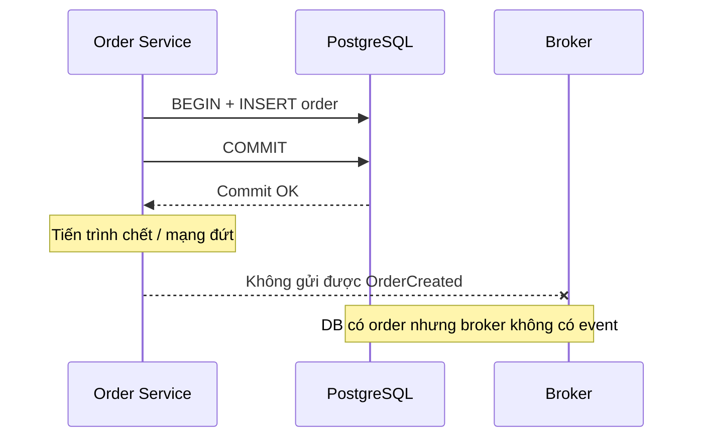
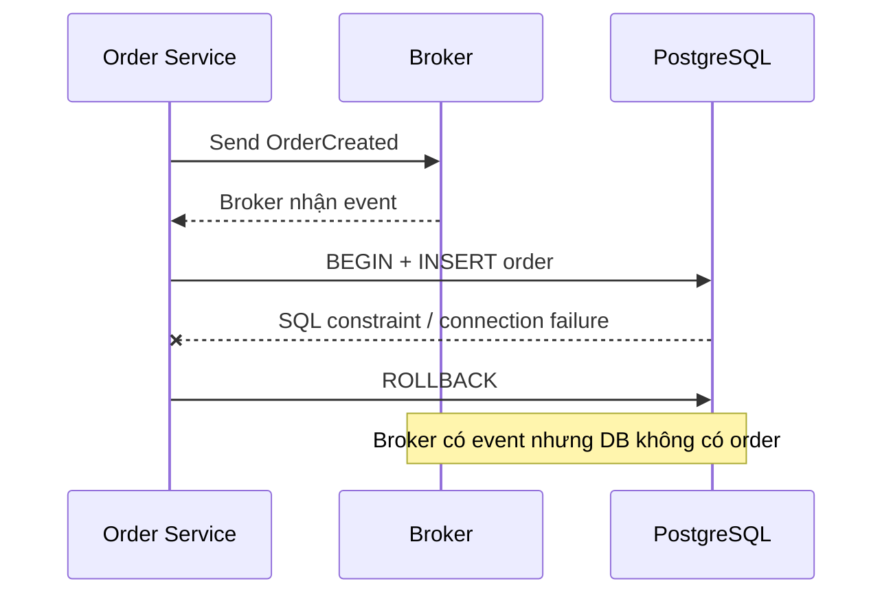
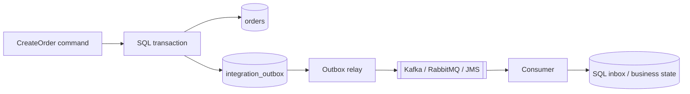
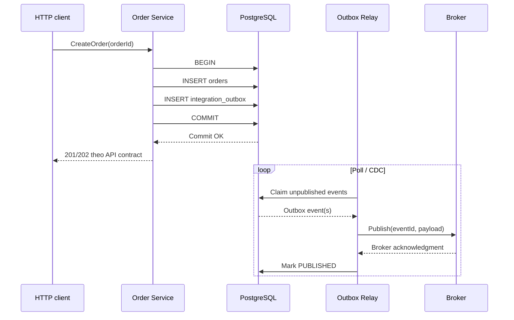
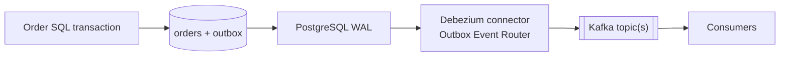
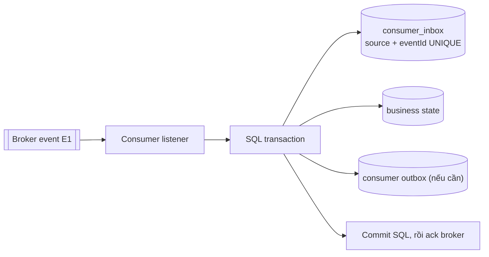
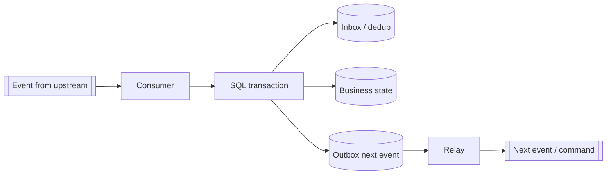
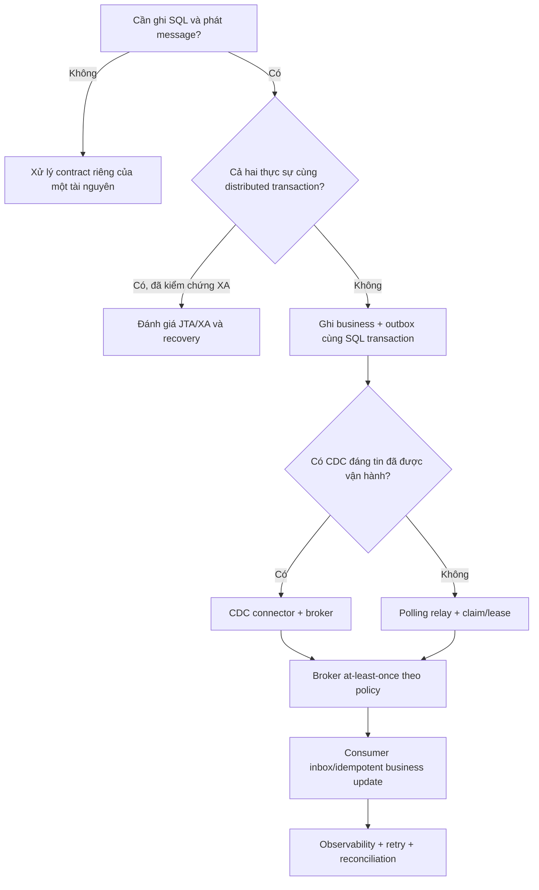

# Khoảng trống giữa commit cơ sở dữ liệu và gửi thông điệp

Một ứng dụng Spring Boot nhận lệnh tạo đơn hàng, ghi bản ghi vào PostgreSQL, sau đó phát sự kiện `OrderCreated` lên Kafka hoặc RabbitMQ. Nhìn từ code, thao tác có vẻ đơn giản: **lưu dữ liệu → gửi message**. Nhưng hai hệ thống không mặc nhiên cùng tham gia một giao dịch. Chỉ cần tiến trình chết trong vài mili giây giữa hai lệnh, **dữ liệu đã commit nhưng thông điệp chưa được gửi**. Nếu đảo thứ tự, gửi message trước rồi commit SQL, consumer có thể nhận một sự kiện nói về đơn hàng chưa từng tồn tại.

Đây là **dual-write problem**, hay khoảng trống giữa **commit cơ sở dữ liệu** và **phát thông điệp**. Vấn đề không biến mất khi thêm `@Transactional`, `@Async`, retry hoặc dùng một message broker có cơ chế delivery rất tốt. Nó đòi hỏi phải xác định ranh giới nguyên tử thực sự, lưu bền vững ý định phát và thiết kế consumer chịu được thông điệp trùng lặp.

Bài thuộc chương **Nhất quán và chống trùng** của module **SPRING_BOOT_INTEGRATION**. Trong module này, Spring Boot được sử dụng để tích hợp HTTP client, cơ sở dữ liệu, cache, broker thông điệp và các adapter Spring Integration. Vì vậy, ngoài Transactional Outbox, chúng ta sẽ liên hệ bài toán với cấu hình, hợp đồng dữ liệu, giao dịch, lỗi, idempotency, retry, kiểm thử và khả năng quan sát của cả luồng tích hợp.

> **Phạm vi minh họa:** Java 17+, Spring Boot 3.x/Spring Framework 6.x, Spring JDBC, PostgreSQL và broker Kafka/RabbitMQ/JMS. Các đoạn SQL chuyên biệt dùng PostgreSQL; với MySQL, SQL Server hoặc database khác cần chỉnh câu lệnh, lock và transaction isolation tương ứng. Các bảo đảm về broker phụ thuộc publisher configuration, acknowledgment, transaction và mức độ bền vững được triển khai.

## 1. Mục tiêu học tập

Sau bài này, bạn có thể:

1. Mô tả chính xác **khoảng trống dual-write** với cả thứ tự `DB commit → broker send` và `broker send → DB commit`.
2. Phân tích từng **failure window**: trước commit, sau commit, khi gửi, sau broker acknowledgment và trước khi đánh dấu đã gửi.
3. Giải thích vì sao `@Transactional` chỉ quản lý những tài nguyên được transaction manager bao phủ.
4. Phân biệt `@TransactionalEventListener(AFTER_COMMIT)` với **Transactional Outbox**.
5. Thiết kế schema outbox và lưu **business state + outbound intent** trong một transaction SQL.
6. Triển khai relay polling, claim/lease với `FOR UPDATE SKIP LOCKED`, retry và đánh dấu `PUBLISHED` có điều kiện.
7. So sánh polling với **CDC/change data capture** và hiểu rủi ro khi connector/relay khởi động lại.
8. Thiết kế **idempotent consumer/inbox** để chịu được at-least-once delivery.
9. Kiểm soát ordering, schema version, outbox cleanup, backlog và các trường hợp cần đối soát.
10. Xây bộ kiểm thử fault-injection chứng minh không mất ý định phát và không tạo side effect trùng.

## 2. Một lời gọi nghiệp vụ nhưng có hai hệ thống commit riêng

Giả sử yêu cầu:

```text
POST /orders
{
  "orderId": "ORD-1001",
  "amountMinor": 125500,
  "currency": "VND"
}
```

Mục tiêu nghiệp vụ: lưu order và phát `OrderCreated` để hệ thống tồn kho tiếp tục xử lý.

Mã minh họa dễ gặp:

```java
@Transactional
public void createOrder(CreateOrder command) {
    orderRepository.insert(command);
    messagePublisher.publish(
            new OrderCreated(command.orderId()));
}
```

Phương thức có annotation `@Transactional`, nhưng cần hỏi:

- Spring đang dùng `JdbcTransactionManager`, `JpaTransactionManager` hay transaction manager khác?
- Broker publisher có được enlist vào **chính transaction đó** không?
- Khi `publish(...)` trả về, broker đã xác nhận lưu bền vững hay mới chỉ ghi vào bộ đệm client?
- Nếu SQL commit thất bại **sau** khi `publish` thành công, bên ngoài có cách thu hồi message không?
- Nếu broker tạm thời không nhận message, có lưu được ý định phát để gửi lại sau restart không?

Với cấu hình Spring Boot thường gặp, **JDBC transaction và broker send là hai thao tác độc lập**. Một annotation không tự tạo ACID transaction xuyên hai tài nguyên.

### 2.1. Những bất biến cần bảo vệ

Với use case tạo đơn, một bộ bất biến thực tế có thể là:

- **I1:** Nếu order được commit, hệ thống phải giữ **ý định phát `OrderCreated`** bền vững, cuối cùng có thể phát hoặc chuyển sang xử lý sự cố có kiểm soát.
- **I2:** Không phát sự kiện tuyên bố order đã tồn tại nếu transaction lưu order bị rollback.
- **I3:** Khi relay/broker/consumer retry, một business event không được tạo **hai lần tác dụng phụ nghiệp vụ**.
- **I4:** Thứ tự các trạng thái của cùng order không bị đảo theo cách làm consumer ghi đè trạng thái mới bằng sự kiện cũ.
- **I5:** Khi không đạt được tiến độ, hệ thống phát hiện được backlog, có cảnh báo và cơ chế replay/đối soát.

**I1 không đồng nghĩa “broker chắc chắn đã nhận message ngay khi HTTP request trả 201”.** Khi dùng outbox bất đồng bộ, có một khoảng thời gian dữ liệu SQL đã commit nhưng message vẫn chờ relay. Hợp đồng hệ thống phải cho phép **eventual delivery**.

## 3. Hai thứ tự ghi đều có khoảng trống

### 3.1. Ghi database trước rồi gửi broker



Đây là **lost event**. Nếu application chỉ giữ sự kiện trong biến Java hoặc bộ nhớ queue nội bộ, restart sẽ mất thông tin cần gửi.

Không thể khôi phục chỉ bằng câu “khi khởi động lại thì retry”: **retry cái gì** nếu không có bản ghi bền vững cho sự kiện cần gửi?

### 3.2. Gửi broker trước rồi commit database



Consumer có thể xử lý `OrderCreated` trước khi order tồn tại hoặc sau khi SQL đã rollback. **Không nên chữa bằng một khoảng `sleep`** ở consumer: delay không bảo đảm order sẽ xuất hiện.

### 3.3. Bảng failure windows

| Thời điểm lỗi | DB state | Broker state | Rủi ro |
| --- | --- | --- | --- |
| Trước SQL commit | Chưa có order | Chưa gửi | Thường an toàn nếu chưa có external side effect |
| Sau SQL commit, trước send | Đã có order | Chưa có event | **Mất sự kiện** |
| Sau send, trước SQL commit | Chưa chắc có order | Có thể đã có event | **Event ma** |
| Trong broker send | Đã có order | **Không rõ** đã nhận chưa | Retry có thể tạo bản phát trùng |
| Sau broker ack, trước ghi “sent” | Đã có order | Có event | Relay retry gây phát trùng |
| Sau consumer SQL commit, trước broker ack | Consumer đã cập nhật SQL | Có thể redeliver | Consumer phải chống trùng |

Cần phân biệt **at-least-once delivery** và **exactly-once business effect**. Chấp nhận message được phát lặp có thể là lựa chọn kỹ thuật hợp lý nếu consumer bảo đảm cùng `eventId` chỉ gây side effect một lần.

## 4. Tại sao @Transactional không tự giải quyết dual-write?

### 4.1. Transaction manager có ranh giới tài nguyên

`@Transactional` làm việc qua Spring transaction interceptor và transaction manager phù hợp. Ví dụ với `JdbcTransactionManager`:

```java
@Transactional
public void createOrder(String orderId) {
    jdbc.update(
        "INSERT INTO orders(order_id, state) VALUES (?, ?)",
        orderId, "CREATED");

    kafkaTemplate.send("order-events", orderId, someJson);
}
```

Các SQL statement dùng cùng datasource có thể thuộc một transaction. Nhưng lệnh `KafkaTemplate.send` được quản lý bởi Kafka producer và broker theo cơ chế riêng; **không tự tham gia JDBC commit**.

Còn một chi tiết: `KafkaTemplate.send(...)` thường trả về kết quả bất đồng bộ (ví dụ `CompletableFuture<SendResult<...>>`). Việc method trả về ngay có thể chỉ nghĩa publisher đã xếp send vào pipeline, không chứng minh broker đã lưu message. **Chờ future thành công cũng không đồng nhất broker commit với SQL commit.**

### 4.2. Vị trí phát message trong method không tạo atomicity

Bốn biến thể thường gặp:

- Publish trước khi `@Transactional` method return.
- Publish sau khi code gọi `repository.save(...)`.
- Publish trong `TransactionSynchronization.afterCommit`.
- Publish trong `@TransactionalEventListener(phase = AFTER_COMMIT)`.

Các biến thể khác nhau về **thứ tự và thời điểm**, nhưng nếu không lưu sự kiện bền vững cùng transaction SQL, vẫn có cửa sổ process crash giữa **SQL commit** và **broker publish**.

### 4.3. Transaction Kafka/JMS cục bộ không tự bao phủ SQL

Kafka producer có idempotence và transaction phục vụ một số bảo đảm **trong phạm vi Kafka**. JMS có session transaction hoặc JTA/XA trong những môi trường phù hợp.

Nhưng:

- Kafka transaction không tự gộp PostgreSQL commit thành một atomic operation.
- JMS transacted session không tự gộp JDBC datasource vào cùng transaction.
- Sử dụng transaction synchronization giữa hai resource vẫn phải xem thứ tự commit và failure của **resource thứ hai**.
- Chỉ khi có cơ chế distributed transaction phù hợp, cả hai resource được enlist thật và có recovery đúng, mới có thể nói tới coordination giữa chúng.

**Đừng dùng từ “transactional producer” để kết luận đã có distributed transaction.**

## 5. AFTER_COMMIT callback có giải quyết khoảng trống không?

### 5.1. Ý tưởng phổ biến

Spring hỗ trợ event listener chạy sau transaction commit:

```java
@Component
public class OrderCreatedListener {

    private final MessagePublisher publisher;

    public OrderCreatedListener(MessagePublisher publisher) {
        this.publisher = publisher;
    }

    @TransactionalEventListener(
        phase = TransactionPhase.AFTER_COMMIT
    )
    public void onOrderCreated(OrderCreated event) {
        publisher.publish(event);
    }
}
```

Nó giải quyết một phần vấn đề **phát message trước khi DB commit**: listener được lên lịch chạy ở giai đoạn sau commit nếu event được phát trong transaction phù hợp. Tuy nhiên:

```text
SQL COMMIT thành công
       |
       | process crash ở ngay đây
       v
@TransactionalEventListener(AFTER_COMMIT)
       |
       v
Gửi message
```

Nếu process chết trong khoảng trống, **event chỉ tồn tại trong bộ nhớ** và có thể không bao giờ được gửi. Không có cơ chế tự hồi sinh event sau restart trừ khi bạn đã lưu nó một nơi bền vững khác.

### 5.2. Khi nào AFTER_COMMIT hữu ích?

Phù hợp cho những phản ứng có thể bỏ qua hoặc dựng lại, ví dụ:

- Invalidate một cache có TTL và có chiến lược tự phục hồi.
- Gửi tín hiệu làm worker kiểm tra outbox sớm hơn.
- Thông báo nội bộ mang tính tối ưu latency, trong khi **bản ghi outbox vẫn là nguồn sự thật**.

Nếu listener cần **ghi SQL mới sau commit**, còn phải hiểu transaction phase: tài nguyên của transaction vừa commit có thể vẫn đang được bind, nhưng phần công việc mới có thể không tự được commit theo cách bạn kỳ vọng. Với side effect SQL mới, dùng ranh giới transaction riêng (`REQUIRES_NEW` qua proxy phù hợp) hoặc một job/event-driven workflow độc lập.

**Không coi AFTER_COMMIT listener là thay thế cho durable outbox.**

## 6. Transactional Outbox: ý định gửi nằm trong cùng DB transaction

### 6.1. Nguyên lý

Thay vì lưu order rồi gửi broker trực tiếp, ta lưu **order + một bản ghi outbox** trong **cùng transaction SQL**:



Bất biến mới:

\[
\text{COMMIT(order)} \Longleftrightarrow
\text{COMMIT(outbox intent)}
\]

Biểu thức này đúng **trong phạm vi transaction SQL cùng database**, khi cả hai lệnh được thực hiện cùng transaction và không có đường code bỏ qua outbox. Nó **không** có nghĩa broker nhận message đồng thời với commit.

### 6.2. Cửa sổ lỗi sau khi dùng outbox

| Thời điểm lỗi | Điều còn bền vững | Khả năng phục hồi |
| --- | --- | --- |
| Trước commit SQL | Không có order/outbox mới | Caller có thể retry command theo idempotency key |
| Sau commit, trước relay | Order + outbox `READY` | Relay đọc lại và gửi sau restart |
| Relay nhận job, trước send | Outbox vẫn còn, có lease/claim | Lease hết hạn, worker khác retry |
| Broker nhận, relay chết trước update | Outbox chưa `PUBLISHED` | Relay gửi lại; **có thể trùng message** |
| Sau update `PUBLISHED` | Order/outbox có trạng thái phát | Giám sát downstream; broker delivery contract vẫn cần kiểm tra |

**Transactional Outbox giải quyết khoảng trống “DB commit rồi mất ý định phát”**, đổi lại phải chấp nhận **at-least-once publishing** và thiết kế consumer idempotent.

### 6.3. Vì sao không xóa bản ghi ngay sau send?

Nếu relay gọi broker xong rồi xóa outbox, sẽ gặp vấn đề tương tự tại thời điểm xóa. Có thể xóa sau khi send được xác nhận theo contract, nhưng nếu crash trước xóa thì vẫn có duplicate. Việc giữ trạng thái `PUBLISHED` trong một thời gian giúp audit, debug và reconciliation; cleanup sau retention mới xử lý xóa.

## 7. Thiết kế outbox schema trên PostgreSQL

### 7.1. Business table

```sql
CREATE TABLE orders (
    order_id        UUID PRIMARY KEY,
    amount_minor    BIGINT NOT NULL CHECK (amount_minor >= 0),
    currency        CHAR(3) NOT NULL,
    state           VARCHAR(32) NOT NULL,
    event_id        UUID NOT NULL UNIQUE,
    created_at      TIMESTAMPTZ NOT NULL DEFAULT now()
);
```

`order_id` là định danh nghiệp vụ do command mang tới hoặc đã được server gán **ổn định**. `event_id` được tạo **một lần khi tạo order**, lưu trong database và tái sử dụng để biết sự kiện tương ứng. Nếu HTTP caller retry cùng một command, application không tự tạo một order/event mới.

### 7.2. Outbox table

```sql
CREATE TABLE integration_outbox (
    event_id          UUID PRIMARY KEY,
    aggregate_type    VARCHAR(64) NOT NULL,
    aggregate_id      VARCHAR(128) NOT NULL,
    aggregate_version BIGINT NOT NULL,
    event_type        VARCHAR(128) NOT NULL,
    schema_version    INTEGER NOT NULL,
    payload_json      JSONB NOT NULL,

    status            VARCHAR(24) NOT NULL DEFAULT 'READY'
                      CHECK (status IN
                          ('READY', 'IN_FLIGHT', 'PUBLISHED', 'BLOCKED')),
    attempt_count     INTEGER NOT NULL DEFAULT 0,
    next_attempt_at   TIMESTAMPTZ NOT NULL DEFAULT now(),
    claim_token       UUID,
    leased_until      TIMESTAMPTZ,
    published_at      TIMESTAMPTZ,
    last_error        VARCHAR(500),
    created_at        TIMESTAMPTZ NOT NULL DEFAULT now()
);
```

Ý nghĩa:

- `event_id`: khóa bất biến để consumer dedup, kể cả khi cùng event được publish nhiều lần.
- `aggregate_type`/`aggregate_id`: định danh đối tượng nghiệp vụ, có thể dùng làm Kafka key.
- `aggregate_version`: thứ tự thay đổi **của aggregate**, khác `schema_version`.
- `payload_json`: nội dung sự kiện **được cố định tại thời điểm business transaction**.
- `status`: relay state; **không phải** trạng thái consumer đã xử lý thành công.
- `attempt_count`, `next_attempt_at`: retry budget và backoff.
- `claim_token`, `leased_until`: claim tạm thời để nhiều worker giảm tranh chấp.
- `published_at`: thời điểm relay ghi nhận send đã được xác nhận theo **publisher contract**.

**Cẩn trọng:** `PUBLISHED` ở outbox chỉ có ý nghĩa mạnh bằng cơ chế acknowledgment đã cấu hình cho producer/broker. Nó **không** chứng minh downstream consumer đã xử lý xong.

### 7.3. Index và kiểm soát dung lượng

```sql
CREATE INDEX idx_outbox_ready
ON integration_outbox (next_attempt_at, created_at, event_id)
WHERE status = 'READY';

CREATE INDEX idx_outbox_lease
ON integration_outbox (leased_until, created_at)
WHERE status = 'IN_FLIGHT';

CREATE INDEX idx_outbox_aggregate
ON integration_outbox (aggregate_type, aggregate_id,
                       aggregate_version);
```

Trong production còn phải quản lý:

- Retention cho `PUBLISHED`, ví dụ theo số ngày cần điều tra/replay.
- Partitioning/archive nếu event volume lớn.
- Autovacuum, index bloat, WAL và database capacity.
- `last_error` chỉ lưu **mã lỗi/thông tin đã redacted**; không ghi token hoặc raw PII.
- Unique constraints thích hợp với **business command idempotency**, không chỉ event ID.
- Schema evolution của payload, đặc biệt nếu consumer cũ còn tồn tại.

## 8. Ghi order và outbox trong một @Transactional method

### 8.1. Dependencies

Ví dụ Gradle (Groovy DSL):

```groovy
dependencies {
    implementation 'org.springframework.boot:spring-boot-starter-jdbc'
    implementation 'org.springframework.boot:spring-boot-starter-json'
    runtimeOnly 'org.postgresql:postgresql'

    testImplementation 'org.springframework.boot:spring-boot-starter-test'
    testImplementation 'org.springframework.boot:spring-boot-testcontainers'
    testImplementation 'org.testcontainers:junit-jupiter'
    testImplementation 'org.testcontainers:postgresql'
}
```

**Lưu ý:** Tên starter/phiên bản JSON có thể khác giữa các nhánh Spring Boot. Với **Spring Boot 3.x**, `spring-boot-starter-json` thường có thể dùng để lấy Jackson trong ngữ cảnh tương ứng; nếu ứng dụng đã có `spring-boot-starter-web` thì Jackson thường đã được quản lý. Đừng thêm nhiều version Jackson thủ công nếu Boot BOM đang quản lý. Với Boot 4.x hãy đối chiếu tài liệu starter theo nhánh được triển khai.

### 8.2. DTO và hợp đồng sự kiện

```java
package com.example.integration.orders;

import java.util.UUID;

public record CreateOrder(
        UUID orderId,
        long amountMinor,
        String currency
) {}

public record OrderCreated(
        UUID eventId,
        UUID orderId,
        long amountMinor,
        String currency,
        long aggregateVersion,
        int schemaVersion
) {}
```

Trong production cần validate currency, amount, tenant/partner và contract của event. Bản ghi outbox không nên chứa một tham chiếu tới mutable entity chưa serialize: **hãy serialize event đã chốt nội dung ngay trong transaction**.

### 8.3. Service với JDBC và unique command ID

Mẫu bên dưới cho thấy các thao tác quan trọng (để ngắn gọn, xử lý JSON exception và các lớp domain được giữ tối thiểu):

```java
package com.example.integration.orders;

import java.util.Map;
import java.util.UUID;

import com.fasterxml.jackson.core.JsonProcessingException;
import com.fasterxml.jackson.databind.ObjectMapper;

import org.springframework.jdbc.core.namedparam.NamedParameterJdbcTemplate;
import org.springframework.stereotype.Service;
import org.springframework.transaction.annotation.Transactional;

@Service
public class OrderCommandService {

    private final NamedParameterJdbcTemplate jdbc;
    private final ObjectMapper mapper;

    public OrderCommandService(
            NamedParameterJdbcTemplate jdbc,
            ObjectMapper mapper) {
        this.jdbc = jdbc;
        this.mapper = mapper;
    }

    @Transactional
    public UUID create(CreateOrder command) {
        if (command.orderId() == null
                || command.amountMinor() < 0
                || !"VND".equals(command.currency())) {
            throw new IllegalArgumentException("Command không hợp lệ");
        }

        UUID newEventId = UUID.randomUUID();

        int rows = jdbc.update("""
                INSERT INTO orders
                    (order_id, amount_minor, currency, state, event_id)
                VALUES (:orderId, :amount, :currency, 'CREATED', :eventId)
                ON CONFLICT (order_id) DO NOTHING
                """, Map.of(
                    "orderId", command.orderId(),
                    "amount", command.amountMinor(),
                    "currency", command.currency(),
                    "eventId", newEventId));

        if (rows == 0) {
            // Retry cùng order ID: so sánh command gốc, không phát event mới.
            return jdbc.queryForObject("""
                    SELECT event_id FROM orders
                    WHERE order_id = :orderId
                      AND amount_minor = :amount
                      AND currency = :currency
                    """, Map.of(
                        "orderId", command.orderId(),
                        "amount", command.amountMinor(),
                        "currency", command.currency()),
                    UUID.class);
        }

        OrderCreated event = new OrderCreated(
                newEventId,
                command.orderId(),
                command.amountMinor(),
                command.currency(),
                1L,
                1);

        String json;
        try {
            json = mapper.writeValueAsString(event);
        } catch (JsonProcessingException ex) {
            throw new IllegalStateException(
                    "Không serialize được OrderCreated", ex);
        }

        jdbc.update("""
                INSERT INTO integration_outbox (
                    event_id, aggregate_type, aggregate_id,
                    aggregate_version, event_type,
                    schema_version, payload_json
                )
                VALUES (
                    :eventId, 'Order', :aggregateId,
                    1, 'OrderCreated', 1,
                    CAST(:payloadJson AS jsonb)
                )
                """, Map.of(
                    "eventId", newEventId,
                    "aggregateId", command.orderId().toString(),
                    "payloadJson", json));

        return newEventId;
    }
}
```

**Hai ghi chú triển khai bắt buộc:**

1. Trong ví dụ này, nếu `rows == 0` nhưng dữ liệu cùng `orderId` **khác amount/currency**, `queryForObject` không tìm thấy bản ghi và báo lỗi. Đây là cách chặn idempotency key bị sử dụng với payload khác. Production nên chuyển thành exception `409 Conflict` có ý nghĩa; không coi mọi `ON CONFLICT` là retry hợp lệ.
2. `UUID.randomUUID()` chỉ dùng khi cố tạo **order mới**. Với retry của cùng `orderId`, method đọc lại `event_id` đã lưu, không phát một outbox entry mới. Trong thiết kế thực, business key/tenant phải được đưa vào unique constraint phù hợp, tránh va chạm giữa tenant.

**Bất biến quan trọng:** Nếu INSERT outbox fail vì database, schema hoặc JSONB constraint, transaction SQL rollback cả INSERT `orders`. Không được catch exception rồi trả success trước khi transaction hoàn tất.

### 8.4. @Transactional chỉ có hiệu lực qua ranh giới phù hợp

Để đạt atomicity của hai bảng, cần:

- Cả hai `jdbc.update` sử dụng **cùng datasource** và tham gia cùng transaction manager.
- Service được gọi qua **Spring transactional proxy** hoặc cơ chế transaction thực sự có hiệu lực.
- Không tự mở connection auto-commit ngoài transaction cho một trong hai bước.
- Không bắt lỗi DB và nuốt exception để method return.
- Không dùng `@Async` cho thao tác INSERT outbox trong một thread/transaction khác.

Với `TransactionTemplate`, có thể kiểm soát transaction tường minh, nhưng yêu cầu **hai ghi SQL cùng transaction** không đổi.

## 9. Gửi message phải nằm ngoài transaction SQL của command

### 9.1. Sơ đồ chức năng



Nếu relay cần vài giây, API command vẫn có thể trả về sau SQL commit. Status HTTP nên thể hiện điều gì **đã thực sự hoàn thành**:

- `201 Created`: order đã được tạo bền vững trong SQL; không nhất thiết downstream đã xử lý.
- `202 Accepted`: operation được nhận để xử lý bất đồng bộ, nếu hợp đồng API dùng mô hình đó.
- Response có thể trả `orderId` và trạng thái `PENDING_INTEGRATION`/`CREATED`, kèm endpoint tra cứu nếu cần.

Không trả “đã giữ hàng thành công” khi chỉ mới ghi outbox cho lời gọi Inventory sắp diễn ra.

### 9.2. Poller không phải gửi message trong @Transactional

Worker nên:

1. Chọn một batch outbox chưa gửi.
2. **Claim ngắn trong SQL** rồi commit transaction claim.
3. Gửi message tới broker, có timeout và publisher acknowledgment.
4. Cập nhật `PUBLISHED` bằng một SQL transaction ngắn **nếu claim token vẫn hợp lệ**.
5. Khi lỗi, đặt lịch retry hoặc để lease hết hạn.

Không giữ PostgreSQL transaction mở trong suốt thời gian chờ network broker nếu không thật sự cần một thiết kế đặc biệt đã phân tích: làm thế giữ connection/row locks, tăng contention và dễ cạn pool.

## 10. Claim/lease: nhiều relay không tranh cùng một event

### 10.1. Tại sao cần claim?

Nếu hai instance cùng chạy:

```text
Worker A: SELECT event WHERE status = READY
Worker B: SELECT event WHERE status = READY
Worker A: gửi E1
Worker B: gửi E1
```

Cả hai có thể đọc cùng bản ghi rồi publish hai lần. Consumer idempotent vẫn cần, nhưng nên giảm duplicate bằng cơ chế claim.

### 10.2. PostgreSQL SKIP LOCKED cho work queue

Ví dụ claim tối đa một batch theo transaction **ngắn**:

```sql
WITH picked AS (
    SELECT event_id
    FROM integration_outbox
    WHERE
        (status = 'READY' AND next_attempt_at <= now())
        OR
        (status = 'IN_FLIGHT' AND leased_until <= now())
    ORDER BY created_at, event_id
    FOR UPDATE SKIP LOCKED
    LIMIT :batchSize
)
UPDATE integration_outbox AS o
SET status = 'IN_FLIGHT',
    claim_token = :claimToken,
    leased_until = now() + INTERVAL '45 seconds',
    attempt_count = attempt_count + 1
FROM picked AS p
WHERE o.event_id = p.event_id
RETURNING
    o.event_id, o.aggregate_id, o.aggregate_version,
    o.event_type, o.payload_json;
```

**Điều kiện:**

- Câu UPDATE có CTE `FOR UPDATE SKIP LOCKED` là một statement nguyên tử trong PostgreSQL transaction. Mỗi worker dùng **claim token ngẫu nhiên riêng** để phân biệt lần claim.
- `SKIP LOCKED` giúp các poller bỏ qua row đang bị worker khác lock trong lúc claim. Nó phù hợp cho một số work queue, nhưng **không bảo đảm thứ tự toàn cục**.
- Claim kết thúc khi transaction chứa statement commit. Relay không giữ row lock qua thời gian send broker.
- Một event `IN_FLIGHT` chỉ được chọn lại sau khi lease hết hạn; nếu worker vẫn đang publish lâu hơn lease, **có thể có hai worker cùng publish**. Cần thiết kế lease duration/renewal, send timeout và consumer idempotency.
- Claim chỉ là **tối ưu điều phối**, không tạo exactly-once delivery.

### 10.3. Đánh dấu PUBLISHED bằng compare-and-set

Chỉ worker giữ đúng claim token mới được cập nhật kết quả:

```sql
UPDATE integration_outbox
SET status = 'PUBLISHED',
    published_at = now(),
    leased_until = NULL,
    claim_token = NULL,
    last_error = NULL
WHERE event_id = :eventId
  AND status = 'IN_FLIGHT'
  AND claim_token = :claimToken;
```

Nếu UPDATE trả `0 row`, worker đã mất quyền sở hữu claim (hoặc trạng thái đã đổi). **Không được suy luận broker chưa nhận event**. Message có thể đã gửi thành công rồi lease bị lấy lại hoặc trạng thái được thay đổi bởi một quy trình khác.

### 10.4. Retry có điều kiện

Khi send broker thất bại một cách rõ ràng, worker có thể đặt event về `READY`:

```sql
UPDATE integration_outbox
SET status = 'READY',
    next_attempt_at = now() + INTERVAL '15 seconds',
    claim_token = NULL,
    leased_until = NULL,
    last_error = :safeError
WHERE event_id = :eventId
  AND status = 'IN_FLIGHT'
  AND claim_token = :claimToken;
```

Một hệ thống thực tế cần backoff tăng dần, jitter, phân loại lỗi và ngưỡng `BLOCKED`/quarantine. Không retry lỗi payload invalid vĩnh viễn giống lỗi broker outage ngắn. Nếu có lỗi giữa **broker acknowledgment** và UPDATE đánh dấu, không biết publisher đã commit trạng thái chưa; **không có cách xóa khoảng trống đó chỉ bằng bảng outbox**.

## 11. Java relay với Spring JDBC và JmsTemplate

### 11.1. Tại sao minh họa bằng JMS?

`JmsTemplate` cung cấp API gửi tương đối ngắn để tập trung vào failure window. Với Kafka, thay publisher bằng `KafkaTemplate` và **đợi future/broker ack đúng contract**; với RabbitMQ, cần xác nhận publisher confirms/returns theo cấu hình. Nguyên tắc **outbox claim → send → mark** giống nhau, nhưng semantics của xác nhận gửi không giống nhau giữa broker.

### 11.2. Relay skeleton có kiểm soát claim

Ví dụ rút gọn sau sử dụng cùng schema mục 7–10. Nó minh họa một lần poll, gửi JMS TextMessage từ chuỗi JSON, đánh dấu `PUBLISHED` sau khi lời gọi send trả về theo JMS provider contract.

```java
package com.example.integration.outbox;

import java.util.List;
import java.util.Map;
import java.util.UUID;

import org.springframework.jdbc.core.namedparam.NamedParameterJdbcTemplate;
import org.springframework.jms.core.JmsTemplate;
import org.springframework.scheduling.annotation.Scheduled;
import org.springframework.stereotype.Component;

@Component
public class JmsOutboxRelay {

    private static final String DESTINATION = "OrdersOut";

    record PendingEvent(
            UUID eventId,
            String aggregateId,
            long aggregateVersion,
            String eventType,
            String payloadJson
    ) {}

    private final NamedParameterJdbcTemplate jdbc;
    private final JmsTemplate jms;

    public JmsOutboxRelay(
            NamedParameterJdbcTemplate jdbc,
            JmsTemplate jms) {
        this.jdbc = jdbc;
        this.jms = jms;
    }

    @Scheduled(fixedDelayString =
            "${integration.outbox.poll-delay-ms:1000}")
    public void poll() {
        UUID claimToken = UUID.randomUUID();

        List<PendingEvent> events = jdbc.query("""
                WITH picked AS (
                    SELECT event_id
                    FROM integration_outbox
                    WHERE (status = 'READY'
                           AND next_attempt_at <= now())
                       OR (status = 'IN_FLIGHT'
                           AND leased_until <= now())
                    ORDER BY created_at, event_id
                    FOR UPDATE SKIP LOCKED
                    LIMIT :limit
                )
                UPDATE integration_outbox o
                SET status = 'IN_FLIGHT',
                    claim_token = :token,
                    leased_until = now() + INTERVAL '45 seconds',
                    attempt_count = attempt_count + 1
                FROM picked p
                WHERE o.event_id = p.event_id
                RETURNING o.event_id, o.aggregate_id,
                          o.aggregate_version,
                          o.event_type, o.payload_json
                """,
                Map.of("limit", 10, "token", claimToken),
                (rs, rowNum) -> new PendingEvent(
                        rs.getObject("event_id", UUID.class),
                        rs.getString("aggregate_id"),
                        rs.getLong("aggregate_version"),
                        rs.getString("event_type"),
                        rs.getString("payload_json")));

        for (PendingEvent event : events) {
            try {
                jms.convertAndSend(
                        DESTINATION,
                        event.payloadJson(),
                        message -> {
                            message.setStringProperty(
                                    "eventId",
                                    event.eventId().toString());
                            message.setStringProperty(
                                    "eventType",
                                    event.eventType());
                            message.setStringProperty(
                                    "aggregateId",
                                    event.aggregateId());
                            return message;
                        });

                jdbc.update("""
                        UPDATE integration_outbox
                        SET status = 'PUBLISHED',
                            published_at = now(),
                            claim_token = NULL,
                            leased_until = NULL,
                            last_error = NULL
                        WHERE event_id = :eventId
                          AND status = 'IN_FLIGHT'
                          AND claim_token = :token
                        """, Map.of(
                            "eventId", event.eventId(),
                            "token", claimToken));

            } catch (RuntimeException ex) {
                jdbc.update("""
                        UPDATE integration_outbox
                        SET status = 'READY',
                            next_attempt_at =
                                now() + INTERVAL '15 seconds',
                            claim_token = NULL,
                            leased_until = NULL,
                            last_error = 'PUBLISH_FAILURE'
                        WHERE event_id = :eventId
                          AND status = 'IN_FLIGHT'
                          AND claim_token = :token
                        """, Map.of(
                            "eventId", event.eventId(),
                            "token", claimToken));
            }
        }
    }
}
```

Cần thêm `@EnableScheduling` tại configuration phù hợp hoặc bật scheduling theo quy ước ứng dụng.

### 11.3. Giới hạn của ví dụ relay

Code trên **chỉ là một skeleton minh họa**; để triển khai production phải bổ sung:

1. Đảm bảo bảng/schema/migration và quyền truy cập SQL đúng.
2. Chọn **physical JMS queue name** hoặc `JndiDestinationResolver` đúng với deployment; `OrdersOut` trong ví dụ chỉ là destination minh họa.
3. Đảm bảo broker thực sự sử dụng **durable send/persistent delivery** và biết `convertAndSend` thành công có ý nghĩa gì ở provider đang dùng.
4. Ràng buộc **publish timeout** với `leased_until`; 45 giây không chắc đủ nếu message gửi chậm hoặc broker đang treo.
5. Xử lý các exception từ **bước update mark/return READY** riêng với exception từ send. Trong đoạn code, catch có thể chạy sau khi broker send thành công nhưng UPDATE SQL thất bại; khi đó retry phát lại là hành vi dự kiến, không được ghi log “broker chưa nhận”.
6. Đặt backoff/jitter theo `attempt_count`, retry budget và trạng thái `BLOCKED`.
7. Không ghi raw exception message chứa credentials/PII vào `last_error`.
8. Giám sát số row cập nhật và sự kiện mất claim (CAS trả 0).
9. Nếu thứ tự per aggregate quan trọng, phải **tăng cường điều phối ordering**, vì relay batch với `SKIP LOCKED` không tự giữ thứ tự khi chạy song song.

Không dùng ví dụ như chứng minh exactly-once; **duplicate là một kết quả chấp nhận được ở cấp transport** nếu toàn luồng được thiết kế đúng.

## 12. Cửa sổ lỗi trong relay: điều gì sẽ xảy ra?

### 12.1. Lỗi trước claim

Nếu database chưa có connection hoặc scheduler chưa chạy, outbox `READY` vẫn nằm trong SQL. HTTP request đã commit nhưng integration lag tăng.

### 12.2. Lỗi sau claim, trước send

Bản ghi ở trạng thái `IN_FLIGHT`. Khi worker chết, lease sẽ hết hạn, worker khác claim lại. Không cần rollback business order đã commit.

### 12.3. Send timeout hoặc mất broker acknowledgment

Có ba khả năng:

- Broker chưa nhận message.
- Broker đã nhận message nhưng client chưa nhận acknowledgment.
- Broker nhận nhưng mức bền vững chưa đáp ứng mong đợi do producer/broker config.

Khi không có bằng chứng, coi đây là **unknown outcome**, retry theo idempotency key ổn định. Đừng kết luận “send thất bại thì chắc chắn broker chưa có message”.

### 12.4. Broker ack rồi mất kết nối SQL

Message đã được broker xác nhận theo policy, nhưng status outbox còn `IN_FLIGHT`. Lease hết hạn, relay phát lại. **Đây là cửa sổ duplicate cố hữu của outbox polling.**

### 12.5. Worker bị treo lâu hơn lease

Worker A claim E1 trong 45 giây, nhưng broker send treo 60 giây. Worker B có thể claim lại E1 rồi gửi trước A. Vì vậy:

- Chọn send timeout nhỏ hơn lease có buffer.
- Hoặc có cơ chế renew lease trong tác vụ kéo dài.
- Dùng `claim_token` để worker A không đánh dấu nhầm claim của B.
- Vẫn cần consumer dedup khi hai lần send diễn ra.

### 12.6. Crash sau khi đánh dấu PUBLISHED

Relay đã có bằng chứng send theo contract và mark `PUBLISHED`. Tuy nhiên, nếu broker không thực sự durable hoặc consumer gặp lỗi không có DLQ/retry, vẫn có thể mất **business processing** ở bước downstream. Outbox **không thay thế thiết kế delivery và consumer reliability**.

## 13. Polling relay so với CDC/transaction-log tailing

Có hai hướng chuyển outbox đến broker phổ biến.

### 13.1. Polling publisher

Worker định kỳ:

```text
SELECT/claim outbox READY
    -> SEND broker
    -> UPDATE outbox PUBLISHED
```

**Ưu điểm:**

- Dễ hiểu và có thể viết ngay bằng Spring Boot/JDBC.
- Ít phụ thuộc hạ tầng CDC.
- Có thể đặt backoff, retry, quarantine, lease theo business.
- Dễ điều chỉnh batch size và quyền truy cập của worker.

**Nhược điểm:**

- Polling liên tục tạo SQL workload và latency theo chu kỳ.
- Cần claim/lease và concurrency control khi scale.
- Dễ gây duplicate hoặc reordering nếu phát nhiều worker.
- Bảng tăng nhanh nếu cleanup/partitioning không tốt.
- Batch quá lớn có thể tạo spike trên broker và connection pool.

### 13.2. CDC từ transaction log

**Change Data Capture** đọc thay đổi đã commit từ transaction log của database, ví dụ PostgreSQL WAL, rồi truyền thay đổi outbox qua connector như Debezium.



Ưu điểm:

- Phát hiện thay đổi dựa trên commit log, không cần mỗi ứng dụng chạy poll query toàn bảng.
- Giảm áp lực polling trong một số workload.
- Thường có thông tin về vị trí log/offset phục vụ resume.
- Thích hợp khi đã có nền tảng Kafka Connect/CDC được vận hành bài bản.

Nhược điểm:

- Cần quản lý replication slot/log retention, connector state, offset, quyền database và monitoring.
- Connector downtime lâu có thể làm WAL tích lũy rất lớn.
- Connector/broker restart và replay vẫn có thể phát **duplicate records**.
- Mapping outbox row thành message key/topic/header cần versioned contract.
- Dọn bảng outbox và xóa dữ liệu có thể tạo thêm CDC events nếu connector không được cấu hình lọc.
- Không tự biến side effect của consumer thành exactly-once.

### 13.3. Không trộn polling với CDC trên cùng event thiếu điều phối

Nếu vừa có polling relay vừa có CDC connector phát cùng các row mà không có cơ chế ownership/phân luồng, có nguy cơ **mỗi event được publish hai lần ngay cả khi không có failure**. Chọn **một nguồn phát chính** cho mỗi outbox stream, hoặc có thiết kế migration được kiểm soát rõ ràng.

### 13.4. Khi nào chọn cách nào?

| Điều kiện | Polling | CDC |
| --- | --- | --- |
| Volume thấp–vừa, ít hạ tầng | Thường dễ triển khai | Có thể quá phức tạp |
| Đã vận hành Kafka Connect/Debezium | Có thể vẫn phù hợp | Tận dụng nền tảng sẵn |
| Cần routing/retry nghiệp vụ tinh vi | Dễ đặt policy trong worker | Thường cần thêm processing stage |
| Ràng buộc DB query load | Cần tối ưu index và batch | Đọc log có thể phù hợp hơn |
| Độ trễ rất thấp và volume lớn | Phải tuning polling | Có tiềm năng tốt, vẫn cần đo |
| Cần nhiều broker đích khác nhau | Worker có thể định tuyến | CDC router/processor cần cấu hình |
| Khả năng vận hành replication/WAL | Không bắt buộc | Bắt buộc |

Không có câu trả lời chung: chọn theo throughput, latency, hạ tầng, rollback và **khả năng vận hành đội ngũ**.

## 14. Idempotent consumer: nửa còn lại của bài toán

### 14.1. Tại sao cần inbox nếu đã có outbox?

Outbox bảo vệ **bên phát** khỏi mất ý định gửi. Nó **không ngăn**:

- Publisher phát lại do crash.
- Broker redeliver sau consumer crash.
- Cùng business event được replay từ DLQ.
- Một event được gửi nhiều lần bởi vận hành/manual repair.
- Consumer nhận bản tin cũ khi rollback/reprocess.

Do đó consumer cần một **inbox/idempotency ledger** cùng transaction với business changes.



### 14.2. Schema inbox

```sql
CREATE TABLE consumer_inbox (
    source_system VARCHAR(64) NOT NULL,
    event_id      UUID NOT NULL,
    payload_hash  CHAR(64) NOT NULL,
    processed_at  TIMESTAMPTZ NOT NULL DEFAULT now(),
    PRIMARY KEY (source_system, event_id)
);
```

Lưu ý: `event_id` là business event ID từ payload/header đã xác minh, **không mặc định dùng Kafka offset hoặc JMSMessageID** làm idempotency key.

### 14.3. Thuật toán xử lý atomic

Trong transaction SQL:

1. Validate schema version, event ID, source/tenant và payload.
2. Tính hash canonical payload nếu contract yêu cầu.
3. Thử insert inbox bằng unique constraint.
4. Nếu insert thành công, thực hiện business update và ghi outbound event trong cùng transaction.
5. Nếu insert conflict, kiểm tra event ID cũ có cùng payload/business meaning không.
6. Commit transaction.
7. Chỉ sau khi thành công mới acknowledge broker theo listener contract.

```sql
INSERT INTO consumer_inbox (source_system, event_id, payload_hash)
VALUES (:source, :eventId, :payloadHash)
ON CONFLICT (source_system, event_id) DO NOTHING;
```

Nếu row count bằng 0, cần đọc bản ghi đã có để xác minh hash/trạng thái. **Không** coi cùng event ID nhưng payload khác là duplicate bình thường; có thể là contract violation hoặc bị phát sự kiện không nhất quán.

### 14.4. Ví dụ application service

```java
@Service
public class OrderCreatedConsumerService {

    private final NamedParameterJdbcTemplate jdbc;
    private final InventoryProjector projector;

    public OrderCreatedConsumerService(
            NamedParameterJdbcTemplate jdbc,
            InventoryProjector projector) {
        this.jdbc = jdbc;
        this.projector = projector;
    }

    @Transactional
    public void process(
            String source,
            UUID eventId,
            String payloadHash,
            OrderCreatedEvent event) {

        int firstSeen = jdbc.update("""
                INSERT INTO consumer_inbox
                    (source_system, event_id, payload_hash)
                VALUES (:source, :eventId, :hash)
                ON CONFLICT (source_system, event_id) DO NOTHING
                """, Map.of(
                    "source", source,
                    "eventId", eventId,
                    "hash", payloadHash));

        if (firstSeen == 0) {
            String existing = jdbc.queryForObject("""
                    SELECT payload_hash FROM consumer_inbox
                    WHERE source_system = :source
                      AND event_id = :eventId
                    """, Map.of(
                        "source", source,
                        "eventId", eventId), String.class);

            if (!payloadHash.equals(existing)) {
                throw new IllegalStateException(
                        "Cùng eventId nhưng payload khác");
            }
            return; // Duplicate hợp lệ: không xử lý business lần hai.
        }

        projector.apply(event); // Phải tham gia cùng SQL transaction.
    }
}
```

`OrderCreatedEvent` và `InventoryProjector` là type/port do ứng dụng triển khai. `projector.apply` phải sử dụng cùng datasource/transaction hoặc một phương thức bảo vệ side effect khác. Nếu `projector.apply` gọi **HTTP API ngoài**, unique inbox không tự biến side effect HTTP thành atomic: có thể cần outbox/command ledger và idempotency key ở phía HTTP partner.

**Lưu ý:** Với truy cập đồng thời, unique constraint bảo đảm hai transaction không cùng insert một inbox key thành công. Nhưng kết quả business vẫn phải tôn trọng isolation và lock/version khi nhiều event khác nhau cập nhật cùng aggregate.

## 15. Ordering: một aggregate không được đi lùi

### 15.1. Outbox không tự bảo đảm thứ tự

Giả sử order nhận hai cập nhật:

```text
E1: OrderCreated, aggregateVersion=1
E2: OrderPaid,    aggregateVersion=2
```

Nếu worker A claim E1 rồi broker send chậm, worker B có thể claim E2 và gửi trước. Consumer nhận `OrderPaid` trước `OrderCreated` và có thể báo lỗi hoặc tạo projection sai.

### 15.2. Những lớp bảo vệ ordering

- **Sequence per aggregate**: ghi `aggregate_version` tăng dần trong transaction bảo vệ state.
- **Kafka partition key = aggregateId** khi cần giữ thứ tự trong partition, với producer/publish policy phù hợp.
- **Poller điều phối**: không claim E2 nếu E1 chưa đạt điều kiện phát trước, hoặc chỉ một worker xử lý từng aggregate.
- **Consumer version guard**: từ chối/đợi event nếu version không kế tiếp, hoặc dùng logic idempotent có thể reorder phù hợp.
- **Gap handling**: xử lý khi E1 bị `BLOCKED`, không để E2 âm thầm vượt làm sai thứ tự.

### 15.3. Một điều kiện chặn event đi sau

Ví dụ ý tưởng để chọn candidate trong poller:

```sql
SELECT o.event_id
FROM integration_outbox o
WHERE o.status = 'READY'
  AND o.next_attempt_at <= now()
  AND NOT EXISTS (
      SELECT 1
      FROM integration_outbox earlier
      WHERE earlier.aggregate_type = o.aggregate_type
        AND earlier.aggregate_id = o.aggregate_id
        AND earlier.aggregate_version < o.aggregate_version
        AND earlier.status <> 'PUBLISHED'
  );
```

Đây chỉ là **điều kiện logic**. Triển khai production vẫn phải giải quyết concurrency và transaction isolation trong claim, bảo đảm không có hai event cùng aggregate được claim/gửi song song sai thứ tự. Ngoài ra `PUBLISHED` chỉ chứng minh broker acknowledgment theo policy, không chứng minh consumer đã xử lý E1 trước E2.

### 15.4. Aggregate version khác schema version

- `aggregate_version` cho biết lần thay đổi thứ mấy của một order.
- `schema_version` cho biết hợp đồng JSON event hiện dùng.
- `event_id` định danh một business event phục vụ dedup.

Không dùng `schema_version` để sắp xếp nghiệp vụ; một event schema v2 có thể nói về aggregateVersion 1, còn schema v1 có thể vẫn đang phát ở version 15.

## 16. Broker acknowledgment và mức bền vững gửi

### 16.1. Kafka

Khi relay dùng Kafka:

```java
CompletableFuture<SendResult<String, String>> future =
        kafkaTemplate.send(
                "order-events",
                event.aggregateId(),
                event.payloadJson());

// Chỉ mark PUBLISHED khi future đã hoàn tất thành công
// theo thời hạn, producer/broker config và retry policy.
```

Trong thực tế cần chờ kết quả có deadline hoặc xử lý completion callback có tính bền vững phù hợp, phân loại lỗi. Producer config như `acks`, replication, retries, delivery timeout và idempotence quyết định chất lượng acknowledgment.

**Không mark `PUBLISHED` chỉ vì `send(...)` trả về future.** Future là một phép tính bất đồng bộ, không chứng minh broker đã nhận.

Kafka producer idempotence và transaction có thể bảo vệ những lần gửi lại trong phạm vi producer/Kafka theo contract, nhưng **không loại bỏ** việc outbox relay phát cùng business `eventId` bằng producer session khác sau crash.

### 16.2. RabbitMQ

Với RabbitMQ, cần phân biệt:

- Publisher **confirms** từ broker.
- Publisher **returns** khi message không route được đến queue theo mandatory-routing policy.
- Queue/exchange durability và persistent delivery mode.
- Consumer manual acknowledgments, retry, DLX/DLQ.

Chỉ việc gọi `RabbitTemplate.convertAndSend` thành công ở application thread không nhất thiết chứng minh message đã vào queue cuối cùng. Nếu cần biết outcome, cấu hình publisher confirms/returns và chờ/ghi nhận theo API Spring AMQP tương ứng.

### 16.3. JMS

Với JMS, `JmsTemplate.convertAndSend` và JMS session semantics phụ thuộc provider, delivery mode, transaction và managed resource. Thành công của send không đồng nghĩa **consumer đã xử lý**. Cần hiểu local JMS session transaction/JTA cũng như persistence policy trước khi mark outbox.

### 16.4. Đừng trộn trách nhiệm producer và consumer acknowledgment

| Chỉ dấu | Nghĩa phù hợp | Không được suy luận |
| --- | --- | --- |
| Producer send API trả về | Client API hoàn thành bước gọi | Message chắc chắn durable |
| Broker producer ack/confirm | Broker xác nhận theo policy | Consumer đã xử lý xong |
| Outbox `PUBLISHED` | Relay ghi nhận send đạt tiêu chí | Business workflow đã complete |
| Consumer ack/offset commit | Consumer xác nhận với broker | Mọi external side effect đã bền vững nếu code không thiết kế đúng |
| SQL inbox commit | Consumer lưu trạng thái xử lý trong DB | Một HTTP call bên ngoài đã có rollback ACID |

## 17. Retry, timeout và phân loại lỗi

### 17.1. Không retry mọi lỗi vô hạn

| Nhóm | Ví dụ | Cách xử lý |
| --- | --- | --- |
| Broker unavailable | Network outage, broker restart | Exponential backoff, jitter, deadline |
| Pool SQL cạn | Claim/update DB timeout | Giảm concurrency, cảnh báo, retry sau |
| Bad payload/schema | JSON invalid, enum không hợp lệ | `BLOCKED`/quarantine, sửa producer hoặc migration |
| Authorization/TLS | Credential không hợp lệ, certificate lỗi | Dừng, vận hành xử lý; tránh retry storm |
| Broker throttling | Quota, backpressure | Tuân thủ rate limit, giảm batch/concurrency |
| Unknown producer outcome | Timeout sau send | Có thể phát lại; dựa vào eventId idempotency |
| Duplicate inbox | EventId đã xử lý | Xác nhận hash/contract rồi ack, không lặp side effect |
| Semantic conflict | Cùng ID nhưng payload khác | Điều tra, không auto-skip |

### 17.2. Backoff có giới hạn

Ví dụ chiến lược cho relay:

```text
Attempt 1:   ngay khi có job
Attempt 2:   sau khoảng 2 giây
Attempt 3:   sau khoảng 5 giây
Attempt 4:   sau khoảng 12 giây
Attempt 5:   sau khoảng 30 giây
...
Giới hạn:    tối đa 10 attempts hoặc theo thời hạn nghiệp vụ
Jitter:      tránh mọi instance retry cùng một thời điểm
Sau giới hạn: BLOCKED + cảnh báo/manual replay
```

Con số minh họa. Với downtime dài, một `BLOCKED` event vẫn cần workflow xử lý và chính sách ưu tiên. Đừng âm thầm xóa event không gửi được rồi coi như hệ thống hết backlog.

### 17.3. Deadline và lease phải phù hợp

Một worker có thể:

- Chờ borrow SQL connection.
- Query/claim.
- Chờ Kafka future hoặc Rabbit confirms.
- Ghi `PUBLISHED`.
- Retry khi gặp network lỗi.

Tổng thời gian có thể dài hơn lease. Hãy tính **publish operation deadline** và buffer đủ cho update status; hoặc renew lease theo cơ chế được test. Không đặt lease chỉ bằng khoảng polling interval.

### 17.4. Circuit breaker không bảo đảm tính đúng đắn

Nếu broker down, circuit breaker có thể tạm ngăn send, giúp giảm tải. Tuy nhiên outbox `READY` phải còn trong database và tiếp tục được xử lý sau khi breaker đóng lại. Circuit breaker là cơ chế **điều tiết lỗi**, không phải durable queue thay cho outbox.

## 18. Exactly-once: phát một lần và xử lý một lần không giống nhau

### 18.1. Các khái niệm

- **At-most-once delivery:** có thể mất message, không chủ động gửi lại.
- **At-least-once delivery:** cố gửi lại để không mất, nên có thể duplicate.
- **Exactly-once delivery/processing:** thuật ngữ phụ thuộc **ranh giới và hệ thống**; phải nói rõ đang xét broker log, producer transaction hay business database.
- **Effectively-once business effect:** duplicate transport không dẫn tới side effect nghiệp vụ trùng nhờ ID, unique constraints và idempotent state transitions.

Ví dụ:

```text
Relay publish E1 hai lần.
Broker chứa hai record có cùng business eventId.
Consumer nhận E1 hai lần.
SQL inbox INSERT lần đầu thành công, lần hai conflict.
Business order update chỉ xảy ra một lần.
```

Transport có duplicate, nhưng **business effect** có thể là một lần.

### 18.2. Các ranh giới không được gộp

Một hệ thống có thể có Kafka transactions/exactly-once stream processing, nhưng HTTP payment hoặc PostgreSQL ở ngoài phạm vi Kafka transaction. Nếu consumer gọi payment API rồi cập nhật Kafka offset, vẫn có cửa sổ giữa external side effect và offset commit.

**Luôn xác định rõ “exactly once ở đâu?”** Nếu câu trả lời là “trên mọi API ngoài, mọi database và broker”, yêu cầu này cần kiến trúc/protocol riêng, không thể suy ra từ một config flag.

## 19. Quan hệ với saga, compensation và reconciliation

### 19.1. Outbox không thay transaction phân tán cho side effect ngoài

Giả sử luồng:

```text
Order SQL commit + outbox OrderCreated
    ↓
Inventory Consumer
    ↓
POST /reservations (Inventory API)
    ↓
Payment Consumer
    ↓
POST /charges (Payment API)
```

Outbox giúp truyền **ý định và event** bền vững, nhưng không làm `POST /reservations` hoặc `POST /charges` rollback cùng SQL.

Nếu một bước đã commit bên ngoài rồi bước sau thất bại, cần:

- **Saga state machine** theo dõi tiến độ.
- **Idempotency key** ổn định cho từng external operation.
- **Compensating action** khi business cho phép (cancel reservation, refund).
- **Reconciliation** khi HTTP timeout hoặc outcome không rõ.
- Deadlines và vận hành manual review cho case không thể tự động xử lý.

### 19.2. Inbox + outbox trên mỗi service

Một chuỗi integration đáng tin thường có tại từng service:



Nếu consumer nhận lại event, inbox chặn xử lý trùng. Nếu SQL commit mà relay chưa gửi event tiếp theo, outbox bảo vệ intent. Cấu trúc này có thể lặp ở nhiều service mà **không yêu cầu mọi service dùng cùng Spring Boot/driver version**, miễn là hợp đồng sự kiện tương thích.

## 20. Những vấn đề thiết kế thường bị bỏ sót

### 20.1. Một command có nhiều event

Không mặc định một order luôn chỉ phát một event. Nếu một command tạo `OrderCreated` và `PaymentRequested`, cả hai outbox rows cần được ghi theo contract cùng transaction SQL nếu business yêu cầu chúng đi cùng. Mỗi event có **eventId riêng**; command có **idempotency key** riêng.

### 20.2. Multi-tenant

Một `eventId` global UUID thường có collision probability rất thấp, nhưng contract identity vẫn phải xác định tenant/source để phân quyền. Tránh để consumer nhận payload tenant A rồi cập nhật SQL tenant B vì chỉ tin vào headers từ nguồn không được xác thực.

### 20.3. Schema evolution

Outbox giữ JSON ở thời điểm tạo event; một vài ngày sau relay hoặc consumer có thể đã nâng version. Cần duy trì `schemaVersion`, compatibility/migration policy và fixture lịch sử. Không tự tái serialize payload bằng domain entity hiện tại khi retry; làm vậy có thể thay ý nghĩa cùng `eventId`.

### 20.4. Payload quá lớn

Nếu outbox lưu vài MB mỗi event, database WAL, index, backup và replication có thể quá tải. Với artifact lớn, cân nhắc lưu reference/checksum và object storage bền vững, nhưng phải giải quyết **atomicity giữa SQL và object store**: upload object trước, dùng key/content hash bất biến, trạng thái job/cleanup và reconciliation. Không giả định “chuyển payload sang S3” tự động giữ atomicity.

### 20.5. Cleanup chưa tính replay window

Xóa tất cả `PUBLISHED` event sau 10 phút có thể làm mất thông tin phục vụ điều tra, replay hoặc đối soát downstream. Chọn retention theo SLA, broker retention, audit/security policy và khả năng backfill. Với CDC, xóa row có thể được connector quan sát như một change event; cấu hình filter/routing cho phù hợp.

### 20.6. DB và broker clock

Lease dùng `now()` từ PostgreSQL để tránh lệch đồng hồ giữa nhiều app instance. Tuy nhiên timestamps của producer/broker/consumer vẫn có thể khác nhau; đừng sắp thứ tự nghiệp vụ chỉ theo wall-clock `created_at` nếu cần thứ tự chính xác per aggregate. Dùng version/sequence được ghi trong transaction phù hợp.

### 20.7. Một event bị BLOCKED và thứ tự

Nếu E1 của aggregate bị lỗi schema và E2 đến sau, relay có thể:

- Chặn E2 cho tới khi sửa E1.
- Cho E2 đi tiếp nếu contract cho phép xử lý out-of-order.
- Quarantine aggregate và cần manual repair.

Đây là **quy tắc nghiệp vụ**, không thể được suy ra chỉ từ status enum.

## 21. Kiểm thử: chứng minh failure window, không chỉ happy path

### 21.1. Những lớp test cần có

| Lớp | Mục tiêu |
| --- | --- |
| Unit test | Serialize payload, eventId ổn định, trạng thái job và phân loại lỗi |
| SQL integration test | Order và outbox commit/rollback nguyên tử |
| Relay integration test | Claim/lease, publish, retry, CAS, nhiều worker |
| Broker integration test | Acks/confirms, redelivery, DLQ, partition key |
| Consumer integration test | Inbox chặn duplicate và phát hiện eventId conflict |
| Fault injection | Process crash ở từng khoảng trống |
| Contract/replay test | Consumer mới đọc event JSON đã tồn tại từ version cũ |
| End-to-end smoke | HTTP → SQL → broker → consumer, quan sát trạng thái cuối |

### 21.2. Kiểm thử nguyên tử SQL bằng Testcontainers

Ví dụ dependency Gradle:

```groovy
dependencies {
    testImplementation 'org.springframework.boot:spring-boot-starter-test'
    testImplementation 'org.springframework.boot:spring-boot-testcontainers'
    testImplementation 'org.testcontainers:junit-jupiter'
    testImplementation 'org.testcontainers:postgresql'
}
```

Ví dụ test Spring Boot với PostgreSQL:

```java
package com.example.integration.orders;

import static org.junit.jupiter.api.Assertions.*;

import java.util.UUID;

import org.junit.jupiter.api.Test;
import org.springframework.beans.factory.annotation.Autowired;
import org.springframework.boot.test.context.SpringBootTest;
import org.springframework.boot.testcontainers.service.connection.ServiceConnection;
import org.springframework.jdbc.core.JdbcTemplate;

import org.testcontainers.containers.PostgreSQLContainer;
import org.testcontainers.junit.jupiter.Container;
import org.testcontainers.junit.jupiter.Testcontainers;

@SpringBootTest
@Testcontainers
class OrderOutboxIT {

    @Container
    @ServiceConnection
    static PostgreSQLContainer<?> postgres =
            new PostgreSQLContainer<>("postgres:16-alpine");

    @Autowired OrderCommandService commands;
    @Autowired JdbcTemplate jdbc;

    private long count(String table, String idColumn, UUID id) {
        // Table/column là hằng nội bộ do test cung cấp, KHÔNG lấy từ input.
        Long value = jdbc.queryForObject(
            "SELECT count(*) FROM " + table
            + " WHERE " + idColumn + " = ?",
            Long.class, id);
        return value;
    }

    @Test
    void orderAndOutboxCommitTogether() {
        UUID orderId = UUID.randomUUID();

        UUID eventId = commands.create(
                new CreateOrder(orderId, 125500, "VND"));

        assertEquals(1L, count("orders", "order_id", orderId));
        assertEquals(1L,
                count("integration_outbox", "event_id", eventId));
    }

    @Test
    void retrySameCommandDoesNotCreateSecondOutbox() {
        UUID orderId = UUID.randomUUID();
        CreateOrder command = new CreateOrder(
                orderId, 125500, "VND");

        UUID first = commands.create(command);
        UUID again = commands.create(command);

        assertEquals(first, again);
        assertEquals(1L, count("orders", "order_id", orderId));
        assertEquals(1L,
                count("integration_outbox", "event_id", first));
    }
}
```

**Giả định của test:** Các bảng được tạo bởi Flyway/Liquibase hoặc test SQL trước khi test chạy. Không đặt `@Transactional` trên chính test method nếu muốn quan sát commit thật ở service boundary. Test thêm trường hợp INSERT outbox cố tình thất bại (constraint, JSON invalid hoặc fault injection) để **chứng minh order cũng rollback**.

Ở code test minh họa, hai tên bảng/cột được truyền bởi code test tin cậy; production không được cho người dùng kiểm soát SQL identifier qua cách nối chuỗi.

### 21.3. Kịch bản crash windows

| Kịch bản fault | Kết quả phải kiểm chứng |
| --- | --- |
| Crash trước SQL commit | Không có order/outbox, hoặc transaction rollback |
| Crash sau SQL commit trước relay | Order/outbox còn `READY` và eventually publish |
| Crash sau relay claim trước send | Lease hết hạn, một worker khác retry |
| Broker nhận message, relay chết trước `PUBLISHED` | Duplicate có thể xuất hiện; inbox chặn side effect |
| DB update `PUBLISHED` lỗi | Event được retry; không mất message, có thể duplicate |
| Hai relay claim đồng thời | Không cùng claim một row tại cùng thời điểm lock, CAS/lease hoạt động |
| Lease hết hạn khi send còn chạy | Có thể duplicate; consumer chịu được |
| Message có eventId cũ nhưng payload khác | Bị reject/quarantine, không âm thầm bỏ qua |
| Consumer commit SQL rồi crash trước ack | Redelivery không nhân đôi business state |
| E2 đến trước E1 | Ordering policy hoạt động, không ghi lùi version |
| Broker down 30 phút | Backlog tăng có cảnh báo, phục hồi mà không mất intent |
| Deploy schema v2 khi còn message v1 | Replay/compatibility test đạt |

### 21.4. Test concurrency và fault injection cần tránh flaky

Test `SKIP LOCKED` nên dùng **nhiều connection/transaction độc lập** và barrier để điều phối thời điểm, không chỉ `Thread.sleep(50)` rồi đoán ai chạy trước. Với lease, dùng clock abstraction hoặc database time/test-controlled delay đủ lớn thay vì assert chính xác mili giây.

Để kiểm tra crash-after-send, có thể làm publisher test ghi message vào broker rồi **ném exception có chủ đích trước khi cập nhật `PUBLISHED`**. Khi relay chạy lại, xác nhận consumer chỉ áp dụng business effect một lần. Đây là test về hành vi hệ thống, không phải đo số lượng message transport bằng 1.

## 22. Observability: phát hiện khoảng trống chưa được lấp

### 22.1. Metric outbox và consumer

| Metric/tín hiệu | Giúp trả lời |
| --- | --- |
| Outbox `READY` count | Có bao nhiêu event chưa được claim? |
| Tuổi event chưa `PUBLISHED` lâu nhất | Có backlog kéo dài không? |
| `IN_FLIGHT` count và expired leases | Worker có treo/chết không? |
| Publish success/failure/unknown outcome | Broker có ổn định không? |
| Retry attempts, `BLOCKED` count | Có poison event hoặc outage lặp không? |
| Claim batch size và claim latency | DB polling có nghẽn không? |
| Broker producer ack latency | Gửi message mất bao lâu? |
| Consumer lag / DLQ depth | Downstream có đang theo kịp không? |
| Inbox duplicate count | Có replay/redelivery/duplicate thường xuyên không? |
| Same eventId payload conflict count | Có contract/idempotency violation không? |
| Aggregate ordering gap count | Consumer có nhận thiếu hoặc sai thứ tự không? |

Ví dụ log có cấu trúc:

```text
operation=outbox-publish
eventType=OrderCreated
eventId=90c4f2cc-...
aggregateType=Order
aggregateId=ORD-1001
schemaVersion=1
attempt=3
claimToken=7e112c1a-...
publishState=RETRY_SCHEDULED
errorCategory=BROKER_ACK_TIMEOUT
elapsedMs=3200
traceId=trace-b21e
```

Không log raw JSON có PII, token hoặc số thẻ. Với metric labels, không gắn eventId/orderId/claimToken có cardinality cao; dùng operation, eventType và error category có tập giá trị giới hạn.

### 22.2. Cảnh báo nên dựa vào age, không chỉ số lượng

Một hệ thống tạo ít event có thể có backlog chỉ **một row** nhưng đó là payment settlement event bị kẹt 2 ngày. Vì vậy cần cảnh báo:

- Oldest unpublished event age vượt SLA.
- `BLOCKED` không có người xử lý.
- Publish failure rate tăng.
- Producer ack timeout kéo dài.
- Consumer DLQ tăng.
- Inbox conflict vượt 0.
- Replication lag/WAL retention nếu dùng CDC.

### 22.3. Readiness và degraded mode

Broker down không nhất thiết làm HTTP command API hoàn toàn không dùng được nếu SQL vẫn nhận outbox và còn dung lượng backlog. Có thể:

- Vẫn chấp nhận commands khi outbox capacity đủ và SLA eventual delivery cho phép.
- Từ chối/giảm lưu lượng khi backlog vượt ngưỡng an toàn.
- Giữ alert và trạng thái `DEGRADED` rõ trong monitoring.
- Không báo “mọi bước hoàn tất” cho end user khi downstream chưa xử lý.

Chính sách phụ thuộc nghiệp vụ; ví dụ thanh toán có thể yêu cầu hạn mức backlog chặt hơn gửi email thông báo.

## 23. Bảo mật, quyền và retention

- **Database permission:** command service chỉ cần insert business/outbox; relay cần claim/update outbox. Phân quyền theo nguyên tắc tối thiểu, không dùng superuser.
- **Broker ACL:** relay chỉ được publish topic/exchange/queue được phép; consumer chỉ subscribe đúng resource.
- **Payload:** lưu thông tin cần cho event, không sao chép bí mật, credential hoặc dữ liệu nhạy cảm không cần thiết vào outbox.
- **Encryption:** đánh giá TLS cho DB/broker, at-rest encryption, backup và retention.
- **Tenant isolation:** kiểm tra tenant ID từ security context và contract, không chỉ tin message header không xác thực.
- **Replay authority:** thao tác phát lại event có thể tạo side effect; cần audit ai replay, vì sao và vào lúc nào.
- **Retention/deletion:** tuân thủ chính sách lưu trữ dữ liệu cá nhân và yêu cầu audit; cleanup row đã gửi không được phá khả năng đối soát cần thiết.

**Đặc biệt:** Việc phát lại `OrderCreated` cũ sau khi hợp đồng dữ liệu đã nâng version có thể hợp lệ về transport nhưng gây sai nghiệp vụ nếu consumer không kiểm tra aggregate version hoặc ID. Replay phải đi qua cùng hàng rào validation/idempotency như message realtime.

## 24. Những anti-pattern thường gặp

1. **Gọi broker trong `@Transactional` và nghĩ mọi thứ nguyên tử.** Broker không tự được enlist.
2. **Gửi trước SQL commit để “message đi nhanh”.** Consumer có thể nhận event ma.
3. **Gửi sau SQL commit trong RAM.** Crash sau commit có thể mất event.
4. **Dùng `@TransactionalEventListener(AFTER_COMMIT)` như durable queue.** Callback vẫn có crash window.
5. **Mark `PUBLISHED` trước broker acknowledgment.** Có thể đánh dấu gửi khi broker chưa nhận.
6. **Tin rằng Kafka producer idempotence giúp SQL+Kafka exactly-once.** Nó không bao phủ PostgreSQL.
7. **Chỉ dùng một worker để tránh duplicate.** Worker đó vẫn có thể crash sau send.
8. **Dùng `SKIP LOCKED` rồi khẳng định global ordering.** Lock skipping có thể đổi thứ tự.
9. **Lease quá ngắn so với send timeout.** Hai worker cùng phát sự kiện.
10. **Retry với eventId mới.** Consumer không thể biết đây là cùng business event.
11. **Lưu inbox ngoài transaction business.** Có thể ghi “đã xử lý” nhưng business update rollback, dẫn tới mất xử lý khi redelivery.
12. **Chỉ kiểm `JMSRedelivered` hoặc Kafka offset.** Không thay business event identity.
13. **Catch mọi exception rồi ack message.** Bỏ qua lỗi contract/transient mà không có durable quarantine.
14. **Không phân biệt producer ack và consumer processed.** Một sự kiện `PUBLISHED` không có nghĩa workflow đã xong.
15. **Xóa outbox quá sớm.** Mất khả năng debug/replay theo SLA.
16. **Không đo oldest pending age.** Backlog nhỏ nhưng bị kẹt lâu vẫn không phát hiện.
17. **Đồng thời dùng polling và CDC không phân luồng.** Phát trùng theo thiết kế.
18. **Gửi payload hiện tại thay vì payload đã lưu khi retry.** Có thể cùng eventId nhưng nội dung khác.
19. **Giữ SQL transaction mở khi chờ broker ack rất lâu.** Dễ cạn connection và tăng lock contention.
20. **Không kiểm tra multi-tenant/event provenance.** Duplicate guard có thể lẫn event của các nguồn khác nhau.

## 25. Quy trình quyết định cho một integration workflow

Trước khi chốt giải pháp, trả lời:

1. **Bất biến nào cần nguyên tử?** Order và outbox có cần cùng commit không?
2. **Có bao nhiêu tài nguyên độc lập?** SQL, Kafka, RabbitMQ, JMS, HTTP API, Redis, SFTP...
3. **Có thể chấp nhận eventual consistency?** SLA publish và hoàn tất workflow là bao lâu?
4. **Hệ thống có hạ tầng CDC đã vận hành tốt chưa?** Nếu không, polling có thể đơn giản hơn.
5. **Publisher ack có nghĩa gì?** Kafka future, Rabbit confirms/returns, JMS persistence?
6. **Event identity là gì?** Business event ID ổn định xuyên retry/replay?
7. **Consumer chống trùng thế nào?** SQL inbox, unique constraint, idempotent state transitions?
8. **Có ordering per aggregate không?** Sequence/version, Kafka key, poller concurrency?
9. **Lỗi nào retry được?** Backoff, deadline, `BLOCKED`, DLQ, manual repair?
10. **Làm sao đối soát unknown outcome?** Lookup order, payment reservation, inbox state?
11. **Dữ liệu lịch sử được replay bao lâu?** Schema version và retention phải đủ.
12. **Có test fault windows và quan sát thật không?** Không chỉ happy-path unit test.



**Không phải mọi hệ thống đều cần XA.** Nhưng nếu chọn JTA/XA, phải kiểm tra cả hai resource enlistment, recovery log và lỗi heuristic trên runtime thật. Với hệ thống có HTTP API ngoài, XA vẫn không tự rollback side effect đó.

## 26. Câu hỏi tự kiểm tra

1. Vì sao `@Transactional` với `JdbcTransactionManager` không làm việc gửi Kafka/RabbitMQ nguyên tử với SQL?
2. DB commit trước broker send có những failure windows nào?
3. Broker send trước DB commit tạo ra rủi ro gì cho consumer?
4. Tại sao `@TransactionalEventListener(AFTER_COMMIT)` vẫn có thể mất sự kiện?
5. Transactional Outbox đảm bảo gì và **không** đảm bảo gì?
6. Vì sao outbox relay được thiết kế at-least-once thay vì hứa không phát message trùng?
7. `eventId`, `aggregateVersion` và `schemaVersion` khác nhau thế nào?
8. Tại sao câu SQL INSERT order và INSERT outbox phải dùng cùng datasource/transaction manager?
9. `SKIP LOCKED` giảm duplicate trong claim nhưng không đảm bảo điều gì về ordering?
10. Vai trò của `claim_token` và `leased_until` trong relay nhiều instance?
11. Nếu broker send thành công nhưng SQL UPDATE `PUBLISHED` thất bại, nên làm gì?
12. Vì sao `KafkaTemplate.send(...)` trả future chưa đủ để đánh dấu outbox đã gửi?
13. Publisher confirm của RabbitMQ có chứng minh consumer đã xử lý không?
14. Cùng `eventId` nhưng payload khác nên được xử lý ra sao?
15. Vì sao inbox INSERT phải trong cùng SQL transaction với business update?
16. Relay gửi E2 trước E1 có thể phá consumer thế nào và cách giảm rủi ro?
17. Polling khác CDC ở mức latency, vận hành, checkpoint và WAL như thế nào?
18. Vì sao Debezium không tự loại bỏ mọi duplicate?
19. Có thể dùng Kafka exactly-once transaction để tự động rollback một HTTP payment không?
20. Khi HTTP API bên ngoài timeout sau khi đã commit, giải pháp nào bổ sung cho outbox?
21. Vì sao outbox `PUBLISHED` không đồng nghĩa order đã hoàn tất cả quy trình?
22. Alert `oldest unpublished event age` cho biết điều gì mà chỉ đếm `READY` không phát hiện?
23. Khi rollback ứng dụng về version cũ, event v2 đã phát trong broker sẽ ra sao?
24. Nếu transaction SQL của test bị rollback bởi `@Transactional` trên test method, có thể dùng nó làm bằng chứng commit thật không?
25. Những kịch bản crash nào bắt buộc có trong integration/fault test?

### Bài tập thực hành

Thiết kế hệ thống nhận `CreateOrder` qua HTTP, lưu PostgreSQL, phát `OrderCreated` lên một message broker và cập nhật Inventory Projection:

1. Tạo bảng `orders`, `integration_outbox` và `consumer_inbox` có khóa/constraint như bài.
2. Viết `@Transactional` command service lưu order và outbox trong cùng transaction, dùng `orderId` làm idempotency key.
3. Viết test cố tình làm INSERT outbox thất bại, kiểm tra cả order bị rollback.
4. Viết polling relay với claim token, lease và `FOR UPDATE SKIP LOCKED`; không giữ SQL transaction mở lúc gửi broker.
5. Mô phỏng broker timeout, broker xác nhận nhưng SQL mark `PUBLISHED` thất bại; xác nhận outbox được retry.
6. Consumer lưu inbox và cập nhật projection trong một transaction; gửi hai lần cùng eventId để chứng minh business effect một lần.
7. Thử cùng eventId nhưng payload khác; phải báo conflict/quarantine.
8. Gửi E2 trước E1 và kiểm tra chính sách ordering/aggregate version.
9. Tăng concurrency lên hai relay instances, mô phỏng lease hết hạn khi send đang chạy.
10. Nếu dùng Kafka, kiểm tra producer future/ack; nếu dùng RabbitMQ, kiểm tra confirms/returns và routing.
11. So sánh một cấu hình CDC/Debezium với polling; nêu kế hoạch vận hành WAL/offset/restart.
12. Thu metric outbox backlog age, publish errors, retry attempts, inbox duplicates và DLQ depth.
13. Viết runbook: broker down, DB down, poison event, expired lease, manual replay và reconciliation.

**Tiêu chí hoàn thành:** Một command SQL đã commit sẽ giữ ý định phát bền vững; relay có thể crash/restart mà không mất event; duplicate transport không nhân đôi business effect; lỗi ordering/contract được phát hiện; và toàn luồng có công cụ quan sát, replay, đối soát.

## 27. Ghi nhớ

- **Dual-write gap** tồn tại khi hai tài nguyên commit độc lập; thay thứ tự ghi SQL/broker không xóa được cửa sổ lỗi.
- **`@Transactional` không tự gộp SQL và broker**, và `AFTER_COMMIT` callback vẫn có thể mất event khi process chết.
- **Transactional Outbox** ghi business state cùng outbound intent trong **một SQL transaction**, giúp không mất ý định gửi sau khi order đã commit.
- **Outbox relay có thể phát trùng** khi broker đã nhận nhưng chưa ghi được `PUBLISHED`; cần consumer **inbox/idempotency**.
- **Claim/lease, CAS, retry, backoff và `SKIP LOCKED`** giảm tranh chấp nhưng không bảo đảm global ordering hay exactly-once.
- **Polling và CDC** là hai cách vận chuyển outbox; CDC vẫn cần vận hành connector, checkpoint, WAL và xử lý replay/duplicate.
- **Producer acknowledgment khác consumer processing**; trạng thái `PUBLISHED` không chứng minh toàn bộ business workflow đã hoàn thành.
- **Ordering, schema evolution, tenant isolation, cleanup, metrics và fault tests** quyết định liệu hệ thống có khôi phục đúng sau lỗi thực tế.
- Với **SPRING_BOOT_INTEGRATION**, khi SQL còn phối hợp HTTP, cache, Kafka/RabbitMQ/JMS hoặc Spring Integration, phải thiết kế **ranh giới giao dịch, hợp đồng dữ liệu và tác dụng phụ nghiệp vụ** tường minh.

### Tài liệu tham khảo

1. [Spring Framework — Declarative Transaction Management](https://docs.spring.io/spring-framework/reference/data-access/transaction/declarative.html)
2. [Spring Framework — Transaction-bound Events](https://docs.spring.io/spring-framework/reference/data-access/transaction/event.html)
3. [Spring for Apache Kafka — Transactions](https://docs.spring.io/spring-kafka/reference/kafka/transactions.html)
4. [Spring AMQP — Transactions](https://docs.spring.io/spring-amqp/reference/amqp/transactions.html)
5. [Debezium — Outbox Event Router](https://debezium.io/documentation/reference/stable/transformations/outbox-event-router.html)
6. [PostgreSQL — SELECT FOR UPDATE and SKIP LOCKED](https://www.postgresql.org/docs/current/sql-select.html)
7. [AWS Prescriptive Guidance — Transactional Outbox Pattern](https://docs.aws.amazon.com/prescriptive-guidance/latest/cloud-design-patterns/transactional-outbox.html)
8. [Microservices Patterns — Transactional Outbox](https://microservices.io/patterns/data/transactional-outbox.html)
9. [Spring Integration — Reference](https://docs.spring.io/spring-integration/reference/)

**Kết luận:** Khoảng trống giữa **commit cơ sở dữ liệu** và **gửi thông điệp** không thể được vá chỉ bằng thêm một lệnh gửi sau transaction hoặc vài lần retry trong bộ nhớ. Thiết kế đáng tin cậy cần lưu bền vững **ý định phát cùng business data**, chuyển outbox tới broker với trạng thái và acknowledgment rõ ràng, và để consumer xử lý duplicate một cách idempotent. Khi kết hợp ordering, backoff, reconciliation, kiểm thử crash windows và observability, hệ thống Spring Boot mới có thể duy trì tính nhất quán nghiệp vụ trước những lỗi phân tán không tránh khỏi.
