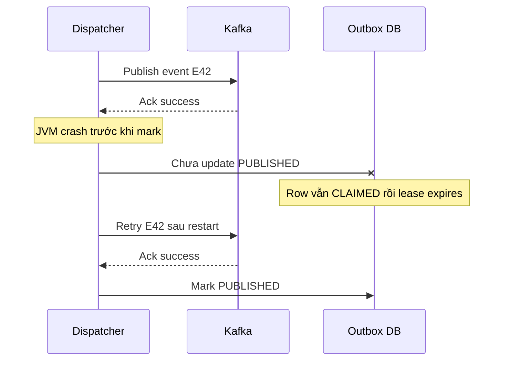
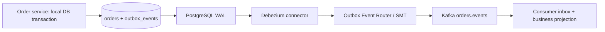
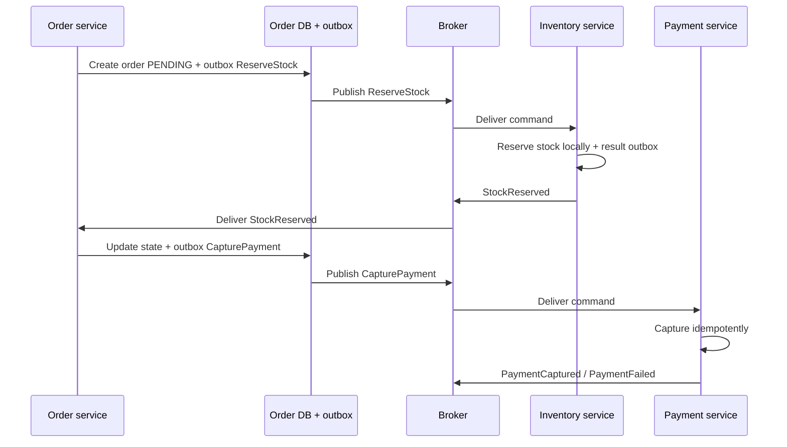
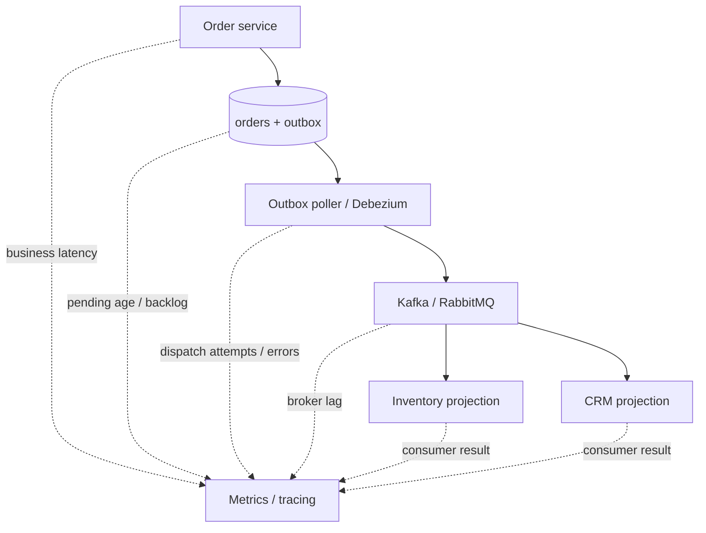

# Transactional Outbox và lưu sự kiện cùng giao dịch nghiệp vụ

## 1. Vấn đề gốc: một thay đổi nghiệp vụ, hai hệ thống lưu trữ

Giả sử hệ thống đơn hàng dùng Spring Boot, PostgreSQL và Kafka. Khi thanh toán thành công, ứng dụng phải:

1. Cập nhật đơn `O-42` thành `PAID` trong PostgreSQL.
2. Phát sự kiện `OrderPaid` để Inventory, CRM và Analytics xử lý qua Kafka.

Nếu database commit nhưng Kafka publish thất bại, các subscriber không biết đơn đã thanh toán. Nếu Kafka publish trước nhưng database rollback, subscriber lại thấy một sự kiện **không phản ánh trạng thái đã commit**.

Đây là bài toán **dual-write**: một thao tác nghiệp vụ tác động đến ít nhất hai tài nguyên độc lập. Một lời gọi `@Transactional` chỉ bao bọc JDBC/JPA không tự tạo giao dịch nguyên tử giữa PostgreSQL với Kafka, RabbitMQ hoặc HTTP API.

**Transactional Outbox** giải quyết khe hở này bằng cách **ghi trạng thái nghiệp vụ và một bản ghi sự kiện cần phát vào cùng giao dịch của một database**. Sau commit, một dispatcher hoặc cơ chế Change Data Capture (CDC) chuyển bản ghi outbox ra broker. Nếu broker tạm không hoạt động, ý định phát vẫn còn trong database để thử lại.

Đây là chủ đề **“Transactional Outbox và lưu sự kiện cùng giao dịch nghiệp vụ”** thuộc chương **“Nhất quán và chống trùng”** trong module **SPRING_BOOT_INTEGRATION**. Module tổ chức tích hợp Spring Boot qua HTTP client, cơ sở dữ liệu, cache, broker thông điệp và adapter Spring Integration, chú trọng cấu hình, hợp đồng dữ liệu, giao dịch, lỗi, xử lý trùng lặp, kiểm thử và observability.

Sau bài này, bạn sẽ:

- Phân biệt transaction nội bộ, dual-write, outbox, inbox và saga.
- Thiết kế schema và code `@Transactional` ghi domain state + event record.
- Hiểu cơ chế dispatcher polling hoặc CDC, publisher acknowledgment và crash recovery.
- Kiểm soát duplicate, ordering, schema version, retry, backpressure và retention.
- Kết hợp với Kafka/RabbitMQ, JDBC/jOOQ/JPA, HTTP client và Spring Integration.
- Viết kiểm thử xác minh commit/rollback và các failure windows, không chỉ mock `send()`.

**Điều cần nhớ:** Outbox tạo tính nguyên tử giữa **domain write và ý định phát** trong cùng database; nó **không** bảo đảm broker chỉ nhận đúng một lần hay mọi subscriber chỉ tạo side effect đúng một lần.

## 2. Vì sao giải pháp “save rồi send” thường sai?

Một đoạn code quen thuộc:

```java
@Transactional
public void markPaid(String orderId) {
    orderRepository.markPaid(orderId);
    kafkaTemplate.send("orders.events", orderId, orderPaidJson);
}
```

Code trên trông có transaction, nhưng `KafkaTemplate.send(...)` gửi qua Kafka producer; Kafka không tự là một phần của JDBC transaction. Future có thể chưa hoàn thành trước khi method trả, và ngay cả khi đã nhận broker acknowledgment thì PostgreSQL vẫn có thể rollback.

Các khả năng:

| Trình tự | Hệ quả |
|---|---|
| DB update → DB commit → Kafka send lỗi | Đơn đã `PAID` nhưng không có event cho hệ thống khác. |
| Kafka send thành công → DB commit lỗi | Có `OrderPaid` nhưng DB vẫn ở trạng thái cũ. |
| Kafka send trả Future chưa hoàn tất → method return | Không biết publish thành công hay thất bại; caller dễ hiểu nhầm. |
| Ứng dụng crash giữa commit và send | Ý định phát không nằm ở đâu đủ bền vững để tiếp tục. |
| Retry toàn method sau lỗi không rõ | Có thể cập nhật/phát trùng nếu không dùng business key ổn định. |

### 2.1. `@TransactionalEventListener(AFTER_COMMIT)` vẫn chưa đủ

Một cách cải tiến thường gặp:

```java
@TransactionalEventListener(phase = TransactionPhase.AFTER_COMMIT)
public void publish(OrderPaid event) {
    kafkaTemplate.send("orders.events", event.orderId(), event);
}
```

Listener chỉ chạy **sau khi DB commit**, giảm rủi ro publish sự kiện của transaction bị rollback. Nhưng còn khe:

```text
DB COMMIT thành công
  JVM crash
AFTER_COMMIT listener chưa chạy
=> không có event bền vững để retry
```

Hoặc listener gửi Kafka lỗi sau commit; database không rollback lại để “đòi” event. `AFTER_COMMIT` hữu ích cho thông báo không quan trọng hoặc kích hoạt dispatcher, **không thay thế outbox** nếu không được phép mất sự kiện. Nếu dùng listener sau commit để đánh thức worker, **outbox record phải đã được lưu trong transaction trước đó**.

### 2.2. Kafka transactions không đồng nghĩa distributed transaction

Kafka hỗ trợ producer transactions và exactly-once trong **phạm vi những thao tác Kafka được cấu hình đúng**. Nó không tự biến database transaction, Kafka publish, Redis invalidation và ERP HTTP call thành một giao dịch ACID thống nhất. Đồng bộ hóa nhiều transaction managers vẫn có failure windows nếu không có 2PC thực sự; thiết kế outbox/inbox thường dễ vận hành hơn distributed two-phase commit trong hệ tích hợp thông thường.

## 3. Outbox thay đổi thứ tự thực thi như thế nào?

```mermaid
sequenceDiagram
    participant API as Order application service
    participant DB as PostgreSQL
    participant D as Outbox dispatcher
    participant B as Kafka/RabbitMQ
    participant C as Inventory consumer
    API->>DB: BEGIN
    API->>DB: UPDATE orders status=PAID
    API->>DB: INSERT outbox_events(OrderPaid, eventId=E42)
    API->>DB: COMMIT (cả hai hoặc không cái nào)
    DB-->>API: COMMIT success
    D->>DB: Claim/find pending outbox event
    D->>B: Publish E42
    B-->>D: Broker acknowledgment / confirm
    D->>DB: Mark event published
    B->>C: Deliver E42
    C->>C: Apply idempotently; commit own state
```

Ở đây có **hai giao dịch hoặc mốc độc lập**:

1. **Business transaction:** update bảng nghiệp vụ và insert outbox trong **cùng một local database transaction**.
2. **Delivery workflow:** đọc event đã commit, publish tới broker, xác nhận và ghi nhận tiến độ dispatch (hoặc để CDC lưu offset tiến trình).

Nếu JVM chết ngay sau business commit, outbox row vẫn còn. Nếu publish thành công rồi dispatcher chết trước khi đánh dấu, hàng đợi có thể phát **E42 lần nữa**. Vì vậy outbox thường đạt **at-least-once delivery** khi retry được cấu hình đúng, không phải exactly-once end-to-end.

### 3.1. Bất biến cốt lõi

Với business operation được xác nhận commit:

- Không tồn tại trạng thái `PAID` mới **mà thiếu** outbox event tương ứng cho operation đó, nếu event là nghĩa vụ của transaction.
- Không tồn tại outbox event đã commit cho một thay đổi nghiệp vụ bị rollback trong **cùng transaction**.
- Dispatcher chỉ nhìn thấy rows **đã commit**, không phát từ những transaction còn dang dở.
- Event có định danh ổn định, không thay mỗi lần publish/retry.
- Nếu publish chưa được xác nhận chắc chắn, row phải tiếp tục đủ điều kiện phục hồi.

Bất biến chỉ có hiệu lực khi domain state và outbox **dùng cùng database và transaction manager** hoặc cùng một nguồn transaction có tính nguyên tử tương đương. Hai `DataSource` độc lập không tự được `@Transactional` gộp vào một local transaction.

## 4. Hợp đồng sự kiện: lưu sự thật nghiệp vụ, không lưu một callback mơ hồ

Một outbox event nên có định danh và metadata để downstream nhận biết **sự kiện nào**, từ aggregate nào, theo version nào:

```json
{
  "eventId": "3b318dd3-4edf-48b5-a9c2-13de59487ea1",
  "eventType": "OrderPaid",
  "schemaVersion": 1,
  "aggregateType": "Order",
  "aggregateId": "O-42",
  "aggregateVersion": 7,
  "occurredAt": "2026-11-21T03:00:00Z",
  "correlationId": "flow-821",
  "causationId": "payment-cmd-93",
  "data": {
    "orderId": "O-42",
    "paymentReference": "pay-5"
  }
}
```

| Trường | Trách nhiệm |
|---|---|
| `eventId` | ID duy nhất **cho logical event**, giữ nguyên khi dispatcher retry. |
| `eventType` | Tên sự kiện có ngữ nghĩa; `OrderPaid` là điều đã xảy ra. |
| `schemaVersion` | Đọc được events cũ sau khi producer/consumer nâng cấp. |
| `aggregateType` và `aggregateId` | Nhóm event theo đối tượng nghiệp vụ, làm broker partition key. |
| `aggregateVersion` | Giải quyết thứ tự và projection update có điều kiện. |
| `occurredAt` | Thời gian sự kiện được ghi nhận bởi nghiệp vụ. |
| `correlationId`/`causationId` | Truy vết luồng, biết operation sinh ra event. |
| `data` | Payload tối thiểu cần cho subscriber, không chứa bí mật ngoài mục đích. |

Có thể lưu payload JSON và các metadata quan trọng thành các cột riêng. Nếu broker dùng Avro/Protobuf hoặc schema registry, outbox có thể lưu envelope có version/format tham chiếu thay vì JSON; cần định nghĩa serializer của dispatcher ổn định và kiểm thử compatibility.

**Không sinh `eventId` mới khi retry dispatch.** Nếu dispatcher đổi eventId mỗi lần gửi, consumer inbox dedupe sẽ không biết hai bản gửi thực ra là cùng một sự kiện.

## 5. Thiết kế schema PostgreSQL: business table và outbox table

Một schema minh họa:

```sql
CREATE TABLE orders (
    order_id VARCHAR(100) PRIMARY KEY,
    status VARCHAR(30) NOT NULL,
    version BIGINT NOT NULL,
    paid_at TIMESTAMPTZ
);

CREATE TABLE outbox_events (
    event_id UUID PRIMARY KEY,
    aggregate_type VARCHAR(80) NOT NULL,
    aggregate_id VARCHAR(100) NOT NULL,
    aggregate_version BIGINT NOT NULL,
    event_type VARCHAR(120) NOT NULL,
    schema_version INT NOT NULL,
    payload JSONB NOT NULL,
    status VARCHAR(20) NOT NULL DEFAULT 'PENDING',
    attempts INT NOT NULL DEFAULT 0,
    available_at TIMESTAMPTZ NOT NULL DEFAULT now(),
    claimed_by VARCHAR(100),
    claimed_until TIMESTAMPTZ,
    claim_generation BIGINT NOT NULL DEFAULT 0,
    published_at TIMESTAMPTZ,
    last_error_code VARCHAR(100),
    created_at TIMESTAMPTZ NOT NULL DEFAULT now(),

    CONSTRAINT ck_outbox_status CHECK (
        status IN ('PENDING', 'CLAIMED', 'PUBLISHED', 'QUARANTINED')
    )
);

CREATE INDEX ix_outbox_pending
    ON outbox_events (available_at, created_at, event_id)
    WHERE status = 'PENDING';

CREATE INDEX ix_outbox_expired_claim
    ON outbox_events (claimed_until, event_id)
    WHERE status = 'CLAIMED';

CREATE INDEX ix_outbox_aggregate
    ON outbox_events (aggregate_type, aggregate_id, aggregate_version);
```

Đây là **mô hình polling dispatcher**, không phải schema chuẩn bắt buộc cho mọi triển khai. Nếu dùng **CDC/Debezium**, có thể chỉ cần các cột event/envelope và metadata, không cần `status`, `claimed_by` hoặc những indexes cho polling. Không áp cùng một schema phức tạp cho mọi chiến lược.

### 5.1. Giải thích trạng thái dispatcher

| Status | Nghĩa | Ai đưa vào? |
|---|---|---|
| `PENDING` | Event đã commit, sẵn sàng phát khi `available_at` đến hạn. | Business transaction hoặc retry scheduler. |
| `CLAIMED` | Một dispatcher đang giữ lease để publish. | Poller claim transaction. |
| `PUBLISHED` | Dispatcher đã nhận producer acknowledgment/confirm theo policy rồi mark. | Dispatch completion transaction. |
| `QUARANTINED` | Retry đã hết hoặc lỗi contract/config cần người xử lý. | Recovery/operations workflow. |

**`PUBLISHED` không có nghĩa mọi subscriber đã xử lý.** Đó là milestone ở producer/broker boundary. Để theo dõi CRM/Inventory đã hoàn tất, cần subscriber inbox/status/projection riêng.

### 5.2. Những constraint bổ sung theo business domain

Có thể thêm unique key dựa trên `(aggregate_type, aggregate_id, aggregate_version, event_type)` **chỉ nếu** hợp đồng bảo đảm tối đa một event của loại đó trên cùng phiên bản aggregate. Nhiều hệ thống cho phép phát nhiều event cùng type/version; thêm unique constraint bừa sẽ làm mất những event hợp lệ.

Nên có **business operation ID** hoặc idempotency key ổn định ở bảng nghiệp vụ để ngăn API/retry tạo một operation mới ngoài ý muốn. `event_id UUID` có thể được sinh trong transaction khi command được chấp nhận, nhưng retry *cùng một ý định* sau lỗi commit chưa rõ cần tra cứu business key trước khi sinh event khác.

## 6. Code Spring Boot: ghi domain state và event trong đúng một transaction

Ví dụ dùng Spring Framework 6.1+/Boot tương thích với `JdbcClient`, PostgreSQL và Jackson. Trong hệ thống thật, nên tạo schema bằng Flyway/Liquibase và cấu hình một `DataSource` và `PlatformTransactionManager` nhất quán.

DTO và event JSON:

```java
public record OrderPaidData(
        String orderId, String paymentReference) {}

public record OrderPaidEnvelope(
        String eventId,
        String eventType,
        int schemaVersion,
        String aggregateType,
        String aggregateId,
        long aggregateVersion,
        java.time.Instant occurredAt,
        OrderPaidData data) {}
```

Application service:

```java
import java.time.Clock;
import java.util.UUID;

import com.fasterxml.jackson.core.JsonProcessingException;
import com.fasterxml.jackson.databind.ObjectMapper;
import org.springframework.jdbc.core.simple.JdbcClient;
import org.springframework.stereotype.Service;
import org.springframework.transaction.annotation.Transactional;

@Service
public class OrderPaymentService {

    private final JdbcClient jdbc;
    private final ObjectMapper mapper;
    private final Clock clock;

    public OrderPaymentService(
            JdbcClient jdbc, ObjectMapper mapper, Clock clock) {
        this.jdbc = jdbc;
        this.mapper = mapper;
        this.clock = clock;
    }

    @Transactional
    public UUID recordPayment(String orderId, String paymentReference) {
        // Ví dụ giả định order đang NEW; real code cần xử lý
        // business idempotency và optimistic version đúng schema.
        int updated = jdbc.sql("""
                UPDATE orders
                SET status = 'PAID',
                    version = version + 1,
                    paid_at = now()
                WHERE order_id = :orderId
                  AND status = 'NEW'
                  AND version = 6
                """)
            .param("orderId", orderId)
            .update();

        if (updated != 1) {
            throw new IllegalStateException(
                    "Order not in expected state/version");
        }

        UUID eventId = UUID.randomUUID();
        OrderPaidEnvelope event = new OrderPaidEnvelope(
                eventId.toString(),
                "OrderPaid", 1, "Order", orderId, 7L,
                clock.instant(),
                new OrderPaidData(orderId, paymentReference));

        String json = toJson(event);

        jdbc.sql("""
                INSERT INTO outbox_events(
                    event_id, aggregate_type, aggregate_id,
                    aggregate_version, event_type,
                    schema_version, payload)
                VALUES (
                    :eventId, 'Order', :orderId,
                    :version, 'OrderPaid', 1,
                    CAST(:payload AS jsonb))
                """)
            .param("eventId", eventId)
            .param("orderId", orderId)
            .param("version", 7L)
            .param("payload", json)
            .update();

        return eventId;
    }

    private String toJson(Object event) {
        try {
            return mapper.writeValueAsString(event);
        } catch (JsonProcessingException ex) {
            throw new IllegalStateException(
                    "Cannot serialize outbox event", ex);
        }
    }
}
```

`Clock` cần được cung cấp thành bean hoặc thay bằng nguồn thời gian được quản lý; trong test nên dùng fixed clock để assertions ổn định. Giá trị `version=6/7` ở đây **chỉ minh họa một chuyển trạng thái cụ thể**; production phải lấy expected version từ input đã xác thực/đọc bằng concurrency policy, và đưa **actual updated version** vào event.

Điểm quan trọng không phải những số trong ví dụ, mà là **cả hai câu SQL chạy bên trong cùng method `@Transactional` và cùng connection/transaction manager**. Nếu insert outbox thất bại hoặc JSON serialization ném exception, domain update phải rollback. Nếu domain update không hợp lệ, **không phát sự kiện**.

### 6.1. Vì sao nên tách business service và dispatcher?

Business service chỉ xác nhận **thay đổi nghiệp vụ cùng intent phát**. Nó không chờ Kafka/ERP. Dispatcher chịu trách nhiệm **giao hàng ra broker**. Khi broker outage, API có thể vẫn chấp nhận business command nếu contract cho phép trạng thái eventual consistency; đồng thời cần theo dõi backlog, rate limit và khả năng phụ thuộc cuối cùng không bắt kịp.

Tùy nghiệp vụ, API nên trả trạng thái như `PAID (event propagation pending)` hoặc operation ID. Không trả lời “Inventory đã cập nhật” khi mới commit local outbox.

## 7. Viết chính xác hơn: bảo vệ idempotency ở business transaction

Ví dụ `recordPayment` trên cố ý ngắn để mô tả transaction. Trong production, cần ngăn hai HTTP requests/retries cùng `paymentReference` sinh hai sự kiện logic.

Một hợp đồng hợp lý:

- `paymentReference` hoặc `commandId` được tạo bởi payment provider/business workflow, **ổn định** giữa retries.
- Bảng orders/payments có unique constraint tương ứng và lưu trạng thái xử lý.
- Nếu lệnh trùng cùng payload/outcome, application trả **kết quả cũ** hoặc xác nhận đã xử lý; không tạo outbox event mới.
- Nếu cùng key nhưng payload khác, báo **conflict**, không giả vờ idempotent.
- Nếu commit outcome `UNKNOWN` do mất kết nối, caller tra cứu theo key trước khi retry.

Ví dụ bảng lệnh có thể:

```sql
CREATE TABLE payment_commands (
    command_id VARCHAR(100) PRIMARY KEY,
    order_id VARCHAR(100) NOT NULL,
    request_hash VARCHAR(64) NOT NULL,
    state VARCHAR(30) NOT NULL,
    event_id UUID,
    updated_at TIMESTAMPTZ NOT NULL DEFAULT now()
);
```

Transaction business có thể claim/insert command row trước, kiểm tra hash và state rồi cập nhật order + outbox + command outcome **cùng transaction**. Không insert marker thành công ở transaction riêng rồi mới xử lý; crash sẽ để marker ngăn retries dù operation chưa hoàn thành.

### 7.1. Outbox không thay thế unique business key

Một `event_id` mới được sinh mỗi lần caller retry tạo ra nhiều events khác nhau dù outbox đều được commit “đúng kỹ thuật”. Outbox đảm bảo **không mất sự kiện đối với một commit**, nhưng **không tự biết hai commits có cùng business intent**. Business idempotency và outbox phải đi cùng nhau.

## 8. `@Transactional`: nơi lỗi vận hành thường bắt đầu

Các điều kiện để mẫu Java ở trên thực sự nguyên tử:

1. Spring transaction được bật và service được gọi **qua Spring proxy**, không phải `new OrderPaymentService(...)` trực tiếp.
2. Method `@Transactional` được gọi từ bean khác; self-invocation trong cùng class có thể bỏ qua proxy.
3. Domain repository và outbox repository dùng **cùng JDBC DataSource/transaction manager**.
4. Không dùng `REQUIRES_NEW` cho outbox insert nếu nó cần cùng outcome với business update.
5. Không ném công việc outbox insert sang `@Async` hoặc executor khác bên trong transaction rồi kỳ vọng cùng thread-bound JDBC transaction.
6. Exception ném ra đúng ranh giới để rollback; không catch rồi tiếp tục commit nửa trạng thái.
7. Dữ liệu cần thiết để serialize event ổn định trước commit.

### 8.1. Tại sao `REQUIRES_NEW` thường sai cho outbox write?

```java
@Transactional
void changeBusinessState() {
    orderRepository.markPaid(...);
    outboxService.insertInRequiresNew(...); // Phản mẫu.
    // Bước tiếp theo ném exception -> transaction ngoài rollback.
}
```

Nếu outbox insert đã commit trong transaction độc lập, còn domain update rollback, broker có thể nhận **event của thay đổi không tồn tại**. Để bảo đảm atomicity, outbox phải tham gia **transaction đang thay đổi business state** (`REQUIRED` hoặc boundary tương đương được cấu hình đúng).

`REQUIRES_NEW` có thể phù hợp cho audit/failure logging độc lập, nhưng đó là một hợp đồng khác; không dùng nó để tự nhận là Transactional Outbox.

### 8.2. `@TransactionalEventListener` có thể giúp đánh thức dispatcher

Nếu business transaction đã ghi outbox:

```text
BEGIN
  UPDATE orders...
  INSERT outbox_events...
COMMIT
  -> AFTER_COMMIT callback signal dispatcher (best-effort)
```

Callback sau commit có thể giảm độ trễ publish bằng cách đánh thức poller. Nếu callback không chạy, scheduled poller vẫn tìm được outbox row còn pending. **Không biến callback thành đường giao event duy nhất.**

## 9. Dùng JPA/Hibernate hoặc jOOQ có thay đổi nguyên lý không?

Không. Spring Boot integration có thể ghi domain bằng JPA và outbox bằng JPA entity, hoặc dùng `DSLContext` jOOQ và JDBC table. Nguyên tắc vẫn là **cùng database transaction**, không phải “cùng repository interface”.

### 9.1. JPA entity và outbox entity

Ví dụ khung:

```java
import jakarta.persistence.Entity;
import jakarta.persistence.Id;
import jakarta.persistence.Column;

@Entity
public class OutboxEntry {

    @Id
    private java.util.UUID eventId;

    private String aggregateType;
    private String aggregateId;
    private String eventType;
    private long aggregateVersion;
    private int schemaVersion;

    @Column(nullable = false, columnDefinition = "jsonb")
    private String payload;

    protected OutboxEntry() {}

    // Constructor/factory/getters được ứng dụng định nghĩa.
}
```

`@Column(columnDefinition="jsonb")` là ví dụ PostgreSQL-specific; việc bind `String` vào JSONB qua Hibernate/JDBC có thể cần JSON type mapping phù hợp, không mặc định mọi version hoạt động chỉ nhờ annotation trên. Trong production có thể dùng Hibernate JSON support hoặc ghi outbox qua `JdbcClient` với `CAST(:payload AS jsonb)`.

`JpaRepository.save(...)` có thể trì hoãn SQL tới flush/commit; **đừng suy ra có `save()` là DB đã commit**. Cần test unique constraint, optimistic lock, rollback và listener `AFTER_COMMIT` với transaction thật.

### 9.2. jOOQ và JDBC chung một transaction

Một `DSLContext` do Spring Boot quản lý có thể tham gia Spring transaction khi dùng `DataSource`/transaction provider phù hợp. Nếu bạn tự tạo DSLContext từ `DriverManager.getConnection(...)` khác, thao tác có thể chạy ngoài transaction đang cập nhật domain. Kiểm tra transaction wiring thực tế, không phỏng đoán từ việc cả hai cùng trỏ tới hostname PostgreSQL.

## 10. Hai chiến lược phân phối outbox: polling hay CDC?

Sau business commit, cần chuyển row ra broker. Hai chiến lược phổ biến:

| Khía cạnh | Polling dispatcher | CDC / transaction log tailing |
|---|---|---|
| Nguồn dữ liệu | Query bảng outbox định kỳ. | Đọc database change log/WAL/binlog. |
| Thành phần | Spring scheduler/worker riêng. | Connector như Debezium và Kafka Connect hoặc tương đương. |
| Độ trễ | Theo poll interval, backlog và query. | Thường thấp khi connector khỏe, phụ thuộc log/connector. |
| DB load | Query/claim/update thường xuyên, cần indexes và cleanup. | CDC đọc log; vẫn có chi phí WAL, replication slot, snapshot. |
| Retry | Lease/status/next-attempt, worker tự quản lý. | Connector offset/checkpoint/restart và producer behavior. |
| Ordering | Phải thiết kế claim/partition/serialization cẩn thận. | Có thể bảo toàn commit/log order theo connector, nhưng downstream vẫn cần key/version. |
| Deploy/vận hành | Đơn giản cho hệ nhỏ, cần scheduler HA. | Cần quản lý connector, slots, storage/retention và compatibility. |
| Khi broker down | Rows `PENDING` tăng. | Connector dừng tiến độ; WAL/connector backlog tăng. |

Cả hai có thể đạt at-least-once delivery. CDC **không xóa** rủi ro duplicate từ retry/restart/offset commit gap. Polling **không cần** đọc WAL nhưng phải tự xử lý lease và multi-replica concurrency.

**Chọn một đường phát chính** cho cùng outbox table. Chạy cả polling và Debezium phát cùng event mà không có coordination sẽ tạo duplicates không cần thiết.

## 11. Polling một replica: đơn giản nhưng chưa production-ready

Một phiên bản dễ hiểu:

```text
@Scheduled:
  SELECT pending outbox events ORDER BY created_at LIMIT 100
  FOR EACH:
      publish to Kafka
      wait for producer acknowledgment
      mark event PUBLISHED
```

Với một dispatcher duy nhất và tải thấp, cách này dễ triển khai. Nhưng trong môi trường nhiều pods, **hai pollers có thể chọn cùng một row**; process crash sau publish nhưng trước mark làm publish lại; transaction giữ lock trong lúc chờ Kafka có thể cản ghi vào DB.

Hệ thống production cần:

- Cơ chế **claim độc quyền tạm thời** cho mỗi row hoặc sharding phù hợp.
- **Lease timeout** để row trở lại sau khi worker chết.
- Giới hạn batch/publish concurrency, retry/backoff có thể lưu bền vững.
- Trạng thái `PUBLISHED` chỉ sau producer confirm/ack theo policy.
- Cơ chế chống stale workers ghi đè kết quả khi lease đã đổi chủ.
- Metric và runbook cho pending/claimed/quarantined backlog.

Một worker thất bại không được khiến row mắc `CLAIMED` vĩnh viễn.

## 12. PostgreSQL: claim bằng `FOR UPDATE SKIP LOCKED`

Mẫu PostgreSQL cho nhiều dispatchers:

```sql
WITH selected AS (
    SELECT event_id
    FROM outbox_events
    WHERE
        (status = 'PENDING' AND available_at <= now())
        OR
        (status = 'CLAIMED' AND claimed_until < now())
    ORDER BY created_at, event_id
    FOR UPDATE SKIP LOCKED
    LIMIT :batchSize
)
UPDATE outbox_events AS o
SET status = 'CLAIMED',
    claimed_by = :workerId,
    claimed_until =
        now() + (:leaseSeconds * INTERVAL '1 second'),
    claim_generation = claim_generation + 1,
    attempts = attempts + 1
FROM selected
WHERE o.event_id = selected.event_id
RETURNING
    o.event_id,
    o.aggregate_id,
    o.aggregate_version,
    o.event_type,
    o.payload,
    o.claim_generation,
    o.attempts;
```

Gọi câu lệnh này trong **một transaction ngắn**, commit claim rồi mới publish qua network.

Các điểm quan trọng:

- `FOR UPDATE SKIP LOCKED` tránh nhiều workers giữ lock/chờ cùng row khi claim.
- `claim_generation` tăng mỗi lần claim, giúp tránh worker cũ mark success cho claim mới.
- `claimed_until` cho phép phục hồi sau JVM crash; không phải distributed lock tuyệt đối.
- `attempts` tăng khi claim, không nhất thiết đồng nghĩa broker đã nhận attempt.
- `LIMIT`/`ORDER BY` chỉ tạo thứ tự **chọn row** trong một lần query, không tự đảm bảo event ordering khi nhiều workers publish song song.
- Cần transaction isolation phù hợp và indexes thực; query là **PostgreSQL-specific**, không copy nguyên sang MySQL/SQL Server mà không kiểm tra.
- Với lease ngắn hơn thời gian publish, row có thể được claim lại khi worker ban đầu chưa xong → duplicate; điều chỉnh hoặc renew lease có điều kiện.

### 12.1. Bảo vệ thao tác mark bằng generation

```sql
UPDATE outbox_events
SET status = 'PUBLISHED',
    published_at = now(),
    claimed_by = NULL,
    claimed_until = NULL,
    last_error_code = NULL
WHERE event_id = :eventId
  AND status = 'CLAIMED'
  AND claimed_by = :workerId
  AND claim_generation = :generation;
```

Phải kiểm tra `updatedRows == 1`. Nếu bằng 0, ownership đã thay đổi hoặc event được xử lý bởi worker khác. Không update vô điều kiện theo `event_id`: stale worker có thể ghi sai trạng thái dù broker send của nó trễ.

Dù generation guard giúp bảo toàn **trạng thái row**, nó **không ngăn** hai workers cùng publish event trong lúc lease hết hạn. Consumer phải idempotent.

## 13. Ranh giới publisher: Kafka acknowledgment rồi mới mark

Một Kafka dispatcher có thể dùng `KafkaTemplate<String, String>` do Spring Boot tạo, với event JSON đã lưu ở outbox:

```java
import java.util.concurrent.TimeUnit;
import org.springframework.kafka.core.KafkaTemplate;
import org.springframework.stereotype.Component;

@Component
class KafkaOutboxSender {

    private final KafkaTemplate<String, String> kafka;

    KafkaOutboxSender(KafkaTemplate<String, String> kafka) {
        this.kafka = kafka;
    }

    void publish(OutboxMessage message) throws Exception {
        kafka.send(
                "orders.events",
                message.aggregateId(),
                message.payloadJson())
            .get(5, TimeUnit.SECONDS);
    }
}
```

`OutboxMessage` là record/DTO do ứng dụng định nghĩa, lấy từ claim query. `KafkaTemplate.send` trả `CompletableFuture` ở các thế hệ Spring Kafka tương thích. Dùng `get(...)` trong ví dụ để minh họa **chờ broker acknowledgment có timeout**, phù hợp với một worker blocking có concurrency bounded, **không** phù hợp trên Reactor Netty event loop.

Ở producer, cần thiết lập:

- `acks=all` khi yêu cầu mức xác nhận mạnh hơn (kết hợp broker `min.insync.replicas`/replication policy).
- `enable.idempotence=true` khi phù hợp để giảm duplicate trong những lần producer retry trong phạm vi session/protocol.
- `delivery.timeout.ms`, `request.timeout.ms`, retries và ordering policy tương thích.
- Key dùng `aggregateId` để các events cùng aggregate có khả năng vào cùng partition.
- Producer metrics/logs không chứa raw payment details.

### 13.1. Timeout publish là trạng thái chưa chắc chắn

Nếu `get(5, TimeUnit.SECONDS)` timeout, producer có thể vẫn đang cố gửi hoặc broker đã nhận nhưng callback chưa kịp trả. **Không ghi `PUBLISHED`**, cũng không mặc định “broker chưa nhận”. Row nên được retry hoặc chuyển trạng thái phù hợp; duplicate delivery là khả năng có chủ đích mà subscriber phải chịu.

Để quản lý thread interruptions, nếu catch `InterruptedException` hãy gọi `Thread.currentThread().interrupt()` rồi dừng chu kỳ worker thích hợp; không nuốt interruption.

### 13.2. Mark sau ack cũng có khe lỗi



Hai Kafka records có thể cùng `eventId=E42`. **Không có cách biến hai bước “Kafka ack” và “DB mark published” thành atomic chỉ bằng `@Transactional` JDBC.** Đây là lý do cần consumer deduplication.

## 14. Worker polling mẫu: transaction ngắn, network nằm ngoài transaction

Một kiến trúc production tối thiểu chia ba bean:

- `OutboxClaimStore`: `claimBatch(...)` chạy trong transaction DB ngắn.
- `KafkaOutboxSender`: gửi message và đợi acknowledgment trong bounded worker.
- `OutboxCompletionStore`: `markPublished(...)` / `scheduleRetry(...)` cập nhật có điều kiện bằng generation.

Pseudocode Java mô tả orchestration:

```java
import java.time.Duration;
import java.util.List;
import org.springframework.scheduling.annotation.Scheduled;
import org.springframework.stereotype.Component;

@Component
class OutboxDispatcher {

    private final OutboxClaimStore claims;
    private final KafkaOutboxSender sender;
    private final OutboxCompletionStore completion;

    OutboxDispatcher(
            OutboxClaimStore claims,
            KafkaOutboxSender sender,
            OutboxCompletionStore completion) {
        this.claims = claims;
        this.sender = sender;
        this.completion = completion;
    }

    @Scheduled(fixedDelayString =
            "${integration.outbox.poll-delay-ms:500}")
    public void dispatch() {
        String worker = "replica-01"; // Lấy từ runtime identity.
        List<OutboxMessage> batch =
                claims.claimBatch(worker, 100, Duration.ofSeconds(30));

        for (OutboxMessage event : batch) {
            try {
                sender.publish(event);

                completion.markPublished(
                        event.eventId(),
                        worker,
                        event.claimGeneration());
            } catch (InterruptedException ex) {
                Thread.currentThread().interrupt();
                return;
            } catch (Exception ex) {
                completion.scheduleRetry(
                        event.eventId(),
                        worker,
                        event.claimGeneration(),
                        classify(ex));
            }
        }
    }

    private String classify(Exception ex) {
        return "BROKER_PUBLISH_ERROR"; // Phân loại an toàn hơn ở bản thật.
    }
}
```

Đây là **khung cấu trúc**, không phải code hoàn chỉnh có thể build độc lập: ứng dụng cần định nghĩa DTO/store, `@EnableScheduling` (hoặc scheduler được cấu hình), runtime worker ID duy nhất, timeout/retry policy, metrics và shutdown handling. Lệnh claim/complete phải được gọi **qua các Spring beans có transaction proxy thực sự**; đặt `@Transactional` trên private method rồi tự gọi trong cùng class là không đủ.

### 14.1. Đừng bao một transaction quanh cả vòng gửi

Sai:

```java
@Transactional
public void dispatch() {
    List<OutboxMessage> events = queryPending();
    for (OutboxMessage e : events) {
        kafka.send(...).get(...);
        markPublished(e);
    }
}
```

Cách này có thể giữ JDBC connection/row locks trong lúc chờ network/backoff, khiến DB pool cạn và tăng lock contention. Nó **vẫn không** bảo đảm atomicity giữa Kafka acknowledgment và commit DB. Hãy commit claim, publish ngoài transaction, rồi commit completion riêng.

### 14.2. Lease phải tính cả queue wait và retry

Nếu batch claim 100 records với lease 30 giây nhưng worker xử lý tuần tự mỗi send mất 5 giây, những rows cuối có thể hết lease **trước khi tới lượt**. Giảm batch size, xử lý bounded concurrency, claim theo tiến độ hoặc có lease renewal đúng generation; đo p99 publish duration và backlog thay vì chọn lease ngẫu nhiên.

## 15. Nếu đẩy event sang RabbitMQ thì khác gì?

Transactional outbox **không phụ thuộc Kafka**. Với RabbitMQ, dispatcher có thể publish event tới exchange và routing key qua `RabbitTemplate`. Những điều cần phân biệt:

| Kafka | RabbitMQ |
|---|---|
| Producer acknowledgment theo `acks`/broker protocol. | Publisher confirms khi được cấu hình. |
| Topic/partition và consumer groups. | Exchange routing, queues/bindings và competing consumers. |
| Retained log cho replay theo retention. | Queue thường loại message sau ack; replay cần DLT/retention riêng. |
| Partition key bằng aggregate ID. | Routing key quyết định queue, ordering còn phụ thuộc queue/consumers. |
| Producer futures/callbacks. | Confirm correlation/callback hoặc API phù hợp trong `RabbitTemplate`. |

**Publisher confirm không chứng minh message đã được route tới queue mong muốn** trong mọi cấu hình; với RabbitMQ cần xem mandatory publish, publisher returns, exchange/binding/topology, queue durability và message persistence. Không mark outbox published chỉ vì lời gọi `convertAndSend(...)` trả bình thường nếu hệ thống yêu cầu xác nhận broker đã nhận và route được.

Nếu broker hỗ trợ delayed routing hoặc DLX, đó là chính sách **downstream retry/error handling**, không tự thay đổi yêu cầu business + outbox atomicity trong PostgreSQL.

## 16. CDC: chuyển từ transaction log sang Kafka

Với PostgreSQL, Debezium có thể theo dõi WAL/replication slot và đưa thay đổi trong bảng outbox ra Kafka qua Kafka Connect. **Outbox Event Router** của Debezium là một tùy chọn để chuyển row thành event có key, topic và payload phù hợp.



Điểm quan trọng:

- Business code vẫn **insert outbox cùng transaction**; đây là phần không đổi.
- CDC chỉ đọc **những thay đổi được commit** từ transaction log theo connector semantics.
- Connector cần quản lý replication slot, WAL retention, snapshot phase, offsets/checkpoints và broker credentials.
- Mapping event ID, aggregate key, route/topic, payload và schema version phải rõ ràng.
- Nếu connector crash sau publish nhưng trước checkpoint, duplicate records có thể xuất hiện.
- Polling-specific `status/claim` thường không cần trong CDC-only design; cập nhật status thường xuyên có thể sinh thêm change events nếu routing không lọc operation phù hợp.

### 16.1. Schema cho CDC nên tối giản và ổn định

Một biến thể:

```sql
CREATE TABLE outbox_events_cdc (
    event_id UUID PRIMARY KEY,
    aggregate_type VARCHAR(80) NOT NULL,
    aggregate_id VARCHAR(100) NOT NULL,
    event_type VARCHAR(120) NOT NULL,
    aggregate_version BIGINT NOT NULL,
    schema_version INT NOT NULL,
    payload JSONB NOT NULL,
    occurred_at TIMESTAMPTZ NOT NULL DEFAULT now()
);
```

Đừng áp nguyên tên cột/format này vào connector config mà chưa kiểm tra **field mapping của Outbox Event Router** và yêu cầu version Debezium đang triển khai. Nếu cần biết publisher đã đến đâu, dùng connector lag/checkpoint và broker telemetry thay vì đánh dấu tất cả rows bằng một polling worker khác.

### 16.2. WAL growth có thể trở thành sự cố production

Nếu Kafka/connector down và replication slot giữ WAL quá lâu, disk PostgreSQL có thể đầy. Outbox qua CDC không xóa backlog; nó **chuyển nơi backlog được quản lý**. Phải alert connector lag, replication slot retention, WAL disk usage và sự chậm trễ event propagation.

## 17. Ordering: lưu đúng thứ tự không bảo đảm publish đúng thứ tự

Giả sử aggregate `O-42` có:

```text
version 7: OrderPaid(event E7)
version 8: OrderRefunded(event E8)
```

Trong một transaction outbox, version của event phải phản ánh **version nghiệp vụ đã commit**. Nhưng với nhiều polling workers:

1. Worker A claim E7, broker đang chậm.
2. Worker B claim E8 và publish thành công.
3. Consumer nhận E8 trước E7.

Ngay cả `ORDER BY created_at` trong SQL cũng **không** bắt hai workers publish tuần tự. Với Kafka key `orderId`, hai messages sẽ có cơ hội vào cùng partition, nhưng thứ tự trong log lúc này là **thứ tự broker nhận**, có thể là E8 rồi E7.

### 17.1. Các chiến lược giữ trật tự

- **Serial per aggregate:** một worker/partition xử lý các event cùng aggregate theo `aggregateVersion`, chỉ phát version kế tiếp khi version trước đã được xác nhận theo hợp đồng.
- **Partition/shard outbox polling:** chia theo hash(aggregateId), bảo đảm một owner serial trong shard và xử lý takeover cẩn thận.
- **CDC theo commit/log order:** giúp giữ trật tự commit ở nguồn trong các điều kiện hỗ trợ, nhưng vẫn phải kiểm tra connector/producer config/partition assignment.
- **Consumer version guard:** chỉ cập nhật projection khi incomingVersion phù hợp, bỏ qua/đệm sự kiện cũ hoặc thiếu version theo business policy.
- **Thiết kế event commutative:** khi có thể, dùng delta/operation có semantics ít phụ thuộc order; vẫn cần idempotency.

Không tự khẳng định CDC “luôn giữ đúng mọi thứ tự” qua nhiều bảng/topics/partitions hoặc khi replay. Ordering phải được định nghĩa **theo aggregate và scope**.

### 17.2. Version check ở consumer

```sql
UPDATE order_projection
SET status = :status,
    aggregate_version = :incomingVersion
WHERE order_id = :orderId
  AND aggregate_version < :incomingVersion;
```

Câu lệnh này **ngăn lùi version**, nhưng không đảm bảo không bỏ qua version 7 khi version 8 đến trước. Nếu nghiệp vụ cần xử lý mọi bước (đặc biệt sổ cái tài chính), phải kiểm tra `incomingVersion = currentVersion + 1`, tạm lưu event thiếu predecessor hoặc rebuild từ source of truth theo chính sách. Không coi “version lớn hơn” là đủ trong mọi hệ thống.

## 18. Inbox: tránh consumer áp dụng cùng event nhiều lần

Outbox phía producer cung cấp event ID ổn định; phía consumer cần **dedupe bền vững** khi Kafka/RabbitMQ redeliver hoặc dispatcher publish lại.

Ví dụ một bảng inbox:

```sql
CREATE TABLE consumed_events (
    consumer_name VARCHAR(100) NOT NULL,
    event_id UUID NOT NULL,
    payload_hash VARCHAR(64) NOT NULL,
    processed_at TIMESTAMPTZ NOT NULL DEFAULT now(),
    PRIMARY KEY (consumer_name, event_id)
);
```

Một consumer Spring Boot có thể xử lý:

```java
import org.springframework.jdbc.core.simple.JdbcClient;
import org.springframework.stereotype.Service;
import org.springframework.transaction.annotation.Transactional;

@Service
class OrderPaidProjectionService {

    private final JdbcClient jdbc;

    OrderPaidProjectionService(JdbcClient jdbc) {
        this.jdbc = jdbc;
    }

    @Transactional
    public void apply(OrderPaidReceived event) {
        int inserted = jdbc.sql("""
                INSERT INTO consumed_events(
                    consumer_name, event_id, payload_hash)
                VALUES ('inventory-projection',
                        :eventId, :payloadHash)
                ON CONFLICT (consumer_name, event_id) DO NOTHING
                """)
            .param("eventId", event.eventId())
            .param("payloadHash", event.payloadHash())
            .update();

        if (inserted == 0) {
            verifyPreviouslyProcessed(event);
            return;
        }

        // Update inventory projection và/hoặc outbox event kết quả
        // trong CÙNG transaction với consumed_events.
        applyBusinessChange(event);
    }

    private void verifyPreviouslyProcessed(OrderPaidReceived event) {
        // Đọc hash/outcome đã lưu và từ chối cùng ID nhưng payload khác.
    }

    private void applyBusinessChange(OrderPaidReceived event) {
        // Domain logic cần triển khai.
    }
}
```

`OrderPaidReceived` là DTO do ứng dụng định nghĩa chứa `UUID eventId` và hash được tính/kiểm chứng từ payload, không tin một chuỗi hash do producer tùy ý khai báo. Hai method helper là **chỗ cần triển khai** chứ không phải lời khuyên coi duplicate nào cũng thành công.

**Bất biến:** ghi inbox marker, cập nhật projection và tạo outbox event thứ cấp (nếu cần) phải nằm trong **cùng DB transaction**. Nếu commit marker trước rồi service crash trước business update, lần redelivery sẽ bỏ sai một operation chưa hoàn thành.

### 18.1. Ack broker khi nào?

Kafka offset commit hoặc RabbitMQ consumer ack nên diễn ra sau khi **business effect hoặc durable handoff tương ứng đã commit**. Nếu DB đã commit còn ack thất bại, broker giao lại, inbox ngăn duplicate. Nếu ack trước DB commit, crash có thể làm mất work.

Với downstream HTTP/ERP có side effect ngoài DB transaction, inbox riêng chưa đủ. Cần **command/outbox + idempotency key phía ERP hoặc đối soát** để giải quyết timeout sau write.

## 19. Outbox đi cùng saga/compensation khi workflow có nhiều dịch vụ

Outbox bảo đảm local state + event intent; nó **không** thực hiện atomic transaction cho Order DB, Inventory DB, Payment Provider và Shipment API. Một workflow dài có thể có các bước:



Nếu PaymentFailed, một saga/orchestrator có thể gửi `ReleaseStock`. Mỗi service có local transaction/outbox riêng và inbox/idempotency; compensation là **nghiệp vụ bù trừ**, không phải rollback phân tán tự động.

Không ghi trong event rằng “toàn bộ đơn đã hoàn thành” chỉ vì Outbox `PUBLISHED`. Cần state machine theo các business outcomes thực.

## 20. Dữ liệu sự kiện và tiến hóa schema

Outbox là một dạng **hợp đồng bất đồng bộ**. Sự kiện có thể được giao lại **nhiều ngày** sau, khi consumer đã deploy version khác.

Các nguyên tắc:

1. Có `eventType` và `schemaVersion`, chọn quy ước version semantics.
2. Ưu tiên thay đổi tương thích ngược: thêm field optional, giữ ý nghĩa field cũ.
3. Tránh xóa/đổi nghĩa một field mà consumer cũ còn cần.
4. Khi nâng major, hỗ trợ upcast/migration hoặc topic/contract mới rõ ràng.
5. Giữ metadata `eventId`, aggregate và version ngoài payload khi dispatcher cần route mà không parse toàn bộ schema.
6. Test serializer/deserializer giữa phiên bản hiện tại và outbox records cũ.
7. Không phụ thuộc tên Java class nội bộ trong wire event nếu producer/consumer deploy độc lập.

Một outbox row **đã commit không nên bị sửa payload tùy tiện** chỉ vì code mới có schema mới. Nếu phải sửa/quarantine lỗi dữ liệu, lưu audit và quy tắc replay. Với CDC router, kiểm tra mapping schema và behavior đối với UPDATE/DELETE nếu schema được thiết kế insert-only.

## 21. Retry và quarantine: khi nào dừng tự động?

Retry publish broker có thể thất bại vì network, ACL, topic không tồn tại, serialization, message quá lớn, timeout hoặc broker quota.

| Lỗi | Chính sách thường hợp lý |
|---|---|
| Network/broker tạm mất, timeout ngắn | Retry bounded, exponential backoff + jitter. |
| Broker 429/quota/throttling tương đương | Giảm rate và concurrency; tôn trọng quota. |
| Authentication/authorization sai | Cảnh báo cấu hình, không retry nóng liên tục. |
| Topic/exchange chưa tồn tại | Kiểm tra provisioning/config; có thể dừng dispatch có kiểm soát. |
| Payload không serialize hoặc schema incompatibility | Quarantine, sửa contract/serializer, tránh poison loop. |
| Message quá lớn | Phân loại non-retryable, dùng payload reference/giảm dữ liệu. |
| Producer ack timeout | Kết quả publish **không chắc chắn**; retry có thể tạo duplicate. |
| Mark PUBLISHED thất bại sau broker ack | Row retry và có thể phát trùng; consumer idempotent. |

### 21.1. Lưu retry state trong database

Ví dụ khi publish thất bại:

```sql
UPDATE outbox_events
SET status = 'PENDING',
    available_at = :nextAttemptAt,
    claimed_by = NULL,
    claimed_until = NULL,
    last_error_code = :errorCode
WHERE event_id = :eventId
  AND claimed_by = :workerId
  AND claim_generation = :generation;
```

`nextAttemptAt` có thể dựa trên exponential backoff có jitter và upper bound. Với lỗi vĩnh viễn hoặc vượt retry budget, chuyển `QUARANTINED` kèm mã lỗi, **nhưng không xóa row** chỉ vì dispatcher không thể phát.

`QUARANTINED` có nghĩa event chưa được xử lý để phát và cần owner; nó không đồng nghĩa domain transaction bị rollback. Một operation đã commit nghiệp vụ có thể đòi **can thiệp khẩn cấp** nếu không phát event quá SLO.

## 22. Bảo trì bảng outbox và retention

Outbox table tăng nhanh theo số business transactions. Nếu chỉ thêm rows, query pending và indexes dần kém hiệu quả, vacuum/WAL/disk tăng. Nhưng xóa quá sớm sẽ mất audit/replay và gây khó khăn đối soát.

Cần thiết kế:

- `PUBLISHED` được giữ bao lâu dựa trên broker retention và yêu cầu audit?
- Khi nào archive/partition/drop partition cũ?
- Event `PENDING/CLAIMED/QUARANTINED` không bị xóa bởi cleanup job thông thường.
- Xóa/archival có batch size và rate limit để không khóa bảng lâu.
- Nếu CDC đọc WAL, đảm bảo connector đã checkpoint và các retention/snapshot constraints trước khi purging.
- Cần giữ payload hay chỉ event ID, hash, reference để phục vụ tra cứu sau này?
- Dữ liệu cá nhân có chính sách xóa/retention riêng, tránh lưu full PII vô thời hạn.

Một index partial cho `status='PENDING'` giúp giảm chi phí polling, nhưng query expired claims cần index riêng. Quan sát execution plan và `VACUUM` trên PostgreSQL thật; không giả định schema mẫu tối ưu cho hàng tỷ events.

## 23. Backpressure và giới hạn tải khi broker chậm

Outbox biến sự cố broker thành **backlog bền vững trong database**, nhưng backlog không thể tăng vô hạn mà không ảnh hưởng ứng dụng.

Cần đo và giới hạn:

| Tín hiệu | Câu hỏi vận hành |
|---|---|
| Pending rows và oldest pending age | Event lâu nhất chưa được phát bao lâu? |
| Claimed rows và expired leases | Có dispatcher kẹt/crash không? |
| Publish throughput và success/failure | Broker có đáp ứng tốc độ commit nghiệp vụ không? |
| Attempts/exhausted/quarantined | Retry đang cứu hay tạo storm? |
| DB pool active/pending, query latency | Polling có tranh tài nguyên với business writes không? |
| WAL/CDC connector lag | CDC có giữ quá nhiều WAL không? |
| Broker consumer lag | Event đã phát nhưng subscriber còn chậm không? |
| Business operation SLA | Event propagation chậm có làm người dùng ảnh hưởng không? |

### 23.1. Giới hạn nguồn tạo và dispatcher

Nếu incoming orders lớn hơn khả năng broker publish trong nhiều giờ, database sẽ đầy dù local business transactions vẫn commit. Một chiến lược production cần capacity planning, cảnh báo theo độ tuổi pending, rate limiting tại API khi không thể chấp nhận backlog mới, và phương án degraded mode rõ ràng.

Không tăng số workers vô hạn khi broker đang rate-limit. Nhiều dispatchers có thể làm tăng PostgreSQL contention, network connections và duplicates do leases hết hạn.

### 23.2. Không publish ngay trên HTTP thread chỉ để giảm latency

Một số ứng dụng vừa ghi outbox, vừa gọi Kafka trực tiếp ngay trong HTTP transaction để “nhanh hơn”. Nếu coi call đó là đường chính thức, lại xuất hiện dual-write và transaction hold time. Nếu muốn độ trễ thấp, sử dụng CDC hoặc notify dispatcher sau commit như **tối ưu best-effort**, còn row trong outbox mới là nguồn sự thật để retry.

## 24. Kiểm thử giao dịch: không chỉ mock `KafkaTemplate`

Một unit test gọi `verify(kafkaTemplate).send(...)` không chứng minh outbox atomicity. Test quan trọng phải đi qua **repository/transaction manager và database thật**:

| Test | Điều cần chứng minh |
|---|---|
| Business update thành công và outbox insert thành công | Cùng một commit chứa state + event đúng payload/ID. |
| Outbox insert lỗi (constraint/JSON) | Business state rollback, không có event row commit. |
| Domain validation/optimistic version fail | Không có outbox event. |
| Hai command cùng business idempotency key | Không tạo hai operations/events trái phép. |
| Transaction commit thất bại | Không tuyên bố event đã publish chỉ vì method được gọi. |
| Dispatcher không thấy uncommitted row | Không phát event từ transaction chưa commit. |
| Broker down sau business commit | Pending row còn và retry sau khi broker lên. |
| Publish ack thành công nhưng mark DB fail | Có thể publish lặp, consumer dedupe theo eventId. |
| Worker crash giữa claim và send | Lease expires, row được claim lại. |
| Worker lease hết hạn khi đang gửi | Generation guard không cho stale write; duplicate vẫn được xử lý. |
| Hai pollers cùng claim | Không lấy cùng row tại một thời điểm claim hợp lệ. |
| E7/E8 cùng aggregate xử lý đồng thời | Ordering/version policy ngăn projection sai. |
| Consumer DB commit rồi offset/ack fail | Redelivery không tạo business effect thêm. |
| DLT/quarantine/replay sau sửa lỗi | Replay có quyền/audit và không tạo event ID mới. |

### 24.1. PostgreSQL + Kafka với Testcontainers

Một integration test có thể dùng `PostgreSQLContainer` và `KafkaContainer`/`ConfluentKafkaContainer` tùy Testcontainers release. Với Spring Boot hỗ trợ `@ServiceConnection`, để Boot cấp datasource/bootstrap connection details; nếu phụ thuộc chưa được hỗ trợ, dùng `@DynamicPropertySource`.

Khung test cấu trúc:

```java
@SpringBootTest
@Testcontainers
class OrderOutboxIntegrationIT {

    @Container @ServiceConnection
    static PostgreSQLContainer<?> postgres =
            new PostgreSQLContainer<>("postgres:16-alpine");

    @Container @ServiceConnection
    static KafkaContainer kafka =
            new KafkaContainer(
                DockerImageName.parse("apache/kafka:3.8.0"));

    @Autowired OrderPaymentService service;
    @Autowired JdbcClient jdbc;

    @Test
    void businessAndEventAreCommittedTogether() {
        // Arrange: INSERT orders(order_id='O-42', status='NEW', version=6)
        UUID eventId = service.recordPayment("O-42", "pay-test");

        // Assert: order status PAID, version 7.
        // Assert: exactly one outbox_events row with eventId and payload.
        // Test ở transaction độc lập để nhìn trạng thái đã COMMIT.
    }
}
```

Các imports, topic provisioning, migrations, bean `Clock`, test fixture và assertions phải được bổ sung trong dự án; đoạn trên là **khung**, không phải test chạy độc lập. Testcontainers Kafka class/image/package thay đổi theo version (ví dụ `org.testcontainers.kafka.KafkaContainer` ở các thế hệ mới), cần chọn đúng module tương thích với BOM. Nếu chỉ test atomicity của domain + outbox, **không bắt buộc start Kafka**; kiểm thử dispatcher ở test riêng để giảm chi phí.

### 24.2. Rollback test có ý nghĩa

```java
@Test
void outboxWriteFailureRollsBackBusinessState() {
    // Arrange: một constraint hoặc failure injection chắc chắn khiến
    // INSERT outbox thất bại trong transaction của service.
    assertThrows(DataAccessException.class,
            () -> service.recordPayment("O-43", "pay-test"));

    // Assert qua transaction/connection mới:
    // O-43 vẫn NEW, không có event tương ứng đã commit.
}
```

Đừng để `@Transactional` của test method tự rollback toàn bộ rồi kết luận service đã rollback đúng trong production. Cần **business transaction thật sự commit hoặc rollback**, kiểm tra state sau khi boundary kết thúc. Có thể dùng `TestTransaction` khi thiết kế test yêu cầu điều khiển commit.

### 24.3. Test replay sau crash với event ID bất biến

Cho dispatcher publish event E42 tới Kafka, rồi **giả lập lỗi ở bước mark PUBLISHED**. Sau khi lease hết hạn và dispatcher chạy lại, Kafka có thể nhận hai records E42. Consumer dùng inbox xử lý một lần. Assertions phải kiểm tra:

- Hai Kafka records, nếu có, mang **cùng eventId** và same payload/hash.
- Business projection chỉ áp dụng effect một lần.
- Dispatcher không tự gán eventId E43 khi retry.
- Event state cuối cùng `PUBLISHED` và bảng inbox ghi một record.
- Retry/backoff/quarantine metrics tương ứng.

Dùng polling assertions có deadline, không `Thread.sleep(...)` tùy tiện. Điều quan trọng là kiểm tra **hành vi khi thất bại**, không chỉ đường hạnh phúc.

## 25. Quan sát và tracing theo từng mốc

Một workflow Outbox có ít nhất ba loại độ trễ:

1. **Domain transaction latency:** thời gian nhận command đến khi DB commit.
2. **Outbox dispatch latency:** từ `created_at`/commit tới lúc broker xác nhận publish.
3. **Consumer propagation latency:** từ broker delivery đến khi subscriber cập nhật projection hoàn tất.

Không gộp cả ba thành một HTTP request timer hoặc suy ra từ producer send count.



Gợi ý metric **do ứng dụng tự định nghĩa** (không phải tên mặc định chắc chắn của Spring Boot):

| Metric | Dimension an toàn |
|---|---|
| `integration.outbox.pending.count` | `eventType` có tập giá trị hữu hạn, `status`. |
| `integration.outbox.oldest.age` | `aggregateType`, `status`. |
| `integration.outbox.dispatch.attempts` | `broker`, `outcome`, `errorCategory`. |
| `integration.outbox.claim.expired` | `workerPool` hoặc `dependency`. |
| `integration.outbox.quarantine.count` | `errorCategory`, `eventType`. |
| `integration.consumer.deduplicated` | `consumerName`, `eventType`. |
| `integration.projection.lag` | `subscriber`/`operation`. |

Không đưa `orderId`, `eventId`, `paymentReference`, trace ID hoặc tenant identity thành metric labels vì cardinality cao và rủi ro dữ liệu. Có thể đưa ID vào logs/traces được bảo vệ, kèm redaction và retention chính sách.

### 25.1. Correlation xuyên các tiến trình

Đặt `correlationId`/`causationId` vào outbox envelope/headers trước commit. Dispatcher chuyển metadata qua broker; consumer tạo observation/span mới từ message context. Trace không sống mãi nếu workflow qua nhiều ngày, nên **business event ID và operation ID** vẫn là khóa đối soát đáng tin cậy. Không tự tạo W3C `traceparent` không đúng chuẩn nếu ứng dụng có Micrometer Tracing/OpenTelemetry hỗ trợ propagation.

## 26. Bảo mật: outbox là dữ liệu bền vững, không phải nơi chứa mọi thứ

Một outbox row có thể ở database lâu hơn HTTP request hoặc Kafka retention; do đó phải kiểm soát:

- Chỉ đưa vào payload những trường subscriber thực sự cần.
- Không ghi access token, bearer header, password, private key, raw card data hoặc full PII nếu không cần.
- Mã hóa và giới hạn quyền xem outbox/DLT/replay dashboard.
- Cân nhắc `payloadReference` trỏ tới object có permission/TTL khi payload lớn hoặc nhạy cảm.
- Version schema và kiểm soát ownership của event type/topic.
- Validate content length/schema trước khi lưu và trước broker publish.
- Không cho người dùng ngoài tùy chọn broker topic/headers tuyệt đối nếu client mang credentials.
- Kiểm soát quyền `replay`/`quarantine`/`delete`, lưu audit user, lý do, event ID và timestamp.
- Phân biệt retry tự động và replay do operator; không sửa `eventId` để “bỏ qua dedupe”.

Đặc biệt với multi-tenant, một subscriber không được tự tin rằng `tenantId` trong event đã được xác thực. Producer và broker ACL phải đáng tin cậy; consumer còn cần kiểm tra scope/tenant theo hợp đồng và policy riêng.

## 27. Troubleshooting: có outbox nhưng sự kiện vẫn thất lạc hoặc lặp

| Triệu chứng | Nguyên nhân có thể | Hướng điều tra |
|---|---|---|
| DB `PAID` nhưng không có outbox row | Insert outbox ở transaction khác, exception bị catch, code path không ghi. | Truy transaction boundary và assert atomicity. |
| Có outbox row nhưng không thấy Kafka record | Dispatcher không chạy, pending not due, topic/ACL, producer fail, CDC lag. | Pending age, worker logs, broker confirms, connector status. |
| Kafka record tồn tại nhưng outbox vẫn PENDING | Ack thành công, mark PUBLISHED/claim step lỗi. | Xem claim_generation, DB errors; chuẩn bị duplicate. |
| Mỗi lần retry thành một event ID mới | ID được tạo trong dispatcher thay vì business transaction. | Lưu eventId khi insert outbox; preserve khi replay. |
| Cùng event xử lý hai lần ở consumer | Inbox thiếu hoặc marker/business update không cùng transaction. | Unique constraint, ack/offset gap, transaction logs. |
| Outbox CLAIMED kẹt lâu | Lease không hết, poller chết, worker ID stale. | Query claimed_until, claim_generation, worker health. |
| Bản tin sau vượt bản tin trước cùng order | Nhiều dispatcher publish song song, retry topic/partition route. | Aggregate version, key, ordering strategy. |
| Hàng outbox tăng nhanh khi broker lỗi | Dispatcher throughput thấp, retry storm, thiếu backpressure. | Pending oldest age, publish latency, broker quota, DB pool. |
| Debezium WAL tăng bất thường | Connector/replication slot lag, broker down. | Connector offsets, slot status, PostgreSQL WAL metrics. |
| CDC phát trùng cùng event | Restart/checkpoint gap, converter/snapshot semantics. | Dedupe theo eventId; không giả định exactly-once. |
| `@TransactionalEventListener` đã chạy mà mất event | Callback không durable, crash sau DB commit. | Chuyển nguồn sự thật sang outbox row. |
| Outbox insert bằng JPA không thấy trong test | Flush/commit bị trì hoãn hoặc test-level rollback. | Xác minh commit thực và persistence context. |
| Cleanup xóa nhầm unprocessed rows | Retention job không lọc status/connector progress. | Chặn delete PENDING/QUARANTINED, audit purge. |
| Replay làm mất tiền hoặc dự trữ trùng | Không đối soát remote outcome/idempotency. | Operation key, upstream contract, approval workflow. |

### 27.1. Runbook điều tra theo thứ tự

1. Lấy **business operation ID** và xác nhận domain state đã commit.
2. Tìm outbox event tương ứng: `eventId`, aggregate/version, status, attempts.
3. Nếu row thiếu, kiểm tra transaction/code path thay vì tăng Kafka retry.
4. Nếu row pending/claimed, xem lease, dispatcher, broker credentials và publish acknowledgments.
5. Nếu row published, tìm Kafka/RabbitMQ record bằng event ID và broker offsets/queue delivery.
6. Nếu broker có record, kiểm tra consumer group/queue, lag, DLT và inbox/projection.
7. Đối chiếu duplicate event IDs, aggregate version và transaction/ack timing.
8. Chỉ replay khi đã xác nhận policy idempotency, ordering, quyền thao tác và ảnh hưởng nghiệp vụ.
9. Sau khi sửa, thêm integration test đúng failure window vừa xảy ra.

## 28. Phản mẫu thường gặp

1. **Gọi Kafka send trong `@Transactional` rồi tin cả DB lẫn broker sẽ commit cùng nhau.**
2. **Dựa hoàn toàn vào `@TransactionalEventListener(AFTER_COMMIT)`** mà không lưu ý định phát.
3. **Insert outbox bằng `REQUIRES_NEW`**, làm sự kiện commit dù domain rollback.
4. **Ghi outbox từ một `@Async` thread**, tách khỏi transaction domain.
5. **Sinh event ID mới khi dispatcher retry**, khiến consumer không thể dedupe.
6. **Mark PUBLISHED trước broker acknowledgment**, làm mất message nếu broker từ chối.
7. **Giữ JDBC transaction mở trong khi chờ Kafka/network**, làm cạn pool/giữ locks.
8. **Không có lease/claim khi chạy nhiều pollers**, tạo duplicate ngoài dự kiến.
9. **Tin `SKIP LOCKED` bảo đảm order theo aggregate**, dù workers publish song song.
10. **Coi publisher acknowledgment là subscriber đã xử lý** và báo business complete.
11. **Không có inbox/idempotency**, nên crash sau Kafka ack trước DB mark nhân side effect.
12. **Xóa outbox row ngay khi dispatch** mà không có retention/audit/recovery policy.
13. **Dùng cả polling và CDC publish cùng event** không có coordination.
14. **Để CDC replication slot giữ WAL đến khi đầy disk** mà không alert.
15. **Retry lỗi auth/schema nóng vô hạn**, làm backlog và storm.
16. **Lưu raw token/PII vào event JSON**, tăng rủi ro lộ dữ liệu lâu dài.
17. **Dùng Kafka transactions để coi PostgreSQL + HTTP ERP là exactly-once**.
18. **Test chỉ bằng mock KafkaTemplate** rồi kết luận business+event atomicity đã đúng.
19. **Ack source broker khi mới enqueue task RAM**, trước khi outbox/job commit.
20. **Replay event đã xử lý với operation ID mới**, tạo side effect trùng.

## 29. Checklist triển khai Transactional Outbox

- [ ] Đã xác định business transaction và event nào bắt buộc phải phát khi commit.
- [ ] Domain state và outbox write dùng cùng database/transaction manager.
- [ ] `@Transactional` đi qua Spring proxy; không dùng `REQUIRES_NEW` sai ranh giới.
- [ ] Có business idempotency key, stable eventId, aggregateId/version và schemaVersion.
- [ ] JSON/Avro event được serialize hoặc tham chiếu bằng cách có thể replay sau deploy.
- [ ] Outbox record không có nội dung nhạy cảm không cần thiết, có retention/access policy.
- [ ] Chọn rõ một delivery strategy: polling dispatcher hoặc CDC.
- [ ] Nếu polling, có claim atomic, lease expiration, generation guard, transaction ngắn.
- [ ] Nếu CDC, có connector offsets, replication slot/WAL monitoring và schema mapping.
- [ ] Dispatcher publish ngoài DB transaction, mark success sau broker ack/confirm.
- [ ] Timeout publish được coi có khả năng duplicate, không gán ID mới khi retry.
- [ ] Có exponential backoff/jitter, số attempts tối đa, quarantine và replay approval.
- [ ] Không xóa pending/quarantined rows bởi cleanup routine.
- [ ] Có chiến lược ordering/version theo aggregate, không tin `ORDER BY` của một query là đủ.
- [ ] Consumer inbox marker và business update commit trong cùng local transaction.
- [ ] Kafka offset/RabbitMQ ack sau durable business outcome hoặc durable handoff.
- [ ] DB transaction không bị hiểu là transaction chung với Kafka/HTTP/Redis.
- [ ] Có fallback/reconciliation cho remote command kết quả UNKNOWN.
- [ ] Có metrics oldest pending age, claim expiry, retry, publish latency, CDC lag.
- [ ] Tạo alerts khi event propagation vượt SLO, WAL/DB storage gần hết.
- [ ] Test commit, rollback, duplicate publish, consumer redelivery, stale claim, ordering.
- [ ] Test broker down và dispatcher restart bằng PostgreSQL/broker thật trong Testcontainers.
- [ ] Có runbook về quarantine, replay, purge, manual recovery và audit.
- [ ] Deployment đảm bảo scheduler/connector có owner, credentials, resources và cleanup.

## 30. Tổng kết

**Transactional Outbox biến “ghi nghiệp vụ và phát sự kiện” từ hai thao tác dễ lệch thành một quyết định nguyên tử ở một nguồn dữ liệu:** trong cùng local transaction, domain state thay đổi **và** event intent được lưu bền vững, hoặc cả hai đều rollback. Dispatcher polling hoặc CDC có thể phát sau commit, retry khi broker lỗi và phục hồi sau JVM restart.

Điều đó **không** có nghĩa sự kiện chỉ được giao một lần. Broker acknowledgment và DB mark luôn có khe lỗi; do vậy **stable eventId, consumer inbox, unique business keys, aggregate version, bounded retry, observability và reconciliation** là các phần bổ sung bắt buộc cho hệ thống cần tính đúng đắn cao.

Trong **SPRING_BOOT_INTEGRATION**, hãy xem outbox là ranh giới giữa transaction dữ liệu cục bộ và thế giới tích hợp bất đồng bộ. Khi ranh giới này được thiết kế, kiểm thử và vận hành rõ ràng, HTTP clients, JDBC/jOOQ/JPA, Redis, Kafka/RabbitMQ và Spring Integration flows có thể mở rộng độc lập mà không phải đánh đổi việc “đã commit đơn hàng nhưng mất thông báo” hoặc “đã thông báo một thay đổi chưa từng xảy ra”.
