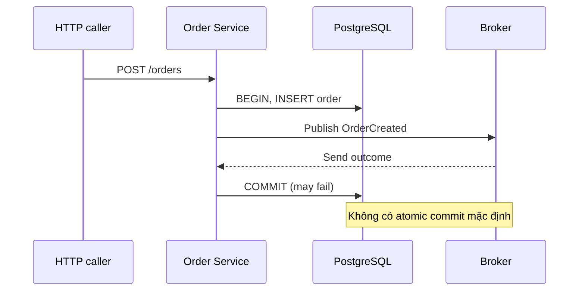
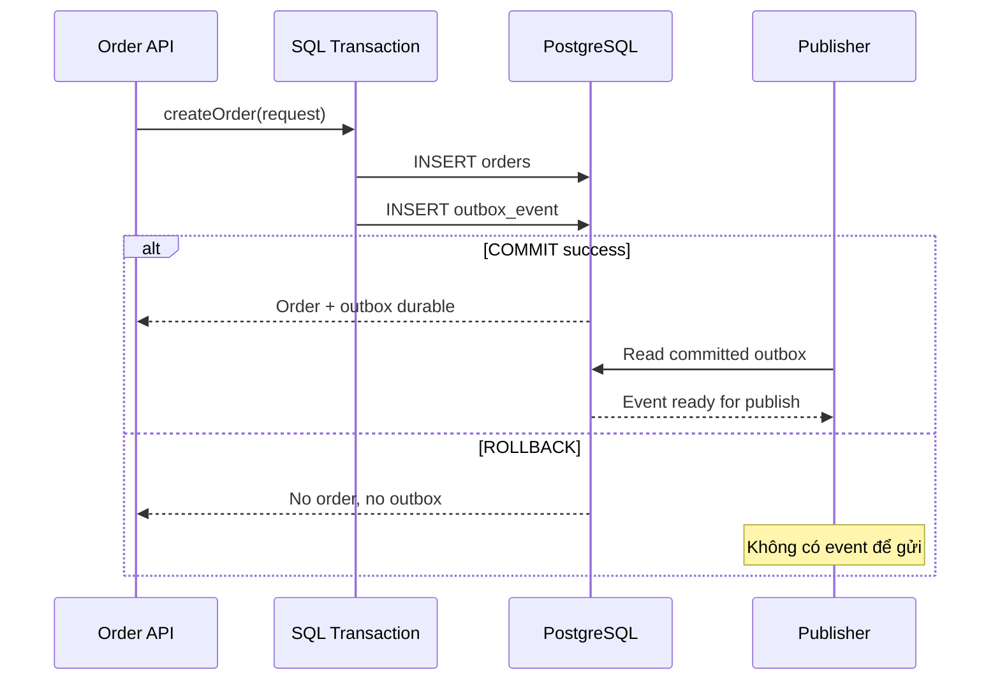
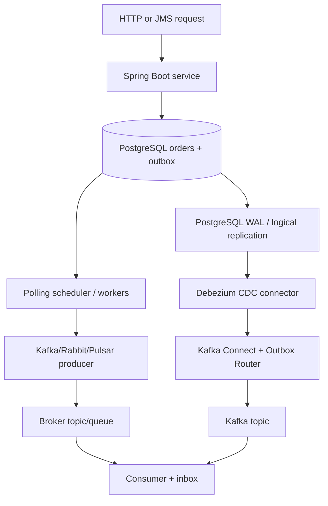
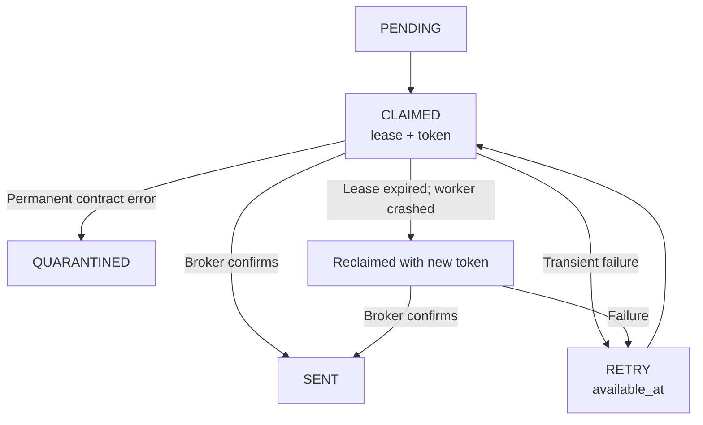
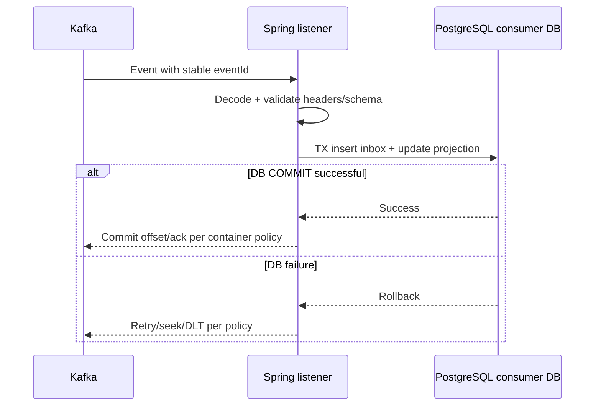
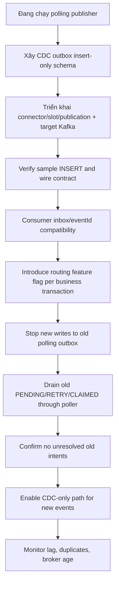
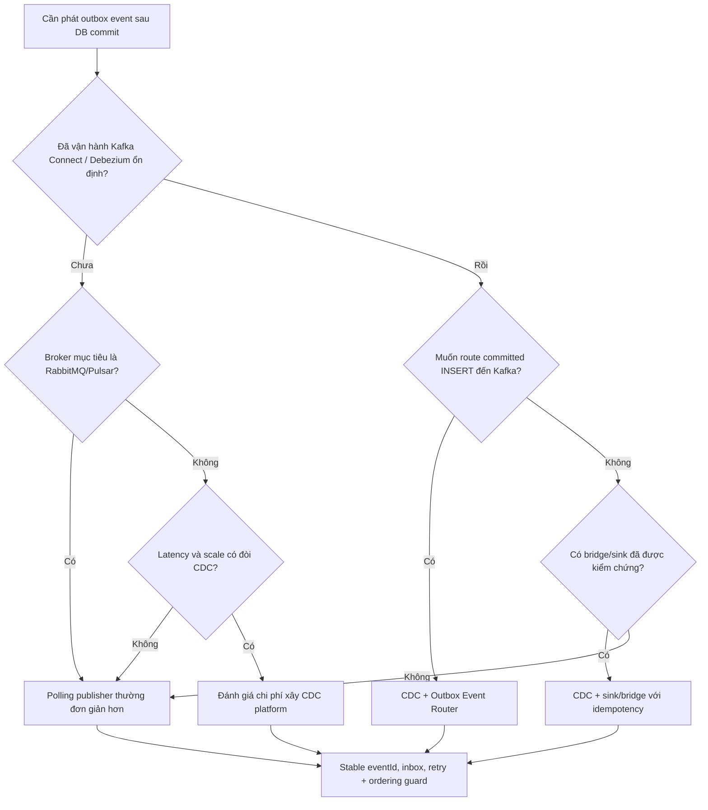

# Polling publisher hoặc CDC để phát dữ liệu outbox

## 1. Bài toán: database đã commit nhưng sự kiện chưa đến broker

Trong phạm vi **SPRING_BOOT_INTEGRATION**, một ứng dụng Spring Boot thường nhận yêu cầu HTTP, ghi PostgreSQL, sau đó phát thông điệp sang RabbitMQ, Kafka hoặc Apache Pulsar để hệ thống khác xử lý. Bài toán nhất quán nảy sinh khi **giao dịch cơ sở dữ liệu** và **lần gửi message tới broker** là hai hành động độc lập.

Giả sử API tạo đơn hàng thực hiện:

```java
@Transactional
public OrderReceipt create(CreateOrderRequest request) {
    Order order = orderRepository.save(
        Order.from(request)
    );
    brokerPublisher.publish(
        new OrderCreated(order.id())
    );
    return new OrderReceipt(order.id());
}
```

Đoạn code diễn tả anti-pattern, các types chỉ là minh họa. `@Transactional` thường quản lý **transaction của PostgreSQL/JPA**, không biến lệnh gửi Kafka/RabbitMQ/Pulsar thành cùng một distributed transaction.

Hai failure windows:

- **Broker nhận event, DB rollback:** consumer xử lý đơn hàng chưa từng được commit.
- **DB commit, broker chưa nhận event:** đơn hàng đã tồn tại nhưng không có sự kiện cập nhật giao vận, tồn kho, email hoặc báo cáo.



**Transactional outbox** giải quyết bằng cách **ghi ý định phát sự kiện trong cùng một transaction database với thay đổi nghiệp vụ**, sau đó có một tiến trình độc lập lấy các outbox rows và đưa lên broker.

```text
POST /orders
   |
   v
PostgreSQL transaction:
  INSERT orders
  INSERT outbox_event
  COMMIT
   |
   +--> Polling publisher  ---> Broker ---> Consumer
   |
   +--> CDC connector ------> Broker ---> Consumer
```

Có hai chiến lược phát dữ liệu outbox nổi bật:

1. **Polling publisher:** một hoặc nhiều worker định kỳ truy vấn outbox, claim rows đến hạn, gửi broker rồi đánh dấu thành công hoặc hẹn retry.
2. **Change Data Capture (CDC):** một connector đọc **transaction log** của database (chẳng hạn PostgreSQL WAL), phát những bản ghi INSERT của outbox thành events; có thể dùng Debezium Outbox Event Router với Kafka Connect.

**Đích đến chung:** biến **durable intent trong DB** thành event được broker chấp nhận, chịu được lỗi ứng dụng/broker và nhận diện duplicate. Không phương án nào mặc nhiên bảo đảm **exactly-once business effects**.

### Kết quả học tập

Sau bài, bạn sẽ:

- Hiểu chính xác phạm vi atomicity của transaction DB và outbox.
- Thiết kế schema outbox cho poller và schema insert-only phù hợp CDC.
- Thực hiện claim, lease, fencing token, retry/backoff và broker confirm cho polling.
- Hiểu CDC với WAL, replication slot, Debezium, Kafka Connect offset và Outbox Event Router.
- Phân tích ordering theo aggregate, key/partition và ảnh hưởng của nhiều producers.
- Chống trùng bằng inbox, unique constraints, optimistic version và partner idempotency key.
- Lựa chọn polling/CDC theo độ trễ, vận hành, quy mô và hạ tầng có sẵn.
- Kiểm thử fresh failure windows, crash/restart, connector lag và cutover không mất việc.
- Quan sát backlog, oldest pending age, WAL lag, duplicate count và poison events.
- Thiết kế migration từ poller sang CDC hoặc ngược lại có đối soát.

> Bài minh họa với **Java 17+, Spring Boot 3.x, PostgreSQL và broker phổ biến**. `FOR UPDATE SKIP LOCKED`, `jsonb` và logical replication là những khả năng PostgreSQL, không áp máy móc cho mọi RDBMS. Chi tiết API/deployment của Debezium, Kafka Connect, Spring Kafka, RabbitMQ và Pulsar phải được kiểm tra theo phiên bản thực tế.

## 2. Outbox là gì — và không phải gì?

Một outbox row là **bản ghi bất biến về ý định phát một sự kiện hoặc lệnh** do thay đổi nghiệp vụ đã commit tạo ra.

Ví dụ:

```json
{
  "eventId": "7a7d90ee-32e8-42db-a519-f779c1beef10",
  "aggregateType": "order",
  "aggregateId": "ORD-501",
  "aggregateVersion": 3,
  "eventType": "OrderConfirmed",
  "schemaVersion": 1,
  "destination": "orders.events",
  "payload": {
    "orderId": "ORD-501",
    "status": "CONFIRMED"
  }
}
```

**Outbox không phải:**

- Một hàng đợi broker thay thế Kafka/RabbitMQ/Pulsar.
- Bằng chứng consumer đã nhận hoặc xử lý thành công.
- Một HTTP retry log có thể xóa bất cứ lúc nào.
- Một transaction manager bảo đảm DB và broker commit atomic.
- Một record tùy tiện được tạo ngoài transaction nghiệp vụ.
- Một event sourcing log đầy đủ có thể dựng lại toàn bộ trạng thái khi chưa có contract như vậy.
- Một cơ chế chống duplicate hoàn chỉnh nếu consumer không có idempotency.

Có thể dùng chung mẫu cho **domain event** (OrderConfirmed) hoặc **integration command** (ReserveStock), nhưng hai loại có ngữ nghĩa khác nhau: event diễn tả điều đã xảy ra; command yêu cầu một bên thực hiện hành động. Cần chọn `destination`, `eventType`, retry deadline và idempotency chính xác.

## 3. Bất biến quan trọng nhất: nghiệp vụ và ý định phát phải commit cùng nhau



**Quy tắc thiết kế:**

1. Cùng một database transaction lưu business data và outbox row.
2. Nếu business command bị rollback, outbox row cũng phải rollback.
3. Outbox có stable `event_id` từ lúc insert; worker retry **không tạo lại ID mới**.
4. Không dùng `REQUIRES_NEW` cho insert outbox nếu điều đó khiến outbox commit ngay cả khi transaction nghiệp vụ rollback.
5. Không gọi broker bên trong SQL transaction rồi giả định broker rollback cùng.
6. Không chỉ đặt `@Transactional` trên method không đi qua Spring proxy (ví dụ self-invocation) rồi tin transaction đã tồn tại.
7. Nếu order và outbox nằm ở **hai databases khác nhau**, giao dịch local không tự atomic; cần thiết kế khác.
8. Nếu SQL transaction commit thành công nhưng HTTP response mất, caller retry POST; dùng **inbound idempotency key** để tránh tạo hai orders/outbox rows.

**Outbox bảo đảm durability của ý định phát**, trong điều kiện database storage, commit, backup/HA hoạt động theo contract. Nó không làm broker trở nên available trong chính HTTP transaction.

## 4. Hai kiến trúc cùng giải bài toán publish



Sơ đồ thể hiện **hai đường lựa chọn**. Đường Debezium Outbox Event Router tiêu biểu phát vào **Kafka thông qua Kafka Connect**; không mặc nhiên tạo ra message RabbitMQ/Pulsar. Muốn đẩy vào broker khác cần thêm **bridge/sink/CDC connector** có semantics phù hợp.

**Cần một owner phát mỗi event.** Nếu cả poller và CDC cùng publish cùng rows trong lúc chuyển đổi, bạn phải coi là có khả năng **duplicate do dual-publish** và có plan/cutover rõ, không giả định hai bên tự coordination.

## 5. So sánh nhanh Polling publisher với CDC

| Tiêu chí | Polling publisher | CDC từ transaction log |
| --- | --- | --- |
| Cách phát hiện event | `SELECT`/claim rows đến hạn | Đọc các thay đổi DB đã commit từ WAL/binlog |
| Hạ tầng tối thiểu | Spring Boot + JDBC + broker client | Log replication permissions, connector runtime, offsets, broker |
| Latency | Thường bị chi phối polling interval + xử lý | Có thể thấp; phụ thuộc log/connector lag |
| Database overhead | Scan/claim/update/index/vacuum | WAL/log reading, replication slot, serialization |
| Quản lý retry | Trong bảng outbox, lease, attempt, backoff | Connector offset/restart và downstream retry/DLQ |
| Schema outbox | Thường mutable: PENDING/CLAIMED/SENT/RETRY | Thường insert-only event rows |
| Broker mục tiêu | Linh hoạt nếu viết publisher tương ứng | Debezium Outbox Router điển hình → Kafka |
| Thứ tự | Poll/claim/retry có thể đảo thứ tự | Theo nguồn log/transaction, nhưng toàn pipeline vẫn cần key/ordering contract |
| Scale | Nhiều workers với SKIP LOCKED/lease | Connector/tasks phụ thuộc DB partitioning/topology và sink |
| Cleanup | Xóa/archive rows SENT theo retention | Xóa/archive phải xem cả tác động CDC DELETE |
| Rủi ro vận hành | Hot polling, table bloat, lease expiry | WAL retention, replication slot lag, connector snapshot/restart |
| Quan sát | Pending age, attempt count, claimed stale | Source lag, connector health, replication slot retained WAL |
| Chuyển broker | Thay implementation publisher | Cần connector/bridge và vận hành phù hợp |
| Độ phức tạp | Thấp–vừa, dễ hiểu trong Spring Boot | Vừa–cao, mạnh khi đã vận hành CDC platform |

**Không có lựa chọn tuyệt đối tốt nhất.** Nếu ứng dụng nhỏ, dùng RabbitMQ và chưa có CDC infrastructure, một poller kiểm soát đúng có thể hợp lý. Nếu tổ chức đã vận hành Debezium/Kafka Connect và cần latency nhỏ với nhiều dịch vụ, CDC thường đáng cân nhắc.

## 6. Hợp đồng sự kiện trước khi chọn công nghệ phát

Dù dùng polling hay CDC, mỗi event nên có:

| Trường | Vai trò | Lỗi thường gặp |
| --- | --- | --- |
| `eventId` | Định danh ổn định qua retry/re-publish | Tạo UUID mới ở mỗi lần gửi |
| `aggregateType` | Loại aggregate: order/payment | Dùng Java class name nội bộ làm hợp đồng lâu dài |
| `aggregateId` | Khóa routing/ordering logic | Có lúc dùng orderId, lúc customerId |
| `aggregateVersion` | Phát hiện out-of-order/gaps | Không có sequence hoặc gán từ đồng hồ |
| `eventType` | Ý nghĩa nghiệp vụ | Event name đổi không versioning |
| `schemaVersion` | Version hợp đồng payload | Nhầm với Liquibase migration number |
| `destination` | Topic/queue/stream logic | Cho client tùy ý chỉ định broker destination |
| `payload` | Dữ liệu đã được schema hóa | Serialize entity JPA hoặc dữ liệu PII không cần |
| `occurredAt` | Thời điểm nghiệp vụ | Dùng để suy thứ tự tổng tuyệt đối |
| `createdAt` | Thời điểm ghi outbox | Coi là commit sequence xuyên transactions |
| `traceId` | Liên kết observability | Dùng làm business idempotency key |

**Payload bất biến:** sau khi outbox row đã commit, không nên viết lại event payload theo trạng thái business mới. Việc **đánh dấu SENT/RETRY** của polling là metadata delivery, không phải thay đổi ý nghĩa event. Với CDC Outbox Router, ưu tiên bảng **append-only** để chỉ capture INSERT của event.

## 7. Mẫu schema 1 — polling outbox trên PostgreSQL

Ví dụ một bảng worker quản lý trạng thái gửi:

```sql
CREATE TABLE integration_outbox (
    event_id UUID PRIMARY KEY,
    aggregate_type VARCHAR(80) NOT NULL,
    aggregate_id VARCHAR(120) NOT NULL,
    aggregate_version BIGINT NOT NULL,
    event_type VARCHAR(120) NOT NULL,
    schema_version INTEGER NOT NULL,
    destination VARCHAR(120) NOT NULL,
    payload_json JSONB NOT NULL,

    status VARCHAR(16) NOT NULL DEFAULT 'PENDING',
    attempt_count INTEGER NOT NULL DEFAULT 0,
    available_at TIMESTAMPTZ NOT NULL DEFAULT now(),

    claimed_by VARCHAR(120),
    claim_token UUID,
    claimed_until TIMESTAMPTZ,

    created_at TIMESTAMPTZ NOT NULL DEFAULT now(),
    published_at TIMESTAMPTZ,
    last_error_code VARCHAR(80),

    CONSTRAINT ck_outbox_status CHECK (
        status IN ('PENDING','CLAIMED','RETRY','SENT','QUARANTINED')
    ),
    CONSTRAINT ck_outbox_attempt CHECK (attempt_count >= 0),
    CONSTRAINT ck_outbox_schema CHECK (schema_version >= 1)
);

CREATE INDEX idx_outbox_due
    ON integration_outbox(available_at, created_at, event_id)
    WHERE status IN ('PENDING','RETRY');

CREATE INDEX idx_outbox_expired_claim
    ON integration_outbox(claimed_until, event_id)
    WHERE status = 'CLAIMED';
```

**Giải thích thiết kế:**

- `event_id` là định danh bền vững dùng cho consumer dedup.
- `status` biểu diễn trạng thái phát, **không phải** trạng thái nghiệp vụ Order.
- `available_at` giúp retry theo backoff thay vì scan liên tục.
- `claimed_by`, `claim_token` và `claimed_until` hỗ trợ claim, lease và fencing.
- `attempt_count` đếm số lần claim/thử theo chính sách; phải định nghĩa rõ nếu một attempt bao gồm nhiều transport retries.
- Index partial dành cho PENDING/RETRY và CLAIMED, không index tất cả SENT rows như hàng đợi nóng.
- `payload_json JSONB` phù hợp PostgreSQL và cho phép validate dạng JSON; schema nghiệp vụ vẫn cần kiểm tra ở application.
- `published_at` là lúc worker ghi nhận publish outcome, **không chứng minh consumer đã xử lý**.
- `last_error_code` chỉ nên chứa mã lỗi đã chuẩn hóa, không lưu stacktrace/PII.

Đây là **polling schema**, không phải schema mặc định của Debezium Outbox Event Router. CDC thường dùng một bảng event insert-only khác được trình bày ở phần sau.

## 8. Trạng thái polling như một state machine



Một state machine hợp lệ cần:

1. Chỉ claim rows đến hạn hoặc CLAIMED đã hết lease.
2. Lease không phải business lock vĩnh viễn; sau deadline, worker khác được claim.
3. Chỉ **worker đang sở hữu claim token** mới được cập nhật kết quả.
4. Chỉ đặt SENT sau khi đã đạt điều kiện broker acceptance/confirmation theo policy.
5. Nếu broker outcome không rõ, event phải còn khả năng retry hoặc reconcile.
6. Permanent schema/authorization failures phải quarantine/alert, không retry nóng vô hạn.
7. Quy tắc cleanup SENT/QUARANTINED phải giữ khả năng điều tra và replay có kiểm soát.
8. TTL/retry deadline không được làm **mất nghĩa vụ nghiệp vụ** khi thời gian hết.

Đừng dùng trạng thái SENT như “đã giao tới mọi subscriber” hoặc “người dùng nhận email”. Đó là các bước downstream có acknowledgement/status khác.

## 9. Thêm outbox row cùng transaction nghiệp vụ

Ví dụ `JdbcTemplate` với một service Spring:

```java
import java.util.UUID;

import org.springframework.jdbc.core.JdbcTemplate;
import org.springframework.stereotype.Service;
import org.springframework.transaction.annotation.Transactional;

@Service
public class OrderCreationService {

    private final JdbcTemplate jdbc;

    public OrderCreationService(JdbcTemplate jdbc) {
        this.jdbc = jdbc;
    }

    @Transactional
    public void create(
            String orderId,
            String customerId,
            String eventPayloadJson) {

        jdbc.update(
            """
            INSERT INTO orders(order_id, customer_id, status)
            VALUES (?, ?, 'CREATED')
            """,
            orderId, customerId
        );

        jdbc.update(
            """
            INSERT INTO integration_outbox(
                event_id, aggregate_type, aggregate_id,
                aggregate_version, event_type,
                schema_version, destination, payload_json)
            VALUES (?, 'order', ?, 1, 'OrderCreated',
                    1, 'orders.events', CAST(? AS jsonb))
            """,
            UUID.randomUUID(), orderId, eventPayloadJson
        );
    }
}
```

Đoạn code giả định bảng `orders` đã tồn tại, `eventPayloadJson` được serialize/validate từ DTO. Trong hệ thống thật:

- `orderId` phải được xác định ổn định bằng inbound request idempotency key; hai HTTP retries không nên tạo hai orders.
- `aggregate_version=1` chỉ đúng khi đây là sự kiện đầu tiên trong vòng đời order.
- `eventId` được sinh một lần khi tạo outbox row; worker không sinh lại.
- `@Transactional` chỉ atomic khi cả hai statements dùng **cùng transaction manager/DataSource**.
- Nếu PostgreSQL driver không nhận UUID argument theo cấu hình hiện tại, xác minh binding/type hỗ trợ.
- Không giữ transaction mở trong khi gọi Kafka/RabbitMQ/Pulsar.
- Nếu event thuộc đơn hàng mới nhưng customer ID nhạy cảm không cần bên nhận, đừng đưa nó vào payload theo thói quen.

**Đặt business update và outbox insert trong một transaction có ý nghĩa nghiệp vụ**, không dùng `@Async` fire-and-forget cho insert outbox.

## 10. Polling đơn giản: tại sao SELECT rồi SEND chưa đủ?

Một bản mẫu dễ nghĩ tới:

```java
@Scheduled(fixedDelayString = "1000")
void publishPending() {
    for (OutboxEvent event : repository.findPending()) {
        broker.send(event);
        repository.markSent(event.id());
    }
}
```

Vấn đề khi có hai replicas:

```text
Worker A: SELECT eventId=e1 status=PENDING
Worker B: SELECT eventId=e1 status=PENDING
Worker A: SEND e1 -> broker
Worker B: SEND e1 -> broker
Worker A: UPDATE e1 SENT
Worker B: UPDATE e1 SENT
```

Cả hai đã publish trùng. Nếu đổi thứ tự `markSent` trước `send` để tránh duplicate thì có thể **mất event** khi worker chết sau khi đánh dấu SENT nhưng trước khi broker nhận.

Cần **atomic claim** hoặc giữ DB row lock có kiểm soát. Poller production thường dùng **`FOR UPDATE SKIP LOCKED` + transaction claim ngắn + lease/fencing**, rồi gửi broker **ngoài** transaction claim.

## 11. Atomic claim với FOR UPDATE SKIP LOCKED và lease

Một truy vấn PostgreSQL minh họa claim một batch:

```sql
WITH candidates AS (
    SELECT event_id
    FROM integration_outbox
    WHERE (
        status IN ('PENDING', 'RETRY')
        AND available_at <= now()
    ) OR (
        status = 'CLAIMED'
        AND claimed_until < now()
    )
    ORDER BY created_at, event_id
    FOR UPDATE SKIP LOCKED
    LIMIT :batchSize
)
UPDATE integration_outbox o
SET status = 'CLAIMED',
    claimed_by = :workerId,
    claim_token = :claimToken,
    claimed_until = now() + INTERVAL '45 seconds',
    attempt_count = o.attempt_count + 1
FROM candidates c
WHERE o.event_id = c.event_id
RETURNING o.event_id,
          o.aggregate_type,
          o.aggregate_id,
          o.aggregate_version,
          o.event_type,
          o.schema_version,
          o.destination,
          o.payload_json,
          o.claim_token,
          o.attempt_count;
```

Đây là PostgreSQL SQL với named parameters cho `NamedParameterJdbcTemplate` hoặc jOOQ phù hợp.

**Tính chất quan trọng:**

- `FOR UPDATE` khóa các candidate rows trong transaction hiện tại.
- `SKIP LOCKED` cho worker B bỏ qua rows worker A đang claim, giảm tranh chấp.
- CTE + `UPDATE ... RETURNING` thực hiện claim và trả các rows đã claim trong cùng statement/transaction.
- `:claimToken` là UUID mới **cho mỗi lần claim batch**. Tổ hợp `(event_id, claim_token)` phân biệt owner cho mỗi row; dùng token riêng từng row cũng hợp lệ.
- `claimed_until` cho phép reclaim khi worker chết; nếu worker chậm mà lease hết, một worker khác có thể publish cùng event.
- `attempt_count` chỉ tăng khi claim; giới hạn attempts phải được áp trong query/workflow thực tế.
- `ORDER BY created_at, event_id` là **ưu tiên chọn**, không phải bảo đảm message theo thứ tự nghiệp vụ.
- Index phù hợp và batch size nhỏ giúp giảm chi phí SQL và thời gian giữ lock.

**Cần COMMIT transaction claim trước khi gọi broker.** Giữ transaction DB mở trong 5–30 giây trong lúc chờ broker sẽ tăng lock contention, connection pool exhaustion và rollback complexity.

### Lưu ý SKIP LOCKED không thay thế hàng đợi có thứ tự

Một worker bị chậm ở `event A` có thể khiến worker khác skip A rồi publish `event B`. Do đó **polling song song không bảo đảm ordering theo aggregate** chỉ vì ORDER BY created_at. Muốn thứ tự theo orderId, cần thêm cơ chế serialize per aggregate, sharding/partition claims hoặc consumer version guard.

## 12. Lease và fencing token: chống worker cũ ghi đè trạng thái

Một failure window:

```text
t0 Worker A claims e1, token=A, lease=45s
t1 Worker A stalls for 60s
t2 Worker B reclaims e1, token=B
t3 Worker B publishes successfully and marks SENT
t4 Worker A wakes up; tries to mark SENT / RETRY
```

Nếu UPDATE không kiểm tra token, A có thể ghi đè `SENT` thành `RETRY`. Dùng điều kiện owner token:

```sql
UPDATE integration_outbox
SET status = 'SENT',
    published_at = now(),
    claimed_by = NULL,
    claimed_until = NULL,
    claim_token = NULL,
    last_error_code = NULL
WHERE event_id = :eventId
  AND status = 'CLAIMED'
  AND claim_token = :claimToken;
```

**Phải kiểm tra affected rows = 1.** Nếu bằng 0, claim đã hết hiệu lực; worker cũ không được coi mình là owner. Với retry:

```sql
UPDATE integration_outbox
SET status = 'RETRY',
    available_at = :retryAt,
    last_error_code = :errorCode,
    claimed_by = NULL,
    claimed_until = NULL,
    claim_token = NULL
WHERE event_id = :eventId
  AND status = 'CLAIMED'
  AND claim_token = :claimToken;
```

Fencing token bảo vệ **trạng thái row trong DB**. Nó **không ngăn** worker A đã mất lease gọi broker hoặc HTTP partner sau khi B claim. Vì vậy vẫn có duplicate publish, và **consumer inbox/idempotency** là bắt buộc.

### Khi nào cần heartbeat/extend lease?

Nếu một lần gửi broker có thể lâu hơn 45 giây do connection failover/large payload:

1. Ưu tiên cấu hình send timeout hợp lý, fail fast và retry ở batch sau.
2. Nếu thực sự cần xử lý lâu, có thể gia hạn lease theo `event_id + claim_token`.
3. Gia hạn không được tiếp tục sau khi ownership đổi.
4. Đặt max lease total duration và alert cho worker treo.
5. Không dùng lease gia hạn vô hạn để giấu bottleneck.

## 13. Lập lịch @Scheduled: poll loop không được giữ transaction quá dài

Một coordinator Spring Boot tối giản về ranh giới:

```java
import java.util.List;

import org.springframework.scheduling.annotation.Scheduled;
import org.springframework.stereotype.Component;

@Component
public class OutboxPollingPublisher {

    private final OutboxClaimService claims;
    private final ConfirmingBrokerPublisher publisher;

    public OutboxPollingPublisher(
            OutboxClaimService claims,
            ConfirmingBrokerPublisher publisher) {
        this.claims = claims;
        this.publisher = publisher;
    }

    @Scheduled(
        fixedDelayString = "${outbox.poll.interval-ms:1000}"
    )
    public void poll() {
        List<ClaimedEvent> batch = claims.claimDue(50);

        for (ClaimedEvent event : batch) {
            try {
                // Must return only after the chosen broker
                // acceptance/confirmation boundary.
                publisher.publishAndConfirm(event);
                claims.markSent(event.eventId(), event.claimToken());
            } catch (Exception failure) {
                claims.retryOrQuarantine(event, failure);
            }
        }
    }
}
```

Các thành phần `OutboxClaimService`, `ClaimedEvent`, `ConfirmingBrokerPublisher` là interfaces/services ứng dụng tự xây, không phải Spring Boot APIs. Đảm bảo `@EnableScheduling` khi cần và cấu hình scheduler thread pool phù hợp.

**Yêu cầu về implementation của `claims`:**

- `claimDue` chạy một transaction ngắn và trả event payload/token khi đã commit claim.
- `markSent` chạy **transaction riêng**, với `WHERE claim_token = ?`; kiểm tra affected rows.
- `retryOrQuarantine` phân loại lỗi và đặt next retry theo backoff; không bị nuốt exception mà row kẹt vô hạn.
- `publishAndConfirm` gửi **bên ngoài DB transaction** và phải xác định broker acceptance/confirm semantics.
- Nếu `markSent` thất bại sau khi publish, **không publish ngay lần thứ hai trong cùng vòng**; row/lease sẽ được reconcile/retry theo state và consumer dedup.
- Nếu `claimDue` exception, scheduler phải log/cảnh báo; không coi empty batch là thành công khi DB unavailable.
- Không tạo worker IDs từ PID duy nhất nếu nhiều containers/instances có thể trùng; dùng instance identity ổn định trong lifecycle và fencing token.

**Ví dụ trên cố ý minh họa orchestration**; production cần bounded concurrency, graceful shutdown, retry budgets, metrics và quyết định xử lý exception riêng.

## 14. Backoff, retry budget và trạng thái QUARANTINED

Một policy minh họa:

| Loại lỗi | Ví dụ | Hướng xử lý |
| --- | --- | --- |
| Broker unavailable | Connection refused/TLS reset | Retry có backoff, giữ outbox durable |
| Broker rate limit/quota | Too many requests/queue full | Bounded backoff + alert |
| Unknown publish outcome | Timeout sau send/confirm chưa rõ | Retry cùng eventId; consumer dedup |
| Payload sai schema | JSON serializable không hợp contract | Quarantine, sửa producer/schema |
| Destination không tồn tại | Sai topic/permission | Alert config owner, không hot retry |
| Auth/ACL failure | Producer không có quyền | Fail fast/quarantine hoặc pause pipeline |
| Permanent max size | Payload quá lớn | Quarantine, chuyển sang object reference |
| Database unavailable lúc claim | PostgreSQL down | Poller không gửi từ dữ liệu chưa claim |
| Database unavailable lúc markSent | Broker đã nhận nhưng update fail | Có thể phát lại; không giả exactly once |

Một lịch backoff có thể là:

```text
attempt 1 -> 1s + jitter
attempt 2 -> 2s + jitter
attempt 3 -> 4s + jitter
attempt 4 -> 8s + jitter
...
cap at 5m, max attempts per policy
```

Các điều kiện:

- `next_attempt_at` tính theo DB/server clock nhất quán hoặc truyền timestamp UTC có test; tránh clock skew giữa workers.
- Một event phải còn trong trạng thái truy vết khi hết retry budget, không tự xóa khỏi bảng.
- `QUARANTINED` cần owner, error code, metadata, retention và quy trình replay.
- Không log raw payload chứa PII/credentials vào `last_error_code`.
- Không tính retry budget chỉ theo số lần gọi API client nếu broker client tự retry thêm bên trong.
- Không cho một poison event chiếm toàn bộ worker slots và làm đói các events hợp lệ.

**Backoff không bảo đảm event ordering.** Khi event version 10 phải retry, worker khác có thể publish version 11 trước nếu không có per-aggregate guard.

## 15. Broker confirmation: “send() returned” chưa chắc đúng mức durability

Khi poller quyết định `SENT`, phải xác định điều gì được coi là broker nhận thành công:

| Broker/client | Tín hiệu cần hiểu | Không tự chứng minh |
| --- | --- | --- |
| Spring Kafka `KafkaTemplate.send` | `CompletableFuture<SendResult>` thành công theo producer `acks` config | Consumer đã xử lý |
| Spring AMQP `RabbitTemplate` | Publisher confirm/returned-message semantics khi được cấu hình; routing/mandatory cũng cần kiểm tra | Message đã vào queue đích và consumer xử lý, nếu thiếu routing checks |
| Spring Pulsar `PulsarTemplate` / producer | Send result/`MessageId` theo Pulsar producer semantics | PostgreSQL và Pulsar commit atomic |
| Generic HTTP webhook | 2xx theo contract + idempotency | Remote action không thể duplicate sau timeout |

### Kafka

Đừng chỉ gọi `kafkaTemplate.send(topic, key, payload)` (async) rồi lập tức đánh dấu SENT. Phải observe/await kết quả của future, timeout, producer settings như `acks`, idempotent producer và errors. Kafka idempotent producer bảo vệ một phạm vi producer retry nhất định, **không loại bỏ duplicate business events do outbox republish sau crash**.

### RabbitMQ

Publisher confirms thông báo broker phản hồi publish theo cấu hình. Nếu exchange nhận message nhưng không route tới queue và **không** bật mandatory/returns tương ứng, chỉ dựa vào confirm có thể chưa đủ chứng minh route đến consumer queue. Cần định nghĩa rõ exchange, routing key, binding và return handling. Consumer ack là bước riêng.

### Pulsar

Pulsar send thành công nhận `MessageId` theo producer/broker semantics; vẫn có unknown outcome khi mạng đứt đúng thời điểm. `MessageId` không phải stable business `eventId` để chống republish.

**Nguyên tắc:** chọn một **acceptance boundary** rõ, mã hóa trong `ConfirmingBrokerPublisher`, test outage/timeout và dùng eventId trong message header/payload.

## 16. Những cửa sổ lỗi của polling — và vì sao duplicate là bình thường

| Điểm xảy ra lỗi | Trạng thái sau phục hồi | Hệ quả |
| --- | --- | --- |
| Trước SQL commit của order/outbox | Không có outbox row | Không được gửi event |
| Sau SQL commit, trước poll | Row PENDING | Worker khác sẽ gửi |
| Trong claim transaction trước commit | Không có claim bền | Row vẫn đến hạn |
| Sau claim commit, trước gửi | CLAIMED tới lease deadline | Event được reclaim sau hạn |
| Broker từ chối publish | RETRY hoặc CLAIMED tới lease expiry | Gửi lại sau backoff |
| Broker nhận event nhưng ACK/confirm mất | Outcome chưa rõ | Retry có thể tạo bản thứ hai |
| Broker nhận, worker chết trước markSent | Row CLAIMED rồi reclaim | Retry có thể tạo bản thứ hai |
| MarkSent commit xong, consumer chưa chạy | SENT, broker giữ dữ liệu theo policy | Theo dõi broker/consumer backlog riêng |
| Consumer commit DB rồi chết trước ack | Broker redeliver | Inbox unique ngăn business effect trùng |
| Worker cũ tỉnh sau lease expiry | Claim token stale | Không được ghi đè trạng thái của worker mới |

**Kết quả mong đợi đúng:** không mất **intent đã commit** khi broker tạm unavailable; event có thể được gửi **ít nhất một lần**; business consumer chịu duplicate an toàn. Tuyên bố “polling đảm bảo exactly once” là không đúng nếu không định nghĩa phạm vi và cơ chế bổ sung cụ thể.

## 17. Phân phối, thứ tự và SKIP LOCKED: ba thuộc tính không đồng nghĩa

Với các event cùng `orderId`:

```text
outbox rows:
  seq=10 created_at=12:00:00.100
  seq=11 created_at=12:00:00.120

Worker A claims seq=10, broker slow
Worker B SKIP LOCKED and claims seq=11, broker fast

Broker receives seq=11 before seq=10.
```

Ngay cả `ORDER BY created_at` trong claim SQL **không bảo đảm thứ tự publish**, vì:

- Một worker có thể claim rồi xử lý chậm.
- `SKIP LOCKED` cố ý bỏ qua rows đang bị khóa.
- Retry/backoff đưa event cũ sang thời điểm sau.
- Các timestamps không nhất thiết phản ánh commit order xuyên transactions.
- Producer gửi async có thể được broker chấp nhận theo thứ tự khác.
- Kafka/Pulsar partitions hoặc RabbitMQ consumer concurrency có thể làm business completion đảo thứ tự.

Nếu nghiệp vụ đòi thứ tự theo aggregate:

1. Có `aggregate_version` từ transaction owner (không chỉ createdAt).
2. Chọn **key=aggregateId** để các events cùng aggregate tới cùng partition/routing path phù hợp.
3. Xem xét **per-aggregate serialization** ở poller (claim fence/shard) khi publish order là yêu cầu bắt buộc.
4. Dùng inbox/state version guard ở consumer; event N+1 không được áp dụng trước N.
5. Khi N thất bại, có durable pending/reconcile, không tùy tiện ack N+1 như thành công.
6. Không tăng partition count hoặc đổi key hash mà không đánh giá ordering migration.
7. Không đọc “broker accepted” như bằng chứng tất cả consumers đã commit theo thứ tự.

## 18. CDC là gì và tại sao đọc transaction log thay vì SELECT liên tục?

**Change Data Capture (CDC)** là kỹ thuật phát hiện thay đổi dữ liệu được commit thông qua một nguồn thay đổi được hệ quản trị CSDL cung cấp. Với PostgreSQL, một cách phổ biến là **logical decoding từ Write-Ahead Log (WAL)** qua replication slot/publication.

```mermaid
sequenceDiagram
    participant APP as Spring Boot
    participant DB as PostgreSQL
    participant WAL as WAL / logical replication
    participant D as Debezium Connector
    participant K as Kafka
    participant C as Consumer
    APP->>DB: BEGIN; update orders; INSERT outbox_event
    DB->>DB: COMMIT
    DB->>WAL: Log committed changes
    WAL->>D: Logical changes from replication slot
    D->>D: Outbox Event Router SMT
    D->>K: Kafka record key=aggregateid
    K->>C: Deliver to subscribed group
    C->>C: Inbox + business DB commit
```

Lợi ích:

- Connector không cần quét toàn bộ bảng outbox để tìm rows mới mỗi giây.
- Sự kiện **INSERT đã commit** xuất hiện trong change stream; rows thuộc transaction rollback không được phát như một committed business event.
- Giảm chi phí cập nhật trạng thái PENDING/SENT trong bảng outbox nếu dùng schema append-only.
- Hữu ích khi công ty đã có Kafka Connect, Debezium, Kafka topic governance và monitoring.
- Có thể đạt latency rất thấp khi database/connector/broker khỏe; nhưng **không phải luôn tức thời**, vẫn có queueing và connector lag.

Giới hạn:

- Logical replication cần permissions, WAL retention/disk budget, publication/slot lifecycle.
- Connector offsets và broker durability phải được cấu hình đúng; restart có thể phát lại.
- DB transactions commit đồng thời có sequence log nhưng application-side event order vẫn cần key/version.
- Event Router là lớp **chuyển đổi Debezium event thành message hướng nghiệp vụ**, không phải distributed transaction với consumer.
- CDC từ business table trực tiếp có thể lộ changes nội bộ và tạo coupling; outbox là hợp đồng rõ hơn.

## 19. Mẫu schema 2 — outbox insert-only dành cho Debezium Event Router

Debezium Outbox Event Router có naming conventions điển hình như `id`, `aggregatetype`, `aggregateid`, `type`, `payload`. Một bảng minh họa:

```sql
CREATE TABLE outbox_event (
    id UUID PRIMARY KEY,
    aggregatetype VARCHAR(80) NOT NULL,
    aggregateid VARCHAR(120) NOT NULL,
    type VARCHAR(120) NOT NULL,
    payload JSONB NOT NULL,
    aggregateversion BIGINT NOT NULL,
    schemaversion INTEGER NOT NULL,
    created_at TIMESTAMPTZ NOT NULL DEFAULT now()
);

CREATE INDEX idx_outbox_event_created
    ON outbox_event(created_at);
```

**Khác schema polling:**

- `outbox_event` không có `status`, `attempt_count`, `claimed_until` hoặc `published_at`.
- Connector quan sát **INSERT** từ WAL rồi đưa lên Kafka; không cần UPDATE row sau khi message được publish.
- `id` tương ứng stable `eventId`; không tái sử dụng ID cho các events khác.
- `aggregatetype` thường dùng routing topic; `aggregateid` dùng message key để giữ tính liên quan trong Kafka partition.
- `aggregateversion`, `schemaversion` có thể đưa vào header hoặc payload theo contract.
- `created_at` chỉ là metadata thời gian, không được lấy làm global commit sequence.

**Chỉ nên append event rows:** nếu UPDATE nội dung `payload` của một outbox row đã commit, log sẽ có UPDATE không theo kỳ vọng Event Router; consumer có thể thấy duplicate/sai semantics hoặc connector phát lỗi tùy config. Khi cần correction, tạo **event mới** có eventId mới và quan hệ điều chỉnh rõ.

### Đừng ghép hai mẫu schema một cách vô thức

Có thể thiết kế cùng một bảng dùng cho cả CDC và polling trong một thời kỳ chuyển đổi, nhưng nếu CDC bắt cả các `UPDATE status` do poller thực hiện, phải lọc events/operations và bảo vệ idempotency. Hướng đơn giản là chọn **một owner chuẩn**, hoặc tạo một bridge/cutover logic với trạng thái rõ.

## 20. Insert event CDC trong cùng PostgreSQL transaction

Một Java service dùng JDBC:

```java
import java.util.UUID;

import org.springframework.jdbc.core.JdbcTemplate;
import org.springframework.stereotype.Service;
import org.springframework.transaction.annotation.Transactional;

@Service
public class OrderConfirmationService {

    private final JdbcTemplate jdbc;
    private final OrderEventCodec codec;

    public OrderConfirmationService(
            JdbcTemplate jdbc,
            OrderEventCodec codec) {
        this.jdbc = jdbc;
        this.codec = codec;
    }

    @Transactional
    public void confirm(String orderId, long nextVersion) {

        int updated = jdbc.update(
            """
            UPDATE orders
            SET status = 'CONFIRMED',
                aggregate_version = ?
            WHERE order_id = ?
              AND aggregate_version = ?
            """,
            nextVersion, orderId, nextVersion - 1
        );

        if (updated != 1) {
            throw new IllegalStateException(
                "ORDER_VERSION_CONFLICT"
            );
        }

        UUID eventId = UUID.randomUUID();
        String json = codec.orderConfirmedJson(
            eventId, orderId, nextVersion
        );

        jdbc.update(
            """
            INSERT INTO outbox_event(
                id, aggregatetype, aggregateid,
                type, payload, aggregateversion, schemaversion)
            VALUES (?, 'order', ?, 'OrderConfirmed',
                    CAST(? AS jsonb), ?, 1)
            """,
            eventId, orderId, json, nextVersion
        );
    }
}
```

`OrderEventCodec` là một abstraction do ứng dụng định nghĩa; JSON tạo ra phải chứa `eventId`/`aggregateVersion` nhất quán, validate trước khi insert. Đoạn code giả định `orders.aggregate_version` đã tồn tại và được migration đúng.

**Lý do dùng optimistic `WHERE aggregate_version = nextVersion - 1`:** hai service threads cùng confirm một order sẽ không thể cùng tự ý chèn cùng bước version mà không qua điều kiện concurrency. Với hệ thống cần **nhiều events cho cùng một business transition**, phải định nghĩa sub-sequence/event ordering riêng thay vì ép unique version khi không đúng semantics.

Transaction rollback vì version conflict → không có outbox event. Transaction commit → row outbox event xuất hiện trong logical CDC stream nếu connector đang giám sát đúng bảng và đủ retention.

## 21. PostgreSQL logical replication: ba thành phần vận hành

Đối với PostgreSQL, một CDC pipeline thông thường liên quan:

| Thành phần | Vai trò | Rủi ro |
| --- | --- | --- |
| **WAL** | Ghi changes phục vụ recovery/replication | Disk pressure, retention tăng khi slot lag |
| **Logical replication slot** | Theo dõi vị trí WAL đã được connector tiêu thụ | Connector dừng lâu giữ WAL, có thể đầy storage |
| **Publication** | Xác định bảng/operations logical replication | Thiếu `outbox_event` dẫn đến không phát event |
| **Debezium PostgreSQL connector** | Đọc logical changes, tạo source records | Permission, restart, offset/slot mismatch |
| **Kafka Connect runtime** | Quản lý connector tasks, config, offsets, status | Worker/offset topic/broker hỏng ảnh hưởng availability |
| **Outbox Event Router SMT** | Biến row INSERT thành Kafka event hướng nghiệp vụ | Không khớp tên cột, route/topic sai |
| **Kafka topic** | Giữ event records cho consumer groups | Retention, partitioning, ACL, producer settings |

Điều kiện thường gặp:

- PostgreSQL có `wal_level=logical` theo phương thức vận hành; cần restart/reconfiguration theo DB platform.
- Connector user có các quyền replication và SELECT trên bảng/tài nguyên phù hợp theo hướng dẫn version cụ thể.
- Replication slot/publication được provision theo quy trình, tránh tự tạo trùng tên giữa nhiều connectors.
- Kafka Connect internal topics và target topics có durability/permissions phù hợp.
- Một replication slot không được chia sẻ tùy tiện bởi hai active connector processes cùng nguồn/slot.
- Monitor connector health **và** WAL retained bytes; chỉ xem Kafka topic có messages là chưa đủ.

Ví dụ câu lệnh kiểm tra (cần quyền phù hợp):

```sql
SHOW wal_level;

SELECT slot_name,
       slot_type,
       active,
       restart_lsn,
       confirmed_flush_lsn
FROM pg_replication_slots
WHERE slot_name = 'orders_outbox_slot';

SELECT pubname
FROM pg_publication
WHERE pubname = 'orders_outbox_pub';
```

**Không xóa replication slot production chỉ để giảm WAL storage** khi chưa có recovery/snapshot plan. Xóa slot có thể khiến connector không tiếp tục từ vị trí cũ; muốn phục hồi phải đối chiếu log history, offset, snapshot, duplicate/loss risks.

## 22. Debezium Outbox Event Router: từ WAL row sang Kafka record

Khi Debezium PostgreSQL connector đọc một INSERT trong `outbox_event`, record change stream mặc định có thể mang metadata operation, before/after/source và transactional details. **Outbox Event Router SMT** chuyển đổi record này thành event phục vụ consumer.

Một cấu hình minh họa Kafka Connect connector (các placeholders bảo mật chỉ là ký hiệu):

```json
{
  "name": "orders-outbox-postgres",
  "config": {
    "connector.class": "io.debezium.connector.postgresql.PostgresConnector",
    "tasks.max": "1",
    "database.hostname": "postgres",
    "database.port": "5432",
    "database.dbname": "orders",
    "database.user": "cdc_reader",
    "database.password": "<load-with-config-provider>",
    "topic.prefix": "ordersdb",
    "plugin.name": "pgoutput",
    "slot.name": "orders_outbox_slot",
    "publication.name": "orders_outbox_pub",
    "table.include.list": "public.outbox_event",

    "transforms": "outbox",
    "transforms.outbox.type": "io.debezium.transforms.outbox.EventRouter",
    "transforms.outbox.route.by.field": "aggregatetype",
    "transforms.outbox.route.topic.replacement": "outbox.event.${routedByValue}",
    "transforms.outbox.table.field.event.id": "id",
    "transforms.outbox.table.field.event.key": "aggregateid",
    "transforms.outbox.table.field.event.payload": "payload",
    "transforms.outbox.table.field.event.timestamp": "created_at",
    "transforms.outbox.table.fields.additional.placement":
      "type:header:eventType,aggregateversion:header:aggregateVersion,schemaversion:header:schemaVersion"
  }
}
```

Các mục cần xác nhận trên bản Debezium thực tế:

1. `table.include.list` lọc đúng schema/bảng.
2. `publication.name` và publication creation mode/quyền được cấu hình để publication thực sự chứa outbox table.
3. `slot.name` ổn định, riêng cho connector sở hữu slot.
4. `topic.prefix` định danh nguồn Debezium; không phải target topic của Outbox Router.
5. `route.by.field=aggregatetype` và `route.topic.replacement` ánh xạ `aggregatetype='order'` thành `outbox.event.order`.
6. `table.field.event.key=aggregateid` giúp Kafka record key là aggregate ID, thuận lợi cho per-key partition ordering.
7. `table.field.event.id=id` đưa event ID vào metadata của record theo Event Router semantics; consumer phải kiểm tra header thực nhận.
8. `table.fields.additional.placement` ánh xạ các trường thành Kafka headers để consumer đọc contract.
9. `database.password` trong ví dụ **chưa phải cấu hình deploy**; phải dùng Kafka Connect ConfigProvider/secret integration được tổ chức hỗ trợ.
10. **Không** giả định string JSON từ tất cả converter đều giống nhau; value/key/header serialization còn phụ thuộc Kafka Connect converters và schemas.
11. `snapshot.mode` không được đặt trong ví dụ để tránh ngầm chọn chiến lược baseline; production phải quyết định snapshot/resume behavior có chủ đích.
12. Dòng cấu hình trên là **minh họa contract**, không thay toàn bộ Kafka Connect worker settings, security, ACL, converters, retry/offset policies.

**Đặc biệt:** Outbox Router SMT được thiết kế cho event rows, không nên áp bừa lên schema history/heartbeat/transaction metadata records. Với connector cần emit loại record khác, dùng predicate/transform filter tương ứng; test snapshot, tombstone và DELETE/UPDATE behavior.

## 23. Kafka key, headers và value sau routing

Với schema ở mục 19, row:

```text
id = e1
aggregatetype = order
aggregateid = ORD-501
type = OrderConfirmed
aggregateversion = 3
schemaversion = 1
payload = {"orderId":"ORD-501","status":"CONFIRMED"}
```

Sau Outbox Event Router, contract Kafka mong muốn:

```text
Topic:   outbox.event.order
Key:     ORD-501
Headers: eventId (via router's event ID header),
         eventType=OrderConfirmed,
         aggregateVersion=3,
         schemaVersion=1
Value:   {"orderId":"ORD-501","status":"CONFIRMED"}
```

**Lưu ý header event ID:** Debezium Outbox Event Router có convention riêng cho ID header (thường header `id` khi dùng field `id`); **đừng tự gọi nó là `eventId` mà không cấu hình mapping và test**. Nếu consumer mong tên `eventId`, cần cấu hình header placement hoặc adapter renaming có kiểm soát. Đảm bảo ID đọc từ header/payload không mất khi bridge/chuyển converter.

**Chính sách serialization:** tùy Kafka Connect key/value converters, payload có thể được encode JSON/string/structured value khác nhau. Consumer contract test phải kiểm tra **bytes/key/header thực**, không chỉ nhìn source row SQL. Dùng cùng event ID, aggregate ID, type/version cho polling và CDC nếu muốn chuyển đổi phương án không đổi nghiệp vụ.

## 24. CDC không phải “lắng nghe trực tiếp bất kỳ bảng nào” mà không trả giá

Có thể cấu hình Debezium CDC trực tiếp bảng `orders`, nhưng lúc đó các consumer thấy thay đổi **database schema** (column names, update operations, kỹ thuật persistence) thay vì một business event rõ.

Rủi ro direct CDC:

- `UPDATE orders SET updated_at=...` bị hiểu thành business event dù chỉ đổi audit timestamp.
- Một nghiệp vụ cập nhật 5 bảng cần event “OrderConfirmed” nhưng CDC phát 5 technical change records.
- Consumer phụ thuộc tên cột nội bộ, khi migration JPA/Liquibase diễn ra dễ vỡ contract.
- Dữ liệu nhạy cảm trong bảng bị đưa sang event stream ngoài ý muốn.
- Một transaction có thể phát nhiều row changes, consumer khó suy business invariant từ thứ tự các rows.
- Snapshot ban đầu chứa trạng thái bảng, không phải lịch sử các sự kiện nghiệp vụ.

Outbox dành riêng để **ứng dụng quyết định điều gì là một event**, payload đã lọc/versioned, rồi CDC chỉ đóng vai trò vận chuyển từ transaction log.

**Không phải mọi hệ thống đều cần Outbox Event Router.** CDC direct table changes phù hợp cho một số analytical replication/sync use cases, nhưng phải phân biệt với integration event contract.

## 25. Snapshot: CDC khởi chạy muộn sẽ phát những rows nào?

Khi Debezium connector lần đầu kết nối hoặc khi cần recovery, có thể có **snapshot behavior** tùy `snapshot.mode`, offset state, slot position và connector version.

Đây là điểm quan trọng của outbox:

- Nếu bảng `outbox_event` đã chứa 1 triệu rows lịch sử, initial snapshot có thể phát **nhiều events cũ** nếu được cấu hình capture existing rows.
- Nếu bỏ qua snapshot mà connector bắt đầu sau khi rows được insert, những events trước vị trí bắt đầu có thể **không được phát** qua đường đó.
- Nếu connector restart với offsets cũ và slot còn WAL phù hợp, nó có thể tiếp tục nhưng vẫn có cửa sổ duplicate.
- Nếu slot mất hoặc WAL cần thiết đã bị loại bỏ, không thể nói chắc “restart là tự đọc lại mọi thứ”.
- Snapshot có thể dùng các phương án signal/incremental theo connector version, nhưng outbox rows là **business intents**, không thể phát lại vô điều kiện như một dimension table analytics.

Quy trình rollout CDC an toàn:

1. Xác định outbox table đã có rows hay sẽ tạo mới cùng feature release.
2. Quyết định snapshot mode và cutoff thời điểm/sequence.
3. Xác định những rows nào **đã từng được poller publish**, nếu chuyển từ poller sang CDC.
4. Chọn handling cho historical rows: replay có dedup, hoặc loại trừ có chứng minh.
5. Ghi rõ Kafka consumer offsets và subscription readiness trước khi mở producer traffic.
6. Monitor các events đầu tiên từ connector đúng target topic/header.
7. Không ngầm bật snapshot toàn bảng trong giờ cao điểm mà chưa sizing Kafka/storage/consumers.

**Snapshot correctness là business decision**, không chỉ là một property của Debezium.

## 26. Replication slot lag và WAL retention: rủi ro không có ở poller

Khi connector dừng hoặc chậm, PostgreSQL replication slot có thể giữ lại WAL chưa được consumer xác nhận để có khả năng tiếp tục. Nếu throughput DB cao, retained WAL có thể lớn dù bảng `outbox_event` rất nhỏ.

```text
orders DB generates 20 GB WAL/hour
Debezium connector down for 6 hours
potential WAL retention pressure grows substantially
(determined by slot/DB retention controls and workload)
```

Các tín hiệu cần theo dõi:

- `pg_replication_slots.active`, `restart_lsn`, `confirmed_flush_lsn`.
- Chênh lệch WAL positions, disk usage, `pg_wal` storage pressure.
- Debezium source queue/backpressure, connector task failures.
- Kafka Connect offset lag/commit failures, Kafka broker availability.
- Retention/safe WAL limits do PostgreSQL/managed service cấu hình.
- Long-running transactions có thể trì hoãn logical decoding, giữ snapshots/cleanup và tăng lag.
- Alert về slot không còn hoạt động hoặc WAL retained bytes quá ngưỡng.

Một truy vấn tham khảo (PostgreSQL và quyền phù hợp):

```sql
SELECT slot_name,
       active,
       pg_size_pretty(
           pg_wal_lsn_diff(pg_current_wal_lsn(), restart_lsn)
       ) AS approximate_retained_wal
FROM pg_replication_slots
WHERE slot_name = 'orders_outbox_slot'
  AND restart_lsn IS NOT NULL;
```

**Đây là ước lượng chênh lệch LSN**, không phải phép đo byte chính xác dành riêng cho outbox events. Nó chịu ảnh hưởng toàn bộ WAL và cơ chế quản lý storage/replication. Cần test theo database/managed provider.

Xóa outbox rows không giải quyết trực tiếp việc WAL bị giữ bởi slot lag. Ngược lại, chạy cleanup xóa hàng triệu rows có thể **tạo thêm WAL**, tăng áp lực CDC.

## 27. CDC offset, broker delivery và tính nhất quán end-to-end

Một câu “Debezium đọc WAL đúng một lần” chưa đủ để suy rằng mọi business effect xảy ra đúng một lần.

Có nhiều mốc:

```text
PostgreSQL COMMIT
   |
Logical WAL position
   |
Debezium reads change
   |
Kafka Connect produces record
   |
Kafka broker accepts
   |
Connect offset checkpoint
   |
Kafka consumer handles
   |
Consumer DB transaction commit
   |
Kafka consumer offset commit/ack
```

Các failure windows:

- Debezium gửi record rồi connector chết trước khi checkpoint offset → cùng change có thể phát lại tùy guarantee/config.
- Kafka broker unavailable → connector backlog, replication slot/WAL lag.
- Kafka consumer commit business SQL rồi chết trước offset commit → record được xử lý lại.
- Một bridge Kafka → RabbitMQ publish rồi chết trước commit source offset → publish trùng ở RabbitMQ.
- Outbox cleanup xóa row sớm không thể tự “thu hồi” message đã phát hoặc bảo đảm connector đã bắt được.
- Một connector config sai `table.include.list`/publication có thể bỏ sót events mặc dù DB đã commit.

**Kafka Connect/Debezium có các tính năng delivery/offset và, ở những phiên bản/cấu hình cụ thể, cơ chế exactly-once source support.** Những cơ chế đó không làm **PostgreSQL transaction + Kafka broker + HTTP business side effect** trở thành một atomic transaction tổng quát. Giải pháp mặc định vẫn là **at-least-once delivery assumption + idempotent consumer**.

## 28. Ordering: WAL commit order, Kafka partition order và business version

CDC có lợi thế nguồn change stream phản ánh **database transaction log**, nhưng thứ tự ứng dụng quan tâm vẫn phải được định nghĩa rõ:

| Tầng | Có thể nói điều gì? | Không nên suy điều gì? |
| --- | --- | --- |
| PostgreSQL transaction | Các INSERT outbox của transaction commit cùng business update | Hai transactions đồng thời luôn có createdAt theo commit order |
| Logical CDC source | Quan sát committed changes theo thứ tự/log semantics của nguồn | Một global order xuyên nhiều databases/connectors |
| Debezium Event Router | Map event đến topic/key theo trường cấu hình | Keys khác nhau có total order |
| Kafka partition | Records trong một partition có thứ tự offset | Thứ tự toàn topic khi có nhiều partitions |
| Kafka consumer group | Partition ownership và processing | DB/HTTP side effects tự commit đúng offset order |
| Business DB | Guard `aggregateVersion` có thể chặn gap | Không tự bù missing events chỉ nhờ guard |

Nếu tất cả events cùng aggregate có `aggregateid` ổn định và Kafka routing đưa chúng cùng một partition khi topology không đổi, consumer có thể giữ **per-aggregate processing order** bằng cách xử lý serial trong partition/key lane. Nhưng:

1. Key có thể bị thay trong một số event producers.
2. Partition count/routing strategy thay đổi có thể ảnh hưởng mapping.
3. Một source transaction tạo nhiều events cho cùng aggregate cần **sequence/sub-order** tường minh.
4. Consumer có thể `@Async` và commit side effects đảo thứ tự.
5. Retry topic/DLQ có thể đưa event N+1 tới khi N còn lỗi.
6. Kafka Connect source/bridge và multi-topic routes có thể thay đổi assumptions.

**Không dùng `created_at` làm sequence number**; timestamp không bảo đảm duy nhất, monotonic theo commit hay đồng bộ khi multi-producer/multi-DB.

## 29. Cleanup bảng outbox CDC: không chỉ DELETE sau vài phút

Với polling, có thể xóa/archive rows `SENT` sau retention có chủ đích. Với CDC insert-only, không có `SENT` flag để biết connector đã đưa message vào Kafka.

Một số chiến lược:

| Chiến lược | Lợi ích | Cảnh báo |
| --- | --- | --- |
| Giữ rows trong thời gian cố định | Đơn giản, hỗ trợ replay/audit ngắn hạn | Table growth/PII retention |
| Partition bảng theo thời gian và drop old partitions | Có thể cleanup hiệu quả | Logical replication/DDL effects, cần kiểm thử connector |
| Batch DELETE rows cũ | Ít phức tạp | DELETE tạo WAL và CDC change operations |
| Archive sang kho lưu trữ | Giữ audit/replay | Cần quyền/PII/retention và checksum |
| Cleanup theo watermark đã xác nhận | Chặt chẽ hơn | Cần offset/slot mapping và recovery logic chính xác |

**Không xóa rows CDC theo `created_at < now() - interval '10 minutes'` mà không xét connector lag**. Nếu connector chậm/slot mất, bạn có thể không còn snapshot source rows để khôi phục những sự kiện cần phát.

**UPDATE/DELETE events:** các operations này có thể xuất hiện trong raw Debezium CDC stream, nhưng Event Router/outbox SMT có quy tắc riêng cho từng operation, tombstone và error handling theo version. Phải test cleanup không tạo business event sai hoặc làm connector fail. Nếu cleanup lớn, xem WAL pressure và replication lag.

Giữ dữ liệu vừa đủ cho recovery không có nghĩa giữ raw PII vô hạn; cần tuân thủ retention/legal compliance và quy trình xóa an toàn.

## 30. CDC sang RabbitMQ/Pulsar: không phải chỉ thay một thuộc tính

Debezium Outbox Event Router thường được minh họa trong **Kafka Connect pipeline**, sản sinh Kafka records. Nếu sản phẩm dùng RabbitMQ hoặc Pulsar, có những lựa chọn:

1. Giữ **polling publisher** trực tiếp dùng RabbitTemplate/PulsarTemplate: ít hạ tầng bridge hơn.
2. Dùng Debezium → Kafka → **bridge/sink** sang broker đích, với durable offset, publisher confirmation và idempotency.
3. Dùng một CDC platform/connector có sink trực tiếp tương thích broker, sau khi đã đánh giá schema, routing, retry và delivery guarantees.
4. Thay đổi topology để consumers dùng Kafka event stream trực tiếp khi phù hợp sản phẩm.

Một bridge cần contract:

```text
Debezium Kafka topic
  |
Bridge receives eventId
  |
Publish to RabbitMQ/Pulsar
  |
Wait for broker durable acceptance
  |
Commit Kafka consumer offset
```

Nếu bridge commit Kafka offset **trước** khi broker đích nhận, có thể mất event. Nếu broker đích nhận rồi bridge chết trước commit offset, có thể publish trùng. Do đó vẫn cần **stable eventId + idempotent consumer**.

Đừng thêm một bridge Kafka chỉ để “dùng CDC” nếu chi phí vận hành, latency, security/ACL và failure windows lớn hơn so với polling trong hệ thống hiện tại.

## 31. Polling vs CDC khi triển khai Spring Boot với nhiều replicas

Một app Spring Boot có thể scale từ 1 lên 20 replicas. Phần phát outbox có thể thiết kế theo hai mô hình:

### Polling publisher

- Chạy poller trong mọi replica với `SKIP LOCKED`, lease và fencing.
- Hoặc tách thành một **deployment worker riêng** nhưng dùng cùng code/DB.
- Scheduler có fixed delay/jitter, batch size, max in-flight và shutdown handling.
- Có thể scale số pollers theo backlog/DB load; giới hạn cạnh tranh DB và broker throughput.

### CDC

- Ứng dụng API **chỉ insert outbox**; không cần các HTTP pods chạy polling.
- Debezium/Kafka Connect là pipeline riêng, có deployment/monitoring/security credentials.
- Scale API pods không tự scale source replication; connector tasks/DB slot model quyết định parallelism.
- Kafka consumer groups scale theo topic partitions và processing model.
- Một app mới deploy không tự start một CDC connector nếu infra chưa được provision; phải có pipeline quản lý connector config/offsets.

**Ranh giới trách nhiệm khác:** poller thuộc Spring Boot application/worker layer; CDC phần lớn chuyển trách nhiệm publish pipeline sang data integration platform. Team cần rõ ai sở hữu connector, slot, topics, alerts, incident response và disaster recovery.

## 32. Security: dữ liệu nhạy cảm, permissions và broker credentials

Cả hai mô hình đều tạo một đường sao chép business data từ DB sang broker. Những chốt bảo mật:

| Bề mặt | Polling | CDC |
| --- | --- | --- |
| DB permissions | Poller đọc/update outbox + app DML | Connector có quyền replication/SELECT và metadata phù hợp |
| Broker credentials | Application publisher credentials | Kafka Connect producer credentials/bridge credentials |
| TLS/auth | DB JDBC + broker client TLS | DB logical replication TLS + Kafka Connect/broker TLS |
| Topic authorization | Allowlist destination trong publisher | Route topic bằng allowlisted aggregatetype/policy |
| PII | Serialize payload tối thiểu | Outbox fields có thể bị capture sang event stream |
| Secrets | Spring config/secrets manager | Kafka Connect ConfigProvider/secret store |
| Logging | Không log raw payload/claim rows | Không log raw Debezium event/config secrets |
| ACL | Worker chỉ được publish approved topics | Connector chỉ đọc approved tables/schemas |

**Không để `aggregatetype` hoặc `destination` được HTTP caller tùy ý đặt để mở ra route tới các Kafka topics nhạy cảm.** Route/type phải được map từ enum/allowlist của ứng dụng, kiểm tra tenant ownership và ACL.

**Không gắn payload vào Micrometer metric labels**. Stable eventId có thể ở structured logs/traces đã sanitize, còn metrics labels cần cardinality thấp.

## 33. Schema version: DB migration không phải event contract migration

Giả sử Liquibase thay cột `orders.status`, nhưng consumer shipping vẫn đọc `OrderConfirmed v1`. Cần tách ba loại version:

1. **Database schema version:** Liquibase/Flyway thay bảng, index, constraints.
2. **Outbox storage version:** bảng poller/CDC có layout nào, column names Event Router map ra sao.
3. **Event payload schema version:** JSON/Avro/Protobuf được external consumer hiểu.

Một ví dụ event JSON v2:

```json
{
  "eventId": "e1",
  "orderId": "ORD-501",
  "aggregateVersion": 3,
  "schemaVersion": 2,
  "currency": "VND",
  "totalMinorUnits": 125000
}
```

Các câu hỏi:

- Consumer v1 có thể bỏ qua optional field mới hay không?
- Nếu xóa/đổi tên field thì cần dual-publish/compatibility window?
- Schema Registry (nếu dùng Avro/Protobuf) có compatibility mode nào?
- Outbox Event Router có map `schemaversion` thành header đúng?
- Event ID có giữ nguyên khi chuyển v1→v2 trong **cùng business intent** hay tạo event mới theo policy?
- Khi replay event cũ, consumer có còn decoder hỗ trợ?
- DLQ/quarantine có lưu schemaVersion để sửa lỗi?

**Không tự đổi schemaVersion của event vì vừa chạy Liquibase migration 015.** Hai hệ thống versioning độc lập nhưng phải tương thích.

## 34. Nhiều databases, sharding hoặc multi-region: mất total order từ nguồn

Một deployment có thể có:

- Order DB ở vùng A, Payment DB ở vùng B.
- Schema-per-tenant hoặc database-per-tenant.
- Nhiều outbox tables theo bounded contexts.
- Mỗi nguồn có WAL/log/connector riêng.
- Một topic Kafka gom events từ nhiều nguồn.

Khi đó:

- PostgreSQL commit order trong database A không thiết lập thứ tự với commit ở database B.
- Mỗi connector có offset/slot riêng; nối streams không tạo một total order.
- Hai events cùng `orderId` nhưng do hai DB owners phát có thể có version conflict/gap.
- Đồng hồ NTP đồng bộ tương đối không thay thế serialized aggregate version.
- Outbox row lưu ở DB khác business transaction **không còn atomic** nếu không có coordination.
- Active-active multi-region có thể cần conflict resolution và single-writer ownership theo aggregate.

**Giải pháp không phải chọn CDC thay polling để “lấy thứ tự toàn hệ thống”.** Cần quy định **aggregate owner, command serialization, version/fencing, eventual consistency và reconciliation**. Khi invariant buộc đồng bộ rất chặt giữa hai databases, nên xem lại bounded context/transaction boundary trước khi chọn message transport.

## 35. Inbox: nửa còn lại của transactional outbox

Outbox giúp producer không mất **ý định phát** sau DB commit. Nhưng để consumer không tạo side effect trùng khi broker redeliver, cần một **idempotent consumer/inbox**.

Một bảng inbox PostgreSQL:

```sql
CREATE TABLE processed_message (
    consumer_name VARCHAR(100) NOT NULL,
    event_id UUID NOT NULL,
    processed_at TIMESTAMPTZ NOT NULL DEFAULT now(),
    PRIMARY KEY (consumer_name, event_id)
);
```

`consumer_name` định danh **business processing group** (ví dụ `shipping-v1`), không phải pod ID. Mỗi nhóm fan-out có thể cần xử lý cùng event một lần, nên việc dedup chỉ theo eventId trên mọi hệ thống là sai.

Mẫu xử lý trong một transaction:

```java
import java.util.UUID;

import org.springframework.jdbc.core.JdbcTemplate;
import org.springframework.stereotype.Service;
import org.springframework.transaction.annotation.Transactional;

@Service
public class ShippingEventHandler {

    private final JdbcTemplate jdbc;

    public ShippingEventHandler(JdbcTemplate jdbc) {
        this.jdbc = jdbc;
    }

    @Transactional
    public void apply(UUID eventId, String orderId, long nextVersion) {

        int firstClaim = jdbc.update(
            """
            INSERT INTO processed_message(consumer_name, event_id)
            VALUES ('shipping-v1', ?)
            ON CONFLICT DO NOTHING
            """,
            eventId
        );

        if (firstClaim == 0) {
            // Previously processed in committed transaction.
            return;
        }

        int updated = jdbc.update(
            """
            UPDATE shipping_projection
               SET aggregate_version = ?,
                   shipping_status = 'CONFIRMED'
             WHERE order_id = ?
               AND aggregate_version = ?
            """,
            nextVersion, orderId, nextVersion - 1
        );

        if (updated != 1) {
            // Roll back BOTH inbox insert and projection update.
            throw new IllegalStateException(
                "AGGREGATE_VERSION_GAP_OR_CONFLICT"
            );
        }
    }
}
```

Điều kiện:

1. `shipping_projection` và `processed_message` cùng PostgreSQL transaction/DataSource.
2. Một `UPDATE` bị trả 0 rows **không tự là duplicate**: có thể missing aggregate, version gap hoặc conflict. Phải rollback, classify và retry/park theo policy.
3. Duplicate eventId có unique constraint; nếu cùng ID nhưng payload khác, điều đó vi phạm contract và cần cảnh báo/audit, không âm thầm bỏ qua.
4. Phương thức `apply` phải được gọi qua Spring transaction proxy. Ack message **chỉ sau khi phương thức hoàn tất với transaction commit thành công**.
5. Consumer cần xử lý riêng **sự kiện tạo aggregate lần đầu** (INSERT/UPSERT có constraint), không mặc định projection row tồn tại.
6. SQL `ON CONFLICT DO NOTHING` đặc thù PostgreSQL; đổi theo DBMS khi dùng MySQL/SQL Server.
7. Nếu xử lý HTTP partner side effect không atomic với DB, inbox này **chưa đủ**; cần idempotency key của partner và trạng thái reconciliation.

**Đừng đánh dấu inbox “processed” trong transaction riêng rồi mới làm business update**, vì crash giữa hai giao dịch có thể làm event bị bỏ qua mãi mãi.

## 36. Consumer broker ack phải theo business commit, không theo lúc nhận

Một consumer Kafka nhận event CDC từ topic `outbox.event.order`. Luồng mong muốn:



Với Spring Kafka, `@KafkaListener` có thể nhận `ConsumerRecord<K,V>` và listener container quyết định ack/offset commit tùy `AckMode`, transactions và error handler. Không được dùng `@Transactional` với JDBC rồi giả định Kafka offset commit được atomically cùng DB.

Một skeleton chỉ minh họa boundaries:

```java
import org.apache.kafka.clients.consumer.ConsumerRecord;
import org.springframework.kafka.annotation.KafkaListener;
import org.springframework.stereotype.Component;

@Component
public class OrderOutboxConsumer {

    private final OutboxEventDecoder decoder;
    private final ShippingEventHandler handler;

    public OrderOutboxConsumer(
            OutboxEventDecoder decoder,
            ShippingEventHandler handler) {
        this.decoder = decoder;
        this.handler = handler;
    }

    @KafkaListener(
        topics = "outbox.event.order",
        groupId = "shipping-v1"
    )
    public void onRecord(ConsumerRecord<String, byte[]> record) {
        // Decoder validates actual Kafka Connect wire format,
        // event ID header, aggregate ID, schema version.
        DecodedOrderEvent event = decoder.decode(record);
        handler.apply(
            event.eventId(),
            event.orderId(),
            event.aggregateVersion()
        );
        // Do not swallow failures: let listener container
        // retry/DLT policy handle them.
    }
}
```

`OutboxEventDecoder` và `DecodedOrderEvent` là ứng dụng tự định nghĩa; test converter/serializer bytes và headers thực trước khi dùng. Để nhận `byte[]`, consumer key/value deserializers phải được cấu hình tương ứng; Kafka Connect source converter không tự quyết định Java consumer generic type.

**Cảnh báo:** không dùng `@Async` hoặc tạo `CompletableFuture` trong listener rồi return trước khi DB commit nếu container auto-ack dựa vào method completion. Một số async listener modes có lifecycle riêng theo phiên bản; phải test chính sách thực tế.

Với RabbitMQ, dùng `@RabbitListener` và queue ack/nack phù hợp; với Pulsar, dùng `@PulsarListener` và subscription ack tương ứng. **Tên API khác nhưng nguyên lý chung** là chỉ xác nhận xử lý thành công sau durable business commit.

## 37. External side effects: Kafka/Rabbit ack không hoàn tác HTTP

Consumer shipping có thể vừa ghi PostgreSQL vừa gọi HTTP Carrier API để tạo vận đơn.

```text
Receive OrderConfirmed
  |
  +--> SQL update projection
  |
  +--> POST /shipments to partner
  |
  +--> Ack message
```

Nếu HTTP partner tạo shipment thành công nhưng consumer chết trước ack, message được giao lại và có nguy cơ tạo shipment thứ hai. Inbox DB chỉ tránh trùng nếu side effect và marking được thiết kế đúng theo trạng thái.

Một workflow bền vững:

1. Consumer nhận eventId, validate và ghi **inbox + shipping intent** trong một transaction.
2. Commit transaction; ack incoming message.
3. Worker riêng claim shipping intent, gửi HTTP với **stable Idempotency-Key** (ví dụ `shipment:ORD-501` theo nghiệp vụ).
4. Với 201/200 confirmation, lưu tracking ID và trạng thái `CONFIRMED`.
5. Với timeout/unknown outcome, không tạo ID mới; query remote status hoặc reconcile.
6. Với 409, phân biệt “đã tồn tại theo idempotency key” với “business conflict không thể tiếp tục”.
7. Worker retry có bounded backoff và quarantine/manual review khi không tự hồi phục.

Đây là **hai tầng outbox/durable intent** ở hai ranh giới: Order Service → broker, và Shipping Service → Carrier API. Không thể đạt một transaction tổng quát chỉ bằng thay polling thành CDC.

## 38. Tối ưu polling: batch size, connection pool và database load

Polling có thể có độ trễ thấp nhưng gây tải nếu truy vấn quá thường xuyên.

Ví dụ:

```text
20 replicas
x poll interval 100 ms
= 200 poll queries / second, even when no event

each batch 100 events
x multiple broker publish retries
= potential burst load to DB + broker
```

Các tham số cần chỉnh bằng benchmark:

| Tham số | Tác dụng | Failure mode nếu cấu hình sai |
| --- | --- | --- |
| Poll interval | Độ trễ phát hiện event | Quá ngắn: DB query storm; quá dài: lag |
| Batch size | Rows mỗi lần claim | Quá lớn: lease hết trước khi gửi xong |
| Max in-flight | Số events đang publish | Quá lớn: bão hòa broker/DB/connections |
| Lease duration | Bao lâu trước khi reclaim | Quá ngắn: duplicate concurrent; quá dài: recovery chậm |
| Broker send timeout | Phát hiện lỗi nhanh | Quá dài: worker kẹt; quá ngắn: unknown outcomes |
| Retry backoff | Điều tiết khi broker lỗi | Quá ngắn: hot retry; quá dài: SLA bị trễ |
| DB pool | Kết nối cho claim/mark | Cạn connections làm nghẽn API transactions |
| Cleanup cadence | Hạn chế table growth | Dọn quá sớm: mất audit/replay |
| Event payload size | Network/serialization | Large blobs ảnh hưởng worker throughput |
| Worker count | Parallelism | Vượt năng lực DB/broker hoặc order requirements |

**Batch lease safety:** nếu claim 100 rows, worker serial send trung bình 1 giây/row, lease 45 giây là không đủ cho toàn batch. Hãy giảm batch, tăng bounded concurrency hợp lý, chọn per-event lease renewal hoặc thiết kế claim-on-demand.

**Tách pool:** API transaction latency cần ưu tiên hơn polling. Có thể dùng DB users/pools riêng và quota nếu hạ tầng cho phép; không tạo hàng trăm scheduler threads chỉ để chạy `SKIP LOCKED` liên tục.

Một thuật toán backoff khi queue trống (adaptive polling) có thể giảm empty queries, nhưng phải đo tác động tới p95 event publication latency.

## 39. Tối ưu CDC: backpressure, connector tasks và throughput WAL

Với CDC, không còn poll query storm nhưng có các nút thắt khác:

- Database WAL generation, logical decoding throughput.
- Connector `max.queue.size`, `max.batch.size`, polling/flush intervals ở connector theo version.
- Kafka Connect producer throughput/acks/retries/offset flush.
- Kafka brokers, topic partitions, storage retention, ACL/quota.
- Logical replication slot `restart_lsn` và retained WAL.
- Network latency từ DB tới connector và từ connector tới Kafka.
- Consumer lag và backpressure sau khi Kafka topic nhận event.

**`tasks.max` không đồng nghĩa Debezium PostgreSQL một nguồn có thể được chia tùy ý thành 20 tasks đọc cùng replication slot**. Cách connector hỗ trợ parallelism phụ thuộc source connector/version và topology DB; nhiều database/shards thường cần nhiều connectors/slots, với ownership rõ.

Khi target Kafka chậm, CDC có thể giữ WAL lâu. Bởi vậy **broker outage tác động ngược tới PostgreSQL storage** theo cách không trực tiếp xuất hiện ở poller SQL.

Không tùy tiện tăng `max.queue.size` đến hàng triệu events trong connector memory để “giải lag”. Cần capacity planning của DB log, connector heap, Kafka broker, consumer throughput và recovery window.

## 40. Observability: hai loại backlog cần phân biệt

Đo một số tín hiệu ở từng tầng.

### Polling metrics

| Signal | Ý nghĩa |
| --- | --- |
| `outbox.pending.count` | Events chưa được claim |
| `outbox.oldest_pending_age` | Ý định phát cũ nhất chưa đến broker |
| `outbox.claimed_expired.count` | Worker chết/chậm/lease policy sai |
| `outbox.claim.duration` | DB claim SQL latency |
| `outbox.publish.confirm.latency` | Broker acceptance delay |
| `outbox.publish.failed` | Retry/error categories |
| `outbox.retry.count` | Mức độ churn/retry storm |
| `outbox.quarantined.count` | Event không thể tự phát |
| `outbox.stale_claim_token.count` | Có worker stale cố cập nhật |
| `outbox.sent.cleanup_lag` | Table growth/retention |
| `outbox.sent.count` | Broker accepted theo policy, **không** phải consumer done |

Truy vấn giám sát minh họa:

```sql
SELECT status, count(*) AS count,
       min(created_at) AS oldest_created_at
FROM integration_outbox
GROUP BY status;

SELECT EXTRACT(
         EPOCH FROM now() - min(created_at)
       ) AS oldest_pending_seconds
FROM integration_outbox
WHERE status IN ('PENDING','RETRY','CLAIMED');
```

### CDC metrics

| Signal | Ý nghĩa |
| --- | --- |
| Replication slot active | Connector có gắn nguồn hợp lệ? |
| WAL retained bytes / source lag | Nguy cơ đầy disk và delay |
| Connector/task status | RUNNING/FAILED và restart loops |
| Kafka Connect source record rate | Source đang phát đều? |
| Kafka Connect offset checkpoint lag | Khả năng resume sau crash |
| Kafka topic production/consumer lag | Broker nhận vs consumer xử lý |
| Outbox event insert rate | Business intent được tạo |
| Source-to-Kafka event age | Latency phát sự kiện |
| Schema/SMT transform errors | Contract/routing sai |
| DLQ/error topic rate | Poison pipeline records |
| DB disk usage/WAL growth | Rủi ro ảnh hưởng toàn database |

**Không nhầm:** Debezium connector RUNNING chỉ nói task đang sống, không chứng minh nguồn đang có data hay Kafka topic/consumer đúng contract. Ngược lại, Kafka topic backlog 0 không chứng minh Shipping DB có đủ state; có thể consumer ack sớm.

Các metric labels nên dùng `client`, `destination` được allowlist, `outcome` và coarse `eventType`; **không** đưa raw `eventId`/`aggregateId` thành labels có cardinality cao. IDs cụ thể được lưu ở logs/traces có quyền truy cập phù hợp.

## 41. Kiểm thử giao dịch database: rollback không được tạo event

Trước khi test broker, phải chứng minh transactional invariant bằng PostgreSQL thực:

1. Tạo một transaction hợp lệ: INSERT order + INSERT outbox, commit.
2. Assert cả order và outbox tồn tại.
3. Tạo transaction mới, insert order/outbox rồi cố tình throw exception trước commit.
4. Assert **không** còn order/outbox của transaction lỗi.
5. Với idempotent HTTP request, gửi cùng client request key hai lần: chỉ một order/event nếu contract yêu cầu.
6. Với cùng aggregate, hai threads cập nhật version đồng thời: chỉ một transition hợp lệ.
7. Kiểm tra outbox payload/schemaVersion/eventId/key nhất quán.

**Lưu ý Spring test:** một `@Transactional` trên test method có thể **rollback mặc định sau test**, khiến Debezium không nhìn thấy một outbox INSERT đã commit. Khi test end-to-end CDC, phải cố ý **commit transaction**, không suy rằng SQL insert tạm trong test transaction đã đi vào WAL committed stream.

Test trên H2 có thể không phản ánh PostgreSQL `jsonb`, `SKIP LOCKED`, `ON CONFLICT` và logical replication; ưu tiên **PostgreSQL Testcontainers** theo version production.

## 42. Integration tests cho Polling publisher

Một ma trận polling với PostgreSQL Testcontainers và broker test instance:

| Ca | Cách kích hoạt | Kết quả mong đợi |
| --- | --- | --- |
| Fresh event | Commit order + outbox PENDING | Được publish, row thành SENT |
| DB rollback | Throw trước commit | Không có outbox, không publish |
| Hai workers claim cùng lúc | Chạy claim song song | Không cùng sở hữu row khi claims còn hiệu lực |
| Worker chết sau claim | Không send, chờ lease expiry | Worker khác reclaim, event không mất |
| Broker reject publish | Broker down/ACL deny | Retry/quarantine, không SENT giả |
| Broker nhận, markSent fail | Cắt DB trước update | Có thể republish, inbox dedup |
| Worker A stale token | B reclaim rồi A update | A không overwrite trạng thái B |
| Poison JSON | Payload/schema invalid | Quarantine, không hot retry |
| 100 events xen kẽ 2 aggregates | Claim nhiều batch | Kiểm thử order guard và throughput |
| Lease nhỏ hơn send time | Chậm broker mock | Quan sát duplicate và điều chỉnh lease |
| Shutdown khi đang gửi | Kill process | Recovery không mất event |
| Backlog lớn | 1 triệu rows test scale | Index/claim latency theo SLA |
| Retention cleanup | Xóa rows SENT cũ | Không xóa PENDING/CLAIMED chưa giải quyết |

Các assertions:

- Cùng `eventId` có thể xuất hiện nhiều lần trên broker nhưng **chỉ một business effect** ở consumer.
- Không có outbox row PENDING bị bỏ vĩnh viễn khi worker crash (trong điều kiện DB/broker cuối cùng hồi phục).
- `SENT` được ghi chỉ sau broker confirmation boundary.
- Trạng thái stale claim không làm rollback `SENT` sang `RETRY`.
- Test p95/p99 claim latency, không chỉ unit tests với repository mock.

## 43. Integration tests cho CDC Debezium

Một test CDC thực tế cần **PostgreSQL logical replication + Debezium connector/Kafka Connect + Kafka + consumer**, có thể chạy bằng Testcontainers hoặc một test environment được provision. Một mock JDBC repository **không** chứng minh CDC semantics.

Các kịch bản:

| Test | Mục tiêu |
| --- | --- |
| COMMIT outbox INSERT | Kafka nhận event đúng topic/key/header/payload |
| ROLLBACK outbox INSERT | Kafka không nhận event rollback |
| Multi-row transaction | Xác minh events, aggregate versions và routing |
| Two transactions concurrent | Xác minh ordering guard theo aggregate |
| Wrong table include/publication | Fail rõ, không coi connector RUNNING là đủ |
| Invalid table field mapping | SMT báo lỗi; không âm thầm bỏ sự kiện |
| Restart connector sau publish | Phát hiện duplicate/recovery behavior |
| Kafka broker outage | Connector lag, retained WAL và hồi phục |
| Snapshot ban đầu với lịch sử | Replay/historical events theo policy chọn |
| DELETE/cleanup old rows | Không tạo business event sai và không phá connector |
| Change JSON schemaVersion | Consumer xử lý hoặc quarantine đúng |
| Topic partition expansion | Key routing và ordering contract có test |
| Kafka Connect converter change | Verify serialized headers/bytes thực |
| Replication slot loss | Runbook recovery/snapshot và duplicate/loss assessment |
| Consumer commit rồi chết trước ack | Inbox ngăn tác động trùng |

Khi chạy test nhiều containers, cần test credentials/ports/ACL đủ nhưng **không** hardcode production secrets. Không để integration test tạo/drop replication slot hoặc publication của production database.

**Quan trọng:** capture test phải phân biệt `eventId` ở header/router (thường `id`) với Kafka record key `aggregateid`. Nếu consumer bỏ sót event ID header, inbox không thể chống trùng đúng nghĩa.

## 44. Chuyển từ Polling sang CDC: tránh event bị bỏ hoặc phát hai lần không kiểm soát

Một thay đổi hạ tầng hấp dẫn là: “Chỉ cần tắt poller và bật Debezium.” Nhưng có hai chồng trạng thái không đồng nhất:

- Polling biết các rows `PENDING/RETRY/CLAIMED/SENT`.
- CDC biết WAL position, replication slot/offset và rows đã được capture.
- Kafka consumers có offsets/inbox riêng.

Một kế hoạch chuyển đổi có kiểm soát:



Các nguyên tắc then chốt:

1. **Không đổi đường phát giữa chừng cho một event** nếu cả hai publishers không phối hợp; event ownership phải được xác định.
2. Có thể chạy song song ở giai đoạn kiểm tra nhưng các events test/shadow phải được cô lập để không làm double business effects.
3. Nếu cố ý dual-write/dual-publish cùng business event trong thời kỳ cutover, phải **giữ cùng stable eventId** theo một contract và chấp nhận duplicates.
4. Đối với aggregate cần strict ordering, drain/serialization/version guard phải ngăn event mới CDC vượt event cũ polling đang retry.
5. CDC connector phải RUNNING, slot offset có khả năng resume và output topic/headers đúng **trước khi** route traffic thực.
6. Nếu dùng một bảng mới insert-only, rollback code về poller phải có đường ghi outbox cũ hoặc một migration/backfill được thiết kế; không đơn giản tắt CDC.
7. Initial snapshot phải được quyết định theo backlog/historical events; tránh “phát lại mọi thứ” do cấu hình mặc định không hiểu.
8. Sau cutover, giám sát **source outbox inserts vs Kafka publishes vs consumer inbox completions**, không chỉ broker throughput.
9. Chỉ dọn outbox cũ sau retention/reconciliation, không xóa ngay khi dashboards yên tĩnh.
10. Ghi lại cutoff timestamp/aggregate sequence/cursor position, deployment versions và người phê duyệt.

**Không thể có zero-duplicate trong mọi failure window chỉ bằng cutover scripts**, nhưng có thể đạt no-lost-intent khi thiết kế đúng và idempotent business effect.

## 45. Chuyển từ CDC về polling hoặc đổi broker

Một sự cố Kafka Connect kéo dài có thể khiến tổ chức muốn “quay về poller”. Nhưng CDC outbox insert-only không có trạng thái PENDING/SENT để biết chính xác row nào đã phát.

Điều cần chuẩn bị từ trước:

- Retention outbox rows đủ lâu để phục hồi theo chính sách, phù hợp PII retention.
- Có cách xác định **cutoff position/event IDs** đã được broker nhận, không chỉ `created_at`.
- Nếu tạo bảng/trạng thái poller mới, cần logic backfill theo **authoritative source** và dedup.
- Không để poller và CDC cùng publish một row với **eventId khác nhau**.
- Với Kafka → RabbitMQ/Pulsar bridge, xác định Kafka offsets đã commit và publisher confirmations broker đích.
- Nếu chuyển sang broker khác, key/routing/partition/order semantics có thể khác; cần consumer contract tests.
- Outbox schema có thể cần expand migration trước khi app code quay lại đường polling.
- Recovery có thể phải **replay có kiểm soát và chịu duplicate**, thay vì cố đoán không có duplicate.
- Có runbook xử lý mất replication slot và WAL retention vượt giới hạn.

**“Tắt Debezium và SELECT tất cả outbox rows” không an toàn** nếu không biết rows nào đã publish hoặc dữ liệu còn đủ để replay. Mỗi phương án cần recovery playbook riêng.

## 46. Decision tree: chọn Polling publisher hay CDC?



**Khuyến nghị có điều kiện:**

- **Chọn polling** khi hạ tầng còn đơn giản, throughput/latency yêu cầu vừa phải, broker không phải Kafka, team kiểm soát Spring Boot worker tốt và có thể quản lý index/lease.
- **Chọn CDC** khi đã có Kafka/Debezium platform, cần phản hồi gần log commit, muốn giảm row status updates/polling load và có đội vận hành replication slots/offsets.
- **Chọn cả hai theo workstream khác nhau** chỉ khi có event ownership/destination tách biệt, không để hai publishers tình cờ phát cùng intent.
- **Không chọn CDC** chỉ vì nghe “exactly once”; nó có failure windows, offset replay, snapshot và WAL pressure.
- **Không chọn polling** chỉ vì muốn tránh xây hạ tầng khi database đã bão hòa bởi hàng chục triệu scans hoặc latency mục tiêu rất thấp.

Nguyên tắc bất biến: **event contract, DB transaction, producer acknowledgment và consumer dedup quan trọng hơn tên công nghệ lấy outbox rows.**

## 47. Case study: 8 replicas, RabbitMQ hiện tại và Kafka phân tích mới

Một nền tảng đặt hàng có:

- Spring Boot REST API chạy 8 replicas.
- PostgreSQL lưu `orders`, `payments` và `integration_outbox`.
- RabbitMQ dùng cho shipping commands, Kafka dùng cho analytics.
- Poller đầu tiên chỉ chạy ở replica A và SELECT `status=PENDING`.
- Khi A chết, không ai publish trong 20 phút; khi B được bật, cả A/B đôi khi gửi trùng.
- HTTP đối tác có lúc trả timeout sau khi đã tạo shipment.
- Team muốn cài Debezium để thay toàn bộ poller, nhưng chưa có replication slot alert.
- Producer không gắn `eventId` vào RabbitMQ message, consumer chỉ dùng transport delivery tag để dedup.
- Một migration bổ sung cột aggregateVersion nhưng events cũ không có version.

### Phân tích từng vấn đề

**Bước 1 — Sửa atomicity nguồn.** Xác nhận `OrderService` insert order + outbox trong cùng PostgreSQL transaction. Inbound `Idempotency-Key` chống retry HTTP tạo hai orders.

**Bước 2 — Thiết kế poller multi-replica.** Dùng `FOR UPDATE SKIP LOCKED`, claim transaction ngắn, lease và claim token. Workers có thể chạy ở nhiều pods nhưng chỉ owner hiện tại được markSent.

**Bước 3 — Xác định RabbitMQ confirmation.** Publisher confirm và routing/returns policy phù hợp; không markSent ngay sau `convertAndSend()` nếu chưa biết broker có nhận và route theo contract.

**Bước 4 — Thêm eventId và inbox.** Stable UUID của outbox đi vào message headers/payload; Shipping consumer có DB unique key và xử lý idempotent sau DB commit.

**Bước 5 — Bảo vệ HTTP side effect.** Shipping worker gửi Carrier API với stable idempotency key; timeout được coi là unknown outcome và reconciliation, không tạo shipment mới.

**Bước 6 — Dùng aggregateVersion.** Mỗi đơn được owner gán version tăng trong SQL transaction; consumer không áp dụng phiên bản N+1 nếu N thiếu. Dữ liệu legacy cần upcast/adapter hoặc explicit version migration.

**Bước 7 — Đánh giá CDC riêng cho analytics.** Nếu Kafka Connect/Debezium đang vận hành, có thể dùng bảng insert-only CDC riêng và Kafka Event Router cho analytics events, trong khi shipping commands vẫn qua polling/RabbitMQ. Event ownership/destination phải tách rõ.

**Bước 8 — Vận hành replication.** WAL retention/slot lag, connector status và Kafka topic/consumer offsets đều có monitoring. Không chỉ xem Connect task RUNNING.

**Bước 9 — Test failure injection.** Kill poller sau broker confirm trước markSent, kill connector sau publish trước checkpoint, kill consumer sau DB commit trước ack; assert business state đúng và không mất event.

**Bước 10 — Cutover nếu cần.** Khi chuyển một event family từ RabbitMQ polling sang Kafka CDC, phải thống nhất consumers mới, event IDs, topic routing, drain/replay và rollback; không bật hai đường rồi mong tự đồng bộ.

**Kết quả:** nghiệp vụ chịu được duplicate nhưng không tạo hiệu ứng trùng, hàng chờ phục hồi sau crash, CDC không làm PostgreSQL đầy WAL mà không cảnh báo, và team phân biệt được **SENT ở producer** với **DONE ở consumer**.

## 48. Checklist triển khai và câu hỏi tự đánh giá

- [ ] Business data và outbox row được ghi **cùng database transaction**.
- [ ] Inbound HTTP idempotency key chống tạo hai business commands khi client retry.
- [ ] Outbox eventId ổn định qua mọi publish attempt; không dùng broker MessageId làm business ID.
- [ ] Payload có aggregateId, aggregateVersion, eventType, schemaVersion và contract được validate.
- [ ] Chọn **polling** hay **CDC** theo hạ tầng, SLA, độ phức tạp và broker mục tiêu.
- [ ] Poller có `SKIP LOCKED` hoặc atomic claim phù hợp DBMS, không dùng SELECT/UPDATE race-prone.
- [ ] Poller có lease expiry, claim token/fencing và affected-row checks khi markSent/retry.
- [ ] Không gọi broker trong một DB transaction kéo dài, không markSent trước confirmation.
- [ ] Retry/backoff có ngân sách, quota; poison events được quarantine với owner rõ.
- [ ] Có index cho due rows và expired claims, cleanup/retention không xóa outstanding intent.
- [ ] Batch size phù hợp lease/send timeout; không claim 1.000 rows rồi serial send 1 giây/row.
- [ ] Với Kafka/RabbitMQ/Pulsar, hiểu broker confirmation boundary và routing/acks policies.
- [ ] CDC outbox ưu tiên append-only, schema phù hợp Event Router hoặc mapping có test.
- [ ] PostgreSQL wal_level, publication, replication slot, permissions, TLS được kiểm soát.
- [ ] Connector source/table filters, SMT mapping, topic prefix, event ID header và Kafka key được test thực.
- [ ] Đã quyết định snapshot strategy, bao gồm existing rows/replay và retention window.
- [ ] Có WAL retained bytes/source lag/connector offsets/Kafka broker availability alerts.
- [ ] Không xóa replication slot hoặc cleanup CDC table tùy tiện khi connector lag.
- [ ] Không nhầm Kafka Connect source delivery guarantee với exactly-once business effect.
- [ ] Với bridge sang RabbitMQ/Pulsar, commit source offset **sau** broker acceptance theo policy.
- [ ] Consumer inbox có unique key và lưu cùng transaction business effects khi cùng DB.
- [ ] Consumer chỉ ack sau durable commit; message replay không gây double business effect.
- [ ] HTTP remote side effects dùng stable idempotency keys và unknown outcome reconciliation.
- [ ] Ordering theo aggregate có version guard, không dùng createdAt làm total order.
- [ ] Không tăng partitions/đổi routing key mà bỏ qua ordering migrations.
- [ ] Có integration tests PostgreSQL/broker/CDC: COMMIT/ROLLBACK/crash/duplicate/poison/restart.
- [ ] Với CDC test, transaction của test phải **commit** để Debezium thấy event.
- [ ] Có metrics pending/oldest age/claimed expired, broker lag, WAL lag, inbox duplicates.
- [ ] Không log full payload, secrets, PII hoặc dùng raw eventId/orderId làm metric labels.
- [ ] Cutover polling↔CDC có event ownership, drain/snapshot/cutoff/replay/rollback plan rõ.
- [ ] Có runbook xử lý broker outage, stuck lease, connector slot loss, schema drift và DLQ.
- [ ] Phân biệt **producer published**, **broker accepted**, **consumer processed** và **business completed**.

### Bài tập ngắn

**Câu 1.** Poller nhận broker confirm nhưng process chết trước `UPDATE status='SENT'`. Điều gì có thể xảy ra?  
**Đáp án:** Row sẽ được reclaim và publish lại sau lease expiry; consumer phải dedup bằng eventId. Đây là hành vi at-least-once có thể chấp nhận.

**Câu 2.** Debezium connector RUNNING nhưng Kafka không có events mới, trong khi PostgreSQL đã có outbox INSERT. Kiểm tra gì?  
**Đáp án:** Transaction đã COMMIT chưa, publication/table.include.list, replication slot/offset/WAL, snapshot/filter/SMT errors, Kafka topic naming/ACL và converter. Không kết luận ngay “database mất event”.

**Câu 3.** Vì sao `created_at` trong outbox không bảo đảm thứ tự chính xác của hai transactions?  
**Đáp án:** Timestamp có thể được gán trước commit, hai transactions cạnh tranh hoặc cùng thời điểm; commit order, routing và consumer execution có thể khác. Dùng aggregateVersion/state guard theo nghiệp vụ.

**Câu 4.** Có nên chuyển mọi outbox CDC rows sang `status=SENT` bằng UPDATE sau khi Kafka nhận không?  
**Đáp án:** Không bắt buộc, và trái hướng append-only nếu không thiết kế. Kafka Connect/CDC có offset/cursor riêng; UPDATE có thể tạo thêm CDC operations. Nếu cần audit tiến độ, xem một bảng/metric riêng và hiểu reconciliation.

**Câu 5.** Vì sao thay poller bằng Debezium không giúp HTTP Carrier API tránh tạo hai shipment sau timeout?  
**Đáp án:** CDC chỉ đảm nhận nguồn event → broker; downstream HTTP vẫn có unknown outcome. Cần stable Idempotency-Key, durable intent và reconciliation.

**Ghi nhớ:** Polling publisher lấy **rows outbox** bằng SQL và quản lý trạng thái gửi; CDC lấy **những INSERT đã commit** từ transaction log. Cả hai biến database commit thành một dòng tích hợp bất đồng bộ, nhưng **không có atomic commit mặc định với broker hay consumer DB**. Tính đúng đắn trong **SPRING_BOOT_INTEGRATION** đến từ **transactional intent, stable eventId, publisher confirmation, retry có giới hạn, inbox/unique constraints, business version guard và kiểm thử các failure windows**.

## Tài liệu tham khảo

- [Transactional Outbox Pattern – microservices.io](https://microservices.io/patterns/data/transactional-outbox.html): ý tưởng atomic business update + outbox intent.
- [Debezium Documentation – Outbox Event Router](https://debezium.io/documentation/reference/stable/transformations/outbox-event-router.html): field conventions, routing, event key/ID, SMT configuration.
- [Debezium Documentation – PostgreSQL Connector](https://debezium.io/documentation/reference/stable/connectors/postgresql.html): logical decoding, publication, slot, snapshots và offsets.
- [Apache Kafka Connect Documentation](https://kafka.apache.org/documentation/#connect): source connectors, offsets, transformation và worker runtime.
- [PostgreSQL Documentation – Logical Replication](https://www.postgresql.org/docs/current/logical-replication.html): publication/subscription và logical decoding concepts.
- [PostgreSQL Documentation – SKIP LOCKED](https://www.postgresql.org/docs/current/sql-select.html): row-level locks, `FOR UPDATE`/`SKIP LOCKED`.
- [PostgreSQL Documentation – WAL and Replication Slots](https://www.postgresql.org/docs/current/warm-standby.html): WAL generation/retention và replication recovery.
- [Spring Framework Reference – Declarative Transaction Management](https://docs.spring.io/spring-framework/reference/data-access/transaction/declarative.html): `@Transactional` và proxy-boundary behavior.
- [Spring Boot Reference – Scheduling](https://docs.spring.io/spring-framework/reference/integration/scheduling.html): `@Scheduled` và task execution.
- [Spring for Apache Kafka Reference](https://docs.spring.io/spring-kafka/reference/): `KafkaTemplate`, `@KafkaListener`, acknowledgements, error handling.
- [Spring AMQP Reference](https://docs.spring.io/spring-amqp/reference/): `RabbitTemplate`, publisher confirms/returns, listener ack.
- [Spring for Apache Pulsar Reference](https://docs.spring.io/spring-pulsar/reference/): Pulsar producers, listeners và acknowledgement modes.
- [Testcontainers for Java](https://java.testcontainers.org/): PostgreSQL/Kafka/broker integration tests.

Các tài liệu trên có thể mô tả phiên bản mới hơn project hiện tại. Trước khi triển khai, hãy đối chiếu **Spring Boot BOM, PostgreSQL version, Debezium connector/SMT version, Kafka Connect converter/security settings và broker confirmation policy thực tế**. Nội dung là mô hình kỹ thuật; cần chạy integration tests của chính hệ thống, đặc biệt ở điểm commit, timeout và restart.
