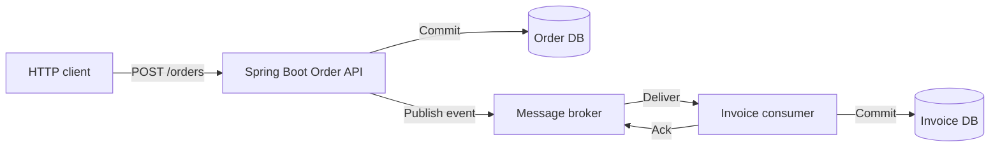
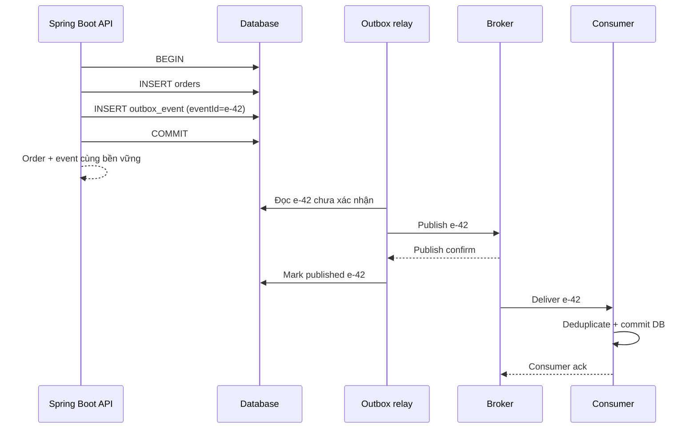
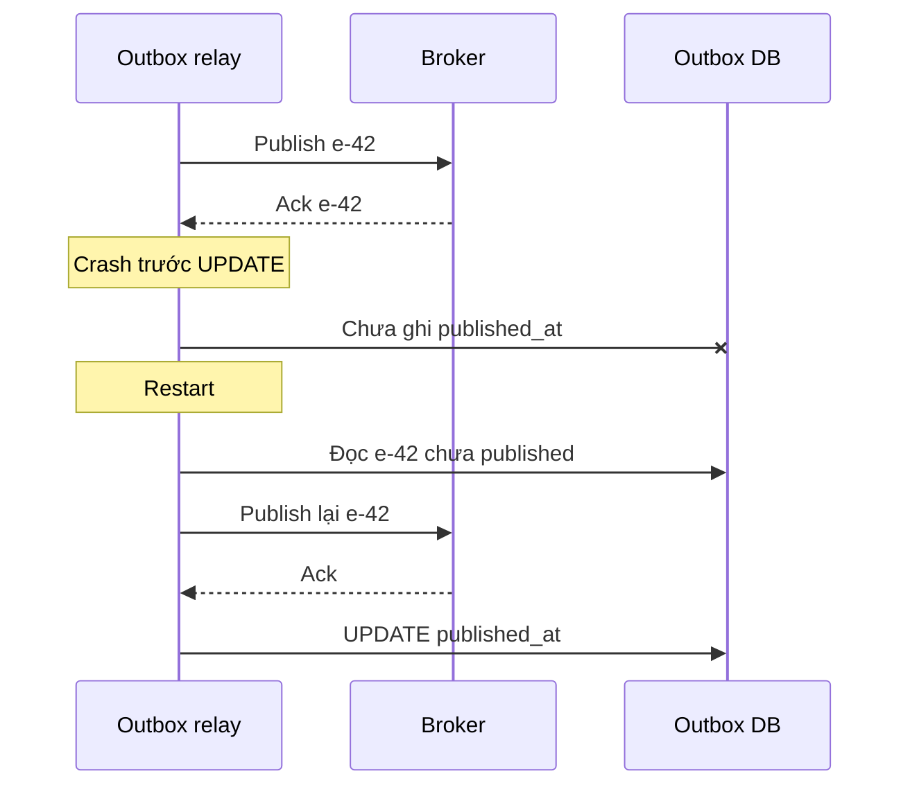
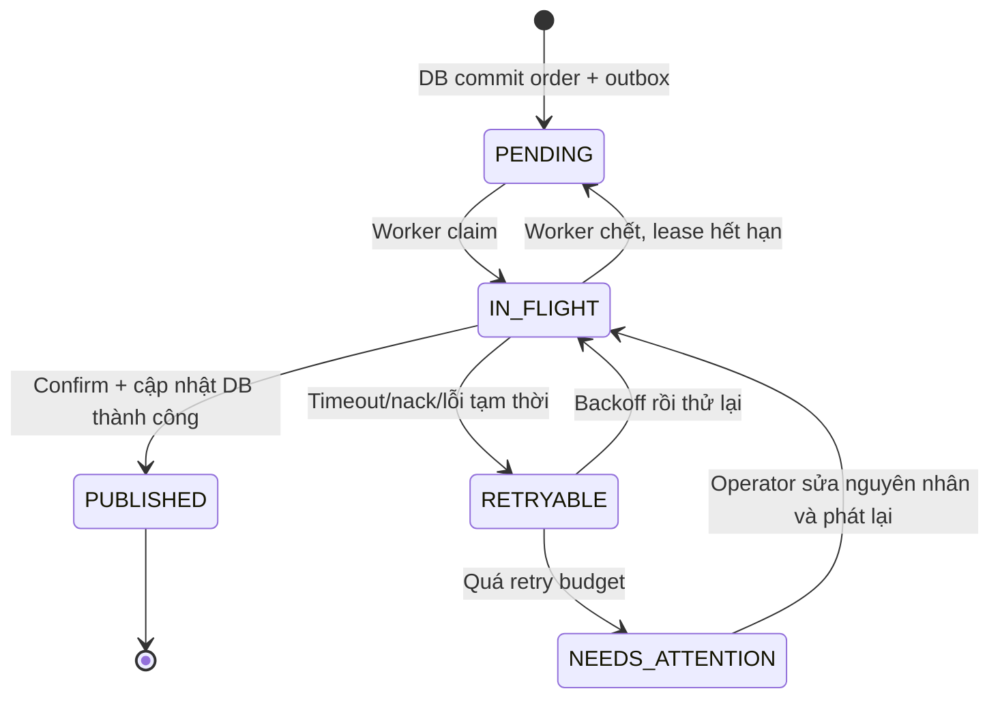

# Xác nhận phát thành công và khả năng phát trùng sau lỗi

Trong hệ thống tích hợp Spring Boot, việc gửi một sự kiện ra Kafka, RabbitMQ, một HTTP endpoint hoặc một adapter của Spring Integration thường không hoàn tất ngay khi phương thức `send(...)` trả về. Dữ liệu có thể mới nằm trong bộ đệm client, đã được broker chấp nhận nhưng producer chưa nhận xác nhận, hoặc đã đến consumer nhưng chưa được xử lý. Nếu tiến trình lỗi đúng lúc không rõ kết quả, **thử gửi lại là cách cần thiết để tránh mất dữ liệu, nhưng có thể tạo bản phát trùng**.

Bài học thuộc chủ đề **Nhất quán và chống trùng** của mô-đun `SPRING_BOOT_INTEGRATION`. Trọng tâm là hiểu chính xác xác nhận phát (*publish/send acknowledgement*), nhận diện khoảng thời gian kết quả không xác định, chọn cơ chế retry, thiết kế transactional outbox và bảo vệ consumer khỏi side effect lặp lại. Các ví dụ đi từ HTTP, giao dịch cơ sở dữ liệu, broker thông điệp đến adapter Spring Integration, đồng thời xét cả kiểm thử và quan sát hoạt động thực tế.

## 1. “Gửi thành công” là thành công ở ranh giới nào?

Một hệ thống đặt hàng có thể thực hiện chuỗi sau:



Từ “thành công” có thể chỉ ít nhất sáu việc riêng biệt:

| Mốc | Điều thực sự được xác nhận | Điều **chưa** được suy ra |
| --- | --- | --- |
| 1. API client nhận HTTP 2xx | Server đã gửi phản hồi 2xx theo hợp đồng HTTP | Các tác vụ async phía sau nhất thiết đã xong |
| 2. Hàm `send` hoặc `convertAndSend` không ném lỗi | Client thư viện chấp nhận lời gọi hoặc đã thực hiện bước gửi được định nghĩa | Broker đã lưu bền hay consumer đã xử lý |
| 3. Producer nhận broker publish acknowledgement | Broker xác nhận theo quy tắc của giao thức và cấu hình độ bền hiện tại | Consumer đã đọc hoặc commit nghiệp vụ |
| 4. Consumer nhận message | Dữ liệu đã được giao tới consumer | Transaction DB của consumer đã commit |
| 5. Consumer commit kết quả vào DB | Side effect trong transaction DB đã được ghi | Broker đã nhận consumer acknowledgement |
| 6. Broker nhận consumer acknowledgement | Broker có thể xem lần phân phối đó đã được xác nhận | Mọi hệ thống khác ngoài transaction consumer đã cùng commit |

**Producer acknowledgement và consumer acknowledgement là hai tín hiệu khác nhau.** Kafka gọi thành công của producer là kết quả từ cơ chế `acks`, còn việc consumer ghi nhận tiến độ thường được thể hiện bằng offset commit. RabbitMQ có **publisher confirms** cho chiều publish và **consumer acknowledgements** cho chiều delivery. Không được lấy một tín hiệu thay cho tín hiệu còn lại.

Ngay cả khi một bước được xác nhận thành công, phạm vi đảm bảo vẫn phụ thuộc cấu hình. Một broker nhận message nhưng dùng mức replication/durability yếu có thể mất message khi sự cố nghiêm trọng. Một consumer đã ack nhưng gọi HTTP ngoài transaction vẫn có thể gặp trạng thái không biết đối tác có thực thi hay chưa.

### 1.1. Các mức bảo đảm giao nhận

| Mô hình | Đặc tính | Đánh đổi |
| --- | --- | --- |
| *At-most-once* | Không chủ động gửi lại sau kết quả mơ hồ; một thông điệp có thể bị mất | Ít phát trùng nhưng không phù hợp nghiệp vụ không được phép mất dữ liệu |
| *At-least-once* | Retry cho đến khi nhận được tín hiệu thành công hoặc đưa sang cơ chế xử lý riêng | Có thể phát/nhận cùng sự kiện nhiều lần |
| *Exactly-once* trong một phạm vi cụ thể | Các thao tác đã xác định được thực hiện với hiệu ứng một lần **trong phạm vi cơ chế hỗ trợ** | Không tự mở rộng sang mọi DB, HTTP endpoint và broker |
| *Effectively-once* ở tầng nghiệp vụ | Có thể nhận nhiều bản sao, nhưng dùng idempotency/unique constraint để tạo hiệu ứng nghiệp vụ một lần | Cần lưu vết, thiết kế khóa và xử lý cạnh tranh |

Đừng ghi chung chung “hệ thống đảm bảo exactly-once” nếu chưa xác định **exactly-once cho thao tác nào, ở hệ thống nào và trong điều kiện lỗi nào**. Ví dụ Kafka transaction có thể phối hợp consume/produce và offset trong Kafka, nhưng không tự biến một lần gọi API ngân hàng hoặc ghi SQL ngoài Kafka thành một transaction toàn cục.

## 2. Khoảng kết quả không xác định là nguồn gốc của phát trùng

Giả sử producer gửi sự kiện `OrderCreated(eventId=e-42)`, broker đã ghi nhận sự kiện, nhưng gói xác nhận bị mất:

```mermaid
sequenceDiagram
    participant P as Spring Boot producer
    participant B as Broker
    P->>B: Publish e-42
    B->>B: Chấp nhận / lưu sự kiện
    B--xP: Publish ack bị mất
    Note over P: Timeout; không rõ đã được nhận?
    P->>B: Retry e-42
    B-->>P: Ack
    Note over B: Có thể tồn tại 2 bản phát e-42
```

Timeout **không chứng minh** publish thất bại. Từ góc nhìn producer, hai thực tế sau cho cùng một biểu hiện:

1. Yêu cầu chưa đến broker; nếu không retry, sự kiện bị mất.
2. Broker đã chấp nhận nhưng phản hồi bị mất; nếu retry, sự kiện có thể được gửi hai lần.

Đây là giới hạn thông tin ở ranh giới mạng. Không thể giải quyết chỉ bằng cách tăng timeout hoặc bao lệnh publish trong một `try/catch`. Cần chọn hợp đồng retry và chuẩn bị khả năng xử lý trùng.

### 2.1. Phân tích các điểm hỏng

| Thời điểm lỗi | Tình trạng sự kiện có thể xảy ra | Ứng dụng nên làm |
| --- | --- | --- |
| Trước khi gửi | Broker chắc chắn chưa nhận lần gửi đó | Có thể gửi theo cơ chế retry |
| Đang gửi, mất kết nối | Broker có thể đã nhận hoặc chưa | Xem là **không xác định**, retry an toàn với cùng event ID |
| Broker chấp nhận, ack bị mất | Sự kiện đã tồn tại nhưng producer không biết | Retry có thể tạo bản trùng; consumer phải idempotent |
| Nhận ack, producer chết trước khi cập nhật DB/outbox | Broker đã chấp nhận, bản ghi outbox vẫn “chưa gửi” | Relay phát lại sau restart; duplicate là dự kiến |
| Producer đánh dấu “đã gửi” trước khi broker xác nhận, rồi crash | Có thể đánh dấu xong dù broker chưa nhận | **Có nguy cơ mất sự kiện**, tránh thứ tự xử lý này |
| Consumer commit DB rồi chết trước khi ack/commit offset | Side effect đã có, broker có thể giao lại message | Consumer xử lý lặp phải không tạo side effect lần hai |
| Consumer ack/commit offset trước DB commit rồi crash | Broker nghĩ đã xử lý, DB chưa có thay đổi | **Có nguy cơ mất hiệu ứng**, tránh ack trước commit |

Không phải cứ broker có “retry” là chắc chắn ghi hai bản trong log. Một số broker/client có cơ chế chống trùng ở cấp protocol, ví dụ producer idempotence trong Kafka. Nhưng các cơ chế đó có giới hạn phiên producer, khóa deduplication hoặc transaction cụ thể; khi ứng dụng tạo một lần phát logic mới sau restart hay có nhiều producer, vẫn phải bảo vệ nghiệp vụ theo **event ID ổn định**.

### 2.2. Event ID khác correlation ID và message ID

| Định danh | Cách dùng | Khả năng giữ nguyên khi retry |
| --- | --- | --- |
| `eventId` / business event ID | Nhận diện **cùng một sự kiện nghiệp vụ** qua mọi lần phát/nhận | **Phải giữ nguyên** |
| Idempotency key của command | Nhận diện cùng một yêu cầu tạo đơn/thanh toán | Giữ nguyên trong cửa sổ retry theo hợp đồng |
| Correlation ID | Ghép log, request/reply, trace xuyên hệ thống | Thường giữ xuyên luồng, nhưng không nhất thiết duy nhất theo event |
| Broker message ID / Kafka offset | Metadata do client/broker hoặc vị trí log cung cấp | Có thể thay đổi khi phát lại |
| Order ID / aggregate ID | Nhận diện thực thể được cập nhật | Nhiều sự kiện khác nhau có thể cùng order ID |

Ví dụ `OrderCreated(e-42, order-7)` được relay hai lần phải giữ `eventId=e-42`. Một lần `OrderShipped(e-43, order-7)` là sự kiện **khác** dù cùng `order-7`; không được dùng order ID làm khóa dedup cho mọi loại sự kiện.

## 3. Kafka: producer acknowledgement có nghĩa gì?

Khi dùng `KafkaTemplate` trong Spring Kafka, lời gọi `send(...)` thường trả về một `CompletableFuture<SendResult<K,V>>`. Việc nhận được đối tượng future **không phải** là xác nhận broker đã chấp nhận. Thành công/thất bại được quan sát khi future hoàn thành.

Mức `acks` quyết định broker phải xác nhận như thế nào:

| `acks` | Cách hiểu | Rủi ro |
| --- | --- | --- |
| `0` | Producer không chờ broker xác nhận việc nhận record | Có thể mất record mà producer không biết |
| `1` | Leader xác nhận sau khi leader xử lý ghi nhận record | Leader lỗi trước khi replica theo kịp có thể làm mất record |
| `all` / `-1` | Broker chờ điều kiện xác nhận từ các replica in-sync theo cấu hình | Mạnh hơn, nhưng không thay thế cấu hình replication/`min.insync.replicas` và kiểm soát toàn hệ thống |

Với dữ liệu cần tin cậy, cân nhắc `acks=all`, replication factor phù hợp, `min.insync.replicas` và giám sát tình trạng ISR. Các giá trị cụ thể phải phù hợp số broker và mức chấp nhận lỗi. `acks=all` không tự đảm bảo consumer đã xử lý sự kiện.

### 3.1. Bật idempotent producer và kiểm soát retry

Ví dụ `application.yml`:

```yaml
spring:
  kafka:
    bootstrap-servers: localhost:9092
    producer:
      acks: all
      properties:
        enable.idempotence: true
        delivery.timeout.ms: 120000
```

Kafka producer idempotence sử dụng định danh producer và sequence number để broker tránh ghi lặp khi **client retry cùng record trong phạm vi phiên và cơ chế idempotent producer**. Cần dùng các cấu hình tương thích (chẳng hạn `acks=all`, số lần retry và giới hạn in-flight phù hợp); thư viện Kafka hiện đại có thể tự đặt/kiểm tra những ràng buộc này, nhưng phải đối chiếu phiên bản chạy thực tế.

Điểm giới hạn quan trọng:

- Producer idempotence giúp retry ở cấp Kafka client, **không** tự chống một application relay publish lại cùng `eventId` như một record mới sau restart.
- Kafka transaction có thể bảo vệ các thao tác consume-process-produce trong **Kafka** và phối hợp offset theo hợp đồng cụ thể. Việc ghi PostgreSQL, gọi HTTP hoặc phát sang RabbitMQ vẫn có ranh giới riêng.
- Nếu future thất bại hoặc hết thời gian chờ, ứng dụng không thể mặc định record chưa từng xuất hiện ở broker; một số tình huống vẫn có kết quả không xác định.

### 3.2. Quan sát kết quả một lần phát bằng `KafkaTemplate`

Ví dụ Java với Spring Kafka hỗ trợ future dạng `CompletableFuture`:

```java
public record OrderCreated(
        UUID eventId,
        String orderId,
        Instant occurredAt) {
}

@Service
public class KafkaOrderPublisher {
    private final KafkaTemplate<String, OrderCreated> kafkaTemplate;

    public KafkaOrderPublisher(
            KafkaTemplate<String, OrderCreated> kafkaTemplate) {
        this.kafkaTemplate = kafkaTemplate;
    }

    public CompletableFuture<SendResult<String, OrderCreated>> publish(
            OrderCreated event) {
        return kafkaTemplate.send(
                "orders.events",
                event.orderId(),
                event);
    }
}
```

Ứng dụng cần cấu hình serializer phù hợp cho `OrderCreated`. Imports tiêu biểu: `java.util.UUID`, `java.time.Instant`, `java.util.concurrent.CompletableFuture`, `org.springframework.kafka.core.KafkaTemplate`, `org.springframework.kafka.support.SendResult`. Trong worker relay, có thể quan sát:

```java
publisher.publish(event).whenComplete((result, error) -> {
    if (error != null) {
        // Ghi nhận thất bại/không xác định theo quy tắc retry của outbox.
        return;
    }

    // Chỉ tại đây có producer acknowledgement theo cấu hình acks.
    // Lưu kết quả theo eventId và offset/partition cho giám sát nếu cần.
    log.info("Published eventId={}, topic={}, partition={}, offset={}",
            event.eventId(),
            result.getRecordMetadata().topic(),
            result.getRecordMetadata().partition(),
            result.getRecordMetadata().offset());
});
```

Đoạn callback ở trên minh họa phân biệt **future completed successfully** với **đã gọi send**; `log` là logger của ứng dụng. Với outbox thực tế, cần cập nhật trạng thái bền vững sau xác nhận trong một transaction riêng, điều phối concurrency và xử lý lỗi callback. Không làm thao tác DB chặn lâu ngay trên thread callback của thư viện.

Sử dụng `orderId` làm Kafka record key giúp các sự kiện cùng đơn thường được định tuyến đến cùng partition khi topology không thay đổi; vẫn phải xem xét số partition, chiến lược partitioning, reorder do retry hoặc nhiều producer và phiên bản của sự kiện khi yêu cầu xử lý theo thứ tự.

## 4. RabbitMQ: publisher confirm khác message return và consumer ack

RabbitMQ tách ba tình huống:

1. **Publisher confirm:** broker phản hồi `ack`/`nack` với publisher cho lần publish trên channel xác nhận. Đây là tín hiệu broker đã xử lý bản phát theo điều kiện của queue/loại lưu trữ, **không phải** consumer đã xử lý.
2. **Return khi không route được:** nếu publish với `mandatory=true` mà không có queue phù hợp, broker có thể trả message về publisher. Trường hợp này vẫn có thể được **publisher confirm ack**, vì exchange đã xử lý publish nhưng không route đến queue.
3. **Consumer acknowledgement:** consumer ack/nack/reject một lần delivery; ack đến sớm hơn transaction nghiệp vụ sẽ gây rủi ro mất hiệu ứng khi consumer crash.

Trong Spring Boot dùng Spring AMQP, ví dụ cấu hình nhận xác nhận:

```yaml
spring:
  rabbitmq:
    host: localhost
    port: 5672
    publisher-confirm-type: correlated
    publisher-returns: true
    template:
      mandatory: true
```

Ở đây `correlated` cho phép liên hệ publisher confirm với từng lần phát qua `CorrelationData`. `publisher-returns` và `mandatory` giúp phát hiện trường hợp không tìm được tuyến đến queue. Cần khai báo exchange, binding, queue phù hợp; queue bền vững, message persistent và kiểu queue phải được thiết kế theo yêu cầu lưu giữ thực tế, không thể chỉ dựa vào một cờ config.

Ví dụ lời gọi publish có ID đối chiếu:

```java
public void publish(OrderCreated event) {
    CorrelationData correlation =
            new CorrelationData(event.eventId().toString());

    rabbitTemplate.convertAndSend(
            "orders.exchange",
            "orders.created",
            event,
            correlation);

    correlation.getFuture().whenComplete((confirm, error) -> {
        if (error != null || confirm == null || !confirm.isAck()) {
            // Ghi nhận để relay xử lý retry/trạng thái không xác định.
            return;
        }

        if (correlation.getReturned() != null) {
            // Broker ack nhưng message không được route tới queue.
            return;
        }

        // Đã có confirm ack và không phát hiện returned message.
        // Chưa thể kết luận consumer đã commit nghiệp vụ.
    });
}
```

Ví dụ giả định đã inject `RabbitTemplate rabbitTemplate` và cấu hình `MessageConverter` thích hợp cho kiểu event. `CorrelationData` thuộc `org.springframework.amqp.rabbit.connection`. Tùy phiên bản Spring AMQP, API callback và cách nhận returned message có thể thay đổi; cần biên dịch với dependency thực tế trước khi triển khai.

Không dùng một callback publisher confirm duy nhất để chứng minh message đã được xử lý: confirm chỉ đóng khoảng mơ hồ ở **mức broker tiếp nhận**, còn consumer có cơ chế acknowledge và retry riêng. Nếu kết nối bị cắt trước confirm, việc publish đã đến broker hay chưa vẫn có thể không xác định.

## 5. Transactional outbox: tránh khoảng trống giữa DB commit và publish

Một hệ thống đặt hàng thường có hai side effect cần nhất quán:

1. Ghi đơn hàng vào database.
2. Phát sự kiện `OrderCreated` sang broker để các service khác biết.

Thực hiện `repository.save(order)` rồi `kafkaTemplate.send(event)` trong cùng method `@Transactional` **không tạo giao dịch nguyên tử xuyên database và Kafka**. DB có thể commit nhưng publish thất bại, hoặc broker nhận nhưng transaction DB rollback.

**Transactional outbox** ghi bản ghi nghiệp vụ và bản ghi sự kiện vào **cùng một transaction database**. Một tiến trình riêng (relay) đọc outbox và publish. Việc phát có thể lặp sau lỗi; đây là hành vi được chấp nhận, vì consumer cần idempotent.



### 5.1. Lược đồ outbox tối thiểu

Ví dụ PostgreSQL:

```sql
CREATE TABLE outbox_events (
    event_id UUID PRIMARY KEY,
    aggregate_type VARCHAR(80) NOT NULL,
    aggregate_id VARCHAR(120) NOT NULL,
    event_type VARCHAR(120) NOT NULL,
    payload JSONB NOT NULL,
    created_at TIMESTAMPTZ NOT NULL DEFAULT NOW(),
    published_at TIMESTAMPTZ NULL,
    attempts INTEGER NOT NULL DEFAULT 0,
    last_error TEXT NULL
);

CREATE INDEX ix_outbox_unpublished
    ON outbox_events (created_at)
    WHERE published_at IS NULL;
```

`event_id` được tạo **một lần khi tạo sự kiện** và lưu cùng payload. Relay không tạo UUID mới cho mỗi lượt phát. `published_at` chỉ được cập nhật sau khi đạt tiêu chí producer acknowledgement và kiểm tra khả năng route theo hợp đồng của broker; khi không chắc chắn, record phải tiếp tục đủ điều kiện retry.

### 5.2. Ghi outbox trong transaction Spring Boot

```java
@Service
public class PlaceOrderService {
    private final OrderRepository orders;
    private final OutboxRepository outbox;

    public PlaceOrderService(
            OrderRepository orders,
            OutboxRepository outbox) {
        this.orders = orders;
        this.outbox = outbox;
    }

    @Transactional
    public OrderResult place(PlaceOrder command) {
        // Repository nghiệp vụ phải có unique constraint cho requestId.
        Order order = orders.insertIdempotently(command);

        // Chỉ tạo sự kiện cho lần chuyển trạng thái thực sự.
        if (order.isNewlyCreated()) {
            UUID eventId = UUID.randomUUID();
            outbox.insert(
                    eventId,
                    "Order",
                    order.id(),
                    "OrderCreated",
                    serializeOrderCreated(eventId, order));
        }

        return new OrderResult(order.id(), order.status());
    }
}
```

Ví dụ trên là mã minh họa cho hai repository và các DTO do ứng dụng định nghĩa, không phải API có sẵn của Spring Data. `insertIdempotently` phải được triển khai bằng transaction, kiểm soát cạnh tranh và ràng buộc duy nhất ở DB. Hai repository phải cùng tham gia một transaction manager và cùng cơ sở dữ liệu giao dịch; nếu trỏ đến hai DB độc lập, ví dụ không còn bảo đảm nguyên tử.

Với retry HTTP, không chỉ dựa vào kiểm tra `findByRequestId` rồi `insert` vì hai request đồng thời có thể cùng không tìm thấy. Nên có unique constraint theo phạm vi đúng (ví dụ `tenant_id + request_id`), bắt lỗi xung đột và trả trạng thái/kết quả đã tạo. Việc tạo outbox cần gắn với lần chuyển trạng thái thực tế để retry không sinh ra nhiều sự kiện khác nhau.

### 5.3. Tại sao outbox vẫn có thể phát trùng?



Nếu đánh dấu `published_at` **trước** publish để loại bỏ trùng, lỗi sau đánh dấu nhưng trước khi broker nhận sẽ làm mất sự kiện. Vì vậy outbox ưu tiên **không mất sự kiện** và chấp nhận **phát ít nhất một lần**, cùng với deduplication ở consumer. Outbox cũng không tự bảo đảm đúng thứ tự khi nhiều relay cùng xử lý; vấn đề concurrency và thứ tự phải được thiết kế riêng.

## 6. Relay outbox: xác nhận, cạnh tranh và thứ tự xử lý

Relay có thể là job `@Scheduled` trong Spring Boot, một Spring Integration polling flow, một worker riêng hoặc tiến trình CDC (change data capture) đọc transaction log. Bất kể cách triển khai, nguyên tắc cốt lõi là **record outbox phải tiếp tục có thể được phát lại cho đến khi broker có xác nhận đáp ứng chính sách phát**.

### 6.1. Trình tự trạng thái

Một state machine đơn giản:



Sơ đồ là logic nghiệp vụ, không yêu cầu lưu đúng các chuỗi trạng thái ấy trong schema SQL. Với bảng ví dụ chỉ có `published_at`, hệ thống cần bổ sung cột lease/claim và trạng thái lỗi nếu chạy nhiều worker hoặc cần tái xử lý có kiểm soát.

### 6.2. Tránh hai relay cùng lấy một bản ghi

Với nhiều replica Spring Boot, hai relay có thể đọc cùng một row `published_at IS NULL` trước khi một worker đánh dấu thành công. Điều này dẫn đến phát trùng ngay cả khi không gặp lỗi mạng.

Một phương án PostgreSQL là worker **claim** record trong transaction ngắn bằng `SELECT ... FOR UPDATE SKIP LOCKED`, cập nhật `claimed_by` và `claim_until` rồi commit. Phần publish được thực hiện **sau khi thả transaction DB**; sau xác nhận, mở transaction khác để cập nhật `published_at`. Claim phải có hạn để worker chết không khóa record vĩnh viễn.

Ví dụ các cột bổ sung:

```sql
ALTER TABLE outbox_events
    ADD COLUMN claimed_by VARCHAR(120),
    ADD COLUMN claim_until TIMESTAMPTZ,
    ADD COLUMN next_attempt_at TIMESTAMPTZ;

CREATE INDEX ix_outbox_ready
    ON outbox_events (next_attempt_at, created_at)
    WHERE published_at IS NULL;
```

Ví dụ *ý tưởng* truy vấn để một transaction giành một nhóm nhỏ các record:

```sql
WITH candidates AS (
    SELECT event_id
    FROM outbox_events
    WHERE published_at IS NULL
      AND (claim_until IS NULL OR claim_until < NOW())
      AND (next_attempt_at IS NULL OR next_attempt_at <= NOW())
    ORDER BY created_at, event_id
    FOR UPDATE SKIP LOCKED
    LIMIT 50
)
UPDATE outbox_events AS o
SET claimed_by = :worker_id,
    claim_until = NOW() + INTERVAL '60 seconds'
FROM candidates AS c
WHERE o.event_id = c.event_id
RETURNING o.*;
```

Biến `:worker_id` là tham số bind do tầng JDBC cung cấp, không được nối chuỗi từ input bên ngoài. Cần bổ sung quy tắc gia hạn claim, retry, batch size và thời gian gọi broker. Nếu lần publish kéo dài hơn 60 giây, worker khác có thể claim lại sau thời hạn: **lease chỉ giảm khả năng phát đồng thời, không loại bỏ duplicate**.

### 6.3. Đánh dấu thành công có kiểm tra chủ sở hữu

Sau broker ack, worker ghi nhận hoàn tất trong transaction DB riêng. Ví dụ:

```sql
UPDATE outbox_events
SET published_at = NOW(),
    claimed_by = NULL,
    claim_until = NULL,
    last_error = NULL
WHERE event_id = :event_id
  AND claimed_by = :worker_id
  AND published_at IS NULL;
```

Ứng dụng phải kiểm tra số row cập nhật. Nếu bằng `0`, có thể claim đã hết hạn hoặc bị worker khác giành lại. Không được ghi nhận bừa rằng đã hoàn thành; cần đọc trạng thái hiện tại và đối soát. Trong hệ thống có yêu cầu cạnh tranh cao, thêm `claim_version` hoặc fencing token để phân biệt chính xác các lần claim.

Đừng giữ database transaction mở trong toàn bộ thời gian chờ broker confirm, vì sẽ giữ lock và connection, làm tăng deadlock và giảm thông lượng. Cách claim → publish → finalize chấp nhận khả năng phát trùng, đổi lại tránh transaction phân tán và lock kéo dài.

### 6.4. Thứ tự sự kiện

Giả sử một đơn hàng có:

```text
OrderCreated(order-7, version=1, eventId=e-42)
OrderPaid(order-7, version=2, eventId=e-43)
OrderCancelled(order-7, version=3, eventId=e-44)
```

Nếu nhiều worker publish outbox song song, `e-43` có thể đến consumer trước `e-42`. Dùng Kafka key theo aggregate ID giúp các bản ghi cùng key đi vào cùng partition trong một cấu hình partition nhất định, nhưng **không sửa được việc producer phát sai thứ tự từ trước**. Thứ tự cũng có thể thay đổi khi có retry, repartition hoặc nhiều service cùng publish.

Khi cần giữ thứ tự, có thể chọn chiến lược *per aggregate ordering*: một producer/worker tuần tự cho cùng aggregate, đưa sự kiện vào partition/key nhất quán, và lưu `aggregate_version` để consumer chỉ chấp nhận chuyển trạng thái hợp lệ. Với trường hợp cho phép eventual consistency, consumer có thể hoãn message đến sớm, bỏ qua version cũ hoặc tái đồng bộ trạng thái từ nguồn đáng tin cậy.

## 7. Consumer idempotency: bảo vệ hiệu ứng nghiệp vụ

Do producer retry, relay phát lại, broker redelivery và consumer restart, consumer cần xem **duplicate là tình huống bình thường** trong mô hình at-least-once.

Xét service lập hóa đơn nhận hai bản sao của `OrderCreated(eventId=e-42)`. Nếu cả hai đều thực thi `INSERT invoice` và gửi email, người mua có thể nhận hai hóa đơn hoặc hai thông báo. Một consumer idempotent phải có cách nhận diện rằng `e-42` đã được áp dụng trước đó và không tạo lại hiệu ứng.

### 7.1. Lưu dấu vết đã xử lý trong cùng transaction với nghiệp vụ

Ví dụ PostgreSQL:

```sql
CREATE TABLE processed_events (
    consumer_name VARCHAR(120) NOT NULL,
    event_id UUID NOT NULL,
    processed_at TIMESTAMPTZ NOT NULL DEFAULT NOW(),
    PRIMARY KEY (consumer_name, event_id)
);

CREATE TABLE invoices (
    invoice_id UUID PRIMARY KEY,
    order_id VARCHAR(120) NOT NULL UNIQUE,
    amount NUMERIC(18, 2) NOT NULL
);
```

Khóa chính `(consumer_name, event_id)` cho phép nhiều consumer nghiệp vụ khác nhau dùng cùng event ID mà mỗi consumer vẫn có một record xử lý riêng. Khóa `UNIQUE(order_id)` ở bảng hóa đơn bảo vệ một invariant nghiệp vụ bổ sung: **mỗi đơn hàng có tối đa một hóa đơn theo hợp đồng ví dụ**.

Service Spring Boot:

```java
@Service
public class InvoiceEventProcessor {
    private final JdbcTemplate jdbc;

    public InvoiceEventProcessor(JdbcTemplate jdbc) {
        this.jdbc = jdbc;
    }

    @Transactional
    public void handleOnce(OrderCreated event) {
        int inserted = jdbc.update(
                """
                INSERT INTO processed_events (consumer_name, event_id)
                VALUES (?, ?)
                ON CONFLICT (consumer_name, event_id) DO NOTHING
                """,
                "invoice-service",
                event.eventId());

        if (inserted == 0) {
            return; // Đã có eventId này trong transaction đã commit.
        }

        // Tạo hóa đơn, thay đổi trạng thái hoặc ghi outbox tiếp theo.
        // Các ghi DB phải cùng transaction với processed_events.
        createInvoiceFrom(event);
    }
}
```

`createInvoiceFrom(event)` là logic nghiệp vụ do ứng dụng triển khai. Code giả định event đã chứa hoặc cho phép tra cứu đủ dữ liệu để tạo hóa đơn; vì record minh họa ở phần Kafka chỉ chứa `eventId` và `orderId`, cần bổ sung lookup/contract cho `amount`. Các import chính: `org.springframework.jdbc.core.JdbcTemplate`, `org.springframework.stereotype.Service`, `org.springframework.transaction.annotation.Transactional`.

Điều cốt lõi nằm ở **transaction**:

1. Nếu insert vào `processed_events` thành công nhưng tạo hóa đơn lỗi, transaction rollback cả hai; lần redelivery sau có thể thử lại.
2. Nếu hóa đơn và dấu vết đã commit nhưng consumer chết trước khi ack broker, lần redelivery sau gặp duplicate key; service trả về thành công mà không tạo hóa đơn thêm.
3. Nếu hai consumer cùng xử lý `e-42`, ràng buộc unique của DB phân xử cạnh tranh. Không dùng `SELECT EXISTS` rồi `INSERT` riêng vì cả hai có thể đồng thời đọc “chưa có”.

Nếu xử lý một sự kiện dẫn đến nhiều lần ghi DB trong **cùng database**, giữ tất cả trong transaction. Nếu còn gửi email, gọi HTTP hoặc cập nhật hệ thống khác, transaction DB **không rollback được side effect ngoài DB**; cần idempotency ở đích, outbox cho bước tiếp theo hoặc cơ chế đối soát.

Một giới hạn của ví dụ tối giản là `processed_events` chỉ ghi event ID. Nếu có khả năng cùng `eventId` xuất hiện với **payload khác nhau**, nên lưu thêm hash của nội dung nghiệp vụ (hoặc version/schema và fingerprint), so sánh khi gặp lại ID và báo lỗi hợp đồng khi chúng không khớp. Bỏ qua một event ID đã có chỉ an toàn khi hệ thống bảo đảm các lần phát của ID đó biểu diễn cùng một sự kiện.

### 7.2. Kafka consumer: commit offset sau hiệu ứng bền vững

Ví dụ listener theo mô hình manual acknowledgement:

```java
@Component
public class InvoiceKafkaListener {
    private final InvoiceEventProcessor processor;

    public InvoiceKafkaListener(InvoiceEventProcessor processor) {
        this.processor = processor;
    }

    @KafkaListener(
            topics = "orders.events",
            groupId = "invoice-service")
    public void onEvent(
            OrderCreated event,
            Acknowledgment acknowledgment) {
        processor.handleOnce(event);
        acknowledgment.acknowledge();
    }
}
```

Ví dụ cấu hình tương ứng:

```yaml
spring:
  kafka:
    consumer:
      enable-auto-commit: false
    listener:
      ack-mode: manual
```

`Acknowledgment` thuộc `org.springframework.kafka.support`; `@KafkaListener` thuộc `org.springframework.kafka.annotation`. Lưu ý service `InvoiceEventProcessor` phải là bean **khác** để `@Transactional` được áp dụng qua Spring proxy trong cấu hình mặc định. Khi `handleOnce` trả về thành công, transaction DB của service đã hoàn tất; listener mới gọi `acknowledge()`.

Ở chế độ `manual`, lời gọi acknowledge đánh dấu tiến độ theo cơ chế container; thời điểm offset thực sự được commit tùy ack mode và cấu hình container. Với yêu cầu cần commit đồng bộ ngay theo từng record, phải hiểu và chọn mode thích hợp, đồng thời chấp nhận chi phí latency. Dù commit offset thành công hay timeout, nếu record được giao lại thì transaction + unique constraint vẫn ngăn hiệu ứng trùng.

Không ack trước khi transaction commit. Nếu exception xảy ra, hãy để error handler và chính sách retry/DLT quyết định có giao lại hay chuyển sang xử lý riêng; việc nuốt exception rồi ack sẽ biến lỗi thật thành mất công việc.

### 7.3. RabbitMQ consumer: ý nghĩa tương ứng

Với RabbitMQ, một listener có thể để container ack sau khi handler trả thành công theo chế độ được hỗ trợ, hoặc quản lý manual acknowledgement. Khi dùng manual ack, trình tự mong muốn là:

```text
Rabbit delivery e-42
    -> kiểm tra và ghi processed_events + invoice trong DB transaction
    -> DB commit thành công
    -> basicAck(deliveryTag, multiple=false)
```

Nếu dùng `basicNack`/`basicReject` với `requeue=true` liên tục cho một message lỗi vĩnh viễn, hệ thống có thể rơi vào vòng lặp nóng. Cần retry có giới hạn, dead-letter queue và cách vận hành bản ghi bị lỗi. Message delivery tag gắn với **channel RabbitMQ cụ thể**; không tái sử dụng tag tùy tiện sau khi channel đóng.

### 7.4. Chống trùng bằng Redis khi nào đủ?

Redis có thể lưu bộ đếm, khóa lease hoặc tập event ID đã thấy để giảm tải trước DB. Nhưng một key `SET NX EX` bị hết TTL hoặc eviction có thể cho phép message cũ đi qua lần nữa. Hai thao tác “đặt key Redis” và “ghi DB” cũng không mặc nhiên nguyên tử với nhau.

Nếu mất duplicate có hậu quả lớn (tạo hóa đơn, trừ tiền, ghi sổ), hãy dùng **unique constraint và transaction ở dữ liệu đích** làm lớp bảo vệ cuối. Redis có thể giúp giảm xử lý lặp ngắn hạn, nhưng không nên là bằng chứng duy nhất rằng side effect tài chính đã thực hiện.

## 8. HTTP và API đối tác: timeout cũng tạo bản phát trùng

Tình huống tương tự xảy ra ngoài broker. Một service gọi:

```http
POST /partner/payments
Idempotency-Key: tenant-31:payment-request-456
Content-Type: application/json

{"orderId":"order-7","amount":120000}
```

Đối tác có thể đã tạo thanh toán nhưng phản hồi HTTP 200 bị mất; phía gọi chỉ thấy timeout. Nếu retry `POST` mà đối tác không hỗ trợ idempotency, có thể tạo hai khoản thu.

Cách xử lý:

- Gửi **cùng idempotency key** cho mọi retry của cùng lệnh nghiệp vụ; khóa cần được đối tác hỗ trợ và có phạm vi/thời gian lưu theo hợp đồng.
- Cố định payload hoặc có fingerprint để phát hiện cùng key nhưng dữ liệu khác; không được xem hai nội dung khác nhau là cùng một yêu cầu hợp lệ.
- Nếu nhận timeout, tra cứu trạng thái bằng request ID/payment ID khi API cho phép; không tự suy diễn “đối tác chưa xử lý”.
- Với giao dịch nhiều bước, lưu trạng thái yêu cầu ở DB và thiết kế cơ chế đối soát, có thể dùng saga/compensation khi các hệ thống không thể commit nguyên tử.

Một HTTP 2xx hoặc producer ack chỉ đóng một phần hành trình. Nếu luồng là `DB → broker → consumer → HTTP partner`, vẫn có thể xảy ra lỗi/duplicate ở mỗi ranh giới. Phải quyết định idempotency ở **mỗi nơi có side effect**, không chỉ ở nơi phát đầu tiên.

## 9. Retry an toàn khi trạng thái phát chưa chắc chắn

Retry tốt cần phân biệt “có thể thử lại”, “không nên thử lại” và “phải đối soát”.

| Tình huống | Hướng xử lý |
| --- | --- |
| Mất kết nối, broker timeout, lỗi mạng tạm thời | Retry với **cùng event ID**, backoff và theo dõi số lần thử |
| Kafka/RabbitMQ bị quá tải, throttling, hạn mức | Giảm tốc độ, giới hạn concurrency và retry có jitter |
| Exchange/queue/topic không tồn tại, serializer sai schema, credentials sai | Báo lỗi cấu hình; thường cần con người/sửa triển khai trước khi retry |
| RabbitMQ returned message vì không route được | Sửa routing/binding; publisher confirm ack riêng không chứng minh giao đến queue |
| API nhận request nhưng response timeout | Tra trạng thái nếu được; dùng idempotency key khi retry |
| Consumer lỗi validation vĩnh viễn | Đưa vào vùng xử lý lỗi/DLT; tránh requeue vô hạn |
| Consumer commit DB rồi mất ack | Chấp nhận redelivery; phát hiện duplicate và ack sau khi xác minh trạng thái |

Lịch retry ví dụ có thể là `1s → 2s → 4s → 8s` với jitter, trần 30 giây và giới hạn số lần theo SLA. Đừng đặt số lần retry vô hạn trong vòng lặp đồng bộ giữ request HTTP hoặc thread consumer, vì sẽ làm nghẽn tài nguyên.

### 9.1. Trạng thái lỗi và hàng chờ xử lý riêng

Với outbox, record không publish được sau retry budget nên được gắn `NEEDS_ATTENTION` hoặc cơ chế tương đương, kèm `eventId`, lỗi cuối, số lần thử và thời điểm retry tiếp theo. Không xóa record vì publish “thử nhiều lần rồi”: việc xóa có thể làm mất sự kiện đã commit trong DB.

Với consumer, Dead Letter Topic/Queue (DLT/DLQ) lưu message cần kiểm tra sau khi hết retry budget. Đưa vào DLT **không đồng nghĩa** nghiệp vụ đã hoàn tất. Cần dashboard, cảnh báo, người chịu trách nhiệm, cách sửa dữ liệu và thao tác replay với cùng event ID. Khi replay, vẫn phải chạy lại idempotency check.

### 9.2. Timeout phải gắn với ngân sách retry

Giả sử producer chờ confirm tối đa 10 giây nhưng worker claim record trong 5 giây. Một worker thứ hai có thể claim trước khi worker đầu tiên nhận kết quả, tăng duplicate đồng thời. Cần chọn claim timeout, connect/request/delivery timeout, tổng retry budget và thời gian shutdown phù hợp với nhau.

Tăng timeout quá cao có thể làm worker giữ tài nguyên rất lâu khi broker lỗi. Tăng concurrency không giới hạn có thể làm broker/downstream quá tải. Cân bằng giữa throughput và độ tin cậy cần số đo thực tế, không chỉ giá trị timeout riêng lẻ.

## 10. Kiểm thử những điểm chết dễ bị bỏ qua

Các trường hợp quan trọng nên được kiểm thử tích hợp trên DB và broker thực (có thể dùng Testcontainers) hoặc qua fault injection có kiểm soát. Unit test với mock `KafkaTemplate`/`RabbitTemplate` không chứng minh được hành vi ack, offset commit hoặc redelivery của broker.

| Kịch bản | Kết quả cần chứng minh |
| --- | --- |
| Transaction tạo đơn hàng rollback | Không có đơn hàng **và** không có outbox event tương ứng |
| DB commit thành công, broker không sẵn sàng | Outbox còn sự kiện chờ; relay retry sau khi broker phục hồi |
| Broker chấp nhận nhưng confirm/response bị mất | Relay giữ khả năng retry cùng event ID; consumer không tạo side effect trùng |
| Worker chết ngay sau nhận confirm, trước `published_at` | Relay phát lại sau restart; consumer dedup hoạt động |
| Worker chết khi đang giữ lease claim | Claim hết hạn có thể được worker khác tiếp quản, không mắc kẹt vĩnh viễn |
| Hai relay cùng lấy batch | Không mất sự kiện; concurrency được giới hạn, chấp nhận trường hợp duplicate đã được bảo vệ |
| Consumer commit DB rồi chết trước broker ack/offset commit | Redelivery không tạo hóa đơn/side effect thêm |
| Consumer ack trước DB commit (mô phỏng lỗi thiết kế) | Test cho thấy nguy cơ mất hiệu ứng và ngăn regression |
| Hai consumer đồng thời xử lý cùng event ID | Unique constraint/transaction bảo đảm chỉ một lần áp dụng |
| Event ID giống nhau nhưng payload khác | Phát hiện xung đột hợp đồng; không lặng lẽ bỏ qua dữ liệu sai |
| RabbitMQ publisher confirm ack nhưng message bị return | Không đánh dấu “đã giao đến queue” khi không route được |
| Message lỗi vĩnh viễn và retry đã hết | Được lưu DLT/quarantine, có cảnh báo và cách replay kiểm soát |
| Sự kiện cùng aggregate đến sai thứ tự | Consumer áp dụng rule version/sequence; không lùi trạng thái |

Một bài test mang tính quyết định cho outbox là **cắt tiến trình relay sau khi broker xác nhận nhưng trước khi relay đánh dấu DB**. Nếu thiết kế đúng, lần khởi động sau có thể phát lại, còn consumer vẫn giữ một hóa đơn. Test chỉ kiểm tra “publish đúng một lần khi mọi thứ bình thường” chưa chạm được lỗi quan trọng nhất của kiến trúc.

### 10.1. Mẫu kiểm tra consumer duplicate

Với `InvoiceEventProcessor` ở trên, test tích hợp có thể gọi:

```java
@Test
void repeatedEventCreatesOnlyOneInvoice() {
    OrderCreated event = knownOrderCreatedEvent();

    processor.handleOnce(event);
    processor.handleOnce(event); // Giống một redelivery.

    assertThat(invoiceRepository.countByOrderId(event.orderId()))
            .isEqualTo(1);
    assertThat(processedRepository.count(
            "invoice-service", event.eventId()))
            .isEqualTo(1);
}
```

`knownOrderCreatedEvent` và repository truy vấn trong ví dụ là test fixture/helper do dự án định nghĩa. Test này chỉ chứng minh dedup trên dữ liệu đã commit trong DB; cần bổ sung test cạnh tranh hai transaction và test broker redelivery để bao phủ toàn bộ flow.

## 11. Quan sát và chẩn đoán sau triển khai

Để nhận biết publish confirm bị mất, record kẹt hoặc duplicate tăng bất thường, cần thống nhất log và metric ở cả producer, outbox relay, broker và consumer.

| Nhóm chỉ số | Ví dụ | Giúp phát hiện |
| --- | --- | --- |
| Outbox backlog | Số record chưa publish, tuổi record cũ nhất, tuổi p95 | Tồn đọng hoặc relay ngừng chạy |
| Publish outcome | Confirm ack/nack, timeout, returned, retry count | Broker/routing không ổn định |
| Producer latency | Thời gian từ gọi `send` đến future/confirm hoàn thành | Áp lực broker, network, ISR |
| Consumer progress | Consumer lag, unacked deliveries, thời gian xử lý | Consumer bị nghẽn hoặc lỗi |
| Deduplication | Số message bị bỏ qua theo `eventId`, tỷ lệ duplicate | Relay/consumer retry tăng, redelivery bất thường |
| Business consistency | Số đơn có outbox; số sự kiện đến consumer; số side effect thành công | Luồng bị đứt tại một ranh giới |
| Recovery | DLT backlog, số record cần thao tác tay, tuổi lỗi cuối | Khả năng khôi phục sau sự cố |

Log nên mang `eventId`, `aggregateId`, `correlationId`, `attempt`, `producer/client instance` và giai đoạn xử lý (created, claimed, sent, confirmed, marked published, consumed, committed). Không ghi token, thông tin cá nhân hay toàn bộ payload nhạy cảm vào log.

Ví dụ một chuỗi log đủ để đối soát:

```text
eventId=e-42 phase=OUTBOX_COMMITTED aggregate=order-7
eventId=e-42 phase=PUBLISH_ATTEMPT attempt=1
eventId=e-42 phase=PUBLISH_CONFIRM broker=kafka partition=2 offset=913
eventId=e-42 phase=MARK_PUBLISHED_FAILED reason=db_timeout
eventId=e-42 phase=PUBLISH_ATTEMPT attempt=2
eventId=e-42 phase=CONSUMER_DUPLICATE consumer=invoice-service
```

Đây không nhất thiết là sự cố dữ liệu: broker có thể nhận hai bản, còn consumer áp dụng nghiệp vụ một lần. Tuy vậy, cần đo tỷ lệ duplicate để biết khi nào relay, mạng hoặc cấu hình đang tạo tải không cần thiết.

Các cảnh báo thực tế nên bao gồm: outbox record già hơn SLA, confirm timeout tăng mạnh, consumer lag kéo dài, DLT không được xử lý và số lượng message không route được. Ngoài kỹ thuật, cần đối soát định kỳ giữa trạng thái nguồn (ví dụ đơn hàng đã tạo) và hệ quả đích (hóa đơn/sự kiện đã xử lý).

## 12. Các sai lầm dễ gặp

| Kết luận sai | Cách hiểu đúng |
| --- | --- |
| “`send()` không throw nên message đã được lưu bền.” | Cần quan sát future/confirm và hiểu broker đảm bảo đến đâu. |
| “Timeout nghĩa là broker chưa nhận.” | Timeout có thể xảy ra sau khi broker đã chấp nhận; kết quả có thể không xác định. |
| “Publisher confirm ack nghĩa là consumer đã xử lý.” | Publisher confirm và consumer ack thuộc hai ranh giới khác nhau. |
| “RabbitMQ ack thì chắc chắn có queue nhận.” | Khi mandatory return xảy ra, publish vẫn có thể được confirm ack dù không route được. |
| “Kafka `enable.idempotence=true` nên nghiệp vụ exactly-once.” | Chống trùng retry ở cấp producer không thay thế business event ID và consumer idempotency. |
| “Có `@Transactional` là DB và broker cùng rollback.” | Transaction DB không tự bao trùm mạng, HTTP và broker; cần outbox hoặc kiến trúc giao dịch phù hợp. |
| “Outbox cho phép phát đúng một lần.” | Outbox giữ event không bị bỏ quên sau DB commit, nhưng vẫn có khoảng phát trùng trước khi đánh dấu đã gửi. |
| “Đặt `processed_events` trước, sau đó tạo hóa đơn là an toàn.” | Hai ghi phải cùng một transaction; nếu dấu vết commit riêng rồi tạo hóa đơn lỗi thì event có thể bị bỏ qua mãi mãi. |
| “Consumer nhận message trùng là lỗi của broker.” | Redelivery là hành vi bình thường khi ack/offset chưa được xác nhận; consumer phải xử lý được. |
| “Xử lý lỗi bằng cách retry vô hạn.” | Cần backoff, giới hạn tài nguyên, DLT/quarantine, cảnh báo và đường phục hồi. |
| “Đặt event ID bằng order ID là đủ.” | Một aggregate có nhiều sự kiện khác nhau; event ID phải phân biệt từng sự kiện nghiệp vụ. |

## 13. Checklist áp dụng vào hệ thống tích hợp Spring Boot

Trước khi cho một luồng `HTTP → DB → broker → consumer` chạy production, cần có câu trả lời rõ ràng:

1. **Phạm vi thành công:** API, producer, broker và consumer đang báo thành công tại bước nào? Ai chịu trách nhiệm bước tiếp theo?
2. **ID ổn định:** event ID và idempotency key được tạo ở đâu? Khi retry có giữ nguyên và gắn đúng phạm vi tenant/operation không?
3. **DB và publish:** dữ liệu nghiệp vụ và outbox có được commit cùng transaction không? Relay chỉ đánh dấu thành công sau broker confirm phù hợp chứ?
4. **Broker:** Kafka `acks`, replication/ISR, idempotent producer hoặc RabbitMQ publisher confirms/mandatory returns đã được cấu hình đúng yêu cầu chưa?
5. **Trạng thái không rõ:** khi timeout hoặc mất kết nối, hệ thống có retry an toàn, đối soát và giữ nguyên event ID không?
6. **Consumer:** dấu vết `processed_events` và side effect DB có cùng transaction, được DB unique constraint bảo vệ khi concurrent duplicate không?
7. **Xác nhận nhận:** consumer offset commit/RabbitMQ ack diễn ra sau commit nghiệp vụ và có chính sách lỗi/poison message rõ ràng không?
8. **Đa hệ thống:** các lần gọi HTTP, gửi email, thanh toán, cache hoặc adapter khác có idempotency/outbox/đối soát riêng theo hậu quả thực tế không?
9. **Concurrency và ordering:** relay claim có thời hạn, có kiểm soát nhiều worker; event cùng aggregate có version/ordering hợp lệ không?
10. **Kiểm thử và giám sát:** đã thử crash tại các điểm trước/sau ack, replay, concurrency và cảnh báo backlog/duplicate/DLT chưa?

**Nguyên tắc thiết kế:** publish confirmation cho biết **một ranh giới đã xác nhận điều gì**, còn timeout/lỗi mạng có thể để lại **trạng thái không xác định**. Muốn tránh mất dữ liệu, hệ thống thường phải retry; muốn retry không tạo hiệu ứng trùng, phải giữ event ID ổn định và bảo vệ bằng **transactional outbox, consumer idempotency và ràng buộc nghiệp vụ ở nơi side effect được ghi nhận**. Những bảo đảm đó cùng nhau tạo ra luồng tích hợp Spring Boot có thể khôi phục sau lỗi, kể cả khi message được phát hoặc giao nhiều lần.
