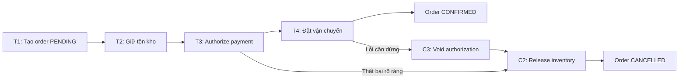
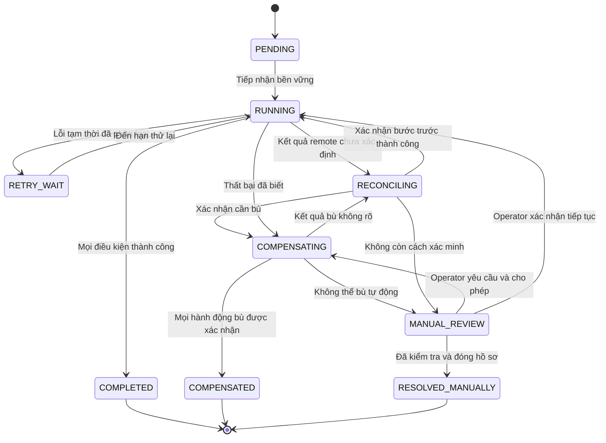
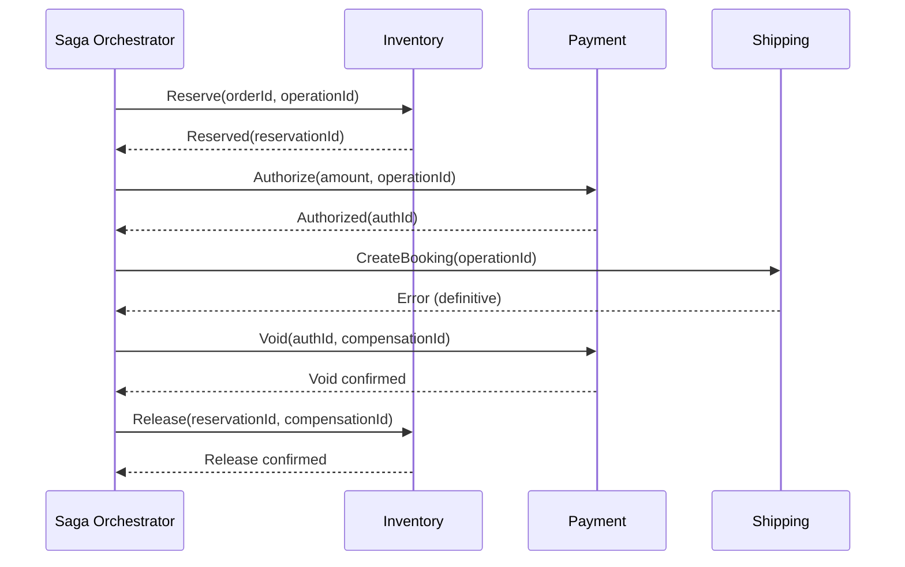
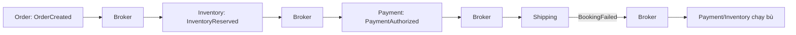

# Saga, hành động bù và giới hạn khôi phục tác vụ ngoài hệ thống

Một giao dịch đặt hàng hiếm khi nằm trọn trong một cơ sở dữ liệu. Ứng dụng Spring Boot có thể phải giữ hàng ở Inventory API, yêu cầu thanh toán qua Payment API, lưu đơn hàng vào PostgreSQL, phát sự kiện lên Kafka và đặt vận chuyển qua một đối tác HTTP. Mỗi hệ thống có trạng thái, timeout và cơ chế commit riêng. Nếu bước cuối lỗi, không có một câu lệnh `ROLLBACK` duy nhất làm tất cả các hành động trước đó biến mất.

**Saga** tổ chức quy trình thành những bước giao dịch cục bộ và những hành động xử lý khi một bước thất bại. Nhưng gọi một hành động “bù” không có nghĩa hành động gốc đã được đảo ngược hoàn toàn. Tiền đã chuyển có thể chỉ được hoàn bằng một giao dịch mới; email đã gửi không thể thu hồi khỏi hộp thư; hàng đã giao cho khách không thể tự quay về kho nhờ gọi API hủy vận chuyển. Với tác vụ ngoài hệ thống, nguy cơ lớn nhất đôi khi là **không biết kết quả đã xảy ra hay chưa** sau một lần timeout.

Bài này thuộc chương **Nhất quán và chống trùng** của mô-đun **SPRING_BOOT_INTEGRATION**, đặt Saga trong bối cảnh tích hợp Spring Boot qua HTTP client, cơ sở dữ liệu, cache, broker thông điệp và Spring Integration adapters. Trọng tâm là ranh giới giao dịch, hợp đồng dữ liệu, retry, idempotency, quản lý lỗi, quan sát và kiểm thử để có quy trình khôi phục thực tế.

## 1. Mục tiêu học tập

Sau bài này, bạn cần có thể:

1. Phân biệt **rollback của transaction cục bộ**, **compensation**, **retry**, **reconciliation** và **sửa sai thủ công**.
2. Mô hình hóa một Saga gồm các trạng thái, bước tiến, bước bù, thời hạn và nhánh cần can thiệp.
3. Lựa chọn giữa **orchestration** và **choreography**, chỉ ra điểm mạnh, giới hạn và trách nhiệm điều phối của từng cách.
4. Thiết kế **idempotency key**, **inbox/outbox**, optimistic locking và điều kiện chuyển trạng thái để chống chạy trùng.
5. Giải thích tại sao lỗi timeout từ hệ thống ngoài tạo kết quả **UNKNOWN**, không đồng nghĩa thất bại.
6. Chọn trình tự tác vụ nhằm trì hoãn hành động khó hoặc không thể bù đến khi đủ điều kiện.
7. Viết ví dụ Spring Boot cho luồng gọi HTTP, lưu state, phát sự kiện và yêu cầu bù bền vững.
8. Đưa ra giới hạn của khôi phục tự động, metric/SLA và các bài test lỗi ở từng điểm có thể crash.

## 2. Vì sao transaction cục bộ không giải quyết được nhiều dịch vụ?

Một transaction JDBC quản lý các thay đổi trên tài nguyên database có cùng transaction manager. Giả sử có:

```text
Order DB          Inventory API         Payment API          Shipping API
   |                    |                     |                     |
   |-- INSERT order --> |                     |                     |
   |-- local COMMIT --- |                     |                     |
   |------------------- reserve -------------->|                     |
   |---------------------------------------- charge ---------------->|
```

Sơ đồ này cố tình khái quát: mỗi hệ thống có cơ chế commit riêng. Khi `Order DB` commit, kết quả có thể đã bền vững tại đó dù Inventory API từ chối giữ hàng. Ngược lại, Payment API có thể đã thu tiền trước khi HTTP response bị mất.

Ví dụ lỗi khi cố dùng `@Transactional`:

```java
@Transactional
public void placeOrder(CreateOrderCommand command) {
    orderRepository.save(Order.pending(command));
    inventoryApi.reserve(command.orderId(), command.items());
    paymentApi.charge(command.paymentRequest());
    shippingApi.createShipment(command.shippingRequest());
}
```

Nếu `shippingApi.createShipment` ném exception, Spring có thể rollback thay đổi trong **Order DB**, nhưng điều đó không tự động trả hàng đã giữ hoặc hoàn tiền đã thu. Transaction database còn có thể giữ connection/lock trong suốt các lời gọi HTTP kéo dài. Nếu caller retry toàn bộ method, các side effect bên ngoài có thể xảy ra thêm lần nữa.

**Không nên suy luận** rằng đặt `@Transactional` bao quanh một chuỗi remote calls tạo ra distributed atomic transaction. Ngay cả khi có hỗ trợ transaction cho database và một broker, một API thanh toán bên thứ ba thường không tham gia vào cùng giao thức commit.

## 3. Saga là gì?

Saga là một chuỗi các **giao dịch cục bộ** và hành động tiếp theo, trong đó mỗi bước hoàn tất theo cơ chế của hệ thống sở hữu nó. Nếu không thể tiếp tục quy trình, Saga kích hoạt **các hành động bù** tương ứng với những tác động đã được ghi nhận.

Ví dụ:



Các nhánh bù chỉ hợp lệ khi trạng thái của hệ thống ngoài đã được xác định đủ rõ. Nếu Payment API timeout sau yêu cầu authorize, ứng dụng **không được giả định** chưa có authorization rồi chuyển thẳng sang hủy đơn hoàn tất; có thể cần truy vấn trạng thái giao dịch, chờ webhook hoặc đối soát.

Đặc tính cốt lõi:

- **Transaction cục bộ:** mỗi bước giữ tính toàn vẹn trên hệ thống của chính nó.
- **Progress bền vững:** kết quả từng bước và bước tiếp theo phải được lưu để restart vẫn biết làm gì.
- **Compensation theo nghiệp vụ:** gọi một thao tác mới để giảm hoặc xử lý tác động của bước trước.
- **Eventual consistency:** nhiều hệ thống đạt trạng thái nhất quán mong muốn sau một khoảng thời gian, có thể đi qua trạng thái trung gian.
- **Idempotency và reconciliation:** đảm bảo retry/replay không nhân side effect, và phát hiện sai lệch khi kết quả remote không rõ.

Saga **không bảo đảm atomic visibility** giữa các hệ thống, không ngăn mọi dirty read/semantic anomaly và không làm tác vụ vật lý trở nên có thể rollback.

## 4. Phân biệt sáu khái niệm dễ nhầm

| Khái niệm | Hành động | Khi nào áp dụng | Giới hạn |
|---|---|---|---|
| **Local rollback** | DB hủy những thay đổi chưa commit trong transaction hiện tại | SQLException trước DB commit | Không đảo ngược side effect HTTP đã thành công |
| **Retry** | Thử lại cùng thao tác | Lỗi tạm thời hoặc kết quả chưa chắc chắn, nếu an toàn | Có thể tạo side effect trùng nếu operation không idempotent |
| **Compensation** | Thực hiện hành động nghiệp vụ mới để xử lý tác động trước | Bước trước đã xảy ra và có hành động bù hợp lệ | Có thể không hoàn trả trạng thái ban đầu hoàn toàn |
| **Reconciliation** | Đối chiếu state nội bộ với state thực của đối tác | Timeout, callback mất, crash, lệch dữ liệu | Cần API truy vấn, báo cáo hoặc nguồn dữ liệu đáng tin |
| **Forward recovery** | Tiếp tục hoàn thành quy trình từ trạng thái đã có | Đã đạt một mốc không thể đảo ngược; nghiệp vụ cho phép | Có thể cần con đường thay thế hoặc thao tác thủ công |
| **Manual resolution** | Người vận hành xử lý sai lệch theo bằng chứng | API bù không có, hết hạn, kết quả tranh chấp | Cần audit, phân quyền và quy trình hậu kiểm |

Hai chiến lược chính khi có lỗi là **backward recovery** (bù những bước đã làm) và **forward recovery** (hoàn tất phần còn lại). Không phải mọi lỗi đều nên dẫn đến backward compensation; nếu hàng đã gửi và tiền đã thu, đôi khi hoàn tất giao hàng hoặc hỗ trợ khách mới là phương án đúng.

## 5. Tình huống xuyên suốt: quy trình đặt hàng

Giả sử Order Service nhận một lệnh đặt hàng hợp lệ và phải làm bốn việc:

1. Lưu order ở trạng thái `PENDING` trong PostgreSQL.
2. Gọi Inventory API để **reserve** hàng theo `orderId`.
3. Gọi Payment API để **authorize** khoản tiền. Việc authorize và capture được tách riêng nếu đối tác hỗ trợ.
4. Gọi Shipping API để tạo booking dự kiến; sau khi điều kiện xác nhận thỏa, chuyển order thành `CONFIRMED` và về sau mới cho phép dispatch.

Bảng khả năng bù:

| Bước tiến | Hành động bù dự kiến | Có trả về trạng thái ban đầu hoàn toàn? |
|---|---|---|
| Tạo order `PENDING` | Chuyển `CANCELLED`, giữ bản ghi audit | Không xóa dấu vết order đã được tạo |
| Inventory reserve | Release reservation đã xác nhận | Thường gần tương đương; phụ thuộc TTL, batch và reservation state |
| Payment authorize | Void/cancel authorization | Có thể hết hạn, bị capture hoặc phát sinh phí |
| Payment capture | Refund, điều chỉnh ledger | Không; refund là giao dịch mới, có độ trễ/phí và có thể thất bại |
| Create shipping booking | Cancel booking nếu còn cho phép | Có thể mất phí; khi đã pickup thì không hủy vận chuyển bằng API đơn giản |
| Gửi email/SMS | Gửi thông báo đính chính | Không thu hồi được nội dung bên nhận đã đọc |

Một quy trình thường cố gắng **trì hoãn tác vụ khó bù** cho đến sau những bước có thể hủy. Ví dụ authorize payment trước, capture sau; chuẩn bị booking trước, dispatch sau. Tuy nhiên không thể chọn thứ tự chỉ dựa trên độ dễ bù: tồn kho, quy định thanh toán và SLA đối tác có thể đặt ra ràng buộc khác.

### 5.1. Điều kiện nghiệp vụ (invariants)

Trước khi chọn Saga, ghi rõ các ràng buộc:

- Một `orderId` không được tạo hai lệnh charge độc lập do retry.
- Không xác nhận `PAID` khi chưa có bằng chứng payment đã capture/settled theo contract.
- Không phát lệnh dispatch khi không có reservation và trạng thái thanh toán hợp lệ.
- Khi đặt hàng bị hủy, phải có dấu vết release/void/refund hoặc một khoản nợ xử lý được theo dõi.
- Nếu đã dispatch, hệ thống không thể đơn giản gắn `CANCELLED` và coi mọi side effect biến mất.
- Mỗi side effect ngoài hệ thống phải có một **business operation ID** ổn định để truy vấn và chống trùng.

Saga state machine và test nên xuất phát từ invariants này, thay vì chỉ chia nhỏ code thành nhiều REST calls.

## 6. Thiết kế các trạng thái Saga minh bạch

Không nên chỉ có boolean `success` hoặc `failed`; nó không diễn tả được timeout hay đang hoàn trả tiền.

Ví dụ state machine:



Đây là mẫu tham khảo. Tên state tùy domain, nhưng phải phân biệt tối thiểu:

- **Intent persisted:** hệ thống đã ghi nhận kế hoạch gọi đối tác.
- **In flight:** yêu cầu có thể đã đến đối tác; chưa được phép khởi tạo operation khác với key mới.
- **Succeeded/failed chắc chắn:** có bằng chứng từ đối tác.
- **Unknown:** chỉ biết request thất bại từ góc nhìn caller, không biết side effect.
- **Compensation requested/in progress/confirmed:** bù cũng có lifecycle riêng.
- **Manual review:** tự động hóa đã đến giới hạn; vẫn còn nhiệm vụ phải hoàn tất.

Trạng thái order hiển thị cho khách (`PENDING_PAYMENT`, `CONFIRMED`, `CANCELLING`, `CANCELLED`...) có thể khác trạng thái điều phối Saga; cần ánh xạ rõ giữa hai thứ.

### 6.1. Bước trong Saga cũng cần trạng thái

Một Saga có thể ở `RECONCILING` vì duy nhất bước authorize payment chưa rõ. Bảng bước có thể có:

```text
step=RESERVE_INVENTORY
  operationId=reserve:O-101:v1
  state=SUCCEEDED
  remoteReference=reservation-884

step=AUTHORIZE_PAYMENT
  operationId=authorize:O-101:v1
  state=UNKNOWN
  remoteReference=<chưa biết>

step=CREATE_SHIPPING
  state=NOT_STARTED
```

Nếu toàn Saga chỉ lưu một cờ `FAILED`, khi restart worker có thể không biết phải release inventory, query payment hay hủy shipping. Lưu **trạng thái từng bước** giúp quyết định tiếp theo từ bằng chứng.

## 7. Orchestration và choreography

Hai phong cách Saga phổ biến:

### 7.1. Orchestration: một bộ điều phối ra quyết định



Orchestrator giữ state, quyết định bước tiếp theo, retry, bù và escalation. Nó có thể là code trong Spring Boot, một workflow engine hoặc một service điều phối chuyên trách.

**Ưu điểm:** thấy đầy đủ workflow, dễ giám sát state, xác định thứ tự compensation và kiểm thử quy tắc nghiệp vụ. **Đánh đổi:** orchestrator thành thành phần quan trọng, cần state bền vững, recovery worker, ownership và khả năng nâng version workflow đang chạy.

### 7.2. Choreography: các dịch vụ phản ứng với event



Mỗi participant nhận event và phát event tiếp, không cần một orchestrator gọi mọi bước. Phong cách này phù hợp luồng ít bước, domain events rõ và các dịch vụ có quyền quyết định cục bộ.

**Ưu điểm:** giảm coupling tới một bộ điều phối trung tâm; tận dụng broker. **Đánh đổi:** khó nhìn thấy toàn bộ quy trình, nguy cơ event loop hoặc nhiều dịch vụ cùng bù, khó xử lý timeout khi “không có event nào đến”, khó quản lý version/ownership.

### 7.3. Chọn kiểu nào?

| Tiêu chí | Orchestration | Choreography |
|---|---|---|
| Quy trình nhiều nhánh và timeout | Dễ biểu diễn tập trung | Cần thiết kế correlation, timers và ownership chặt |
| Quan sát một instance Saga | State ở coordinator | Phải tổng hợp từ nhiều event logs |
| Thay đổi quy tắc nghiệp vụ | Chủ yếu tại orchestrator | Có thể tác động nhiều participants |
| Coupling | Phụ thuộc giao thức gọi/command của participants | Phụ thuộc event contracts và semantics |
| Compensation phối hợp | Coordinator quyết định thứ tự | Phải có chủ thể chịu trách nhiệm tránh trùng |
| Khả năng phục hồi | Coordinator phải durable và restart-safe | Mỗi participant + broker đều phải idempotent/durable |

Có thể **kết hợp**: một orchestrator lưu state và gửi command qua Kafka/RabbitMQ, trong khi các participant xử lý cục bộ và phản hồi bằng events. Không nên cho rằng orchestration bắt buộc dùng HTTP hay choreography bắt buộc dùng Kafka.

## 8. Local transaction, outbox và inbox trong Saga

Saga không loại bỏ nhu cầu transaction; mỗi bước phải được ghi nhận bền vững.

### 8.1. Transactional outbox

Khi Order DB cần lưu order và phát command `ReserveInventory`, không nên:

```java
orderRepository.save(order);
kafkaTemplate.send("reserve-inventory", command); // Có thể fail sau DB commit.
```

Ngay cả khi method mang `@Transactional`, transaction DB và broker send không tự đồng nhất. Cửa sổ crash có thể khiến order tồn tại nhưng không có command, hoặc command đã đến broker rồi DB rollback.

Outbox ghi cả order và intent phát command trong **một local SQL transaction**:

```text
BEGIN DB transaction
  INSERT order(state=PENDING)
  INSERT saga_instance(state=RUNNING)
  INSERT outbox_message(eventId=evt-100, type=ReserveInventory, ...)
COMMIT

Publisher:
  đọc outbox chưa publish
  publish command bằng eventId ổn định
  nhận xác nhận từ broker
  đánh dấu outbox đã publish
```

Nếu publisher crash sau broker đã nhận nhưng trước khi đánh dấu outbox, command có thể được phát lại. Vì thế participant cần inbox hoặc operation idempotency.

### 8.2. Inbox tại participant

Inventory consumer có thể nhận cùng `ReserveInventory` nhiều lần. Trong **cùng database transaction** với xử lý nghiệp vụ, nó ghi:

```sql
CREATE TABLE processed_commands (
    consumer_name VARCHAR(100) NOT NULL,
    command_id VARCHAR(160) NOT NULL,
    processed_at TIMESTAMPTZ NOT NULL DEFAULT CURRENT_TIMESTAMP,
    PRIMARY KEY (consumer_name, command_id)
);
```

Nếu lệnh đã xử lý, participant trả/công bố lại kết quả đã lưu hoặc chấp nhận duplicate mà không reserve lần nữa. Nếu bước tạo reservation có tác động qua API ngoài thay vì cùng DB, inbox riêng **không đủ** để bảo đảm atomically chống duplicate; phải dùng idempotency key tại API, query trạng thái hoặc workflow bên ngoài tương ứng.

### 8.3. Outbox/inbox không xóa hoàn toàn duplicate

| Kỹ thuật | Giải quyết tốt | Không tự giải quyết |
|---|---|---|
| Outbox | DB commit cùng ý định publish | Broker message có thể nhận nhiều lần |
| Inbox + unique constraint | Chặn xử lý lại trong một DB transaction | Side effect HTTP ngoài transaction có thể vẫn bị lặp |
| Idempotency key phía đối tác | Giảm duplicate operation khi request được thử lại | Đối tác phải hỗ trợ và duy trì kết quả theo key |
| Broker transaction | Ranh giới atomic trong phạm vi broker được hỗ trợ | Transaction SQL + HTTP ngoài broker |
| Saga compensation | Xử lý tác động đã xảy ra khi workflow không thể tiếp tục | Không đảo ngược lịch sử hay tác vụ vật lý |

## 9. Idempotency key cho từng bước tiến và bước bù

Với order `O-101`, mỗi operation cần key riêng và ổn định:

```text
reserve inventory:  reserve:O-101:revision-1
release inventory:  release:O-101:revision-1
authorize payment:  authorize:O-101:revision-1
void payment:       void:O-101:revision-1
create booking:     booking:O-101:revision-1
cancel booking:     cancel-booking:O-101:revision-1
```

**Không** dùng cùng key cho `authorize` và `void` chỉ vì cùng order; đó là hai operation khác nhau. **Không** tạo random UUID mới ở mỗi lần retry; đối tác sẽ thấy nhiều request độc lập.

Nếu một order cho phép thao tác nhiều lần hợp lệ, thêm `revision` hoặc một `operationId` được tạo **một lần khi nghiệp vụ tạo ý định mới**, lưu bền vững rồi tái sử dụng. Không tự đặt key bằng timestamp của mỗi attempt.

### 9.1. Hợp đồng idempotency phải có ngữ nghĩa

Đối tác cần định nghĩa:

- Key có phạm vi theo merchant/account/endpoint hay toàn bộ API?
- Thời hạn ghi nhớ key và kết quả là bao lâu?
- Cùng key nhưng payload khác trả lỗi hay thay đổi yêu cầu?
- Retry cùng key khi request đầu đang xử lý trả gì: `IN_PROGRESS`, `409`, `202` hay kết quả cũ?
- Khi response bị mất, có endpoint `GET by operationId`/`GET by clientReference` không?
- Key cho void/refund có chống tạo hai khoản hoàn riêng biệt không?

Header `Idempotency-Key` **không tự biến API thành idempotent** nếu bên nhận không thi hành hợp đồng. Với một API không hỗ trợ, ứng dụng chỉ có thể giảm rủi ro bằng giới hạn retry, tìm kiếm theo reference, callback/đối soát và can thiệp thủ công; không thể tự chứng minh exactly once.

## 10. Cửa sổ lỗi quan trọng nhất: timeout có kết quả không xác định

Giả sử Payment API nhận lệnh authorize:

```mermaid
sequenceDiagram
    participant O as Order Saga
    participant P as Payment API
    O->>P: POST /authorizations, key=authorize:O-101
    P->>P: Lưu authorization thành công
    Note over O,P: Response bị mất do mạng
    O--xP: Client timeout
    Note over O: Chỉ biết timeout; remote state = UNKNOWN
```

**Client timeout không chứng minh Payment API đã rollback hoặc chưa thực thi.** Có ít nhất ba trạng thái thực tế:

1. Request chưa đến đối tác; không có authorization.
2. Request đến, đối tác xử lý thành công nhưng response mất.
3. Request đến, đối tác vẫn đang xử lý hoặc kết thúc thất bại.

Nếu ngay lập tức gọi `authorize` với key mới, có nguy cơ giữ tiền hai lần. Nếu lập tức bù `void` mà không có reference, API có thể không biết void gì hoặc void sai authorization.

Hành vi an toàn:

```text
POST authorize timeout
    -> persist step = UNKNOWN, giữ nguyên operationId
    -> query payment by operationId/clientReference
    -> nếu biết SUCCEEDED: lưu authId, tiếp tục hoặc void theo quyết định Saga
    -> nếu biết FAILED/NOT_FOUND một cách đáng tin: retry cùng key hoặc bù bước trước
    -> nếu còn PENDING/UNKNOWN: backoff, chờ webhook/đối soát
    -> quá deadline/không đủ bằng chứng: MANUAL_REVIEW
```

`NOT_FOUND` không luôn có nghĩa “chưa từng thực thi”: có thể API dùng eventual consistency hoặc lookup chưa cập nhật. Hợp đồng đối tác phải nêu khi nào một kết quả NOT_FOUND là xác nhận chắc chắn.

## 11. Hành động bù là giao dịch nghiệp vụ mới

Compensation thường phải **ghi thêm** một sự kiện hoặc giao dịch mới:

```text
Payment authorization A-77: AUTHORIZED
Void request V-88: VOID_REQUESTED
Void confirmed: VOIDED

hoặc nếu đã CAPTURED:
Payment capture C-99: CAPTURED
Refund request R-10: REFUND_REQUESTED
Refund settled: REFUNDED
```

Không xóa bản ghi authorization/capture cũ khỏi audit trail. Hệ thống kế toán cần thấy cả giao dịch ban đầu và giao dịch hoàn/bù.

### 11.1. Bù không phải hàm toán học đảo ngược

Nếu `T` là tác vụ ngoài và `C` là compensation, thường **không thể đảm bảo**:

\[
C(T(s)) = s
\]

với mọi trạng thái `s`. Ví dụ sau khi gửi email, một email xin lỗi không xóa email đầu; sau capture và refund, tiền có thể về khách trễ và phí giao dịch vẫn tồn tại.

Mục tiêu thực tế là đưa hệ thống đến một **trạng thái nghiệp vụ chấp nhận được**, có bằng chứng đầy đủ và ghi nhận phần tổn thất hoặc nghĩa vụ còn lại. Vì vậy Saga cần mô hình **compensation outcome** và không được chỉ gán một cờ `ROLLED_BACK=true`.

### 11.2. Phân loại khả năng bù

| Loại tác vụ | Ví dụ | Chiến lược |
|---|---|---|
| **Có thể hoàn tác gần đầy đủ** | Reserve rồi release tồn kho chưa xuất | Bù idempotent, xác minh reservation state |
| **Có thể xử lý bằng giao dịch đối ứng** | Capture rồi refund | Theo dõi tiền về, phí và thời hạn settlement |
| **Có thể bù có điều kiện** | Hủy vận đơn trước pickup | Kiểm tra cutoff/booking status trước cancel |
| **Không thể đảo ngược** | Giao hàng, email đã gửi, SMS OTP đã nhận | Forward recovery, hỗ trợ nghiệp vụ, ghi dấu và xử lý thủ công |
| **Không rõ trạng thái** | HTTP timeout, mất webhook | Reconciliation trước khi quyết định bù |

## 12. Thứ tự compensation và phụ thuộc giữa các bước

Một nguyên tắc khởi đầu là bù **theo thứ tự ngược lại** các bước đã hoàn thành:

```text
Forward:
  reserve inventory -> authorize payment -> create booking

Backward khi booking thất bại rõ:
  void payment authorization -> release inventory
```

Tuy nhiên reverse order chỉ đúng nếu dependency/business invariants cho phép. Ví dụ có thể cần giữ reservation cho tới khi xác định payment không còn charge đang treo; hoặc shipping booking đã tạo thành công nhưng chưa nhận reply, nên phải query/cancel shipping trước khi void/release.

### 12.1. Chỉ bù những bước chắc chắn đã xảy ra

Không gọi `releaseReservation` nếu chưa hề biết reservation có tồn tại, trừ khi API quy định release-by-operationId idempotent và an toàn ngay cả khi reservation chưa được tạo. Không phát refund dựa trên suy đoán đã charge. Hành động bù phải có:

- Bằng chứng mục tiêu: `reservationId`, `authorizationId`, `chargeId` hoặc operation reference ổn định.
- Precondition: trạng thái nào còn được phép cancel/void/refund.
- Idempotency key riêng của compensation.
- Expected outcome và cách xác minh đã hoàn tất.
- Thời hạn, retry policy và nhánh xử lý khi không thể bù.

### 12.2. Parallel steps phải dùng dependency graph

Nếu Inventory reserve và kiểm tra chống gian lận chạy song song, không tồn tại “thứ tự ngược” duy nhất. Hãy xác định dependency graph: một compensation có thể được thực hiện song song với compensation khác chỉ khi không phá invariant. Khi một bước đã đạt mốc irreversible, phải chuyển sang xử lý phù hợp thay vì máy móc chạy mọi bước bù.

## 13. Giới hạn khôi phục đối với tác vụ ngoài hệ thống

Không phải API nào cũng có thao tác bù. Ngay cả API có endpoint cancel/refund, quyền và thời gian bù có thể bị giới hạn.

| Giới hạn | Ví dụ | Hệ quả với Saga |
|---|---|---|
| **Không có API đối ứng** | Email/SMS đã gửi | Chỉ có thể đính chính, thông báo hoặc hỗ trợ |
| **Cutoff time** | Shipping đã pickup | Không thể dùng cancel booking để trả hàng về kho |
| **Phí và độ trễ settlement** | Refund thẻ mất nhiều ngày | Order cần trạng thái `REFUND_PENDING`, không báo hoàn tiền ngay |
| **Idempotency TTL ngắn** | Đối tác quên key sau 24 giờ | Retry muộn có thể tạo giao dịch mới; cần query/reconcile |
| **API lookup hạn chế** | Không tìm được payment theo client reference | Trạng thái UNKNOWN có thể cần manual reconciliation |
| **Rate limit/quota** | Refund API bị throttling | Backoff, queue, SLA riêng cho bù |
| **Quy định pháp lý/kế toán** | Không được xóa ledger/transaction | Bù bằng chứng từ giao dịch mới và audit |
| **Con người can thiệp** | Đơn đã đóng gói/chuyển phát | Cần workflow thủ công và xác nhận |
| **Khác biệt eventual consistency** | API báo success nhưng status query còn pending | Không kết luận sai từ một lần GET |
| **Phụ thuộc cascading** | Hủy vận chuyển buộc cập nhật bảo hiểm | Compensation có thể là một workflow riêng |

Hạn chế thường bị bỏ quên: **một API bù cũng có thể timeout sau khi đã thực hiện thành công**. Khi đó Saga không thể chỉ retry bù với key mới. Compensation cần cơ chế lưu intent, key ổn định, trạng thái UNKNOWN và reconciliation y như bước tiến.

## 14. Thiết kế hợp đồng với đối tác trước khi viết Saga

Với mỗi API ngoài, đặt các câu hỏi:

| Chủ đề | Câu hỏi |
|---|---|
| Tạo operation | Client có được cung cấp `operationId`/`merchantReference` ổn định không? |
| Idempotency | Cùng key + cùng payload nhiều lần có trả cùng logical result không? |
| Trạng thái | Có API tra cứu bằng client reference không? Có webhook/callback không? |
| Bù | Có cancel/void/refund/release không, precondition và deadline ra sao? |
| Kết quả | Response `200`/`202`/`409` biểu thị “hoàn tất”, “đã nhận” hay “đang xử lý”? |
| Lỗi | Status/code nào retry được? Timeout có thể xảy ra sau side effect không? |
| Tần suất | Quota, throttling, `Retry-After`, yêu cầu backoff nào? |
| Bảo mật | Scope API, mTLS/token rotation, dữ liệu nào được log? |
| Đối soát | Báo cáo ngày, query theo reference, SLA dispute/chargeback như thế nào? |
| Giữ dữ liệu | Key TTL, retention của lịch sử giao dịch, cổng hỗ trợ khi quá hạn |

Nếu nhà cung cấp không hỗ trợ key/idempotent query, **ghi nhận rủi ro rõ ràng**. Đừng ghi “exactly once” trong tài liệu chỉ vì ứng dụng có inbox table.

## 15. Độ bền của điều phối: lưu state trước khi gọi remote

Trong orchestrated Saga, mỗi command gửi ra ngoài cần có **ý định đã lưu**:

```text
1. DB transaction:
   - chọn Saga đã sẵn sàng bước AUTHORIZE_PAYMENT
   - lưu operationId / requestHash / state=IN_FLIGHT
   - COMMIT

2. Ngoài DB transaction:
   - POST Payment API (Idempotency-Key=operationId)

3. DB transaction:
   - lưu remoteReference, result=SUCCEEDED hoặc UNKNOWN
   - cập nhật Saga state, bước tiếp theo và outbox event
   - COMMIT
```

Không để việc ghi `IN_FLIGHT` và gửi HTTP nằm trong một SQL transaction mở lâu. Khi crash giữa 1 và 2, worker có thể thử lại với **cùng key**; khi crash giữa 2 và 3, worker truy vấn hoặc thử lại idempotent. Điều này biến các cửa sổ lỗi thành trạng thái có thể quản lý được.

### 15.1. Persist intent chưa có nghĩa remote chưa được gọi

Sau crash, nhìn thấy `IN_FLIGHT` không nói được request đã đến đối tác hay chưa. Recovery worker không được tự suy ra “chưa gọi” từ việc không có `remoteReference`. Trạng thái đúng là **có thể đã xảy ra**; phải dựa vào operationId, idempotency contract và reconciliation.

### 15.2. Cần chống nhiều worker cùng sở hữu một bước

Hai worker có thể đọc cùng một Saga khi scale ngang. Dùng atomic claim/lease, optimistic locking/version hoặc database locking phù hợp. Ví dụ cần bảo đảm chỉ một transition hợp lệ tại một thời điểm; tuy vậy **lease hết hạn không chứng minh side effect của worker cũ đã dừng**. Bởi vậy cần cả:

- CAS/version hoặc fencing token để một worker cũ không ghi đè Saga state mới.
- Operation ID ổn định để hai attempts cùng hướng về một logical side effect ở đối tác.
- Reconciliation khi một attempt bị chậm hoặc response đến sau.

Không khóa một DB row suốt thời gian gọi HTTP chỉ để ngăn chạy trùng: giải pháp đó có thể gây nghẽn pool, lock timeout và vẫn không bảo vệ được sau crash.

## 16. Mô hình dữ liệu Saga bằng PostgreSQL

Một triển khai nhỏ có thể bắt đầu với bảng Saga, bảng operations và outbox. Đây là schema **minh họa**; hệ thống thật cần thêm migration, index, constraints, retention và thiết kế phân vùng phù hợp.

```sql
CREATE TABLE order_sagas (
    saga_id       UUID PRIMARY KEY,
    order_id      VARCHAR(100) NOT NULL UNIQUE,
    state         VARCHAR(40) NOT NULL,
    current_step  VARCHAR(80) NOT NULL,
    version       BIGINT NOT NULL DEFAULT 0,
    last_error    VARCHAR(500),
    created_at    TIMESTAMPTZ NOT NULL DEFAULT now(),
    updated_at    TIMESTAMPTZ NOT NULL DEFAULT now()
);

CREATE TABLE saga_operations (
    saga_id          UUID NOT NULL REFERENCES order_sagas(saga_id),
    step_name        VARCHAR(80) NOT NULL,
    operation_id     VARCHAR(160) NOT NULL UNIQUE,
    direction        VARCHAR(15) NOT NULL, -- FORWARD / COMPENSATE
    state            VARCHAR(40) NOT NULL, -- PENDING / IN_FLIGHT / UNKNOWN / ...
    request_hash     VARCHAR(100) NOT NULL,
    remote_reference VARCHAR(180),
    attempt_count    INT NOT NULL DEFAULT 0,
    next_attempt_at  TIMESTAMPTZ,
    lease_until      TIMESTAMPTZ,
    last_error_code  VARCHAR(100),
    updated_at       TIMESTAMPTZ NOT NULL DEFAULT now(),
    PRIMARY KEY (saga_id, step_name, direction)
);

CREATE TABLE saga_outbox (
    message_id     UUID PRIMARY KEY,
    saga_id        UUID NOT NULL REFERENCES order_sagas(saga_id),
    event_type     VARCHAR(100) NOT NULL,
    payload_json   JSONB NOT NULL,
    published_at   TIMESTAMPTZ,
    created_at     TIMESTAMPTZ NOT NULL DEFAULT now()
);

CREATE INDEX idx_saga_operations_due
    ON saga_operations(state, next_attempt_at);

CREATE INDEX idx_saga_outbox_unpublished
    ON saga_outbox(created_at)
    WHERE published_at IS NULL;
```

Giải thích các trường thiết yếu:

| Trường | Công dụng |
|---|---|
| `saga_id` | Định danh một workflow instance, không thay thế `orderId` |
| `state` | Trạng thái tổng thể, không được suy ra chỉ từ HTTP status cuối |
| `current_step` | Bước đang xét, phù hợp điều phối tuần tự; flow phức tạp có thể cần dependency graph |
| `version` | Optimistic locking/CAS để chặn transition cạnh tranh |
| `operation_id` | Key ổn định gửi tới upstream và dùng để reconcile |
| `request_hash` | Phát hiện cùng key bị dùng lại với payload khác |
| `remote_reference` | Mã xác nhận do upstream cấp, phục vụ hủy/void/refund |
| `attempt_count`/`next_attempt_at` | Thử lại có giới hạn, tránh retry nóng |
| `lease_until` | Phát hiện worker đang giữ bước nhưng mất tiến độ; không phải bằng chứng remote chưa chạy |
| `published_at` | Theo dõi outbox đã được broker xác nhận theo chính sách publish |

Ràng buộc `UNIQUE(order_id)` chỉ là **ví dụ** cho use case một Saga tạo đơn. Nếu một order có nhiều Saga hợp lệ (thanh toán, đổi trả, hoàn tiền) thì cần thêm `saga_type`, `business_operation_id` và uniqueness theo quy tắc nghiệp vụ thật.

### 16.1. Atomic claim cho worker

Đối với PostgreSQL, có thể claim một operation sắp chạy bằng điều kiện tại database:

```sql
UPDATE saga_operations
SET state = 'IN_FLIGHT',
    attempt_count = attempt_count + 1,
    lease_until = now() + interval '45 seconds',
    updated_at = now()
WHERE saga_id = :sagaId
  AND step_name = :stepName
  AND direction = :direction
  AND (
        state = 'PENDING'
        OR (state = 'RETRY_WAIT' AND next_attempt_at <= now())
        OR (state = 'IN_FLIGHT' AND lease_until < now())
      )
RETURNING operation_id, request_hash, attempt_count;
```

Đây là ví dụ về **atomic claim**, cần thực hiện trong một local transaction và commit trước khi gọi HTTP. Với state `UNKNOWN`, ưu tiên một nhánh **reconciliation riêng** thay vì cho câu claim này tự động gửi lại thao tác. Khi lease hết hạn, worker mới có thể tiếp quản; nó phải dùng lại `operation_id` gốc.

Ở workload lớn, có thể kết hợp `SELECT ... FOR UPDATE SKIP LOCKED` để chọn nhiều công việc đến hạn và tránh tranh chấp, nhưng vẫn cần predicate, version và idempotency. Nếu response của worker cũ đến muộn, câu lệnh ghi kết quả cần CAS bằng `version`/attempt ownership hoặc điều kiện trạng thái hợp lệ; không để kết quả cũ ghi đè state mới.

### 16.2. Chuyển trạng thái có điều kiện

Một cập nhật Saga không nên kiểu “đọc rồi ghi bất kỳ state nào”:

```sql
UPDATE order_sagas
SET state = 'RUNNING',
    current_step = 'CREATE_SHIPPING',
    version = version + 1,
    updated_at = now()
WHERE saga_id = :sagaId
  AND version = :expectedVersion
  AND state = 'RUNNING'
  AND current_step = 'AUTHORIZE_PAYMENT';
```

Nếu số dòng cập nhật là `0`, phải đọc lại trạng thái và quyết định xem đây là duplicate callback, cạnh tranh hợp lệ hay lỗi nhất quán. Không tự retry ghi đè vô hạn.

Lưu step result, Saga transition và outbox event trong **cùng local transaction** để không có trạng thái “payment đã ghi nhận thành công nhưng không có lệnh shipping tiếp theo”.

## 17. Ví dụ Spring Boot: điều phối một bước HTTP có kết quả không chắc chắn

Phần này tập trung vào **ranh giới transaction và quyết định recovery**, không tạo một framework Saga hoàn chỉnh trong vài dòng. Các lớp `SagaWorkStore`, `PaymentApi`, `PaymentAuthorization` là contract ứng dụng cần triển khai và kiểm thử.

### 17.1. API contract cho Payment

```java
public interface PaymentApi {

    PaymentAuthorization authorize(
        String orderId,
        long amountMinor,
        String currency,
        String idempotencyKey
    );

    PaymentStatus findByOperationId(String operationId);

    VoidResult voidAuthorization(
        String authorizationId,
        String idempotencyKey
    );
}

public record PaymentAuthorization(
    String authorizationId,
    String status
) {}

public record PaymentStatus(
    String status,          // AUTHORIZED / DECLINED / PENDING / UNKNOWN
    String authorizationId
) {}

public record VoidResult(
    String status           // VOIDED / PENDING / NOT_ALLOWED ...
) {}
```

Các kiểu được trình bày cạnh nhau để minh họa. Khi viết Java source thật, mỗi `public` top-level type cần file tương ứng. Các trạng thái phải được ánh xạ theo tài liệu đối tác; `HTTP 200` chưa chắc là `AUTHORIZED`, và `HTTP 202` có thể chỉ biểu thị request đã được tiếp nhận.

### 17.2. Một worker gọi remote ngoài DB transaction

```java
import java.util.UUID;
import org.springframework.stereotype.Service;
import org.springframework.web.client.ResourceAccessException;

@Service
public class PaymentSagaWorker {

    private final SagaWorkStore store;
    private final PaymentApi paymentApi;

    public PaymentSagaWorker(
            SagaWorkStore store,
            PaymentApi paymentApi) {
        this.store = store;
        this.paymentApi = paymentApi;
    }

    public void executeAuthorization(UUID sagaId) {
        var claimed = store.claimAuthorization(sagaId);
        if (claimed.isEmpty()) {
            return; // Đã có worker khác hoặc chưa đến hạn.
        }
        var work = claimed.get();

        try {
            var result = paymentApi.authorize(
                work.orderId(),
                work.amountMinor(),
                work.currency(),
                work.operationId() // Giữ nguyên qua mọi attempt.
            );

            if ("AUTHORIZED".equals(result.status())) {
                store.completeAuthorization(
                    work, result.authorizationId());
            } else if ("DECLINED".equals(result.status())) {
                store.recordDefinitiveRejection(work, "DECLINED");
            } else {
                store.recordUnknown(work, "REMOTE_PENDING");
            }
        } catch (ResourceAccessException ex) {
            // Timeout/connection error: không suy ra remote rollback.
            store.recordUnknown(work, "TRANSPORT_UNCERTAIN");
        } catch (DefinitivePaymentRejection ex) {
            // Chỉ dùng nếu contract khẳng định chưa có side effect.
            store.recordDefinitiveRejection(work, ex.errorCode());
        }
    }
}
```

`SagaWorkStore` cần cung cấp các method tương ứng, ví dụ `claimAuthorization`, `completeAuthorization`, `recordUnknown` và `recordDefinitiveRejection`. Mỗi method thực hiện **local DB transaction** ở bean riêng, với conditional update/CAS, lưu step result và tạo outbox message theo transition. `DefinitivePaymentRejection` là kiểu exception domain do adapter phân loại theo hợp đồng đối tác. Đây là code minh họa thiết kế, chưa là project biên dịch độc lập nếu chưa bổ sung DTO/store/adapter.

Những nguyên tắc quan trọng hơn cú pháp:

1. Sau `claimAuthorization`, local transaction phải **commit xong trước** khi gọi Payment API.
2. Sau HTTP success, `completeAuthorization` ghi kết quả, chuyển state và tạo outbox trong một transaction.
3. Sau timeout, `recordUnknown` giữ nguyên operation ID; worker sẽ **reconcile**, không ngầm phát request với key mới.
4. Nếu process crash **trước** `recordUnknown` hoặc `completeAuthorization`, lease và recovery scanner vẫn phải phát hiện `IN_FLIGHT` quá hạn, rồi xác minh kết quả tại Payment.
5. Nếu response đến muộn sau khi instance khác đã tiến Saga, record result phải được guard bằng expected state/version, tránh đảo ngược trạng thái mới.

### 17.3. Reconciler riêng cho UNKNOWN

```java
@Service
public class PaymentReconciler {

    private final SagaWorkStore store;
    private final PaymentApi paymentApi;

    public PaymentReconciler(
            SagaWorkStore store,
            PaymentApi paymentApi) {
        this.store = store;
        this.paymentApi = paymentApi;
    }

    public void reconcile(UUID sagaId) {
        var pending = store.findAuthorizationRequiringReconcile(sagaId);
        if (pending.isEmpty()) {
            return;
        }

        var work = pending.get();
        try {
            var status = paymentApi.findByOperationId(
                work.operationId());
            switch (status.status()) {
                case "AUTHORIZED" ->
                    store.completeAuthorization(
                        work, status.authorizationId());
                case "DECLINED" ->
                    store.recordDefinitiveRejection(
                        work, "REMOTE_DECLINED");
                case "PENDING", "UNKNOWN" ->
                    store.scheduleReconciliation(work);
                default ->
                    store.scheduleManualReview(
                        work, "UNKNOWN_REMOTE_STATUS");
            }
        } catch (ResourceAccessException ex) {
            store.scheduleReconciliation(work);
        }
    }
}
```

Với `NOT_FOUND`, đừng vội coi là rejected: cần có quy định của đối tác về tính nhất quán và thời gian mà lookup trở nên đáng tin. Nếu đối tác không cung cấp query by operation ID, reconciler có thể cần webhook được xác minh, báo cáo settlement, batch đối soát hoặc manual review.

### 17.4. Vì sao không gọi tất cả từ một phương thức `@Transactional`?

`@Transactional` quanh `executeAuthorization` sẽ giữ DB transaction mở trong lúc chờ HTTP; rollback sau timeout không hủy side effect Payment. Đặt transaction ở **store methods trong bean riêng** giúp commit rõ từng mốc. Nếu dùng self-invocation của method `@Transactional` trong cùng bean, phải hiểu Spring AOP proxy để tránh transaction annotation không được áp dụng như kỳ vọng.

## 18. Triển khai compensation như một workflow có trạng thái

Khi Shipping API từ chối booking chắc chắn sau khi payment đã authorize, Saga cần void authorization. **Không** chỉ gọi `paymentApi.void(...)` trong `catch` rồi gắn `CANCELLED`.

Mô hình:

```text
Saga state=COMPENSATING
  step VOID_PAYMENT:
    operationId=void:O-101:revision-1
    targetAuthorizationId=auth-77
    state=PENDING

Worker claim -> IN_FLIGHT
  -> POST /authorizations/auth-77/void
  -> response VOIDED:
       ghi step SUCCEEDED
       tạo intent RELEASE_INVENTORY
  -> timeout:
       ghi UNKNOWN
       lookup void state hoặc payment status
  -> remote says NOT_ALLOWED (already captured):
       chuyển sang REFUND workflow hoặc MANUAL_REVIEW
```

### 18.1. Không dùng compensation state chung cho mọi bước

Một Saga có thể có trạng thái:

```text
VOID_PAYMENT        SUCCEEDED
RELEASE_INVENTORY   UNKNOWN
ORDER_CANCEL        PENDING
```

Lúc đó **chưa thể** tuyên bố `COMPENSATED` vì release inventory chưa được xác nhận. Nếu UI cần cho khách biết đặt hàng không tiếp tục được, có thể dùng `CANCELLING` kèm thông tin xử lý nội bộ, không che giấu tồn đọng bù.

### 18.2. Bù có thể được thử lại

Ví dụ HTTP call `void` timeout. Nếu đối tác hỗ trợ key ổn định và query, thử lại hoặc reconcile phải dùng **cùng compensation operation ID**. Việc bù thất bại không nhất thiết là thất bại vĩnh viễn: có thể rate limited, chờ window mới hoặc cần operator xử lý do trạng thái remote đã đổi.

### 18.3. Bù thất bại sau khi một phần đã hoàn tất

Nếu void payment thành công nhưng release inventory fail, Saga tiếp tục ở `COMPENSATING`/`RECONCILING`, ghi rõ phần nào còn nợ. Trường hợp ngược lại cũng cần có trace. Thử lại toàn bộ chuỗi compensation từ đầu chỉ an toàn khi từng hành động bù idempotent và status tracking đúng.

## 19. Lựa chọn backward recovery hay forward recovery

Một Saga thường không cần bù khi vẫn có đường tiến hợp lệ:

| Tình huống | Hướng xử lý có thể phù hợp | Lý do |
|---|---|---|
| Inventory reserve thất bại rõ, chưa authorize payment | Dừng và hủy order | Ít side effects; chưa có tiền |
| Payment authorize timeout | Reconcile/tiếp tục hoặc bù sau khi biết trạng thái | Kết quả chưa chắc |
| Shipping booking tạm lỗi, order chưa giao | Retry booking hoặc đổi nhà vận chuyển | Có thể hoàn tất hợp đồng |
| Payment capture thành công, booking lỗi kéo dài | Refund hoặc đổi phương án fulfilment theo SLA | Cần quyết định nghiệp vụ |
| Hàng đã pickup, khách yêu cầu hủy | Return/refund workflow mới | Không thể đảo ngược dispatch |
| Email thông báo gửi trước khi order hoàn tất | Thông báo đính chính/hỗ trợ | Không thể thu hồi email đã đọc |

Một Saga thành công có thể bao gồm **chuyển sang phương án thay thế** (ví dụ booking carrier B khi carrier A không khả dụng), miễn là hợp đồng, deadline, chi phí và quyền hạn cho phép. Hệ thống không phải luôn cố “quay lại điểm xuất phát”.

### 19.1. Pivot transaction và điểm không thể quay lại

Trong nhiều mô hình Saga, có thể phân các bước thành:

- **Compensatable:** nếu bước sau không được, có hành động bù hợp lệ.
- **Pivot:** mốc nghiệp vụ khó hoặc không thể hủy; sau đó chủ yếu hướng đến hoàn tất.
- **Retryable:** các bước sau pivot được thiết kế để có thể tiếp tục/retry đến kết quả cuối theo chính sách.

Ví dụ dispatch thực tế có thể là pivot. Sau khi carrier nhận hàng, Saga “cancel đơn” đơn giản không còn hợp lệ; cần một workflow return/refund mới. Phân loại này hữu ích cho thiết kế, nhưng không tự động chứng minh mọi tác vụ sau pivot **chắc chắn** thành công: vẫn có thể cần con người, lịch hẹn mới hoặc bồi thường.

## 20. Timeout, deadline, retry budget và backoff

Mỗi bước cần ít nhất ba nhóm thời hạn:

1. **Attempt timeout:** giới hạn một lần gọi remote.
2. **Step deadline:** thời gian tối đa để hoàn tất hoặc xác minh một bước.
3. **Saga/business deadline:** mốc nghiệp vụ mà nếu quá hạn phải chuyển trạng thái, ví dụ giữ hàng tối đa 15 phút.

```text
Inventory reservation TTL: 15 phút
Payment authorization step deadline: 2 phút
Shipping booking deadline: 5 phút
Saga confirmation deadline: 12 phút

Attempt #1 timeout: 3 giây
Retry schedule: exponential backoff + jitter
Reconcile: kiểm tra định kỳ theo API contract
Sau deadline: có quyết định bù/forward/manual rõ ràng
```

Đây là số minh họa. Không có một timeout áp dụng cho mọi đối tác hoặc phương thức; timeout gửi yêu cầu và thời gian xử lý thực ở remote có thể khác nhau.

### 20.1. Retry sau kết quả không rõ phải cẩn trọng

Phân biệt:

| Loại lỗi | Retry thao tác tiến? | Lý do |
|---|---|---|
| Không mở được TCP connection, request chắc chắn chưa gửi | Có thể retry | Không có bằng chứng remote side effect; vẫn dùng cùng operation ID |
| Read timeout sau khi request được gửi | Chỉ nếu có idempotency hoặc đã reconcile | Remote có thể đã hoàn thành |
| HTTP 429/503 | Có thể retry theo contract/Retry-After | Có thể bị xử lý trước hoặc lỗi tạm; xác định semantics |
| HTTP 400 payload sai | Không tự retry cùng payload | Phải sửa dữ liệu/hợp đồng |
| HTTP 401/403 | Không retry vô hạn | Token/quyền cần sửa |
| HTTP 409 | Phụ thuộc contract | Có thể là duplicate idempotent, operation pending hoặc conflict thật |
| Compensation timeout | Query/retry cùng compensation ID | Bù cũng có side effect |

Nếu HTTP client, application service, broker listener và worker scheduler cùng retry, số lần thực gọi có thể nhân lên rất lớn. Chọn **một chủ thể sở hữu retry nghiệp vụ** và ngân sách tổng thể. Dùng circuit breaker/bulkhead để bảo vệ tài nguyên, nhưng circuit open chỉ nói hiện tại không gọi được, không xác định trạng thái operation trước đó.

### 20.2. Deadline kết thúc tự động hóa, không xóa nghĩa vụ

Khi quá hạn, Saga có thể chuyển `MANUAL_REVIEW` hoặc `COMPENSATING` theo policy; không xóa record, đặt `DONE` hoặc cho rằng tiền tự hoàn. Một khoản refund chưa settle cần tiếp tục được giám sát dù khách hàng đã thấy yêu cầu hủy được chấp nhận.

## 21. Đồng thời, ordering và các bất thường về nhất quán

Saga không có global isolation của một database transaction. Các quy trình khác có thể đọc/ghi trạng thái trung gian.

Ví dụ:

```text
T1: Order A reserve 1 sản phẩm cuối
T2: Order B cũng đọc cache thấy còn 1
T3: Order B cố reserve
T4: Order A bị hủy và release
```

Không thể chỉ dựa trên Saga coordinator để ngăn oversell. **Inventory service** phải thực thi atomic reservation/stock invariant bằng transaction, conditional update, unique reservation hoặc lock hợp lý trong storage của chính nó.

### 21.1. Semantic lock và trạng thái trung gian

Trong Order DB, dùng state `PENDING_PAYMENT` hoặc `CANCELLING` để các luồng khác biết order đang trong Saga. Một endpoint sửa/hủy đơn phải xét state hiện tại, tránh cập nhật chồng lên bước đang chạy.

Ví dụ:

```sql
UPDATE orders
SET status = 'CANCELLING',
    version = version + 1
WHERE order_id = :orderId
  AND status IN ('PENDING_PAYMENT', 'RESERVED')
  AND version = :expectedVersion;
```

Kiểm tra số row cập nhật để phát hiện concurrent transition. Semantic lock là **quy ước nghiệp vụ được thực thi trong mỗi service**, không phải khóa phân tán tự động.

### 21.2. Event đến trễ và out-of-order

Một webhook `PaymentAuthorized` có thể đến sau khi Saga đã chuyển sang `COMPENSATING`. Không đơn giản xử lý sự kiện muộn bằng cách set `CONFIRMED`. Cần:

- Phân biệt `operationId` và `eventId`, kiểm tra message có thuộc operation hiện tại.
- Dùng trạng thái hiện tại và version để quyết định transition.
- Nếu authorize đã thành công sau khi workflow cần hủy, tạo hoặc tiếp tục **void** thay vì quay lại bước shipping.
- Deduplicate callbacks bằng message/event ID và uniqueness.
- Ghi log/audit event muộn với nguyên nhân được xử lý.

Kafka key theo `orderId` có thể giúp giữ thứ tự trên một partition khi các event cùng topic và partitioner phù hợp, nhưng không bảo đảm thứ tự của HTTP callbacks hoặc mọi topic/queue khác. Không suy luận toàn hệ thống có một total order.

## 22. Saga với Kafka/RabbitMQ và Spring Integration

Trong mô-đun Spring Boot Integration, Saga có thể được kích hoạt bằng HTTP, Kafka record, RabbitMQ message hoặc Spring Integration flow. Ranh giới xác nhận đầu vào phải khớp với điều kiện **ghi bền vững ý định thực hiện**.

### 22.1. Tiếp nhận Kafka event thành Saga instance

```text
Kafka OrderRequested
    -> validate eventId/schema
    -> DB transaction:
         inbox ghi eventId
         insert Saga PENDING
         insert outbox StartSaga
    -> DB COMMIT
    -> container commit Kafka offset theo AckMode

Worker riêng:
    -> đọc StartSaga/outbox
    -> claim bước ReserveInventory
    -> gọi Inventory API với operationId ổn định
```

Với mô hình này, Kafka listener không phải chờ hết hàng phút cho thanh toán/vận chuyển mới commit offset. **Hợp đồng tiêu thụ** của listener là tiếp nhận công việc bền vững vào DB; Saga worker sẽ tiếp tục hoàn tất nghiệp vụ. Tuy nhiên phải công bố rõ trạng thái đã tiếp nhận (`ACCEPTED/PENDING`) và không nhầm với business success (`CONFIRMED`).

### 22.2. Ack trước khi persist là lỗi nghiêm trọng

Nếu listener commit Kafka offset trước khi lưu Saga intent/outbox, process crash có thể khiến message đã bị bỏ qua nhưng workflow chưa được tạo. Thứ tự an toàn thường là:

```text
persist inbox + Saga + outbox trong transaction
    -> DB commit thành công
    -> Kafka acknowledge / offset commit
```

Cửa sổ giữa DB commit và Kafka commit có thể gây replay; inbox đảm bảo duplicate delivery không tạo Saga thứ hai. Cơ chế tương tự với RabbitMQ: message có thể redeliver khi consumer đã commit DB nhưng ack AMQP bị mất.

### 22.3. Producer xác nhận không đồng nghĩa consumer hoàn tất

Kafka producer `send()` thành công chỉ xác nhận broker đã chấp nhận message ở mức `acks` cấu hình. RabbitMQ publisher confirms phản ánh publish broker, không chứng minh participant đã commit giao dịch nghiệp vụ. Orchestrator phải chờ **reply/event kết quả nghiệp vụ** có correlation + operation ID hoặc tự truy vấn trạng thái đối tác.

### 22.4. Spring Integration adapters

Với Spring Integration, một inbound adapter có thể đưa message vào channel rồi downstream flow xử lý. Việc channel chuyển message thành công không luôn nghĩa remote side effect đã được ghi bền vững. Khi thiết kế acknowledgement, transaction advice, poller hoặc error channel, phải kiểm tra:

- Adapter ack/commit tại mốc nào.
- Flow xử lý đồng bộ hay có ranh giới async executor/channel.
- Exception có được trả về nguồn hay rơi vào error flow.
- Tác vụ Saga intent có được persist trước khi xác nhận đầu vào.
- Retry/error channel có thể làm lệnh được thực hiện nhiều lần hay không.

Nếu flow chuyển từ thread Kafka consumer sang async channel, không suy luận annotation `@Transactional` hoặc offset acknowledgment tự kéo dài xuyên thread.

## 23. Callback, webhook và kết quả đến ngoài thứ tự

Nhiều đối tác không trả final state trong HTTP response. Ví dụ `POST /refunds` trả `202 ACCEPTED`, sau đó webhook `RefundSettled` đến vài giờ sau.

Thiết kế callback:

```text
RefundRequested (operationId=refund:O-101:1)
   -> HTTP 202
   -> Saga state REFUND_PENDING
   -> webhook RefundSettled / RefundRejected
   -> verify signature + dedup eventId + match operationId
   -> DB transaction updates refund step and Saga state
   -> outbox state-changed event
```

Các tình huống cần chịu được:

- Callback đến hai lần với cùng event ID.
- Callback đến **trước** HTTP response được persist, vì mạng/worker scheduling.
- Callback đến trễ sau timeout và sau khi reconciliation đã xử lý.
- Callback báo trạng thái cũ sau trạng thái mới.
- Callback bị mất; reconciliation scheduler vẫn phải query/poll.
- Callback có signature không hợp lệ hoặc operation ID không khớp.

Nên lưu inbound webhook raw metadata tối thiểu và trạng thái đã xử lý trong inbox/audit có retention thích hợp; luôn xác thực chữ ký/định danh của nhà cung cấp trước khi tin vào trạng thái giao dịch.

## 24. Tách trạng thái Saga khỏi trạng thái hiển thị cho khách

Một UI không nên hiển thị `FAILED` chung chung khi hệ thống đang hoàn tiền. Ví dụ mapping:

| Saga state | Trạng thái order có thể công bố | Ý nghĩa với khách |
|---|---|---|
| `RUNNING`, chưa authorize | `PENDING_PAYMENT` | Đang xử lý thanh toán |
| `RETRY_WAIT`, booking chậm | `PROCESSING` | Đang xác nhận vận chuyển |
| `RECONCILING`, charge kết quả chưa rõ | `PAYMENT_VERIFICATION` | Đang kiểm tra giao dịch, chưa xác nhận thu tiền thành công |
| `COMPENSATING`, yêu cầu refund | `REFUND_PENDING` | Đã yêu cầu hoàn tiền, chưa xác nhận tiền về |
| `COMPENSATED` | `CANCELLED` hoặc `REFUNDED` theo bằng chứng | Quy trình bù đã hoàn tất theo định nghĩa |
| `MANUAL_REVIEW` | `NEEDS_SUPPORT` hoặc trạng thái phù hợp | Có vấn đề cần hỗ trợ, không giấu nghĩa vụ |
| `COMPLETED` | `CONFIRMED` | Các điều kiện xác nhận đơn đã đạt |

Không gán `REFUNDED` chỉ vì đã gọi `POST /refund` và nhận `202`. Nếu payment provider phân biệt “refund accepted”, “processing”, “settled”, ứng dụng cũng cần có định nghĩa rõ cho trạng thái khách nhìn thấy.

### 24.1. Tính nhất quán với cache và API read models

Khi Order DB cập nhật Saga state, cache hoặc read model có thể chậm cập nhật. Cần version, event timestamp và invalidation/update logic phù hợp để UI không hiển thị state cũ quá lâu. Không dùng cache như nguồn chân lý quyết định một refund đã settlement hay chưa nếu chỉ DB/đối tác có bằng chứng.

## 25. Kiểm thử cửa sổ lỗi theo từng bước

Kiểm thử Saga không nên chỉ có happy path và một mock HTTP trả 500. Cần kiểm tra những thời điểm crash mà không có distributed transaction che giấu:

| Điểm lỗi | Trạng thái thực tế có thể xảy ra | Điều phải chứng minh |
|---|---|---|
| Trước DB commit intent | Remote chưa được gọi | Restart không tạo operation mồ côi |
| Sau DB commit intent, trước HTTP request | `IN_FLIGHT` nhưng remote chưa làm | Recovery chạy lại đúng operationId |
| Remote thực hiện xong, trước HTTP response | Side effect đã có, caller timeout | Reconciler nhận đúng kết quả, không tạo side effect thứ hai |
| Sau HTTP success, trước lưu step result | Remote đã có, DB chưa biết | Query/idempotent replay, ghi nhận success một lần |
| Sau lưu step result, trước publish outbox | DB có step success, broker chưa biết | Outbox tiếp tục phát event |
| Broker nhận event, trước outbox mark published | Message có thể phát hai lần | Participant inbox không xử lý trùng |
| Trong void/refund, mất response | Compensation có thể đã xảy ra | Query/retry cùng compensation key |
| Webhook duplicate/out-of-order | Hai cập nhật cho cùng operation | CAS/monotonic transitions không quay lùi |
| Hết reservation TTL khi chờ payment | Inventory tự release, Saga chưa biết | Revalidate reservation trước confirm |
| Hai worker claim cùng Saga | Có thể race do lease expiry | CAS/fencing và remote idempotency bảo vệ |
| Tất cả retries bị cạn | Side effect còn treo | MANUAL_REVIEW có owner và evidence |

### 25.1. Test Spring Boot với fake remote service

Dùng WireMock, MockWebServer hoặc một HTTP stub tương đương để mô phỏng:

- Response `200/201` với `operationId` và remote ID.
- `202 PENDING` rồi callback thành công sau một độ trễ.
- HTTP response timeout **sau** khi stub đã ghi nhận side effect.
- Duplicate request cùng key trả cùng logical response.
- Cùng key nhưng payload khác trả conflict.
- Void/refund báo `NOT_ALLOWED` khi đã quá cutoff.
- Mất mạng lúc response compensation.

Kết hợp với PostgreSQL Testcontainers hoặc database integration test để xác nhận transactional state và uniqueness. Không cần viết test chỉ lặp lại constant, nhưng những test này phát hiện lỗi thật về crash windows, transaction boundaries và duplicate side effects.

### 25.2. Scenario: timeout payment sau khi thành công

```text
Given:
  Order O-101 đã reserve tồn kho.
  Saga operation authorize:O-101:1 đã persist.

When:
  Payment mock nhận authorize và ghi authorization A-77.
  Mock cố tình không trả response (client timeout).
  PaymentSagaWorker ghi UNKNOWN hoặc process bị kill trước khi ghi.
  Reconciler gọi GET by operationId và nhận AUTHORIZED A-77.

Then:
  Chỉ tồn tại đúng một authorization logical A-77.
  Saga ghi remoteReference=A-77.
  Saga tiếp tục hoặc chạy void theo state hiện tại, không authorize bằng key mới.
  Không có order bị gắn PAID chỉ từ kết quả HTTP timeout.
```

### 25.3. Scenario: compensation thất bại

```text
Given:
  Inventory reservation R-80 đã được xác nhận.
  Payment authorization A-77 đã được xác nhận.
  Shipping booking bị từ chối chắc chắn.

When:
  Void authorization thành công.
  Release reservation timeout sau khi remote đã release.
  Worker restart và chạy reconciler.

Then:
  Inventory chỉ có một release logical.
  Saga chỉ chuyển COMPENSATED sau khi xác minh release.
  Nếu không thể xác minh, state vẫn RECONCILING/MANUAL_REVIEW.
  Order hiển thị trạng thái tương ứng với nghĩa vụ còn lại.
```

### 25.4. Kiểm thử thứ tự và fencing

Cho worker A giữ lease, mô phỏng chậm; worker B claim sau lease expiry và hoàn tất. Khi A trở lại, update của A phải bị từ chối nếu `expectedVersion` hoặc token sở hữu đã cũ. Đồng thời kiểm tra cả A và B cùng gọi remote bằng **một operation ID**, thay vì tạo hai khoản thu/giữ hàng.

## 26. Xử lý hỏng lâu dài: manual review và reconciliation định kỳ

Không phải mọi Saga đều kết thúc tự động. Một quy trình thực tế phải có hàng đợi **ngoại lệ nghiệp vụ**:

```text
MANUAL_REVIEW
  sagaId: 2b...
  orderId: O-101
  step: REFUND_PAYMENT
  operationId: refund:O-101:1
  remoteReference: capture-995
  lastKnownState: REFUND_PENDING
  attempts: 6
  lastError: PARTNER_STATUS_UNAVAILABLE
  nextAction: reconcile with settlement report
  owner: payments-operations
  deadline: theo SLA nghiệp vụ
```

Runbook cần ghi rõ:

1. Ai có quyền xem/cập nhật trạng thái hoặc thực hiện thao tác bù?
2. Bằng chứng nào xác nhận remote side effect đã/ chưa xảy ra?
3. Có cho phép retry? Dùng key nào? Có rủi ro idempotency TTL hết hạn?
4. Làm thế nào xử lý khi đối tác yêu cầu support ticket hoặc reconciliation file?
5. Có cần phê duyệt kép với refund giá trị cao không?
6. Sau thao tác thủ công, cập nhật ledger, Saga history và outbox events thế nào?
7. Dữ liệu nhạy cảm nào không được đưa vào log/support ticket?

Không cung cấp nút “force complete” vô điều kiện trong dashboard vận hành. Nếu bắt buộc có thao tác override, ghi người thực hiện, lý do, bằng chứng, trạng thái trước/sau và quy tắc kiểm tra invariants; một override sai có thể che giấu công nợ thực.

### 26.1. Reconciliation là một workflow chính thức

Một job đối soát có thể chạy theo lịch:

```text
Đọc Saga có step UNKNOWN/PENDING quá hạn
  -> truy vấn trạng thái từ API/report đối tác
  -> chuẩn hóa thành remote status đã xác minh
  -> áp CAS transition hợp lệ
  -> ghi audit + outbox event
  -> nếu không thể phân loại: tăng escalation, MANUAL_REVIEW
```

Job này cũng phải idempotent và không được tạo duplicate refund/authorization. Với dữ liệu lớn, cần phân trang, giới hạn tốc độ, retry/backoff, checkpoint và theo dõi tuổi bản ghi chưa giải quyết.

## 27. Các chỉ số và cảnh báo vận hành Saga

Đếm tổng số Saga thành công là chưa đủ. Một quy trình có thể báo success rate cao nhưng để hàng trăm khoản refund chưa về.

| Metric/tín hiệu | Câu hỏi cần trả lời |
|---|---|
| Saga `started/completed/compensated/manual` theo loại | Luồng nào đang thất bại? |
| Saga age theo state/step | Tác vụ nào treo lâu hơn SLA? |
| Step execution latency p95/p99 | Đối tác/bước nào đang chậm? |
| `UNKNOWN` operation count/oldest age | Bao nhiêu side effects chưa xác minh được? |
| Compensation attempted/succeeded/failed | Bù có thật sự hoàn tất không? |
| Refund pending vs settled | Có nghĩa vụ tiền tệ nào còn mở? |
| External API timeout/429/5xx | Đối tác nào đang suy yếu? |
| Retry count và circuit breaker state | Hệ thống có đang gọi quá nhiều? |
| Outbox unpublished age | Có command/event bị kẹt trước broker không? |
| Inbox duplicate hit | Redelivery/retry xảy ra ở mức nào? |
| Reconciliation success rate | Bao nhiêu trường hợp UNKNOWN được tự động xác minh? |
| Manual review backlog và tuổi hồ sơ | Có đủ năng lực giải quyết ngoại lệ không? |

Nhãn metric nên là tập giá trị nhỏ: `sagaType=ORDER_CHECKOUT`, `step=AUTHORIZE_PAYMENT`, `state=UNKNOWN`, `partner=payment`. Không dùng `sagaId`, `orderId` hoặc `idempotencyKey` làm metric labels vì cardinality có thể tăng rất lớn. Dùng các mã này trong log/trace/audit có kiểm soát.

### 27.1. Một trace ví dụ

```text
POST /orders           traceId=tr-01, correlationId=corr-81
  DB create saga       sagaId=sg-101, orderId=O-101
  outbox command       operationId=reserve:O-101:1

Inventory worker      sagaId=sg-101, step=RESERVE_INVENTORY
  POST /reserve        result=SUCCESS, reservationId=R-80

Payment worker        sagaId=sg-101, step=AUTHORIZE_PAYMENT
  POST /authorize      result=TIMEOUT
  DB step=UNKNOWN

Payment reconciler    sagaId=sg-101, step=AUTHORIZE_PAYMENT
  GET by operationId   result=AUTHORIZED, authId=A-77
  Saga advance         step=CREATE_SHIPPING
```

Không mặc định mọi tác vụ bất đồng bộ kéo dài nhiều ngày nằm trong cùng một distributed trace kỹ thuật. Kết nối qua Saga ID, business correlation ID và span links nếu instrumentation hỗ trợ. Không log token, dữ liệu thẻ hoặc toàn bộ payload tài chính.

## 28. Runbook: Saga kẹt ở trạng thái bù

Khi dashboard báo nhiều Saga `COMPENSATING` lâu hơn SLA:

1. **Xác định phạm vi:** Saga ID, order ID, bước cuối thành công, operation ID, đối tác, tuổi state và remote reference.
2. **Kiểm tra tính chắc chắn:** lỗi là timeout (UNKNOWN) hay từ chối dứt khoát (FAILED)? Đã có xác nhận từ callback hoặc reconciliation chưa?
3. **Đọc lịch sử compensation:** void/refund/release nào đã confirmed, nào chưa? Có retry sau khi idempotency TTL hết hạn không?
4. **Đối chiếu remote:** truy vấn API, settlement report hoặc partner support; không dựa vào một dòng log `request sent` để kết luận thành công.
5. **Xác định hướng sửa:** tiếp tục forward, retry cùng key, chạy bù mới theo điều kiện, hoặc chuyển manual review có người chịu trách nhiệm.
6. **Thực hiện chuyển trạng thái có kiểm soát:** tránh ghi đè worker đang chạy; dùng CAS, audit và outbox.
7. **Xác minh hậu quả:** order state, tồn kho, authorization/capture/refund, shipment và customer notifications phản ánh đúng.
8. **Đóng nguyên nhân gốc:** điều chỉnh timeout, contract, missing lookup, idempotency, test hay operational alert tương ứng.

Nếu công cụ quản trị có lệnh “replay Saga”, lệnh phải ghi rõ **replay bước nào**, operation ID nào, precondition nào và outcome cần theo dõi. Replay một workflow từ đầu trong khi side effects cũ còn tồn tại có nguy cơ nhân đôi chi phí hoặc tiền.

## 29. Các phản mẫu thường gặp

| Phản mẫu | Hậu quả | Hướng xử lý |
|---|---|---|
| Bao tất cả HTTP calls bằng một `@Transactional` | DB rollback không hoàn tác remote; lock kéo dài | Transaction ngắn quanh state/outbox, HTTP ngoài transaction |
| Timeout nghĩa là thất bại | Có thể charge/booking đã thành công | Trạng thái UNKNOWN + lookup/reconcile |
| Retry với UUID mới mỗi lần | Tạo nhiều logical side effects | Lưu operation ID một lần, dùng lại khi retry |
| Chạy `refund` ngay khi chưa biết đã charge chưa | Dễ bù sai hoặc mất dấu | Xác minh capture/authorization trước |
| Chỉ lưu một boolean `completed` | Không biết bước nào cần bù | Saga state + per-step state/remote reference |
| Compensation trong `catch`, không persist | Process crash làm mất ý định bù | Persist compensation command/state, worker riêng |
| Đánh dấu `CANCELLED` ngay sau POST refund `202` | Khách hiểu nhầm hoàn tiền đã xong | `REFUND_PENDING` đến khi có bằng chứng settle |
| Dùng correlation ID làm dedup key | Bỏ sót nhiều events cùng workflow | Event ID/operation ID theo phạm vi |
| Inbox có nhưng HTTP side effect không idempotent | SQL chống trùng, remote vẫn lặp | Remote idempotency + reconciliation |
| Lease hết hạn thì giả định worker cũ ngừng | Hai worker có thể cùng gọi remote | CAS/fencing + operation ID ổn định |
| Tin vào delivery order từ nhiều broker/webhook | Callback muộn đảo trạng thái | Conditional transitions + version checks |
| Retry mãi khi đối tác báo invalid input | Quá tải, không thể phục hồi | Non-retryable classification và manual/error flow |
| Gắn shared DB vào Saga như nguồn chân lý duy nhất | Remote có trạng thái khác DB | Định kỳ reconciliation, audit remote |
| Chạy bù tất cả theo thứ tự ngược máy móc | Một bước đã irreversible | Dependency graph + business preconditions |
| Chỉ test happy path | Bỏ sót crash sau side effect | Fault injection trước/sau từng commit/call |
| Ghi log đầy đủ payment request | Lộ dữ liệu nhạy cảm | Sanitized structured log, quyền truy cập/audit |

## 30. Bài tập tình huống có hướng giải

### Tình huống A — Lệnh thanh toán timeout

Saga đã reserve hàng. `POST /authorizations` timeout, không nhận được `authorizationId`. Product owner muốn lập tức hủy đơn và release hàng.

*Phân tích:* Hủy đơn có thể hợp lệ về mặt business, nhưng trước khi coi công nợ đã sạch phải xác minh liệu authorization đã tồn tại không. Giữ operation ID và đặt payment step `UNKNOWN`; query hoặc chờ callback. Có thể tạm ngừng tiếp tục shipping, nhưng không kết luận “không thu tiền” chỉ từ timeout.

### Tình huống B — Refund API trả 202

Carrier không thể giao hàng, payment đã capture. Saga gửi refund, đối tác trả `202 ACCEPTED`; UI hiện `REFUNDED`.

*Phân tích:* `202` thường biểu thị đã nhận yêu cầu, không nhất thiết hoàn tiền đã hoàn tất. UI cần `REFUND_PENDING` theo contract; tiếp tục nhận webhook hoặc reconciliation cho đến trạng thái settled/failed phù hợp.

### Tình huống C — Hai worker cùng chạy

Worker A gửi yêu cầu reserve, bị pause 60 giây. Lease 45 giây hết hạn, worker B claim lại, gửi reserve lần nữa.

*Phân tích:* CAS bảo vệ Saga database nhưng không ngăn chắc việc hai HTTP requests đến remote. Cả hai phải dùng **một operation ID** mà Inventory API bảo đảm idempotent; kết quả ghi về DB phải có conditional transition/fencing.

### Tình huống D — Compensation một phần

Void payment thành công, release inventory bị từ chối do reservation đã hết hạn. Có nên coi Saga thất bại vĩnh viễn?

*Phân tích:* Cần đối chiếu với chính sách Inventory. Nếu reservation hết hạn nghĩa là đã tự release, có thể coi mục tiêu bù đạt sau khi xác minh. Nếu tồn kho vẫn đang held bởi operation khác, cần xử lý tiếp. Không suy ra chỉ từ HTTP status.

### Tình huống E — Đã gửi hàng

Order đã được shipper pickup thì customer cancel. Saga chạy `cancelBooking` rồi `releaseInventory` như lúc chưa giao.

*Phân tích:* Đây là vượt **pivot**. Hàng đang di chuyển nên không thể coi release tồn kho là hợp lệ; cần return/refund hoặc dispute workflow khác, có trạng thái và chứng từ riêng.

### Tình huống F — Event trùng sau Kafka rebalance

Kafka listener đã lưu Saga và outbox, sau đó crash trước offset commit. Consumer mới nhận lại `OrderRequested`.

*Phân tích:* Inbox unique key theo `eventId` (hoặc business operation ID thích hợp) phải tránh tạo hai Saga. Event có thể được xử lý lại về mặt delivery, nhưng side effect nghiệp vụ chỉ được tạo theo logical operation duy nhất.

### Tình huống G — Outbox phát hai lần

Publisher gửi `ReserveInventory` thành công nhưng crash trước `published_at`, sau restart publish lại command.

*Phân tích:* Đây là đặc tính at-least-once của outbox. Inventory consumer cần inbox hoặc reservation API idempotency; Saga event/command ID không thay đổi giữa hai lần publish.

### Tình huống H — Đối tác hết thời hạn idempotency

Sau ba ngày sự cố, một worker thử lại `POST /refund` bằng key cũ, nhưng đối tác chỉ nhớ key 24 giờ.

*Phân tích:* Key cũ **không còn bảo đảm chống trùng**. Cần tra cứu refund theo client reference/settlement report hoặc xử lý thủ công trước khi gửi thêm operation; không thể chỉ dựa vào “cùng header key” để an toàn.

## 31. Checklist triển khai Saga trong Spring Boot Integration

- [ ] Mọi bước tiến có mục tiêu nghiệp vụ, precondition, timeout, expected outcome và remote reference.
- [ ] Mọi bước có khả năng bù được phân loại rõ: reversible, compensatable có điều kiện hay irreversible.
- [ ] Có strategy khi bước cần bù không có API/hết hạn/chưa biết kết quả.
- [ ] Idempotency key được tạo một lần cho **mỗi logical operation**, có hợp đồng với đối tác.
- [ ] Saga ID, operation ID, event ID, correlation ID và Kafka key không bị dùng lẫn vai trò.
- [ ] DB transaction chỉ bao trạng thái cục bộ và outbox/inbox; HTTP calls nằm ngoài transaction dài.
- [ ] Có per-step state `PENDING/IN_FLIGHT/SUCCEEDED/FAILED/UNKNOWN`, kèm state compensation.
- [ ] Có atomic claim/lease, CAS/version và chống kết quả worker cũ ghi đè.
- [ ] Có retry hữu hạn, jitter, step deadline và business deadline; không retry nhân tầng.
- [ ] Có reconciliation API/webhook/report cho kết quả remote không chắc chắn.
- [ ] Có trạng thái `MANUAL_REVIEW`, owner, audit, evidence và runbook rõ.
- [ ] Kafka/RabbitMQ acknowledgement diễn ra sau khi **tiếp nhận Saga intent bền vững** theo contract.
- [ ] Có idempotent consumer và xử lý outbox duplicate khi broker redelivery.
- [ ] Có test crash ở trước/sau HTTP call, DB commit, broker ack, compensation và webhook.
- [ ] Read model/UI không hiển thị completed/refunded khi thực tế chỉ accepted/pending.
- [ ] Có metric theo trạng thái, tuổi Saga, pending compensation, reconciliation, DLT và outbox backlog.
- [ ] Bảo mật API secrets, dữ liệu thanh toán, PII, audit trail và quyền manual override.
- [ ] Đã ghi nhận SLA, phí, cutoff và giới hạn thao tác ngoài hệ thống trong tài liệu nghiệp vụ.

## 32. Tổng kết

**Saga phối hợp các giao dịch cục bộ để đạt tính nhất quán nghiệp vụ theo thời gian.** Khi một bước lỗi, hệ thống có thể retry, tiếp tục theo hướng tiến, hoặc thực hiện các tác vụ bù đã thiết kế. Bù là hành động mới có điều kiện, có thể thất bại và không nhất thiết đưa thế giới bên ngoài trở về nguyên trạng; với tiền đã hoàn, hàng đã giao hoặc email đã gửi, luôn tồn tại giới hạn vật lý và nghiệp vụ.

Đặc biệt với HTTP API và những tác vụ ngoài Spring Boot, **timeout có thể là kết quả UNKNOWN**. Muốn khôi phục đáng tin cậy phải lưu intent và operation ID trước khi gọi remote, dùng idempotency theo hợp đồng đối tác, ghi state cùng outbox một cách nguyên tử trong database, và bổ sung reconciliation cho cả bước tiến lẫn bước bù. Khi không thể tự động xác minh hoặc hoàn tác, Saga cần chuyển sang manual review có bằng chứng, owner và SLA rõ ràng. Đó là cách thực tế để tích hợp database, broker, cache và các adapter mà vẫn quản lý được duplicate, lỗi và các nghĩa vụ chưa hoàn tất.
