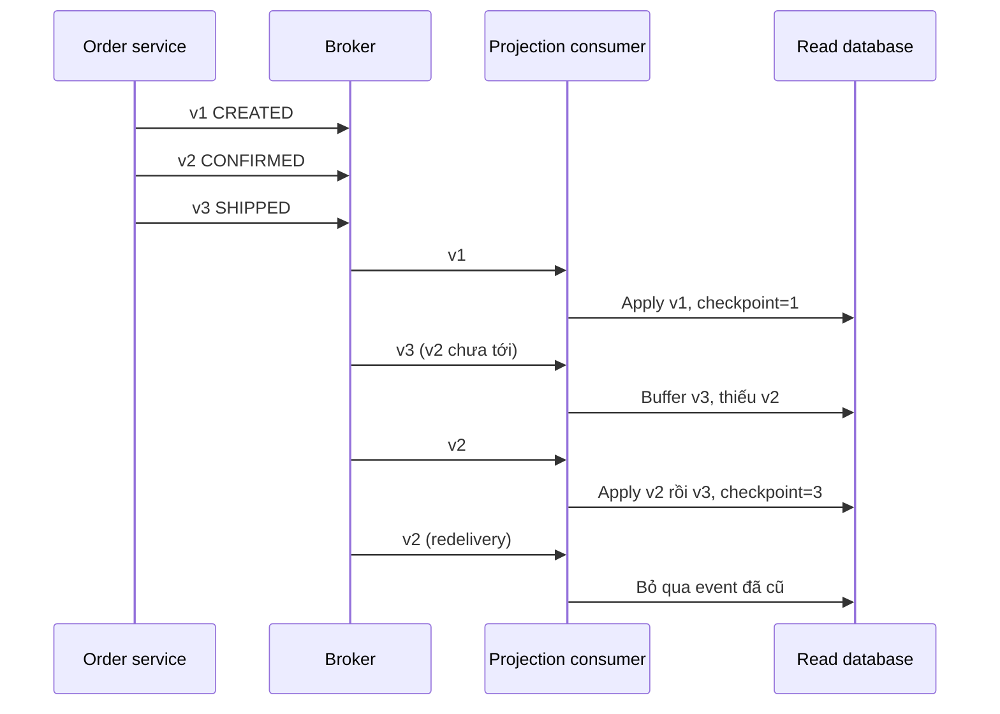
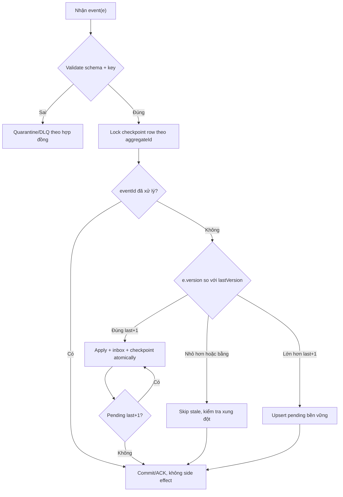

# Thứ tự sự kiện theo thực thể và xử lý sự kiện đến muộn

Trong kiến trúc tích hợp Spring Boot, một đơn hàng có thể liên tiếp được tạo, xác nhận, giao cho đơn vị vận chuyển rồi hoàn tất. Các thay đổi được công bố qua Kafka, RabbitMQ, Apache Pulsar hoặc một luồng Spring Integration. Tuy nhiên, sự kiện **được phát theo thứ tự** không có nghĩa **mọi consumer luôn nhìn thấy và áp dụng chúng theo đúng thứ tự**. Retry, nhiều partition, consumer chạy song song, mạng chậm, dead-letter/redrive và việc khôi phục sau sự cố đều có thể làm sự kiện đến muộn hoặc đảo thứ tự.

Bài học thuộc chương **Nhất quán và chống trùng** của `SPRING_BOOT_INTEGRATION`, module tổ chức tích hợp Spring Boot qua HTTP client, cơ sở dữ liệu, cache, broker thông điệp và các adapter Spring Integration. Chúng ta sẽ giải quyết câu hỏi cụ thể: **làm thế nào giữ trạng thái đúng cho từng thực thể khi sự kiện đến không đúng thứ tự**, đồng thời kiểm soát giao dịch, idempotency, lỗi, kiểm thử và quan sát.

Ví dụ xuyên suốt sử dụng các sự kiện của `order-42`. Giả sử producer sở hữu aggregate `Order`, mỗi lần thay đổi thành công tăng `aggregateVersion` lên đúng một đơn vị và phát một sự kiện tương ứng. Đây là **giả định hợp đồng bắt buộc** cho thuật toán yêu cầu các phiên bản liên tiếp; nếu producer không bảo đảm như vậy, phải chọn thiết kế khác.

## 1. Hiểu đúng thứ tự: phát, nhận và áp dụng

Ba thời điểm phải được phân biệt:

| Thời điểm | Câu hỏi | Ai kiểm soát? |
| --- | --- | --- |
| Thứ tự ghi nghiệp vụ | Phiên bản nào của `Order` thực sự được commit trước? | Database và application service sở hữu aggregate. |
| Thứ tự gửi/nhận qua broker | Message nào được publish, append, deliver hoặc redeliver trước? | Publisher, partition/key, subscription và broker. |
| Thứ tự áp dụng tại consumer | Phiên bản nào được ghi vào read model, cache hoặc gửi tới hệ thống ngoài trước? | Logic consumer, transaction, checkpoint và chính sách khôi phục. |

Ví dụ:

```text
Producer commit:
  Order(order-42) v1 CREATED
  Order(order-42) v2 CONFIRMED
  Order(order-42) v3 SHIPPED
  Order(order-42) v4 DELIVERED

Consumer quan sát:
  v1 -> v3 -> v2 -> v4 -> v2 (redelivery)
```

Nếu consumer cập nhật `status` mỗi khi nhận event mà không so phiên bản, việc áp dụng `v2` sau `v3` có thể làm đơn hàng đang `SHIPPED` quay lại `CONFIRMED`. Nếu `v2` được gửi lặp sau khi đã xử lý `v4`, trạng thái có thể lùi lần nữa.



Mục tiêu không phải sắp xếp mọi sự kiện của **toàn hệ thống** thành một chuỗi duy nhất. Phần lớn bài toán cần thứ tự **theo một thực thể/aggregate**: `order-42` có chuỗi riêng, `order-43` có thể được xử lý song song. Thứ tự giữa hai đơn hàng độc lập thường không có ý nghĩa nghiệp vụ.

## 2. Hợp đồng sự kiện cần đủ thông tin để khôi phục

Ví dụ message DTO độc lập với JPA entity:

```java
import java.time.Instant;
import java.util.UUID;

public record OrderStatusChangedV1(
        UUID eventId,
        String aggregateType,
        UUID aggregateId,
        long aggregateVersion,
        String status,
        Instant occurredAt,
        int schemaVersion,
        String correlationId) {
}
```

Một payload minh họa:

```json
{
  "eventId": "0b4b4db4-37c4-4f18-8f11-f37e306bbbd1",
  "aggregateType": "Order",
  "aggregateId": "72e99948-84e2-42f6-8fa6-935776033d12",
  "aggregateVersion": 3,
  "status": "SHIPPED",
  "occurredAt": "2026-11-20T10:12:00Z",
  "schemaVersion": 1,
  "correlationId": "checkout-734"
}
```

| Trường | Vai trò | Sai lầm thường gặp |
| --- | --- | --- |
| `eventId` | Danh tính **một sự kiện logic**, dùng deduplicate khi redelivery/redrive | Tạo UUID mới mỗi lần publisher retry. |
| `aggregateId` | Khóa gom sự kiện theo thực thể | Dùng message delivery ID làm khóa thực thể. |
| `aggregateVersion` | Thứ tự thay đổi do **chủ sở hữu aggregate** cấp | Dùng timestamp của consumer hoặc số lần retry thay thế. |
| `occurredAt` | Thời điểm sự kiện nghiệp vụ xảy ra, phục vụ phân tích thời gian | Dùng timestamp để suy thứ tự tuyệt đối dù clock lệch. |
| `schemaVersion` | Phiên bản **định dạng payload** | Nhầm với `aggregateVersion`, vốn là phiên bản trạng thái. |
| `correlationId` | Liên kết một hành trình nghiệp vụ qua nhiều dịch vụ | Coi correlation ID là idempotency key của mọi thao tác. |

`aggregateVersion` nên được cấp atomically cùng việc cập nhật aggregate trong **cùng database transaction**. Nếu producer có nhiều instance, dùng optimistic locking (`@Version`), khóa hàng hoặc cơ chế phiên bản tương đương để tránh hai thay đổi đều tự xưng là `v7`.

Ví dụ SQL cấp phiên bản khi cập nhật có kiểm tra:

```sql
UPDATE purchase_orders
SET status = :newStatus,
    aggregate_version = aggregate_version + 1
WHERE id = :orderId
  AND aggregate_version = :expectedVersion
RETURNING aggregate_version;
```

Nếu không cập nhật được hàng nào, producer phải đọc lại trạng thái, phát hiện conflict và quyết định retry nghiệp vụ; không tự phát event với version đoán trước. Bản ghi outbox chứa event ID, aggregate ID và **version đã được commit** cần được insert trong cùng transaction với thay đổi aggregate. Outbox publisher có thể publish lặp khi crash, nhưng không được biến một event `v3` thành `v4` chỉ vì gửi lại.

**Một điều kiện thiết kế:** nếu một thay đổi aggregate có thể phát *nhiều event*, chúng không thể mặc nhiên cùng dùng `aggregateVersion` rồi hy vọng consumer có một chuỗi version duy nhất. Cần thêm `eventSequence` riêng theo aggregate (có thứ tự và uniqueness rõ ràng), hoặc xác định rằng các event cùng version được xử lý như một nhóm theo hợp đồng.

## 3. “Đến muộn”, “trùng” và “mất khoảng” là ba trường hợp khác nhau

Giả sử consumer đã áp dụng đến `lastAppliedVersion = 5`:

| Event nhận được | Phân loại sơ bộ | Quyết định cho một *delta stream* liên tiếp |
| --- | --- | --- |
| `version = 6` | Event tiếp theo | Kiểm tra hợp đồng rồi áp dụng atomically. |
| `version = 5` | Event đã cũ hoặc bản gửi lặp | Kiểm tra danh tính/ledger; không áp dụng lại. |
| `version = 4` | Event cũ đến muộn | Không ghi đè trạng thái mới. |
| `version = 8` | Event mới nhưng **thiếu 6, 7** | Lưu vào pending bền vững; chờ bù khoảng trống hoặc rebuild. |
| `version = 6`, `eventId` giống bản đang xử lý | Giao trùng đồng thời | Chỉ một transaction được claim/commit. |
| `version = 6`, hai `eventId` khác nhau | Xung đột với hợp đồng một event/version | Cảnh báo/quarantine để điều tra producer hoặc dữ liệu sai. |
| Event không có version | Thiếu dữ liệu xác định thứ tự | Chuyển sang thiết kế thích hợp; không tự đoán thứ tự từ thời gian nhận. |

Hai trường hợp cần phân biệt thêm:

- **Event trễ về vận chuyển:** event đúng nghiệp vụ nhưng mạng, retry hoặc DLQ khiến nó tới sau những event phát sau.
- **Event có thời gian nghiệp vụ trong quá khứ:** ví dụ hệ thống đối soát hôm nay phát bản điều chỉnh cho giao dịch từ tuần trước. Event *mới được phát* có thể mang `occurredAt` cũ, nhưng vẫn có version mới. Không loại bỏ nó chỉ vì timestamp cũ.

Một `eventId` có thể bị redelivery nhiều lần; một `aggregateVersion` có thể được nhìn thấy lại. Idempotency kiểm soát *thao tác đã thực hiện*; version guard kiểm soát *thứ tự áp dụng*. Trong trường hợp cần bảo vệ side effect bên ngoài, thường phải dùng **cả hai**.

## 4. Thứ tự tại broker: có ích nhưng không đủ

| Kênh | Cách giữ cùng thực thể gần nhau | Giới hạn quan trọng |
| --- | --- | --- |
| Kafka | Gửi message cùng `aggregateId` làm record key để cùng partition ở cấu hình hiện hành | Thứ tự chỉ có nghĩa trong **một partition**; nhiều consumer/công việc async/retry ngoài luồng có thể làm áp dụng đảo. Thay số partition có thể thay ánh xạ key. |
| Apache Pulsar | Chọn message key `aggregateId`, cân nhắc `Key_Shared` khi cần chia tải theo key | Cần hiểu subscription, batching, redelivery và giới hạn thứ tự theo key; xử lý song song bên trong consumer vẫn có thể đảo thứ tự hoàn tất. |
| RabbitMQ | Queue có thứ tự enqueue; cân nhắc single active consumer, phân sharding theo key hoặc consumer tuần tự theo hàng đợi | Nhiều consumer, prefetch, requeue và concurrency làm thứ tự **hoàn tất xử lý** khác thứ tự delivery. |
| HTTP webhook | Bên gửi cung cấp `eventId` và version cho từng resource | Nhiều request tới cùng lúc; HTTP không tự bảo đảm order giữa các request. |
| Spring Integration flow | Định tuyến theo `aggregateId`, quản lý executor/concurrency hoặc aggregator/resequencer phù hợp | Channel bất đồng bộ, retry adapter và việc chuyển thread có thể đảo thứ tự áp dụng. |

Nếu dùng Kafka và có topic nhiều partition, producer phải sử dụng key ổn định cho cùng aggregate; consumer group thường nhận một partition cho một consumer tại một thời điểm, nhưng code xử lý message bất đồng bộ có thể phá thứ tự bên trong partition. Rebalance, retry topic và DLQ có thể đưa cùng aggregate sang một đường xử lý khác. Dù cấu hình broker “theo thứ tự”, consumer vẫn nên kiểm soát version tại nơi ghi.

Ở Pulsar, `Shared` ưu tiên phân phối message; `Key_Shared` có thể hỗ trợ gắn cùng key vào consumer phù hợp. Không giả định từ tên subscription rằng **mọi** điều kiện đều duy trì thứ tự tuyệt đối qua retry hoặc việc ứng dụng dùng `flatMap` song song. Thử nghiệm trên subscription type và client version thực tế là cần thiết.

Với RabbitMQ, một queue có thể được tiêu thụ bởi nhiều worker. Nếu A nhận `v2` nhưng gọi HTTP chậm, B nhận `v3` và commit trước, kết quả vẫn đảo dù broker đã giao đúng thứ tự. Giảm concurrency xuống một cho cả queue thường làm nghẽn các order độc lập; phương án tốt hơn là **routing theo key + version guard** ở consumer.

## 5. Quyết định chính sách theo loại sự kiện

Không phải mọi payload đều phải chờ version liên tiếp. Trước khi viết consumer, hãy xác định message biểu diễn **delta**, **snapshot** hay thao tác có tính giao hoán:

| Loại | Ví dụ | Có được áp dụng `v8` khi chỉ có `v5`? | Rủi ro nếu bỏ event trung gian |
| --- | --- | --- | --- |
| Delta nghiệp vụ | `AddItem(quantity=2)`, `Debit(100)` | **Không**, nếu v6/v7 làm thay đổi kết quả | Mất tác động không thể suy lại. |
| Event chuyển trạng thái | `PaymentAuthorized`, `PaymentCaptured` | Phụ thuộc state machine và bất biến nghiệp vụ | Có thể bỏ qua kiểm tra/side effect cần thiết. |
| Snapshot đầy đủ | `OrderSnapshot(v8, allFields...)` | **Có điều kiện**, nếu consumer chỉ cần trạng thái mới nhất và snapshot được chủ nguồn xác nhận | Bỏ lỡ notification/side effect riêng của từng transition. |
| Phép toán giao hoán/CRDT | Cộng counter với event ID duy nhất | Có thể áp dụng khác thứ tự nếu toán học/hợp đồng cho phép | Trùng event vẫn gây double count nếu không deduplicate. |
| Event phục vụ analytics theo event time | `PageViewed`, `SensorReading` | Có thể nhận/sắp xếp theo cửa sổ thời gian và watermark | Kết quả window có thể đổi khi dữ liệu tới muộn. |

Ba hướng phổ biến:

1. **Strict sequential:** chỉ áp dụng `version = last + 1`; event lớn hơn thì lưu chờ; phù hợp delta và chuyển trạng thái cần đủ lịch sử.
2. **Latest-state-wins có kiểm soát:** chỉ dùng khi event chứa snapshot **đầy đủ** và việc bỏ qua version cũ là hợp lệ; điều kiện cập nhật phải là `incomingVersion > storedVersion`. Không dùng timestamp của consumer làm tiêu chí chính.
3. **Recompute/rebuild:** nếu khoảng trống không thể bù hoặc event đến quá muộn, truy vấn snapshot authoritative/đọc lại event log rồi rebuild projection, giữ audit rõ ràng.

Không sử dụng `Math.max(lastVersion, incomingVersion)` rồi đánh dấu mọi event là “đã xử lý” cho một **delta stream**: khi version 7 đến trước version 6, nâng checkpoint lên 7 sẽ đánh mất v6 và làm trạng thái sai vĩnh viễn.

## 6. Thiết kế database consumer: checkpoint, inbox và pending

Giả sử mỗi lần tăng version producer phát **đúng một** `OrderStatusChangedV1` cho một aggregate; `aggregateId` là UUID, version bắt đầu từ 1. Consumer có ba nhóm dữ liệu:

- **Projection/checkpoint:** trạng thái đã áp dụng và `last_version` của từng order.
- **Inbox/processed-event:** các event đã áp dụng thành công; ngăn side effect lặp và cho phép điều tra.
- **Pending event:** event đã nhận nhưng chưa đủ điều kiện áp dụng; lưu bền vững trước khi ACK delivery.

Một schema PostgreSQL minh họa:

```sql
CREATE TABLE order_projection (
    order_id       UUID PRIMARY KEY,
    status         VARCHAR(32) NOT NULL DEFAULT 'UNKNOWN',
    last_version   BIGINT NOT NULL DEFAULT 0 CHECK (last_version >= 0),
    updated_at     TIMESTAMPTZ NOT NULL DEFAULT CURRENT_TIMESTAMP
);

CREATE TABLE processed_order_event (
    consumer_name  VARCHAR(80) NOT NULL,
    event_id       UUID NOT NULL,
    order_id       UUID NOT NULL,
    event_version  BIGINT NOT NULL,
    event_status   VARCHAR(32) NOT NULL,
    processed_at   TIMESTAMPTZ NOT NULL DEFAULT CURRENT_TIMESTAMP,
    PRIMARY KEY (consumer_name, event_id),
    UNIQUE (consumer_name, order_id, event_version)
);

CREATE TABLE pending_order_event (
    consumer_name  VARCHAR(80) NOT NULL,
    order_id       UUID NOT NULL,
    event_version  BIGINT NOT NULL,
    event_id       UUID NOT NULL,
    payload        JSONB NOT NULL,
    received_at    TIMESTAMPTZ NOT NULL DEFAULT CURRENT_TIMESTAMP,
    PRIMARY KEY (consumer_name, order_id, event_version),
    UNIQUE (consumer_name, event_id)
);

CREATE INDEX idx_pending_order_received
    ON pending_order_event (received_at);
```

Các bảng trên phục vụ **một stream event chuẩn cho mỗi aggregate**. Nếu projection có nhiều consumer logic hoặc nguồn phát version khác nhau, cần thiết kế lại khóa `(consumer_name, aggregateType, aggregateId, streamId, version)` tương ứng. Ràng buộc `UNIQUE (consumer_name, order_id, event_version)` chỉ đúng khi producer bảo đảm một event duy nhất cho mỗi version trong stream này. `event_status` cho phép kiểm tra payload trong ví dụ chỉ có trạng thái; với payload phức tạp hơn, lưu thêm fingerprint/hash chuẩn hóa hoặc bản gốc để phát hiện cùng `eventId` nhưng nội dung nghiệp vụ khác nhau.

Đối với `order_projection`, trạng thái `UNKNOWN` chỉ là trạng thái nội bộ trước khi apply v1; không được trả nó như trạng thái nghiệp vụ hợp lệ. Khi nhận v1, consumer xác minh kiểu sự kiện khởi tạo hợp đồng trước khi chuyển sang `CREATED`.

### Vì sao pending phải bền vững?

Giả sử `v3` đến trước `v2`. Nếu consumer cất `v3` trong `HashMap` memory rồi ACK broker, một lần restart sẽ làm mất dữ liệu đó. Nếu consumer **không ACK** và giữ delivery chờ `v2`, có thể nghẽn cả partition/queue hoặc tạo vòng requeue. Lưu pending trong PostgreSQL và ACK **sau khi commit pending** cho phép consumer tiếp tục nhận `v2` mà không mất `v3`.

Đổi lại, từ thời điểm ACK pending, **database pending là nơi chịu trách nhiệm phục hồi**, vì broker có thể không giao lại event nữa. Cần worker drain pending, cơ chế giám sát, retention và runbook khi pending kẹt. Không thể chỉ thêm bảng mà bỏ việc xử lý các hàng chờ.

## 7. Thuật toán áp dụng theo version và transaction

Với mỗi event `e` thuộc một `orderId`, thực hiện trong một transaction PostgreSQL:

1. Validate `schemaVersion`, `eventId`, `aggregateId`, version dương, status hợp lệ và authorization/tenant nếu có.
2. Đảm bảo tồn tại hàng checkpoint; lấy **row lock** cho đúng `orderId` bằng `SELECT ... FOR UPDATE` để serialize các lần áp dụng cùng order ở nhiều replica.
3. Nếu `eventId` đã nằm trong inbox, trả kết quả đã xử lý, không lặp side effect.
4. Nếu `e.version <= last_version`, phân loại stale/duplicate. Nếu xuất hiện hai payload hoặc event ID mâu thuẫn cho một version, ghi cảnh báo/quarantine; không cập nhật trạng thái.
5. Nếu `e.version > last_version + 1`, lưu **nguyên payload** vào pending với unique constraint, kiểm tra xung đột event/version, rồi commit; delivery có thể ACK.
6. Nếu `e.version == last_version + 1`, kiểm tra transition hợp lệ và áp dụng sự kiện, ghi inbox, tăng checkpoint **trong cùng transaction**.
7. Tìm pending `last_version + 1` mới, áp dụng tiếp theo thứ tự đến giới hạn batch; nếu còn nhiều, để worker drain trong transaction kế tiếp.
8. Sau khi transaction commit thành công, listener mới báo thành công/ACK broker. Nếu DB rollback thì delivery phải retry/nack theo chính sách.



### 7.1. Lock checkpoint để hai replica không vượt nhau

Một cách đảm bảo hàng checkpoint tồn tại trước khi lấy lock:

```sql
INSERT INTO order_projection (order_id, status, last_version)
VALUES (:orderId, 'UNKNOWN', 0)
ON CONFLICT (order_id) DO NOTHING;

SELECT status, last_version
FROM order_projection
WHERE order_id = :orderId
FOR UPDATE;
```

Hai câu SQL này phải chạy **trong cùng transaction**. Unique constraint trên `order_id` và row lock sẽ serialize hai transaction cùng xử lý một order, dù đến từ hai pod khác nhau. Với order khác, PostgreSQL có thể xử lý song song. Không dựa vào `synchronized` trong JVM vì mỗi pod có lock riêng.

Nếu chỉ sử dụng optimistic compare-and-set thay row lock, mỗi cập nhật vẫn phải có điều kiện `WHERE last_version = :expectedVersion` và kiểm tra affected rows; transaction thất bại phải retry với checkpoint mới. Không được “last write wins” bằng update không điều kiện.

### 7.2. Mã ứng dụng minh họa

Ví dụ Java dưới đây tách các thao tác SQL vào repository để tập trung vào logic điều phối. Các interface là hợp đồng minh họa cần hiện thực bằng Spring JDBC/JPA với cùng `DataSource`/transaction manager:

```java
import java.util.UUID;
import org.springframework.stereotype.Service;
import org.springframework.transaction.annotation.Transactional;

public record OrderEvent(
        UUID eventId, UUID orderId, long version, String status) {
}

public enum ApplyResult {
    APPLIED, BUFFERED, DUPLICATE, STALE
}

@Service
public class OrderedOrderEventService {
    private static final String CONSUMER = "order-view-v1";
    private final OrderProjectionRepository projection;
    private final ProcessedEventRepository processed;
    private final PendingOrderEventRepository pending;

    public OrderedOrderEventService(
            OrderProjectionRepository projection,
            ProcessedEventRepository processed,
            PendingOrderEventRepository pending) {
        this.projection = projection;
        this.processed = processed;
        this.pending = pending;
    }

    @Transactional
    public ApplyResult accept(OrderEvent event) {
        validate(event);
        projection.createCheckpointIfAbsent(event.orderId());
        var checkpoint = projection.lockForUpdate(event.orderId());

        var previous = processed.findByEventId(CONSUMER, event.eventId());
        if (previous.isPresent()) {
            processed.assertSameEvent(previous.get(), event);
            return ApplyResult.DUPLICATE;
        }
        if (event.version() <= checkpoint.lastVersion()) {
            processed.assertNoVersionConflict(CONSUMER, event);
            return ApplyResult.STALE;
        }
        if (event.version() > checkpoint.lastVersion() + 1) {
            pending.insertOrAssertSameEvent(CONSUMER, event);
            return ApplyResult.BUFFERED;
        }

        applyAndAdvance(event);
        drainContiguousPending(event.orderId(), 100);
        return ApplyResult.APPLIED;
    }

    private void applyAndAdvance(OrderEvent event) {
        projection.applyTransitionAndAdvanceVersion(event);
        processed.insert(CONSUMER, event);
        pending.deleteIfMatches(CONSUMER, event);
    }

    private void drainContiguousPending(UUID orderId, int maxEvents) {
        for (int i = 0; i < maxEvents; i++) {
            long nextVersion = projection.currentVersion(orderId) + 1;
            var next = pending.find(CONSUMER, orderId, nextVersion);
            if (next.isEmpty()) {
                return;
            }
            applyAndAdvance(next.get());
        }
        // Nếu còn pending liền mạch, scheduler/outbox worker phải drain tiếp.
    }

    private void validate(OrderEvent event) {
        if (event.eventId() == null || event.orderId() == null
                || event.version() < 1 || event.status() == null) {
            throw new IllegalArgumentException("Invalid order event");
        }
    }
}
```

Đoạn code mô tả **một use case**, chưa phải class Java độc lập có thể build ngay: mỗi `public record`/`enum`/class được đặt vào tệp Java riêng; cần cài đặt ba repository, mapping JSON, xác thực `schemaVersion`, state machine và import đúng package. Các phương thức `assertSameEvent`, `applyTransitionAndAdvanceVersion`, `insertOrAssertSameEvent` và `assertNoVersionConflict` phải kiểm tra điều kiện và ném lỗi khi cùng event ID hoặc version bị gắn với nội dung nghiệp vụ khác. Nếu chỉ `INSERT ... ON CONFLICT DO NOTHING` rồi coi như thành công, hệ thống có thể che mất một sự kiện bị sai.

Ví dụ điều kiện cập nhật checkpoint:

```sql
UPDATE order_projection
SET status = :newStatus,
    last_version = :incomingVersion,
    updated_at = CURRENT_TIMESTAMP
WHERE order_id = :orderId
  AND last_version = :incomingVersion - 1;
```

Sau update, yêu cầu affected rows bằng `1`. Điều kiện version là chốt chặn bổ sung ngay cả khi đã dùng row lock. Dòng `processed_event` được insert trong **cùng transaction** với update projection; nếu một bước lỗi, cả hai rollback. Số event được drain trong một transaction phải giới hạn để tránh giữ row lock quá lâu.

`@Transactional` cần thật sự đi qua Spring proxy (listener gọi sang service bean khác), transaction manager chọn đúng database và listener chỉ báo thành công sau khi method service **đã return và transaction commit thành công**. Nếu lưu checkpoint ở database A, inbox ở database B, một `@Transactional` cục bộ không bảo đảm atomicity giữa hai database.

### 7.3. Bổ sung worker xử lý pending

Pending worker định kỳ phải tìm các order có pending, khóa checkpoint theo order và áp dụng các event liên tiếp. Nếu một worker đang xử lý order khác, có thể dùng `FOR UPDATE SKIP LOCKED` với chiến lược claim phù hợp, hoặc phân vùng công việc theo key. Đừng lấy một global lock cho mọi order.

Để tránh race, luôn thực hiện drain trong cùng transaction và cùng quy tắc version của consumer; pending worker **không được bỏ qua** validate, inbox hoặc state machine. Nếu receive `v3` rồi `v2` chưa tới, bảng pending có `v3`; khi `v2` đến, listener áp dụng `v2` rồi drain `v3`. Nếu listener crash trước commit, cả việc áp dụng v2/v3 rollback và broker có thể redeliver v2; dữ liệu pending vẫn còn nếu đã commit trước đó.

## 8. Sự kiện đến muộn sau khi checkpoint đã tiến xa

Khi consumer đã áp dụng tới v10 và nhận v8, phải xác định nhu cầu nghiệp vụ:

- **Projection trạng thái hiện tại:** nếu v8 chỉ là delta đã được áp dụng trước đó, bỏ qua an toàn sau khi xác minh ID/version phù hợp. Không ghi đè trạng thái v10.
- **Event đến muộn do trước đây bị mất nhưng projection đã nhảy tới v10 từ snapshot:** liệu side effect của v8 có còn cần thực hiện không? Nếu có, phải có một luồng xử lý/đối soát riêng, không mặc định bỏ qua.
- **Thay đổi hồi tố:** event mới có `aggregateVersion=11` nhưng `effectiveAt` ở tuần trước; cần áp dụng theo ngữ nghĩa bitemporal/điều chỉnh lịch sử, không gọi là stale chỉ vì thời điểm hiệu lực cũ.
- **Sự kiện trễ sau thời hạn nghiệp vụ:** ví dụ yêu cầu hủy hàng đến sau khi đã giao. Không đơn giản áp dụng `CANCELLED`; cần state machine từ chối hoặc phát workflow hoàn tiền/bù trừ.

Với event-time analytics (ví dụ đo số đơn mỗi giờ), có thể dùng **watermark/allowed lateness**:

```text
Window 10:00-11:00
Watermark đã qua 11:05
Cho phép late event đến 11:10
Event 10:40 đến lúc 11:08 -> cập nhật kết quả window theo chính sách
Event 10:35 đến lúc 11:15 -> đưa sang side output/quarantine hoặc hiệu chỉnh
```

Watermark là ước lượng tiến độ thời gian sự kiện, không phải `lastAppliedVersion` của aggregate. Việc cập nhật một cửa sổ phân tích sau khi đã công bố kết quả có thể đòi hỏi retraction/upsert tới downstream và version kết quả. Đừng dùng ngưỡng watermark để tự ý bỏ sự kiện thay đổi trạng thái đơn hàng vốn cần toàn bộ chuỗi delta.

## 9. Xử lý khoảng trống không bao giờ được lấp

Một event v7 nằm pending hơn một giờ trong khi checkpoint vẫn ở v4 có thể báo hiệu v5/v6 chưa được publish, đã mất trong pipeline, bị DLQ hoặc mắc lỗi schema. Không nên giữ pending vô thời hạn mà không có vận hành.

| Tình huống | Hành động đề xuất |
| --- | --- |
| Event v5 còn trong retry topic hoặc DLQ | Điều tra lỗi, sửa nguyên nhân, redrive **giữ nguyên** `eventId`, `aggregateId`, `version`. |
| Producer đã commit v5 nhưng outbox chưa publish | Kiểm tra outbox backlog, publisher offset, broker confirm và phát lại idempotently. |
| Producer chưa từng phát v5 dù aggregate chuyển từ v4 lên v6 | Xác định lỗi hợp đồng publisher; khôi phục từ event store hoặc snapshot authoritative. |
| Snapshot v10 có thể thay thế projection mà không cần side effect trung gian | Thực hiện rebuild/fast-forward theo quy trình riêng và ghi audit, thay đổi checkpoint atomically. |
| Một event không thể deserialize | Đưa quarantine/DLQ, lưu raw payload, schema version, error; không đánh dấu đã apply. |
| Phiên bản v5 đã quá retention và không có snapshot | Tình trạng dữ liệu không thể tự phục hồi; phát cảnh báo và yêu cầu can thiệp từ nguồn sự thật. |

Một quy trình reconciliation có thể chạy định kỳ:

1. Tìm các `orderId` có pending cũ hơn một ngưỡng, xác định `last_version` và `min(pending_version)`.
2. Tính dải version thiếu; tra cứu outbox/event store của producer hoặc endpoint snapshot có quyền.
3. Nếu tìm được event thiếu, đưa vào cùng pipeline chuẩn (giữ ID/version) để dùng lại idempotency, state machine và transaction.
4. Nếu chọn rebuild, xác nhận side effect trung gian nào vẫn cần thực hiện; tạo snapshot mới với `sourceVersion` rõ ràng.
5. Sau khi sửa, drain pending theo thứ tự và quan sát độ trễ cho đến khi backlog hết.

Không sửa thủ công `last_version` lên bằng `MAX(pending_version)` để “chữa kẹt”: thao tác này có thể đánh dấu nhầm những delta chưa bao giờ được áp dụng.

## 10. Retry, dead-letter, redrive và ACK

Một integration flow có thể nhận cùng event nhiều lần vì consumer crash sau commit nhưng trước ACK. Chính sách xử lý:

| Tình huống | Có thể ACK khi nào? | Điều không nên làm |
| --- | --- | --- |
| Event được áp dụng | Sau DB transaction commit thành công | ACK trước khi commit. |
| Duplicate đã được áp dụng | Sau khi xác minh trạng thái/inbox, không tạo side effect | Chạy lại HTTP payment/ghi DB. |
| Future version được buffer | Sau **commit pending bền vững**, và có worker drain | ACK khi chỉ giữ event trong memory. |
| Sai schema vĩnh viễn | Sau khi quarantine/DLQ được đảm bảo theo adapter/broker | Lặp ngay vô hạn cùng payload sai. |
| Database mất kết nối | Không thể xác nhận apply/buffer; cần retry/backoff | Coi là đã xử lý hoặc nuốt exception. |
| Gap đã quá hạn | Không tự ACK coi complete; cần escalation/reconciliation | Tăng checkpoint bỏ qua các version thiếu. |

Với Spring Kafka, Spring AMQP, Spring for Apache Pulsar hoặc Spring Integration inbound adapter, ACK/NACK, retry topic và DLQ có API và thời điểm commit khác nhau. Cần cấu hình theo từng adapter; không thể lấy `acknowledge()` hoặc `@Transactional` của một adapter áp dụng nguyên xi cho adapter khác.

**Một nguyên tắc thực tế:** gói `accept(event)` trong một service `@Transactional` rồi để listener đồng bộ gọi service. Service chỉ return sau commit; container/adapter mới đánh dấu delivery thành công theo cấu hình. Nếu dùng async handler, cần đợi completion của operation trước khi ACK. Khi đường xử lý bắt đầu gửi HTTP ra bên ngoài, DB transaction không bao trùm HTTP; ghi một lệnh cần thực thi vào **transactional outbox** và để publisher có idempotency làm side effect sau commit.

### Vì sao một event cũ vẫn cần được ghi nhận?

Khi version <= checkpoint, không phải trường hợp nào cũng giống nhau:

- Nếu inbox cho thấy **cùng eventId đã áp dụng**, duplicate thực sự; ACK không tạo side effect.
- Nếu cùng version nhưng **eventId khác** so với event đã áp dụng, hợp đồng một event/version bị vi phạm; cần quarantine/alert.
- Nếu version cũ hơn checkpoint nhưng inbox đã bị archive theo retention, có thể bỏ qua **chỉ khi** chính sách projection cam kết checkpoint bao phủ đầy đủ dải version đó. Phải giữ bằng chứng/audit thích hợp nếu cần điều tra.

Với pending trùng `(orderId, version)`, nếu event ID và payload giống nhau thì có thể deduplicate; nếu khác nhau thì không im lặng `ON CONFLICT DO NOTHING`. Một event ID xuất hiện với version khác cũng là lỗi hợp đồng.

## 11. Sự kiện liên quan nhiều aggregate và luồng liên dịch vụ

Thứ tự theo `aggregateId` giải quyết **một** chuỗi do **một** chủ sở hữu kiểm soát; nó không tạo thứ tự toàn cục cho nhiều dịch vụ.

Ví dụ:

```text
Order service:   OrderConfirmed(order-42, orderVersion=5)
Payment service: PaymentCaptured(payment-19, paymentVersion=3)
Shipping service: ShipmentCreated(shipment-8, shipmentVersion=1)
```

Các version 5/3/1 thuộc **ba stream riêng**, không thể so sánh lớn nhỏ. Để phối hợp, cần correlation/causation ID, state machine hoặc saga/orchestrator, điều kiện “chỉ giao hàng khi đã xác nhận thanh toán” và idempotency ở từng command. Nếu một consumer nhận `ShipmentCreated` trước `PaymentCaptured`, có thể buffer dựa trên điều kiện nghiệp vụ đã lưu thay vì dùng `MAX(version)` giữa hai aggregate.

Nếu một event chứa `aggregateVersion=8` nhưng có nhiều writer không có nguồn sự thật duy nhất, version đó cũng không đủ bảo đảm thứ tự. Cần thống nhất quyền sở hữu (single writer per aggregate) hoặc một giao thức concurrency/distributed ordering có chủ đích. Dùng `occurredAt` với nhiều clock máy chủ khác nhau hiếm khi giải quyết được xung đột đó.

## 12. Khi nào dùng khóa và khi nào dùng optimistic concurrency?

Trong một consumer đơn lẻ, `synchronized(orderId)` có thể serialize các task cùng key, nhưng khi scale ba replica, JVM lock không có tác dụng liên process.

| Cơ chế | Bảo vệ | Giới hạn |
| --- | --- | --- |
| `SELECT ... FOR UPDATE` trên checkpoint | Serialize cập nhật của cùng order trong một database | Phải bảo đảm transaction và cùng DB; giữ khóa quá lâu gây contention. |
| Optimistic compare-and-set version | Ngăn stale write trong SQL, phát hiện xung đột | Cần kiểm tra affected rows và retry đúng; không tự lưu pending. |
| Spring Integration `LockRegistry` phân tán | Chỉ một worker giữ khóa trên cùng key khi lease hợp lệ | Lease có thể hết khi worker cũ còn chạy; vẫn cần version check/idempotency. |
| Broker partition/subscription theo key | Tăng khả năng delivery tuần tự và giảm cạnh tranh | Retry/redrive, async completion và nhiều nguồn phát vẫn có thể đảo. |
| Database unique constraint/inbox | Chống áp dụng trùng event trong transaction cục bộ | Không tự xử lý event đến thiếu version hoặc HTTP side effect. |

Ở ví dụ `order_projection`, transaction ngắn với row lock và điều kiện version là đủ để kiểm soát database state. Nếu cần gọi HTTP chậm, **không** giữ row lock qua network rồi xem đó là giải pháp thứ tự. Tạo outbox command có thứ tự/version, gửi sau commit và bảo vệ phía đối tác bằng idempotency key hoặc fencing/version.

## 13. Test có ý nghĩa: gửi đảo thứ tự và mô phỏng crash

Kiểm thử cần chứng minh cả tính đúng đắn của **trạng thái**, **inbox**, **pending**, **ACK** và side effect. Unit test quyết định chính sách; integration test với PostgreSQL + broker thật kiểm tra concurrency, transaction và redelivery.

### 13.1. Ma trận kiểm thử

| Kịch bản | Chuỗi đầu vào | Kết quả mong đợi |
| --- | --- | --- |
| Đúng thứ tự | v1 → v2 → v3 | Checkpoint 3, trạng thái v3, pending rỗng. |
| Đảo thứ tự | v1 → v3 → v2 | Sau v3: pending v3; sau v2: áp dụng v2 rồi v3, checkpoint 3. |
| Trùng sau commit | v1 → v2 → v2 | Một bản ghi inbox cho v2, không áp dụng lại. |
| Stale rất muộn | v1 → v2 → v3 → v1 | Checkpoint vẫn 3, trạng thái không lùi. |
| Gap kéo dài | v1 → v4 | Pending v4, checkpoint 1; alert sau SLA. |
| Version xung đột | Hai event ID khác nhau cùng aggregate/version | Quarantine hoặc báo contract violation; không âm thầm bỏ một bản. |
| Event ID xung đột | Cùng event ID với hai version/payload khác nhau | Phát hiện sai dữ liệu; không làm side effect. |
| Hai replica cùng xử lý v2 | Hai delivery đồng thời tới chung DB | Chỉ một transaction áp dụng; cái còn lại duplicate/stale. |
| Crash trước commit v2 | Chết khi đang cập nhật projection | Transaction rollback; redelivery áp dụng v2 đúng một lần. |
| Crash sau commit trước ACK | DB đã lên v2, broker chưa ACK | Redelivery được deduplicate, không phát side effect nữa. |
| Crash sau commit pending trước ACK | v4 đã lưu pending | Redelivery không thêm bản ghi mâu thuẫn; pending còn sau restart. |
| Redrive từ DLQ | v2 thiếu được gửi lại sau v4 | Drain v2, v3, v4 tuần tự khi đủ dải. |
| Snapshot có version cao | v10 snapshot sau v5 | Chỉ fast-forward nếu hợp đồng cho phép, không làm mất side effect. |
| Hai order độc lập | order A/v2 và order B/v3 đồng thời | Không cần chờ nhau, trạng thái mỗi order đúng. |
| State machine sai | `DELIVERED` → `CREATED` dù version mới | Bị từ chối/quarantine theo luật, không mặc định version cao là hợp lệ. |

### 13.2. Test cạnh tranh với hai transaction thật

Dùng Testcontainers PostgreSQL, hai thread/context gọi cùng service với `eventId` khác nhau nhưng cùng `aggregateId`/version. Tạo barrier cho hai worker bắt đầu gần như đồng thời. Cần kiểm chứng:

1. Một transaction lấy row lock trước và áp dụng version tiếp theo.
2. Transaction còn lại sau khi nhận lock nhìn thấy checkpoint đã đổi, nên không ghi đè.
3. Nếu cùng version nhưng event ID khác, hệ thống phát hiện conflict theo hợp đồng; không coi cả hai là thành công.
4. Nếu v3 đến trước v2, v3 được buffer bền vững, rồi v2 kích hoạt drain.

Test transaction không nên được bao bởi `@Transactional` trên **toàn method test**, vì nó có thể giữ connection/lock và che khả năng concurrency của service. Dùng commit độc lập hoặc hai context giao dịch thật; assert dữ liệu trong một transaction mới sau khi các worker kết thúc.

### 13.3. Test với broker và crash point

Với Kafka/Pulsar/RabbitMQ container thật, gửi message có **cùng aggregate key**, đồng thời tạo tình huống retry hoặc redrive làm chúng tới consumer theo thứ tự v1, v3, v2. Kiểm tra trạng thái ở PostgreSQL và việc ACK/offset commit theo hợp đồng adapter. Không chỉ assert thứ tự mà fake repository được gọi.

Để mô phỏng crash sau commit nhưng trước ACK, cần một hook/fixture có thể kill worker process ở đúng điểm; ném exception trong cùng JVM là test hữu ích nhưng không mô phỏng đầy đủ broker connection bị mất. Khi process mới nhận lại delivery, xác minh không gọi HTTP bên ngoài thêm lần nữa và inbox cho thấy event đã hoàn thành.

## 14. Quan sát, cảnh báo và vận hành backlog

Không chỉ đo số lần xử lý thành công. Thứ tự có thể sai âm thầm nếu checkpoint tiến nhưng pending không bao giờ được drain.

| Metric/log | Ý nghĩa | Dấu hiệu cần cảnh báo |
| --- | --- | --- |
| `event_apply_total{result}` (`applied`, `buffered`, `duplicate`, `stale`, `conflict`) | Phân biệt lý do consumer ACK/skip | `conflict` tăng hoặc `buffered` tăng bất thường. |
| `projection_last_version` theo nhóm/tenant **ít cardinality** | Quan sát tiến độ tổng quát | Projection tụt xa nguồn, không tiến trong thời gian dài. |
| Số pending, `min(received_at)`, age oldest pending | Phát hiện khoảng trống kẹt | Pending quá SLA hoặc tăng liên tục. |
| Khoảng thiếu `next_expected` đến `min_pending_version` | Chỉ ra version đang chờ | Gap không được producer/outbox bù. |
| Consumer lag, broker redelivery, DLQ depth | Định vị nguyên nhân ở transport | Lag/DLQ tăng cùng pending tăng. |
| Inflight processing, lock wait, DB deadlock | Phát hiện contention theo aggregate | Transaction giữ lock lâu hoặc retry nóng. |
| Outbox backlog, publish failures, broker confirm | Định vị event chưa đến broker | Source version tăng nhưng downstream thiếu sự kiện. |

`aggregateId`, `eventId` có cardinality rất cao không nên là label metric; sử dụng chúng ở structured log/tracing có chính sách quyền truy cập dữ liệu. Log hữu ích gồm `eventId`, `aggregateId`, `eventVersion`, `checkpointBefore`, `checkpointAfter`, `result`, `correlationId`, `consumerName` và `traceId`. Không ghi payload chứa secret/PII một cách không kiểm soát vào DLQ, tracing hoặc log.

Khi rollout:

- Mỗi instance cùng consumer logic dùng cùng schema checkpoint/inbox/pending và cùng hợp đồng phiên bản.
- Không bật hai phiên bản consumer có logic xử lý khác nhau vào **cùng** checkpoint nếu chưa chứng minh tương thích.
- Giữ retention đủ cho event store/outbox, pending và lịch sử replay; có quy trình archive processed-event mà không làm mất khả năng phát hiện duplicate trong cửa sổ cần thiết.
- Có retry với backoff khi database/broker lỗi; không để một message gap liên tục được requeue nóng gây chiếm partition.
- Cân nhắc bootstrap/rebuild projection khi triển khai một consumer mới: xác định version bắt đầu, snapshot và cách bắt kịp các event sau snapshot.

## 15. Những lỗi thiết kế thường gặp

| Lỗi | Tại sao sai | Cách sửa |
| --- | --- | --- |
| Sắp xếp theo `receivedAt` | Thứ tự arrival thay đổi do network/consumer | Dùng sequence/version do nguồn authoritative phát. |
| Sắp xếp theo timestamp máy producer | Clock có thể lệch; hai event đồng timestamp | Dùng version/sequence được cấp atomically. |
| Dùng `MAX(version)` cho delta | Bỏ mất các delta ở giữa | Chỉ apply `last+1`, lưu gap và reconciliation. |
| ACK event future trước khi lưu | Pending memory mất khi crash | Commit pending bền vững trước ACK. |
| Dùng unique eventId nhưng không check version | Không chặn trạng thái lùi do event khác ID | Kết hợp inbox và version guard. |
| Dùng version nhưng không có inbox | Side effect có thể lặp khi retry và khi checkpoint chưa commit | Inbox/unique constraint trong transaction và idempotency ở hệ thống ngoài. |
| Hai payload khác nhau cùng version, vẫn `ON CONFLICT DO NOTHING` | Che lỗi hợp đồng producer | So khớp ID/hash rồi quarantine/conflict alert. |
| Consumer tự tăng version khi retry | Mỗi delivery thành event mới | Version được cấp khi producer commit, giữ nguyên xuyên retry. |
| Chỉ cấu hình Kafka key rồi bỏ version guard | Retry topic/async worker vẫn đảo thứ tự | Guard tại DB và test redelivery/reorder. |
| Một khóa toàn cục bảo vệ mọi aggregate | Giảm concurrency không cần thiết | Lock theo aggregate hoặc row lock checkpoint. |
| Cùng `aggregateVersion` cho nhiều event chưa có định nghĩa thứ tự | Không biết đâu là bước tiếp theo | Có sequence riêng hoặc nhóm event theo hợp đồng. |
| Tự bỏ sự kiện v5 vì “quá cũ” | Có thể bỏ side effect chưa từng chạy | Xác định semantics stale, check history và reconciliation. |
| Nâng version chỉ vì timestamp/snapshot mới | Chưa chứng minh bỏ qua delta an toàn | Contract snapshot, audit và rebuild có kiểm soát. |

## 16. Checklist áp dụng và bài tập

Trước khi scale Spring Boot integration flow theo nhiều consumer/replica, hãy xác nhận:

- [ ] Chủ sở hữu aggregate phát version/sequence rõ ràng, atomically, không tái cấp version khi retry.
- [ ] `eventId`, `aggregateId`, `aggregateVersion`, `schemaVersion` có nghĩa riêng và được kiểm tra.
- [ ] Key/routing/subscription theo aggregate phù hợp cơ chế broker thực tế.
- [ ] Đã chọn policy strict delta, snapshot hoặc commutative theo ngữ nghĩa nghiệp vụ.
- [ ] Consumer có checkpoint và inbox bền vững, unique constraint/row lock hoặc optimistic CAS.
- [ ] Future event được lưu pending bền vững; có worker drain và reconciliation cho gap quá hạn.
- [ ] Stale/duplicate/conflict được phân biệt, không cập nhật lại trạng thái cũ hoặc che lỗi khác payload.
- [ ] ACK chỉ sau commit của apply hoặc pending; retry/DLQ/redrive giữ nguyên identity event.
- [ ] HTTP side effect dùng idempotency key; các lệnh outbound quan trọng dùng outbox hoặc phương án nhất quán đã xác nhận.
- [ ] Có kiểm thử reorder, duplicate, multi-replica, crash trước/sau commit và version conflict.
- [ ] Có metric pending age/gap, conflict, backlog, outbox và quy trình khôi phục từ nguồn sự thật.

**Bài tập thực hành:** dựng `order_projection`, `processed_order_event`, `pending_order_event` bằng PostgreSQL Testcontainers và một consumer Spring Boot. Phát lần lượt `OrderCreated(v1)`, `OrderShipped(v3)`, `OrderConfirmed(v2)`, `OrderShipped(v3)` lần nữa. Kiểm tra sau v3 đầu tiên, checkpoint vẫn là 1 và pending chứa v3; sau v2, checkpoint là 3, trạng thái `SHIPPED`, pending trống; sau v3 lặp lại, không có thay đổi hay side effect thứ hai. Tiếp theo cho hai worker cùng nhận v4, cố tình crash sau commit trước ACK, rồi dùng bản redelivery để xác minh inbox và version guard hoạt động. Cuối cùng tạo gap v5 thiếu và viết một reconciliation job báo tuổi pending, tra cứu nguồn và chỉ bù dữ liệu khi chứng minh được event/version đúng.

**Ghi nhớ:** thứ tự delivery của broker là một hỗ trợ quan trọng, nhưng tính đúng đắn theo thực thể được quyết định tại **nơi áp dụng trạng thái**. Hợp đồng version rõ ràng, checkpoint/inbox/pending có transaction, xử lý gap và khôi phục sau crash giúp Spring Boot xử lý sự kiện đến muộn mà không làm trạng thái lùi hoặc mất những thay đổi nghiệp vụ cần thiết.
