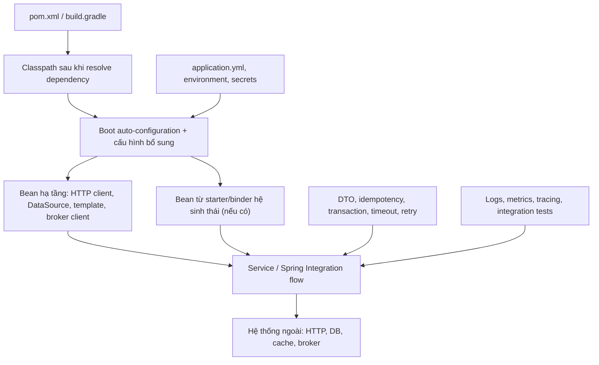
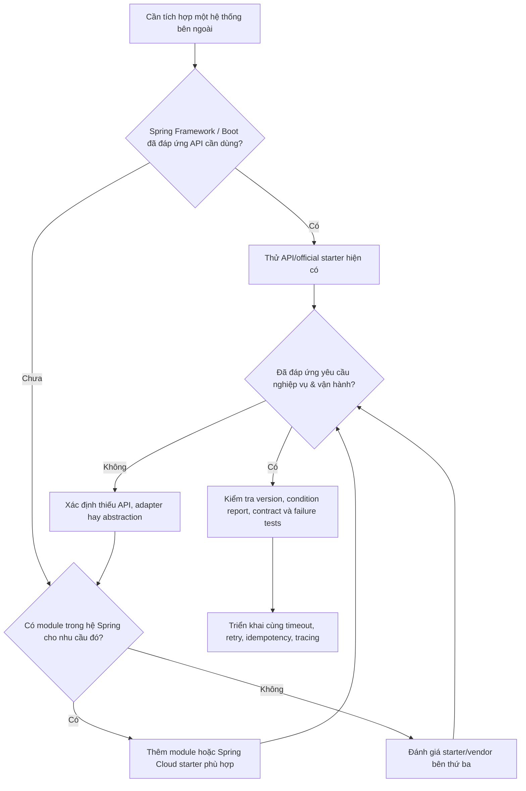

# Phân biệt tích hợp có sẵn của Boot với starter từ hệ sinh thái

> **Chương:** Thư viện bổ sung  
> **Phạm vi:** Trong module **SPRING_BOOT_INTEGRATION**, một ứng dụng Spring Boot có thể tích hợp hệ thống qua HTTP client, cơ sở dữ liệu, cache, broker thông điệp và các adapter của Spring Integration. Bài này làm rõ khả năng nào được Spring Boot hỗ trợ cấu hình tự động, khi nào cần thêm module hay starter của hệ sinh thái, và cách kiểm soát phiên bản, hợp đồng dữ liệu, giao dịch, lỗi, trùng lặp, kiểm thử và quan sát khi ghép nhiều thư viện.

## 1. Câu hỏi cốt lõi: “Boot đã hỗ trợ” nghĩa là gì?

Khi đọc tài liệu hoặc dependency của một dự án, ta thường gặp những nhận xét như “Spring Boot hỗ trợ Redis”, “Boot hỗ trợ Kafka” hoặc “chỉ cần thêm starter”. Các câu này **không cùng nghĩa**:

- **Thư viện có API thực thi:** ví dụ Spring Framework cung cấp HTTP client, Spring Data cung cấp repository, Spring AMQP cung cấp API RabbitMQ. Chúng mới là nơi phần lớn logic giao tiếp được triển khai.
- **Spring Boot có auto-configuration:** khi thư viện và cấu hình phù hợp hiện diện, Boot có thể dựng sẵn các bean hạ tầng như client builder, connection factory, template, repository infrastructure hoặc transaction manager.
- **Spring Boot cung cấp starter chính thức:** một dependency dùng để gom các thư viện thường cần cho một tính năng, giúp người dùng khai báo ít dependency hơn.
- **Starter hoặc module từ hệ sinh thái:** một dự án Spring khác, Spring Cloud hoặc bên thứ ba có thể cung cấp API, auto-configuration và dependency tiện dụng cho nhu cầu bổ sung.

Vì vậy, **có starter không đồng nghĩa có kết nối đang hoạt động**, và **có auto-configuration không đồng nghĩa đã thiết kế xong flow nghiệp vụ**. Ví dụ: thêm thư viện Kafka không tự tạo topic, hợp đồng event, idempotency key hoặc chính sách xử lý lại.

## 2. Phân tầng đúng các thành phần

| Tầng | Ví dụ | Thực hiện điều gì? | Ai quản lý phần chính? |
| --- | --- | --- | --- |
| **Spring Framework / dự án Spring nền tảng** | `RestClient`, `WebClient`, Spring Transaction, Spring Messaging, Spring AMQP, Spring Integration | API và implementation cho HTTP, transaction, messaging, integration flow | Các dự án Spring tương ứng |
| **Spring Boot auto-configuration** | Cấu hình `DataSource`, `RestClient.Builder`, `KafkaTemplate`, `RabbitTemplate` khi đủ điều kiện | Tạo bean hạ tầng, bind properties, thiết lập mặc định | Spring Boot |
| **Official Spring Boot starter** | `spring-boot-starter-web`, `spring-boot-starter-data-jpa`, `spring-boot-starter-amqp`, `spring-boot-starter-integration` | Gom các dependency phù hợp; cho phép auto-configuration kích hoạt | Spring Boot |
| **Module bổ sung trong hệ Spring** | `spring-integration-http`, `spring-integration-jdbc`, `spring-kafka` | Bổ sung adapter hoặc API cụ thể; không nhất thiết có từ “starter” | Dự án Spring chuyên trách |
| **Spring Cloud starter / binder** | `spring-cloud-starter-openfeign`, `spring-cloud-stream-binder-kafka` | Tăng mức trừu tượng cho HTTP client khai báo, message binding và các nhu cầu hệ phân tán | Spring Cloud, với release train riêng |
| **Starter bên thứ ba** | `redisson-spring-boot-starter`, `springdoc-openapi-starter-webmvc-ui` | Thêm chức năng riêng, có thể đăng ký auto-configuration do tác giả cung cấp | Nhà duy trì thư viện bên ngoài |

Tên artifact có chữ `starter` **không chứng minh** đó là starter do Spring Boot chính thức phát hành. Ngược lại, một thư viện như `spring-kafka` vẫn có thể được **Boot tự động cấu hình** dù bản thân nó không mang tên “starter”.

### 2.1. Starter là gói dependency, auto-configuration là hành vi

Hai chức năng này nên được hiểu riêng:

1. **Starter** thường là một artifact có nhiệm vụ kéo các dependency liên quan theo quan hệ bắc cầu (*transitive dependencies*).
2. **Auto-configuration** gồm các class cấu hình có điều kiện. Boot có thể nạp chúng khi thấy class, property và bean phù hợp.
3. **Business integration** là phần ứng dụng phải tự thiết kế: route, DTO, schema, xác thực, transaction, retry, duplicate handling, số liệu vận hành.

Một starter của bên thứ ba có thể chứa auto-configuration hoặc đưa một artifact auto-configuration khác vào classpath. Tuy nhiên, **không có quy tắc** mọi dependency có chữ `starter` đều tự tạo đúng những bean bạn mong đợi.

### 2.2. Sơ đồ từ dependency đến luồng nghiệp vụ



Các bean chỉ được tạo khi điều kiện của auto-configuration thỏa mãn. Nhiều class có `@ConditionalOnClass`, `@ConditionalOnMissingBean`, `@ConditionalOnProperty` hoặc điều kiện phụ thuộc bean khác. Nếu ứng dụng tự khai báo bean thay thế, một auto-configuration có thể **back off**.

## 3. Các tình huống tích hợp thường gặp

| Nhu cầu | Thường bắt đầu với Boot / Spring hiện có | Khi nào cân nhắc hệ sinh thái bổ sung? |
| --- | --- | --- |
| **Gọi REST/HTTP đối tác** | `spring-boot-starter-web` với `RestClient`; hoặc `spring-boot-starter-webflux` với `WebClient` | Cần API client khai báo bằng interface, khả năng tích hợp Spring Cloud hoặc hệ thống quản lý client chung → cân nhắc OpenFeign; cũng có thể dùng Spring HTTP Interface |
| **Truy cập DB quan hệ** | `spring-boot-starter-jdbc` hoặc `spring-boot-starter-data-jpa` và JDBC driver | Cần thư viện migration, query chuyên dụng, CDC hoặc adapter dữ liệu khác → bổ sung thành phần đúng nhu cầu |
| **Cache ứng dụng** | `spring-boot-starter-cache` + `@EnableCaching` + cache provider tương thích | Cần khóa phân tán, cấu trúc dữ liệu đặc thù hay client Redis chuyên dụng → xem xét thư viện khác, đánh giá semantics |
| **Redis làm data store/cache** | `spring-boot-starter-data-redis`, các thành phần Spring Data Redis | Cần chức năng đặc thù của client bên thứ ba; kiểm tra xung đột cấu hình connection/cache |
| **RabbitMQ** | `spring-boot-starter-amqp`, `RabbitTemplate`, `@RabbitListener` | Cần abstraction không phụ thuộc broker cho event-driven flow → cân nhắc Spring Cloud Stream binder |
| **Kafka** | `spring-kafka` với Boot auto-configuration, `KafkaTemplate`, `@KafkaListener` | Cần functional message binding/trừu tượng hóa binder → Spring Cloud Stream Kafka binder |
| **Routing, transformer, filter, aggregator** | `spring-boot-starter-integration` và các module `spring-integration-*` cần thiết | Cần adapter chưa được gói sẵn, giao thức đặc thù hoặc thư viện bên thứ ba |
| **Health, metrics, tracing** | `spring-boot-starter-actuator`, Micrometer và instrumentation phù hợp | Cần exporter, tracing bridge hoặc agent của hệ thống observability đang dùng |
| **Circuit breaker, bulkhead, rate limit** | Boot cung cấp hạ tầng cấu hình chung; bản thân Boot không tự áp một chính sách resilience cho mọi lời gọi | Cân nhắc Resilience4j, Spring Cloud Circuit Breaker hoặc công cụ gateway; cấu hình theo từng dependency |

Tên dependency và hành vi auto-configuration có thể thay đổi theo dòng phiên bản Spring Boot; cần kiểm tra dependency tree và tài liệu **đúng phiên bản của dự án**. Đặc biệt với Kafka, việc sử dụng `spring-kafka` và cơ chế Boot tự cấu hình không nên bị nhầm với việc bắt buộc phải tìm một artifact có tên `spring-boot-starter-kafka` trong mọi phiên bản.

### 3.1. HTTP: RestClient/WebClient và OpenFeign

Spring Framework cung cấp:

- `RestClient`: API HTTP client dạng fluent, **blocking**, thích hợp cho phần lớn service đồng bộ.
- `WebClient`: API HTTP client hỗ trợ reactive/non-blocking; hiệu quả khi phần còn lại của luồng cũng được tổ chức phù hợp.
- **HTTP Interface** với `@HttpExchange` và proxy factory: lập trình với interface bằng cơ chế của Spring Framework, nhưng vẫn cần thiết lập client/proxy phù hợp.

Spring Boot có thể cấu hình sẵn các builder hoặc thành phần hỗ trợ dựa vào dependency/phiên bản, chẳng hạn `RestClient.Builder` từ Spring Boot 3.2+. Trong khi đó, **Spring Cloud OpenFeign** bổ sung client HTTP kiểu interface dựa trên Feign cùng cơ chế tích hợp Spring Cloud. Việc chọn OpenFeign nên xuất phát từ nhu cầu thực tế, không chỉ vì muốn tránh viết vài dòng dựng HTTP client.

Một ứng dụng sử dụng WebMVC với `RestClient` vẫn có thể là ứng dụng servlet thông thường. Chỉ thêm `WebClient` không tự khiến toàn bộ JDBC/JPA downstream trở nên non-blocking.

### 3.2. Messaging: thư viện giao tiếp khác binder và Integration flow

Với Spring AMQP hoặc Spring Kafka, ứng dụng thường điều khiển trực tiếp `RabbitTemplate`/`KafkaTemplate`, listener, nhóm consumer và chính sách xác nhận. **Spring Cloud Stream** cung cấp abstraction *binding* giữa hàm xử lý message với broker thông qua binder; rất hữu ích nếu nhóm muốn dùng mô hình phát/nhận message nhất quán.

**Spring Integration** có mục tiêu khác: xây dựng các luồng tích hợp với channel, gateway, transformer, router, splitter, aggregator và các adapter. Nó có thể gọi HTTP client, DB hoặc broker từ flow. Một hệ thống có thể dùng cả Integration flow và thư viện broker trực tiếp; chỉ nên thêm Cloud Stream khi cần mô hình binder và các quy ước của nó.

Không lớp thư viện nào tự bảo đảm “exactly once” xuyên qua database, broker và HTTP. Hợp đồng event, xử lý lặp, thứ tự, ack/redelivery và outbox vẫn cần thiết kế.

## 4. Ví dụ A: dùng tính năng sẵn có của Boot để gọi HTTP

Giả sử dịch vụ cần kiểm tra trạng thái đơn ở hệ thống đối tác. Yêu cầu chỉ là gửi một request GET và giải mã response JSON; trước tiên có thể dùng `RestClient` thay vì thêm một client starter mới.

Với Spring Boot **3.2+** cùng `spring-boot-starter-web`:

```xml
<dependency>
    <groupId>org.springframework.boot</groupId>
    <artifactId>spring-boot-starter-web</artifactId>
</dependency>
```

```yaml
partner:
  base-url: ${PARTNER_BASE_URL:http://localhost:8089}
```

```java
package com.example.integration.partner;

import org.springframework.beans.factory.annotation.Value;
import org.springframework.context.annotation.Bean;
import org.springframework.context.annotation.Configuration;
import org.springframework.web.client.RestClient;

@Configuration
class PartnerHttpConfiguration {

    @Bean
    PartnerOrderClient partnerOrderClient(
            RestClient.Builder builder,
            @Value("${partner.base-url}") String baseUrl) {
        return new PartnerOrderClient(builder.baseUrl(baseUrl).build());
    }
}

final class PartnerOrderClient {
    private final RestClient client;

    PartnerOrderClient(RestClient client) {
        this.client = client;
    }

    PartnerOrder getOrder(String orderId) {
        return client.get()
                .uri("/orders/{orderId}", orderId)
                .retrieve()
                .body(PartnerOrder.class);
    }
}

record PartnerOrder(String id, String status) {}
```

**Các phần đã được hỗ trợ:** thư viện HTTP client và cấu hình builder cơ bản; có thể dùng dependency management của Spring Boot cho các thư viện thuộc bộ quản lý phiên bản của Boot.

**Các phần ứng dụng vẫn phải làm:** thiết lập timeout kết nối/đọc, credential và TLS, phân loại lỗi 4xx/5xx, validate DTO, truyền correlation ID, quy tắc retry có idempotency và test tương thích hợp đồng đối tác. `RestClient` là API blocking nên cần xem xét pool thread khi có nhiều request đồng thời.

Lưu ý `RestClient.Builder` được cấu hình tự động trong môi trường phù hợp nhưng **không có lý do để mặc định mọi tùy chọn production đã tối ưu**. Nếu sử dụng Spring Boot thấp hơn 3.2, cần chọn API được hỗ trợ ở phiên bản tương ứng.

## 5. Ví dụ B: thêm Spring Cloud OpenFeign khi cần client khai báo

Giả sử nhóm có nhiều interface gọi đối tác và chọn quy ước declarative client. Khi đó Spring Cloud OpenFeign là một lựa chọn thuộc **hệ sinh thái Spring Cloud**, nhưng **không phải starter thuộc Spring Boot core**.

Ngoài Spring Boot parent/BOM đang dùng, khai báo Spring Cloud BOM với một release train **tương thích** phiên bản Boot (giá trị minh họa cố ý không gắn phiên bản cụ thể):

```xml
<properties>
    <spring-cloud.version>REPLACE_WITH_COMPATIBLE_RELEASE_TRAIN</spring-cloud.version>
</properties>

<dependencyManagement>
    <dependencies>
        <dependency>
            <groupId>org.springframework.cloud</groupId>
            <artifactId>spring-cloud-dependencies</artifactId>
            <version>${spring-cloud.version}</version>
            <type>pom</type>
            <scope>import</scope>
        </dependency>
    </dependencies>
</dependencyManagement>

<dependencies>
    <dependency>
        <groupId>org.springframework.cloud</groupId>
        <artifactId>spring-cloud-starter-openfeign</artifactId>
    </dependency>
</dependencies>
```

Không dùng chuỗi placeholder này như version thật khi build. Hãy chọn release train tương thích từ tài liệu Spring Cloud và đưa version đã chọn vào dependency management của dự án. Sau đó có thể định nghĩa interface:

```java
package com.example.integration.partner;

import org.springframework.cloud.openfeign.FeignClient;
import org.springframework.web.bind.annotation.GetMapping;
import org.springframework.web.bind.annotation.PathVariable;

@FeignClient(name = "partnerOrders", url = "${partner.base-url}")
public interface PartnerOrdersFeignClient {

    @GetMapping("/orders/{orderId}")
    PartnerOrder getOrder(@PathVariable("orderId") String orderId);
}
```

Ở application class, bật quét Feign client:

```java
package com.example.integration;

import com.example.integration.partner.PartnerOrdersFeignClient;
import org.springframework.boot.SpringApplication;
import org.springframework.boot.autoconfigure.SpringBootApplication;
import org.springframework.cloud.openfeign.EnableFeignClients;

@SpringBootApplication
@EnableFeignClients(basePackageClasses = PartnerOrdersFeignClient.class)
public class IntegrationApplication {
    public static void main(String[] args) {
        SpringApplication.run(IntegrationApplication.class, args);
    }
}
```

Trong ví dụ, `PartnerOrdersFeignClient` cần là interface `public` để application class ở package khác có thể import qua `basePackageClasses`. DTO `PartnerOrder` đặt cùng package với client nên có thể dùng được trong ví dụ; nếu chia sẻ DTO qua nhiều package, hãy tách nó thành kiểu `public` và tổ chức source file tương ứng. Khi code được tổ chức theo module, cần quét đúng package chứa Feign interface.

**Sự khác biệt thực tế:**

| Tiêu chí | RestClient với Boot | Spring Cloud OpenFeign |
| --- | --- | --- |
| Kiểu lập trình | Xây request qua fluent API | Định nghĩa interface có annotation |
| Thư viện bổ sung | Dựa trên Spring Framework + Boot integration tương ứng | Thêm Spring Cloud OpenFeign và dependency liên quan |
| Quản lý phiên bản | Phần lớn theo Spring Boot BOM | Theo Spring Boot **và** Spring Cloud BOM tương thích |
| Khởi tạo client | Dựng `RestClient` từ builder | Feign client proxy từ `@FeignClient` và `@EnableFeignClients` |
| Kiểm soát hành vi | Tùy chỉnh client, request factory, interceptor | Tùy chỉnh Feign config, HTTP client, encoder/decoder, interceptor |
| Retry, timeout, resilience | Ứng dụng cấu hình có chủ đích | Vẫn phải cấu hình có chủ đích; không mặc định an toàn |

Spring Cloud OpenFeign có thể phù hợp khi hệ thống đã chuẩn hóa trên Spring Cloud; tuy nhiên cần đánh giá dòng phiên bản, chi phí cập nhật và tình trạng bảo trì của từng thư viện trong giai đoạn dự án sử dụng.

## 6. Ví dụ C: broker client trực tiếp hay Spring Cloud Stream binder?

### 6.1. Gửi/nhận RabbitMQ với Spring AMQP

Khi yêu cầu là dùng RabbitMQ cụ thể và cần điều khiển rõ exchange, queue, routing key, ack/nack, có thể bắt đầu với:

```xml
<dependency>
    <groupId>org.springframework.boot</groupId>
    <artifactId>spring-boot-starter-amqp</artifactId>
</dependency>
```

Ứng dụng có thể inject `RabbitTemplate`, dùng `@RabbitListener` và cấu hình `spring.rabbitmq.*`. Cần khai báo exchange/queue/binding, chính sách durable/persistent message và listener acknowledgment phù hợp. Boot hỗ trợ dựng thành phần hạ tầng nhưng không tự biết định tuyến nghiệp vụ.

### 6.2. Thêm binder khi muốn functional message binding

Nếu dùng Spring Cloud Stream, nhóm thiết kế các hàm như `Consumer<OrderCreated>` và liên kết input/output với broker bằng cấu hình binding. Một adapter binder cụ thể, chẳng hạn Kafka binder hoặc Rabbit binder, phụ trách phần nối với broker phù hợp.

Ví dụ khái niệm với một binding consumer:

```java
import java.util.function.Consumer;
import org.springframework.context.annotation.Bean;
import org.springframework.context.annotation.Configuration;

@Configuration
class EventConsumerConfiguration {

    @Bean
    Consumer<OrderCreated> handleOrder(OrderApplicationService service) {
        return service::accept;
    }
}

record OrderCreated(String eventId, String orderId) {}
```

```yaml
spring:
  cloud:
    function:
      definition: handleOrder
    stream:
      bindings:
        handleOrder-in-0:
          destination: orders.created
          group: order-processing-service
```

Đoạn này minh họa **hợp đồng binding**, chưa đủ để chạy độc lập: cần thêm `spring-cloud-stream` và binder đúng broker, connection properties, class `OrderApplicationService` và cấu hình bảo mật. Bean `Consumer` xử lý theo mô hình binder, nhưng cơ chế commit/ack, retry, DLQ và transaction vẫn tùy binder và các property của nó.

**Khi nào nên ưu tiên cách nào?** Nếu dự án gắn chặt vào RabbitMQ và dùng API riêng của RabbitMQ có chủ đích, Spring AMQP trực tiếp thường dễ nhìn rõ hành vi. Nếu nhiều dịch vụ dùng chung mô hình functional messaging và cần sự nhất quán ở lớp binding, Spring Cloud Stream có thể hữu ích. Không có cách nào loại bỏ nhu cầu idempotency, schema version và integration test với broker thực.

## 7. Phân biệt adapter Spring Integration với starter cung cấp hạ tầng

Trong Spring Integration, **gateway, router, transformer, filter, splitter, aggregator, channel** được dùng để tổ chức đường đi của message. Có những dependency phục vụ khả năng orchestration, và có dependency thêm **adapter** cho giao thức cụ thể.

Ví dụ:

| Thành phần | Vai trò |
| --- | --- |
| `spring-boot-starter-integration` | Đưa các thành phần nền Spring Integration cùng tích hợp Spring Boot vào ứng dụng |
| `spring-integration-http` | Thêm HTTP inbound/outbound gateway và adapter cho flow |
| `spring-integration-jdbc` | Thêm JDBC adapter để poll/ghi dữ liệu theo flow |
| `spring-integration-amqp` | Kết nối flow với thành phần Spring AMQP |
| `spring-integration-kafka` | Kết nối flow với thành phần Spring Kafka |

Thêm starter Integration không mặc định bật tất cả adapter của mọi hệ thống. Chỉ thêm module giao thức được sử dụng thực tế, đồng thời kiểm tra dependency và các bean cần có của từng module.

Ví dụ mục tiêu “nhận message từ broker → chuẩn hóa DTO → gọi HTTP đối tác → ghi DB → phát event” có thể thiết kế bằng Spring Integration DSL, nhưng có thể không cần một starter hệ sinh thái nữa nếu các adapter đã đáp ứng được yêu cầu. Ngược lại, một dự án chỉ cần vài service gọi `RestClient` và `JpaRepository` có thể không cần orchestration flow của Spring Integration.

## 8. Quản lý phiên bản: Boot BOM, Spring Cloud BOM, thư viện ngoài

**BOM (Bill of Materials)** quy định tập phiên bản được kiểm thử/đồng bộ cùng nhau. Nó không tự thêm thư viện vào ứng dụng; nó chỉ quản lý version khi dependency được khai báo.

| Nguồn dependency | Cách quản lý thường gặp | Nguy cơ nếu dùng sai |
| --- | --- | --- |
| Official Spring Boot starter, nhiều thư viện trong tập Boot hỗ trợ | Dùng Boot parent hoặc `spring-boot-dependencies` BOM | Override version tùy tiện gây lệch Spring Framework, Reactor, Jackson, Hibernate hoặc thư viện client |
| Spring Cloud starter/binder | Import Spring Cloud BOM **tương thích** với Boot đang dùng | Chọn release train không khớp khiến application context không khởi động hoặc lỗi API |
| Module Spring Integration/Spring Data khác | Ưu tiên version được Boot BOM quản lý khi có | Kéo nhiều phiên bản Spring không tương thích |
| Thư viện/starter của vendor bên ngoài | Kiểm tra tài liệu vendor, bảng hỗ trợ Boot/Java, pin version có chủ đích nếu không được BOM quản lý | Lệch Jakarta/Javax, thay đổi auto-config, dependency xung đột, CVE |

Một thứ tự thao tác an toàn khi bổ sung starter:

1. Xác định **Spring Boot, Spring Framework, Java** đang dùng; với Spring Cloud, tìm release train tương thích.
2. Kiểm tra starter thuộc dự án nào, trạng thái hỗ trợ, changelog, yêu cầu Java/Jakarta và dependency transitives.
3. Thêm **một** starter/module đúng nhu cầu, không kéo nhiều framework có cùng vai trò mà chưa định nghĩa ranh giới.
4. Xem cây dependency và các bean được auto-configure trước khi thêm cấu hình thủ công.
5. Kiểm thử flow thực tế với lỗi, timeout, khả năng hồi phục, bảo mật và tài nguyên.

Lệnh kiểm tra dependency phổ biến:

```bash
# Maven
./mvnw dependency:tree

# Gradle
./gradlew dependencies --configuration runtimeClasspath
```

Trong Windows, dùng wrapper tương ứng của dự án, ví dụ `mvnw.cmd` hoặc `gradlew.bat`. Nội dung in ra từ dependency tree phải được đọc để xác định **phiên bản thực tế** chứ không suy ra chỉ từ dependency khai báo trực tiếp.

### 8.1. Những xung đột dễ gặp

- **Hai HTTP client stack** cùng xuất hiện do nhiều starter: hãy xác định luồng nào blocking, luồng nào reactive và giới hạn tài nguyên tương ứng.
- **Nhiều bean cùng kiểu** như `CacheManager`, `DataSource`, `RestClient.Builder` hoặc connection factory: phải chủ động chọn bean, `@Qualifier` hoặc `@Primary` khi cần. Việc cung cấp bean riêng có thể khiến auto-configuration rút lui.
- **Thay đổi namespace** từ `javax.*` sang `jakarta.*` khi nâng cấp Spring Boot 2.x → 3.x: không thể mặc định starter cũ tiếp tục tương thích.
- **Thư viện JSON/Netty/Reactor bị kéo nhiều version** qua starter: sử dụng BOM và quan sát dependency resolution thay vì “chữa cháy” bằng override rải rác.
- **Cùng lúc bật cache manager hoặc tracing bridge khác nhau** có thể tạo hành vi quan sát không nhất quán, đếm trùng hoặc mất span nếu cấu hình không đồng bộ.

## 9. Kiểm tra Boot đã tự cấu hình những gì

Không nên đoán từ tên artifact hoặc dựa hoàn toàn vào tutorial của phiên bản khác. Có ba loại bằng chứng thực tế:

1. **Classpath:** dependency có nằm ở runtime classpath không?
2. **Condition evaluation:** auto-configuration nào matched / did not match, và điều kiện nào quyết định?
3. **Bean và behavior:** bean nào thực sự được tạo, request/message có đi đúng luồng và đúng transaction không?

Có thể bật báo cáo đánh giá điều kiện trong môi trường development:

```properties
debug=true
```

Hoặc dùng endpoint Actuator `conditions` nếu đã thêm Actuator và cấu hình quyền truy cập phù hợp. Endpoint này có thể tiết lộ chi tiết cấu hình hạ tầng, vì vậy không nên công khai ra Internet.

Ví dụ kết quả diễn giải:

- Nếu không có `RestClient.Builder`, kiểm tra phiên bản Boot và các điều kiện cần cho RestClient auto-configuration.
- Nếu thêm Kafka nhưng không có `KafkaTemplate` mong muốn, kiểm tra classpath, producer factory, bean custom và thuộc tính `spring.kafka.*`.
- Nếu ứng dụng tự định nghĩa `DataSource`, Boot có thể không tạo một `DataSource` mặc định nữa do điều kiện `@ConditionalOnMissingBean`.
- Nếu một Feign interface không thành bean, kiểm tra `@EnableFeignClients`, package scanning, Cloud BOM và annotation.

Không suy ra rằng một bean tồn tại là kết nối mạng đã thành công. Test kết nối đến broker/DB/HTTP bên ngoài vẫn là một lớp xác minh riêng.

## 10. Chọn thư viện theo rủi ro của luồng tích hợp

Trước khi thêm starter, xác định **khả năng chính cần bổ sung** và **vấn đề vận hành sẽ xuất hiện**.

### 10.1. Timeout và lỗi

Client HTTP nào cũng cần timeout rõ ràng, phân loại lỗi transient/permanent và chính sách retry. Tùy theo thư viện, cấu hình có thể đặt tại request factory, HTTP client, Feign config, retry advice hoặc circuit breaker. Việc thêm starter không có nghĩa các cơ chế này tự bật hoặc có mặc định thích hợp.

Với request gây side effect, timeout không chứng minh hệ thống đối tác chưa xử lý. Cần idempotency key và cách tra cứu kết quả trước khi retry.

### 10.2. Transaction và xử lý trùng lặp

Một `@Transactional` ở service chỉ quản lý transaction tương ứng với transaction manager được sử dụng; nó không mặc nhiên bao phủ HTTP API, Redis cache và message broker. Nếu nghiệp vụ cần “ghi DB rồi phát event” đáng tin cậy, cân nhắc transactional outbox. Người nhận message cần có inbox/idempotency hoặc unique constraint phù hợp khi có redelivery.

Khi đổi từ RabbitMQ listener sang Spring Cloud Stream hoặc từ HTTP client thủ công sang Feign, **cơ chế nghiệp vụ chống trùng lặp không được bỏ đi**. Framework khác nhau có thể thay đổi nơi bắt lỗi và thời điểm ack, do đó phải kiểm thử hành vi thực tế.

### 10.3. Tài nguyên và quan sát

- Blocking HTTP/JDBC cần pool thread và connection phù hợp; reactive client cần cấu hình pipeline không gây block event-loop.
- Cache provider cần chính sách TTL/invalidation và handling khi backend cache down; không giả định cache nhất quán với DB.
- Broker adapter cần quan sát lag, retry, DLQ, requeue, consumer concurrency và backpressure/queue saturation.
- Một flow tích hợp cần correlation/trace ID xuyên qua HTTP, DB và message; dữ liệu nhạy cảm không nên xuất hiện trong log hoặc metric tags.

Thêm quá nhiều starter có thể tăng số cấu hình tự động và phụ thuộc bắc cầu, khiến điều tra lỗi khó hơn. Chọn lớp phù hợp nhất với ranh giới hiện có trong dự án.

## 11. Tiêu chí đánh giá một starter bên ngoài

| Câu hỏi | Bằng chứng cần tìm |
| --- | --- |
| **Ai duy trì?** | Dự án Spring chính thức, Spring Cloud, hay một vendor/community bên thứ ba? |
| **Tương thích gì?** | Spring Boot/Framework, Java, Jakarta namespace, Reactor/Netty và thư viện broker/client |
| **Tạo những bean nào?** | Danh sách auto-configuration, `@ConditionalOn...`, bean name và property prefix |
| **Đem theo dependency gì?** | Runtime dependency tree, version conflict, native client và thư viện codec |
| **Đổi hợp đồng xử lý ra sao?** | Exception mapping, retry, timeout, ack, transaction, fallback, serialization |
| **Có nâng cấp/bảo trì được không?** | Release notes, chính sách hỗ trợ, lỗ hổng bảo mật và khả năng thay thế |
| **Quan sát, kiểm thử được không?** | Metric/tracing hook, health check, test slice, integration test với hạ tầng thật |
| **Có thực sự cần thiết không?** | Phần việc thêm vào có giảm lỗi hoặc phức tạp đủ để bù chi phí dependency không? |

Starter do bên thứ ba phát hành không mặc nhiên kém tin cậy; một số thư viện giải quyết tốt những nhu cầu không thuộc phạm vi Boot core. Điểm cần làm là xác minh **quyền sở hữu, tương thích, hành vi và rủi ro vận hành** trước khi đưa vào hệ thống.

## 12. Kiểm thử khi thêm một tích hợp từ hệ sinh thái

| Lớp kiểm thử | Nội dung khuyến nghị |
| --- | --- |
| **Context test** | Ứng dụng khởi động khi thêm starter; đúng bean, không có ambiguity/circular dependency, property bind hợp lệ |
| **Contract test** | HTTP DTO, JSON schema, event version, route name, content type và error code phù hợp hợp đồng |
| **Integration test** | Dùng HTTP mock server, PostgreSQL/Testcontainers, Redis/RabbitMQ/Kafka phù hợp với môi trường thật |
| **Failure test** | Timeout, 4xx/5xx, DB unavailable, cache unavailable, broker redelivery, listener retry/DLQ |
| **Concurrency test** | Hai request cùng business key, nhiều consumer cùng nhận event, connection pool/queue giới hạn |
| **Observability test** | Có correlation ID, metric cho lỗi/retry/độ trễ, không lộ credential hoặc payload nhạy cảm |
| **Upgrade test** | Kiểm tra behavior và dependency tree trước/sau thay Boot/Cloud/vendor version |

Ví dụ một tình huống rất có giá trị: khi thay client HTTP tự viết bằng Feign, server đối tác nhận lệnh và ghi dữ liệu thành công nhưng client mất kết nối trước response. Test phải chứng minh retry không tạo hai bản ghi. Đây là bài kiểm tra hợp đồng nghiệp vụ, không chỉ là bài kiểm tra Feign có gọi được HTTP.

## 13. Quy trình ra quyết định ngắn gọn



**Ví dụ tổng hợp:** Một dịch vụ nhận đơn qua RabbitMQ, gọi REST đối tác rồi lưu DB có thể dùng `spring-boot-starter-amqp`, `spring-boot-starter-web` và `spring-boot-starter-data-jpa`. Nếu flow cần router/transformer phức tạp, thêm `spring-boot-starter-integration` và adapter cần dùng. Nếu tổ chức đã thống nhất cơ chế client khai báo, cân nhắc Spring Cloud OpenFeign. Trong mọi phương án, phải bảo đảm message trùng không tạo giao dịch trùng, timeout có cách tra cứu kết quả, lỗi được chuyển đúng retry/DLQ và trạng thái có thể quan sát.

### Câu hỏi tự kiểm tra

1. Starter khác auto-configuration ở điểm nào? Vì sao thêm dependency chưa chắc đã tạo bean?
2. Tại sao `spring-kafka` có thể được Boot cấu hình tự động dù tên artifact không chứa “starter”?
3. Khác biệt về vai trò giữa `spring-boot-starter-integration`, `spring-integration-http` và Spring Cloud Stream binder là gì?
4. Khi nào `RestClient` đủ dùng? Khi nào đáng cân nhắc OpenFeign?
5. Vì sao một dự án dùng Spring Cloud cần kiểm tra **cả** Boot BOM và Spring Cloud BOM?
6. Nếu thêm starter bên thứ ba khiến xuất hiện hai `CacheManager`, nên kiểm tra những gì?
7. Nếu đổi thư viện Kafka/RabbitMQ mà flow bắt đầu xử lý message trùng, phần trách nhiệm thuộc adapter và phần nào thuộc nghiệp vụ?
8. Làm sao biết một auto-configuration đã bị bỏ qua vì bean do ứng dụng tự định nghĩa?

**Ghi nhớ:** “Spring Boot hỗ trợ tích hợp” chủ yếu nói đến dependency management và cấu hình có điều kiện cho thư viện hiện diện. Official Boot starter giúp tập hợp dependency; module Spring, Spring Cloud starter/binder và starter bên thứ ba thêm adapter hoặc abstraction riêng. Hãy chọn theo nhu cầu thật, quản lý version đúng hệ sinh thái, xác minh bean và hành vi thực tế; sau đó thiết kế rõ hợp đồng dữ liệu, transaction, retry, idempotency, kiểm thử và quan sát để flow hoạt động tin cậy.
