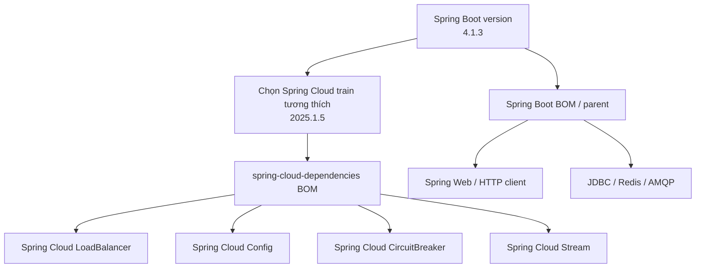
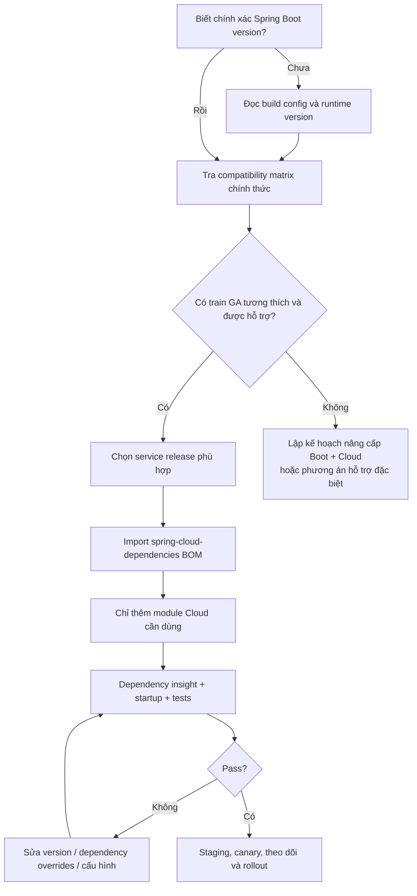
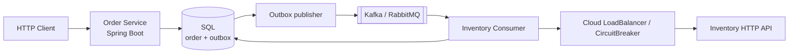

# Spring Cloud release train và tương thích với Spring Boot

Một ứng dụng Spring Boot kết nối tới hệ thống tồn kho qua HTTP, lấy cấu hình từ Config Server, dùng service discovery, giới hạn lỗi bằng circuit breaker hoặc tiêu thụ thông điệp qua broker thường cần nhiều thư viện **Spring Cloud**. Nếu các thư viện này được chọn phiên bản riêng lẻ mà không kiểm soát mối quan hệ với **Spring Boot**, ứng dụng có thể biên dịch thành công nhưng thất bại khi khởi động, thiếu bean, báo `NoSuchMethodError` hoặc vận hành sai do hợp đồng API đã thay đổi.

Spring Cloud giải quyết vấn đề bằng **release train**: một bộ phiên bản được phát hành và kiểm tra tương thích cùng nhau, với một **Bill of Materials (BOM)** để quản lý các dependency thuộc Spring Cloud. Tuy nhiên, release train chỉ phù hợp với **một số nhánh Spring Boot nhất định**. Chọn đúng cặp Boot–Cloud là bước thiết kế nền tảng trước khi viết bất kỳ adapter tích hợp nào.

Bài thuộc chương **Thư viện bổ sung** của module **SPRING_BOOT_INTEGRATION**. Module tập trung vào tích hợp Spring Boot qua HTTP client, SQL, cache, broker và các adapter Spring Integration, cùng việc quản lý cấu hình, hợp đồng dữ liệu, giao dịch, lỗi, trùng lặp, kiểm thử và quan sát. Vì thế, ngoài khái niệm release train, bài trình bày cách quản lý version thực tế, phát hiện sai lệch, nâng cấp, kiểm thử và đánh giá tác động đến luồng tích hợp.

> **Mốc thông tin:** Các ví dụ phiên bản được minh họa theo thông báo chính thức công bố đến **21/11/2026**. Release train, patch và thời hạn hỗ trợ thay đổi theo thời gian; luôn đối chiếu trang tương thích và release notes chính thức trước khi áp dụng cho một dự án khác.

## 1. Mục tiêu học tập

Sau bài này, bạn có thể:

1. Giải thích khác biệt giữa **Spring Boot**, **Spring Framework**, **Spring Cloud** và **Spring Cloud release train**.
2. Hiểu cách đặt tên release train, service release, GA, milestone và release candidate.
3. Tra cứu và lựa chọn cặp Spring Boot–Spring Cloud tương thích, không nhầm **tương thích** với **còn được bảo trì**.
4. Dùng `spring-cloud-dependencies` BOM đúng cách trong Maven và Gradle cùng cơ chế quản lý dependency của Boot.
5. Biết khi nào cần thư viện Spring Cloud, khi nào chỉ cần Spring Boot/Spring Integration/Spring Kafka/Spring AMQP.
6. Chẩn đoán lỗi tương thích bằng compatibility verifier, dependency tree và kiểm thử.
7. Lập kế hoạch nâng cấp một luồng HTTP–SQL–broker mà vẫn kiểm soát lỗi, dữ liệu trùng và khả năng quan sát.

## 2. Spring Boot và Spring Cloud có quan hệ gì?

### 2.1. Vai trò của từng lớp

| Thành phần | Mục đích | Ví dụ trong hệ thống tích hợp |
| --- | --- | --- |
| **Spring Framework** | Core container, dependency injection, MVC/WebFlux, transaction, HTTP client và nhiều abstraction nền | `RestClient`, `WebClient`, `@Transactional` |
| **Spring Boot** | Auto-configuration, starter, application lifecycle, cấu hình và vận hành | `spring-boot-starter-webmvc`, Actuator, datasource setup |
| **Spring Cloud** | Các pattern của hệ thống phân tán: cấu hình, discovery, load balancing, gateway, circuit breaker, stream... | Spring Cloud Config, LoadBalancer, Gateway, Stream |
| **Spring Data** | Kho dữ liệu và repository abstraction | JPA, JDBC, Redis, MongoDB, Elasticsearch |
| **Spring Integration** | Enterprise integration patterns: message channel, transformer, router và adapter | `IntegrationFlow` |
| **Spring for Apache Kafka / Spring AMQP** | Client và listener tích hợp broker cụ thể | `@KafkaListener`, `@RabbitListener` |

**Spring Cloud không phải “bản nâng cấp Spring Boot”**. Nó là một tập dự án bổ sung cho các pattern phân tán, được phát triển trên nền Spring Boot/Framework tương thích. Một ứng dụng dùng HTTP client, JDBC, Redis và RabbitMQ **không bắt buộc** phải thêm Spring Cloud nếu các thư viện Boot/Spring hiện có đã đáp ứng yêu cầu.

### 2.2. Release train quản lý nhiều dự án cùng lúc

Giả sử hệ thống sử dụng:

- Spring Cloud Config để tải cấu hình tập trung.
- Spring Cloud LoadBalancer để gọi các instance của một service.
- Spring Cloud CircuitBreaker để giới hạn tác động của API ngoài bị lỗi.
- Spring Cloud Stream để gắn business event với broker.
- Spring Cloud Gateway để định tuyến HTTP tại biên hệ thống.

Nếu chọn mỗi module một phiên bản ngẫu nhiên, chúng có thể yêu cầu các bản Spring Cloud Commons, Spring Framework, Reactor hoặc thư viện bên thứ ba khác nhau.

**Release train** cung cấp một tập phiên bản của các dự án Cloud được phối hợp phát hành. Ứng dụng chọn **một phiên bản release train**, import BOM và thường **không tự ghi version** cho từng artifact thuộc phạm vi quản lý của BOM.



Sơ đồ thể hiện **quản lý dependency** chứ không ám chỉ tất cả thư viện được tải vào ứng dụng. Chỉ thêm starter hoặc module nào được sử dụng thực sự.

## 3. Hiểu tên release train và trạng thái phát hành

### 3.1. Cách đặt tên theo lịch

Các release train Spring Cloud hiện đại thường dùng **Calendar Versioning (CalVer)**. Một tên như `2025.1.5` có thể diễn giải:

- `2025`: năm của dòng release train.
- `1`: số dòng phát hành trong năm (không phải Java 1 hay Spring Boot 1).
- `5`: service release/patch thứ năm của dòng đó theo cách đặt tên của Spring Cloud.

Bản `2025.1` còn có tên mã **Oakwood**, `2025.0` là **Northfields**, `2026.0` là **Paddington**. Tên mã giúp thảo luận lịch sử phát hành nhưng **không thay thế version trong BOM**.

Một train **không bảo đảm** tất cả artifact con có version bằng `2025.1.5`. Ví dụ, cùng một train có thể quản lý Spring Cloud Commons `5.0.x`, Gateway `5.0.x` hoặc CircuitBreaker theo nhánh riêng. Hãy để BOM giải quyết version cụ thể.

### 3.2. GA, service release và bản preview

| Loại | Cách hiểu | Chính sách lựa chọn |
| --- | --- | --- |
| **GA / RELEASE** | Bản phát hành chính thức để sử dụng rộng rãi | Ưu tiên cho production nếu còn được hỗ trợ |
| **Service release / patch** | Cập nhật sửa lỗi/bảo mật cho cùng train | Thường nên chọn patch phù hợp mới nhất của train |
| **M / milestone** | Bản xem trước tính năng | Chỉ đánh giá/thử nghiệm theo chính sách dự án |
| **RC / release candidate** | Ứng viên trước GA | Kiểm thử chuẩn bị nâng cấp, không mặc định dùng production |
| **SNAPSHOT** | Bản build phát triển có thể thay đổi | Tránh dùng cho build cần tái lập và production |

Không được suy luận **“năm lớn hơn luôn tốt hơn”**. Spring Cloud `2026.0.0` chỉ nên ghép với dòng Spring Boot được xác nhận tương thích; không thay `2025.1.x` bằng `2026.0.0` trong một ứng dụng còn chạy Boot `4.1.x` mà chưa nâng Boot và kiểm thử.

### 3.3. Release train, BOM và plugin là ba khái niệm khác nhau

- **Release train**: tập dự án/phiên bản Spring Cloud được phát hành cùng nhau.
- **BOM**: POM khai báo `dependencyManagement` để chọn version cho nhiều artifact mà không tự thêm dependency.
- **Maven/Gradle plugin**: công cụ build và đóng gói ứng dụng, ví dụ `spring-boot-maven-plugin` hoặc `org.springframework.boot` Gradle plugin.

Import BOM **không tự bật** Config Server, service discovery hoặc circuit breaker. Để dùng tính năng, vẫn phải thêm starter/module, khai báo bean/cấu hình và kiểm thử hành vi.

## 4. Ma trận tương thích Spring Boot–Spring Cloud

Tại thời điểm **21/11/2026**, nguồn chính thức của Spring đưa ra các cặp phiên bản tiêu biểu sau:

| Spring Boot | Spring Cloud release train phù hợp | Tên mã | Ghi chú |
| --- | --- | --- | --- |
| **4.2.x** | **2026.0.x** | Paddington | `2026.0.0` GA ngày 20/11/2026, dựa trên Boot `4.2.0` |
| **4.1.x** | **2025.1.x** | Oakwood | Hỗ trợ Boot 4.1 bắt đầu từ `2025.1.2` |
| **4.0.x** | **2025.1.x** | Oakwood | Dòng Cloud cùng nhóm Boot 4.0/4.1, theo patch tương thích |
| **3.5.x** | **2025.0.x** | Northfields | Đối chiếu trạng thái bảo trì riêng |
| **3.4.x** | **2024.0.x** | Moorgate | Dòng cũ; xem EOL trước khi lựa chọn |
| **3.3.x / 3.2.x** | **2023.0.x** | Leyton | Boot 3.3 từ `2023.0.2` |
| **3.1.x / 3.0.x** | **2022.0.x** | Kilburn | Boot 3.1 từ `2022.0.3`; dòng lịch sử |

**Nguồn để đối chiếu:** [Trang Spring Cloud — bảng release train](https://spring.io/projects/spring-cloud/), [Spring Cloud supported versions](https://github.com/spring-cloud/spring-cloud-release/wiki/Supported-Versions) và [thông báo phát hành 2026.0.0 ngày 20/11/2026](https://spring.io/blog/2026/11/20/spring-cloud-2026-0-0-has-been-released/).

Hai vấn đề cần lưu ý:

1. **Tương thích không đồng nghĩa còn hỗ trợ OSS.** Bản cũ có thể vẫn được ghi trong bảng tương thích vì phục vụ tra cứu lịch sử, nhưng đã hết bảo trì công khai. Kiểm tra thông tin hỗ trợ tại [Spring Cloud Support](https://spring.io/projects/spring-cloud/#support) và [Spring project generations](https://spring.io/projects/generations).
2. **Độ hạt phiên bản quan trọng.** Một train có thể bổ sung hỗ trợ một phiên bản Boot mới ở một **service release cụ thể**. Vì vậy, chỉ nói “Cloud 2025.1 với Boot 4.1” là thiếu chính xác nếu chọn `2025.1.0`/`2025.1.1`. Phải kiểm tra mức patch đã công bố tương thích.

### 4.1. Hai ví dụ cụ thể tại mốc học bài

**Ví dụ A — Ứng dụng đang dùng Spring Boot 4.1.3:** có thể sử dụng Spring Cloud `2025.1.5`. Bản Cloud này được phát hành ngày 20/11/2026 và nằm trong train đã bổ sung hỗ trợ Boot 4.1 từ `2025.1.2`. Khi triển khai vẫn phải kiểm thử stack Java, plugin và các starter thực tế.

**Ví dụ B — Ứng dụng mới trên Spring Boot 4.2.0:** Spring Cloud `2026.0.0` được công bố GA ngày 20/11/2026, phát triển dựa trên Boot `4.2.0`. Đây là một **cặp khác**, không phải chỉ thay mỗi version BOM trên ứng dụng Boot 4.1 mà giữ nguyên runtime.

Với ứng dụng mới, nên ưu tiên những cặp **GA và còn được hỗ trợ** đáp ứng chính sách triển khai. Với ứng dụng cũ, cần lập kế hoạch cập nhật cả Boot lẫn Cloud khi nhánh đang dùng hết bảo trì.

## 5. Quy trình chọn version đúng

### 5.1. Bắt đầu từ Spring Boot, không từ artifact Cloud

Quy trình khuyến nghị:

1. Xác định phiên bản Spring Boot chính xác đang chạy trong build và runtime, ví dụ `4.1.3`.
2. Tra bảng **Release Trains** trên trang Spring Cloud hoặc dùng `start.spring.io` chọn Boot version cùng project Cloud cần dùng.
3. Chọn train tương thích, sau đó chọn **service release phù hợp** trong train, ưu tiên GA và bản vá mới đang được hỗ trợ.
4. Kiểm tra JDK, Spring Framework, runtime/container, Maven/Gradle, Gradle plugin và các module Cloud thực sự sử dụng.
5. Import một Spring Cloud BOM cho ứng dụng và để quản lý version module Cloud theo BOM.
6. Kiểm tra dependency tree và startup compatibility verifier.
7. Chạy unit test, HTTP contract test, broker/SQL integration test và smoke test trước khi triển khai.

Ví dụ với app Boot `4.1.x`, đừng tra từ `spring-cloud-gateway` artifact mới nhất rồi suy ra Cloud train; hãy chọn **train từ Boot version** và để BOM quyết định Gateway tương ứng.

### 5.2. Một bảng quyết định đơn giản



BOM giải quyết phần lớn **version alignment**, không tự chứng minh business flow an toàn khi lỗi. Những thay đổi config, authentication, retry, listener acknowledgment hoặc JSON serialization vẫn cần được kiểm thử.

## 6. Cấu hình Maven: Boot parent và Spring Cloud BOM

Ví dụ dưới đây dùng cặp đã đối chiếu: **Spring Boot 4.1.3 + Spring Cloud 2025.1.5**.

### 6.1. POM tối thiểu

```xml
<project xmlns="http://maven.apache.org/POM/4.0.0"
         xmlns:xsi="http://www.w3.org/2001/XMLSchema-instance"
         xsi:schemaLocation="http://maven.apache.org/POM/4.0.0
                             https://maven.apache.org/xsd/maven-4.0.0.xsd">
    <modelVersion>4.0.0</modelVersion>

    <groupId>com.example.integration</groupId>
    <artifactId>inventory-adapter</artifactId>
    <version>1.0.0-SNAPSHOT</version>

    <parent>
        <groupId>org.springframework.boot</groupId>
        <artifactId>spring-boot-starter-parent</artifactId>
        <version>4.1.3</version>
        <relativePath/>
    </parent>

    <properties>
        <java.version>17</java.version>
        <spring-cloud.version>2025.1.5</spring-cloud.version>
    </properties>

    <dependencyManagement>
        <dependencies>
            <dependency>
                <groupId>org.springframework.cloud</groupId>
                <artifactId>spring-cloud-dependencies</artifactId>
                <version>${spring-cloud.version}</version>
                <type>pom</type>
                <scope>import</scope>
            </dependency>
        </dependencies>
    </dependencyManagement>

    <dependencies>
        <dependency>
            <groupId>org.springframework.cloud</groupId>
            <artifactId>spring-cloud-starter-loadbalancer</artifactId>
        </dependency>

        <dependency>
            <groupId>org.springframework.boot</groupId>
            <artifactId>spring-boot-starter-test</artifactId>
            <scope>test</scope>
        </dependency>
    </dependencies>
</project>
```

Giải thích:

- `spring-boot-starter-parent` chọn cấu hình build và các version được Boot quản lý; không tự sửa Spring Framework hay Jackson version khi chưa có lý do phù hợp.
- `spring-cloud-dependencies` chỉ **quản lý dependency**: nó không tự thêm `spring-cloud-starter-loadbalancer`.
- `spring-cloud.version` là version **train BOM**, không phải version cần đặt lên mỗi starter.
- Dependency `spring-cloud-starter-loadbalancer` **không khai báo `<version>`** vì BOM quản lý.
- `java.version` cần phù hợp yêu cầu Java của stack đang dùng và image production.
- Maven wrapper (`./mvnw`) và plugin version cũng phải phù hợp JDK/toolchain, nhưng Cloud BOM không quản lý tất cả plugin.

### 6.2. Nếu không dùng Spring Boot parent

Một dự án dùng parent của tổ chức có thể import Spring Boot BOM bên cạnh Cloud BOM trong `dependencyManagement`:

```xml
<dependencyManagement>
    <dependencies>
        <dependency>
            <groupId>org.springframework.boot</groupId>
            <artifactId>spring-boot-dependencies</artifactId>
            <version>4.1.3</version>
            <type>pom</type>
            <scope>import</scope>
        </dependency>
        <dependency>
            <groupId>org.springframework.cloud</groupId>
            <artifactId>spring-cloud-dependencies</artifactId>
            <version>2025.1.5</version>
            <type>pom</type>
            <scope>import</scope>
        </dependency>
    </dependencies>
</dependencyManagement>
```

Đây chỉ là phần `dependencyManagement`, chưa phải POM độc lập. Cần khai báo dependencies/plugins theo project.

Khi dùng hai BOM, phải hiểu **quy tắc precedence của Maven dependencyManagement** và các entry bị trùng, thay vì dựa vào trực giác “BOM import sau sẽ thắng”. Maven có quy tắc riêng với dependencyManagement ở POM hiện tại, imported BOM và thứ tự import; hãy xem **effective POM và dependency tree** để biết version cuối cùng. Không gắn version thủ công cho cùng một artifact ở nhiều nơi.

## 7. Cấu hình Gradle: import BOM vào build

Ví dụ **Groovy DSL** với cặp Boot–Cloud tương tự:

```groovy
plugins {
    id 'java'
    id 'org.springframework.boot' version '4.1.3'
    id 'io.spring.dependency-management' version '1.1.7'
}

group = 'com.example.integration'
version = '1.0.0-SNAPSHOT'

java {
    toolchain {
        languageVersion = JavaLanguageVersion.of(17)
    }
}

repositories {
    mavenCentral()
}

ext {
    set('springCloudVersion', '2025.1.5')
}

dependencyManagement {
    imports {
        mavenBom "org.springframework.cloud:spring-cloud-dependencies:${springCloudVersion}"
    }
}

dependencies {
    implementation 'org.springframework.cloud:spring-cloud-starter-loadbalancer'
    testImplementation 'org.springframework.boot:spring-boot-starter-test'
}

tasks.named('test') {
    useJUnitPlatform()
}
```

Trong ví dụ:

1. Plugin Spring Boot chọn logic build/packaging cho ứng dụng Boot.
2. Plugin `io.spring.dependency-management` cung cấp DSL `dependencyManagement` và khả năng import Maven BOM. Version plugin `1.1.7` là ví dụ cần đối chiếu với Gradle/Boot thực tế khi nâng cấp.
3. Cloud BOM quản lý version starter Cloud, nên dependency `spring-cloud-starter-loadbalancer` không ghi version riêng.
4. Boot plugin và Boot BOM vẫn cần được quản lý phù hợp; **Cloud BOM không thay thế** Boot plugin hoặc dependency management cho Spring Boot.

### 7.1. Cách khác: Gradle native platform

Gradle hỗ trợ import BOM như một `platform`. Ví dụ **đoạn dependency**:

```groovy
dependencies {
    implementation platform(
        'org.springframework.cloud:spring-cloud-dependencies:2025.1.5'
    )
    implementation 'org.springframework.cloud:spring-cloud-starter-loadbalancer'
}
```

Nếu dùng cách native này, phải **đảm bảo dependency management cho Boot đã được cài đặt** (ví dụ import Boot BOM tương ứng hoặc dùng cơ chế được plugin/dự án áp dụng). Không trộn `platform`, `enforcedPlatform` và plugin dependency management một cách ngẫu nhiên vì cách Gradle giải quyết version/constraint có thể thay đổi kết quả.

**Nguyên tắc:** Chọn một chính sách dependency management nhất quán cho repository và kiểm tra `runtimeClasspath` thực tế, không chỉ nhìn file `build.gradle`.

## 8. Kiểm tra BOM đã thực sự quản lý version chưa

### 8.1. Maven

Các lệnh chẩn đoán, **thực hiện tại project có `pom.xml`**:

```bash
./mvnw help:effective-pom
./mvnw dependency:tree
./mvnw dependency:tree -Dincludes=org.springframework.cloud
./mvnw test
```

Trên Windows có thể dùng `mvnw.cmd` thay cho `./mvnw`. `effective-pom` giúp thấy cấu hình quản lý dependency sau kế thừa/import. `dependency:tree` cho biết artifact và version thực tế cùng nguồn transitive dependency.

Một số hệ thống build có thể dùng plugin riêng hoặc mirror repository; cú pháp/hiển thị có thể khác theo phiên bản Maven. Mục tiêu là xác nhận **phiên bản được resolve**, không chỉ đoạn khai báo.

### 8.2. Gradle

```bash
./gradlew dependencies --configuration runtimeClasspath
./gradlew dependencyInsight --dependency spring-cloud-commons --configuration runtimeClasspath
./gradlew dependencyInsight --dependency spring-cloud-loadbalancer --configuration runtimeClasspath
./gradlew test
```

`dependencyInsight` chỉ ra vì sao một version được chọn và những constraint xung đột. Nó hữu ích khi ứng dụng import thêm BOM từ thư viện khác, hoặc một module nội bộ kéo theo Spring Cloud phiên bản cũ.

### 8.3. Khi thấy version sai

Hãy xác minh theo thứ tự:

1. Build đang dùng đúng file/branch và đúng Maven/Gradle wrapper không?
2. Boot plugin/parent/BOM đang ở phiên bản nào?
3. Có chính xác **một release train Cloud chủ đạo** trong application dependency graph không?
4. Có version Cloud được ép trực tiếp ở `dependencies`, `resolutionStrategy` hoặc dependency constraints không?
5. Có multi-module project dùng BOM khác nhau giữa các module không?
6. Có transitive library kéo version Cloud cũ không? Dependency management có thật sự ghi đè/align không?
7. Có profile hoặc repository snapshot khiến build trên CI khác máy cá nhân không?

Không chữa mọi lỗi bằng cách thêm `exclude group: 'org.springframework.cloud'` bừa bãi; có thể làm thiếu module bắt buộc và tạo lỗi startup mới.

## 9. Compatibility verifier của Spring Cloud

Một số dòng Spring Cloud Commons cung cấp **compatibility verifier** để kiểm tra phiên bản Spring Boot trên classpath khi ứng dụng khởi động. Nếu cặp Boot–Cloud không phù hợp, ứng dụng có thể báo startup failure với gợi ý phiên bản tương thích.

Ví dụ minh họa nội dung lỗi:

```text
APPLICATION FAILED TO START

Description:
Your project setup is incompatible with our requirements.
Spring Boot [x.y.z] is not compatible
with this Spring Cloud release train.

Action:
Use a supported Spring Boot version or
select a compatible Spring Cloud release train.
```

Thông điệp thực tế khác nhau theo phiên bản. Tài liệu Spring Cloud Commons mô tả các thuộc tính:

```properties
spring.cloud.compatibility-verifier.enabled=false
spring.cloud.compatibility-verifier.compatible-boot-versions=4.1.x
```

**Đây là thông tin để chẩn đoán, không phải giải pháp nâng cấp.**

- `enabled=false` có thể tắt kiểm tra trên những phiên bản có cơ chế này; **không làm các API trở nên tương thích**.
- `compatible-boot-versions` cho phép ghi đè tập version được verifier xem là chấp nhận được trong các phiên bản hỗ trợ; không nên dùng nó để “hợp thức hóa” một cặp không được phát hành cùng nhau.
- Default/việc bật verifier có thể khác giữa các thế hệ và loại module được nạp. Nếu không thấy verifier chạy, không được kết luận tổ hợp dependency đã an toàn.

Ví dụ: ép Spring Boot `4.2.x` chạy cùng Cloud `2025.1.x` có thể khiến ứng dụng vượt qua một bước kiểm tra nếu tắt verifier, nhưng vẫn có khả năng lỗi liên kết nhị phân, auto-configuration hoặc hành vi runtime. **Cách sửa là chọn train chính thức phù hợp**, không giấu cảnh báo.

Nguồn: [Spring Cloud Commons — Compatibility Verification](https://docs.spring.io/spring-cloud-commons/reference/spring-cloud-commons/common-abstractions.html).

## 10. Vì sao sai phiên bản thường gây lỗi khó hiểu?

### 10.1. Các dạng sai lệch

| Nhóm sai lệch | Triệu chứng | Nguyên nhân điển hình |
| --- | --- | --- |
| **Spring Boot–Cloud train** | Startup fail, compatibility warning | Ghép Boot với train không phù hợp |
| **Spring Framework API** | `NoSuchMethodError`, `ClassNotFoundException` | Library được build theo API khác |
| **Auto-configuration** | Không có bean, bean trùng, condition không khớp | Starter/module thay đổi giữa các thế hệ |
| **Java runtime** | `UnsupportedClassVersionError` | Chạy JDK thấp hơn yêu cầu bytecode |
| **Jakarta/Javax migration** | Thiếu class annotation/servlet | Thư viện cũ dùng `javax.*`, stack mới dùng `jakarta.*` |
| **Reactor/Netty/HTTP client** | Lỗi runtime hoặc timeout bất thường | Version/transport client không đồng bộ |
| **Serialization/schema** | Đọc message lỗi, JSON đổi cấu trúc | Nâng cấp binder/converter nhưng chưa kiểm thử contract |
| **Config precedence** | App lấy config không đúng nguồn | Thay đổi cách import/refresh config giữa bản |
| **Dependencies ngoài BOM** | Một starter chạy, module khác lỗi | Thư viện được ép version hoặc nằm ngoài quản lý của Cloud BOM |

Không phải mọi lỗi trên đều do sai Cloud train. Chúng là **dấu hiệu điều tra**: cần đối chiếu stack trace, `dependency tree`, release notes và thay đổi cấu hình trước khi kết luận.

### 10.2. Ví dụ lỗi do nâng Cloud mà giữ Boot

```text
Trước nâng cấp:
  Spring Boot 4.1.x
  Spring Cloud 2025.1.x

Thay đổi không an toàn:
  Spring Boot 4.1.x
  Spring Cloud 2026.0.x

Cách tiếp cận:
  1. Kiểm tra train đích dùng cho Boot 4.2.x.
  2. Lập nhánh nâng Boot lên nhánh tương thích.
  3. Nâng BOM Cloud theo train tương ứng.
  4. Chạy kiểm thử startup, API, SQL và broker.
  5. Rollout theo canary và sẵn phương án rollback.
```

Khi Cloud train mới đã GA không có nghĩa app hiện tại được phép thay BOM ngay. **Nâng cấp khung nền** là thay đổi tích hợp có khả năng ảnh hưởng runtime ở nhiều adapter.

## 11. Những dự án Spring Cloud liên quan module tích hợp

Chọn thư viện theo nhu cầu kỹ thuật thay vì kéo tất cả starter vào classpath.

| Công cụ | Đặt ở đâu trong kiến trúc? | Điều cần kiểm thử khi nâng cấp |
| --- | --- | --- |
| **Spring Cloud Config** | Cấp cấu hình tập trung cho application | Config import, quyền truy cập, refresh, secret handling |
| **Spring Cloud LoadBalancer** | Lựa chọn instance service cho HTTP client | Service ID, danh sách instance, timeout, fallback |
| **Spring Cloud CircuitBreaker** | Bảo vệ outbound call với circuit breaker/time limiter | Ngưỡng lỗi, trạng thái OPEN, retry và deadline |
| **Spring Cloud Gateway** | Inbound/outbound routing ở biên hệ thống | Route, filter, auth, header, caching, timeout |
| **Spring Cloud OpenFeign** | Khai báo HTTP client dựa trên interface | Contract/path/headers, retry, serialization |
| **Spring Cloud Stream** | Abstraction cho function/message và binder tới broker | Serializer, consumer group, binder mapping, retry, DLQ |
| **Spring Cloud Vault** | Đọc secret từ Vault qua cấu hình phù hợp | Auth, refresh, rotation, quyền truy cập |
| **Discovery integration** | Tìm instance từ registry/discovery | Khả năng đăng ký, health, service naming |
| **Spring Cloud Task** | Vòng đời short-lived task/batch | Job lifecycle, metadata persistence, failure recovery |

### 11.1. Không nhầm Spring Cloud Stream với Spring Integration

- **Spring Cloud Stream** thường dùng để xây ứng dụng message-driven qua binder (ví dụ Kafka/RabbitMQ), dựa trên các abstraction/function model mà Cloud Stream cung cấp.
- **Spring Integration** mô tả những flow với `MessageChannel`, `IntegrationFlow`, gateway, router, transformer, filter và adapter.
- **Spring Kafka/Spring AMQP** cung cấp API và listener trực tiếp cho broker tương ứng.

Chúng có thể **phối hợp** trong một ứng dụng, nhưng không phải quan hệ thay thế bắt buộc một-một. Release train Cloud quản lý các artifact **Spring Cloud Stream** thuộc train; không nên suy luận nó quản lý mọi thành phần của Spring Integration, Spring Data, JDBC driver hoặc broker runtime.

### 11.2. HTTP service interface và OpenFeign

Spring Framework có `@HttpExchange` và `HttpServiceProxyFactory`; Spring Cloud OpenFeign có client contract riêng. Hai cách đều có thể khai báo HTTP client bằng interface, nhưng chúng có:

- Annotation/khả năng bind argument khác nhau.
- Cách cấu hình transport, retry, load balancing và observation khác nhau.
- Dependency, compatibility và vòng đời dự án khác nhau.

Nếu chỉ cần một HTTP outbound client, không mặc định phải đưa OpenFeign vào. Với Spring Boot phù hợp, có thể dùng `RestClient`/`WebClient` và các adapter cần thiết, thêm LoadBalancer/CircuitBreaker nếu đúng nhu cầu. Chọn dựa trên convention của codebase và chi phí vận hành.

## 12. Ví dụ luồng tích hợp chịu ảnh hưởng của dependency version

Một service đặt hàng thực hiện:

1. Nhận HTTP request tạo đơn.
2. Ghi order và outbox trong một SQL transaction.
3. Publisher gửi `OrderCreated` qua broker.
4. Consumer gọi Inventory Service qua một HTTP client có service discovery/load balancing.
5. Ghi trạng thái kết quả và phát sự kiện tiếp theo.



### 12.1. Dependency liên quan

| Thành phần | Ví dụ thư viện | Nguồn quản lý version thường dùng |
| --- | --- | --- |
| HTTP server/client | Spring Web MVC, `RestClient` | Spring Boot BOM / Spring Framework |
| SQL transaction/JDBC | `spring-boot-starter-jdbc`, JDBC driver | Spring Boot BOM + vendor |
| Cloud LoadBalancer | `spring-cloud-starter-loadbalancer` | Spring Cloud BOM |
| Circuit breaker | Spring Cloud CircuitBreaker starter | Spring Cloud BOM |
| Message abstraction | Spring Cloud Stream/binder | Spring Cloud BOM, binder compatibility |
| Broker client trực tiếp | Spring for Apache Kafka/AMQP | Spring Boot BOM và BOM liên quan |
| Enterprise Integration Patterns | Spring Integration | Spring Boot/Spring Integration dependency management tương ứng |

Chọn đúng train Cloud đảm bảo một lớp **dependency compatibility** trong những thành phần do train quản lý, nhưng không thay thiết kế nghiệp vụ.

### 12.2. Các bất biến cần bảo vệ khi nâng cấp

- **Hợp đồng dữ liệu:** JSON/event schema, content type, header, timestamp, mã lỗi và tên topic/queue không đổi ngoài ý muốn.
- **Giao dịch:** `@Transactional` với SQL không bao phủ HTTP/broker; pattern outbox/inbox vẫn cần hoạt động.
- **Idempotency:** cùng `eventId`/`operationId` không tạo side effect hai lần sau retry.
- **Error handling:** timeout/429/5xx được phân loại; retry không vô hạn.
- **Thứ tự:** consumer không ghi đè trạng thái mới bằng sự kiện có version cũ.
- **Security:** token/client credentials/TLS và quyền truy cập sau nâng cấp vẫn đúng.
- **Observability:** các metric, span, log field và correlation ID còn đủ cho điều tra.

Nhiều lỗi ở đây **không gây compile error**. Vì thế chỉ chạy `./mvnw package` không đủ để kết luận upgrade an toàn.

## 13. Kế hoạch nâng cấp Spring Boot và Spring Cloud

Một chiến lược đáng tin thường có các bước:

### 13.1. Trước nâng cấp

- Ghi lại cặp Boot–Cloud hiện tại, version Java, Maven/Gradle plugin, các BOM và dependency override.
- Kiểm tra hiện trạng bảo trì, CVE, release notes và các thay đổi breaking.
- Liệt kê adapter đang dùng: HTTP, SQL, Redis/cache, Kafka/RabbitMQ, Spring Integration, Cloud Gateway/Config/LoadBalancer.
- Ghi baseline: startup success, test pass rate, HTTP p95 latency, consumer lag, tỷ lệ lỗi, số sự kiện trùng và thời gian phục hồi.
- Đặt tiêu chí rollback, cửa sổ triển khai và chủ sở hữu quyết định.

### 13.2. Thực hiện nâng cấp theo cặp

Nếu nâng từ Boot `4.1.x`/Cloud `2025.1.x` sang Boot `4.2.x`/Cloud `2026.0.x`:

1. Tạo nhánh nâng cấp, cập nhật Boot và Cloud theo **cặp tương thích**, không đẩy riêng một nửa lên production.
2. Kiểm tra Java/toolchain và build plugin.
3. Loại bỏ override không cần thiết; import đúng BOM.
4. Xem release notes của từng starter Cloud thực tế đang sử dụng.
5. Sửa các API deprecated/removed và thay đổi cấu hình.
6. Chạy dependency tree, compile, test và kiểm thử runtime.
7. Triển khai staging, canary/blue-green theo chính sách dự án, quan sát rồi tăng lưu lượng.

**Ví dụ version ở đây là cặp cụ thể tại 21/11/2026, không phải lời khuyên dùng số version cố định mãi mãi.** Khi đang giữ một ứng dụng trên dòng Cloud cũ, ưu tiên patch bảo mật hợp lệ trong train và lập kế hoạch nâng major/minor riêng.

### 13.3. Các lớp kiểm thử bắt buộc

| Lớp test | Điều cần xác minh |
| --- | --- |
| **Dependency resolution** | Không có version Cloud trôi hoặc artifact bị ép sai |
| **Application context test** | Các bean HTTP/Cloud/SQL/broker được tạo đúng |
| **HTTP contract test** | Method, path, header, auth, JSON, status/error mapping |
| **SQL integration test** | Driver, migration, transaction, unique constraint |
| **Broker integration test** | Serialization, routing, consumer group, ack, DLQ, retry |
| **Failure injection** | Timeout, 429/503, mất broker, duplicate, crash giữa các bước |
| **Security test** | Credential/config import, TLS, phân quyền, tenant isolation |
| **End-to-end / smoke** | Luồng đặt hàng chạy đúng xuyên các adapter |
| **Observability check** | HTTP metrics, tracing, correlation ID, consumer lag |

Có thể dùng **Testcontainers** để dựng PostgreSQL/Redis/broker cho integration test và mock HTTP server để kiểm tra API đối tác. Một phần khác của hợp đồng cần sandbox hoặc environment gần production để kiểm tra đúng network/TLS và các hệ thống không chạy được trong container.

### 13.4. Rollback phải xét đến dữ liệu

Rollback code/BOM không tự rollback schema SQL, event schema hoặc message đang nằm trong broker. Khi deploy phiên bản mới, nên:

- Ưu tiên migration có tính tương thích tiến/lùi khi có thể.
- Không đổi event schema phá consumer cũ trước khi tất cả consumer nâng cấp.
- Chạy đồng thời trong giai đoạn chuyển tiếp với chiến lược dual-read/dual-write có kiểm soát nếu cần.
- Thiết kế retry/idempotency xuyên phiên bản để message cũ có thể được xử lý lại.
- Giữ cơ chế replay, đối soát và rollback plan dựa trên **dữ liệu thực**, không chỉ image ứng dụng.

## 14. Tình huống lỗi thường gặp và hướng xử lý

| Triệu chứng | Hướng kiểm tra | Không nên làm |
| --- | --- | --- |
| `Spring Boot ... incompatible` khi startup | Tra matrix, chọn Cloud BOM đúng train và patch | Tắt verifier rồi bỏ qua |
| `NoSuchMethodError` / `ClassNotFoundException` | `dependencyInsight`/`dependency:tree`, API release notes | Thêm nhiều jar trùng version |
| Một module Cloud mới hơn phần còn lại | BOM/override/transitive dependency | Ép từng module một cách thủ công |
| `@LoadBalanced` client không gọi được service | Starter LoadBalancer, service discovery, bean và service ID | Quy mọi lỗi cho BOM khi thiếu config |
| Config Server import lỗi | `spring.config.import`, credentials, Config Client/Server version | Commit secret vào source để “thử cho nhanh” |
| Gateway route thay đổi sau upgrade | Route definition, filter order, handler stack MVC/WebFlux | Rollout toàn bộ khi chưa có contract test |
| Consumer bị lỗi deserialize message cũ | Schema version, serializer, binder config | Xóa queue để che vấn đề |
| Retry tạo hai đơn/phiếu giữ hàng | Idempotency key, inbox/outbox, ack policy | Nghĩ Spring Cloud tự bảo đảm exactly-once |
| CI pass nhưng production fail | JDK/plugin, runtime classpath, auth, TLS, broker version | Chỉ kiểm tra unit test |
| Module dùng Boot BOM và Cloud BOM khác nhau giữa subprojects | Centralized version catalog/BOM, dependency tree mỗi module | Giữ mỗi module tự “chọn bản mới nhất” |

Nếu lỗi xảy ra **sau** nâng cấp, bước đầu tiên thường nên là so sánh dependency graph và thay đổi cấu hình với bản trước, thay vì vội sửa business logic.

## 15. Quản lý version trong multi-module repository

Trong một mono-repo có các module `common`, `http-adapter`, `messaging-adapter` và `service-app`:

- Dùng quy tắc **thống nhất train Cloud** ở application build/parent hoặc platform/version catalog.
- Không để hai module đóng gói những phiên bản Spring Cloud Commons khác nhau vào cùng runtime.
- Module thư viện chung nên khai báo API dependency thật sự cần, tránh bắt mọi consumer phải kéo cả Cloud starter không liên quan.
- Với `java-library` Gradle, cân nhắc phạm vi `api`/`implementation`/`runtimeOnly` để không làm lộ phụ thuộc không cần thiết.
- Kiểm tra **runtime classpath ở ứng dụng cuối** vì lỗi tương thích thường xuất hiện ở nơi toàn bộ dependency graph được ghép lại.
- Khi triển khai nhiều service độc lập, chúng có thể nâng cấp Boot/Cloud theo lịch riêng **nếu giao tiếp qua contract tương thích** (HTTP, message schema), không cần ép mọi service cùng version vào một ngày.

**Phiên bản runtime của hai microservice độc lập không nhất thiết trùng nhau.** Một service Boot 4.2 và một service Boot 4.1 có thể giao tiếp HTTP/broker nếu hợp đồng dữ liệu, security và khả năng tương thích wire protocol đúng. Quy tắc “cùng train” áp dụng chủ yếu cho **các thư viện nằm trong cùng một ứng dụng/runtime**, không phải cho mọi tiến trình trong hệ thống phân tán.

## 16. Bảo mật, hỗ trợ và khả năng quan sát

### 16.1. Vòng đời hỗ trợ là quyết định vận hành

Một cặp Boot–Cloud **tương thích** có thể vẫn không được hỗ trợ công khai nếu đã hết vòng đời. Với hệ thống production, cần theo dõi:

- Thời hạn hỗ trợ OSS/enterprise của các dòng Boot và Cloud.
- Các bản service release vá lỗ hổng hoặc lỗi hoạt động.
- Thông báo bảo mật ảnh hưởng trực tiếp đến Gateway, Config, Stream, discovery hoặc thư viện transitive.
- Thời điểm cần chuyển sang train mới và kế hoạch cập nhật phụ thuộc.

BOM giúp điều phối version nhưng **không thay công việc quản lý rủi ro bảo mật**. Sau khi chọn phiên bản, vẫn phải chạy dependency vulnerability scan theo quy định, đọc CVE advisory và xác định phụ thuộc có thật sự được sử dụng/khai thác không.

### 16.2. Quan sát tác động của nâng cấp

Các tín hiệu cần so sánh trước và sau thay đổi:

- **Startup failure** và health/readiness của dịch vụ.
- **HTTP client latency**, timeout, 4xx/5xx, circuit breaker state và retry rate.
- **SQL pool**, transaction error, migration failure và độ trễ commit.
- **Broker consumer lag**, redelivery, DLQ và serialization error.
- **Config refresh/load failure**, số lần lấy secret thất bại.
- **Correlation ID/tracing** xuyên inbound HTTP → SQL → broker → outbound client.

Spring Boot Actuator và Micrometer hỗ trợ vận hành nếu được cấu hình đúng; thêm Cloud starter không tự bảo đảm mọi metric/span đều được xuất. Cần xác minh instrumentation và metric name phù hợp phiên bản. Không đưa token, secret, raw payload nhạy cảm hay event ID có cardinality cao vào metric labels.

## 17. Checklist lựa chọn release train

Trước khi chấp thuận một pull request thêm hoặc nâng Spring Cloud:

- [ ] Spring Boot version hiện tại được xác định rõ.
- [ ] Cloud train và **service release** được chọn từ tài liệu tương thích chính thức.
- [ ] Nhánh lựa chọn còn được hỗ trợ theo chính sách của tổ chức.
- [ ] Có đúng Spring Cloud BOM, không hardcode version ngẫu nhiên của các starter Cloud.
- [ ] Spring Boot parent/BOM, JDK và build plugin phù hợp.
- [ ] Đã xem runtime dependency tree và loại bỏ override xung đột.
- [ ] Đã đọc release notes/migration guide của các project Cloud được sử dụng.
- [ ] Application context khởi động thành công không phải nhờ tắt compatibility verifier.
- [ ] Contract test HTTP, message schema, SQL migration và integration tests đều đạt.
- [ ] Retry, idempotency, timeout, transaction boundary không thay đổi ngoài ý muốn.
- [ ] Đã xác nhận cấu hình auth/TLS/secret và observability sau nâng cấp.
- [ ] Có chiến lược staging/canary, rollback code **và** xử lý dữ liệu nếu phải khôi phục.

## 18. Câu hỏi tự kiểm tra

1. Release train Spring Cloud giải quyết vấn đề gì nếu hệ thống sử dụng Config, LoadBalancer và Stream cùng lúc?
2. Vì sao Spring Cloud `2026.0.0` không nên được thêm tùy tiện vào một ứng dụng chạy Boot `4.1.x`?
3. CalVer `2025.1.5` có phải phiên bản của `spring-cloud-gateway` trực tiếp không? Vì sao?
4. Import `spring-cloud-dependencies` BOM có tự thêm một HTTP client/broker listener vào ứng dụng không?
5. Vì sao một cặp “tương thích kỹ thuật” vẫn có thể không phù hợp triển khai production?
6. Trong Maven, vai trò của `spring-boot-starter-parent` khác gì với Spring Cloud BOM?
7. Trong Gradle, `dependencyInsight` giúp tìm điều gì sau khi import nhiều BOM?
8. Tại sao không nên xử lý lỗi compatibility verifier bằng `enabled=false`?
9. Khi nâng từ Boot 4.1/Cloud 2025.1 lên Boot 4.2/Cloud 2026.0, cần kiểm thử những ranh giới nghiệp vụ nào ngoài việc ứng dụng khởi động?
10. Hai service dùng Boot/Cloud khác phiên bản có nhất thiết không thể giao tiếp không? Yếu tố quyết định là gì?
11. Vì sao Cloud BOM không tự bảo đảm transaction SQL, message broker và HTTP side effect nguyên tử với nhau?
12. Nếu upgrade làm consumer nhận lại message nhiều lần, tính idempotency phải được kiểm tra ở những lớp nào?

### Bài tập thực hành

**Bài tập A — Chọn version:** Lập một bảng cho ba ứng dụng dùng Boot `3.5.x`, `4.1.x` và `4.2.x`. Tìm train Cloud tương ứng từ nguồn chính thức, ghi rõ **mức patch tối thiểu khi có quy định**, phiên bản GA dự định dùng và trạng thái bảo trì. Giải thích vì sao bạn không dùng một Cloud BOM chung cho tất cả runtime.

**Bài tập B — Dependency management:** Tạo hai ứng dụng đơn giản, một dùng Maven, một dùng Gradle. Cả hai cùng dùng một cặp Boot–Cloud tương thích và `spring-cloud-starter-loadbalancer`. Xem effective POM/dependency tree/Gradle dependencyInsight, xác nhận không có starter Cloud nào phải tự đặt version.

**Bài tập C — Nâng cấp tích hợp:** Giả sử service nhận `OrderCreated` từ RabbitMQ, gọi Inventory API qua HTTP và ghi kết quả vào PostgreSQL. Lập kế hoạch nâng cặp Boot–Cloud, viết kịch bản kiểm thử cho timeout, HTTP 429, duplicate message, mất kết nối database và rollback. Xác định metric nào giúp so sánh kết quả trước/sau nâng cấp.

## 19. Ghi nhớ

- **Spring Cloud release train** là tập version phối hợp của các dự án Cloud; **Spring Cloud BOM** giúp quản lý các version đó trong Maven/Gradle.
- **Spring Boot và Spring Cloud phải chọn theo cặp tương thích**, bao gồm cả **mức service release** khi một train mở rộng hỗ trợ nhánh Boot mới.
- **BOM chỉ quản lý dependency**, không tự thêm starter, không thay Boot parent/plugin và không bảo đảm logic nghiệp vụ phân tán đúng.
- **Compatibility verifier** giúp phát hiện một số cấu hình sai, nhưng tắt nó không biến một tổ hợp không được hỗ trợ thành tương thích.
- **Tương thích không có nghĩa còn được bảo trì**: cần kiểm tra hỗ trợ, bảo mật, release notes và kế hoạch nâng cấp.
- Với ứng dụng **SPRING_BOOT_INTEGRATION**, mọi thay đổi version đều phải qua kiểm thử HTTP contract, SQL transaction, cache, broker, retry, idempotency, schema và observability, không chỉ build thành công.

### Nguồn tham khảo chính thức

1. [Spring Cloud — Overview, Release Trains và BOM](https://spring.io/projects/spring-cloud/)
2. [Spring Cloud release — Supported Versions](https://github.com/spring-cloud/spring-cloud-release/wiki/Supported-Versions)
3. [Spring Cloud 2026.0.0 (Paddington) GA — 20/11/2026](https://spring.io/blog/2026/11/20/spring-cloud-2026-0-0-has-been-released/)
4. [Spring Cloud 2025.1.5 (Oakwood) — 20/11/2026](https://spring.io/blog/2026/11/20/spring-cloud-2025-1-5-has-been-released/)
5. [Spring Cloud 2025.1.2 — Bổ sung tương thích Boot 4.1](https://spring.io/blog/2026/06/11/spring-cloud-2025-1-2-aka-oakwood-has-been-released/)
6. [Spring Cloud Commons — Compatibility Verification](https://docs.spring.io/spring-cloud-commons/reference/spring-cloud-commons/common-abstractions.html)
7. [Spring Cloud release reference](https://docs.spring.io/spring-cloud-release/reference/)

**Kết luận:** Chọn đúng Spring Cloud release train theo Spring Boot là điều kiện nền tảng để hệ thống tích hợp có thể khởi động, nâng cấp và vận hành ổn định. Một nền tảng dependency đúng cần đi kèm **hợp đồng tích hợp, giới hạn giao dịch rõ ràng, kiểm thử lỗi và cơ chế quan sát**, vì release train không thể thay thế những quyết định kiến trúc đó.
