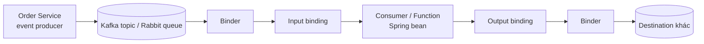
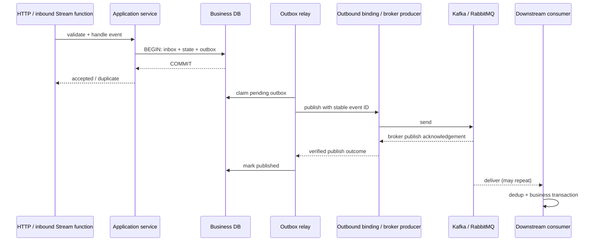
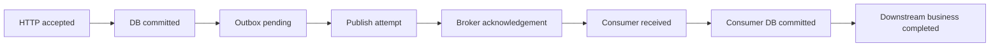

# Spring Cloud Stream, binder và mô hình hàm xử lý thông điệp

> **Chương:** Thư viện bổ sung  
> **Module:** `SPRING_BOOT_INTEGRATION` — tổ chức tích hợp hệ thống trong Spring Boot qua HTTP client, cơ sở dữ liệu, cache, broker thông điệp và các adapter Spring Integration, chú trọng cấu hình, hợp đồng dữ liệu, giao dịch, lỗi, xử lý trùng lặp, kiểm thử và quan sát các luồng tích hợp thực tế.
>
> **Lưu ý phiên bản:** Bài sử dụng mô hình lập trình **functional** của Spring Cloud Stream và Spring Cloud Function. Tên artifact, property và chức năng chi tiết của binder phụ thuộc bộ phiên bản **Spring Boot + Spring Cloud release train + Spring Cloud Stream + broker client**. Ví dụ dùng Kafka binder; khi chuyển sang RabbitMQ hoặc nhánh thư viện khác, phải đối chiếu tài liệu và chạy kiểm thử trên phiên bản thực tế.

## 1. Bài toán: một event đơn hàng đi qua nhiều hệ thống

Dịch vụ Order nhận HTTP request, commit đơn hàng vào PostgreSQL, rồi cần báo cho dịch vụ Inventory, Notification và Analytics. Mỗi bên có thời điểm xử lý, khả năng mở rộng và chiến lược retry riêng.

Một cách là gọi từng dịch vụ qua HTTP, nhưng luồng sẽ phụ thuộc độ trễ của mọi bên. Cách khác là publish event `OrderPlaced` qua Kafka hoặc RabbitMQ. Spring Cloud Stream giúp ứng dụng diễn đạt **xử lý thông điệp dưới dạng hàm Java**; việc kết nối hàm với một destination của broker được cấu hình qua **binding** và **binder**.



Trong mô hình này:

- **Hàm** quyết định phải làm gì với payload.
- **Binding** đặt tên đầu vào/đầu ra của hàm và liên kết chúng với destination.
- **Binder** hiện thực giao tiếp với middleware cụ thể.
- **Broker** vận chuyển và lưu thông điệp theo mô hình riêng.
- **Ứng dụng** vẫn phải bảo đảm hợp đồng dữ liệu, transaction, idempotency và quan sát kết quả nghiệp vụ.

Cloud Stream làm phần wiring thống nhất hơn, nhưng **không tự biến một lời gọi database và một lần gửi message thành transaction nguyên tử**.

### Mục tiêu học tập

Sau bài này, bạn có thể:

1. Phân biệt `Spring Cloud Stream`, `Spring Cloud Function`, binder, binding, destination và consumer group.
2. Viết `Supplier<T>`, `Function<T,R>` và `Consumer<T>` dưới dạng `@Bean`.
3. Cấu hình tên binding `<function>-in-0` / `<function>-out-0` và khai báo topic/queue đích.
4. Dùng `StreamBridge` để publish từ HTTP endpoint hoặc outbox relay, với hiểu biết đúng về giới hạn xác nhận gửi.
5. Biết phần nào phụ thuộc Kafka binder, Rabbit binder, native broker và phiên bản framework.
6. Thiết kế schema, retry/DLQ, inbox/outbox, kiểm thử và observability cho luồng tích hợp thật.

## 2. Spring Cloud Stream bổ sung gì cho Spring Boot?

Spring Framework cung cấp IoC, dependency injection, transaction, web và Spring Messaging. Spring Boot tổ chức starter, auto-configuration và cấu hình theo môi trường. Spring Cloud Function cho phép đăng ký, tìm và compose hàm theo mô hình Java function. **Spring Cloud Stream** gắn những hàm đó với middleware qua binder.

| Thành phần | Trách nhiệm | Ví dụ |
|---|---|---|
| **Spring Framework** | Container bean, transaction, message abstraction | `@Bean`, `@Transactional`, `Message<T>` |
| **Spring Boot** | Application startup, externalized config, Actuator | `application.yml`, bean auto-configured khi đủ điều kiện |
| **Spring Cloud Function** | Mô hình, discovery và định nghĩa hàm | `Supplier`, `Function`, `Consumer` |
| **Spring Cloud Stream** | Binding lifecycle và các abstraction xử lý message | `spring.cloud.stream.bindings.*`, `StreamBridge` |
| **Binder** | Nối một binding với middleware | Kafka binder, RabbitMQ binder |
| **Broker** | Topic/queue, vận chuyển, persistence, ACK/redelivery | Apache Kafka hoặc RabbitMQ |
| **Code nghiệp vụ** | Hợp đồng, trạng thái, dedup, retry side effect | `InventoryApplicationService.applyOnce(...)` |

**Không có “broker chung” tên là Cloud Stream.** Binder là thư viện chạy **trong ứng dụng** để kết nối tới hạ tầng broker bên ngoài, không phải một cụm broker độc lập.

### 2.1. Khi nào cần lớp abstraction này?

Ví dụ cùng một hàm `Consumer<OrderPlacedEvent>` có thể giữ nguyên phần xử lý nghiệp vụ khi chuyển cấu hình/binder từ middleware này sang middleware khác. Nhưng không được diễn giải là “đổi một dependency là tương thích hoàn toàn”: topology, key/partition, ordering, retry, DLQ, offset/ACK, retention và authentication vẫn khác nhau.

Với một dịch vụ chỉ cần `@KafkaListener` và `KafkaTemplate`, thư viện native có thể dễ hiểu và cho phép điều khiển chi tiết hơn. Với nhiều service cùng theo mô hình event-driven, muốn chuẩn hóa cách định nghĩa input/output bằng hàm, Cloud Stream thường là lựa chọn đáng cân nhắc.

## 3. Bốn lớp tên: function, binding, destination, binder

Đây là điểm dễ gây lỗi cấu hình nhất. Hãy xem ví dụ:

```yaml
spring:
  cloud:
    function:
      definition: reserveInventory
    stream:
      bindings:
        reserveInventory-in-0:
          destination: orders.placed.v1
          group: inventory-service
        reserveInventory-out-0:
          destination: inventory.commands.v1
```

Có bốn loại tên riêng:

| Tên | Giá trị trong ví dụ | Ý nghĩa |
|---|---|---|
| Function definition | `reserveInventory` | Tên **bean hàm** do Spring Cloud Function chọn |
| Input binding name | `reserveInventory-in-0` | Đầu vào chỉ số `0` của hàm |
| Output binding name | `reserveInventory-out-0` | Đầu ra chỉ số `0` của hàm |
| Destination | `orders.placed.v1` / `inventory.commands.v1` | Topic hoặc thực thể giao tiếp do binder định tuyến đến |
| Binder | Kafka binder/Rabbit binder đã chọn | Implementation kết nối middleware |

`-in-0` và `-out-0` **không phải một phần của tên Kafka topic**. Chúng là tên binding logic trong Spring Cloud Stream. Đổi tên method `reserveInventory` mà không cập nhật `spring.cloud.function.definition` và `bindings.*` có thể khiến ứng dụng không tạo binding đúng mong muốn.

### 3.1. Quy tắc tên binding sinh từ functional bean

Đối với function đơn giản, quy tắc quy ước thường là:

```text
<functionBeanName>-in-0
<functionBeanName>-out-0
```

- `Consumer<T>` có **input**, thường không có output.
- `Function<T,R>` có **input và output**.
- `Supplier<T>` có **output**, thường không có input.

Chỉ số `0` đại diện cho đầu vào/ra thứ nhất của function cơ bản. Các trường hợp nhiều đầu vào/ra, composition hoặc reactive function có quy tắc phức tạp hơn; không suy ra mọi hàm chỉ luôn có một binding.

### 3.2. Binding không phải queue vật lý

Một binding là **điểm ghép logic** giữa ứng dụng và middleware. Kafka binder thường ánh xạ destination tới topic Kafka. RabbitMQ binder dùng exchange/queue/binding tương ứng, phụ thuộc group và cấu hình. Một tên destination giống nhau không bảo đảm topology vật lý hay semantics giống nhau giữa hai binder.

### 3.3. Group và danh tính consumer

`group: inventory-service` giúp các instance cùng vai trò chia sẻ xử lý theo cơ chế của broker:

- **Kafka binder:** group thường ánh xạ sang Kafka consumer group; các consumer trong cùng group phân chia partition và quản lý offset theo cấu hình.
- **Rabbit binder:** named group thường dẫn đến queue có danh tính tương ứng, nơi các consumer trong cùng nhóm cùng tiêu thụ; chi tiết tên queue và durability phụ thuộc binder settings.

Nếu bỏ `group`, Cloud Stream có thể dùng **anonymous subscription/group** với lifecycle khác và không phù hợp một số yêu cầu xử lý bền vững. Với consumer nghiệp vụ quan trọng, chủ động đặt **group ổn định** và kiểm thử hành vi khi restart.

## 4. Mô hình hàm: Supplier, Function, Consumer

Spring Cloud Stream dùng các interface chuẩn của `java.util.function` làm contract xử lý message.

| Kiểu | Đầu vào | Đầu ra | Công dụng điển hình |
|---|---|---|---|
| `Supplier<T>` | Không | `T` | Nguồn phát thông điệp do ứng dụng cung cấp |
| `Function<T,R>` | `T` | `R` | Nhận và biến đổi thông điệp để phát downstream |
| `Consumer<T>` | `T` | Không | Nhận và thực thi logic nghiệp vụ |

Các kiểu có thể dùng payload thuần hoặc `org.springframework.messaging.Message<T>` để truy cập header. Việc convert payload từ bytes/JSON sang Java type dựa trên content type, converter/schema, binder và phiên bản framework.

**Nên tách hàm thuần với side effect.** Function chỉ biến đổi dữ liệu thường dễ test và compose. Consumer ghi database hoặc gọi HTTP phải chịu trách nhiệm transaction, retry và idempotency. Supplier tạo message từ dữ liệu bền vững cần có checkpoint và xác nhận tiến độ; bản thân interface `Supplier` không cung cấp hàng đợi đáng tin cậy.

## 5. Thiết lập một ứng dụng Kafka binder tối thiểu

Ví dụ sử dụng Spring Boot, Spring Cloud Stream functional model và Kafka binder. Gradle Groovy DSL:

```gradle
dependencies {
    implementation("org.springframework.boot:spring-boot-starter")
    implementation("org.springframework.cloud:spring-cloud-starter-stream-kafka")
    implementation("org.springframework.boot:spring-boot-starter-actuator")

    testImplementation("org.springframework.boot:spring-boot-starter-test")
}
```

**Quan trọng:** phiên bản Spring Cloud release train tương thích phải được quản lý qua BOM/dependency management của project. Không sao chép ngẫu nhiên các phiên bản Spring Boot, Spring Cloud Stream và Kafka client khác đời rồi cho rằng chỉ cần compile được là đủ.

Giả sử chỉ có một Kafka binder trên classpath và ứng dụng định nghĩa hàm `reserveInventory`:

```yaml
spring:
  cloud:
    function:
      definition: reserveInventory
    stream:
      bindings:
        reserveInventory-in-0:
          destination: orders.placed.v1
          group: inventory-service
          content-type: application/json
        reserveInventory-out-0:
          destination: inventory.commands.v1
          content-type: application/json
      kafka:
        binder:
          brokers: ${KAFKA_BOOTSTRAP_SERVERS:localhost:9092}
```

Cấu hình nêu rõ function nào được kích hoạt, input/output topic và group đọc. `spring.cloud.stream.kafka.binder.brokers` thuộc **Kafka binder**, không phải `spring.kafka.bootstrap-servers` của một ứng dụng chỉ dùng Spring Kafka thuần. Một số property có thể được binder kế thừa hoặc hỗ trợ cấu hình riêng; cần kiểm tra lớp cấu hình thực sự trong phiên bản đang chạy.

Không mặc định topic được phép auto-create trong production. Hãy provision topic, partition, replication, ACL và schema bằng quy trình quản trị phù hợp.

## 6. Ví dụ Function: nhận OrderPlaced, phát InventoryReservationRequested

Định nghĩa hai message contract ở tầng ứng dụng:

```java
public record OrderPlacedEvent(
    String eventId,
    String orderId,
    String tenantId,
    long amountMinor,
    String currency,
    int schemaVersion
) {}

public record InventoryReservationRequested(
    String commandId,
    String causationEventId,
    String orderId,
    String tenantId,
    int schemaVersion
) {}
```

Function:

```java
import java.util.function.Function;
import org.springframework.context.annotation.Bean;
import org.springframework.context.annotation.Configuration;

@Configuration(proxyBeanMethods = false)
class OrderStreamFunctions {

    @Bean
    Function<OrderPlacedEvent, InventoryReservationRequested> reserveInventory() {
        return event -> new InventoryReservationRequested(
            "reserve-" + event.eventId(),
            event.eventId(),
            event.orderId(),
            event.tenantId(),
            1
        );
    }
}
```

Ở đây:

1. Kafka binder nhận record từ `orders.placed.v1` qua input binding.
2. Message converter chuyển JSON thành `OrderPlacedEvent` nếu content type/serialization phù hợp.
3. Spring Cloud Function gọi bean `reserveInventory`.
4. Giá trị trả về được gửi qua output binding sang `inventory.commands.v1`.
5. `commandId` được dẫn xuất ổn định từ `eventId`; nếu event được giao lại, consumer downstream có một khóa chống trùng.

**Đây là ví dụ biến đổi message, không phải đặt giữ hàng trực tiếp.** Khi muốn side effect như trừ tồn kho, cần một consumer nghiệp vụ có transaction và idempotency ở bên sở hữu tồn kho. Nếu chọn gọi HTTP trong function, phải phân tích việc function có thể được thực thi lại khi binder retry/redelivery.

### 6.1. Function chạy ở thread nào?

Không nên giả định function luôn chạy trên một thread riêng, một executor tự động hoặc một transaction bao trùm toàn bộ công việc. Thread, concurrency, ACK và transaction phụ thuộc binder, consumer configuration và cách ứng dụng xử lý message. Khi function blocking lâu vì HTTP/DB, throughput/lag sẽ bị ảnh hưởng.

### 6.2. Output có được gửi nguyên tử với input không?

Không mặc định. Nếu transform từ input Kafka sang output Kafka, một số binder/transaction configuration có thể hỗ trợ phạm vi xử lý đặc thù. Nhưng dù binder có cấu hình transaction, **ghi PostgreSQL hay gọi HTTP không tự trở thành phần của Kafka transaction**. Với thay đổi DB và message bắt buộc phải đi cùng nhau, cân nhắc transactional outbox và consumer idempotency.

## 7. Ví dụ Consumer: nhận event và cập nhật một lần

Nếu Inventory Service chỉ cần nhận `OrderPlacedEvent` rồi xử lý một lần, dùng `Consumer<T>`:

```java
import java.util.function.Consumer;
import org.springframework.context.annotation.Bean;
import org.springframework.context.annotation.Configuration;

@Configuration(proxyBeanMethods = false)
class InventoryConsumerConfiguration {

    @Bean
    Consumer<OrderPlacedEvent> applyOrderPlaced(
            InventoryApplicationService inventoryService) {

        return inventoryService::applyOnce;
    }
}
```

`InventoryApplicationService` là service **do dự án triển khai**. Cấu hình chỉ triển khai consumer:

```yaml
spring:
  cloud:
    function:
      definition: applyOrderPlaced
    stream:
      bindings:
        applyOrderPlaced-in-0:
          destination: orders.placed.v1
          group: inventory-service
          content-type: application/json
```

Khi message được đưa đến, function bean được gọi và service nhận payload. Nếu method ném exception, đường xử lý lỗi/retry phụ thuộc **binder, consumer binding, error handler và phiên bản**; không khẳng định message tự chuyển DLQ sau đúng một số lần.

### 7.1. Consumer không có output không có nghĩa không cần ACK

`Consumer<T>` trả `void`, nhưng broker vẫn có cơ chế ghi nhận tiến độ đọc. Kafka dùng offset/group; RabbitMQ dùng delivery acknowledgement theo container/binder. “Hàm không trả kết quả” **không có nghĩa** caller được phép bỏ qua transaction commit hoặc trạng thái xử lý nghiệp vụ.

### 7.2. Nhận Message<T> để đọc headers

```java
import java.util.function.Consumer;
import org.springframework.context.annotation.Bean;
import org.springframework.messaging.Message;

@Bean
Consumer<Message<OrderPlacedEvent>> applyOrderPlacedWithHeaders(
        InventoryApplicationService service) {

    return message -> {
        OrderPlacedEvent event = message.getPayload();
        Object correlationId = message.getHeaders().get("correlationId");

        // Correlation ID phục vụ observability, không dùng làm khóa dedup.
        service.applyOnce(event);
    };
}
```

Nếu dùng bean này thay bean ở ví dụ trước, cần đổi `spring.cloud.function.definition` thành `applyOrderPlacedWithHeaders` và input binding tương ứng. Header delivery/serialization phải được kiểm chứng giữa producer và consumer, nhất là khi các client không dùng cùng một binder.

## 8. Idempotent Consumer với database inbox

Một broker có thể giao lại message khi worker crash sau database commit nhưng trước ACK. Một producer cũng có thể publish cùng event hai lần. Vì vậy, consumer thường phải xử lý theo **at-least-once**, dù cấu hình transport có những cơ chế giảm trùng.

Bảng PostgreSQL minh họa:

```sql
CREATE TABLE processed_message (
    consumer_name VARCHAR(120) NOT NULL,
    event_id VARCHAR(160) NOT NULL,
    processed_at TIMESTAMPTZ NOT NULL DEFAULT CURRENT_TIMESTAMP,
    PRIMARY KEY (consumer_name, event_id)
);
```

Ứng dụng thực hiện trong **một transaction database**:

```java
import org.springframework.jdbc.core.JdbcTemplate;
import org.springframework.stereotype.Service;
import org.springframework.transaction.annotation.Transactional;

@Service
public class InventoryApplicationService {

    private final JdbcTemplate jdbc;

    public InventoryApplicationService(JdbcTemplate jdbc) {
        this.jdbc = jdbc;
    }

    @Transactional
    public void applyOnce(OrderPlacedEvent event) {
        int inserted = jdbc.update(
            """
            INSERT INTO processed_message (consumer_name, event_id)
            VALUES (?, ?)
            ON CONFLICT (consumer_name, event_id) DO NOTHING
            """,
            "inventory-service",
            event.eventId()
        );

        if (inserted == 0) {
            return; // Đã xử lý cùng event trong transaction trước.
        }

        // Ví dụ: ghi một yêu cầu giữ hàng ở DB trong cùng transaction.
        jdbc.update(
            """
            INSERT INTO reservation_request (command_id, order_id, status)
            VALUES (?, ?, 'PENDING')
            ON CONFLICT (command_id) DO NOTHING
            """,
            "reserve-" + event.eventId(),
            event.orderId()
        );
    }
}
```

Đoạn mã giả định `reservation_request` đã được migration tạo và có unique key `command_id`. Đây là **minh họa PostgreSQL**; trong production cần validate schema version, tenant, trạng thái đơn, business invariant và tránh đưa event chưa được tin cậy thẳng vào SQL.

Vì hai lệnh ở cùng transaction, nếu việc ghi yêu cầu giữ hàng lỗi và transaction rollback, bản ghi dedup cũng rollback. Nếu consumer chết **sau commit nhưng trước broker ACK**, lần giao lại gặp `processed_message` và không tạo tác dụng phụ lần nữa.

**Không dùng `correlationId` làm khóa dedup**: nhiều event của cùng workflow có thể chia sẻ correlation ID. Nếu external HTTP call được thực hiện sau DB commit, unique key trong DB chưa đủ bảo đảm side effect HTTP exactly-once; cần outbox/job, idempotency key phía đối tác hoặc reconciliation.

## 9. Ví dụ Supplier: tạo nguồn message

`Supplier<T>` là hàm không có input, có output. Ví dụ phát heartbeat/demo:

```java
import java.time.Instant;
import java.util.function.Supplier;
import org.springframework.context.annotation.Bean;
import org.springframework.messaging.Message;
import org.springframework.messaging.support.MessageBuilder;

@Bean
Supplier<Message<String>> statusPulse() {
    return () -> MessageBuilder
        .withPayload("heartbeat:" + Instant.now())
        .setHeader("source", "integration-service")
        .build();
}
```

Cấu hình output binding:

```yaml
spring:
  cloud:
    function:
      definition: statusPulse
    stream:
      bindings:
        statusPulse-out-0:
          destination: integration.heartbeat.v1
          content-type: text/plain
```

Với **Supplier imperative**, Cloud Stream thường dùng cơ chế poller để gọi supplier theo lịch; cadence và cách đặt cấu hình poller phải được kiểm tra theo version. Đừng lấy ví dụ heartbeat này để phát một event nghiệp vụ mới từ một dòng database **mỗi lần poller chạy** nếu chưa có cơ chế claim/checkpoint: nó có thể publish cùng công việc liên tục.

### 9.1. Khi nào Supplier phù hợp?

- Nguồn sự kiện tự phát theo nhịp/timer với contract rõ.
- Đọc dữ liệu từ một nguồn ngoài có checkpoint hoặc cơ chế đánh dấu xử lý bền vững.
- Tạo nội dung thử nghiệm hoặc trạng thái hệ thống không yêu cầu độ tin cậy nghiệp vụ như một event thanh toán.

Một nguồn dữ liệu thay đổi liên tục hoặc phát event theo HTTP request thường phù hợp `StreamBridge` hoặc outbox relay hơn là một supplier polling tự phát. `Supplier<Flux<T>>` thuộc mô hình reactive có semantics khác supplier imperative; không suy từ ví dụ trên ra lịch polling cho mọi loại supplier.

## 10. StreamBridge: publish từ HTTP controller hoặc application service

Không phải message nào cũng bắt đầu ở binder input. Một HTTP request có thể tạo event cần publish. Spring Cloud Stream cung cấp `StreamBridge` để **gửi tới output binding theo tên** từ mã imperative.

```java
import org.springframework.cloud.stream.function.StreamBridge;
import org.springframework.messaging.support.MessageBuilder;
import org.springframework.stereotype.Service;

@Service
public class AuditStreamPublisher {

    private final StreamBridge streamBridge;

    public AuditStreamPublisher(StreamBridge streamBridge) {
        this.streamBridge = streamBridge;
    }

    public boolean publish(String eventId, String correlationId, String json) {
        return streamBridge.send(
            "auditEvents-out-0",
            MessageBuilder.withPayload(json)
                .setHeader("eventId", eventId)
                .setHeader("correlationId", correlationId)
                .setHeader("contentType", "application/json")
                .build()
        );
    }
}
```

Khai báo destination tương ứng:

```yaml
spring:
  cloud:
    stream:
      output-bindings: auditEvents-out-0
      bindings:
        auditEvents-out-0:
          destination: audit.events.v1
          content-type: application/json
```

`output-bindings` chỉ định output binding cần được tạo chủ động; `StreamBridge` cũng có khả năng tạo dynamic binding khi gửi tới một tên chưa có, tùy cấu hình. Với hệ thống nghiệp vụ, nên **định nghĩa allowlist tên binding/destination** thay vì truyền tên từ request của người dùng, tránh tạo ra hàng loạt binding/producer hoặc gửi nhầm tenant/topic.

### 10.1. Giá trị boolean không phải consumer acknowledgement

`StreamBridge.send(...)` trả boolean thể hiện **kết quả gửi qua message channel/binding theo abstraction**, **không được coi mặc nhiên là broker đã lưu bền vững** hoặc consumer đã xử lý. Trong cấu hình producer bất đồng bộ, broker acknowledgement hoặc lỗi gửi có thể xảy ra sau khi method trả về.

Do đó, **không nên xóa bản ghi outbox chỉ vì `StreamBridge.send(...) == true`** nếu yêu cầu “không mất event” đòi hỏi bằng chứng broker đã xác nhận. Cần xác định cơ chế publish acknowledgement của binder/transport đang dùng, hoặc dùng API native (ví dụ Kafka producer callback/`KafkaTemplate`, Rabbit publisher confirms) khi phải đánh dấu bản ghi đã publish dựa trên xác nhận cụ thể.

### 10.2. Khi nào StreamBridge rất hữu ích?

- HTTP endpoint cần phát event **không có input function**.
- Một scheduled task/tác vụ background cần xuất thông điệp theo binding name cố định.
- Adapter ngoài như webhook/SFTP/scheduler đẩy payload vào Cloud Stream pipeline.
- Cần gửi sự kiện đến nhiều destination **đã được cấu hình và kiểm soát**, thay vì tạo nhiều function bean trùng nhau.

Hãy quyết định rõ response HTTP chỉ là “đã tiếp nhận” hay “đã publish”. Nếu cần bảo đảm công việc tiếp tục sau JVM crash, ghi công việc/outbox vào DB bền vững trước khi trả response là một lựa chọn an toàn hơn gửi bất đồng bộ rồi bỏ qua kết quả.

## 11. Kafka binder và RabbitMQ binder: tương đồng và khác biệt

Cloud Stream che bớt khác biệt trong API của **hàm** và **binding**, nhưng broker vẫn có semantics riêng.

| Khía cạnh | Kafka binder | Rabbit binder |
|---|---|---|
| Destination điển hình | Kafka topic | Exchange + queue/binding do binder provisioning theo cấu hình |
| Group | Kafka consumer group và offset | Nhóm thường ánh xạ đến queue có danh tính theo binder |
| Phân phối cùng group | Các member chia partition assignment | Các consumer cùng queue thường chia delivery |
| Đọc lại dữ liệu | Có thể replay records còn trong retention bằng offset | Queue thông thường không có replay log kiểu Kafka |
| Tiến độ | Offset commit/ack theo consumer container | Delivery ACK/NACK/requeue |
| Key/ordering | Key thường dùng định tuyến partition | Routing key/binding và thứ tự queue có ngữ nghĩa khác |
| DLQ | DLT/topic và error handler/binder-specific config | DLQ/dead-letter exchange/TTL, binder-specific config |
| Durability | Phụ thuộc acks, replication, ISR, retention | Phụ thuộc queue type/durability, message persistence, confirms |
| Fan-out | Nhiều consumer group độc lập | Nhiều queue ràng buộc tới exchange |

Vì vậy:

- `spring.cloud.stream.bindings.*` chứa cấu hình abstraction chung.
- `spring.cloud.stream.kafka.*` và `spring.cloud.stream.rabbit.*` chứa cấu hình theo binder tương ứng.
- Tùy yêu cầu đặc biệt, có thể phải dùng **Spring Kafka/Spring AMQP native API** để kiểm soát broker rõ hơn.

### 11.1. Nhiều binder trong một ứng dụng

Một ứng dụng có thể sử dụng nhiều binder. Khi đó cần khai báo **binder configuration** và chỉ rõ `binder` cho từng binding:

```yaml
spring:
  cloud:
    stream:
      bindings:
        kafkaEvents-in-0:
          destination: orders.placed.v1
          binder: kafkaPrimary
        rabbitCommands-out-0:
          destination: inventory.commands
          binder: rabbitPrimary
      binders:
        kafkaPrimary:
          type: kafka
        rabbitPrimary:
          type: rabbit
```

**Ví dụ chỉ minh họa mapping binding–binder**, chưa đủ cấu hình kết nối broker, authentication, hàm và mô hình dữ liệu. Để chạy, ứng dụng phải có cả hai binder dependency, chọn function definitions thích hợp, cấu hình broker endpoints và xử lý namespace/queue/topic provisioning. Không mặc định payload, ACK và transaction tự chuyển đổi tương thích giữa hai binder.

### 11.2. Đổi binder không chỉ là đổi property

Khi chuyển ứng dụng từ Kafka sang RabbitMQ cần kiểm tra lại:

1. Event contract và serializer/content type có giữ nguyên không?
2. Group và topology fan-out được tạo như mong muốn chưa?
3. Ordering/key/partition vs routing key tương đương được không?
4. Retry/DLQ và cơ chế ACK/offset có thay đổi failure mode không?
5. Producer acknowledgement, transaction và khả năng replay có còn đáp ứng yêu cầu nghiệp vụ không?
6. Metrics, ACL, consumer backlog và quy trình vận hành đã cập nhật chưa?

## 12. Content type, Message<T> và hợp đồng dữ liệu

Spring Cloud Stream có thể chuyển đổi payload dựa trên `contentType` và Java type mà function mong đợi. Nhưng không nên giả định “mọi thứ tự chuyển thành POJO chính xác” khi có field mới, thời gian, enum hoặc schema không tương thích.

Message có thể có:

```json
{
  "eventId": "evt-order-88",
  "type": "order.placed.v1",
  "schemaVersion": 1,
  "occurredAt": "2026-11-21T03:00:00Z",
  "aggregateId": "order-88",
  "correlationId": "checkout-88",
  "payload": {
    "orderId": "order-88",
    "tenantId": "shop-a",
    "amountMinor": 12550,
    "currency": "USD"
  }
}
```

Đây là **envelope do ứng dụng định nghĩa**, không phải format bắt buộc của Spring Cloud Stream. Trong một contract khác, `eventId` và `correlationId` có thể nằm ở message headers.

### 12.1. Metadata nên có

| Thuộc tính | Mục đích | Cần nhớ |
|---|---|---|
| `eventId` / `commandId` | Khóa idempotency nghiệp vụ | Ổn định khi retry cùng sự kiện/lệnh |
| `type`, `schemaVersion` | Consumer chọn cách parse và xử lý | Có chính sách backward compatibility |
| `aggregateId` | ID đơn hàng/sản phẩm | Có thể làm partition key nếu cần thứ tự theo aggregate |
| `correlationId` | Truy vết workflow | Nhiều event hợp lệ có thể cùng correlation ID |
| `causationId` | Lý do trực tiếp tạo event | Hữu ích khi điều tra chain |
| `occurredAt` | Thời điểm sự kiện xảy ra | Không đồng nghĩa publish time hay consume time |
| `producer` | Tên nguồn nghiệp vụ | Không thay authentication/ACL của broker |

### 12.2. Header propagation phụ thuộc binder

`MessageBuilder` có thể tạo headers trong Spring Messaging. Nhưng trên đường broker, cách header được serialise/embedded, các header reserved, tên header và support của client không đồng nhất giữa mọi binder. Test contract bằng **producer và consumer thực** thay vì suy luận từ object `Message<?>` trong JVM.

### 12.3. Schema evolution

Khi producer mới deploy trước consumer cũ:

- Field mới là optional hay required? Consumer cũ xử lý field lạ thế nào?
- Có đổi tên field, enum hoặc timestamp representation không?
- Message cũ còn trong Kafka retention/DLQ sau upgrade có đọc được không?
- Khi đổi JSON/Avro/Protobuf, binder converter hoặc serializer nào thực sự được dùng?
- Contract test đã chạy qua mixed-version deployment chưa?

**Cloud Stream không thay thế schema registry hoặc hợp đồng dữ liệu.** Nó cung cấp khả năng kết nối và conversion, còn versioning/compatibility vẫn là trách nhiệm thiết kế.

## 13. Retry, error handler, DLQ/DLT: xác định đúng tầng

Khi một `Consumer<OrderPlacedEvent>` ném exception, framework có thể thực hiện retry, chuyển error channel hoặc dead-letter tùy binder/configuration. Nhưng:

- Lỗi parse/schema khác lỗi tạm thời của database.
- Kafka binder và Rabbit binder có cách retry/DLQ khác.
- Reactive function và imperative function có semantics khác nhau.
- ACK/offset commit và transaction database là hai ranh giới khác nhau theo mặc định.

### 13.1. Cấu hình retry ví dụ cho input binding

```yaml
spring:
  cloud:
    stream:
      bindings:
        applyOrderPlaced-in-0:
          destination: orders.placed.v1
          group: inventory-service
          consumer:
            max-attempts: 3
            back-off-initial-interval: 1000
            back-off-multiplier: 2.0
            back-off-max-interval: 10000
```

Đây là ví dụ **retry cấu hình ở binding consumer** cho xử lý imperative mà binder hỗ trợ. Các property `max-attempts`/`back-off-*` có thể tác động ở tầng ứng dụng theo phiên bản và binder; không đồng nghĩa mọi lỗi đều được retry chính xác như vậy hay broker đã có DLQ. Phải xác nhận semantics khi test thực tế.

### 13.2. Cấu hình DLQ theo binder

Ví dụ **Kafka binder** trong cấu hình hỗ trợ DLQ:

```yaml
spring:
  cloud:
    stream:
      kafka:
        bindings:
          applyOrderPlaced-in-0:
            consumer:
              enable-dlq: true
              dlq-name: orders.placed.v1.inventory.dlt
```

Các yêu cầu về topic DLT, partition, quyền producer, serializer cho message lỗi và dead-letter metadata phải được kiểm chứng ở môi trường thật. Không phải cứ bật `enable-dlq` là mọi broker và mọi loại consumer có cùng hành vi. Với Rabbit binder, sử dụng những thuộc tính DLQ/dead-letter của Rabbit binder và topology tương ứng, không copy các property Kafka vào Rabbit.

### 13.3. Phân loại lỗi

| Lỗi | Ví dụ | Chính sách phù hợp |
|---|---|---|
| **Transient** | DB timeout, connection reset, downstream tạm unavailable | Retry bounded + backoff/jitter, theo dõi lag |
| **Non-retryable** | Payload sai schema, thiếu quyền, domain validation cứng | DLT/quarantine hoặc phản hồi nghiệp vụ rõ |
| **Unknown outcome** | HTTP timeout sau khi đối tác có thể đã xử lý | Idempotency key/tra cứu trạng thái trước retry |
| **Poison message** | Deserialize lỗi lặp không thể phục hồi | DLT và alert; không retry vô hạn |
| **Duplicate delivery** | Cùng `eventId` đã commit DB | Dedup rồi ACK bình thường, có metric riêng |

### 13.4. Đừng ACK trước khi công việc được lưu bền vững

Một consumer nhận event, gọi `@Async` để xử lý sau rồi trả về. Binder có thể coi xử lý đã xong và commit offset/ACK trước khi worker hoàn tất; nếu pod chết, công việc mất. Muốn tách xử lý, hãy ghi task/outbox vào database hoặc broker bền vững **trước khi function trả thành công**, hoặc thiết kế container acknowledgement có điều khiển và kiểm thử rõ.

## 14. Transaction: binder transaction không bao trùm mọi hệ thống

Giả sử consumer thực hiện:

```text
Nhận event từ Kafka
→ Cập nhật PostgreSQL
→ Phát command sang topic khác
→ ACK input offset
```

Đây là ít nhất **ba hệ thống/ranh giới trạng thái**: database, broker output và tiến độ consumer. Một transaction manager JDBC không mặc nhiên bao trùm broker; một transaction Kafka không tự đưa HTTP hay PostgreSQL vào cùng transaction.

Với một số binder, có thể cấu hình transaction trong **phạm vi middleware** để phối hợp publish/consume. Phải đọc tài liệu version và thử crash-recovery trước khi tuyên bố exactly-once. Khi có DB side effect, cách phổ biến là:

1. Xử lý event input idempotent trong DB transaction, cùng record inbox.
2. Ghi trạng thái nghiệp vụ và **outbox event/command** trong cùng DB transaction.
3. Commit DB.
4. Relay gửi outbox tới broker, retry khi không chắc kết quả.
5. Consumer downstream cũng dedup theo ID nghiệp vụ.

### 14.1. Transactional outbox trong luồng Cloud Stream



Hình trên mô tả **một relay có khả năng quan sát xác nhận publish từ transport**. Nếu relay dùng `StreamBridge.send` thuần, không được coi `true` là đầy đủ bằng chứng broker đã lưu bền vững; nên dùng cơ chế acknowledgements được chứng minh trên binder/native API hoặc thiết kế relay theo vận hành của middleware.

### 14.2. Outbox không giải quyết một mình mọi vấn đề

Relay có thể publish thành công rồi chết trước khi cập nhật outbox; event sẽ được gửi lại. Do đó **consumer dedup vẫn cần thiết**. Hệ thống phải có khóa `eventId` ổn định, hợp đồng schema và chính sách đối soát khi downstream có side effect ngoài DB.

### 14.3. Cache và HTTP downstream

Nếu consumer cập nhật cache Redis sau DB commit, cache có thể trễ hoặc invalidation thất bại. Thiết kế TTL/version/reconciliation; không xem việc một function kết thúc thành công là bằng chứng cache mọi replica đã đồng bộ.

Nếu consumer gọi HTTP partner, dùng timeout, idempotency key và chính sách đối soát kết quả không chắc chắn. Thường không nên giữ một database transaction mở trong khi đợi HTTP remote lâu.

## 15. Partitioning, concurrency và ordering

Với tải lớn, muốn nhiều instance Inventory Service cùng xử lý. Cấu hình `group` cho phép binder gắn các instance vào cùng nhóm, nhưng thứ tự và scale khác nhau theo broker.

### 15.1. Kafka binder

- Với cùng consumer group, phân công record phụ thuộc số **partition** của topic.
- Event cùng aggregate nên dùng **partition key ổn định** nếu cần giữ thứ tự tương đối trong một partition.
- Thứ tự không được bảo đảm trên toàn bộ nhiều partition.
- Khi tăng concurrency vượt số partition, không tự tăng số luồng xử lý hiệu quả tương ứng.
- Rebalance/redelivery có thể làm message được xử lý lại; dùng event ID và aggregate version.

### 15.2. Rabbit binder

- Các consumer cùng queue thường chia nhau delivery.
- Routing key/exchange binding không đồng nghĩa Kafka partition key.
- Prefetch, concurrency và requeue có thể ảnh hưởng thứ tự quan sát và memory unacked.
- Muốn fan-out tới các hệ thống độc lập, cần topology nhiều queue/binding phù hợp, không chỉ tăng số consumer của một queue.

### 15.3. Partitioning là thiết kế dữ liệu, không chỉ property

Spring Cloud Stream có các cấu hình partitioning producer/consumer ở tầng abstraction, nhưng cách áp dụng và hiệu lực phụ thuộc binder. Phải thiết kế key resolver/partition count theo đặc tính broker đang dùng, chứ không coi mọi binder tự tạo cùng một mức ordering và failover.

Đặc biệt, nếu một event `OrderPaid(version=3)` đến sau `OrderCancelled(version=4)`, consumer cần kiểm tra **aggregate version** chứ không chỉ dựa vào timestamp hoặc thứ tự lần nhận.

## 16. Nhiều function và composition

Một ứng dụng có thể có nhiều bean hàm:

```java
@Bean
Function<String, String> normalize() {
    return value -> value.trim().toLowerCase();
}

@Bean
Consumer<String> audit() {
    return value -> System.out.println("audit received: " + value);
}
```

Với nhiều function candidates, thường cần khai báo `spring.cloud.function.definition` để tránh mơ hồ, ví dụ chỉ bật một hàm:

```yaml
spring:
  cloud:
    function:
      definition: normalize
```

Spring Cloud Function hỗ trợ **composition** của các function tương thích kiểu. Cú pháp, tên binding sinh ra và semantics thực tế cần kiểm chứng theo phiên bản. Khi muốn hai consumer độc lập nhận cùng một event, **không coi function composition là tương đương hai subscription độc lập**: compose có thể biến chúng thành pipeline trong cùng lần xử lý, với cùng ranh giới lỗi.

Trong hệ thống production, không dùng `System.out.println` để log dữ liệu nghiệp vụ như ví dụ toy ở trên; dùng structured logging với event ID, tránh in payload nhạy cảm.

### 16.1. Router và nhiều loại event

Khi một topic chứa nhiều event type, cần version/type ở header hoặc payload để phân loại. Spring Cloud Function có khả năng routing theo cơ chế phù hợp, còn Spring Integration có router/transformer/filter mạnh hơn cho luồng nhiều bước. Không đưa input từ người dùng trực tiếp vào expression routing hoặc tên function nếu không có validation/allowlist.

## 17. Khi nào dùng Cloud Stream, Spring Kafka/AMQP, Spring Integration?

| Tiêu chí | Spring Cloud Stream | Spring Kafka/AMQP native | Spring Integration |
|---|---|---|---|
| Mô hình chính | Hàm với binding/binder abstraction | Template, listener, container và API broker | Message channel/gateway/router/transformer/adapter |
| Tích hợp nhiều broker | Có thể, qua binder tương thích | Code cần adapter cụ thể cho mỗi broker | Nhiều adapter cho transport |
| Kiểm soát Kafka offset/producer native | Có thể truy cập một phần qua binder config | Thường trực tiếp và chi tiết hơn | Phụ thuộc inbound/outbound adapter |
| Flow nhiều bước, routing phức tạp | Có thể qua function/composition | Cần tự điều phối | Mạnh về Enterprise Integration Patterns |
| Độ tin cậy xuyên DB/broker | Vẫn cần thiết kế | Vẫn cần thiết kế | Vẫn cần thiết kế |
| Độ phức tạp cấu hình | Binding name, group, binder, destination | Broker-specific props | Channel, endpoint, poller, gateway |
| Khi phù hợp | Chuẩn hóa nhiều service theo functional event processing | Tận dụng chức năng đặc thù broker | Phối hợp nhiều nguồn/đích và EIP |

### 17.1. Tránh thừa abstraction

Đừng dùng cả Cloud Stream, Spring Integration flow tùy chỉnh, native `@KafkaListener` và custom consumer cho **cùng một topic và cùng trách nhiệm** nếu không hiểu cách các subscriber chia message. Có thể dẫn tới xử lý hai lần, nhóm consumer khác nhau hoặc tạo queue ngoài ý muốn.

Nếu một app vừa có webhook HTTP, database inbox/outbox, Kafka consumer và file adapter, có thể chọn Spring Integration cho orchestration của file/HTTP và Cloud Stream cho event-driven functions. Nhưng boundary phải rõ: ai **sở hữu** việc ACK, ai retry, ai publish và ai dùng unique key.

## 18. Kiểm thử chức năng và broker thực tế

Spring Cloud Stream cung cấp phương thức **test binder** cho các bài kiểm thử function/binding logic mà không phải khởi động Kafka/RabbitMQ. Với những phiên bản hiện đại, thư viện test binder thường được sử dụng thông qua dependency hỗ trợ testing phù hợp với release train.

### 18.1. Tách kiểm thử logic thuần

Ví dụ test trực tiếp `Function`:

```java
import static org.assertj.core.api.Assertions.assertThat;
import java.util.function.Function;
import org.junit.jupiter.api.Test;

class OrderFunctionUnitTest {

    @Test
    void keepsStableCommandId() {
        Function<OrderPlacedEvent, InventoryReservationRequested> function =
            event -> new InventoryReservationRequested(
                "reserve-" + event.eventId(),
                event.eventId(),
                event.orderId(),
                event.tenantId(),
                1
            );

        OrderPlacedEvent event = new OrderPlacedEvent(
            "evt-88", "order-88", "shop-a", 12550, "USD", 1);

        InventoryReservationRequested command = function.apply(event);

        assertThat(command.commandId()).isEqualTo("reserve-evt-88");
        assertThat(command.orderId()).isEqualTo("order-88");
    }
}
```

Unit test này kiểm tra logic mapping, **không chứng minh binding đúng topic, contentType conversion, broker ACK hoặc retry**.

### 18.2. Test binder cho wiring

Với bộ test binder tương thích, có thể đưa bytes/message vào **InputDestination** và kiểm tra output qua **OutputDestination**. Ví dụ ý tưởng sử dụng các API test của Spring Cloud Stream:

```java
import static org.assertj.core.api.Assertions.assertThat;

import org.junit.jupiter.api.Test;
import org.springframework.beans.factory.annotation.Autowired;
import org.springframework.cloud.stream.binder.test.InputDestination;
import org.springframework.cloud.stream.binder.test.OutputDestination;
import org.springframework.messaging.Message;
import org.springframework.messaging.support.MessageBuilder;

class FunctionalBindingTest {

    @Autowired InputDestination input;
    @Autowired OutputDestination output;

    @Test
    void transformsOrderIntoInventoryCommand() {
        input.send(
            MessageBuilder.withPayload("""
                {"eventId":"evt-88","orderId":"order-88",
                 "tenantId":"shop-a","amountMinor":12550,
                 "currency":"USD","schemaVersion":1}
                """.getBytes(java.nio.charset.StandardCharsets.UTF_8))
                .setHeader("contentType", "application/json")
                .build(),
            "orders.placed.v1"
        );

        Message<byte[]> received = output.receive(5_000, "inventory.commands.v1");
        assertThat(received).isNotNull();
    }
}
```

Đây là **đoạn minh họa phần thân test**, chưa có cấu hình Spring test context/test binder registration và chưa assert payload command. Tên destination phải phù hợp với test configuration; signature `InputDestination.send` / `OutputDestination.receive` và cách register binder cần đối chiếu phiên bản. Một test hoàn chỉnh nên kiểm tra JSON output, header correlation, và đường lỗi. **Test binder không mô phỏng chính xác Kafka partition assignment hay RabbitMQ DLQ**.

### 18.3. Integration test với broker thật

Để khẳng định đúng transport semantics, dùng Kafka/RabbitMQ test environment hoặc Testcontainers phù hợp, test:

1. Function được bind vào đúng topic/exchange và group.
2. Message JSON/schema được decode đúng; header có thể được truyền qua broker.
3. Hai instance cùng group có chia message theo topology đúng không.
4. Consumer database commit rồi crash trước ACK → redelivery idempotent.
5. Lỗi transient retry/backoff và non-retryable chuyển dead-letter theo cấu hình.
6. Publisher publish xong mất xác nhận → outbox relay phát lại cùng event ID.
7. Rolling upgrade consumer cũ và producer mới không phá schema.
8. Hệ thống chịu tải, queue/lag tăng và các giới hạn có hiệu lực.

### 18.4. @SpringBootTest không thay broker integration test

`@SpringBootTest` kiểm tra context, dependency injection và auto-configuration. Nó không tự chứng minh middleware đã chạy, topology đã provision, timeout đúng hoặc consumer idempotent. Với vấn đề transaction/unique constraint, ưu tiên test database đúng loại production.

## 19. Quan sát và vận hành luồng Cloud Stream



Một request “thành công” ở bước A không chứng minh H đã hoàn thành. Nên có cả **correlation ID**, **event ID** và trạng thái nghiệp vụ.

| Lớp | Metric/log nên quan sát | Cảnh báo có ý nghĩa |
|---|---|---|
| HTTP/API | Request rate, validation error, latency | 4xx/5xx tăng, signature fail |
| Database/inbox | Commit error, duplicate count, lock wait | Inbox backlog hoặc DB timeout tăng |
| Outbox relay | Oldest pending age, attempt/failure | Event đã commit nhưng chưa được publish |
| Binder/producer | Send error, publish latency, buffer/backpressure | Broker chậm hoặc serialization sai |
| Broker | Kafka consumer lag, Rabbit queue depth/unacked | Consumer không theo kịp |
| Consumer | Duration, retry, DLT/DLQ, dedup count | Poison message hoặc retry storm |
| End-to-end | Event ID, correlation ID, status transition | Event “mất” ở ranh giới nào |

Spring Boot Actuator/Micrometer và binder-specific instrumentation có thể cung cấp những metric kỹ thuật tùy phiên bản, dependency và cấu hình. **Metric nghiệp vụ** như `inventory.reservation.applied` hoặc `outbox.pending.age` thường cần tự instrument; không mặc định thêm Actuator là thấy toàn bộ pipeline.

### 19.1. Log và bảo mật

- Ghi event ID, binding name, destination, consumer group, schema version, error category.
- Không log token/credential hoặc payload chứa PII, thông tin thanh toán.
- Kiểm soát ACL theo topic/queue, consumer group và tenant/namespace.
- Hạn chế độ lớn headers/payload và retention của dead-letter; tránh đẩy dữ liệu nhạy cảm sang các destination dễ truy cập hơn.
- Bảo đảm correlation/tracing context được propagate qua binder thực tế, không chỉ trong unit test JVM.

## 20. Sai lầm thường gặp

| Ngộ nhận | Hiểu đúng |
|---|---|
| “Cloud Stream chính là broker.” | Nó là abstraction/framework trong ứng dụng; broker chạy bên ngoài. |
| “Tên binding và topic là một.” | `reserveInventory-in-0` là binding; `orders.placed.v1` là destination. |
| “Function bean tồn tại thì tự được bind đúng.” | Phải chọn definition, binder và binding/destination đúng. |
| “Chuyển Kafka sang Rabbit chỉ cần đổi dependency.” | ACK, group, topology, ordering, DLQ và durability khác. |
| “`Function` tự được retry đúng một lần.” | Retry phụ thuộc binder/config và failure mode; cần idempotency. |
| “`StreamBridge.send(...) == true` nghĩa là consumer đã xong.” | Chỉ phản ánh kết quả gửi qua abstraction; không là business acknowledgement. |
| “`@Transactional` của DB bao cả publish Kafka.” | Hai ranh giới khác nhau; dùng outbox hoặc cơ chế phối hợp rõ. |
| “Cùng group bảo đảm message đúng một lần.” | Redelivery vẫn có thể xảy ra; consumer dedup theo event ID. |
| “Supplier có thể poll database mà không cần checkpoint.” | Có thể phát trùng/mất công việc sau crash. |
| “Có contentType application/json là schema tương thích.” | Converter không thay schema version/contract test. |
| “Đã có test binder thì không cần Kafka/Rabbit.” | Test binder không mô phỏng hết broker semantics. |
| “Bỏ group là cách tốt nhất để scale consumer.” | Anonymous group có lifecycle khác; dùng group ổn định cho nghiệp vụ cần phục hồi. |
| “Dead-letter cứ bật là tự xử lý xong.” | Cần topic/queue, quyền, alert, owner và quy trình reprocess. |
| “Event ID và correlation ID dùng thay nhau được.” | Event ID để dedup; correlation ID để liên hệ nhiều bước. |

## 21. Quy trình chọn Cloud Stream cho một tích hợp mới

Một quyết định thực dụng nên đi theo thứ tự:

1. **Hợp đồng nghiệp vụ:** đây là command, event hay query/reply? Ai sở hữu kết quả?
2. **Broker:** Kafka, RabbitMQ hoặc transport nào? Cần replay, ordering, throughput và durability gì?
3. **Abstraction:** có cần chuẩn hóa functional binding không, hay native client đơn giản hơn?
4. **Hàm:** `Supplier` tạo nguồn, `Function` biến đổi, hay `Consumer` áp dụng trạng thái?
5. **Tên và quyền:** function name, input/output binding, destination, group, binder được khai báo ở đâu?
6. **Schema:** type/version, header, correlation/event ID, serialization và compatibility?
7. **State:** transaction DB, inbox/outbox, khóa idempotency và trạng thái khi broker tạm unavailable?
8. **Lỗi:** phân loại retryable/non-retryable, retry budget, backoff, DLT/DLQ và owner xử lý?
9. **Tải:** concurrency, partition/routing, memory/connection pool, lag/queue depth?
10. **Kiểm thử:** unit function, test binder, database+broker integration, crash/replay, mixed-version?
11. **Vận hành:** metrics, logs, tracing, ACL, secret management, rolling deployment và runbook?

### Tự kiểm tra nhanh

**Câu 1:** `applyOrderPlaced-in-0` và `orders.placed.v1` khác gì nhau?  
**Trả lời:** Tên đầu là input binding logic theo function; tên sau là destination của middleware.

**Câu 2:** `Function<OrderPlaced, Command>` trả một command. Cloud Stream có tự gửi nó không?  
**Trả lời:** Nếu function được bind/configure đúng, framework chuyển giá trị trả về qua output binding; không nên suy ra đã có transaction nguyên tử với DB.

**Câu 3:** `Consumer<OrderPlaced>` đã ghi DB thành công rồi crash trước ACK. Có thể xử lý lại không?  
**Trả lời:** Có. Cần inbox/dedup trong DB transaction để side effect không lặp.

**Câu 4:** `StreamBridge.send("auditEvents-out-0", msg)` trả `true`. Có nên xóa outbox ngay không?  
**Trả lời:** Không chỉ dựa vào boolean khi yêu cầu broker acknowledgement bền vững. Cần cơ chế xác nhận publish đáng tin phù hợp binder/native client.

**Câu 5:** Đổi Kafka binder sang Rabbit binder có giữ nguyên consumer group và replay semantics không?  
**Trả lời:** Không mặc nhiên. Topology, offset/ACK, queue và retention/replay khác nhau; phải kiểm thử lại.

**Câu 6:** Khi lỗi JSON không parse được, nên tăng vô hạn `max-attempts` không?  
**Trả lời:** Không. Phân loại poison message, đưa vào nơi cách ly/DLT phù hợp và có quy trình khắc phục.

**Câu 7:** `Supplier` được poll nhiều lần có thể tạo message trùng không?  
**Trả lời:** Có nếu đọc nguồn không có checkpoint/claim hoặc tạo lại cùng business event; cần hợp đồng ID và cơ chế đánh dấu bền vững.

### Tài liệu chính thức để đối chiếu theo phiên bản

- [Spring Cloud Stream Reference](https://docs.spring.io/spring-cloud-stream/reference/).
- [Spring Cloud Function Reference](https://docs.spring.io/spring-cloud-function/reference/).
- [Spring Cloud Stream Kafka Binder](https://docs.spring.io/spring-cloud-stream/reference/kafka/kafka-binder/).
- [Spring Cloud Stream Rabbit Binder](https://docs.spring.io/spring-cloud-stream/reference/rabbit/rabbit_overview/).

Các URL là nguồn tra cứu theo nhánh tài liệu hiện hành của dự án Spring; **bài học không cố định một release train cụ thể**. Khi sao chép cấu hình hoặc thử ví dụ, chọn đúng tài liệu khớp phiên bản đã được quản lý trong project.

---

Trong chương **Thư viện bổ sung** của `SPRING_BOOT_INTEGRATION`, hãy nhớ: **Spring Cloud Stream gắn hàm xử lý thông điệp với broker thông qua binding và binder**. `Supplier` tạo nguồn, `Function` chuyển đổi, `Consumer` xử lý đầu vào, còn `StreamBridge` giúp phát message từ nguồn không phải function input. Các abstraction này giảm mã kết nối nhưng **không thay thiết kế hợp đồng, transaction, idempotency, retry, DLQ và quan sát luồng tích hợp**.
