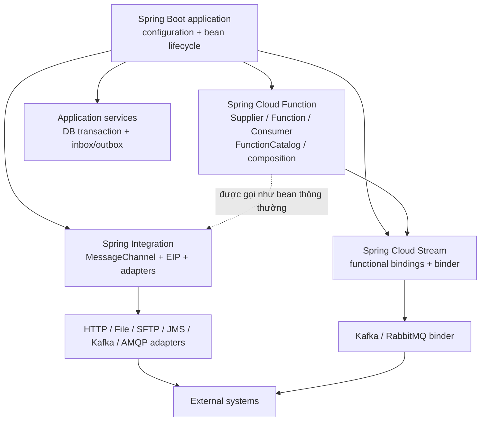
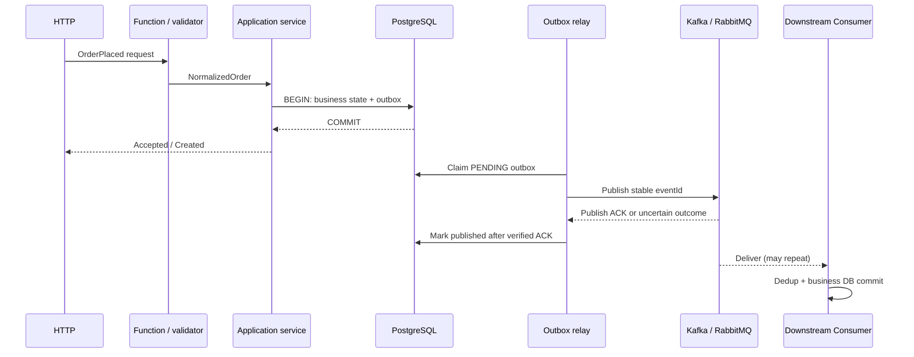
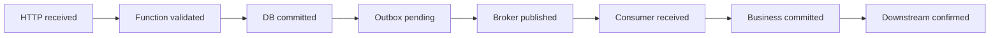
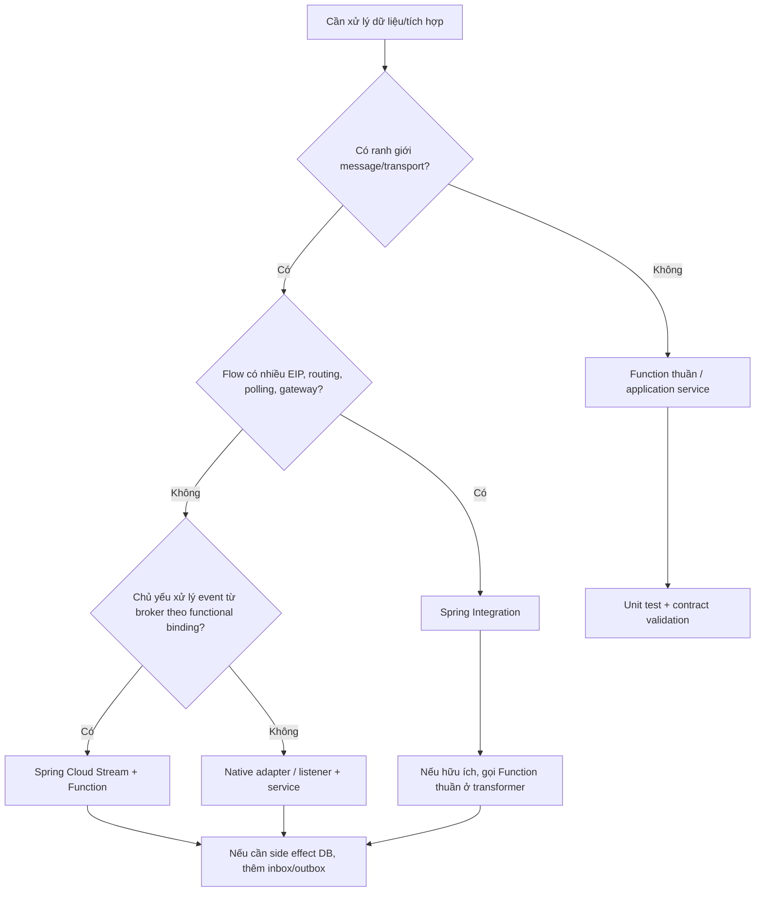

# Spring Cloud Function và ranh giới với Spring Integration

> **Chương:** Thư viện bổ sung  
> **Module:** `SPRING_BOOT_INTEGRATION` — tổ chức tích hợp hệ thống trong Spring Boot qua HTTP client, cơ sở dữ liệu, cache, broker thông điệp và các adapter của Spring Integration. Trọng tâm là cấu hình, hợp đồng dữ liệu, giao dịch, xử lý lỗi, chống xử lý trùng lặp, kiểm thử và quan sát những luồng tích hợp thực tế.
>
> **Phạm vi phiên bản:** Bài dùng mô hình functional của Spring Cloud Function, Java 17+ và Spring Integration DSL theo hệ Spring Boot 3/Spring Framework 6 để minh họa. Tên artifact, API, tùy chọn binder và auto-configuration cần đối chiếu với **Spring Boot + Spring Cloud release train** thực tế. Các đoạn mã độc lập nhằm giải thích lựa chọn kiến trúc; không được ghép tất cả cấu hình demo vào một ứng dụng production.

## 1. Bài toán: một hàm xử lý đơn hàng có cần cả IntegrationFlow?

Một dịch vụ nhận webhook `OrderPlaced` từ đối tác, chuẩn hóa dữ liệu, ghi PostgreSQL và phát sự kiện sang Kafka để Inventory và Billing xử lý. Đội phát triển đang phân vân giữa ba lựa chọn:

1. Viết một `Function<OrderPlaced, NormalizedOrder>` để chuẩn hóa dữ liệu, rồi gọi nó từ HTTP controller.
2. Dùng `IntegrationFlow` với `MessageChannel`, filter, router và outbound adapter để điều phối toàn bộ chuỗi.
3. Dùng `Spring Cloud Stream` để nhận `OrderPlaced` từ một topic và gọi `Consumer<OrderPlaced>`.

Cả ba đều có thể xuất hiện trong một hệ Spring Boot, nhưng **chúng không giải quyết cùng một vấn đề**:

- Một **Function** biểu diễn phép biến đổi hoặc xử lý dữ liệu với hợp đồng đầu vào/đầu ra.
- Một **IntegrationFlow** diễn đạt *hành trình của message* qua nhiều endpoint và Enterprise Integration Patterns (EIP).
- Một **Stream binding** nối hàm với một nguồn/đích message broker thông qua binder.

Nếu coi `Function` là một hàng đợi bền vững, một router EIP hoặc một transaction manager, ứng dụng dễ xử lý sai timeout, ACK, retry và lỗi trùng lặp.

### Mục tiêu học tập

Sau bài này, bạn có thể:

1. Phân biệt Spring Framework, Spring Boot, Spring Cloud Function, Spring Integration và Spring Cloud Stream.
2. Viết `Supplier`, `Function`, `Consumer` dạng Spring bean; gọi bằng DI hoặc `FunctionCatalog`.
3. Hiểu composition, routing, kiểu payload/headers và những giới hạn của functional abstraction.
4. Viết một `IntegrationFlow` kết nối các bước xử lý bằng channel, filter, transformer, router, gateway và service activator.
5. Quyết định khi nào nên dùng riêng một hàm, riêng IntegrationFlow hoặc kết hợp chúng.
6. Xác định ranh giới HTTP–database–broker, transaction, ACK, retry, idempotency và observability.
7. Kiểm thử từng lớp mà không nhầm unit test của hàm với integration test của broker.

## 2. Sơ đồ vị trí của các thư viện trong một ứng dụng Spring Boot



| Công nghệ | Thứ nó định nghĩa rõ nhất | Thứ nó không tự bảo đảm |
|---|---|---|
| **Spring Framework** | IoC/DI, AOP, HTTP, transaction, Spring Messaging cơ sở | Không tự dựng message pipeline bền vững xuyên mọi transport |
| **Spring Boot** | Starter, externalized configuration, conditional auto-configuration, Actuator | Không tự tạo nghiệp vụ idempotent hoặc distributed transaction |
| **Spring Cloud Function** | Mô hình và đăng ký/gọi/compose hàm | Không tự tạo topic, queue hay message broker |
| **Spring Integration** | Enterprise Integration Patterns, channel, endpoint, gateway và transport adapters | Không tự biến mọi channel thành durable queue |
| **Spring Cloud Stream** | Binding của function với broker qua binder | Không che được mọi khác biệt về ACK, ordering, DLQ giữa brokers |
| **Business service** | Hợp đồng dữ liệu, transaction, retry budget và kết quả nghiệp vụ | Cần được tích hợp/kiểm thử qua ranh giới thật |

**Không có quan hệ bắt buộc “phải dùng Cloud Function rồi mới được dùng Integration”.** Một IntegrationFlow có thể gọi trực tiếp POJO/service. Một `Function` có thể chạy trong code Java thông thường. Cloud Stream thường dùng Spring Cloud Function để tìm và kết nối function với binder.

## 3. Spring Cloud Function: mô hình code tối giản

Các interface trọng tâm đến từ `java.util.function`:

| Kiểu | Dạng toán học gần đúng | Ý nghĩa |
|---|---|---|
| `Supplier<T>` | `() -> T` | Tạo dữ liệu khi được gọi |
| `Function<T,R>` | `T -> R` | Biến đổi đầu vào thành đầu ra |
| `Consumer<T>` | `T -> void` | Tiếp nhận đầu vào và thực hiện một hành động |

Code Java thuần:

```java
import java.util.function.Consumer;
import java.util.function.Function;
import java.util.function.Supplier;

Supplier<String> currentStatus = () -> "READY";
Function<String, String> normalizeCode =
    code -> code.trim().toUpperCase();
Consumer<String> auditCode =
    code -> System.out.println("Audit code: " + code);

String value = normalizeCode.apply(" a-101 ");
auditCode.accept(value);
```

Đây **chưa** cần Spring Cloud Function, Spring Integration hay broker. Đó là các functional interfaces của JDK. Spring Cloud Function bổ sung **discovery, catalog, adaptation và composition** khi các hàm được đăng ký trong Spring context.

Một function thuần, không I/O và không trạng thái mutable, rất dễ kiểm thử. Một `Consumer` ghi database hoặc gọi HTTP vẫn là thao tác có side effect, phải được thiết kế transaction/timeout và idempotency như mọi service khác.

## 4. Đăng ký functional bean trong Spring Boot

Ví dụ dùng Java record biểu diễn hợp đồng đơn hàng:

```java
import java.time.Instant;

public record OrderPlaced(
    String eventId,
    String orderId,
    String tenantId,
    long amountMinor,
    String currency,
    Instant occurredAt
) {}

public record NormalizedOrder(
    String eventId,
    String orderId,
    String tenantId,
    long amountMinor,
    String currency,
    Instant occurredAt
) {}
```

Đăng ký bean hàm:

```java
import java.util.Locale;
import java.util.function.Function;
import org.springframework.context.annotation.Bean;
import org.springframework.context.annotation.Configuration;

@Configuration(proxyBeanMethods = false)
public class OrderFunctions {

    @Bean
    Function<OrderPlaced, NormalizedOrder> normalizeOrder() {
        return event -> {
            if (event.eventId() == null || event.eventId().isBlank()) {
                throw new IllegalArgumentException("eventId is required");
            }
            if (event.orderId() == null || event.orderId().isBlank()) {
                throw new IllegalArgumentException("orderId is required");
            }
            return new NormalizedOrder(
                event.eventId().trim(),
                event.orderId().trim(),
                event.tenantId(),
                event.amountMinor(),
                event.currency().toUpperCase(Locale.ROOT),
                event.occurredAt()
            );
        };
    }
}
```

Đoạn này là **biến đổi dữ liệu**. Trong ứng dụng thật cần validate `currency != null`, `tenantId`, giá trị tiền và tính hợp lệ của timestamp trước khi dereference. `IllegalArgumentException` phù hợp để minh họa rejection, không phải toàn bộ chiến lược chuyển lỗi sang HTTP 4xx/DLQ.

Có thể inject trực tiếp function như một bean Spring:

```java
import java.util.function.Function;
import org.springframework.beans.factory.annotation.Qualifier;
import org.springframework.stereotype.Service;

@Service
public class NormalizationService {
    private final Function<OrderPlaced, NormalizedOrder> normalizeOrder;

    public NormalizationService(
            @Qualifier("normalizeOrder")
            Function<OrderPlaced, NormalizedOrder> normalizeOrder) {
        this.normalizeOrder = normalizeOrder;
    }

    public NormalizedOrder normalize(OrderPlaced event) {
        return normalizeOrder.apply(event);
    }
}
```

**Điểm phân biệt:** inject trực tiếp qua `@Qualifier` là Spring DI; không cần `FunctionCatalog` nếu đã biết chính xác bean nào và không có nhu cầu lookup/compose động.

## 5. FunctionCatalog: khám phá và gọi hàm theo tên

`org.springframework.cloud.function.context.FunctionCatalog` là API của Spring Cloud Function để **lookup** và gọi functional bean, bao gồm hàm có thể được framework adapt/compose theo version.

```java
import java.util.function.Function;
import org.springframework.cloud.function.context.FunctionCatalog;
import org.springframework.stereotype.Service;

@Service
public class CatalogBasedNormalizer {
    private final FunctionCatalog catalog;

    public CatalogBasedNormalizer(FunctionCatalog catalog) {
        this.catalog = catalog;
    }

    public NormalizedOrder normalize(OrderPlaced event) {
        Function<OrderPlaced, NormalizedOrder> function =
            catalog.lookup("normalizeOrder");

        if (function == null) {
            throw new IllegalStateException("normalizeOrder not registered");
        }
        return function.apply(event);
    }
}
```

`lookup(...)` trả function phù hợp theo khả năng/adaptation của catalog. Khi framework dùng type conversion hoặc wrapper cho các kiểu message/reactive, **kiểu đầu vào/đầu ra thực tế phải được kiểm thử** chứ không suy từ phép cast generic mà compiler cho phép.

### 5.1. Khi nào nên dùng catalog?

- Adapter cần chọn một function trong **tập đã được kiểm soát**.
- Cần composition bằng tên thay vì tự gọi nhiều bean tuần tự.
- Cần tích hợp với framework binder/HTTP/function invocation adapter.
- Đang viết một thư viện có ý thức về mô hình functional hơn là một service inject trực tiếp.

Nếu chỉ dùng một hàm ổn định trong application service, injection bằng constructor thường **đơn giản và dễ debug** hơn catalog.

### 5.2. Bean name là một phần hợp đồng cấu hình

`normalizeOrder` ở ví dụ là **tên method `@Bean`**, nên trở thành tên bean mặc định. Nếu đổi tên thành `normalizeOrderEvent` mà không cập nhật `FunctionCatalog.lookup(...)`, composition hoặc `spring.cloud.function.definition`, một số endpoint/binding có thể không còn tìm thấy hàm.

Hãy coi tên functional bean được các adapter bên ngoài tham chiếu là **configuration contract** cần review khi refactor.

## 6. Composition: nối các phép biến đổi đơn giản

Giả sử cần chuẩn hóa một mã rồi thêm tiền tố đối tác:

```java
import java.util.Locale;
import java.util.function.Function;
import org.springframework.context.annotation.Bean;
import org.springframework.context.annotation.Configuration;

@Configuration(proxyBeanMethods = false)
class CodeFunctions {

    @Bean
    Function<String, String> trimAndUppercase() {
        return text -> text.trim().toUpperCase(Locale.ROOT);
    }

    @Bean
    Function<String, String> prefixPartner() {
        return text -> "PARTNER-" + text;
    }
}
```

Dùng Spring Cloud Function composition:

```yaml
spring:
  cloud:
    function:
      definition: trimAndUppercase|prefixPartner
```

Đường pipe `|` là cách khai báo composition trong Spring Cloud Function theo những nhánh hỗ trợ. Có thể lookup một composed function:

```java
Function<String, String> pipeline =
    catalog.lookup("trimAndUppercase|prefixPartner");

String result = pipeline.apply(" a-101 ");
// result: "PARTNER-A-101"
```

**Composition là gọi chuỗi function**, không tự tạo message channel, persisted queue hay checkpoint. Nếu function thứ nhất thành công nhưng function thứ hai ném exception, không có database rollback/compensation trừ khi caller đã đặt transaction và các thao tác tham gia transaction đó.

### 6.1. Điều kiện composition

Hai hàm phải **tương thích kiểu** ở ranh giới đầu ra/đầu vào. `Function<A,B>` ghép với `Function<B,C>` tự nhiên hơn `Function<A,B>` ghép với `Function<X,C>` không có converter rõ.

Với `Supplier` hoặc `Consumer`, khả năng composition và cách wrapper hoạt động phụ thuộc adapter/định nghĩa function. Nên bắt đầu từ chuỗi `Function<T,R>` đơn giản, tách các side effects sang service có contract riêng.

### 6.2. Composition không giống routing

Composition: **A rồi B** trên cùng một luồng. Routing: **chọn A hoặc B** dựa trên metadata/payload. Spring Cloud Function có các cơ chế routing chuyên biệt; Spring Integration có `Router`, `Filter` và nhiều EIP khác. Chọn routing khi cần chuyển message tới **nhánh khác nhau**, không cố biểu diễn mọi quyết định bằng chuỗi hàm tuyến tính.

## 7. Routing và an toàn khi tên hàm đến từ input

Một dispatcher có thể muốn chọn function theo `eventType`. Dù Spring Cloud Function hỗ trợ function routing, không nên cho HTTP header hoặc message payload không tin cậy quyết định **tùy ý** tên function/expression có thể được thực thi.

Ví dụ cách dùng **allowlist** ở tầng application:

```java
import java.util.Map;
import java.util.function.Function;

public final class EventDispatchService {

    private final Map<String, Function<String, String>> handlers;

    public EventDispatchService(
            Function<String, String> normalizeShipment,
            Function<String, String> normalizePayment) {
        this.handlers = Map.of(
            "shipment.updated.v1", normalizeShipment,
            "payment.captured.v1", normalizePayment
        );
    }

    public String dispatch(String eventType, String payload) {
        Function<String, String> handler = handlers.get(eventType);
        if (handler == null) {
            throw new IllegalArgumentException("Unsupported event type");
        }
        return handler.apply(payload);
    }
}
```

Hai function ở constructor là **giá trị do ứng dụng cung cấp**. Với nhiều bean cùng `Function<String,String>`, khi cấu hình trong Spring cần inject đúng `@Qualifier` hoặc định nghĩa factory rõ ràng.

Đối với Spring Integration, một `HeaderValueRouter` hoặc `PayloadTypeRouter` có thể diễn đạt routing và mapping channel đích. Dù dùng cách nào, **đầu vào không được quyền chọn bất kỳ bean/channel/topic nào** nếu không có policy.

## 8. Message<T>, headers và hợp đồng dữ liệu

Một `Function<T,R>` thuần chỉ thấy payload. Nếu cần correlation ID, event ID hoặc metadata vận chuyển, có thể dùng `org.springframework.messaging.Message<T>`:

```java
import java.util.function.Function;
import org.springframework.context.annotation.Bean;
import org.springframework.messaging.Message;
import org.springframework.messaging.support.MessageBuilder;

@Bean
Function<Message<OrderPlaced>, Message<NormalizedOrder>>
        normalizeWithCorrelation(
            Function<OrderPlaced, NormalizedOrder> normalizeOrder) {

    return inbound -> {
        NormalizedOrder normalized =
            normalizeOrder.apply(inbound.getPayload());

        Object correlation = inbound.getHeaders().get("correlationId");

        MessageBuilder<NormalizedOrder> output =
            MessageBuilder.withPayload(normalized);

        if (correlation != null) {
            output.setHeader("correlationId", correlation);
        }
        output.setHeader("eventId", normalized.eventId());
        return output.build();
    };
}
```

**Điểm cần kiểm tra:** khi ứng dụng có nhiều `Function<OrderPlaced,NormalizedOrder>`, dùng `@Qualifier("normalizeOrder")` cho injection như mục 4. Với `Message<T>`, nên **whitelist header** được phép truyền tiếp; không sao chép bừa mọi header chứa credential, transport metadata hoặc header điều khiển routing/ACK.

### 8.1. Message của Spring không phải topic

`Message<T>` là một object mang payload và headers. Nó **không tự tạo broker message**, không có cursor hoặc retention. Message đi qua Spring Integration `MessageChannel` trong một JVM có thể hoàn toàn chỉ nằm trong RAM; nếu gửi qua Kafka/RabbitMQ, adapter/binder mới thực hiện encode và publish.

### 8.2. Metadata nào cần ổn định?

| Trường | Ý nghĩa | Lưu ý |
|---|---|---|
| `eventId` | Định danh một business event | Ổn định khi producer retry/republish |
| `commandId` | Định danh yêu cầu hành động | Consumer dedup theo command ID |
| `correlationId` | Gom nhiều bước cùng workflow | Không thay event ID |
| `causationId` | Sự kiện/lệnh trực tiếp gây ra message hiện tại | Giúp audit |
| `aggregateId` | Đơn hàng/sản phẩm/tài khoản | Có thể dùng làm partition key |
| `schemaVersion` | Phiên bản hợp đồng | Consumer chọn parser và kiểm tra tương thích |
| `MessageHeaders.ID` | ID của Spring Message tại một boundary | Không thay broker ID hoặc event ID |

Không mặc định headers tự được bảo toàn khi qua mọi adapter/binder, nhất là với serialisation, Kafka message headers và RabbitMQ properties. **Kiểm thử đường đi thực**, không chỉ unit test một object `Message<?>`.

## 9. Kiểu hóa payload, JSON và chuyển đổi dữ liệu

Spring Cloud Function có cơ chế adaptation/conversion khi được dùng qua các adapter phù hợp; Spring Integration có transformer/converter tương ứng. Nhưng **không phải mọi lambda Java tự biết parse JSON**.

Ví dụ:

```java
Function<String, String> upper = String::toUpperCase;
upper.apply("{\"orderId\":\"o-1\"}");
```

Kết quả chỉ là **chuỗi JSON bị upper-case toàn bộ**, không phải một `OrderPlaced` hợp lệ với field đã chuẩn hóa. Muốn map JSON sang DTO cần một parser/MessageConverter/cơ chế type conversion đã được khai báo, cùng validation.

### 9.1. Cần quản lý cả schema và semantic validation

Một hợp đồng event có thể có envelope:

```json
{
  "eventId": "evt-902",
  "eventType": "order.placed.v1",
  "schemaVersion": 1,
  "correlationId": "checkout-902",
  "occurredAt": "2026-11-21T03:00:00Z",
  "payload": {
    "orderId": "order-902",
    "tenantId": "shop-a",
    "amountMinor": 12550,
    "currency": "USD"
  }
}
```

Schema parsing kiểm tra cấu trúc; business validation kiểm tra tenant, số tiền, trạng thái và tính hợp lệ của ID. Content type `application/json` **không tự bảo đảm** các bên đồng ý với ý nghĩa field hay khả năng tương thích khi producer nâng cấp trước consumer.

### 9.2. Chia trách nhiệm đúng

- Adapter nhận JSON và convert thành một DTO đã được xác minh.
- Function thuần chuẩn hóa/trích xuất dữ liệu và tạo output DTO.
- Service nghiệp vụ quyết định chấp nhận hay từ chối trạng thái.
- Message adapter/binder serialize output đúng contract.

Khi transformation phức tạp nhiều bước, Spring Integration có `Transformer`, `Enricher` hoặc `Splitter`; không nhất thiết phải nhồi toàn bộ logic vào một `Function<String,String>`.

## 10. Spring Integration giải quyết loại bài toán khác

Spring Integration hiện thực **Enterprise Integration Patterns** qua message channel, endpoints và adapters. Một số EIP thường gặp:

| Pattern | Mục đích | Khi functional composition chưa đủ rõ |
|---|---|---|
| **Message Channel** | Tách producer và consumer trong một luồng message | Cần ranh giới giữa các endpoint/thread |
| **Gateway** | Cho caller gọi một API rồi biến thành message | Cần request/reply, timeout, correlation |
| **Transformer** | Chuyển payload/header từ type này sang type khác | Cần mapping minh bạch theo step |
| **Filter** | Cho qua hoặc loại message theo predicate | Cần discard channel/handling cụ thể |
| **Router** | Chọn output channel theo điều kiện | Nhiều nhánh xử lý theo event type |
| **Splitter** | Tách message chứa danh sách thành nhiều message | Đọc một file/batch rồi xử lý item |
| **Aggregator** | Gom nhiều message thành một nhóm | Có correlation, release/expiry policy |
| **Resequencer** | Sắp xếp message theo thứ tự được quy định | Cần xử lý out-of-order với state |
| **Service Activator** | Gọi service nghiệp vụ từ message | Có side effects, error handling |
| **Inbound/Outbound Adapter** | Kết nối HTTP, file, SFTP, JMS, Kafka, AMQP... | Cần transport boundary cụ thể |
| **Poller** | Kích hoạt đọc nguồn theo chu kỳ | File/DB/job queue không có push |

Một function tuyến tính `A.andThen(B)` **không tự cung cấp** correlation store cho aggregator, retry advice chain, dead-letter routing hoặc lifecycle của polling adapter.

### 10.1. Kết luận nhanh về ranh giới

**Cloud Function** trả lời “đầu vào → hàm nào → đầu ra gì?”.  
**Spring Integration** trả lời “message đi qua channel/endpoint nào, theo nhánh nào, qua transport nào, ai điều phối timeout và lỗi?”.  
Hai cách nhìn **bổ sung** cho nhau, không bắt buộc loại trừ nhau.

## 11. MessageChannel và semantics của thread/durability

Spring Integration cung cấp nhiều dạng channel. Lựa chọn channel quyết định **thời điểm gọi handler** và cách điều phối, không phải chỉ là tên.

| Channel | Đặc điểm | Nguy cơ cần kiểm soát |
|---|---|---|
| `DirectChannel` | Gọi handler đồng bộ trên luồng gửi khi không có executor boundary | Caller chịu độ trễ và exception của handler |
| `ExecutorChannel` | Dispatch qua executor | Thread/transaction context không tự đi theo nguyên vẹn |
| `QueueChannel` | Queue pull/poll trong ứng dụng | Thường ở RAM, mất khi process crash nếu không có durable store |
| `PublishSubscribeChannel` | Phát tới nhiều subscriber trong context | Fan-out trong JVM không thay fan-out bền vững của broker |
| `PriorityChannel` | Queue theo mức ưu tiên | Priority không tự giải quyết starvation/recovery |
| `FluxMessageChannel` | Reactive channel theo publisher semantics | Cần hiểu backpressure và subscriber lifecycle |

### 11.1. DirectChannel không phải “gửi message bất đồng bộ”

Ví dụ `MessageChannel.send(...)` tới `DirectChannel` có thể gọi downstream ngay trong cùng thread. Nếu downstream ghi DB chậm, caller cũng bị chậm. Nếu bean có `@Transactional` và cả hai bước tham gia cùng thread/transaction manager thì có thể chia sẻ context theo cấu hình.

Chuyển sang `ExecutorChannel` tạo thread boundary mới; **ThreadLocal transaction context không tự chuyển sang worker**. Nếu mã cũ trông có vẻ transaction end-to-end, thay channel có thể làm commit/rollback khác đi.

### 11.2. QueueChannel không tự là broker bền vững

Một `QueueChannel` mặc định có thể giữ message trong bộ nhớ. ACK một webhook chỉ vì đã đưa message vào QueueChannel như vậy có thể **mất công việc nếu JVM crash**. Nếu cần bền vững, dùng persistent MessageStore được thiết kế đúng, DB job/inbox/outbox hoặc external broker có ACK policy, tùy yêu cầu.

## 12. IntegrationFlow: diễn đạt pipeline bằng DSL

Ví dụ một flow nhận `OrderPlaced`, chuẩn hóa rồi gọi service. **Giả định** có bean `normalizeOrder` trong mục 4 và service `OrderIntakeService.accept(NormalizedOrder)` do ứng dụng cung cấp.

```java
import java.util.function.Function;
import org.springframework.beans.factory.annotation.Qualifier;
import org.springframework.context.annotation.Bean;
import org.springframework.context.annotation.Configuration;
import org.springframework.integration.channel.DirectChannel;
import org.springframework.integration.dsl.IntegrationFlow;
import org.springframework.messaging.MessageChannel;

@Configuration(proxyBeanMethods = false)
public class OrderIntegrationFlowConfiguration {

    @Bean
    MessageChannel orderInput() {
        return new DirectChannel();
    }

    @Bean
    IntegrationFlow orderIntakeFlow(
            @Qualifier("normalizeOrder")
            Function<OrderPlaced, NormalizedOrder> normalizeOrder,
            OrderIntakeService service) {

        return IntegrationFlow.from("orderInput")
            .transform(OrderPlaced.class, normalizeOrder::apply)
            .handle(NormalizedOrder.class, (payload, headers) -> {
                service.accept(payload);
                return null;
            })
            .get();
    }
}
```

Cấu trúc này cố ý dùng **chính Function đã có** để biến đổi message bên trong IntegrationFlow. Không cần đăng ký thêm một function thứ hai chỉ để viết lại cùng logic.

- `orderInput` là input channel logic, không phải Kafka topic.
- `transform(...)` nhận payload, gọi function, tạo message chứa kết quả phù hợp theo DSL.
- `handle(...)` là service-activator-style endpoint; trong ví dụ service xử lý side effect và không có reply.
- Vì channel là `DirectChannel`, toàn flow có thể chạy đồng bộ trong caller thread, không tự có persistence hoặc retry khi JVM crash.

### 12.1. Gateway để code bên ngoài gọi flow

Thay vì inject `MessageChannel` vào mọi controller, có thể dùng messaging gateway:

```java
import org.springframework.integration.annotation.Gateway;
import org.springframework.integration.annotation.MessagingGateway;

@MessagingGateway
public interface OrderIntakeGateway {

    @Gateway(requestChannel = "orderInput")
    void accept(OrderPlaced event);
}
```

Một số cấu hình cần bật `@IntegrationComponentScan` để đăng ký interface gateway làm Spring bean, ví dụ ở một `@Configuration`:

```java
import org.springframework.context.annotation.Configuration;
import org.springframework.integration.config.EnableIntegration;
import org.springframework.integration.annotation.IntegrationComponentScan;

@Configuration(proxyBeanMethods = false)
@EnableIntegration
@IntegrationComponentScan
class GatewayRegistrationConfiguration {
}
```

Khi ứng dụng dùng Spring Boot starter Integration, một phần infrastructure có thể được Boot tự cấu hình; không tự nhân đôi bean đăng ký chỉ vì một ví dụ dùng `@EnableIntegration`. Kiểm tra context và package scan thực tế. Gateway **không tự tạo HTTP endpoint**; một HTTP controller cần inject gateway và gọi method.

## 13. Gateway, request/reply và correlation khác Function.apply()

Một `Function<T,R>` trả dữ liệu sau khi áp dụng. Một Integration gateway cũng có thể cho caller gọi method và nhận reply, nhưng message-based request/reply có thêm:

- Request/reply channels, reply timeout và error channel.
- Correlation khi có splitter/aggregator.
- Hỗ trợ chuyển từ request đồng bộ sang flow bất đồng bộ nếu được thiết kế.
- Header propagation, routing và conversion ở các endpoint.

Ví dụ một flow có splitter và aggregator là bài toán **nhiều message**: một request chứa nhiều items, chia thành từng message, các item xử lý và tổng hợp dựa trên correlation/release strategy. Một `Function<List<Item>,Result>` hoàn toàn có thể chạy vòng lặp, nhưng nếu từng item phải đi qua queue/broker, timeout và retry độc lập, mẫu aggregator/MessageStore của Integration diễn đạt boundary rõ hơn.

Không tự động chọn IntegrationFlow chỉ vì code có 3 lời gọi method; khi không có ranh giới messaging hay orchestration, **một service hoặc function thuần là đủ**.

## 14. Kết hợp Function và Integration: chọn đúng điểm giao

Có ba cách kết hợp thực tế.

### 14.1. Function thuần làm transformer

```java
return IntegrationFlow.from("orderInput")
    .transform(OrderPlaced.class, normalizeOrder::apply)
    .handle(NormalizedOrder.class, (payload, headers) -> {
        orderService.accept(payload);
        return null;
    })
    .get();
```

Ưu điểm: chuẩn hóa có thể test độc lập, không cần Spring Integration runtime. Flow quyết định **khi nào** và **qua channel nào** gọi nó.

### 14.2. Application service dùng FunctionCatalog có allowlist

Một adapter có thể lookup hàm theo **tên cấu hình đã được phê duyệt**, sau đó gọi nó. Hữu ích khi function implementations thay đổi theo deployment/feature, nhưng tạo thêm rủi ro cấu hình sai hoặc chọn hàm không tương thích type. Không cho payload từ bên ngoài quyết định arbitrary function name.

### 14.3. Dùng Integration để điều phối nhiều function

Một IntegrationFlow có thể gồm transform → filter → route → service activator, mỗi bước ủy quyền cho một functional bean. Thường nên ưu tiên *một nơi duy nhất* sở hữu routing và retry: nếu cả Cloud Function router, Integration router và binder header router cùng quyết định, hệ thống khó giải thích message đi nhánh nào.

### 14.4. Không xem Composition là channel graph

`FunctionCatalog.lookup("a|b")` tạo chuỗi các hàm tương thích. Nó không thay đổi topology `MessageChannel`, không tự cấu hình poller, không cung cấp queue/durable store. Nếu cần fan-out, aggregation, delayed retry hoặc request/reply timeout, Integration thường cung cấp mẫu diễn đạt rõ hơn.

## 15. Spring Cloud Stream: khi Function cần nối vào broker

Một function không có broker là một Java bean. Để Spring Boot **subscribe topic Kafka/Rabbit và đưa payload vào function**, có thể dùng **Spring Cloud Stream binder**.

Ví dụ consumer:

```java
import java.util.function.Consumer;
import org.springframework.context.annotation.Bean;
import org.springframework.context.annotation.Configuration;

@Configuration(proxyBeanMethods = false)
class InventoryStreamFunctions {

    @Bean
    Consumer<OrderPlaced> applyOrderPlaced(
            InventoryApplicationService service) {
        return service::applyOnce;
    }
}
```

Cấu hình Kafka binder:

```yaml
spring:
  cloud:
    function:
      definition: applyOrderPlaced
    stream:
      bindings:
        applyOrderPlaced-in-0:
          destination: orders.placed.v1
          group: inventory-service
          content-type: application/json
      kafka:
        binder:
          brokers: ${KAFKA_BOOTSTRAP_SERVERS:localhost:9092}
```

Dependency ví dụ (Spring Cloud BOM phù hợp phải được cấu hình tại project):

```gradle
dependencies {
    implementation("org.springframework.cloud:spring-cloud-stream-binder-kafka")
    implementation("org.springframework.boot:spring-boot-starter-jdbc")
    runtimeOnly("org.postgresql:postgresql")
}
```

Ở đây:

- `applyOrderPlaced` là **functional bean name**.
- `applyOrderPlaced-in-0` là **input binding name** của Spring Cloud Stream.
- `orders.placed.v1` là **destination** (Kafka topic theo binder này).
- `inventory-service` là **consumer group** của ứng dụng.
- Kafka binder chịu trách nhiệm kết nối broker và gọi function qua binding.

**Spring Cloud Function core không tự subscribe Kafka.** Chỉ thêm function bean mà không có binder/adapter/controller phù hợp không tạo consumer.

### 15.1. Đầu vào/đầu ra theo tên function

Thông thường:

```text
Consumer<T>   -> <beanName>-in-0
Function<T,R> -> <beanName>-in-0 và <beanName>-out-0
Supplier<T>   -> <beanName>-out-0
```

Nếu có nhiều functional beans, đặt `spring.cloud.function.definition` để lựa chọn, thay vì phụ thuộc phát hiện ngẫu nhiên. Function có thể được compose; khi đó tên binding cần theo quy tắc của framework/version, không tự phỏng đoán bằng việc ghép tên bean tùy ý.

### 15.2. Binder abstraction không che hết transport semantics

Kafka group/offset/partition khác RabbitMQ queue/ACK/requeue. Cùng một `Consumer<OrderPlaced>` có thể giữ phần nghiệp vụ, nhưng startup, provisioning, retry, DLQ, backpressure và ordering vẫn cần được thiết kế theo broker.

Nếu ứng dụng phải can thiệp sâu vào consumer offset, publisher confirms hoặc serializer đặc thù, API native như `@KafkaListener`, `KafkaTemplate`, `@RabbitListener` hay Spring Integration adapter có thể phù hợp hơn.

## 16. StreamBridge và Function: khi nguồn là HTTP hoặc outbox relay

Không phải mọi message đi từ inbound stream binding. HTTP controller hoặc scheduled relay có thể cần publish một event đã được lưu trong database.

Spring Cloud Stream có `StreamBridge`:

```java
import org.springframework.cloud.stream.function.StreamBridge;
import org.springframework.messaging.support.MessageBuilder;
import org.springframework.stereotype.Service;

@Service
class OutboundOrderEventAdapter {
    private final StreamBridge bridge;

    OutboundOrderEventAdapter(StreamBridge bridge) {
        this.bridge = bridge;
    }

    boolean send(OrderPlaced event) {
        return bridge.send(
            "orderEvents-out-0",
            MessageBuilder.withPayload(event)
                .setHeader("eventId", event.eventId())
                .setHeader("contentType", "application/json")
                .build()
        );
    }
}
```

```yaml
spring:
  cloud:
    stream:
      output-bindings: orderEvents-out-0
      bindings:
        orderEvents-out-0:
          destination: orders.placed.v1
          content-type: application/json
```

`StreamBridge` là API của **Spring Cloud Stream**, không phải `FunctionCatalog` hoặc `MessageChannel` của Spring Integration. Kết quả boolean của `send` là trạng thái gửi qua binding abstraction, **không phải bằng chứng consumer đã xử lý** và cũng **không luôn tương đương broker durable ACK** trong mọi cấu hình producer.

Nếu yêu cầu outbox relay chỉ đánh dấu `PUBLISHED` sau broker acknowledgement thật, phải dùng cơ chế xác nhận được binder/native client chứng minh hỗ trợ (ví dụ callback/confirm thích hợp) và kiểm thử trường hợp mất phản hồi. Không xóa outbox chỉ vì `bridge.send(...) == true`.

## 17. Spring Integration adapter và Stream binder: đừng dùng trùng đường nhận

Một ứng dụng có thể có:

- `@KafkaListener` của Spring Kafka.
- Kafka inbound channel adapter trong Spring Integration.
- Kafka binder input binding trong Spring Cloud Stream.
- Một gateway HTTP tự đưa message vào channel.

Tất cả đều có thể gọi cùng `InventoryApplicationService`, nhưng chúng tạo **những endpoint tiêu thụ khác nhau**, đôi khi có group/offset và ACK riêng.

### 17.1. Nguy cơ đọc trùng cùng business event

Nếu vừa cấu hình Kafka inbound adapter của Integration vừa dùng Cloud Stream consumer cho cùng topic nhưng **khác group**, cả hai nhận record và có thể chạy side effect hai lần. Nếu cùng group, chúng có thể chia partition và làm thứ tự/quan sát khó giải thích.

Đừng mặc định “cùng topic nên Spring tự gộp thành một listener”. Chọn **một ingress owner** cho mỗi trách nhiệm nghiệp vụ, và nếu phải có nhiều ingress hợp lệ, bảo vệ bằng `eventId`/dedup.

### 17.2. Khi nào adapter Integration phù hợp?

- Một flow nối nhiều nguồn như SFTP → transform → database → JMS/Kafka.
- Cần EIP như splitter/aggregator/router, poller, gateway, error channel.
- Muốn quản trị nhiều bước có thread/channel boundary rõ.
- Có hạ tầng native broker sẵn, muốn gắn outbound/inbound adapter vào channel graph.

### 17.3. Khi nào binder phù hợp?

- Nhiều service xử lý message theo `Function`/`Consumer`/`Supplier`.
- Đội muốn chuẩn hóa cách khai báo input/output/destination/group.
- Các use case chủ yếu nhận một event, áp dụng logic và tùy chọn tạo event khác.
- Broker-specific control có thể được bộc lộ qua binder configuration phù hợp.

**Không có lựa chọn “mọi broker đều thay được dễ dàng”**. Khả năng portability chỉ đúng ở những phần abstraction mà cả hai binder thực sự hỗ trợ.

## 18. HTTP adapter và serverless adapter: Function không phải HTTP controller

Spring Cloud Function có các adapter để expose/invoke function qua transport như web hoặc một số nền tảng serverless theo dependency và cấu hình tương ứng. Nhưng một bean:

```java
@Bean
Function<String, String> normalizeCode() {
    return value -> value.trim().toUpperCase();
}
```

không tự tạo Spring MVC `@PostMapping` trong một ứng dụng chỉ có starter core. Có thể:

1. Dùng Spring MVC controller, inject function và gọi `apply(...)`.
2. Dùng web adapter của Spring Cloud Function **nếu đã thêm đúng dependency và chấp nhận contract endpoint của nó**.
3. Dùng Spring Integration HTTP inbound gateway để biến HTTP request thành message.
4. Dùng cloud-function adapter cho môi trường serverless theo deployment model phù hợp.

### 18.1. Chọn boundary HTTP rõ ràng

Khi HTTP request cần signature verification, tenant authorization, schema validation, idempotency key, status codes và problem details, một **controller/adapter rõ ràng** thường dễ kiểm soát hơn expose mọi function tự động.

Một function thuần nên nhận **DTO đã validate**, không tự đọc HTTP headers/servlet context nếu muốn reuse qua broker hoặc batch.

### 18.2. Request/reply không thay state machine

Một Function trả output trong cùng request không chứng minh downstream event đã được xử lý. Với thao tác chậm như reserve inventory qua broker, HTTP thường chỉ nên trả trạng thái đã tiếp nhận cùng request ID, rồi có endpoint/query tra tiến độ; không giữ request mở chờ tất cả subscribers nếu SLA không yêu cầu.

## 19. Imperative và reactive functions: semantics khác nhau

Spring Cloud Function hỗ trợ mô hình imperative và một số mô hình reactive qua `Publisher`/`Flux` khi adapter phù hợp.

Ví dụ hàm Reactor thuần:

```java
import java.util.function.Function;
import reactor.core.publisher.Flux;

Function<Flux<String>, Flux<String>> normalizeEvents =
    incoming -> incoming.map(String::trim)
        .filter(value -> !value.isBlank());
```

Đây là transformation reactive; nó **không tự subscribe một Pulsar/Kafka topic** và không tự tạo subscription broker. Khi kết hợp Cloud Stream reactive functions, cách framework subscribe, dispatch và quản lý ACK khác imperative listener; phải đọc tài liệu của binder/version đang chạy.

### 19.1. Không đưa JDBC blocking vào reactive operator tùy ý

`JdbcTemplate`/jOOQ JDBC dùng I/O blocking. Gọi chúng trực tiếp trong `map(...)` chạy trên event-loop của reactive pipeline có thể chặn các tác vụ khác. Phải chọn scheduler/worker pool phù hợp, hoặc dùng công nghệ reactive data access khi cần toàn đường nonblocking.

`publishOn`/`subscribeOn` có thể thay thread scheduling nhưng **không tự tạo transaction hoặc idempotency**. Khi stream phát lại sau lỗi, side effect trong `map/flatMap` có thể chạy nhiều lần.

### 19.2. Supplier reactive khác Supplier polling

`Supplier<Flux<T>>` có thể phát một publisher stream được adapter subscribe theo mô hình của nó; `Supplier<T>` imperative có thể được poll bởi binder theo chính sách. Không suy ra cùng một poller, lifecycle hoặc retry semantics chỉ vì cả hai dùng interface `Supplier`.

## 20. Transaction: Function, Integration và broker không chia một commit tự nhiên

Xét luồng:

```text
HTTP nhận OrderPlaced
→ Function normalizeOrder
→ PostgreSQL insert order
→ Kafka publish OrderPlaced
→ Inventory consume
→ PostgreSQL reserve inventory
→ HTTP supplier update
```

Đây là **nhiều transaction boundary**. Java function composition, DirectChannel và Stream binding không mặc nhiên hợp nhất chúng.

| Ranh giới | Điều có thể commit | Điều không tự nằm trong commit |
|---|---|---|
| Spring JDBC `@Transactional` | Nhiều SQL statements của datasource/manager phù hợp | Kafka publish, HTTP side effect |
| Kafka producer transaction (nếu dùng) | Các thao tác broker trong phạm vi được hỗ trợ | JDBC business transaction tự động |
| Integration DirectChannel | Chạy handler đồng bộ trong caller thread | Không tự tạo DB transaction |
| Integration ExecutorChannel | Dispatch message qua thread khác | Không tự mang ThreadLocal transaction context |
| Cloud Stream Consumer | Xử lý và broker progress theo binder/config | Không tự bảo đảm exactly-once side effect PostgreSQL |
| Cloud Function `apply(...)` | Trả về giá trị hoặc ném exception | Không có commit/checkpoint nếu caller không thiết kế |

### 20.1. Transactional outbox cho luồng HTTP–DB–broker



Function chỉ chuẩn hóa hợp đồng; **application service** quyết định transaction; **relay** sở hữu publish retry; **consumer** phải dedup.

### 20.2. Vì sao outbox chưa đủ nếu không idempotent?

Relay publish thành công rồi crash trước khi cập nhật `PUBLISHED`. Sau restart, nó có thể publish **lại chính event**. Consumer phải dùng `eventId` (hoặc `commandId`) để không nhân đôi business effect. At-least-once transport + idempotent processing thường thực dụng hơn tuyên bố exactly-once xuyên cả DB và broker.

## 21. Thiết kế consumer idempotent với PostgreSQL

Ví dụ xử lý `OrderPlaced` đến từ Spring Cloud Stream consumer hoặc một Integration inbound adapter. Cả hai có thể gọi chung application service:

```sql
CREATE TABLE processed_message (
    consumer_name VARCHAR(100) NOT NULL,
    event_id VARCHAR(160) NOT NULL,
    processed_at TIMESTAMPTZ NOT NULL DEFAULT CURRENT_TIMESTAMP,
    PRIMARY KEY (consumer_name, event_id)
);

CREATE TABLE inventory_command (
    command_id VARCHAR(180) PRIMARY KEY,
    order_id VARCHAR(160) NOT NULL,
    state VARCHAR(24) NOT NULL
);
```

```java
import org.springframework.jdbc.core.JdbcTemplate;
import org.springframework.stereotype.Service;
import org.springframework.transaction.annotation.Transactional;

@Service
public class InventoryApplicationService {
    private final JdbcTemplate jdbc;

    public InventoryApplicationService(JdbcTemplate jdbc) {
        this.jdbc = jdbc;
    }

    @Transactional
    public void applyOnce(OrderPlaced event) {
        int inserted = jdbc.update(
            """
            INSERT INTO processed_message (consumer_name, event_id)
            VALUES (?, ?)
            ON CONFLICT (consumer_name, event_id) DO NOTHING
            """,
            "inventory-service",
            event.eventId()
        );

        if (inserted == 0) {
            return;
        }

        jdbc.update(
            """
            INSERT INTO inventory_command(command_id, order_id, state)
            VALUES (?, ?, 'PENDING')
            ON CONFLICT (command_id) DO NOTHING
            """,
            "reserve-" + event.eventId(),
            event.orderId()
        );
    }
}
```

Đây là ví dụ **PostgreSQL**; bảng/constraint phải được tạo qua migration. Input đã được parse và validate trước khi tới đây. Nếu `eventId` duy nhất trong phạm vi tenant chứ không toàn hệ thống, unique key và `commandId` phải bao gồm `tenantId`.

**Transaction bắt buộc:** cả hai INSERT phải dùng cùng `DataSource` và transaction manager. Nếu method thất bại trước commit, inbox insert rollback để message có thể được retry. Nếu consumer chết **sau commit nhưng trước broker ACK**, redelivery gặp primary key và không thực hiện side effect lần hai.

Không dựa vào `System.out.println`, mutable `Set<String>` trong RAM hay MessageId của broker làm bằng chứng business idempotency.

## 22. Error handling: ai nhận lỗi ở từng lớp?

Các trường hợp khác nhau có đường lỗi khác nhau:

| Vị trí lỗi | Ví dụ | Ai chịu trách nhiệm chính |
|---|---|---|
| Trong `Function.apply` | Schema hợp lệ nhưng business validation fail | Caller/adapter quyết định HTTP 4xx, reject hoặc DLQ |
| Trong `IntegrationFlow` đồng bộ | Transformer/handler ném exception qua DirectChannel | Caller/gateway có thể nhận exception |
| Trong Integration flow bất đồng bộ | Endpoint trên ExecutorChannel lỗi | Error channel/handler và retry advice tùy cấu hình |
| Trong Cloud Stream consumer | DB timeout khi handler chạy | Binder/consumer error infrastructure + app classification |
| Deserialize trước function | JSON/Avro không decode được | Adapter/binder converter/error handling |
| Publish broker | Topic sai, auth fail, timeout | Producer/binder/native client và relay |
| Downstream HTTP | Timeout với kết quả không chắc chắn | HTTP adapter, idempotency key và reconciliation |

Không viết một `try/catch(Exception) { log(); }` rồi return bình thường trong consumer nếu broker sẽ ACK sau return: message có thể **mất khỏi luồng xử lý** dù nghiệp vụ chưa xong.

### 22.1. Retry ownership cần thống nhất

Một lỗi database tạm thời có thể kích hoạt:

- Retry trong application service (ví dụ Spring Retry/Resilience4j).
- Retry của Spring Integration endpoint/advice.
- Redelivery từ Kafka/Rabbit binder hoặc native listener.
- Retry của outbox/job relay.

Nếu mỗi tầng retry 5 lần, tổng tải có thể tăng mạnh. Xác định tầng sở hữu retry, budget, backoff/jitter và đường chuyển poison message sang quarantine/DLT/DLQ. Không retry lỗi contract không thể phục hồi.

### 22.2. Error channel không phải dead-letter broker

Spring Integration `errorChannel` vận chuyển exception trong **message flow ở ứng dụng**, có thể chỉ trong JVM. Broker DLQ/DLT là destination của middleware. Muốn lỗi được lưu bền vững, phải cấu hình adapter/handler thực sự publish/store tới nơi có durability theo contract.

## 23. Thread, backpressure và thứ tự xử lý

Một function thuần chạy trên thread do caller quyết định. Khi đưa nó vào IntegrationFlow hay Cloud Stream, scheduling do endpoint/channel/binder quyết định.

- `DirectChannel`: thường chạy trong thread của sender; dễ reasoning transaction nhưng dễ chặn caller.
- `ExecutorChannel`: bất đồng bộ; có queue, thread pool, saturation và context propagation.
- Kafka binder: partition/group/concurrency quyết định song song và thứ tự theo partition.
- Rabbit binder: queue, prefetch, concurrency và requeue quyết định throughput/ordering.
- Reactive function: subscriber demand/scheduling/backpressure phụ thuộc framework và transport.

### 23.1. Không biến đồng bộ thành “fire-and-forget” bằng cách dùng thread pool

Đưa message vào `Executor` hay một `QueueChannel` in-memory rồi trả HTTP `200` không chứng minh công việc đã được lưu bền vững. Khi cần phục hồi sau crash, lưu vào database job/inbox hoặc broker có ACK phù hợp trước khi trả “accepted”.

### 23.2. Ordering là contract riêng

Cùng `orderId` có event `OrderPaid(version=3)` và `OrderCancelled(version=4)`. Dù broker cố gắng giữ thứ tự theo key, replay và retry có thể khiến consumer quan sát khác thứ tự kỳ vọng. Với state machine quan trọng, kiểm tra `aggregateVersion` hoặc transition rule trong DB; function composition không tự giải quyết ordering.

## 24. Kiểm thử theo tầng: không nhầm mức bảo đảm

| Tầng kiểm thử | Kiểm tra được | Chưa chứng minh |
|---|---|---|
| Function unit test | Input → output, validation, schema mapping | Channel, broker, transaction |
| FunctionCatalog integration test | Function bean đăng ký, lookup/composition | Kafka/Rabbit topic và ACK |
| IntegrationFlow test | Channel routing, filter/transform/handler | External broker nếu chỉ test in-memory |
| Cloud Stream test binder | Functional bindings, content-type conversion | Partition/offset/DLQ thật |
| DB integration test | Transaction, unique key, rollback/idempotency | Publish ACK broker |
| Broker integration test | Topic/group, serialization, retry, DLQ/ACK | Remote HTTP side effect đúng |
| End-to-end failure test | Crash/retry, outbox/inbox, eventual processing | Cần môi trường giống production để tin cậy |

### 24.1. Unit test Function không cần Spring context

```java
import static org.assertj.core.api.Assertions.assertThat;
import java.util.function.Function;
import org.junit.jupiter.api.Test;

class CodeFunctionTest {

    @Test
    void normalizesAndPrefixes() {
        Function<String, String> normalize = String::trim;
        Function<String, String> prefix =
            code -> "PARTNER-" + code.toUpperCase();

        assertThat(normalize.andThen(prefix).apply(" a-101 "))
            .isEqualTo("PARTNER-A-101");
    }
}
```

Unit test chứng minh logic thuần; nó không khẳng định `FunctionCatalog` đã phát hiện đúng bean hoặc file YAML đã định nghĩa composition.

### 24.2. Test Spring Cloud Function catalog

Một test context nhỏ có thể import bean cấu hình rồi xác minh catalog:

```java
import static org.assertj.core.api.Assertions.assertThat;
import java.util.function.Function;
import org.junit.jupiter.api.Test;
import org.springframework.beans.factory.annotation.Autowired;
import org.springframework.boot.test.context.SpringBootTest;
import org.springframework.cloud.function.context.FunctionCatalog;

@SpringBootTest
class FunctionCatalogIntegrationTest {

    @Autowired
    FunctionCatalog catalog;

    @Test
    void composedFunctionCanBeResolved() {
        Function<String, String> fn =
            catalog.lookup("trimAndUppercase|prefixPartner");

        assertThat(fn).isNotNull();
        assertThat(fn.apply(" a-101 "))
            .isEqualTo("PARTNER-A-101");
    }
}
```

Test cần cả `CodeFunctions` ở mục 6 và Spring Cloud Function dependency/infrastructure được Spring context nạp đúng. Nếu application có nhiều function hoặc context không scan config class đó, bổ sung `@Import(CodeFunctions.class)` hoặc cấu hình test context hợp lệ. Không trộn với broker test trừ khi cần.

### 24.3. IntegrationFlow test: gửi Message tới channel

Giả định context đã đăng ký `orderInput` và `orderIntakeFlow` ở mục 12:

```java
import org.junit.jupiter.api.Test;
import org.springframework.beans.factory.annotation.Autowired;
import org.springframework.boot.test.context.SpringBootTest;
import org.springframework.beans.factory.annotation.Qualifier;
import org.springframework.messaging.MessageChannel;
import org.springframework.messaging.support.MessageBuilder;

@SpringBootTest
class OrderFlowWiringTest {

    @Autowired
    @Qualifier("orderInput")
    MessageChannel orderInput;

    @Test
    void acceptsMessageIntoFlow() {
        OrderPlaced event = new OrderPlaced(
            "evt-1", "order-1", "shop-a", 12550, "USD",
            java.time.Instant.parse("2026-11-21T03:00:00Z")
        );

        boolean accepted =
            orderInput.send(MessageBuilder.withPayload(event).build());

        org.assertj.core.api.Assertions.assertThat(accepted).isTrue();
    }
}
```

Test này **chỉ xác nhận message được channel tiếp nhận thành công**; không assert transaction hay kết quả service. Để test có giá trị hơn, inject một mock `OrderIntakeService` hoặc DB test và verify side effect; để kiểm tra broker hãy chạy integration test transport thực.

### 24.4. Cloud Stream test binder và broker thật

Spring Cloud Stream có test binder hỗ trợ `InputDestination`/`OutputDestination` theo dependency và version phù hợp. Nó giúp kiểm tra định nghĩa function và binding mà không cần Kafka thật; nhưng để kiểm tra group assignment, ordering, poison message, publisher ACK, retry và dead-letter **phải có test broker**.

Khi luồng có database và Kafka/Rabbit, nên dùng database cùng loại production và broker test infrastructure, rồi inject crash/failure: DB commit trước ACK, publish thành công nhưng relay không ghi trạng thái, consumer nhận lặp và schema evolution khi rolling deploy.

## 25. Observability: một request không đồng nghĩa một kết quả cuối



Một metric “function completed” ở bước B không thể thay metric publish ACK ở E hoặc business outcome ở H.

| Lớp | Dấu hiệu cần theo dõi | Vì sao |
|---|---|---|
| Function | Invocation count, latency, validation error | Logic và schema có phù hợp? |
| IntegrationFlow | Channel send failure, filter discard, error channel volume, poller lag | Message dừng ở endpoint nào? |
| HTTP adapter | Request ID, status, timeout, retry | Partner có đáp ứng SLA? |
| DB | Pool active, transaction latency, inbox duplicate | DB nghẽn hay retry trùng? |
| Outbox | Pending count, oldest pending age, publish attempts | Event đã commit nhưng chưa publish? |
| Broker | Producer ACK, consumer lag/queue depth, DLT/DLQ | Consumer có nhận và xử lý kịp? |
| Business | Accepted/processed/failed/reconciled count | Luồng nghiệp vụ có hoàn tất? |

Dùng `eventId` cho dedup, `correlationId` cho tracing workflow và `causationId` cho mối liên hệ nhân quả. Không dùng eventId làm metric label có cardinality quá cao; đặt nó trong structured logs/traces có masking và retention phù hợp.

Spring Boot Actuator, Micrometer, tracing và các instrumentation của Spring Integration/Cloud Stream hỗ trợ quan sát tùy dependency/phiên bản, nhưng **không tự có đầy đủ end-to-end business metrics** nếu ứng dụng chưa instrument.

## 26. Security, governance và chính sách vận hành

### 26.1. Function routing và dữ liệu không tin cậy

Không cho HTTP header tùy ý chọn bất kỳ `FunctionCatalog.lookup(...)`, Spring bean hoặc channel name. Dùng enum/allowlist và validate type/version. Với router dựa trên expression (SpEL hoặc script), đầu vào không tin cậy không được quyền biến thành biểu thức thực thi tự do.

### 26.2. Payload và secrets

- Không log full payload chứa thông tin cá nhân, token, dữ liệu thanh toán.
- Không copy mọi header từ inbound HTTP sang broker; header auth có thể lộ cho nhiều subscriber.
- Dùng secret manager/config theo môi trường, TLS/ACL cho database và broker.
- Với multi-tenant, validate `tenantId` theo danh tính nguồn, không chỉ theo field JSON.
- Quy định thời hạn lưu dead-letter, inbox/outbox và dữ liệu tạm trong Integration MessageStore.

### 26.3. Lỗi startup và compatibility

- Pin bộ Spring Boot + Spring Cloud release train phù hợp; không ghép tùy ý nhiều đời.
- Nếu đổi tên function bean, cập nhật `spring.cloud.function.definition` và binding names.
- Nếu thêm/bớt Spring Cloud Stream binder dependency, kiểm tra auto-configuration và function discovery.
- Nếu chuyển DirectChannel sang ExecutorChannel, test lại transaction, ordering và error path.
- Nếu đổi schema, test consumer cũ và event nằm trong backlog/retention.
- Nếu một bean tự khai báo khiến Boot auto-configuration back off, dùng Condition Evaluation Report để phân biệt lỗi wiring với lỗi broker.

## 27. Anti-patterns và cách thay thế

| Anti-pattern | Hậu quả | Lựa chọn tốt hơn |
|---|---|---|
| Cho mọi logic vào một `Function<String,String>` khổng lồ | Khó test, khó phân loại lỗi và transaction | Tách parsing, pure transform, application service và adapter |
| Coi `FunctionCatalog` là broker | Không có durable delivery/ACK | Chọn Stream binder hoặc Integration adapter |
| Coi `IntegrationFlow` là transaction manager | Side effect HTTP/broker không rollback theo DB | Transaction boundary + outbox/inbox |
| Thay một chuỗi hai method đơn giản bằng 8 channels | Overengineering, khó quan sát | Function/service thuần |
| Tự viết `Thread.sleep` và retry vô hạn trong function | Chặn thread, retry storm | Retry owner/budget/backoff và quarantine |
| Bật cả Kafka binder và Kafka inbound adapter cho cùng nghiệp vụ | Trùng consumer hoặc khó giải thích assignment | Chọn một ingress owner, dùng dedup |
| Đưa message vào in-memory QueueChannel rồi ACK HTTP | Crash mất công việc | Persist task/inbox trước khi ACK |
| `StreamBridge.send(...) == true` → xóa outbox ngay | Có thể chưa có broker durable acknowledgement | Xác nhận theo transport hoặc relay design được kiểm chứng |
| Cho payload tự chọn tên function/channel | Routing không được kiểm soát, rủi ro bảo mật | Allowlist cố định |
| Copy mọi inbound header sang output | Rò credential/PII | Chỉ propagate header hợp đồng |
| Dựa vào correlation ID làm khóa dedup | Có nhiều event cùng correlation ID | Dùng event ID ổn định và unique constraint |
| Bật reactive pipeline rồi gọi JDBC blocking trên event loop | Giảm throughput, nghẽn thread | Chọn scheduler phù hợp hoặc reactive data access |
| Chỉ unit test function rồi tuyên bố “Kafka chạy đúng” | Không kiểm tra broker/converter/ACK | Test binder + test broker thật |
| Chuyển Kafka sang Rabbit chỉ đổi dependency | Khác topology, replay, ordering, ACK/DLQ | Thiết kế lại transport semantics và runbook |

## 28. Chọn công cụ theo tình huống

| Tình huống | Điểm khởi đầu | Lý do |
|---|---|---|
| Chuẩn hóa một DTO trước khi ghi database | `Function<T,R>` thuần hoặc service method | Dễ test, không cần message middleware |
| Gọi hàm qua tên/cấu hình và compose các transformer | Spring Cloud Function + `FunctionCatalog` | Discovery/composition |
| Nhận event từ Kafka, gọi một consumer nghiệp vụ | Spring Cloud Stream `Consumer<T>` hoặc Spring Kafka native | Chọn theo mức abstraction và control cần thiết |
| Nhận HTTP webhook, phát event sau DB commit | Controller + transaction + outbox + publisher | Boundary bền vững quan trọng hơn function registry |
| File/SFTP → split → route → enrich → DB/broker | Spring Integration `IntegrationFlow` | Mẫu EIP và adapters rõ |
| HTTP request/reply qua một flow với timeout/correlation | Spring Integration gateway hoặc controller/service | Chọn theo số bước và nhu cầu messaging |
| Nhiều middleware khác nhau trong một flow | Spring Integration adapters hoặc Stream binders có thiết kế | Không giả định có một transaction toàn cục |
| Chỉ cần Kafka-native offset/producer confirm tinh chỉnh | Spring Kafka native API | Control transport trực tiếp |
| Nhiều function thuần cần deploy qua HTTP/serverless | Spring Cloud Function + adapter phù hợp | Chia logic khỏi cách invoke |
| Job xử lý hàng triệu record có checkpoint/restart | Spring Batch; dùng function cho transformer nếu hợp lý | Job/Step/ExecutionContext và recoverability |

### 28.1. Quy trình quyết định



Không có quy tắc “càng nhiều abstraction càng tốt”. Hãy chọn thành phần tối thiểu mô tả đúng **transport, lifecycle, ownership và business invariants**.

## 29. Checklist review trước khi đưa luồng vào production

1. **Ranh giới:** service/function, Integration endpoint, Stream binding, broker và database có trách nhiệm rõ chưa?
2. **Function:** tên bean và input/output type có ổn định, composition có tương thích type?
3. **Lookup/routing:** tên function/channel/destination có allowlist, không nhận tùy ý từ người dùng?
4. **Message:** có `eventId`/`schemaVersion`/`aggregateId`, content-type và header contract?
5. **DI:** bean `@Bean`, `FunctionCatalog` và `@Qualifier` hoạt động đúng khi có nhiều cùng type?
6. **IntegrationFlow:** channel types, thread boundary, gateway timeout, filter discard, errorChannel, MessageStore?
7. **Stream:** function.definition, input/output binding, destination, consumer group, binder đã khớp?
8. **Broker:** ACK, retry, ordering, key/partition, DLT/DLQ và retention đã kiểm thử?
9. **DB:** transaction manager và datasource đúng, unique constraint inbox/outbox?
10. **Retry:** ai chịu trách nhiệm, số lần/budget và backoff/jitter, poison message xử lý ở đâu?
11. **Idempotency:** consumer crash sau commit nhưng trước ACK có nhân đôi business effect không?
12. **Outbox:** DB commit và event intent nguyên tử; relay publish an toàn khi ACK không chắc chắn?
13. **Resource:** executor queue/thread, JDBC pool, HTTP timeout, backpressure và batch size có giới hạn?
14. **Security:** secrets, authorization, tenant isolation, schema/version và header masking?
15. **Observability:** correlation/event IDs, channel errors, outbox age, consumer lag và business result?
16. **Tests:** unit function, catalog, IntegrationFlow, test binder, DB/broker integration và failure injection?
17. **Upgrade:** release train tương thích, deprecations, bean names/binding properties có regression tests?
18. **Runbook:** replay/reprocess/DLQ và hủy/tạm dừng consumer có owner và quy tắc idempotency?

## 30. Tự kiểm tra kiến thức

**Câu 1:** `Function<OrderPlaced, NormalizedOrder>` có tự nhận message từ Kafka không?  
**Trả lời:** Không. Cần Spring Cloud Stream binder, Spring Integration adapter, native listener hoặc một adapter khác gọi function.

**Câu 2:** `FunctionCatalog.lookup("a|b")` có tương đương một `IntegrationFlow` gồm channel/queue/retry không?  
**Trả lời:** Không. Nó diễn đạt composition của hàm, không tự tạo message transport hay durable message store.

**Câu 3:** Khi nào Integration thường phù hợp hơn một hàm thuần?  
**Trả lời:** Khi flow cần gateway, splitter/aggregator, router, poller, nhiều adapter hoặc lifecycle/error channel của message pipeline.

**Câu 4:** `DirectChannel` có phải queue bất đồng bộ và bền vững không?  
**Trả lời:** Không. Thường dispatch đồng bộ trong caller thread; không có persistence tự động.

**Câu 5:** `StreamBridge.send(...)` trả `true` có nghĩa consumer đã commit DB không?  
**Trả lời:** Không. Nó là kết quả gửi qua binding abstraction; consumer business acknowledgement là một ranh giới khác.

**Câu 6:** Một consumer ghi DB thành công rồi crash trước broker ACK thì sao?  
**Trả lời:** Broker có thể redeliver. Consumer cần khóa idempotency và transaction để không nhân đôi side effect.

**Câu 7:** Hai service độc lập cần nhận cùng event có nên dùng cùng consumer group không?  
**Trả lời:** Thường không. Mỗi business service có group/subscription riêng; nhiều replicas của cùng service chia tiến độ theo transport.

**Câu 8:** Có thể thay Kafka binder bằng Rabbit binder mà giữ nguyên ordering và replay không?  
**Trả lời:** Không mặc nhiên. Broker topology, offset/ACK, queue/replay, DLQ và routing khác; phải thiết kế/kiểm thử lại.

**Câu 9:** Vì sao không dùng correlation ID làm key chống trùng?  
**Trả lời:** Một workflow có thể phát nhiều event cùng correlation ID. Dùng event/command ID ổn định và uniqueness đúng phạm vi.

**Câu 10:** `@Transactional` ở một Function có làm HTTP call và Kafka publish rollback cùng PostgreSQL không?  
**Trả lời:** Không. Mặc định chỉ quản lý resource tham gia transaction manager tương ứng; cần outbox/inbox và reconciliation.

### Tài liệu để đối chiếu theo phiên bản

- [Spring Cloud Function Reference](https://docs.spring.io/spring-cloud-function/reference/).
- [Spring Integration Reference](https://docs.spring.io/spring-integration/reference/).
- [Spring Cloud Stream Reference](https://docs.spring.io/spring-cloud-stream/reference/).
- [Spring Boot Messaging](https://docs.spring.io/spring-boot/reference/messaging/).
- [Enterprise Integration Patterns](https://www.enterpriseintegrationpatterns.com/).

Các link trên là điểm bắt đầu tra cứu; ví dụ trong bài **không pin một phiên bản**. Khi nâng cấp, phải chọn docs theo release train tương thích với dự án, kiểm tra method/annotation/property thực tế và chạy kiểm thử ở tầng transport.

---

Trong chương **Thư viện bổ sung** của `SPRING_BOOT_INTEGRATION`, hãy nhớ: **Spring Cloud Function định nghĩa hàm và cách compose/invoke chúng; Spring Integration điều phối message qua channel và Enterprise Integration Patterns; Spring Cloud Stream nối functional beans với broker qua binding/binder**. Chúng có thể kết hợp nhưng không thay cho nhau. Độ tin cậy thật của luồng HTTP–database–cache–broker phụ thuộc vào hợp đồng dữ liệu, transaction boundary, outbox/inbox, idempotency, retry, bảo mật, kiểm thử và khả năng quan sát — không phụ thuộc việc dùng bao nhiêu abstraction.
