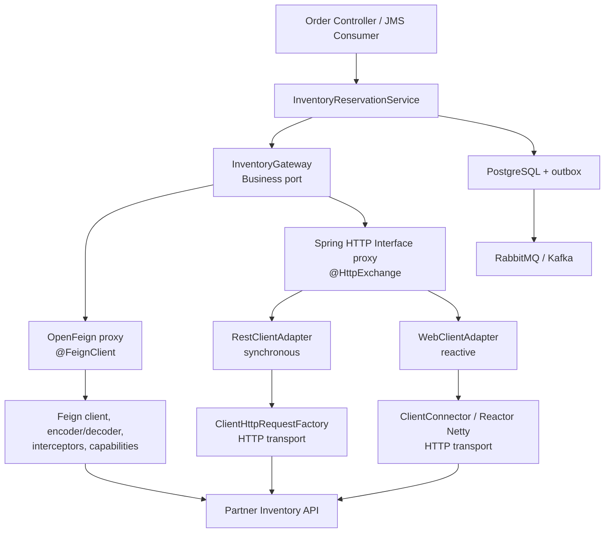
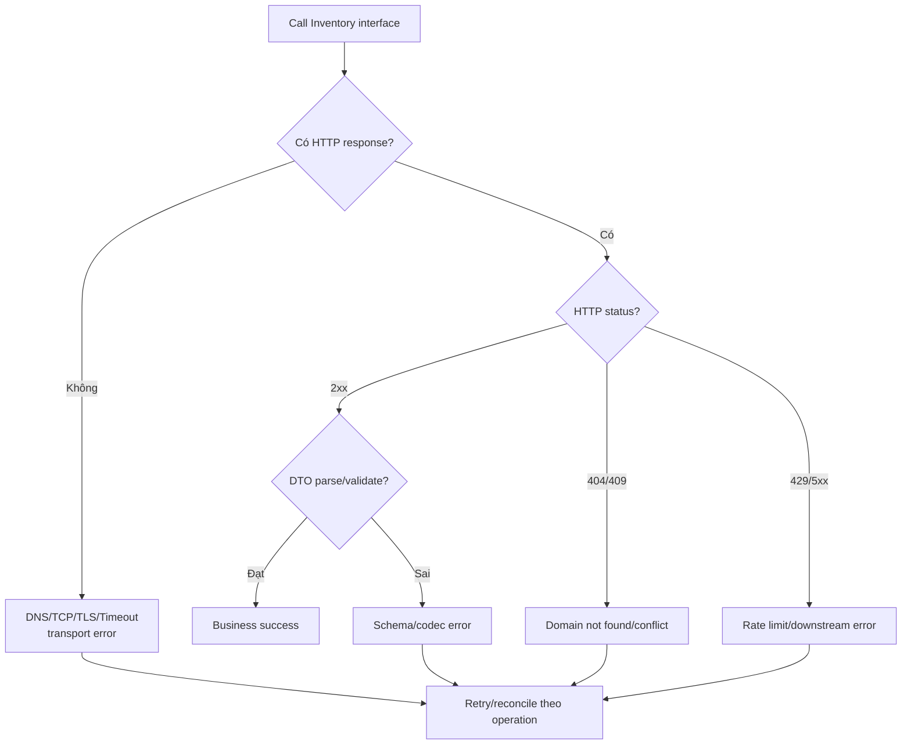
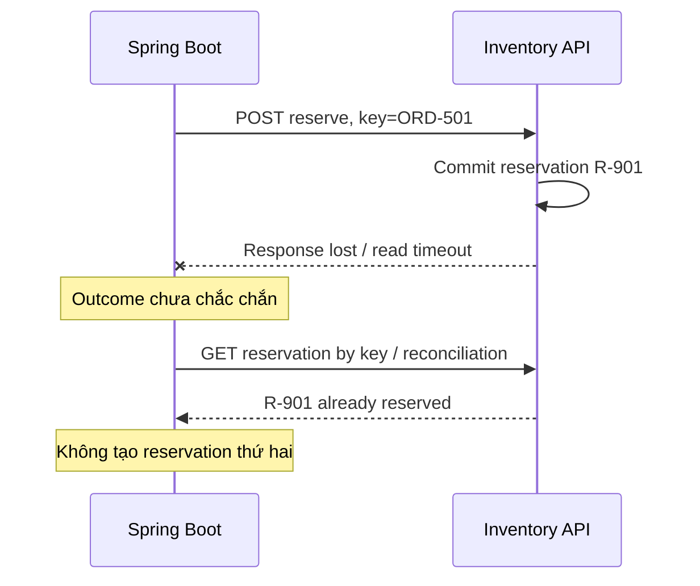
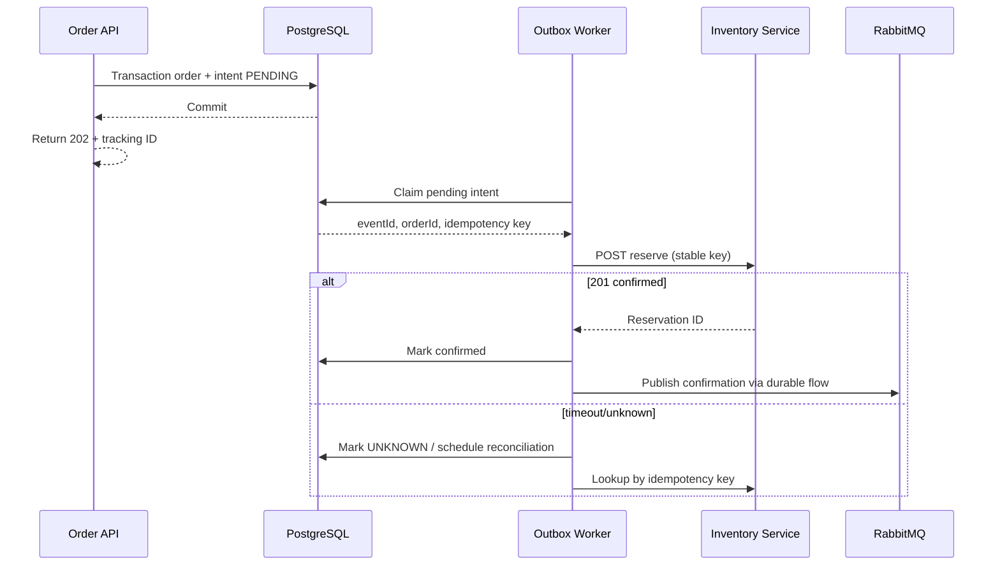
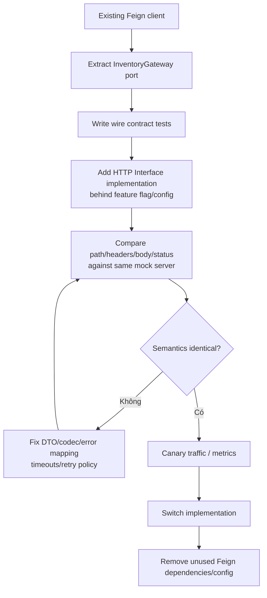

# OpenFeign, HTTP interface và lựa chọn client khai báo

## 1. Bối cảnh: vì sao Spring Boot cần HTTP client khai báo?

Trong module **SPRING_BOOT_INTEGRATION**, một dịch vụ Spring Boot thường cần giao tiếp với hệ thống khác: gọi API tồn kho để giữ hàng, truy vấn khách hàng, gửi yêu cầu thanh toán, cập nhật CRM hoặc gửi dữ liệu đến một adapter legacy. Các lời gọi HTTP phải tuân theo **hợp đồng dữ liệu**, cấu hình môi trường, timeout, retry, xử lý lỗi, bảo mật và cơ chế quan sát.

Nếu viết mỗi lời gọi bằng chuỗi lệnh `RestClient` hoặc `WebClient`, bạn phải lặp lại URI, phương thức, headers và cách đọc response:

```java
InventoryDto inventory = restClient.get()
    .uri("/v1/inventory/{sku}", sku)
    .retrieve()
    .body(InventoryDto.class);
```

Một **HTTP client khai báo (declarative HTTP client)** gom hợp đồng đó vào Java interface:

```java
interface InventoryHttpApi {
    InventoryDto findInventory(String sku);
}
```

Framework tạo proxy thực thi các lời gọi dựa trên annotation và cấu hình. Trong hệ sinh thái Spring, hai lựa chọn thường gặp là:

1. **Spring Cloud OpenFeign** với `@FeignClient`, annotations kiểu Spring MVC, encoder/decoder, named clients và các tích hợp Spring Cloud.
2. **Spring Framework HTTP Interface** với `@HttpExchange`, `@GetExchange`, `@PostExchange` và `HttpServiceProxyFactory`, có thể sử dụng `RestClient` hoặc `WebClient` làm phương tiện vận chuyển.

**Lợi ích chính** là làm rõ hợp đồng ở ranh giới hệ thống. Nhưng khai báo interface **không tự giải quyết** lỗi mạng, xử lý trùng lặp, circuit breaker, transaction xuyên hệ thống hay lưu công việc bền vững.

### Kết quả học tập

Sau bài này, bạn sẽ:

- So sánh `OpenFeign`, Spring HTTP Interface, `RestClient` và `WebClient`.
- Viết một Feign client có request/response DTO, headers, path và query parameters.
- Tạo HTTP interface proxy chạy qua `RestClientAdapter` hoặc `WebClientAdapter`.
- Cấu hình URL, authentication, timeout, codec, error handling và logging ở đúng tầng.
- Nhận diện khác biệt giữa lỗi **HTTP status**, **DNS/TCP/TLS/timeout** và **business rejection**.
- Đặt chính sách retry dựa trên idempotency, không gửi trùng một lệnh thanh toán/đặt hàng.
- Kiểm thử request thực qua HTTP mock server và kiểm soát sự khác biệt giữa proxy/client/framework.
- Quyết định khi nào nên di chuyển từ Feign sang HTTP Interface, khi nào giữ Feign và khi nào dùng client lập trình tường minh.

> **Phạm vi phiên bản:** Những đoạn dùng `RestClient` và `RestClientAdapter` giả định **Spring Framework 6.1+**, thường đi cùng **Spring Boot 3.2+**. Spring HTTP Interface có từ Spring Framework 6.0 nhưng cách cấu hình và các adapter có thay đổi theo bản. Spring Cloud OpenFeign phải dùng **Spring Cloud release train tương thích** với Spring Boot đang chạy; không trộn tùy ý major/minor.

## 2. Khai báo interface không có nghĩa server API được tạo ra

Một client khai báo mô tả **HTTP request mà ứng dụng gửi đi**, không phải REST controller ở phía nhận. So sánh:

```java
// Client-side: sends an HTTP GET to the remote service.
@GetExchange("/v1/inventory/{sku}")
InventoryDto findInventory(@PathVariable String sku);
```

với:

```java
// Server-side: handles an HTTP GET received by this application.
@GetMapping("/v1/inventory/{sku}")
InventoryDto getInventory(@PathVariable String sku) {
    return inventoryService.findInventory(sku);
}
```

HTTP Interface của Spring có nhóm annotations riêng để diễn tả các yêu cầu ở **phía client**. OpenFeign trong Spring Cloud thường dùng `@GetMapping`/`@PostMapping` làm contract cho client. **Không copy một interface rồi mặc nhiên suy nó có thể thay controller ở cả hai phía** mà không xem framework và phạm vi annotation tương ứng.

Một interface khai báo tốt nên mô tả API **của đối tác** (paths, query, body, headers) và giữ các business decisions như retry, cache, fallback, error mapping ở adapter/service có trách nhiệm rõ.

## 3. Kiến trúc: proxy interface nằm trên HTTP transport



Sơ đồ thể hiện **các lựa chọn thay thế**; một deployment không bắt buộc chạy đồng thời cả ba loại client. Trong một module tích hợp, nên đặt business interface riêng để có thể thay implementation HTTP mà không thay service xử lý đơn hàng.

Ví dụ business port:

```java
public interface InventoryGateway {
    Availability check(String sku);
    ReservationReceipt reserve(
        String orderId, String sku, int quantity
    );
}
```

Adapter OpenFeign hoặc HTTP Interface có nhiệm vụ ánh xạ business types sang API contract/HTTP status, tránh để toàn bộ service phụ thuộc vào `FeignException` hoặc `WebClientResponseException`.

## 4. Bảng so sánh nhanh những HTTP clients liên quan

| Lựa chọn | Kiểu lập trình | HTTP execution | Trọng tâm |
| --- | --- | --- | --- |
| **Spring Cloud OpenFeign** | Interface `@FeignClient` | Chủ yếu đồng bộ/blocking ở stack phổ biến | Named clients, Spring Cloud integrations, ecosystem |
| **Spring HTTP Interface + RestClient** | Interface `@HttpExchange` | Đồng bộ/blocking | Client khai báo với Spring Framework thuần |
| **Spring HTTP Interface + WebClient** | Interface `@HttpExchange` | Reactive khi return type/reactive stack phù hợp | Nonblocking API contracts; `Mono`/`Flux` |
| **RestClient** | Fluent imperative | Đồng bộ/blocking | HTTP call linh hoạt, không bắt buộc interface |
| **WebClient** | Fluent reactive | Reactive/nonblocking | Streaming, reactive composition, backpressure |
| **RestTemplate** | Imperative cũ | Đồng bộ/blocking | Legacy code, không ưu tiên cho code mới khi có RestClient |
| **JDK HttpClient** | JDK API | Sync/async | Không phụ thuộc Spring converter/annotations mặc định |

**OpenFeign không phải WebClient bọc bằng interface.** Spring Cloud OpenFeign truyền thống không cung cấp reactive client support trong cùng cơ chế như Spring HTTP Interface với `WebClientAdapter`. Một lời gọi Feign `InventoryDto check(...)` thường chiếm một worker thread trong khi chờ HTTP.

**HTTP Interface cũng không tự “reactive”.** Nếu proxy được tạo trên `RestClientAdapter`, lời gọi thường đồng bộ; `WebClientAdapter` kết hợp return types phù hợp mới có ngữ nghĩa reactive.

## 5. Quy tắc chọn client theo mục tiêu kỹ thuật

| Nhu cầu | Phù hợp hơn | Lý do |
| --- | --- | --- |
| Dự án đã dùng Spring Cloud OpenFeign ổn định | Giữ OpenFeign khi vẫn phù hợp | Tránh migration không mang lại giá trị |
| Dự án Spring Boot 3.2+ không cần Spring Cloud | HTTP Interface + RestClient | Ít dependency/cloud configuration hơn |
| Spring MVC/service đồng bộ, vài APIs cố định | HTTP Interface + RestClient hoặc RestClient | Hợp đồng gọn, dễ test |
| WebFlux end-to-end, streaming hoặc reactive fan-out | HTTP Interface + WebClient hoặc WebClient trực tiếp | Không block event loop, quản lý publishers |
| Per-request behavior rất động, streaming uploads, custom status workflow | RestClient/WebClient trực tiếp | Fluent API rõ quyền điều khiển mỗi request |
| Nhiều service names với Spring Cloud LoadBalancer/discovery | OpenFeign hoặc HTTP Interface kèm integration được cấu hình rõ | Phụ thuộc Spring Cloud/phiên bản |
| Cần typed API interface được nhiều adapters sử dụng | HTTP Interface | Core Spring Framework |
| Có đội vận hành đã chuẩn hóa Feign customizations | OpenFeign | Tận dụng convention và diagnostics hiện có |
| API cần durable delivery/retry sau crash | **Outbox/broker**, không chỉ HTTP client | Proxy không lưu công việc bền vững |

Đừng chọn API vì số dòng code ngắn nhất. Chọn theo **tính ổn định của hợp đồng, async vs blocking, dependencies, khả năng quan sát, chi phí chuyển đổi và các failure modes thực**.

## 6. Release trains và dependency compatibility

Spring Cloud OpenFeign thuộc **Spring Cloud**, không phải Spring Framework core. Vì vậy không thêm starter mới nhất một cách độc lập vào mọi dự án Spring Boot.

Ví dụ Maven (release train chỉ minh họa và phải kiểm tra compatibility cho Boot thực tế):

```xml
<dependencyManagement>
  <dependencies>
    <dependency>
      <groupId>org.springframework.cloud</groupId>
      <artifactId>spring-cloud-dependencies</artifactId>
      <version>${spring-cloud.version}</version>
      <type>pom</type>
      <scope>import</scope>
    </dependency>
  </dependencies>
</dependencyManagement>

<dependencies>
  <dependency>
    <groupId>org.springframework.cloud</groupId>
    <artifactId>spring-cloud-starter-openfeign</artifactId>
  </dependency>
</dependencies>
```

Trong đoạn XML này `${spring-cloud.version}` là Maven property do **project** khai báo theo release train tương thích; không phải biến môi trường được khai báo trong bài. Spring Boot BOM/parent và Spring Cloud BOM phải được phối hợp phiên bản.

Với Spring HTTP Interface + RestClient, ứng dụng Boot 3.2+ có `spring-web` thông qua `spring-boot-starter-web` (hoặc dependency thích hợp):

```xml
<dependency>
  <groupId>org.springframework.boot</groupId>
  <artifactId>spring-boot-starter-web</artifactId>
</dependency>
```

Nếu dùng adapter `WebClient`, cần Spring WebFlux có trên classpath:

```xml
<dependency>
  <groupId>org.springframework.boot</groupId>
  <artifactId>spring-boot-starter-webflux</artifactId>
</dependency>
```

Có cả starter-web và starter-webflux **không tự làm server trở thành reactive**: Spring Boot thường ưu tiên MVC server khi cả hai stack cùng có mặt, trừ khi cấu hình khác. Dùng WebClient trong một ứng dụng Spring MVC vẫn hợp lệ; vấn đề là chọn đúng kiểu I/O và quản lý threads.

### Chú ý xu hướng dài hạn

Spring Cloud OpenFeign hiện được mô tả là **feature-complete** trong tài liệu Spring Cloud OpenFeign, với định hướng các client dựa trên Spring HTTP Service Interfaces cho phát triển mới. Đây là **tín hiệu về hướng công nghệ**, không phải yêu cầu phải bỏ Feign ngay hoặc tuyên bố một version cụ thể đã hết hỗ trợ. Kiểm tra release train và thời gian support thực tế trước khi lập kế hoạch nâng cấp.

## 7. Ví dụ xuyên suốt: contract API của hệ thống tồn kho

Giả sử đối tác cung cấp hai endpoints:

```text
GET  /v1/inventory/{sku}
POST /v1/reservations
```

GET thành công:

```json
{
  "sku": "SKU-001",
  "availableQuantity": 27
}
```

POST request:

```json
{
  "orderId": "ORD-501",
  "sku": "SKU-001",
  "quantity": 2
}
```

POST response:

```json
{
  "reservationId": "R-901",
  "status": "RESERVED"
}
```

Các DTO Java:

```java
public record InventoryDto(
    String sku,
    int availableQuantity
) {}

public record ReservationRequest(
    String orderId,
    String sku,
    int quantity
) {}

public record ReservationResponse(
    String reservationId,
    String status
) {}
```

Trong production, nên dùng `@NotBlank`/`@Positive` và contract validation tại boundaries; DTO ở đây tối giản để tập trung vào client. Có thể dùng `Integer` thay `int` khi cần phân biệt **thiếu trường** với số 0 trong JSON. Java records tiện cho wire DTO, không nên đưa entity JPA/Hibernate trực tiếp làm API payload.

Các quy tắc tích hợp bổ sung:

- `X-Correlation-Id` để trace request xuyên hệ thống, không tự làm business key.
- `Idempotency-Key` ổn định cho POST khi client có quyền retry.
- Partner có thể trả HTTP 404 cho SKU không có, 409 cho inventory conflict, 429 cho rate limit, 503 cho unavailable.
- Sau timeout của POST, remote side effect **có thể đã thành công**; workflow phải kiểm tra trạng thái bằng orderId/idempotency key trước khi tạo lệnh khác.

## 8. Bắt đầu với Spring Cloud OpenFeign

Trong một ứng dụng Spring Boot có starter tương thích, bật component scanning cho các Feign interfaces:

```java
import org.springframework.boot.SpringApplication;
import org.springframework.boot.autoconfigure.SpringBootApplication;
import org.springframework.cloud.openfeign.EnableFeignClients;

@SpringBootApplication
@EnableFeignClients(basePackages = "com.example.integration.clients")
public class IntegrationApplication {
    public static void main(String[] args) {
        SpringApplication.run(
            IntegrationApplication.class, args
        );
    }
}
```

`@EnableFeignClients` quét các interface `@FeignClient` ở package được chỉ định. Nếu không bật hoặc đặt package ngoài vùng scan, ứng dụng có thể báo **không có bean của interface** dù dependency có mặt.

Không đưa mọi Feign client vào package ngẫu nhiên rồi hy vọng Spring Boot tự tìm thấy. Trong dự án đa module, nên dùng `basePackages` hoặc `clients` rõ ràng.

## 9. Khai báo @FeignClient với Spring MVC contract

Một Feign client cho đối tác tồn kho:

```java
package com.example.integration.clients;

import org.springframework.cloud.openfeign.FeignClient;
import org.springframework.web.bind.annotation.GetMapping;
import org.springframework.web.bind.annotation.PathVariable;
import org.springframework.web.bind.annotation.PostMapping;
import org.springframework.web.bind.annotation.RequestBody;
import org.springframework.web.bind.annotation.RequestHeader;

@FeignClient(
    name = "inventory",
    url = "${clients.inventory.base-url}"
)
public interface InventoryFeignClient {

    @GetMapping("/v1/inventory/{sku}")
    InventoryDto getInventory(
        @PathVariable("sku") String sku,
        @RequestHeader("X-Correlation-Id")
        String correlationId
    );

    @PostMapping("/v1/reservations")
    ReservationResponse reserve(
        @RequestHeader("Idempotency-Key")
        String idempotencyKey,
        @RequestHeader("X-Correlation-Id")
        String correlationId,
        @RequestBody ReservationRequest request
    );
}
```

Ở đây `InventoryDto`, `ReservationRequest` và `ReservationResponse` được định nghĩa trong module domain/contract thích hợp và import vào interface thực tế.

Những điểm cần hiểu:

1. `name="inventory"` là tên logical Feign client dùng cho named configuration.
2. `url=... ` trỏ tới **endpoint cụ thể**, có thể đọc từ properties. Khi URL được chỉ định tường minh, Feign thường không dùng service discovery/load-balancing dựa vào client name cho lời gọi này.
3. `@GetMapping`, `@PostMapping` và `@RequestBody` thuộc Spring MVC annotations nhưng được **Feign Contract** diễn giải để tạo request, không đăng ký controller endpoint.
4. `@RequestHeader` mô tả những header mà method caller phải cung cấp. Một header value rỗng/không hợp lệ không được framework tự sửa theo business contract.
5. Method trả DTO **đồng bộ**; call chờ response/timeout và có thể ném Feign exception.
6. Một request HTTP thành công về mặt kết nối không có nghĩa message broker/SQL workflow của ứng dụng đã commit.

### Tránh URL/port sai khi chạy container

```yaml
clients:
  inventory:
    base-url: ${INVENTORY_BASE_URL:http://localhost:8091}
```

Fallback `localhost` chỉ để chạy ví dụ local. Trong Docker/Kubernetes, `localhost` trỏ tới chính application container/pod; production phải chỉ rõ host/service name thực, có kiểm soát hostname và TLS.

**Đừng cho HTTP caller nhập trực tiếp `base-url` rồi Feign/WebClient gọi đến đó**; sẽ mở ra nguy cơ SSRF và truy cập dịch vụ nội bộ. Remote endpoints phải được cấu hình/allowlist theo tenant hoặc environment đã xác thực.

## 10. Feign RequestInterceptor: headers chung, auth và correlation

Khi nhiều method cùng cần bearer token/correlation, `RequestInterceptor` có thể bổ sung headers trước khi gửi:

```java
import feign.RequestInterceptor;
import org.springframework.context.annotation.Bean;

public class InventoryFeignConfiguration {

    @Bean
    RequestInterceptor inventoryTokenInterceptor(
            InventoryTokenProvider tokenProvider) {

        return template -> {
            String token = tokenProvider.accessToken();
            template.header(
                "Authorization", "Bearer " + token
            );
        };
    }
}
```

Và gắn cấu hình cho đúng named client:

```java
@FeignClient(
    name = "inventory",
    url = "${clients.inventory.base-url}",
    configuration = InventoryFeignConfiguration.class
)
public interface InventoryFeignClient {
    // Methods from section 9
}
```

`InventoryTokenProvider` là abstraction do ứng dụng cung cấp; phải xử lý token expiry và refresh theo chính sách xác thực thực tế. Đây là **mẫu cấu hình**, không phải code đủ chạy khi thiếu provider.

**Cảnh báo phạm vi bean:** nếu `InventoryFeignConfiguration` bị Spring component scan như một cấu hình toàn cục, các `RequestInterceptor` beans trong đó có thể áp dụng rộng hơn dự tính. Cần kiểm soát package/scope và xác minh bằng test hai clients sử dụng các credentials khác nhau.

Không:

- Gắn bearer token của client A vào request đến client B.
- Log access token trong Feign DEBUG/FULL logging.
- Đọc `SecurityContextHolder` rồi giả định context luôn tồn tại khi được gọi từ `@Async`, scheduler hay broker listener.
- Truyền token người dùng tới một service không được ủy quyền chỉ vì cùng correlationId.

Với OAuth2 client credentials hoặc token relay, dùng cơ chế Spring Security/OAuth2 phù hợp và cache token có kiểm soát thay vì tạo một HTTP login request cho mỗi invocation.

## 11. OpenFeign configuration theo named client

Trong Spring Cloud OpenFeign 4.x, có nhóm properties như:

```yaml
spring:
  cloud:
    openfeign:
      client:
        config:
          inventory:
            connectTimeout: 2000
            readTimeout: 5000
            loggerLevel: basic
```

**Đơn vị:** các properties `connectTimeout` và `readTimeout` ở ví dụ Spring Cloud OpenFeign 4.x biểu thị **milliseconds**; hãy kiểm tra metadata/docs đúng bản Spring Cloud đang chạy. Đừng nhầm với một `Duration` nhận `2s` ở các Spring Boot properties khác.

Ý nghĩa:

- **Connect timeout**: giới hạn thời gian thiết lập kết nối theo transport client; không bảo đảm toàn bộ request hoàn thành trong 2 giây.
- **Read timeout**: giới hạn giai đoạn chờ/đọc dữ liệu theo client implementation; không tự tạo **end-to-end workflow deadline** bao gồm queue, retry, DNS, token refresh và các tác vụ ngoài HTTP.
- **loggerLevel**: mức log chi tiết do Feign sử dụng, nhưng log có xuất hiện còn phụ thuộc Java logger/SLF4J level và configuration.
- Cấu hình `inventory` gắn với **logical client name/contextId** theo cơ chế Spring Cloud OpenFeign; cần xác minh nếu có nhiều Feign clients cùng tên với `contextId` khác nhau.

### Retry mặc định của Spring Cloud OpenFeign khác Feign thuần

Trong Spring Cloud OpenFeign có cấu hình default `Retryer.NEVER_RETRY`, **khác** Feign core có thể có default retry cho một số `IOException`/`RetryableException`. Điều đó có nghĩa: **đừng dựa vào khả năng tự retry** khi dùng Spring Cloud OpenFeign. Nếu yêu cầu retry, khai báo policy cụ thể với điều kiện, giới hạn và idempotency.

Đồng thời, nếu bật Feign retry + Spring Retry/Resilience4j + gateway retry, **số lần gọi có thể nhân lên**. Cần định nghĩa ai sở hữu retry ở một ranh giới cho một operation.

## 12. OpenFeign HTTP errors: FeignException và ErrorDecoder

HTTP response **đã đến** với status 4xx/5xx khác với tình huống không có response do DNS/TCP/TLS/timeout. Với OpenFeign, response không nằm trong nhóm thành công có thể được chuyển thành `FeignException` hoặc exception do `ErrorDecoder` quyết định.

Ví dụ phân loại hợp đồng:

| Status | Ý nghĩa có thể có ở Inventory API | Chính sách nghiệp vụ |
| --- | --- | --- |
| 200 | Đọc SKU thành công | Deserialize/validate response |
| 201/202 | Reservation đã được chấp nhận theo contract | Kiểm tra receipt/tracking status |
| 400 | Request sai schema, số lượng âm | Không retry cùng payload |
| 401/403 | Auth/permission issue | Sửa token/quyền; tránh retry nóng |
| 404 | SKU không tồn tại | Domain `InventoryNotFound` |
| 409 | Không đủ tồn kho/phiên bản conflict | Domain conflict, có thể đọc lại trước quyết định |
| 429 | Rate limit | Backoff và `Retry-After` nếu contract hỗ trợ |
| 500/502/503/504 | Remote/service infrastructure issue | Retry có điều kiện + deadline |
| Timeout/network failure | Chưa có HTTP response xác định | Có thể là unknown outcome cho POST |

### Một ErrorDecoder có giới hạn trách nhiệm

```java
import feign.Response;
import feign.codec.ErrorDecoder;

public final class InventoryErrorDecoder
        implements ErrorDecoder {

    private final ErrorDecoder defaultDecoder =
        new ErrorDecoder.Default();

    @Override
    public Exception decode(String methodKey, Response response) {
        return switch (response.status()) {
            case 404 -> new InventoryNotFoundException(
                "Inventory SKU not found"
            );
            case 409 -> new InventoryConflictException(
                "Inventory reservation rejected"
            );
            case 429 -> new InventoryRateLimitedException(
                "Inventory API rate limited"
            );
            default -> defaultDecoder.decode(methodKey, response);
        };
    }
}
```

`InventoryNotFoundException`, `InventoryConflictException` và `InventoryRateLimitedException` là exceptions do ứng dụng tự định nghĩa; ví dụ minh họa ý tưởng mapping. Đăng ký `ErrorDecoder` như một bean trong cấu hình **riêng của Feign client** nếu muốn tránh áp nhầm lên tất cả integrations.

**Không parse raw error body vô hạn** chỉ để tìm `errorCode`. Partner có thể trả HTML 502 rất lớn, JSON malformed hoặc PII. Nếu cần đọc error body, giới hạn bytes, charset và schema rồi map về lỗi an toàn. Không trả nguyên remote message/stack trace cho HTTP client nội bộ.

### ErrorDecoder không bắt mọi lỗi

`ErrorDecoder` xử lý **HTTP response status**, không phải nơi bao quát mọi network exception trước khi có response. DNS failure, SSL handshake, connection reset, connect/read timeout phải được phân loại ở adapter/resilience layer phù hợp.

## 13. OpenFeign encoder, decoder và Jackson

Một Feign client biến:

- Java method arguments → URI, query, headers, body (request template + encoder).
- HTTP response bytes → Java return type (decoder).
- Response error status → exception (ErrorDecoder).

Spring Cloud OpenFeign với Spring MVC Contract và Spring HTTP message converters có thể sử dụng Jackson để mã hóa DTO thành JSON theo `Content-Type` và configuration. Nhưng **đừng giả định** mọi body đều là JSON, hoặc mọi response có body.

Ví dụ:

```java
@PostMapping(
    value = "/v1/reservations",
    consumes = "application/json",
    produces = "application/json"
)
ReservationResponse reserve(
    @RequestHeader("Idempotency-Key") String key,
    @RequestBody ReservationRequest body
);
```

Cần thống nhất:

- JSON property names/nullable fields, enum values, timestamp/decimal formats.
- Response 204 không có body: method trả DTO non-null có thể không tương ứng contract.
- Unknown fields, binary body, streaming response và max payload sizes.
- Jackson modules: Java Time, Kotlin, records, naming strategy.
- Validation ở phía gửi và phía nhận; outbound declarative interface **không tự xác thực tất cả domain invariants**.
- Error payload có schema/version riêng, không lấy DTO success để deserialize response 400.

Đặc biệt, nếu dùng `Retryer` và request có body streaming không thể replay, việc retry có thể không an toàn hoặc không thực hiện được. Cân nhắc idempotency và buffer/stream lifecycle trước khi retry uploads.

## 14. URL cụ thể và service discovery/load balancing

Hai cách cấu hình Feign:

**Gọi theo URL tường minh:**

```java
@FeignClient(
    name = "inventory",
    url = "${clients.inventory.base-url}"
)
interface InventoryByUrlClient {
    // ...
}
```

**Gọi theo logical service name:**

```java
@FeignClient(name = "inventory-service")
interface InventoryByServiceNameClient {
    // ...
}
```

Với cách thứ hai, nếu môi trường có **Spring Cloud LoadBalancer** hoặc discovery integration được cấu hình, logical name có thể được resolve tới service instances. Không có cấu hình cần thiết, chỉ khai báo `name` không bảo đảm endpoint được tìm thấy.

Phân biệt:

1. **DNS-based balancing:** URL trỏ đến hostname được DNS/load balancer ngoài ứng dụng quản lý.
2. **Client-side balancing:** Feign/transport dùng Spring Cloud LoadBalancer để chọn instance từ service discovery/configuration.
3. **Provider-managed balancing:** endpoint API gateway/mesh chọn backend.
4. **Failover/retry:** selection của instance khác không đồng nghĩa cùng request là idempotent.

Đừng vừa dùng fixed URL, vừa mong client-side discovery đổi instance. Và đừng tự động retry POST qua một instance khác nếu side effect có thể đã thực hiện ở instance đầu.

## 15. Circuit breaker, fallback và tải thực

Spring Cloud OpenFeign có khả năng tích hợp với **Spring Cloud CircuitBreaker** khi thêm dependencies và kích hoạt configuration tương ứng, nhưng **không phải** cứ thêm `spring-cloud-starter-openfeign` là mọi method tự có circuit breaker/fallback.

Một số hệ thống dùng Resilience4j ở service/adapter boundary để có:

- Circuit breaker: dừng gọi tạm thời khi lỗi downstream vượt ngưỡng.
- Time limiter: áp hạn thời gian chờ ở tầng caller (không bảo đảm cancel side effect).
- Retry: thử lại lỗi tạm thời với backoff/jitter có giới hạn.
- Bulkhead/semaphore: bảo vệ concurrency tới partner.
- Rate limiter: tôn trọng quota request/second.

**Fallback là quyết định nghiệp vụ**, không chỉ handler của framework:

- Với **GET inventory**, có thể trả cache snapshot cùng timestamp nếu API chấp nhận stale data.
- Với **POST reserve**, không được tự báo `RESERVED` khi partner unavailable; phải giữ trạng thái `PENDING`/`UNKNOWN` để đối soát.
- Với **lệnh thanh toán**, fallback tạo “thành công giả” là sai nghiêm trọng.

Timeout, circuit breaker và retry phải được phối hợp với broker, HTTP client connection pool và transaction budget. Có nhiều lớp retry độc lập là nguyên nhân phổ biến dẫn đến retry storm.

## 16. OpenFeign logging và observability

Spring Cloud OpenFeign có hỗ trợ logging theo Feign logger và có thể tích hợp Micrometer/Observation qua dependencies/capabilities/auto-configuration tương thích.

Các mức Feign logging điển hình:

| Mức | Thông tin được ghi | Cảnh báo |
| --- | --- | --- |
| `NONE` | Không log bởi Feign logger | Metrics/tracing vẫn có thể hoạt động riêng |
| `BASIC` | Method, URL, status, latency | URL có query chứa PII nếu thiết kế kém |
| `HEADERS` | Thêm headers | Authorization, cookie, API key có thể lộ |
| `FULL` | Thêm body request/response | Dễ lộ PII/secrets, log quá lớn |

**Không bật HEADERS/FULL toàn production để debug thường trực.** Sanitization/masking phải có ở lớp được dùng thực tế; không giả định mọi logger tự ẩn token. Metrics nên dùng labels cardinality thấp như `client=inventory`, method, outcome, status group; không dùng order ID, sku, token hoặc raw URI có biến làm tag.

Với OpenTelemetry/Micrometer, cần kiểm tra propagation qua `@Async`, message consumers và HTTP interceptors. AOP/proxy không tự sao chép mọi ThreadLocal trace/security context.

## 17. Spring HTTP Interface: khai báo trên Spring Framework core

Spring Framework hỗ trợ các annotations phía client:

| Annotation | Ý nghĩa |
| --- | --- |
| `@HttpExchange` | Định nghĩa base path/content type và metadata HTTP chung |
| `@GetExchange` | HTTP GET |
| `@PostExchange` | HTTP POST |
| `@PutExchange` | HTTP PUT |
| `@PatchExchange` | HTTP PATCH |
| `@DeleteExchange` | HTTP DELETE |
| `@PathVariable` | Bind URI template variable |
| `@RequestParam` | Bind query/form parameter theo client stack |
| `@RequestHeader` | Bind header request |
| `@RequestBody` | Bind request body |
| `@RequestPart` | Bind multipart part khi adapter hỗ trợ |

HTTP Interface dùng `org.springframework.web.service.annotation.*`. Chú ý `@RequestHeader`, `@RequestParam`, `@PathVariable`, `@RequestBody` ở `org.springframework.web.bind.annotation`; annotations có thể giống phía server nhưng được **client proxy** diễn giải.

Ví dụ:

```java
package com.example.integration.clients;

import org.springframework.web.bind.annotation.PathVariable;
import org.springframework.web.bind.annotation.RequestBody;
import org.springframework.web.bind.annotation.RequestHeader;
import org.springframework.web.service.annotation.GetExchange;
import org.springframework.web.service.annotation.HttpExchange;
import org.springframework.web.service.annotation.PostExchange;

@HttpExchange(
    url = "/v1",
    accept = "application/json",
    contentType = "application/json"
)
public interface InventoryHttpService {

    @GetExchange("/inventory/{sku}")
    InventoryDto getInventory(
        @PathVariable("sku") String sku,
        @RequestHeader("X-Correlation-Id")
        String correlationId
    );

    @PostExchange("/reservations")
    ReservationResponse reserve(
        @RequestHeader("Idempotency-Key") String key,
        @RequestHeader("X-Correlation-Id") String correlationId,
        @RequestBody ReservationRequest request
    );
}
```

Đây chỉ là **interface definition**. Không có `@FeignClient` hoặc bean tự động xuất hiện nếu chưa xây `HttpServiceProxyFactory` (hoặc cơ chế đăng ký được hỗ trợ bởi phiên bản Spring cao hơn). Ở các ví dụ Boot 3.2/3.3, chúng ta tạo bean proxy một cách tường minh.

## 18. Tạo HTTP interface proxy đồng bộ với RestClientAdapter

Ví dụ phù hợp **Spring Framework 6.1+ / Spring Boot 3.2+**:

```java
import org.springframework.context.annotation.Bean;
import org.springframework.context.annotation.Configuration;
import org.springframework.web.client.RestClient;
import org.springframework.web.client.support.RestClientAdapter;
import org.springframework.web.service.invoker.HttpServiceProxyFactory;

@Configuration(proxyBeanMethods = false)
public class InventoryHttpServiceConfiguration {

    @Bean
    InventoryHttpService inventoryHttpService(
            RestClient.Builder restClientBuilder,
            InventoryEndpointProperties properties) {

        RestClient client = restClientBuilder
            .baseUrl(properties.baseUrl())
            .defaultHeader("Accept", "application/json")
            .build();

        RestClientAdapter adapter =
            RestClientAdapter.create(client);

        HttpServiceProxyFactory factory =
            HttpServiceProxyFactory
                .builderFor(adapter)
                .build();

        return factory.createClient(InventoryHttpService.class);
    }
}
```

`InventoryEndpointProperties` là cấu hình ứng dụng do bạn định nghĩa; `baseUrl()` nên đọc một endpoint đã được kiểm soát từ environment/secret config, không nhận tùy ý từ HTTP request. Ví dụ record phù hợp cho Boot configuration:

```java
import org.springframework.boot.context.properties.ConfigurationProperties;

@ConfigurationProperties(prefix = "clients.inventory")
public record InventoryEndpointProperties(
    String baseUrl
) {}
```

Cần bật `@ConfigurationPropertiesScan` hoặc `@EnableConfigurationProperties(InventoryEndpointProperties.class)` trong app để bean được đăng ký. `RestClient.Builder` từ Spring Boot thường đã có các customizations hữu ích như message converters/observability; **không** tạo `RestClient.builder()` ở mọi nơi nếu bạn đang cần tận dụng customization tập trung.

Một `RestClientAdapter` thực thi lời gọi trên HTTP transport đồng bộ. Nó không biến method trả `ReservationResponse` thành nonblocking, và một `@HttpExchange` interface **không tự có retry/circuit breaker**.

## 19. Đọc cấu hình endpoint qua @ConfigurationProperties có validate

Ví dụ bổ sung để đăng ký properties và tránh URL rỗng:

```java
import org.springframework.boot.context.properties.EnableConfigurationProperties;
import org.springframework.context.annotation.Configuration;

@Configuration(proxyBeanMethods = false)
@EnableConfigurationProperties(InventoryEndpointProperties.class)
public class InventoryEndpointRegistration {
}
```

```yaml
clients:
  inventory:
    base-url: ${INVENTORY_BASE_URL}
```

Bản ghi properties ở mục 18 chỉ minh họa binding; để validation thực sự bắt buộc một URL HTTP(S) an toàn, có thể dùng `@Validated` cùng Jakarta Bean Validation và một validator được định nghĩa theo yêu cầu bảo mật. Chỉ `String baseUrl` **không tự bác bỏ** chuỗi rỗng hoặc scheme `file:` nếu framework cho phép.

**Không trộn endpoint của local/test/prod trong code**. Sử dụng profile hoặc environment properties và kiểm tra theo deployment. Nếu nhiều tenants có endpoint khác nhau, xác minh tenant ownership/allowlist trước khi chọn host, chống SSRF/DNS rebinding theo chính sách network của ứng dụng.

## 20. HTTP Interface reactive với WebClientAdapter

Nếu luồng Spring Boot sử dụng Reactor, có thể tạo HTTP interface proxy trên `WebClient`:

```java
import reactor.core.publisher.Mono;

import org.springframework.web.bind.annotation.PathVariable;
import org.springframework.web.bind.annotation.RequestBody;
import org.springframework.web.bind.annotation.RequestHeader;
import org.springframework.web.service.annotation.GetExchange;
import org.springframework.web.service.annotation.HttpExchange;
import org.springframework.web.service.annotation.PostExchange;

@HttpExchange(url = "/v1", accept = "application/json")
public interface ReactiveInventoryHttpService {

    @GetExchange("/inventory/{sku}")
    Mono<InventoryDto> getInventory(
        @PathVariable("sku") String sku
    );

    @PostExchange("/reservations")
    Mono<ReservationResponse> reserve(
        @RequestHeader("Idempotency-Key") String key,
        @RequestBody ReservationRequest body
    );
}
```

Tạo proxy:

```java
import org.springframework.context.annotation.Bean;
import org.springframework.context.annotation.Configuration;
import org.springframework.web.reactive.function.client.WebClient;
import org.springframework.web.reactive.function.client.support.WebClientAdapter;
import org.springframework.web.service.invoker.HttpServiceProxyFactory;

@Configuration(proxyBeanMethods = false)
class ReactiveInventoryConfiguration {

    @Bean
    ReactiveInventoryHttpService reactiveInventoryHttpService(
            WebClient.Builder builder,
            InventoryEndpointProperties properties) {

        WebClient webClient = builder
            .baseUrl(properties.baseUrl())
            .build();

        WebClientAdapter adapter =
            WebClientAdapter.create(webClient);

        HttpServiceProxyFactory factory =
            HttpServiceProxyFactory.builderFor(adapter).build();

        return factory.createClient(
            ReactiveInventoryHttpService.class
        );
    }
}
```

Dùng từ một service:

```java
public Mono<Availability> findAvailability(String sku) {
    return inventoryApi.getInventory(sku)
        .map(dto -> new Availability(
            dto.sku(),
            dto.availableQuantity()
        ));
}
```

Các biến `inventoryApi`, record `Availability` và method đang nằm trong service do dự án định nghĩa; ví dụ chỉ thể hiện compose `Mono`.

**Đặc điểm quan trọng**:

- HTTP request bắt đầu khi có subscription phù hợp; tạo `Mono` không đồng nghĩa remote đã được gọi.
- Mỗi subscription vào một cold publisher có thể khiến remote HTTP request được thực hiện lại. Không `retry`/`subscribe` tùy ý nếu POST tạo side effect.
- Trên WebFlux event loop, tránh `.block()` và các JDBC/Feign imperative calls không được tách sang scheduler có giới hạn.
- Với `WebClient`, filter, connector, codec, TLS và timeout phải được cấu hình trên đúng `WebClient.Builder` dùng tạo proxy.
- `Mono`/`Flux` không biến event thành durable work sau process crash. Cần outbox/broker nếu business contract đòi khả năng phục hồi.

## 21. Cách chọn synchronous và reactive không phụ thuộc annotation

Một sai lầm là thấy `@HttpExchange` rồi cho rằng interface luôn hoạt động theo cùng thread/concurrency model.

| Cấu hình proxy | Return type thường gặp | Hành vi I/O |
| --- | --- | --- |
| `RestClientAdapter` | `InventoryDto`, `ResponseEntity<T>` | Imperative/blocking |
| `WebClientAdapter` | `Mono<T>`, `Flux<T>` (khi phù hợp) | Reactive/nonblocking |
| `OpenFeign` chuẩn Spring Cloud | `T`/`Response` | Thông thường blocking |
| `WebClient` fluent | `Mono<T>`/`Flux<T>` | Reactive/nonblocking |
| `RestClient` fluent | `T`/`ResponseEntity<T>` | Imperative/blocking |

Khi endpoint phải trả một response duy nhất và app là Spring MVC, HTTP Interface + RestClient thường đơn giản hơn WebClient + `block()`. Nếu ứng dụng là WebFlux và cần gọi đồng thời nhiều downstream, WebClient + reactive interface phù hợp hơn; nhưng concurrency vẫn cần được giới hạn theo HTTP connection pools và quota của đối tác.

**Không cần đưa một app JDBC/JPA blocking sang WebFlux chỉ vì muốn sử dụng HTTP Interface.** Chọn một thiết kế nhất quán với execution model và resource limits hiện có.

## 22. Cấu hình connect/read timeout với RestClient

`RestClient` dùng một `ClientHttpRequestFactory`. Cách cấu hình timeout phụ thuộc request factory và HTTP transport được chọn. Ví dụ minh họa với `SimpleClientHttpRequestFactory`:

```java
import java.time.Duration;

import org.springframework.context.annotation.Bean;
import org.springframework.web.client.RestClient;
import org.springframework.http.client.SimpleClientHttpRequestFactory;

@Bean
RestClient inventoryRestClient(
        RestClient.Builder builder,
        InventoryEndpointProperties properties) {

    SimpleClientHttpRequestFactory requestFactory =
        new SimpleClientHttpRequestFactory();

    requestFactory.setConnectTimeout(
        Duration.ofSeconds(2)
    );
    requestFactory.setReadTimeout(
        Duration.ofSeconds(5)
    );

    return builder
        .baseUrl(properties.baseUrl())
        .requestFactory(requestFactory)
        .build();
}
```

**Lưu ý phiên bản:** overload nhận `Duration` của các request factories có thể khác giữa Spring Framework minor versions; nếu dự án chỉ có overload milliseconds, áp dụng API đúng bản đang chạy. Không sao chép literal `2s` vào một property chỉ nhận số milliseconds.

`SimpleClientHttpRequestFactory` giúp ví dụ ngắn, **không phải khuyến nghị duy nhất cho production**. Hệ thống nhiều requests cần xem connection pooling, TLS, HTTP/2, proxy, connection reuse và thời gian chờ lấy connection. Có thể dùng JDK HttpClient hoặc Apache HttpComponents 5/Jetty/Reactor Netty theo classpath và Spring version.

**Timeout cần phân biệt rõ**:

- DNS resolution có thể có behavior khác connect timeout.
- Connect timeout không giới hạn thời gian nhận toàn bộ response.
- Read timeout không tự kiểm soát số lần retry và tổng business deadline.
- Timeout ở caller có thể không hủy remote side effect.
- Pool acquisition timeout khác TCP connect timeout.
- Nếu một thread chờ trong executor queue 30 giây trước khi bắt đầu request, HTTP timeout 5 giây không bảo đảm business hoàn thành trong 5 giây.

Giữ timeout policy nhất quán và đưa con số vào cấu hình của **client chuyên biệt**, tránh một global override vô tình ảnh hưởng mọi partner.

## 23. WebClient timeout, response buffering và connection pooling

Với WebClient/Reactor Netty, có thể cấu hình Netty `HttpClient`:

```java
import java.time.Duration;

import io.netty.channel.ChannelOption;
import reactor.netty.http.client.HttpClient;

import org.springframework.http.client.reactive.ReactorClientHttpConnector;
import org.springframework.web.reactive.function.client.WebClient;

HttpClient httpClient = HttpClient.create()
    .option(ChannelOption.CONNECT_TIMEOUT_MILLIS, 2_000)
    .responseTimeout(Duration.ofSeconds(5));

WebClient inventoryWebClient = WebClient.builder()
    .baseUrl("https://inventory.example.internal")
    .clientConnector(
        new ReactorClientHttpConnector(httpClient)
    )
    .codecs(codecs -> codecs.defaultCodecs()
        .maxInMemorySize(256 * 1024))
    .build();
```

Ở đây:

- `CONNECT_TIMEOUT_MILLIS` và `responseTimeout` là những giới hạn khác nhau.
- `maxInMemorySize` giới hạn các trường hợp **codec aggregation** chứ không phải universal streaming body cap.
- Reactor Netty có connection pool/resource management; với production, xem max connections, pending acquire timeout, idle/max life, TLS và global vs riêng tài nguyên theo client.
- Tạo `HttpClient`/`ConnectionProvider` mới cho mọi request có thể phá connection reuse và gây cạn sockets.
- `responseTimeout` không phải một end-to-end business deadline khi có queue, retry, circuit breaker hoặc nhiều HTTP hops.

Ví dụ `WebClient.builder()` bỏ qua một số customizations Spring Boot có thể đã đăng ký. Trong app thực, nên dùng `WebClient.Builder` được inject rồi chỉ override connector khi thật sự cần và đã kiểm chứng metrics/tracing/TLS.

## 24. HTTP Interface xử lý response 4xx/5xx thế nào?

HTTP Interface **không có một bộ quy tắc lỗi độc lập với transport**. Khi proxy chạy qua `RestClientAdapter`, nó thường nhận semantics của `RestClient`. Khi qua `WebClientAdapter`, nó nhận semantics của `WebClient`.

Với cách dùng `retrieve()` thông thường:

- `RestClient` có thể ném `RestClientResponseException` (hoặc subtype phù hợp) khi HTTP status 4xx/5xx.
- `WebClient` có thể ném `WebClientResponseException` cho HTTP status.
- **Kết nối mạng thất bại trước response** thường là `ResourceAccessException` với RestClient blocking (tùy request factory) hoặc `WebClientRequestException` với WebClient.
- JSON response không parse được là lỗi codec/conversion, **không phải** HTTP 404 nếu status thực là 200.
- Mã HTTP 204 có thể tương ứng `null`/empty publisher tùy return type; cần API contract rõ thay vì luôn giả định có DTO.

Cần phân biệt lỗi kỹ thuật với outcome nghiệp vụ:



**Không trả HTTP 500 cho mọi lỗi** khi service của bạn là adapter. Ví dụ inventory 404 có thể trở thành domain not-found; remote 503 có thể trở thành “availability unknown”, không phải “out of stock”; response JSON sai schema cần một lỗi contract rõ để điều tra.

## 25. Đặt error mapping tại adapter boundary

Một thiết kế làm service phụ thuộc trực tiếp `FeignException` hoặc `WebClientResponseException` khiến migration giữa clients khó và tests ràng buộc vào thư viện.

Nên có một mô hình exception nghiệp vụ:

```java
public final class InventoryUnavailableException
        extends RuntimeException {
    public InventoryUnavailableException(String message,
                                         Throwable cause) {
        super(message, cause);
    }
}

public final class InventoryNotFoundException
        extends RuntimeException {
    public InventoryNotFoundException(String message) {
        super(message);
    }
}
```

Ví dụ một Feign adapter:

```java
import feign.FeignException;
import org.springframework.stereotype.Component;

@Component
public final class FeignInventoryGateway
        implements InventoryGateway {

    private final InventoryFeignClient client;
    private final CorrelationIdProvider correlationIds;

    public FeignInventoryGateway(
            InventoryFeignClient client,
            CorrelationIdProvider correlationIds) {
        this.client = client;
        this.correlationIds = correlationIds;
    }

    @Override
    public Availability check(String sku) {
        try {
            InventoryDto dto = client.getInventory(
                sku,
                correlationIds.currentOrNew()
            );
            return new Availability(
                dto.sku(), dto.availableQuantity()
            );
        } catch (FeignException.NotFound ex) {
            throw new InventoryNotFoundException(
                "Inventory SKU not found"
            );
        } catch (FeignException ex) {
            throw new InventoryUnavailableException(
                "Inventory service request failed", ex
            );
        }
    }

    @Override
    public ReservationReceipt reserve(
            String orderId, String sku, int quantity) {
        // Illustrative key for one reservation per order and SKU.
        // Include a stable line ID if duplicate order lines are allowed.
        String key = "reserve:" + orderId + ":" + sku;
        try {
            ReservationResponse dto = client.reserve(
                key,
                correlationIds.currentOrNew(),
                new ReservationRequest(orderId, sku, quantity)
            );
            return new ReservationReceipt(
                dto.reservationId(), dto.status()
            );
        } catch (FeignException ex) {
            throw new InventoryUnavailableException(
                "Inventory reservation outcome requires handling",
                ex
            );
        }
    }
}
```

`InventoryGateway`, `Availability`, `ReservationReceipt`, `CorrelationIdProvider` là các abstractions do dự án định nghĩa. Mã hoàn thiện cả hai method của port về mặt chữ ký; ứng dụng thật phải kiểm tra DTO và xác nhận business status. Khóa minh họa `orderId + sku` chỉ đúng khi mỗi order/SKU có một reservation; nếu có nhiều dòng cùng SKU, phải sử dụng business line ID ổn định. Exception khi POST timeout biểu thị **unknown outcome**, cần reconciliation thay vì mặc định retry.

**Không được nuốt `ErrorDecoder` domain exceptions** rồi giả định catch `FeignException` bao phủ chúng. Khi `ErrorDecoder` biến 404 thành `InventoryNotFoundException`, cần để exception đó đi qua adapter hoặc map theo thiết kế tương ứng. Tránh đăng ký decoder và catch block mâu thuẫn nhau.

Với HTTP Interface, adapter tương tự có thể catch `RestClientResponseException`/`WebClientResponseException` theo transport, rồi chuyển thành cùng `InventoryUnavailableException` để business service độc lập.

## 26. Response body có dữ liệu không đồng nghĩa hợp đồng hợp lệ

Xét HTTP 200 nhưng response:

```json
{
  "sku": null,
  "availableQuantity": -99
}
```

Jackson có thể tạo DTO nếu field nullable/primitive compatible, nhưng business contract không hợp lệ. Ngoài exception HTTP status, cần validate **response DTO**:

- `sku` không blank và khớp request nếu contract quy định.
- `availableQuantity >= 0` hoặc theo định nghĩa partner.
- `reservationId` không null/blank với trạng thái `RESERVED`.
- Timestamp/amount/currency có type, units, timezone rõ.
- `schemaVersion` và enum values thuộc tập được consumer hỗ trợ.
- Body quá lớn, JSON lồng quá sâu hoặc HTML trả về thay JSON phải bị giới hạn/đánh dấu lỗi hợp đồng.

**Bean Validation trên record không tự chạy cho mọi outbound HTTP response** chỉ vì có `@Valid` ở một annotation method. Cần explicit validation ở adapter, custom decoder hoặc contract tests theo stack được dùng.

Đừng tin remote response `sku=SKU-999` khi caller đang yêu cầu `SKU-001`, nếu điều đó có thể gây lỗi giữ hàng cho sai sản phẩm.

## 27. Retry GET khác POST: idempotency và unknown outcome

Một bảng quyết định tối thiểu:

| Operation | Retry network/5xx? | Điều kiện |
| --- | --- | --- |
| GET inventory | Có thể, bounded | Request không gây side effect và deadline còn |
| HEAD/GET metadata | Có thể | Cache/conditional headers thích hợp |
| PUT với resource ID ổn định | Có thể, nếu semantics idempotent | Partner thật sự hỗ trợ idempotency/conditional updates |
| DELETE | Chỉ khi API định nghĩa idempotent | Phân biệt “đã xóa” với không tồn tại |
| POST reserve | **Không retry mù** | Cần stable `Idempotency-Key`, query/reconciliation hoặc contract đảm bảo |
| POST payment | Rất thận trọng | Idempotency key và trạng thái giao dịch đáng tin |
| Large streaming upload | Thận trọng | Body có thể không replay được; tính toàn vẹn/checkpoint |

Một retry có thể gây **tác động lặp** trong failure window:



Nếu partner hỗ trợ `Idempotency-Key`, dùng **cùng key** cho mọi lần retry của cùng business command; không tạo UUID mới ở mỗi attempt. Idempotency key phải đủ ổn định, có scope và retention được hai bên thống nhất.

**Một HTTP client khai báo không thể tự biết POST nào an toàn để retry.** Chọn policy ở adapter/workflow có knowledge về business semantics.

## 28. Retry layers: tránh nhân số lần gọi

Một hệ thống có thể có:

- Feign Retryer.
- Spring Retry/Resilience4j ở service.
- Spring Cloud LoadBalancer retry.
- Gateway/ingress retry.
- HTTP client transport retry.
- Broker redelivery/outbox retry.

Nếu ba tầng đều thử lại tối đa 3 lần độc lập, có thể tạo tới 27 attempts trong một đường thực thi — trước khi tính các lớp khác. Không dùng “mỗi tầng một retry để cho an toàn” mà thiếu tổng deadline/budget.

Thiết kế hợp lý:

1. Chỉ định **retry owner** cho mỗi loại operation.
2. Chỉ retry những lỗi transient có khả năng phục hồi và payload có thể replay.
3. Giới hạn attempts, exponential backoff, jitter và tổng deadline.
4. Tôn trọng `Retry-After` của 429/503 nếu partner dùng đúng.
5. Có circuit breaker/rate limiter để không tấn công downstream đang quá tải.
6. Log/metric attempt number, final outcome và error classification.
7. Với POST, bắt buộc có idempotency/reconciliation path được kiểm thử.
8. Khi broker/outbox sở hữu durable retry, không cần giữ một HTTP request thread đợi nhiều phút.

**Retry nên giảm thiểu tác động, không che lỗi schema hay auth.** HTTP 400, JSON mismatch, TLS certificate invalid và credentials sai không tự trở nên đúng khi lặp lại 10 lần.

## 29. Circuit breaker, timeout và async thread model

Khi một Spring MVC service dùng Feign hoặc RestClient, mỗi call blocking chiếm một worker thread. Nếu downstream chậm, cả server có thể cạn threads trước khi connection pool HTTP hết hạn.

Những cơ chế nên phối hợp:

| Cơ chế | Bảo vệ điều gì? | Không bảo vệ điều gì? |
| --- | --- | --- |
| Connect/read timeout | Chờ HTTP transport vô hạn | Tổng workflow, DB transaction, broker backlog |
| Connection pooling | Socket reuse và giới hạn connections | Business rate limit nếu không có quota |
| Semaphore/bulkhead | Max concurrent calls tới một partner | Durable message queue |
| Circuit breaker | Giảm calls tới dependency đang fail | Việc thay thế business result đúng |
| Rate limiter | Quota requests/second | Đúng đắn khi retry POST |
| Broker/outbox | Intent còn sau restart, phân phối công việc | Tự bảo đảm exactly-once |
| Idempotency key/inbox | Tránh side effect trùng | Delivery thành công tự động |

**Không bọc Feign blocking call trong `Mono.just(feignClient.get(...))` trên WebFlux event loop.** Đoạn này thực thi call khi tạo Mono, có thể chặn event loop. Nếu bắt buộc dùng blocking adapter trong một reactive flow, cần phân tách scheduler đúng và concurrency limits, hoặc chọn WebClient reactive nếu kiến trúc cho phép.

Tương tự, sử dụng `@Async` để gọi Feign không biến Feign thành nonblocking I/O; nó chỉ chuyển blocking work sang một thread pool khác. Pool, queue và rejection policy vẫn cần thiết.

## 30. Khả năng quan sát: URL, token, trace và lỗi

Một chuẩn logging/metrics cho tất cả declarative clients nên có:

- Logical client name: `inventory`, không phải hostname nhạy cảm.
- HTTP method và **URI template** thay vì URL chứa `orderId`/token.
- Status group 2xx/4xx/5xx hoặc error category.
- Request latency p50/p95/p99 và timeout rate.
- Retry attempt count, circuit-breaker state, rate-limit count.
- Connection pool active/pending, DNS/TLS failures.
- Business state: reservation `PENDING`/`CONFIRMED`/`UNKNOWN`.
- Correlation/trace ID qua HTTP, database outbox và broker.

Không:

- Log bearer token, cookies, Authorization headers.
- Gắn mỗi order ID/sku/path cụ thể làm metric label.
- Trả nguyên remote error body chứa PII cho API caller.
- Dùng một HTTP 200 để đánh dấu outbox workflow thành công khi bản ghi local chưa commit.

Micrometer Observation, HTTP client instrumentation, OpenTelemetry propagation và Spring Boot Actuator có hỗ trợ thay đổi theo dependencies và version. Kiểm tra metrics thực tế; **không khẳng định** chỉ thêm `@FeignClient` hoặc `@HttpExchange` là tất cả trace spans đã được tạo/propagate.

## 31. Kiểm thử HTTP Interface với MockRestServiceServer

Với `RestClient`, Spring Test hỗ trợ `MockRestServiceServer`, giúp kiểm tra URI, HTTP method và đọc DTO mà không cần mạng. Ví dụ minh họa dùng Spring Framework 6.1+:

```java
import static org.assertj.core.api.Assertions.assertThat;
import static org.springframework.test.web.client.match.MockRestRequestMatchers.method;
import static org.springframework.test.web.client.match.MockRestRequestMatchers.requestTo;
import static org.springframework.test.web.client.response.MockRestResponseCreators.withSuccess;

import org.junit.jupiter.api.Test;
import org.springframework.http.HttpMethod;
import org.springframework.http.MediaType;
import org.springframework.test.web.client.MockRestServiceServer;
import org.springframework.web.client.RestClient;
import org.springframework.web.client.support.RestClientAdapter;
import org.springframework.web.service.invoker.HttpServiceProxyFactory;

class InventoryHttpInterfaceTest {

    @Test
    void readsInventoryContract() {
        RestClient.Builder builder = RestClient.builder()
            .baseUrl("http://inventory.test");

        MockRestServiceServer server =
            MockRestServiceServer.bindTo(builder).build();

        RestClient client = builder.build();

        InventoryHttpService api =
            HttpServiceProxyFactory
                .builderFor(RestClientAdapter.create(client))
                .build()
                .createClient(InventoryHttpService.class);

        server.expect(
                requestTo(
                    "http://inventory.test/v1/inventory/SKU-001"
                )
            )
            .andExpect(method(HttpMethod.GET))
            .andRespond(withSuccess(
                """
                {"sku":"SKU-001","availableQuantity":27}
                """,
                MediaType.APPLICATION_JSON
            ));

        InventoryDto response =
            api.getInventory("SKU-001", "trace-test-1");

        assertThat(response.sku()).isEqualTo("SKU-001");
        assertThat(response.availableQuantity()).isEqualTo(27);
        server.verify();
    }
}
```

Điều test này chứng minh:

- HTTP interface method tạo request đúng path/method.
- Adapter sử dụng `RestClient` được test bind.
- Jackson có thể decode response JSON vào record.
- Phản hồi được ánh xạ thành DTO đúng.

Điều **chưa** chứng minh: DNS, TLS, connection pool, network timeout, proxy/ingress, remote signature và idempotency server. Với các trường hợp đó, cần **HTTP socket test** và integration/environment tests.

### Kiểm tra cả lỗi HTTP

Bổ sung các test trả 404/409/429/503 bằng `withStatus(HttpStatus.NOT_FOUND)` hoặc builders tương ứng; assert exception domain mapping ở adapter. Test đặc biệt nên xác minh **404 không bị retry như 503** và **timeout POST không tạo ID mới**.

## 32. Kiểm thử request thực qua HTTP mock server

Để kiểm tra Feign hoặc HTTP Interface qua **HTTP transport thật**, dùng MockWebServer hoặc WireMock. Ví dụ MockWebServer (OkHttp API/test dependency tương thích version):

```java
import static org.assertj.core.api.Assertions.assertThat;

import java.util.concurrent.TimeUnit;

import okhttp3.mockwebserver.MockResponse;
import okhttp3.mockwebserver.MockWebServer;
import okhttp3.mockwebserver.RecordedRequest;
import org.junit.jupiter.api.Test;
import org.springframework.web.client.RestClient;
import org.springframework.web.client.support.RestClientAdapter;
import org.springframework.web.service.invoker.HttpServiceProxyFactory;

class InventoryHttpSocketTest {

    @Test
    void sendsGetOverRealHttpSocket() throws Exception {
        try (MockWebServer server = new MockWebServer()) {
            server.start();
            server.enqueue(new MockResponse()
                .setResponseCode(200)
                .addHeader("Content-Type", "application/json")
                .setBody("""
                    {"sku":"SKU-001","availableQuantity":27}
                    """));

            RestClient restClient = RestClient.builder()
                .baseUrl(server.url("/").toString())
                .build();

            InventoryHttpService api = HttpServiceProxyFactory
                .builderFor(RestClientAdapter.create(restClient))
                .build()
                .createClient(InventoryHttpService.class);

            InventoryDto result =
                api.getInventory("SKU-001", "trace-1001");

            RecordedRequest request =
                server.takeRequest(2, TimeUnit.SECONDS);

            assertThat(request).isNotNull();
            assertThat(request.getMethod()).isEqualTo("GET");
            assertThat(request.getPath())
                .isEqualTo("/v1/inventory/SKU-001");
            assertThat(request.getHeader("X-Correlation-Id"))
                .isEqualTo("trace-1001");
            assertThat(result.availableQuantity()).isEqualTo(27);
        }
    }
}
```

Test này đi qua socket local và HTTP client implementation thật, **không** cần phụ thuộc vào remote partner đang hoạt động. Nếu dùng Spring Cloud OpenFeign, có thể tạo `@SpringBootTest` với property `clients.inventory.base-url` lấy từ mock server URL do test cung cấp, rồi kiểm tra tương tự. Cần test profile/dynamic property registration đúng và không dùng port cố định khi CI chạy song song.

Tùy MockWebServer major version, package/API có thể khác. Đây là ví dụ cho OkHttp MockWebServer 4.x; khi dùng 5.x, đối chiếu artifact/package tương ứng. **Không** lấy một unit test Mockito của Feign client làm bằng chứng timeout, actual headers hoặc JSON conversion trên đường HTTP.

## 33. Test lỗi network khác lỗi HTTP

Một test trả HTTP 503 có **status response hợp lệ**, không tương đương với DNS failure hoặc connect timeout. Hãy có test cases riêng:

| Tình huống | Cách tạo test | Kỳ vọng |
| --- | --- | --- |
| HTTP 200 + JSON hợp lệ | Mock server trả body đúng | DTO đọc và validate được |
| HTTP 200 + JSON sai schema | Trả thiếu/khác kiểu | Lỗi contract, không ghi side effect |
| HTTP 404 | Trả status 404 | Map domain not-found; không retry vô hạn |
| HTTP 409 | Trả conflict | Không báo “inventory available” |
| HTTP 429 + Retry-After | Trả header/status | Bounded backoff, theo quota |
| HTTP 503 | Trả server error | Retry có điều kiện, không giả success |
| Read timeout | Trì hoãn response vượt client deadline | Client timeout; POST có unknown outcome |
| Connection refused | Connect tới port không có listener trong test cô lập | Lỗi transport, không đi qua onStatus |
| TLS certificate fail | Test HTTPS server/cert không tin cậy | Lỗi handshake; không bypass verification |
| Slow/drip response body | Server gửi body chậm | Verify read/overall deadline và buffer policies |
| Oversized error body | Trả HTML/JSON quá lớn | Giới hạn logging/buffering; không OOM |
| Retry cùng POST | Cố tình timeout phản hồi lần đầu | Idempotency-Key giữ nguyên, không tạo double reservation |

Với WebClient reactive, dùng `StepVerifier` hoặc integration test subscription; xác minh không gọi remote khi chưa subscribe và **mỗi retry/resubscription** có thể phát request mới. Đối với mọi client, tests phải khẳng định **outcome nghiệp vụ** và số lần gọi, không chỉ bắt một exception class.

## 34. Contract test và schema version

Typed Java interface khiến code dễ đọc, nhưng **không đủ** để đảm bảo remote API không đổi:

- Đối tác đổi `/v1` thành `/v2`.
- Trường `availableQuantity` đổi từ number thành string.
- 404 chuyển nghĩa từ “không có SKU” thành “đối tác đang bảo trì”.
- POST trả 202 + tracking ID thay vì 201 + reservation object.
- `Idempotency-Key` bị bỏ hoặc đổi scope/retention.
- Response `Content-Type` không còn là JSON.
- Một số field mới bắt buộc nhưng chưa có trong request DTO.
- URL thay bằng per-tenant host, kéo theo auth/SSRF considerations.

Các kỹ thuật kiểm thử:

1. Consumer-driven contract tests (ví dụ Pact) khi hai teams có hợp đồng hỗ trợ.
2. WireMock/MockWebServer tests cho serialization và HTTP status behaviors.
3. Schema fixtures versioned JSON hoặc OpenAPI-generated contracts được kiểm tra vào CI.
4. Integration test với staging/sandbox partner có rate limits/dữ liệu giả.
5. Golden payload tests cho `null`, missing field, enum lạ và schema evolution.
6. Version compatibility matrix cho producer/consumer deployments.
7. Load tests và failure-injection tại connection pool, network/TLS hoặc upstream timeout.

**Không để contract test thay thế bảo vệ runtime.** Đối tác vẫn có thể gửi malformed hoặc oversized response trên production; codec limits, validation và error policy cần hiện diện ở client thật.

## 35. Kiến trúc kết hợp HTTP client với outbox/broker

Giả sử API nhận `POST /orders` và phải giữ hàng ở Inventory Service. Nếu bạn gọi remote HTTP trong cùng transaction PostgreSQL, có failure windows:

```text
BEGIN SQL TRANSACTION
  INSERT order
  POST inventory/reservations
COMMIT SQL
```

Nếu remote reserve thành công nhưng PostgreSQL rollback, trạng thái hai hệ thống lệch. Nếu PostgreSQL commit nhưng app chết trước khi gọi remote, lệnh không được gửi. Chọn OpenFeign hay HTTP Interface **không sửa được** vấn đề này.

Một thiết kế có thể phục hồi:



Quy tắc:

- Business DB ghi order + outbox intent **cùng transaction**.
- Worker gọi HTTP bằng declarative client nhưng giữ trạng thái `PENDING/UNKNOWN/CONFIRMED/REJECTED`.
- Retry sử dụng **stable idempotency key**, không tạo mới theo attempt.
- 409 được phân loại theo domain, không tự động trả success.
- 429/503 có backoff/deadline; không làm nghẽn queue bởi retry nóng.
- Sau crash, worker khác có thể claim task bền vững và tiếp tục.
- Broker publish sau HTTP success cũng có failure windows; dùng outbox/durable state cho outgoing events nếu bắt buộc.
- Tracing/correlation IDs nối các giai đoạn nhưng **không phải khóa giao dịch phân tán**.

## 36. Anti-pattern khi dùng HTTP clients khai báo

1. **Chọn Feign vì nghĩ nó reactive:** OpenFeign phổ biến là blocking; không gọi trên WebFlux event loop.
2. **Cho rằng `@HttpExchange` tự tạo bean:** ở Boot 3.x thường phải tạo `HttpServiceProxyFactory` hoặc cơ chế đăng ký tường minh.
3. **Bỏ qua Spring Cloud compatibility matrix:** Feign starter và Boot versions có thể xung đột.
4. **Dùng fixed `url` nhưng mong discovery load-balance:** hai cơ chế khác nhau.
5. **Dùng `localhost` trong container để gọi service khác:** trỏ sai network namespace.
6. **Tạo RestClient/WebClient trên mọi request:** mất connection reuse và khó quản lý metrics.
7. **Không cấu hình connect/read timeout:** worker có thể bị giữ lâu khi remote hỏng.
8. **Chỉ đặt future timeout và tưởng HTTP POST đã bị rollback:** remote có thể đã commit.
9. **Bật nhiều lớp retry độc lập:** nhân số attempts, tạo retry storm.
10. **Retry POST với idempotency key mới:** có thể tạo nhiều reservations.
11. **Bật Feign FULL logging production:** có nguy cơ lộ token, PII và payload lớn.
12. **Cho HTTP caller tự chỉ định host của declarative client:** SSRF/tenant isolation.
13. **Gộp 404/409/429/503 thành một lỗi “unknown”:** mất business semantics và retry sai.
14. **Đem FeignException xuyên domain layer:** tăng coupling khi migration.
15. **Dùng `@Valid` ở interface và nghĩ toàn bộ response đã validate:** cần explicit contract checks.
16. **Biến 503 thành “hết hàng”:** lỗi hạ tầng bị ngụy trang thành kết quả nghiệp vụ.
17. **Không kiểm tra error body size:** HTML/JSON rất lớn có thể tăng memory/log.
18. **Dùng HTTP interface reactive và gọi `subscribe()` rồi bỏ:** mất error/transaction tracking.
19. **Gửi HTTP remote trong JDBC transaction và coi hai bên atomic:** không có distributed transaction mặc định.
20. **Test mock proxy method mà không test wire bytes/headers:** không phát hiện path/codec/timeout thực.
21. **Coi HTTP 202 của partner là reservation hoàn tất:** còn phải theo tracking/confirmation contract.
22. **Không đối soát unknown outcome:** tồn kho bị giữ nhưng ứng dụng vẫn retry.
23. **Không giới hạn concurrency tới partner:** rate limit/connection pool saturation.
24. **Dùng một token interceptor toàn cục cho mọi clients:** rò credentials qua sai host.
25. **Không lập kế hoạch schema version khi thay Feign bằng HTTP Interface:** migration kỹ thuật làm đổi wire contract ngoài ý muốn.

## 37. Chuyển dần từ OpenFeign sang Spring HTTP Interface

Nếu đã có code Feign ổn định, **không cần rewrite ồ ạt**. Có thể dùng chiến lược từng bước:



### Những điều thường khác khi migrate

| Chủ đề | OpenFeign | Spring HTTP Interface |
| --- | --- | --- |
| Annotation | `@FeignClient` + Spring MVC mappings | `@HttpExchange`/`@GetExchange`... |
| Bean creation | `@EnableFeignClients` + named client | `HttpServiceProxyFactory` (trong Boot 3.x) |
| Transport | Feign client/HTTP stack do Spring Cloud chọn | RestClient/WebClient adapter do bạn chọn |
| Errors | `FeignException`/ErrorDecoder | RestClient/WebClient exceptions/status handling |
| Interceptors | `RequestInterceptor` | RestClient interceptors/WebClient filters |
| Timeout | Feign named-client properties/transport | RequestFactory/connector-specific config |
| Retry | Retryer/Spring Cloud integrations | Resilience layer/transport/reactive operators |
| Metrics | Feign capabilities/Micrometer integration | RestClient/WebClient observations theo config |
| Load balance | Spring Cloud integration/config | Phải cấu hình ở underlying client/Cloud integration |
| Return type | Thường sync | Sync qua RestClient, reactive qua WebClient |

**Đừng đổi cả transport, serialization, retry và transaction một lúc.** Trước tiên viết contract tests giữ nguyên các bytes/headers/status/semantics quan trọng; sau đó thay từng lớp và đo canary để không thay đổi behavior nghiệp vụ ngoài ý định.

## 38. Chọn client khi ứng dụng có nhiều đối tác

Một hệ thống tích hợp có thể có:

- **Inventory API:** REST JSON, GET + POST idempotent, yêu cầu latency thấp.
- **Payment API:** OAuth2/mTLS, side effects nhạy cảm, cần reconciliation.
- **CRM API:** rate limit nghiêm ngặt, batch/sync theo lịch.
- **Legacy XML API:** SOAP XML hoặc HTTP form đặc thù.
- **Event feed:** server-sent events/streaming.
- **Internal services:** load balanced theo cluster DNS/service discovery.

Không nên dùng một `RestClient.Builder` với mọi auth header và một global retry policy cho tất cả. Có thể tổ chức:

```text
integration/
  inventory/
    InventoryGateway
    InventoryHttpService
    InventoryHttpServiceConfiguration
    InventoryContractDtos
    InventoryExceptionMapping
  payment/
    PaymentGateway
    PaymentHttpClient
    PaymentIdempotencyRepository
    PaymentReconciliationWorker
  crm/
    CrmGateway
    CrmRateLimiter
    CrmSyncScheduler
```

Đây là **đề xuất phân lớp**, không phải yêu cầu đặt tên folder hay tự tạo các tệp khi viết bài này. Các interfaces HTTP bám sát contract của từng downstream; business ports ở service layer giữ ngôn ngữ nghiệp vụ và dữ liệu hợp lệ.

## 39. Tình huống tổng hợp: giữ hàng trong đợt cao điểm

Một dịch vụ đặt hàng dùng Spring Boot MVC, PostgreSQL và RabbitMQ. Lúc đầu, đội phát triển dùng OpenFeign gọi Inventory API:

```text
@FeignClient(name="inventory", url=...)
  GET /v1/inventory/{sku}
  POST /v1/reservations
```

Sự cố:

- Feign timeout bị hiểu thành “không đủ hàng”, khiến nhiều đơn hàng bị từ chối sai.
- Một lớp retry Feign, một lớp retry Resilience4j và một lớp retry ở API gateway cùng bật; lưu lượng POST tăng bất thường.
- HTTP POST giữ hàng có lúc thành công nhưng response mất; ứng dụng retry bằng idempotency key mới và tạo giữ hàng trùng.
- Một interceptor toàn cục đưa bearer token Inventory API sang CRM API.
- Test chỉ mock Feign interface, không phát hiện JSON field đổi tên.
- Team muốn chuyển sang HTTP Interface để giảm Spring Cloud dependencies, nhưng lo thay đổi behavior production.

### Hướng giải quyết

**Bước 1 — Chốt behavior trước khi chọn thư viện.** Phân biệt `AVAILABLE`, `OUT_OF_STOCK`, `UNKNOWN` và `RESERVED`. Một lỗi HTTP 503 hoặc read timeout **không** phải out-of-stock.

**Bước 2 — Tách business port.** `InventoryGateway` cung cấp `check/reserve`; service không catch FeignException.

**Bước 3 — Thiết kế state bền vững.** PostgreSQL transaction ghi đơn hàng + outbox intent, worker gọi Inventory API. Khi timeout, trạng thái `UNKNOWN` và reconciliation theo stable key.

**Bước 4 — Thống nhất retry owner.** Không để Feign/gateway/worker retry không giới hạn. Chỉ retry lỗi transient với bounded budget, jitter và cùng business idempotency key.

**Bước 5 — Cấu hình security riêng.** Token provider/interceptor cho Inventory không được áp sang CRM. Mọi endpoint đều có allowlist và TLS policy.

**Bước 6 — Test wire contract.** Cùng một MockWebServer nhận request từ Feign và HTTP Interface implementation, so method/path, header, JSON body, error mapping, timeouts và idempotency.

**Bước 7 — Chuyển có kiểm soát.** Chạy HTTP Interface + RestClient ở staging/canary, giữ Feign làm fallback cấu hình **ở cấp deployment**, không gửi hai lệnh POST song song để “so sánh”.

**Bước 8 — Theo dõi.** Dashboard hiển thị HTTP latency, 404/409/429/5xx, timeout, retry attempts, outbox age và số reservations được xác nhận/trùng lặp.

**Bước 9 — Kiểm tra tải.** Số threads/pool, HTTP connections, concurrency tới Inventory và quota partner phải có giới hạn, không chỉ tăng timeout để chữa tắc nghẽn.

**Bước 10 — Quyết định giữ hay bỏ Feign.** Nếu HTTP Interface giúp đơn giản dependencies nhưng không làm mất cloud integrations cần dùng, có thể migrate dần. Nếu Feign hiện ổn định và tích hợp sâu với service discovery, không cần chuyển chỉ vì xu hướng.

## 40. Checklist triển khai client khai báo

- [ ] Biết Spring Boot, Spring Framework và Spring Cloud release train nào tương thích.
- [ ] Phân biệt Feign `@FeignClient` với Spring `@HttpExchange`, không dùng lẫn annotations một cách ngẫu nhiên.
- [ ] Chọn blocking (Feign/RestClient) hay reactive (WebClient) theo execution model thực.
- [ ] HTTP interface proxy được tạo/đăng ký bean rõ, đúng adapter và transport.
- [ ] `baseUrl` lấy từ config đã kiểm soát; không nhận arbitrary URL từ request.
- [ ] URL tường minh hay logical service name/load-balancer có chủ đích.
- [ ] Token/auth interceptor/filter áp đúng client, đúng audience và có credential redaction.
- [ ] JSON contract nêu path/query/headers, body, nullability, enum, version, status semantics.
- [ ] `connectTimeout`, `read/responseTimeout`, pool acquire timeout và overall deadline được cấu hình theo transport.
- [ ] Body/error body, JSON parser depth, field lengths và collection counts có giới hạn.
- [ ] Lỗi HTTP 404/409/429/503 được phân loại khác DNS/TCP/TLS/timeout.
- [ ] Không coi POST timeout là failed/rolled back; có idempotency key và reconciliation.
- [ ] Retry có một owner, bounded attempts, backoff/jitter và tổng deadline.
- [ ] Circuit breaker, bulkhead, rate limiter phù hợp từng partner; fallback không giả lập business success.
- [ ] Không block Reactor event loop bằng Feign/RestClient hoặc `Mono.just(blockingCall())`.
- [ ] HTTP response DTO được validate, không chỉ tin status 200 hoặc deserialization thành công.
- [ ] Adapter che giấu exception framework khỏi domain/business service.
- [ ] Tracing/correlation ID xuyên HTTP, DB outbox và broker với metrics labels cardinality thấp.
- [ ] Tests kiểm tra thực method/path/query/headers/content type/JSON bytes/status, không chỉ Mockito.
- [ ] Test HTTP 4xx/5xx, DNS/connection/read timeout, TLS và malformed/oversized response tách biệt.
- [ ] Với tác vụ quan trọng, outbox/inbox hoặc workflow state bền vững, không chỉ gọi HTTP trong `@Transactional`.
- [ ] Khi migrate Feign → HTTP Interface, có contract golden tests, canary và rollback.
- [ ] Không bật Feign FULL logging hoặc log bearer tokens/raw PII trên production.
- [ ] Kiểm tra service-side rate limits, retries, circuit breaker và client connection pools trước khi tăng concurrency.
- [ ] Khi nâng version, đối chiếu property names/API signatures và test adapter thực tế.

**Ghi nhớ:** **OpenFeign** và **Spring HTTP Interface** đều cho phép diễn đạt hợp đồng HTTP bằng Java interface, nhưng khác framework dependencies, proxy construction, error types và cách gắn transport/resilience. `@HttpExchange` + `RestClientAdapter` phù hợp nhiều ứng dụng đồng bộ hiện đại; `@HttpExchange` + `WebClientAdapter` phù hợp reactive flows; OpenFeign vẫn hữu dụng khi hệ thống đã chuẩn hóa Spring Cloud integrations. Chất lượng tích hợp phụ thuộc vào **hợp đồng dữ liệu, timeout, retry có điều kiện, bảo mật, giới hạn tải, idempotency, khả năng phục hồi và kiểm thử thực**, không chỉ độ gọn của interface.

## Tài liệu tham khảo

- [Spring Framework Reference – REST Clients](https://docs.spring.io/spring-framework/reference/integration/rest-clients.html): RestClient, WebClient và HTTP Interface clients.
- [Spring Framework Javadoc – HttpServiceProxyFactory](https://docs.spring.io/spring-framework/docs/current/javadoc-api/org/springframework/web/service/invoker/HttpServiceProxyFactory.html): tạo HTTP service proxy và các adapters.
- [Spring Cloud OpenFeign Reference](https://docs.spring.io/spring-cloud-openfeign/reference/): `@FeignClient`, named clients, timeout, retry, request interceptors, circuit breaker và Spring Cloud integration.
- [Spring Boot Reference – Calling REST Services](https://docs.spring.io/spring-boot/reference/io/rest-client.html): RestClient.Builder, WebClient.Builder và customization.
- [Spring Framework Reference – Testing REST Clients](https://docs.spring.io/spring-framework/reference/testing/spring-mvc-test-client.html): MockRestServiceServer và client request verification.
- [Project Reactor Reference](https://projectreactor.io/docs/core/release/reference/): `Mono`/`Flux`, retry, resource lifecycle và backpressure.
- [Resilience4j Documentation](https://resilience4j.readme.io/docs): circuit breaker, rate limiter, retry, bulkhead và time limiter.
- [Testcontainers for Java](https://java.testcontainers.org/): môi trường test tích hợp cho PostgreSQL, brokers và các dependencies.
- [IETF HTTP Semantics (RFC 9110)](https://www.rfc-editor.org/rfc/rfc9110): HTTP methods, idempotency, statuses và semantics.

Các đường dẫn tham khảo có thể trỏ tới Spring Framework/Spring Cloud phiên bản mới hơn project. Trước khi sử dụng ví dụ, hãy kiểm tra **Spring Boot BOM, Spring Cloud release train, Spring Framework minor version và HTTP transport libraries** mà dự án thực tế đang dùng.
