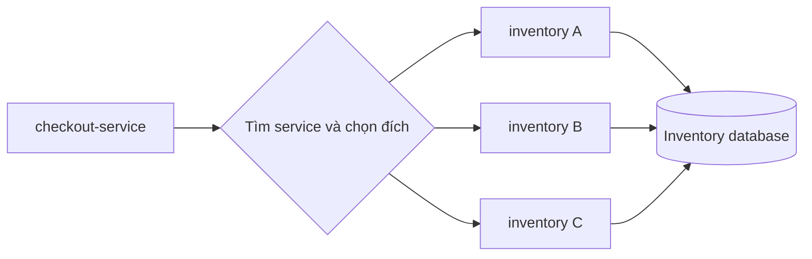
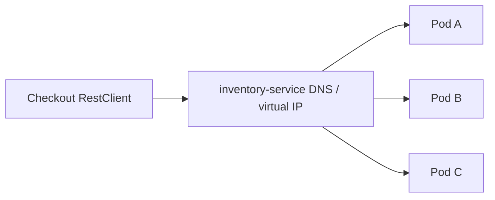
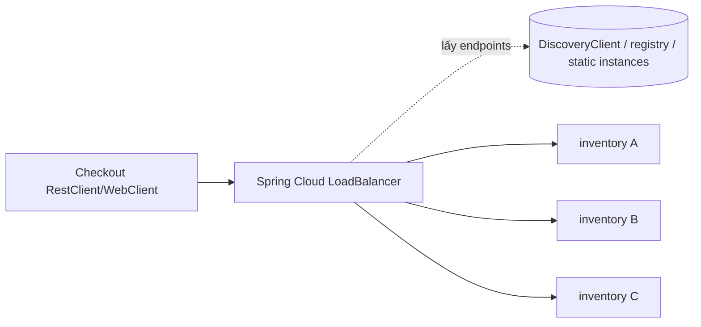
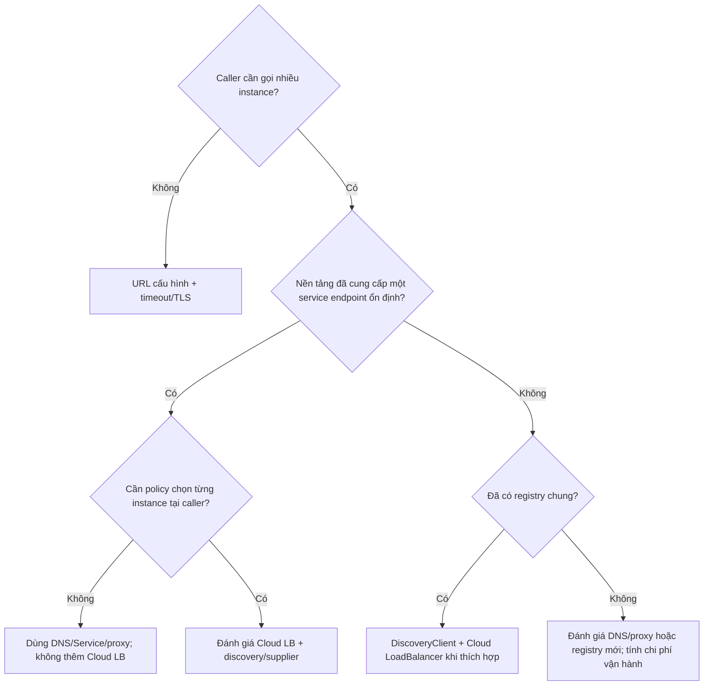
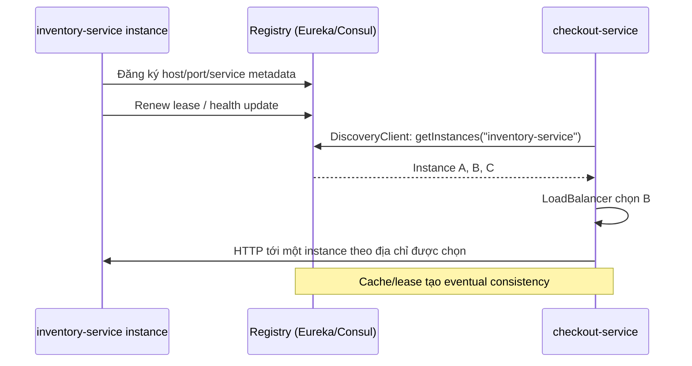
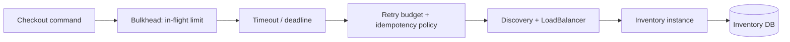
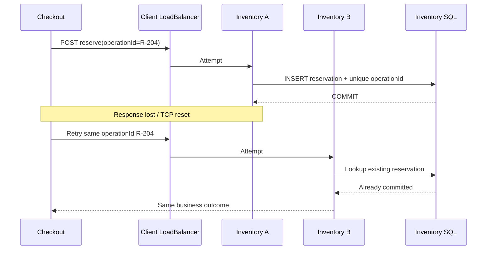
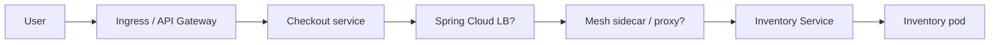
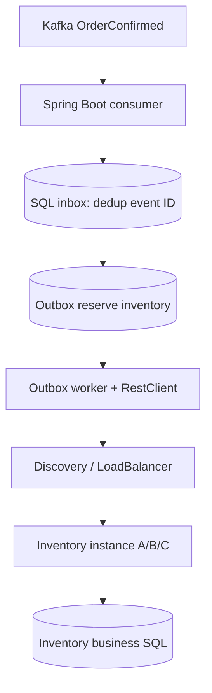
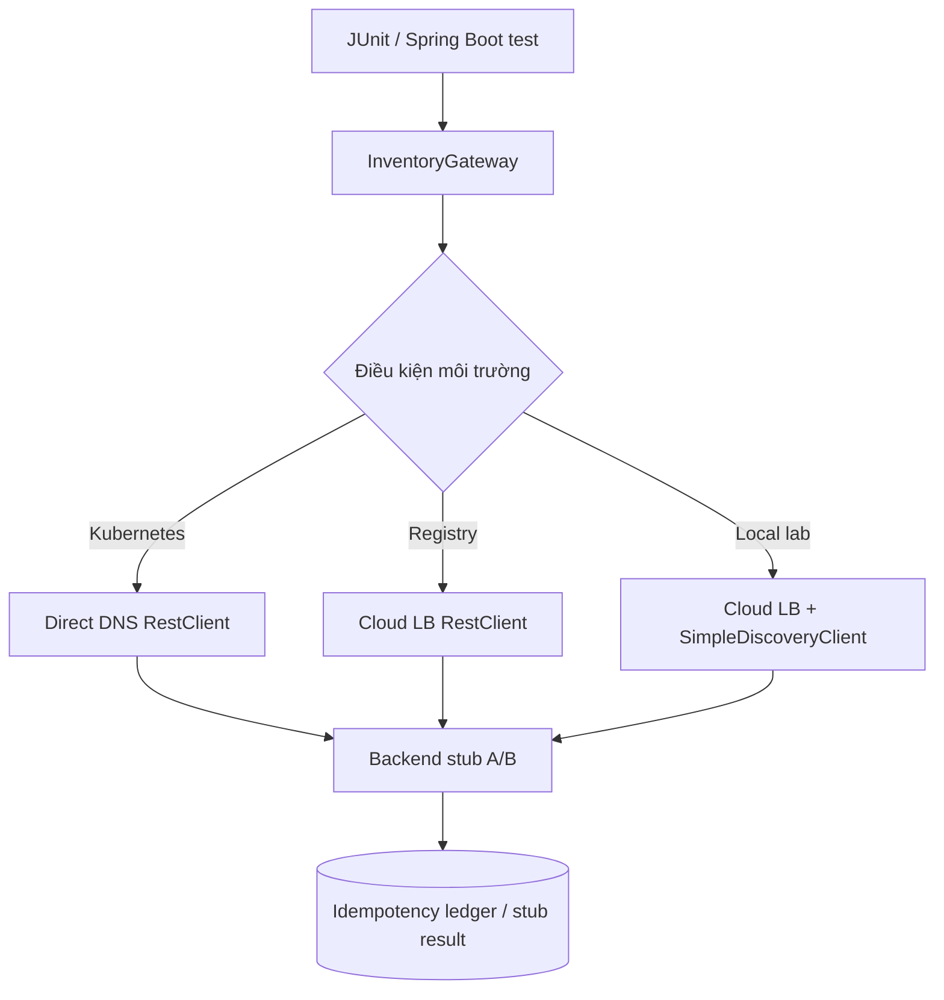

# Service discovery, load balancing và điều kiện cần thêm Spring Cloud

> **Chương:** Thư viện bổ sung  
> **Phạm vi:** Module **SPRING_BOOT_INTEGRATION** tổ chức tích hợp hệ thống trong Spring Boot qua HTTP client, cơ sở dữ liệu, cache, broker thông điệp và các adapter Spring Integration. Bài này tập trung vào **tìm địa chỉ service (service discovery)**, **phân phối request giữa các instance (load balancing)**, lựa chọn **DNS, nền tảng triển khai hay Spring Cloud**, đồng thời phân tích transaction, timeout, retry, idempotency, bảo mật, quan sát và kiểm thử trong các luồng tích hợp.

## 1. Vấn đề thực tế: địa chỉ của một service không cố định

Một ứng dụng `checkout-service` gọi HTTP đến `inventory-service` để kiểm tra tồn kho. Ở local, có thể dùng một URL:

```yaml
integration:
  inventory:
    base-url: http://localhost:8081
```

Nhưng ở production, `inventory-service` có nhiều instance:

```text
inventory-service:
  instance A: 10.20.3.21:8080
  instance B: 10.20.4.38:8080
  instance C: 10.20.5.19:8080
```

Khi instance B bị thay trong rolling deployment, danh sách host thay đổi. Nếu `checkout-service` hard-code địa chỉ B, nó sẽ gọi một instance đã không tồn tại. Nếu mọi request vào instance A, A có thể quá tải trong khi B và C còn trống.



Giải bài toán này có thể gồm **service discovery**, **load balancing**, **health/readiness**, **timeout** và **cơ chế xử lý lỗi**. **Không phải hệ thống nào cũng cần Spring Cloud**: trên Kubernetes, DNS của `Service` và network dataplane đã giải quyết một phần lớn nhu cầu mà không cần đưa registry và client-side load balancing vào từng ứng dụng.

### Mục tiêu học tập

Sau bài này, người đọc có thể:

1. Phân biệt service registry, discovery client, service instance, DNS và load balancer.
2. Chọn giữa **fixed URL**, **Kubernetes Service DNS**, **reverse proxy/service mesh** và **Spring Cloud LoadBalancer + DiscoveryClient**.
3. Biết khi nào cần thêm Spring Cloud, khi nào thêm vào chỉ làm tăng độ phức tạp.
4. Cấu hình Spring Cloud BOM và các starter theo phiên bản Spring Boot tương thích.
5. Thực hành `@LoadBalanced RestClient.Builder` và `WebClient.Builder` với danh sách instance.
6. Hiểu giới hạn của round-robin, readiness, instance cache, connection reuse và zone affinity.
7. Xử lý no-instance, stale endpoint, timeout, retry, circuit breaker, idempotency và transaction boundary.
8. Không nhầm service discovery HTTP với cơ chế discovery riêng của Kafka, MongoDB, Redis, JDBC hoặc RSocket.
9. Kiểm thử instance restart, rolling deployment, duplicate side effects và quan sát lựa chọn instance.

## 2. Thuật ngữ: discovery và load balancing không phải cùng một việc

| Thuật ngữ | Trả lời câu hỏi | Ví dụ |
| --- | --- | --- |
| **Service ID/name** | Tên logic nào mà caller muốn gọi? | `inventory-service` |
| **Service instance** | Endpoint cụ thể nào đang cung cấp service? | `10.20.3.21:8080`, metadata như zone |
| **Service registry** | Ai lưu danh sách instance đã đăng ký? | Eureka, Consul; một nền tảng có thể có cơ chế riêng |
| **Discovery client** | Caller lấy danh sách instance bằng cách nào? | Spring Cloud `DiscoveryClient`, DNS query, platform API |
| **Load balancing** | Sau khi biết các đích, gửi request tới instance nào? | Round-robin, random, zone-aware, proxy/load balancer |
| **Health/readiness** | Instance có đủ điều kiện phục vụ traffic mới? | Kubernetes readiness probe, registry health check |
| **Circuit breaker** | Tạm ngăn những lời gọi liên tiếp tới một dependency đang lỗi? | Resilience4j/Spring Cloud CircuitBreaker nếu được chọn |
| **Retry** | Thử lại một request bị lỗi theo chính sách nào? | Retry có giới hạn cho idempotent operation |
| **Gateway** | Một entry point điều hướng/áp policy cho traffic | Spring Cloud Gateway hoặc ingress/reverse proxy |

**Discovery trả về những ứng viên có thể gọi; load balancing chọn một ứng viên.** Hai việc có thể nằm ở client, proxy hoặc hạ tầng. Một registry có thể tồn tại nhưng không có load-balancing client; một load balancer cũng có thể chạy từ danh sách tĩnh mà không cần registry.

### 2.1. Service ID không phải địa chỉ thực

```text
Logical target: inventory-service

Có thể được phân giải thành:
  Kubernetes Service DNS:
      inventory-service.production.svc.cluster.local:8080

  Registry-based discovery:
      10.20.3.21:8080, 10.20.4.38:8080, 10.20.5.19:8080

  Static configuration:
      localhost:18081, localhost:18082 (chỉ local/test)
```

**Không đưa service ID do người dùng tự nhập thẳng vào HTTP client** để caller có thể chọn bất kỳ hostname/instance nào. Trong hệ tích hợp, service ID nên nằm trong allowlist/config đã được kiểm soát, tránh SSRF, cross-tenant routing và lộ mạng nội bộ.

## 3. Hai kiểu load balancing chính

### 3.1. Server-side load balancing

Client gọi **một endpoint ổn định**. Một proxy, load balancer hoặc hạ tầng điều hướng tới các pods/instances:



Trong Kubernetes, `Service` có DNS name ổn định; traffic tới Service được phân phối tới các endpoints phù hợp thông qua cơ chế dataplane của cluster (ví dụ kube-proxy hoặc giải pháp eBPF). Thông thường **không cần thêm Spring Cloud LoadBalancer** chỉ để gọi một Kubernetes Service theo DNS.

**Lưu ý:** cân bằng thường diễn ra theo **connection/transport flow**, không phải luôn từng HTTP request. HTTP keep-alive, HTTP/2 multiplexing hoặc một RSocket TCP connection dài có thể làm tỷ lệ request trên các pods **khác** tỷ lệ kết nối.

### 3.2. Client-side load balancing

Client tự lấy danh sách service instances rồi chọn một instance trước khi gửi HTTP request:



Spring Cloud LoadBalancer là một thành phần phía **caller**, có thể dựa vào discovery client hoặc danh sách instance của một supplier. Nó không tự tạo service registry, không tự quản lý health của backend và không biến các backend thành một database nhất quán.

### 3.3. So sánh

| Tiêu chí | Hạ tầng/proxy cân bằng | Spring Cloud client-side LB |
| --- | --- | --- |
| Client cần biết danh sách IP/pod? | Thường không | Thường có qua supplier/discovery |
| Cấu hình ứng dụng | URL cố định tới service/gateway | Starter, `@LoadBalanced`, discovery/supplier |
| Chính sách theo metadata/zone | Tùy nền tảng/proxy | Có thể cấu hình ở client khi cần |
| Registry dependency trong JVM | Không nhất thiết | Có nếu supplier lấy từ registry |
| Vận hành | Tập trung ở platform | Có thêm behavior và cache tại mỗi caller |
| Rolling deploy | Phụ thuộc readiness/endpoint updates | Phụ thuộc registry freshness, health và retry |
| Observability | Proxy/mesh metrics + client metrics | Cần đo cả client selection và HTTP exchange |
| Thích hợp khi | Kubernetes Service, ingress, proxy đã đủ | Hạ tầng ngoài Kubernetes hoặc cần chọn instance có policy đặc thù |

**Không đồng nhất “dùng Kubernetes” với “không bao giờ cần client-side LB”.** Có use case chọn zone/metadata hoặc dịch vụ chạy ngoài cluster. Tuy nhiên **lý do phải rõ**, tránh triển khai hai lớp routing cùng mục đích mà không có lợi ích đo được.

## 4. Quyết định trước khi thêm một dependency Spring Cloud

Áp dụng một cây quyết định đơn giản:



### 4.1. Các trường hợp thường **không cần** Spring Cloud

1. Một Spring Boot API gọi một partner URL ổn định do đối tác cung cấp.
2. Service-to-service HTTP bên trong Kubernetes đã dùng `Service` DNS đúng namespace.
3. Load balancer hoặc service mesh của nền tảng đã làm routing, health và retries theo policy được vận hành tập trung.
4. Một batch job gọi một service cố định qua private endpoint/VPN.
5. RSocket server được gọi qua một endpoint do platform cân bằng **kết nối**, không có yêu cầu đổi instance cho mỗi message.
6. Kafka client dùng bootstrap brokers và metadata discovery của **Kafka protocol**, không cần Eureka để chọn broker.
7. MongoDB driver dùng connection string/replica-set discovery riêng, không đi qua Spring Cloud LoadBalancer.

### 4.2. Các trường hợp **có thể cần** Spring Cloud

1. Nhiều Spring Boot services chạy trên VMs/bare metal và hệ thống đã có **Eureka/Consul** cho việc đăng ký, lookup, health.
2. Caller cần **zone-aware instance selection**, metadata routing, hoặc loại bỏ một nhóm instances theo policy mà DNS/proxy không biểu đạt đủ.
3. Cần một client-side load balancer dùng chung cho `RestClient`, `WebClient` và declarative clients được Spring Cloud tích hợp.
4. Có nhu cầu kiến trúc khác được xác nhận: Spring Cloud Gateway, Config, CircuitBreaker hoặc tính năng của Spring Cloud Kubernetes; **chỉ thêm starter thật sự cần**.
5. Một hệ hỗn hợp VM–Kubernetes–cloud cần discovery abstraction được quản lý và thử nghiệm đầy đủ.

**Spring Cloud không phải “nâng cấp bắt buộc của Spring Boot”**. Spring Boot, Spring Framework `RestClient`/`WebClient`, actuator, JDBC/Redis/Kafka integrations vẫn vận hành khi không có Spring Cloud.

## 5. Spring Boot thuần: HTTP client vẫn gọi được DNS

Với một endpoint ổn định như Kubernetes Service, chỉ cần dùng `RestClient` hoặc `WebClient` của Spring Framework, cấu hình timeout và security:

```yaml
integration:
  inventory:
    base-url: ${INVENTORY_URL:http://inventory-service:8080}
```

```java
package com.example.integration.inventory;

import org.springframework.beans.factory.annotation.Value;
import org.springframework.stereotype.Service;
import org.springframework.web.client.RestClient;

@Service
public class DirectInventoryClient {
    private final RestClient client;

    public DirectInventoryClient(
            RestClient.Builder builder,
            @Value("${integration.inventory.base-url}")
            String inventoryBaseUrl) {
        this.client = builder.baseUrl(inventoryBaseUrl).build();
    }

    public InventoryAvailability get(String sku) {
        return client.get()
                .uri("/api/inventory/{sku}", sku)
                .retrieve()
                .body(InventoryAvailability.class);
    }
}

record InventoryAvailability(
        String sku, long availableQuantity) {}
```

Ở ví dụ **không có `@LoadBalanced`**, `inventory-service` là DNS name hoặc host mà networking của nền tảng phân giải được. Nếu đang chạy trực tiếp trên laptop, tên `inventory-service` không tự có DNS; đặt `INVENTORY_URL=http://localhost:8081` hoặc chạy môi trường có network naming phù hợp.

**Các điều kiện production chưa nằm hết trong snippet:** transport TLS/mTLS, connect/response/read timeout, HTTP pool, authentication, error mapping, retry budget và observability. Chúng có thể được cung cấp bằng customizers/HTTP request factory được lựa chọn và test; **không cần Spring Cloud** chỉ để thêm những tính năng cơ bản đó.

### 5.1. Spring Framework HTTP Interface không bắt buộc Spring Cloud

Với `@HttpExchange`/`HttpServiceProxyFactory`, ứng dụng có thể tạo declarative HTTP client dựa trên `RestClient` hoặc `WebClient`. Có thể gọi một **fixed base URL** mà không cần Eureka, Feign hay Spring Cloud. Nếu sau này muốn chọn instance ở phía caller, cần tích hợp HTTP adapter với builder/client có load-balancing phù hợp, thay vì coi tên annotation đã tự bật discovery.

## 6. Kubernetes Service DNS: lời giải thường đơn giản nhất

Một `Service` kiểu ClusterIP cấp một địa chỉ logic cho nhóm pods:

```yaml
apiVersion: v1
kind: Service
metadata:
  name: inventory-service
  namespace: production
spec:
  selector:
    app: inventory-service
  ports:
    - name: http
      port: 8080
      targetPort: 8080
```

Caller ở namespace `production` có thể gọi:

```text
http://inventory-service:8080

Hoặc FQDN:
http://inventory-service.production.svc.cluster.local:8080
```

**Điều kiện:** DNS cluster và Service/Endpoints được cấu hình đúng, network policies cho phép kết nối và pods báo readiness. Kubernetes cập nhật **EndpointSlices** theo trạng thái pods; dataplane phân phối kết nối tới endpoints phù hợp.

### 6.1. Readiness khác liveness

- **Readiness:** pod có nên nhận request mới hay chưa; quan trọng trong rolling deploy và khởi động có migration/warmup.
- **Liveness:** pod còn đang hoạt động đúng để cần restart nếu bị treo; không dùng một outage ngắn của hệ phụ thuộc làm cớ restart hàng loạt.
- **Startup probe:** bảo vệ tiến trình khởi động chậm khỏi bị liveness kill quá sớm.

```yaml
readinessProbe:
  httpGet:
    path: /actuator/health/readiness
    port: 8080
  periodSeconds: 5
  failureThreshold: 1
livenessProbe:
  httpGet:
    path: /actuator/health/liveness
    port: 8080
  periodSeconds: 10
  failureThreshold: 3
```

Đây là **đoạn trong Kubernetes container spec**, không phải Deployment hoàn chỉnh. Spring Boot Actuator readiness/liveness probes cần được bật/cấu hình và expose đúng port. Probe thành công không tự chứng minh backend transaction hoặc consumer offset đã commit.

### 6.2. DNS không thay ứng dụng xử lý lỗi

Giữa lúc Service endpoint được cập nhật và client gửi request, một pod có thể đã nhận SIGTERM hoặc connection cũ bị đóng. Vì vậy vẫn cần:

- Timeout hữu hạn, deadline phù hợp SLA.
- Điều phối graceful shutdown/admission gate.
- HTTP retry **chỉ khi an toàn về idempotency**.
- Circuit breaker/bulkhead nếu lỗi có thể lan rộng.
- Giới hạn concurrency và connection pool.
- Giám sát 502/503/connection reset khi deploy.

**Đừng bật cả Spring Cloud LB, mesh retry và HTTP client retry độc lập mà không tính tổng số lần thử**; ba tầng có thể nhân số request lên đáng kể.

### 6.3. Khi nào cân nhắc Spring Cloud Kubernetes?

Nếu muốn Java client **đọc trực tiếp danh sách pod/EndpointSlice, metadata và namespace** hoặc áp dụng logic Spring Cloud discovery/load balancing, hãy đánh giá Spring Cloud Kubernetes và starter tương ứng. Điều đó có thêm phụ thuộc Kubernetes API, quyền RBAC, cache, watch/retry behavior và kiểm thử trong cluster.

Chỉ cần gọi `http://inventory-service:8080` qua Kubernetes Service thì **không cần bắt buộc** `spring-cloud-starter-kubernetes-client-discovery`. Nếu dùng RBAC để discovery trực tiếp, chỉ cấp quyền cần thiết và không cho runtime account quyền quản trị cluster.

## 7. Spring Cloud gồm các module khác nhau

Một số module dễ bị coi là “cùng một gói”:

| Thành phần | Vai trò | Có cần cho HTTP discovery/LB? |
| --- | --- | --- |
| **Spring Cloud Commons** | Abstractions như `DiscoveryClient`, load-balanced client integration | Là nền tảng của nhiều starters |
| **Spring Cloud LoadBalancer** | Client-side selection và integration cho HTTP clients | **Có**, nếu muốn chọn instance tại caller |
| **Spring Cloud Netflix Eureka Client** | Đăng ký và tìm instance với Eureka | **Chỉ khi dùng Eureka** |
| **Spring Cloud Consul Discovery** | Đăng ký/tìm service với Consul | **Chỉ khi dùng Consul** |
| **Spring Cloud Kubernetes Discovery** | Discovery dựa trên Kubernetes platform | **Chỉ nếu thực sự cần API-based discovery** |
| **Spring Cloud Gateway** | Reverse proxy/gateway routing, filters/policies | Không phải dependency bắt buộc của mỗi client |
| **Spring Cloud OpenFeign** | Declarative HTTP client | Tùy chọn; không phải yêu cầu để dùng `RestClient` |
| **Spring Cloud CircuitBreaker** | Abstraction cho fault tolerance | Không tự tạo registry/discovery |
| **Spring Cloud Config** | Phân phối cấu hình từ hệ thống tập trung | Độc lập với cơ chế chọn instance |

**Thêm Spring Cloud chỉ khi đã xác định feature và owner vận hành.** Không thêm một starter chung chỉ vì system có nhiều microservices.

### 7.1. Các công nghệ thường gây nhầm

`Ribbon` từng được dùng nhiều với Netflix client-side load balancing trong các tutorial cũ, nhưng **không nên chọn Ribbon cho dự án Spring Boot/Spring Cloud hiện đại**; hãy dùng Spring Cloud LoadBalancer nếu cần chức năng tương đương trong hệ Spring.

`Hystrix` là thư viện legacy trong nhiều ví dụ cũ; với nhu cầu fault tolerance hiện nay, đánh giá Resilience4j/Spring Cloud CircuitBreaker phù hợp phiên bản, nhưng đó là **quyết định khác** với discovery.

## 8. Quản lý phiên bản Spring Cloud đúng với Spring Boot

**Điều kiện kỹ thuật đầu tiên trước khi thêm Spring Cloud:** phiên bản **Spring Cloud release train** phải **tương thích với Spring Boot version**. Không sao chép một BOM/version từ tutorial năm trước vào dự án đang dùng Boot khác.

### 8.1. Dependency management

```xml
<properties>
    <java.version>17</java.version>
    <!-- Chọn release train tương thích từ tài liệu chính thức. -->
    <spring-cloud.version>REPLACE_WITH_COMPATIBLE_RELEASE_TRAIN</spring-cloud.version>
</properties>

<dependencyManagement>
    <dependencies>
        <dependency>
            <groupId>org.springframework.cloud</groupId>
            <artifactId>spring-cloud-dependencies</artifactId>
            <version>${spring-cloud.version}</version>
            <type>pom</type>
            <scope>import</scope>
        </dependency>
    </dependencies>
</dependencyManagement>

<dependencies>
    <dependency>
        <groupId>org.springframework.cloud</groupId>
        <artifactId>spring-cloud-starter-loadbalancer</artifactId>
    </dependency>
</dependencies>
```

Đây là **mẫu khung**, không phải `pom.xml` đã sẵn sàng build: phải thay `REPLACE_WITH_COMPATIBLE_RELEASE_TRAIN` bằng version **đã kiểm tra theo Spring Cloud compatibility matrix**, và dự án cần Spring Boot parent/BOM hoặc dependency management tương ứng. Không tự thêm version riêng cho mọi Spring Cloud artifact khi BOM đã quản lý.

### 8.2. Danh sách kiểm tra compatibility

1. Xác định chính xác `Spring Boot`, `Spring Framework`, Java và Spring Cloud release train.
2. Đọc bảng supported releases chính thức và release notes của các starters sẽ dùng.
3. Kiểm tra Jakarta namespace/API và security stack của phiên bản.
4. Xác nhận `RestClient`/`WebClient` load-balancer integration được hỗ trợ ở train đã chọn.
5. Không để transitive dependencies kéo hai version khác nhau của Spring Cloud Commons/LoadBalancer.
6. Chạy smoke test startup, discovery instance resolution và HTTP request trên môi trường thật.
7. Pin versions có kiểm soát và có kế hoạch upgrade/rollback.

**Không hạ/tắt compatibility verifier chỉ để ứng dụng khởi động** khi BOM thực tế không khớp. Cần sửa dependency management cho đúng trước khi xử lý lỗi ở runtime.

### 8.3. Nếu không có registry, LoadBalancer vẫn có thể hữu ích

Spring Cloud LoadBalancer có thể lấy instances qua `ServiceInstanceListSupplier` hoặc **SimpleDiscoveryClient** tĩnh. Vì vậy **không bắt buộc cài Eureka chỉ để test client-side load balancing**. Nhưng ở production, nếu nền tảng đã cung cấp DNS/proxy, lại phải hỏi vì sao client cần thêm tầng chọn instance.

## 9. Service discovery bằng registry: Eureka, Consul và những đổi chác

### 9.1. Luồng đăng ký/lookup



Sơ đồ chỉ minh họa tương tác khái niệm, không mô phỏng đúng API network/cơ chế watch của mọi registry. **Registry có thể chậm nhận biết instance chết**, và discovery client cũng có thể cache danh sách. Vì thế vẫn phải xử lý `connection refused`, `503` và timeout.

### 9.2. Eureka

Với hệ thống **đã vận hành Eureka**, một service có thể dùng Spring Cloud Netflix Eureka client để register và discover:

```xml
<dependency>
    <groupId>org.springframework.cloud</groupId>
    <artifactId>spring-cloud-starter-netflix-eureka-client</artifactId>
</dependency>
```

```yaml
spring:
  application:
    name: inventory-service

eureka:
  client:
    service-url:
      defaultZone: ${EUREKA_SERVER_URL:http://localhost:8761/eureka/}
```

**Lưu ý:** property `defaultZone` của Eureka có cách đặt tên riêng, nên giữ đúng dạng mà release train hỗ trợ. URL local trên chỉ dành cho phát triển; production dùng TLS/auth/network policy và vùng registry tin cậy.

Đăng ký không đồng nghĩa instance đã sẵn sàng về nghiệp vụ. Nếu app chưa hoàn tất startup/migrations mà registry đã route traffic, cần phối hợp **health/readiness/registration lifecycle** và kiểm tra ở môi trường triển khai.

### 9.3. Consul

Với hạ tầng đã có Consul, có thể dùng:

```xml
<dependency>
    <groupId>org.springframework.cloud</groupId>
    <artifactId>spring-cloud-starter-consul-discovery</artifactId>
</dependency>
```

```yaml
spring:
  application:
    name: checkout-service
  cloud:
    consul:
      host: ${CONSUL_HOST:localhost}
      port: ${CONSUL_PORT:8500}
      discovery:
        enabled: true
```

Trong production phải cấu hình rõ security/ACL, TLS, health checks, service tags, deregistration, datacenter và ownership. Không vận hành một Consul cluster mới chỉ để tránh ghi một Kubernetes Service DNS name khi platform networking đã đủ.

### 9.4. Service metadata không phải authorization

Registry có thể lưu `zone`, `version`, `secure` hoặc tags. Chúng hỗ trợ routing, nhưng **không phải chứng thực của backend**: caller vẫn phải xác thực TLS certificate/identity, gửi OAuth2 token theo audience và áp dụng authorization ở server. Không tin metadata do một đăng ký độc hại gửi vào để chọn sai endpoint.

## 10. Spring Cloud DiscoveryClient abstraction

Spring Cloud Commons cung cấp `DiscoveryClient` cho caller lấy danh sách các instance của service logic:

```java
package com.example.integration.discovery;

import java.util.List;

import org.springframework.cloud.client.ServiceInstance;
import org.springframework.cloud.client.discovery.DiscoveryClient;
import org.springframework.stereotype.Service;

@Service
public class ServiceDirectory {
    private final DiscoveryClient discoveryClient;

    public ServiceDirectory(DiscoveryClient discoveryClient) {
        this.discoveryClient = discoveryClient;
    }

    public List<ServiceInstance> inventoryInstances() {
        return List.copyOf(
                discoveryClient.getInstances("inventory-service"));
    }
}
```

`DiscoveryClient.getInstances(...)` trả danh sách endpoints của một service ID nếu backend discovery được cấu hình. Nếu không tìm thấy service, danh sách có thể rỗng. Không được dùng `instances.get(0)` mà không kiểm tra hoặc coi danh sách là bất biến trong suốt request.

### 10.1. ReactiveDiscoveryClient

Spring Cloud cũng cung cấp reactive discovery abstraction ở những integration hỗ trợ. **Không nhầm việc dùng `ReactiveDiscoveryClient` với bảo đảm rằng registry/network operation luôn non-blocking**: adapter và registry backend quyết định. Khi đã dùng `@LoadBalanced WebClient.Builder`, thường để LoadBalancer tự gọi supplier thay vì viết một `flatMap(discovery.getInstances(...))` rồi tự random chọn.

### 10.2. Hợp đồng của ServiceInstance

Một `ServiceInstance` có những thông tin như `serviceId`, host, port, URI, secure flag và metadata map. Một caller cần:

- Chọn URL scheme đúng (`http` hay `https`).
- Kiểm chứng backend identity/TLS, không chỉ metadata `secure=true`.
- Tránh log credentials hoặc full URI nhạy cảm.
- Không dùng host/port riêng của pod sau khi dịch vụ đã di chuyển mà không có retry/re-resolution.

**DiscoveryClient không tự gửi HTTP request**. Nó chỉ cung cấp các ứng viên để phần mềm khác lựa chọn và gọi.

## 11. Local lab không cần Eureka: SimpleDiscoveryClient

Để kiểm chứng load-balancing client mà không chạy một registry, có thể cung cấp **static service instances**:

```yaml
spring:
  application:
    name: checkout-service
  cloud:
    discovery:
      client:
        simple:
          instances:
            inventory-service:
              - uri: http://localhost:18081
              - uri: http://localhost:18082
```

Điều kiện: Spring Cloud Commons/LoadBalancer version được cấu hình, hai local test servers đang lắng nghe ở cổng tương ứng. `SimpleDiscoveryClient` hữu ích cho **local/test hoặc danh sách được quản lý tĩnh**, nhưng không tự phát hiện một pod/container mới khi IP thay đổi.

**Trong production:** nếu cả hai backend static được triển khai sau proxy hoặc Kubernetes Service, cân nhắc gọi một endpoint ổn định. Không duy trì một danh sách IP cố định trong YAML khi autoscaling/rolling deployment thay đổi instances liên tục.

## 12. Client-side load balancing cho RestClient

Với Spring Cloud LoadBalancer tương thích Spring Framework/Boot version, định nghĩa một `RestClient.Builder` có `@LoadBalanced`:

```java
package com.example.integration.inventory;

import org.springframework.cloud.client.loadbalancer.LoadBalanced;
import org.springframework.context.annotation.Bean;
import org.springframework.context.annotation.Configuration;
import org.springframework.web.client.RestClient;

@Configuration(proxyBeanMethods = false)
public class InventoryLoadBalancingConfiguration {

    @Bean("loadBalancedRestClientBuilder")
    @LoadBalanced
    RestClient.Builder loadBalancedRestClientBuilder() {
        return RestClient.builder();
    }
}
```

Khi auto-configuration Cloud đúng version và `ServiceInstanceListSupplier`/discovery trả endpoints, một client có thể dùng **service ID làm host logic**:

```java
package com.example.integration.inventory;

import org.springframework.beans.factory.annotation.Qualifier;
import org.springframework.stereotype.Component;
import org.springframework.web.client.RestClient;

@Component
public class LoadBalancedInventoryClient {
    private final RestClient client;

    public LoadBalancedInventoryClient(
            @Qualifier("loadBalancedRestClientBuilder")
            RestClient.Builder builder) {
        this.client = builder
                .baseUrl("http://inventory-service")
                .build();
    }

    public InventoryAvailability available(String sku) {
        return client.get()
                .uri("/api/inventory/{sku}", sku)
                .retrieve()
                .body(InventoryAvailability.class);
    }
}
```

`InventoryAvailability` là DTO khai báo ở phần 5. Trong ví dụ có `@LoadBalanced`, host `inventory-service` là **service ID để load balancer resolve**, không phải bắt buộc là hostname DNS thật. Không dùng `http://10.20.3.21:8080` nếu mục tiêu là LB theo logical service name.

### 12.1. Những điều kiện để ví dụ chạy

1. Có `spring-cloud-starter-loadbalancer` và dependency management tương thích.
2. Có discovery/supplier trả ít nhất một `ServiceInstance` cho `inventory-service`.
3. Spring Cloud autoconfiguration thực sự gắn load-balancing interceptor/customization vào builder này.
4. Backend instance có route `/api/inventory/{sku}` và DTO/codec tương thích.
5. HTTP timeout, TLS, connection pool, authentication và error mapping đã được thiết kế.

Nếu chỉ gọi `RestClient.create("http://inventory-service")` hoặc `RestClient.builder()` trong một method không dùng load-balanced builder, **không được giả định Spring Cloud sẽ tự can thiệp vào toàn bộ RestClient trong process**.

### 12.2. Đừng làm mất Spring Boot customizers

`RestClient.builder()` tạo builder của Spring Framework, nhưng trong nhiều ứng dụng Spring Boot có thêm configuration/customizers cho request factory, SSL, tracing hoặc codec. Nếu tự tạo `@Bean RestClient.Builder`, hãy **xem lại cách áp dụng Boot customizers** và kiểm thử timeout/tracing/security. Đừng cho rằng riêng annotation `@LoadBalanced` đã cấu hình tất cả HTTP client concerns.

### 12.3. Nếu vừa có builder thường vừa có builder load-balanced

```text
RestClient.Builder thường:
  -> https://partner.example/api  (DNS trực tiếp)

RestClient.Builder @LoadBalanced:
  -> http://inventory-service     (logical service ID)
```

Dùng bean name/`@Qualifier` rõ ràng để tránh ambiguity. Không gắn `@LoadBalanced` lên tất cả HTTP clients nếu có URLs tới đối tác ngoài registry: client LB có thể coi hostname bên ngoài là service ID và báo **no available instances**.

## 13. WebClient và reactive load balancing

Với code dùng WebFlux/Project Reactor, Spring Cloud LoadBalancer có thể tích hợp vào `WebClient.Builder`:

```java
package com.example.integration.inventory;

import org.springframework.cloud.client.loadbalancer.LoadBalanced;
import org.springframework.context.annotation.Bean;
import org.springframework.context.annotation.Configuration;
import org.springframework.web.reactive.function.client.WebClient;

@Configuration(proxyBeanMethods = false)
public class ReactiveInventoryClientConfiguration {

    @Bean("loadBalancedWebClientBuilder")
    @LoadBalanced
    WebClient.Builder loadBalancedWebClientBuilder() {
        return WebClient.builder();
    }
}
```

```java
package com.example.integration.inventory;

import org.springframework.beans.factory.annotation.Qualifier;
import org.springframework.stereotype.Component;
import org.springframework.web.reactive.function.client.WebClient;
import reactor.core.publisher.Mono;

@Component
public class ReactiveInventoryClient {
    private final WebClient client;

    public ReactiveInventoryClient(
            @Qualifier("loadBalancedWebClientBuilder")
            WebClient.Builder builder) {
        client = builder.baseUrl("http://inventory-service").build();
    }

    public Mono<InventoryAvailability> available(String sku) {
        return client.get()
                .uri("/api/inventory/{sku}", sku)
                .retrieve()
                .bodyToMono(InventoryAvailability.class);
    }
}
```

Để dùng `WebClient` cần dependency `spring-webflux` (thường qua `spring-boot-starter-webflux`) cùng starter load balancer; **không cần đổi toàn bộ MVC application sang reactive server** chỉ vì có WebClient. Tuy nhiên code tiêu thụ `Mono` không nên gọi `block()` trên Reactor Netty event-loop. Blocking JDBC/remote dependencies phải được quản lý đúng scheduler/threading.

### 13.1. Reactive không tự làm hệ thống chịu tải tốt

`flatMap(client::available)` có thể tạo nhiều remote requests đồng thời. Nếu cần bảo vệ inventory:

```java
Flux<InventoryAvailability> result = Flux.fromIterable(skus)
        .flatMap(client::available, 8);
```

`skus` là danh sách/iterable do ứng dụng cung cấp; con số 8 giới hạn inner publishers **trong pipeline ấy**, không phải toàn bộ pod hoặc cluster. Với nhiều concurrent requests, cần global bulkhead/rate limiter, bounded queue và capacity planning.

### 13.2. load balancing khác backpressure

LoadBalancer chọn instance **cho một HTTP exchange**, không tự ngăn caller gửi quá nhiều request. Reactive backpressure điều tiết demand giữa publishers/subscribers, nhưng một `flatMap` không có concurrency bound vẫn có thể gây quá tải. Cần quản lý cả **instance selection, concurrency, request size và retry budget**.

## 14. Chọn instance: round-robin, random, zone và cache

Spring Cloud LoadBalancer cung cấp các chiến lược chọn instance và pipeline `ServiceInstanceListSupplier` để cung cấp/lọc danh sách. **Round-robin** là lựa chọn phổ biến/default trong nhiều cấu hình, nhưng không bảo đảm mỗi instance có số request chính xác bằng nhau.

| Chiến lược/yếu tố | Có ích khi | Cần kiểm tra |
| --- | --- | --- |
| Round-robin | Backend tương đối đồng đều | Connection reuse, concurrency, instance churn |
| Random | Phân phối đơn giản khi không cần thứ tự | Tỷ lệ chỉ cân bằng thống kê trên tập đủ lớn |
| Zone-aware filtering | Giảm cross-zone latency/chi phí khi có instances phù hợp | Fallback khi một zone hết khỏe |
| Health-check supplier | Discovery có instances nhưng một số không healthy | Health endpoint policy và probe cost |
| Sticky/session affinity | Session state tạm không chia sẻ hoặc locality | Instance failover và state recovery |
| Cache of instances | Giảm chi phí gọi registry liên tục | Stale entries khi rolling deployment |
| Weighted selection | Instances có sức chứa khác nhau | Cần thuật toán/metadata/capacity xác thực |

### 14.1. Cache là sự đánh đổi giữa latency và freshness

Nếu registry trả danh sách A/B/C và caller cache trong 30 giây, instance B chết ngay sau lần fetch, caller có thể còn chọn B cho đến khi cache cập nhật hoặc health filter phát hiện.

```text
T0   Discovery cache = [A, B, C]
T1   B bắt đầu termination / bị kill
T2   Caller vẫn chọn B từ cache cũ
T3   Connection refused / 503 / timeout
T4   Discovery refresh = [A, C]
```

Không giải quyết bằng cách cache = 0 ở mọi nơi nếu registry chịu tải cao. Chọn TTL/watch/refresh/health strategy theo churn và SLO, đồng thời **request phải có timeout và lỗi fallback/retry đúng ngữ nghĩa**.

### 14.2. Một lớp cache thường là đủ

Khi có discovery-client cache và load-balancer supplier cache, các lớp có thể chồng lên nhau. **Đừng bật nhiều lớp caching mà không biết source of truth và độ trễ refresh tổng**. Xem thông số cache của registry client/Cloud version trước khi tuning.

### 14.3. Zone-aware không thay HA

Ưu tiên zone A có thể giảm latency, nhưng nếu zone A suy giảm và client không fallback đúng, tất cả requests có thể bị lỗi dù zone B khỏe. Kiểm thử **zone evacuation**, không chỉ test phân phối khi cả hai zone hoạt động.

## 15. Các lỗi discovery/load balancing phải xử lý

Một client-side load balancer không loại bỏ lỗi. Nó thay đổi **điểm phát sinh lỗi**: trước HTTP còn có bước tìm instance và chọn đích.

| Lỗi quan sát | Nguyên nhân khả dĩ | Cách điều tra / chính sách |
| --- | --- | --- |
| **No available instances** | Registry không có service ID, sai tên/case, cache rỗng, readiness đều fail | Kiểm tra service name, registry/EndpointSlice, discovery client và quyền lookup |
| `UnknownHostException` | Client đang dùng DNS thường nhưng hostname không resolve | Kiểm tra `@LoadBalanced` builder hoặc DNS/network thực tế |
| `Connection refused` | Instance cũ đã đóng port, endpoint bị cache stale, pod chưa ready | Bảo đảm readiness, timeout và retry nếu operation an toàn |
| Connection reset / EOF | Pod terminate giữa request, proxy reset hoặc pool giữ connection cũ | Graceful shutdown, retry có idempotency, connection pool |
| HTTP 503 từ backend | Backend overload/draining hoặc không sẵn sàng | Giới hạn concurrency, retry/backoff nếu được phép |
| HTTP 401/403 | Sai token/audience/role hoặc mất auth khi chuyển host | Sửa identity/authorization; **không** retry mù sang instance khác |
| HTTP 404 | Sai route/API version, không nhất thiết instance hỏng | Kiểm tra contract; không quy mọi 404 thành discovery failure |
| TLS handshake/certificate mismatch | Cert không khớp hostname/identity thực; trust chain sai | TLS validation, DNS/URI scheme, service identity |
| p99 latency tăng sau scale-out | DB chung nghẽn, cold instances, zone mismatch hoặc retry storm | Trace across instances, backend capacity, DB metrics |
| Chỉ một instance bị dồn request | Sticky sessions, connection reuse, HTTP/2, LB policy hoặc danh sách stale | Phân biệt connection balance với request balance |

### 15.1. Không có instance phải là một lỗi có ngữ nghĩa

```text
Caller -> inventory-service (logical ID)
    -> Discovery returns []
    -> LoadBalancer không có target
    -> Client nhận lỗi/response do adapter tạo (thường 503 trong HTTP context)
```

**Không hard-code chính xác class exception hoặc HTTP status cho mọi adapter/version**: `RestClient`, `WebClient`, Gateway và custom LoadBalancer filter có thể báo lỗi khác nhau. Định nghĩa **application error taxonomy**, test với phiên bản thực tế và phân biệt rõ:

- Discovery không có target.
- Có target nhưng TCP/TLS kết nối thất bại.
- Backend trả business error hợp lệ.
- Backend nhận request nhưng response timeout, kết quả chưa rõ.

Không biến mọi lỗi thành `null` hoặc `200 OK + empty inventory`, vì như thế caller có thể suy ra “hết hàng” thay vì “dependency unavailable”.

### 15.2. Instance unhealthy không đồng nghĩa business state sai

Một instance trả 500 khi đọc dữ liệu do bug, chuyển sang instance khác có thể nhận cùng 500 vì **mọi instance dùng cùng database/schema**. Retry và load balancing không sửa được dữ liệu sai. Cần root-cause, circuit breaking/fail-fast và backpressure khi dependency chung đang lỗi.

### 15.3. Instance không sẵn sàng có thể vẫn giữ connection cũ

Kubernetes readiness hoặc registry health thường điều khiển **traffic mới**; một TCP keep-alive/HTTP/2/RSocket connection đã tồn tại có thể tiếp tục hoạt động một thời gian. Shutdown vẫn cần **drain in-flight**, không chỉ chờ endpoint bị xóa khỏi registry rồi tắt ngay.

## 16. Timeout, retry, circuit breaker và bulkhead là quyết định riêng

Một hệ phân tán có bốn lớp kiểm soát:



**LoadBalancer chọn target; timeout giới hạn thời gian; retry quyết định thử lại; circuit breaker giảm call khi dependency đang lỗi; bulkhead giới hạn sự lan truyền quá tải.** Một starter load balancer không tự làm đúng tất cả policy này.

### 16.1. Timeout theo end-to-end deadline

Giả sử HTTP request từ người dùng có SLA 2 giây:

```text
Gateway / caller timeout tổng: 2.0s
  authentication + validation: 0.1s
  inventory outbound budget: 0.5s
  business SQL transaction: 0.4s
  safety margin / serialization: 0.2s
  ... tổng các đoạn phải nằm trong deadline
```

Đây là số **minh họa**, không phải cấu hình áp dụng mọi service. Cần đo p95/p99 thực tế và có connect/read/response timeout phù hợp. Nếu timeout HTTP client là 30 giây trong khi ingress timeout là 2 giây, handler có thể tiếp tục chiếm pool/threads dù caller đã bỏ cuộc.

### 16.2. Retry có thể nhân tải

```text
Client HTTP retry:      tối đa 3 attempts
Gateway retry:          tối đa 2 attempts
Service mesh retry:     tối đa 2 attempts

Trường hợp xấu nếu tất cả cùng retry độc lập:
  3 × 2 × 2 = 12 upstream attempts
  cho một business request ban đầu
```

Không phải mọi cấu hình đều thực sự tạo tích số này; ví dụ chỉ minh họa **nguy cơ retry amplification**. Đặt ownership rõ: **một tầng điều phối retry chính**, budget chung, exponential backoff + jitter và giới hạn số lần theo deadline.

### 16.3. Retry chỉ an toàn khi operation đúng ngữ nghĩa

| Operation | Có thể retry thế nào? |
| --- | --- |
| `GET /inventory/{sku}` chỉ đọc, không side effect | Có thể retry hữu hạn với transient network/503 nếu SLA cho phép |
| `PUT /resource/{id}` idempotent theo contract | Có thể retry nếu request body/ID ổn định và server thực sự bảo đảm idempotency |
| `POST /reservations` tạo đặt chỗ | **Không** retry vô điều kiện; cần operation/idempotency key + status lookup |
| Thanh toán/charge | Retry chỉ theo policy của provider và cùng idempotency key |
| Kafka/JMS publish | Dùng ack/producer semantics và outbox khi cần; LB HTTP không quyết định broker delivery |
| Request với body stream không replayable | Không retry đơn giản; cần nguồn body có thể phát lại an toàn |

Một operation HTTP `GET` theo chuẩn nên không có side effect nghiệp vụ, nhưng **không nên suy mọi GET tự an toàn** nếu hệ thống legacy thiết kế sai. Định nghĩa idempotency theo **behavior thật**, không chỉ method name.

### 16.4. Reactor retry ví dụ giới hạn

```java
Mono<InventoryAvailability> result = reactiveInventoryClient
        .available("SKU-42")
        .retryWhen(
                reactor.util.retry.Retry
                        .backoff(2, java.time.Duration.ofMillis(150))
                        .filter(this::isTransientDependencyFailure));
```

Đây là **snippet trong một method của class** có helper `isTransientDependencyFailure(Throwable)` do ứng dụng định nghĩa và `ReactiveInventoryClient` đã được inject. `backoff(2, ...)` cho phép **tối đa 2 retries sau lần thử đầu**, không có nghĩa tổng hai lần gọi. Cần phân loại network/5xx/429, tính toàn bộ deadline, hiểu rằng resubscribe sẽ chạy lại HTTP exchange; không dùng ví dụ này cho POST có side effect thiếu idempotency.

### 16.5. Circuit breaker không phải health check toàn cluster

Một circuit breaker thường đánh giá tỷ lệ lỗi/slow calls trong một **cửa sổ quan sát** và tạm từ chối requests tiếp theo. Nếu dùng chung breaker cho mọi instances của một service, một instance lỗi có thể làm breaker bảo vệ **toàn service**; nếu theo instance, cần quản lý cardinality khi instances thay đổi.

Chọn scope theo kiến trúc. Circuit breaker không tự loại instance khỏi registry và không thay readiness/liveness của backend. Khi lỗi do database chung, retry sang instance khác có thể không cải thiện gì.

## 17. Load balancing và transaction: tính đúng đắn nghiệp vụ vẫn là việc riêng

Một `checkout-service` gửi lệnh `POST /inventory/reservations` tới một trong ba instance, cả ba dùng chung SQL:



Điểm nguy hiểm: retry có thể **chọn instance khác**, nhưng không vì thế mà yêu cầu cũ chưa được xử lý. Nếu instance A đã commit mà response mất, instance B **phải tìm thấy durable operation outcome** qua nguồn dữ liệu chung hoặc dịch vụ trạng thái.

### 17.1. Idempotency key bền vững

```sql
CREATE TABLE inventory_reservations (
    tenant_id VARCHAR(80) NOT NULL,
    operation_id VARCHAR(120) NOT NULL,
    sku VARCHAR(120) NOT NULL,
    requested_quantity BIGINT NOT NULL,
    request_hash VARCHAR(64) NOT NULL,
    reservation_id VARCHAR(120) NOT NULL,
    state VARCHAR(32) NOT NULL,
    created_at TIMESTAMPTZ NOT NULL DEFAULT CURRENT_TIMESTAMP,
    PRIMARY KEY (tenant_id, operation_id)
);
```

Đây là **schema nghiệp vụ PostgreSQL minh họa**, không thuộc Spring Cloud. Khi một command đến:

1. Xác thực caller/tenant, validate SKU và quantity.
2. Chuẩn hóa business operation ID và fingerprint payload.
3. Trong transaction, kiểm tra/ghi reservation và hiệu chỉnh stock theo invariant.
4. Nếu gặp duplicate key, **so fingerprint và trả lại kết quả cũ**, không tạo reservation mới.
5. Nếu operation ID cũ nhưng payload khác, trả conflict rõ.
6. Chỉ trả successful business response khi transaction đã commit; nếu response mất, caller tra lại theo operation ID.

**Unique key không tự đủ** nếu các bước khác trong transaction sai hoặc inventory bị cập nhật vượt số lượng còn lại. Cần isolation/atomic update/optimistic locking và tests concurrent reservations.

### 17.2. Timeout sau POST có kết quả UNKNOWN

```text
T0: POST reserve R-204 tới A
T1: A gửi SQL COMMIT thành công
T2: Network connection reset trước response
T3: Caller nhìn thấy timeout

Kết luận ĐÚNG: remote outcome chưa rõ từ góc nhìn caller.
Kết luận SAI: reservation chắc chắn chưa được tạo.
```

**Service discovery và load balancing không giải quyết kết quả UNKNOWN.** Cần API tra cứu `GET /reservations/by-operation/{id}` hoặc business reconciliation, cùng idempotency key. Nếu gọi trực tiếp bằng RSocket request-response, nguyên tắc vẫn tương tự.

### 17.3. Local @Transactional không bao được remote service

```java
@Transactional
public void placeOrder(OrderCommand command) {
    orderRepository.insertPending(command);
    inventoryClient.reserve(command); // HTTP POST, ngoài JDBC TX
    orderRepository.markReserved(command.orderId());
}
```

Đây là **anti-pattern giải thích ranh giới**, không phải code production. Nếu SQL rollback sau khi HTTP đã thành công, inventory reservation có thể còn. Nếu HTTP timeout trong khi SQL giữ lock, hệ thống còn bị nghẽn pool.

Đối với tích hợp quan trọng, cân nhắc **business state + transactional outbox** trong local SQL transaction, một worker gửi lệnh remote theo operation ID ổn định, lưu kết quả `SENT/UNKNOWN/FAILED` và reconciliation sau timeout.

### 17.4. Cân bằng tải không tạo thứ tự

Nếu command `version=2` và `version=3` cùng một order được gửi song song tới hai instances, chúng có thể đến DB không đúng thứ tự. Round-robin không bảo đảm ordering hay affinity. Dùng version checks, optimistic locking, per-key partitioning hoặc serialization trong business layer; tránh dựa vào instance selection làm transaction coordinator.

## 18. Spring Integration: dùng HTTP client đã được cấu hình LB

Spring Integration có thể gọi REST API qua handler/HTTP outbound gateway. Trong một flow, load balancing chỉ hoạt động nếu **HTTP client được dùng thật sự có cơ chế LB**. Đừng tin rằng thêm `spring-cloud-starter-loadbalancer` vào classpath sẽ tự làm mọi outbound HTTP adapter phân giải service ID.

### 18.1. Một flow gọi service qua client bean

```java
package com.example.integration.inventory;

import org.springframework.context.annotation.Bean;
import org.springframework.context.annotation.Configuration;
import org.springframework.integration.dsl.IntegrationFlow;

record InventoryLookup(String sku) {}

@Configuration(proxyBeanMethods = false)
public class InventoryFlowConfiguration {

    @Bean
    IntegrationFlow inventoryLookupFlow(
            LoadBalancedInventoryClient inventoryClient) {
        return IntegrationFlow.from("inventoryLookupInput")
                .handle(InventoryLookup.class,
                        (query, headers) ->
                                inventoryClient.available(query.sku()))
                .get();
    }
}
```

Đây là **request–reply flow đơn giản**: input là `InventoryLookup`, output là `InventoryAvailability`. Khi gọi từ gateway/API cần timeout và error channel semantics phù hợp. Service client có thể dùng `RestClient` @LoadBalanced (như phần 12), hoặc direct DNS client không Cloud (phần 5), **không cần đổi Integration DSL**.

### 18.2. Nếu dùng HTTP outbound gateway của Spring Integration

Một HTTP outbound endpoint có thể dùng `RestTemplate`/HTTP client hoặc cơ chế khác tùy version. Để dùng logical service ID theo Spring Cloud, phải cấu hình **adapter và client cụ thể** để thật sự dùng LoadBalancer; việc có `@LoadBalanced RestClient.Builder` ở bean khác không tự sửa mọi HTTP outbound gateway.

**Cần test end-to-end**: một route logical `http://inventory-service` có resolve được tới mock/static instances không, có giữ headers/auth không, timeout/error mapping ra `ErrorMessage` thế nào và có làm retry mất idempotency key không.

### 18.3. Flow async và reply timeout

Nếu một message đi qua `ExecutorChannel` hoặc broker rồi mới tới HTTP handler, caller timeout có thể xảy ra trước khi downstream hoàn tất. **Không hứa business success dựa trên việc send vào channel đã trả true**. Với job asynchronous, trả `202 Accepted` chỉ khi công việc đã được ghi bền vững, có operation ID và API trạng thái.

## 19. Không áp Spring Cloud LoadBalancer chung cho mọi protocol

Các hệ tích hợp có cơ chế discovery và fault tolerance riêng:

| Protocol/backend | Cơ chế tìm đích thường dùng | Điều không nên giả định |
| --- | --- | --- |
| **HTTP REST** | DNS/proxy hoặc Spring Cloud Discovery + LB | Cả hai có thể dùng; Spring Cloud không bắt buộc |
| **RSocket TCP/WebSocket** | DNS/platform routing, requester connection management hoặc client-specific discovery | `@LoadBalanced RestClient` không tự cân bằng RSocket streams |
| **Kafka** | Bootstrap servers → broker metadata/partitions do Kafka client quản lý | Không đưa `kafka.bootstrap-servers` thành Eureka service ID mặc định |
| **RabbitMQ/AMQP** | AMQP client addresses/cluster topology/broker endpoint | HTTP LoadBalancer không tự quyết định broker failover/ACK |
| **JMS** | Connection factory/provider discovery/failover URL | Eureka không thay JMS session/transaction semantics |
| **MongoDB** | Connection URI, replica set/sharded cluster discovery của MongoDB driver | Không random chọn MongoDB member từ Cloud LB |
| **Redis Cluster/Sentinel** | Redis client hiểu cluster topology/sentinel/master state | Không chọn Redis node bằng round-robin HTTP |
| **PostgreSQL/JDBC** | DNS/proxy/driver failover/HA routing phù hợp primary/replica | Không gửi write transaction tùy ý tới read replica |
| **SFTP/FTP** | Host config, DNS/VIP/partner gateway | Cân bằng kết nối không thay file idempotency/checksum |

### 19.1. RSocket: kết nối dài làm phân phối khác HTTP

Một `RSocketRequester.Builder.tcp(host, port)` thiết lập RSocket connection; nhiều request–response, request-stream hoặc request-channel có thể multiplex trên connection đó. Nếu DNS/platform cân bằng lúc **thiết lập TCP**, hàng nghìn logical requests sau đó vẫn có thể dùng **cùng instance** cho đến khi connection thay đổi.

Đừng chỉ đo requests/second qua các pods rồi kết luận Kubernetes Service LB sai. Kiểm tra connection cardinality, stream count và lifecycle. Với requirement phân phối per-stream/per-request cần **RSocket-aware connection pool/load balancing design** được version/library hỗ trợ và kiểm thử resubscribe/cancellation/replay; không cố dùng annotation HTTP cho RSocket.

### 19.2. Broker partitioning cũng tạo affinity riêng

Kafka phân công partition cho consumer group members; không có mục tiêu round-robin **mỗi message** giữa các Spring Boot pods như HTTP requests. Kafka dùng partition key/ordering/offset/consumer rebalance; Spring Cloud LB **không** điều phối những semantics đó.

Tương tự, RabbitMQ message delivery chịu prefetch, ACK và consumer concurrency; một HTTP load balancer không bảo đảm fair dispatch hoặc dedup trong broker.

## 20. Bảo mật: registry và endpoint là vùng cần tin cậy

Thêm service discovery là thêm một **nguồn thông tin định tuyến nhạy cảm**. Nếu kẻ tấn công đăng ký một instance giả dưới tên `payment-service` hoặc thay đổi metadata routing, caller có thể gửi thông tin nghiệp vụ tới endpoint sai.

### 20.1. Những ranh giới phải bảo vệ

1. **Registry write access:** ai được register/deregister service, sửa tags/health hoặc ghi ACL?
2. **Registry read access:** ai được xem danh sách host/IP, zones và metadata?
3. **Service identity:** TLS/mTLS, certificate validation và audience of credentials.
4. **Caller identity:** OAuth2 workload identity, service account hoặc phương pháp xác thực phù hợp.
5. **Authorization:** backend tự kiểm tra scope/tenant; discovery không cấp quyền nghiệp vụ.
6. **DNS/proxy trust:** tránh DNS spoofing, network route sai và plaintext traffic khi yêu cầu TLS.
7. **Config security:** registry URLs/tokens, service metadata không nằm trong logs.
8. **Request destination policy:** không cho caller chọn service ID/host bất kỳ để SSRF.

### 20.2. Không forward token sai audience

Caller nhận token dùng để gọi `checkout-service`, nhưng token đó không mặc nhiên hợp lệ để gọi `inventory-service`. Nếu HTTP client được cấu hình global authorization header, khi load balancer chọn đích khác hoặc caller dùng builder đó cho partner external, có thể lộ credentials.

Thiết kế **per-service client configuration**: identity, audience, credentials, allowed destinations và timeout riêng. Khi dùng circuit breaker/retry, bảo đảm token refresh/expiry và log redaction không gây accidental replay thông tin nhạy cảm.

### 20.3. Không log toàn bộ ServiceInstance metadata

Registry metadata có thể chứa internal hosts, zones, tags hoặc giá trị nhạy cảm do team vận hành thêm. Log nên ở mức:

```text
targetService=inventory-service
selectionOutcome=selected
zone=zone-a
connectOutcome=success
requestMethod=GET
routeTemplate=/api/inventory/{sku}
latencyMs=32
```

Không dùng raw full URL có query token, user ID hoặc `orderId` làm metric tag có cardinality cao. Để điều tra request cụ thể, dùng trace ID và business operation ID trong hệ thống log/tracing có phân quyền, không đưa vào metric labels.

## 21. Service mesh/Gateway: tránh chồng chính sách

Một tổ chức có thể sử dụng **Ingress + service mesh + Spring Cloud LoadBalancer + HTTP client retry** cùng lúc. Mỗi lớp có nhiệm vụ, nhưng cấu hình trùng lặp có thể tạo lỗi tinh vi.



**Câu hỏi trước khi bật một policy mới:**

- **Ai sở hữu discovery?** Kubernetes DNS, mesh control plane, Eureka hay Consul?
- **Ai sở hữu retries?** Gateway, mesh, client, Spring Retry/Reactor?
- **Ai giới hạn concurrency?** App bulkhead, proxy/mesh circuit breaker, backend worker pool?
- **Ai quản lý TLS identity?** Mesh mTLS, workload certificates hay application HTTP client?
- **Ai ghi metrics?** Có nhận ra request retry tạo nhiều upstream attempts không?
- **Ai quản lý degraded mode?** Fallback có trả kết quả đủ ngữ nghĩa hay tạo data corruption?

### 21.1. Gateway không bắt buộc cho nội bộ

Spring Cloud Gateway hữu ích khi cần **định tuyến, filters, rate limiting và API policies** ở một entry point, nhưng không phải mọi internal service-to-service call đều cần đi qua gateway. Đi qua gateway nội bộ vô điều kiện có thể tăng hop, latency và tạo single bottleneck nếu không thiết kế HA.

### 21.2. Mesh không thay application idempotency

Service mesh có thể retry HTTP khi network reset hoặc instance lỗi, nhưng **không biết SQL transaction hoặc đối tác đã charge tiền hay chưa**. Một rule proxy retry POST là nguy hiểm nếu ứng dụng không có idempotency contract. Cần phối hợp policy giữa platform và owner của nghiệp vụ.

## 22. Readiness, graceful shutdown và scale-out

Một registry hoặc Kubernetes EndpointSlice sẽ thay đổi danh sách service instances trong deployment, nhưng client vẫn có **cửa sổ stale routing**.

```text
Pod inventory-B nhận SIGTERM
  -> B chuyển readiness về NOT_READY / deregister
  -> Discovery/proxy cập nhật endpoint list
  -> Client có thể còn connection/cache trỏ tới B trong một thời gian
  -> B drain requests đang xử lý và đóng tài nguyên
  -> Replacement B2 ready và bắt đầu nhận traffic
```

### 22.1. Một Deployment cần cấu hình rollout phù hợp

```yaml
apiVersion: apps/v1
kind: Deployment
metadata:
  name: inventory-service
spec:
  replicas: 3
  strategy:
    type: RollingUpdate
    rollingUpdate:
      maxSurge: 1
      maxUnavailable: 0
  selector:
    matchLabels:
      app: inventory-service
  template:
    metadata:
      labels:
        app: inventory-service
    spec:
      terminationGracePeriodSeconds: 60
      containers:
        - name: app
          image: example/inventory-service:1.0.0
          ports:
            - containerPort: 8080
          readinessProbe:
            httpGet:
              path: /actuator/health/readiness
              port: 8080
            periodSeconds: 5
            failureThreshold: 1
```

Đây là **manifest minh họa**, chưa có resources, secrets, security context, ServiceAccount, PodDisruptionBudget, liveness/startup probes hay HPA config. `maxUnavailable:0` đòi hỏi thêm capacity cho pods mới và không bảo đảm zero downtime khi DB hoặc network có lỗi. Cần kiểm chứng capacity và readiness thực tế.

### 22.2. Connection draining và discovery refresh

Nếu graceful shutdown web server cho request cũ thêm 20 giây, termination grace period phải đủ **cho cả thời gian route propagation và cleanup**. Nếu Cloud LB cache danh sách trong 60 giây nhưng pod bị kill sau 10 giây, caller có thể còn chọn instance cũ. Khi cần, điều chỉnh registry TTL/health supplier/cache và readiness cùng nhau; không sửa độc lập một timeout rồi coi là hết rủi ro.

### 22.3. Health endpoint không được quá tải downstream

Một readiness probe chạy mỗi 2 giây không nên thực hiện một truy vấn đắt đỏ qua năm dependencies ở mỗi lần health check trên hàng nghìn pods. Cần phân biệt **application liveness**, **traffic readiness** và **dependency degraded status**. Nếu database chung lỗi ngắn hạn khiến mọi pod đồng loạt bị mark NOT_READY, có thể làm một outage nhỏ thành mất toàn bộ availability.

### 22.4. Autoscaling không giải quyết bottleneck chung

Tăng inventory pods từ 3 lên 30 chỉ giúp khi bottleneck nằm ở CPU/concurrency của instance. Nếu tất cả pods cạnh tranh cùng một PostgreSQL connection pool/lock hoặc rate limit của partner, thêm pods có thể làm **database quá tải hơn**. Cần đo throughput, DB connections, queue lag, p95/p99 và error budget toàn hệ trước khi bật autoscale.

## 23. Observability: biết request đã chọn instance nào và vì sao lỗi

Load balancing có thể làm troubleshooting khó hơn nếu logs chỉ ghi “inventory failed”. Một request có thể đến instance A, lần retry vào B, và business SQL ở cả hai cùng một database. Cần quan sát **cả tầng lựa chọn instance lẫn outcome nghiệp vụ**.

### 23.1. Các tín hiệu tối thiểu

| Tín hiệu | Điều trả lời |
| --- | --- |
| `targetServiceId` | Caller đang muốn gọi service logic nào? |
| `resolvedInstanceCount` | Registry/supplier thấy bao nhiêu candidates? |
| `selectionOutcome` | Có chọn được target hay không? |
| `backendZone` / version | Routing có đúng zone/canary policy? |
| HTTP connect/response latency | Chậm ở network hay backend? |
| HTTP status và exception category | 503, 404 business, 401 auth, timeout, reset khác nhau ra sao? |
| Attempts per logical operation | Gateway/mesh/client có nhân retry không? |
| Circuit breaker state / rejections | Có đang fail fast khi dependency lỗi? |
| Connection pool active/waiting | Có nghẽn pool hoặc connection reuse bất thường? |
| Backend readiness và pod restarts | Có instance mới chưa ready nhưng đã được chọn? |
| Registry refresh/cache age | Caller dùng danh sách stale bao lâu? |
| Business idempotency conflicts | Retry sau timeout có tạo duplicate hoặc payload conflict? |
| Outbox pending/UNKNOWN age | Lời gọi remote đã nhận xử lý nhưng outcome chưa rõ? |

Các metric này là **đề xuất**, không phải tên Micrometer metrics mặc định tồn tại cho mọi Spring Cloud starter. Spring Boot Actuator, Micrometer Observation, HTTP client instrumentation, Cloud LB metrics và registry/network exporter có khả năng khác nhau theo version và cấu hình.

### 23.2. Chọn cardinality đúng

Phù hợp làm metric dimensions:

```text
target_service = inventory-service
method = GET
route = /api/inventory/{sku}
outcome = timeout
zone = zone-a
client_type = restclient
```

Không nên dùng làm metric tags:

```text
customerId / orderId / idempotencyKey / traceId
full URL có path parameter tùy ý
registry token / Authorization header
mọi pod IP/port nếu số lượng biến động rất lớn
```

Khi cần debug một request đơn lẻ, sử dụng **distributed tracing** và logs có access controls với correlation ID, không đưa operation ID của mọi request thành hàng triệu time series.

### 23.3. Số request không nhất thiết chia đều

Đừng assert mỗi instance nhận chính xác 1/3 traffic sau đúng ba requests. Trong thực tế:

- Round-robin state có thể ở từng caller instance riêng.
- HTTP/2 hoặc keep-alive làm số kết nối khác số requests.
- Health/zone/canary policy cố ý không chia đều.
- Concurrent requests có hoàn tất ở thời điểm khác nhau.
- Một số backend trả lỗi và được retry qua instance khác.

Đánh giá phân phối trên **cửa sổ đủ lớn**, phân biệt **attempts** với **logical operations**, và đo cùng latency/error rate.

## 24. Kiểm thử discovery và load balancing

### 24.1. Unit test một thuật toán chọn instance chưa đủ

Một unit test chỉ mock `DiscoveryClient.getInstances(...)` chưa chứng minh:

- `RestClient`/`WebClient` thực sự dùng load-balanced builder.
- URI `http://inventory-service` được chuyển thành endpoint host/port đúng.
- Connection pool/tracing/TLS/auth headers còn hoạt động.
- Một instance chết nhưng vẫn nằm trong cache được xử lý đúng.
- Không có instance sẽ tạo application error phù hợp.
- Retry POST sau timeout không tạo duplicate business outcome.

Phân lớp test:

1. **Contract test:** API route/DTO/error codes tương thích.
2. **Component test:** supplier/discovery trả danh sách, client chọn đúng loại endpoint.
3. **Integration test:** hai HTTP servers thật, Spring application context và client LB.
4. **Failure test:** stop instance, gây timeout, trả 429/503, đổi registry entries.
5. **End-to-end/chaos:** rollout nhiều pods, DNS/proxy, service mesh và database.

### 24.2. Local setup với hai backend giả

Để luyện tập, chạy hai HTTP stub servers:

```text
localhost:18081 -> GET /api/inventory/SKU-42
                   {"sku":"SKU-42","availableQuantity":12}

localhost:18082 -> GET /api/inventory/SKU-42
                   {"sku":"SKU-42","availableQuantity":12}
```

Dùng `SimpleDiscoveryClient` (phần 11) đưa cả hai URI vào `inventory-service`. Sau đó:

- Gọi `LoadBalancedInventoryClient.available("SKU-42")` nhiều lần.
- Kiểm tra cả hai stubs nhận traffic trong một cửa sổ đủ dài.
- Stop stub `18082` trong khi discovery list chưa đổi.
- Quan sát lỗi và retry policy; không kết luận caller phải nhận thành công 100% khi một instance chết đột ngột.
- Xóa instance `18082` khỏi danh sách/supplier và kiểm tra client chỉ chọn `18081` sau khi refresh.

### 24.3. Một integration test skeleton

```java
package com.example.integration.inventory;

import static org.assertj.core.api.Assertions.assertThat;

import org.junit.jupiter.api.Test;
import org.springframework.beans.factory.annotation.Autowired;
import org.springframework.boot.test.context.SpringBootTest;
import org.springframework.cloud.client.discovery.DiscoveryClient;

@SpringBootTest(properties = {
        "spring.cloud.discovery.client.simple.instances."
                + "inventory-service[0].uri=http://localhost:18081",
        "spring.cloud.discovery.client.simple.instances."
                + "inventory-service[1].uri=http://localhost:18082"
})
class InventoryDiscoveryIT {

    @Autowired
    DiscoveryClient discoveryClient;

    @Test
    void hasTwoConfiguredInstances() {
        assertThat(discoveryClient.getInstances("inventory-service"))
                .hasSize(2);
    }
}
```

Đây là **test skeleton**: project phải có Spring Cloud BOM/starter tương thích và SimpleDiscoveryClient được khởi tạo từ properties; còn muốn test request thực cần chạy hai HTTP stubs ở các cổng tương ứng. Test chỉ kiểm tra **đã cấu hình hai candidate instances**, không chứng minh HTTP load balancing hoặc distribution.

Trong một hệ có nhiều `DiscoveryClient` trên classpath, có thể có composite discovery: cần kiểm tra instances được tổng hợp theo thứ tự/policy version thực tế. Test nên cô lập những discovery backends không dùng thay vì cố đoán chúng luôn trả đúng hai instances.

### 24.4. Test end-to-end dùng chính client đã cấu hình

```java
@Autowired
LoadBalancedInventoryClient inventoryClient;

@Test
void callsInventoryByLogicalServiceId() {
    // Setup: HTTP stub chạy ở 18081 và 18082.
    // Có thể dùng WireMock/MockWebServer/Testcontainers phù hợp.
    InventoryAvailability result =
            inventoryClient.available("SKU-42");

    assertThat(result.sku()).isEqualTo("SKU-42");
    assertThat(result.availableQuantity()).isEqualTo(12);

    // Assert ít nhất một stub nhận request đúng route và headers;
    // test bổ sung đo distribution qua nhiều requests nếu cần.
}
```

Đoạn này thuộc test class có imports/assertions cần thiết và fixtures được khởi tạo. **Không dùng literal localhost ports làm contract production**; trong CI nên dùng ephemeral ports và truyền vào properties trước khi application context khởi tạo.

### 24.5. Ma trận lỗi cần có

| Ca thử | Kết quả phải chứng minh |
| --- | --- |
| Không có service ID trong registry | Trả lỗi dependency unavailable có ngữ nghĩa; không trả dữ liệu rỗng giả |
| Một instance nhận 503 | Retry hữu hạn đúng policy hoặc báo lỗi; không flood backend |
| Một instance chết giữa TCP handshake | Timeout/connection exception được phân loại |
| Registry trả instance stale | Client recover khi danh sách đổi, không cache vĩnh viễn |
| Instance B chưa ready nhưng đã register | Health/readiness gating chặn hoặc test phát hiện lỗi thiết kế |
| Sửa service name sai chữ | Diagnostic rõ, không fallback sang partner URL bất kỳ |
| Token hợp lệ với A nhưng B trả 401 | Điều tra auth config, không bypass bằng retry sang instance khác |
| TLS certificate của B sai | Kết nối bị từ chối; không tắt verification |
| Client gửi 100 requests song song | Connection pool và bulkhead giữ trong giới hạn |
| Một POST đã commit nhưng response mất | Retry cùng idempotency key không tạo side effect thứ hai |
| Mesh và client đều retry | Số attempts được kiểm soát theo budget tổng |
| Zone A mất toàn bộ | Fallback/fail-fast đúng policy, không treo vô hạn |
| Rolling deployment có traffic liên tục | P99, 5xx, draining và instance refresh trong SLO |

## 25. Kiểm thử integration với database/broker: độ đúng quan trọng hơn phân phối

Spring Cloud load balancing chủ yếu nằm trên outbound HTTP path. Nhưng trong module tích hợp, HTTP đó thường tiếp nối hoặc khởi phát một transaction SQL và message broker:



Mục tiêu test:

1. Message redelivery với cùng `eventId` không tạo hai outbox commands.
2. Outbox worker chọn instance nào cũng gửi **cùng operation ID**.
3. Timeout sau remote commit để lại `UNKNOWN`, sau đó reconcile đúng.
4. Duplicate request với cùng operation ID và cùng hash trả business outcome cũ.
5. Duplicate operation ID với payload khác bị từ chối.
6. Nếu discovery không tìm thấy instance, outbox **không tự đánh dấu SENT**.
7. Sau khi service trở lại, pending work tiếp tục mà không cần xóa broker offset.
8. Khi cả backend cùng lỗi vì database, circuit breaker/bulkhead giúp tránh retry storm.

### 25.1. Crash injection theo thời điểm

```text
T1: SQL ghi outbox PENDING
T2: Worker claim operationId=R-204
T3: LoadBalancer chọn inventory A
T4: A commit reservation vào SQL
T5: A response mất, worker timeout
T6: Worker bị SIGTERM/SIGKILL
T7: Pod mới khởi động; LB chọn inventory B
T8: B nhận lại R-204 và trả existing result
T9: Outbox đánh dấu SENT cùng remote reservation ID
```

Nếu ở bước T7 worker **tạo operation ID mới**, backend không thể biết đó là replay hợp lệ. Đây là lỗi nghiệp vụ mà test chỉ đo load distribution sẽ không phát hiện.

### 25.2. Test khi lỗi chung thay vì lỗi riêng instance

Thử cho cả inventory A/B/C dùng một PostgreSQL đã mất kết nối: retry sang instance khác **không giúp**. Quan sát số attempts, rate limit, circuit breaker và việc worker không giữ SQL transaction chờ HTTP quá lâu. Nên giảm tải hoặc defer outbox thay vì nhân request trong khi hệ phụ thuộc chưa phục hồi.

## 26. Quy trình nâng cấp từ URL cố định sang Spring Cloud

Một nhóm đang dùng:

```yaml
integration:
  inventory:
    base-url: http://inventory-vm-01.internal:8080
```

Họ chuyển sang nhiều VMs với Eureka/Consul. Không nên đổi URL và thêm cả một bộ starter trong một commit rồi deploy toàn bộ.

### Pha 1: xác định yêu cầu

- Có bao nhiêu services cần discovery? Autoscaling tần suất nào?
- Nền tảng DNS/VIP hiện tại đã đủ chưa?
- Đã có Eureka/Consul đang được vận hành hay phải tạo cluster mới?
- Có cần metadata/zone/canary/routing riêng tại client?
- SLO về endpoint update/churn/failover là bao nhiêu?
- Security: registry ACL, identity, TLS, trusted networks?

Nếu hiện tại chỉ có 2 VMs sau một reverse proxy/virtual IP, có thể **không cần registry**.

### Pha 2: chuẩn hóa client adapter

Tạo một interface ứng dụng:

```java
public interface InventoryGateway {
    InventoryAvailability available(String sku);
}
```

Có thể cài hai adapter: `DirectInventoryClient` (fixed DNS) và `LoadBalancedInventoryClient` (Cloud), nhưng **không đăng ký cả hai bean cùng interface mà thiếu qualifier/profile/conditional selection rõ**. Tách business logic khỏi cơ chế định tuyến giúp test và rollback.

### Pha 3: thêm dependency có kiểm soát

1. Chọn Spring Cloud release train tương thích Spring Boot.
2. Thêm đúng `spring-cloud-starter-loadbalancer`.
3. Thêm registry starter **chỉ khi có registry**.
4. Đưa service ID/metadata/timeout vào config, không hard-code pod IP.
5. Tạo test với static instances trước khi kết nối registry thật.
6. Kiểm tra TLS/auth, tracing, Boot customizers và HTTP error behavior sau chuyển builder.

### Pha 4: rollout canary

```text
5% traffic  -> client LB mới
95% traffic -> endpoint cũ

Quan sát:
  no-instance rate
  HTTP 5xx / timeout
  p95/p99 latency
  instance selection distribution
  registry query rate/cache staleness
  business duplicate/conflicts
```

Canary percentage có thể do gateway/mesh/platform quyết định, **không mặc định Spring Cloud LoadBalancer tự cung cấp feature flag phân phối giữa hai kiến trúc**. Nếu canary lỗi, rollback adapter/client config chứ không tự xóa registry hoặc business state.

### Pha 5: chuyển chủ quyền vận hành

Runbook phải nêu ai chịu trách nhiệm:

- Registry availability, upgrades, backup và ACL.
- Service registration/lease/health policy.
- Client LB config/TTL/zone selection.
- HTTP timeouts/retry/circuit breaker.
- Broker/outbox retry và business reconciliation.
- Dashboard/alert/no-instance response.

Không coi “đã cài Spring Cloud starter” là xong một kiến trúc production.

## 27. Runbook vận hành những sự cố thường gặp

### Sự cố A: toàn bộ caller báo không có instance

1. Xác nhận service ID chính xác và đúng namespace/registration name.
2. Kiểm tra registry/DiscoveryClient có trả danh sách không.
3. Nếu ở Kubernetes, phân biệt **DNS Service lookup** với **API-based DiscoveryClient**.
4. Kiểm tra Service selector, EndpointSlices, pod readiness, network policy và RBAC nếu dùng Kubernetes API.
5. Kiểm tra cache refresh, zone filtering có loại hết instances không.
6. Kiểm tra nếu mọi backend đều healthy nhưng không có instance do config/version mismatch.
7. Chỉ mở traffic lại khi đã gọi smoke test thành công; không fallback sang host không tin cậy.

### Sự cố B: chỉ sau rollout mới tăng connection refused

1. So sánh thời điểm pod termination với readiness/registry deregistration.
2. Kiểm tra Cloud LB cache TTL và stale entries.
3. Xem old HTTP keep-alive/HTTP2 connections còn được dùng hay đã bị đóng.
4. Đối chiếu Spring Boot graceful shutdown và Kubernetes termination grace.
5. Kiểm tra pool settings và retries theo idempotency.
6. Đo 5xx/p99 trước–trong–sau rollout; không chỉ “có lỗi” là rollback nếu SLO đã định cho phép một khoảng rất nhỏ.

### Sự cố C: retry làm duplicate đặt chỗ

1. Dừng thêm retries vô hạn; giảm traffic nếu đang tạo side effect sai.
2. Tập hợp `operationId`, backend commit logs và caller attempts.
3. Kiểm tra liệu proxy/mesh, Cloud client và application có nhiều tầng retry không.
4. Kiểm tra DB unique key/fingerprint và transaction của reservation.
5. Reconcile những operations `UNKNOWN` với source of truth.
6. Sửa policy chỉ retry khi có idempotency contract; thêm crash injection test.
7. Không “khắc phục” bằng cách pin tất cả requests vào một instance: instance ấy vẫn có thể crash sau commit.

### Sự cố D: client ở sai zone, latency cao

1. Kiểm tra backend metadata `zone`, service registration và topology.
2. Xác nhận policy zone-aware supplier thực sự được kích hoạt.
3. Kiểm tra fallback nếu zone local không còn instance khỏe.
4. Xem DNS/proxy/mesh có routing zone policy khác dẫn tới double-routing.
5. So sánh p95/p99 cross-zone và failure behavior, không chỉ ping giữa nodes.

## 28. Bài thực hành: chọn đúng giải pháp cho ba môi trường

### Bối cảnh

Nhóm xây `checkout-service` và `inventory-service`, có yêu cầu:

- `checkout-service` gọi GET tồn kho và POST giữ hàng.
- Ba inventory replicas chia sẻ một PostgreSQL source of truth.
- Một service nhận Kafka `OrderConfirmed`, viết inbox/outbox và gửi sang inventory.
- Các pods thay đổi địa chỉ trong rolling update.
- Người vận hành cần nhìn thấy no-instance, stale target, retry count và business duplicates.
- Local development không có Eureka/Consul.

### Nhiệm vụ A — Kubernetes

Không thêm Spring Cloud ngay. Tạo `Service` và dùng `INVENTORY_URL=http://inventory-service:8080` trong `RestClient` thường. Kiểm thử readiness, rolling deploy và graceful shutdown. Chỉ khi có requirement chọn pod/zone trực tiếp mà platform không đáp ứng, đề xuất thêm Spring Cloud Kubernetes/LoadBalancer kèm chi phí RBAC/cache.

### Nhiệm vụ B — VMs đã có Consul

Thêm Spring Cloud BOM tương thích, starter Consul Discovery và LoadBalancer. Dùng `@LoadBalanced RestClient.Builder` với `http://inventory-service`. Kiểm thử registry unavailable, cache stale, service deregistration và TLS/ACL; không bật retry POST thiếu idempotency key.

### Nhiệm vụ C — Chỉ có hai endpoints tĩnh

Dùng `SimpleDiscoveryClient` + Cloud LoadBalancer trong lab để học `@LoadBalanced` hoặc dùng một reverse proxy/DNS stable endpoint nếu production thật không cần registry. Tính chi phí của mỗi lựa chọn; không tạo cả Eureka server chỉ để chia GET giữa hai host.

### Thiết kế test chung



### Tiêu chí nghiệm thu

| Yêu cầu | Bằng chứng |
| --- | --- |
| Chọn kiến trúc theo nhu cầu | Có sơ đồ, owner, đánh giá lợi ích/chi phí so với DNS |
| Đúng service identity | Client không thể tùy ý gọi host từ input người dùng |
| Discovery đúng | Local/static hoặc registry trả được instances |
| Load balancing hoạt động | Request tới hơn một stub khi policy cho phép |
| Không instance | Error mapping/telemetry rõ, không trả dữ liệu giả |
| Rolling update | Stale connection được xử lý theo timeout/retry budget |
| Thử GET an toàn | Retry hữu hạn khi lỗi transient |
| POST không tạo duplicate | Stable operation ID + SQL uniqueness + replay tests |
| Multi-tenant | Backend kiểm tra quyền tenant, client không tin tenant do caller khai |
| Quan sát | Có selection/outcome/retry/latency và source of truth business |

## 29. Những nhầm lẫn và anti-pattern

1. **“Spring Boot microservice thì bắt buộc dùng Spring Cloud.”** Sai: có thể dùng Boot + DNS/proxy.
2. **“Service discovery cũng chính là load balancing.”** Sai: lookup và instance selection là hai chức năng khác.
3. **“Có Kubernetes Service rồi vẫn bắt buộc cài Eureka.”** Sai: DNS/Service đã có thể đáp ứng.
4. **“Thêm `spring-cloud-starter-loadbalancer` tự làm mọi HTTP call cân bằng.”** Sai: cần client/builder/adapter tích hợp đúng.
5. **“Mọi `RestClient.builder()` đều được `@LoadBalanced`.”** Sai: phải dùng bean được annotation/customized.
6. **“Dùng `@LoadBalanced` với URL partner public cũng tốt.”** Sai: có thể bị resolve như logical service ID và fail.
7. **“Chỉ cần Eureka client là mọi lỗi instance biến mất.”** Sai: registry/cache eventual consistency và network errors vẫn còn.
8. **“Service đăng ký là đã ready.”** Sai: cần health/readiness policy phù hợp.
9. **“Dùng round-robin nên mỗi instance nhận đúng 33,33% request mọi lúc.”** Sai: statistical distribution/connections/concurrency khác.
10. **“LoadBalancer luôn tự chọn zone nhanh nhất.”** Sai: cần policy/metadata cấu hình và test.
11. **“DNS LoadBalancer luôn đổi pod sau mỗi HTTP request.”** Sai: thường có connection reuse và HTTP/2.
12. **“Retry network timeout chứng minh remote không commit.”** Sai: outcome có thể UNKNOWN.
13. **“POST retry sang instance khác tránh duplicate.”** Sai: có thể nhân side effect nếu thiếu idempotency.
14. **“Một `@Transactional` bao trùm hai service qua HTTP.”** Sai: local SQL transaction không điều khiển remote.
15. **“Circuit breaker là thay thế registry health.”** Sai: breaker và readiness có nhiệm vụ khác.
16. **“Càng nhiều retries càng tăng availability.”** Sai: retry amplification có thể phá backend đang yếu.
17. **“Spring Cloud LoadBalancer tự cân bằng Kafka partitions.”** Sai: Kafka dùng broker metadata/consumer group semantics.
18. **“MongoDB/Redis/JDBC nên đưa qua HTTP client load balancer.”** Sai: driver có topology/role semantics riêng.
19. **“RSocket mỗi stream luôn tới một pod khác nhờ DNS.”** Sai: long-lived connection có multiplexing.
20. **“Spring Cloud Gateway phải đứng giữa mọi internal calls.”** Sai: có thể thêm hop/bottleneck không cần thiết.
21. **“Service mesh retry tự bảo đảm exactly-once.”** Sai: không biết business SQL commit/outbox.
22. **“Có `DiscoveryClient` thì cần đưa tất cả registry metadata vào logs.”** Sai: rò rỉ hosts/secret/cao cardinality.
23. **“Khắc phục lỗi bằng cách disable TLS certificate validation.”** Sai: mất kiểm chứng service identity.
24. **“Lưu business state trong instance memory vẫn an toàn khi đã load balance.”** Sai: routing không bảo toàn session/state khi pod chết.
25. **“Có nhiều replicas là hệ thống tự mở rộng throughput.”** Sai: bottleneck có thể ở database/partner.
26. **“BOM mismatch chỉ là warning, có thể tắt verifier.”** Sai: cần sửa dependency compatibility.
27. **“Mock `DiscoveryClient` là đủ để chứng minh failover production.”** Sai: cần HTTP stubs, real network và rolling/fault tests.

## 30. Checklist trước khi chọn Spring Cloud cho production

1. **Vấn đề rõ:** Cần instance lookup, chọn target, zone affinity, registry hay chỉ cần một DNS name?
2. **Baseline không Cloud:** Đã thử Spring Boot + Kubernetes Service/DNS/proxy chưa?
3. **Owner vận hành:** Ai quản registry, certificates, ACL, failover và backups?
4. **Compatibility:** Spring Boot/Framework/Cloud release train và Java version được kiểm tra.
5. **Dependencies tối thiểu:** Chỉ thêm LoadBalancer/registry/Gateway/CircuitBreaker khi có yêu cầu.
6. **Client wiring đúng:** `@LoadBalanced` cho đúng builder, qualifier và HTTP adapter; không áp cho public partner URLs tùy tiện.
7. **Service identity:** Names/namespace/metadata chuẩn, có allowlist và authorization.
8. **Availability:** Readiness, health, deregistration, cache freshness, lifecycle drain.
9. **Networking:** TLS/mTLS, service account/token audience, firewall/RBAC và secrets.
10. **Timeout/deadline:** Connect/read/response timeout theo SLA, không giữ SQL transaction qua HTTP chậm.
11. **Retry budget:** Một owner chính, có backoff/jitter, không nhân tầng retries.
12. **Idempotency:** Unique operation ID/fingerprint, inbox/outbox, remote status lookup, replay tests.
13. **Concurrency:** Client pool, bulkhead, rate limit, per-key ordering, DB capacity.
14. **Protocol boundary:** Không áp HTTP LB sang RSocket/Kafka/Rabbit/JMS/Mongo/Redis/JDBC nếu không tương thích.
15. **Observability:** No-instance, selection, connect/response errors, latency, attempts, backend/DB state.
16. **Rolling deployment:** Stale cache, connection reuse, readiness and graceful shutdown được kiểm thử.
17. **Quality gates:** Contract, integration with two instances, fault injection, load, zone outage.
18. **Rollback:** Có cách quay lại direct DNS/adapter cũ mà không phá business state.
19. **Cost control:** Đo lợi ích routing so với CPU/latency/network/registry maintenance.
20. **Runbook:** No instances, registry outage, stale routes, retry storms, auth/TLS failures, remote outcome UNKNOWN.

### Câu hỏi tự kiểm tra

1. Service discovery khác load balancing ở điểm nào?
2. Khi nào Spring Boot thuần gọi một Kubernetes Service DNS là đủ?
3. Tại sao không nên dựng Eureka chỉ để gọi hai hosts sau một proxy ổn định?
4. Client-side và server-side load balancing khác ở đâu?
5. `DiscoveryClient` và `ServiceInstance` giúp gì, và không giúp gì?
6. Tại sao `Spring Cloud LoadBalancer` có thể hoạt động với SimpleDiscoveryClient mà không có registry?
7. `@LoadBalanced RestClient.Builder` khác `RestClient.builder()` thường thế nào?
8. Tại sao cần kiểm tra Spring Cloud release train tương thích Spring Boot?
9. Khi sử dụng `WebClient`, `flatMap(..., 8)` có giới hạn concurrency toàn cluster không?
10. Một Eureka instance được register có chắc sẵn sàng nhận traffic không?
11. Tại sao cache của discovery có thể khiến request vào một pod đã terminate?
12. Round-robin có bảo đảm mỗi instance nhận đúng số lượng request trong vài giây không?
13. Vì sao HTTP/2 và RSocket làm phân phối kết nối khác phân phối logical requests?
14. Retry qua một instance khác có an toàn với HTTP POST tạo reservation không?
15. Nếu remote đã commit nhưng response timeout, caller nên dùng ID nào để reconcile?
16. Một `@Transactional` có bảo đảm inventory HTTP POST rollback cùng checkout SQL không?
17. Khi nào circuit breaker/bulkhead khác với health checks của registry?
18. Spring Cloud LoadBalancer có thay Kafka broker metadata hoặc MongoDB replica set discovery không?
19. Nếu một service mesh đã retry, vì sao client phải kiểm tra retry budget trước khi bật thêm?
20. Những test nào cần chạy trước khi chuyển một production service từ fixed URL sang Cloud LB?

## 31. Tài liệu tham khảo

- [Spring Cloud — Dự án và release trains](https://spring.io/projects/spring-cloud): phiên bản và ma trận tương thích với Spring Boot.
- [Spring Cloud Commons — LoadBalancer](https://docs.spring.io/spring-cloud-commons/reference/spring-cloud-commons/loadbalancer.html): `@LoadBalanced`, `ServiceInstanceListSupplier` và thuật toán chọn instance.
- [Spring Cloud Commons — DiscoveryClient](https://docs.spring.io/spring-cloud-commons/reference/spring-cloud-commons/common-abstractions.html): discovery abstractions, service instance và client integration.
- [Spring Cloud Netflix](https://docs.spring.io/spring-cloud-netflix/reference/): Eureka client/server, registration và discovery.
- [Spring Cloud Consul](https://docs.spring.io/spring-cloud-consul/reference/): Consul discovery/registration/configuration.
- [Spring Cloud Kubernetes](https://docs.spring.io/spring-cloud-kubernetes/reference/): Kubernetes-backed discovery, configuration và load-balancer integration.
- [Spring Framework — REST Clients](https://docs.spring.io/spring-framework/reference/integration/rest-clients.html): `RestClient`, `WebClient` và HTTP service interfaces.
- [Spring Boot — Web / HTTP Clients](https://docs.spring.io/spring-boot/reference/web/): client configuration, health, lifecycle và observations.
- [Kubernetes — Services](https://kubernetes.io/docs/concepts/services-networking/service/): `Service`, ClusterIP và DNS-backed service discovery.
- [Kubernetes — EndpointSlices](https://kubernetes.io/docs/concepts/services-networking/endpoint-slices/): tập endpoints, readiness và scaling.
- [Kubernetes — Pod lifecycle](https://kubernetes.io/docs/concepts/workloads/pods/pod-lifecycle/): readiness, termination, graceful shutdown.
- [Spring Integration — Reference](https://docs.spring.io/spring-integration/reference/): message channels, HTTP adapters và error handling.
- [Spring Framework — Transaction Management](https://docs.spring.io/spring-framework/reference/data-access/transaction.html): phạm vi transaction và các giới hạn của local SQL.

**Ghi nhớ:** **Spring Boot không bắt buộc phải thêm Spring Cloud để service-to-service calls hoạt động.** Nếu hạ tầng đã cung cấp **DNS/Service/proxy** ổn định, sử dụng `RestClient`/`WebClient` thông thường với timeout, TLS và quan sát có thể là lựa chọn đơn giản nhất. Chỉ thêm **Spring Cloud LoadBalancer và DiscoveryClient** khi caller thực sự cần tìm/chọn instances bằng registry hoặc metadata/policy riêng, và phải dùng **release train tương thích Spring Boot**. Dù phân phối bằng DNS, Gateway, mesh hay Cloud LB, **retry sang instance khác không hoàn tác giao dịch đã commit**, registry không thay authorization và tải lớn không tự biến mất. Muốn một luồng tích hợp Spring Boot đáng tin cậy cần **readiness, deadline, idempotency key, inbox/outbox, recovery, metrics và kiểm thử mất kết nối/redeploy/concurrency** cùng với cơ chế tìm service.
