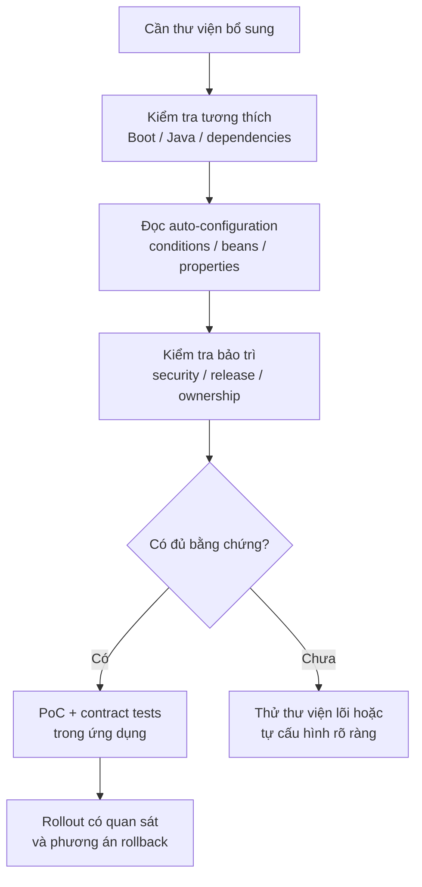

# Đánh giá starter bên thứ ba qua phiên bản, điều kiện tạo bean và bảo trì

## 1. Vì sao cần đánh giá một Spring Boot starter trước khi thêm?

Trong mô-đun **SPRING_BOOT_INTEGRATION**, một ứng dụng Spring Boot thường kết nối qua HTTP client, JDBC/JPA, Redis, Kafka, RabbitMQ hoặc các adapter Spring Integration. Các thư viện bổ sung có thể giúp tự cấu hình connection factory, retry, circuit breaker, serialization, telemetry hay client SDK nhanh hơn. Tuy nhiên, một **starter bên thứ ba** có thể thay đổi cách Spring khởi tạo bean, kéo theo dependency mới và tự kích hoạt hành vi khi ứng dụng chạy.

Ví dụ một thư viện giới thiệu dependency:

```groovy
dependencies {
    // Tọa độ và phiên bản giả định để minh họa quy trình đánh giá.
    implementation("com.example.partner:dispatch-spring-boot-starter:1.2.3")
}
```

Sau khi thêm, ứng dụng khởi động được không có nghĩa starter đã an toàn: nó có thể tạo `RestClient` riêng, tự đăng ký scheduler, chọn timeout không phù hợp, đưa thêm version của Jackson, tự bật consumer hoặc ghi payload vào log. Một bản cập nhật minor có thể thay điều kiện tạo bean khiến ứng dụng đột ngột có **hai client**, mất customizer của đội phát triển hoặc đổi kết nối đến môi trường không mong muốn.

Bài học đặt mục tiêu đánh giá qua **ba trục chính**:

1. **Phiên bản và tương thích**: starter có phù hợp với Spring Boot, Spring Framework, JDK, Jakarta API và các dependency đang chạy không?
2. **Điều kiện tạo bean và tác dụng phụ**: auto-configuration được kích hoạt trong trường hợp nào, có ghi đè bean của ứng dụng hay tạo side effect bất ngờ không?
3. **Bảo trì và vòng đời**: ai phát hành, sửa lỗi bảo mật, cung cấp release notes, chịu trách nhiệm khi upstream thay đổi hoặc dự án ngừng phát triển?

Ba trục này liên hệ trực tiếp tới quản lý cấu hình, hợp đồng dữ liệu, retry/idempotency, giao dịch, kiểm thử và observability của các luồng tích hợp.



## 2. Starter, auto-configuration và thư viện lõi khác nhau thế nào?

| Thành phần | Chức năng | Tác động điển hình |
| --- | --- | --- |
| **Thư viện lõi** | Cung cấp API, adapter hoặc client implementation | Ứng dụng tự khởi tạo bean và cấu hình |
| **Auto-configuration module** | Khai báo `@AutoConfiguration`, các `@Bean` và điều kiện | Spring tạo bean khi classpath/properties/beans phù hợp |
| **Starter** | Dependency tiện lợi kéo theo thư viện lõi, auto-config và các phần cần thiết | Thêm một tọa độ Gradle/Maven có thể kích hoạt nhiều cấu hình |
| **Spring Boot official starter** | Starter được duy trì đồng bộ với Spring Boot theo BOM/hệ sinh thái | Có tài liệu tương thích và lộ trình theo Spring Boot |
| **Third-party starter** | Starter của tổ chức hoặc cộng đồng khác | Cần kiểm tra riêng khả năng bảo trì và tương thích |

Tên artifact có hậu tố `-spring-boot-starter` **không đảm bảo** nó đã được Spring Boot kiểm duyệt. Chỉ nên coi đó là cách đóng gói dependency; kiểm tra source, artifact metadata và hành vi thực tế.

Một starter có thể gồm:

```text
dispatch-spring-boot-starter
  ├─ dispatch-core
  ├─ dispatch-spring-boot-autoconfigure
  ├─ HTTP client dependency
  ├─ metrics / retry dependency
  └─ transitive dependencies
```

Không phải starter nào cũng theo đúng cấu trúc này. Nếu chỉ cần `dispatch-core` nhưng starter tự cấu hình nhiều bean, **dùng thư viện lõi cùng @Configuration do mình kiểm soát** có thể giảm rủi ro. Quyết định dựa trên chi phí phát triển và sở hữu vận hành thực tế.

## 3. Đặt chuẩn tương thích phiên bản trước khi thử

Đánh giá cần bắt đầu từ **stack hiện đang triển khai**, không bắt đầu từ số version lớn nhất của starter.

| Thành phần | Cần ghi nhận | Lý do |
| --- | --- | --- |
| Spring Boot | Phiên bản chính/xây dựng cụ thể và BOM đang áp dụng | Quy định bộ phiên bản thư viện được kiểm thử cùng nhau |
| Spring Framework | Phiên bản do Boot quản lý | API và SPI của auto-configuration có thể khác |
| Java/JDK | Runtime và bytecode target thực tế | Class file/feature không tương thích sẽ không load |
| Servlet/Jakarta | `jakarta.*` hay `javax.*` ở các API đã chuyển namespace | Spring Boot 3/Spring Framework 6 có thay đổi hệ Jakarta |
| Spring Data / Security / Integration | API và starter tương ứng | Tính tương thích của repository/adapter/filter |
| Jackson, Reactor, Netty, Kafka client | Version được chọn trong runtime classpath | Lệch version có thể gây lỗi liên kết khi chạy |
| Third-party starter | Release, branch hỗ trợ, công bố tương thích | Một version chạy được chưa chắc được upstream hỗ trợ |

**Ví dụ về chuyển đổi lớn:** Spring Boot 3 dựa trên Spring Framework 6 và yêu cầu Java 17 trở lên, chuyển nhiều Servlet/Validation/JPA API từ `javax.*` sang `jakarta.*`. Tuy nhiên, các API Java SE như `javax.sql.DataSource` **vẫn ở `javax.sql`**. Không thay namespace dựa trên tìm kiếm chuỗi một cách máy móc.

Khi đánh giá Spring Boot 4 hoặc một major release mới hơn, phải đối chiếu riêng **ma trận hỗ trợ của chính starter** và thử runtime; đừng suy từ việc bản cũ hỗ trợ Boot 3 rằng nó cũng hoạt động nguyên trạng với bản mới.

### Checklist phiên bản

- Starter có ghi rõ phiên bản Spring Boot/Spring Framework/JDK tối thiểu và tối đa đã thử chưa?
- Có build/test trên những major version phù hợp hay chỉ công bố “Spring Boot compatible” chung chung?
- Starter sử dụng API công khai hay lớp nội bộ có thể đổi ở bản minor?
- Có phụ thuộc `javax.servlet`, `javax.validation` hoặc Spring Security API cũ không?
- Có phát hành cùng nhịp với bản sửa CVE của dependency chủ chốt không?
- Có thay đổi behavior/config property giữa hai bản mà không có migration guide không?

Nếu thiếu tài liệu tương thích, hãy coi đó là **điểm chưa được chứng minh** và tạo PoC trên chính version runtime của ứng dụng.

## 4. Quản lý dependency bằng BOM và phân tích cây phụ thuộc

Spring Boot quản lý nhiều version thư viện qua BOM. Starter bên thứ ba có thể khai báo dependency theo version riêng, hoặc đưa vào những nhóm chưa có trong BOM. Cần nhìn **phiên bản cuối cùng được resolve ở runtime**.

Trong dự án Gradle có wrapper, có thể dùng các lệnh dưới đây khi đánh giá trên checkout thực tế:

```bash
./gradlew dependencies --configuration runtimeClasspath
./gradlew dependencyInsight --dependency spring-web --configuration runtimeClasspath
./gradlew dependencyInsight --dependency jackson-databind --configuration runtimeClasspath
./gradlew dependencyInsight --dependency reactor-netty --configuration runtimeClasspath
```

Trên Windows có thể chạy wrapper `gradlew.bat` tương ứng. Các lệnh này là **hướng dẫn thực hành**, không phải bước đang chạy trong bài viết.

Với Maven, `mvn dependency:tree` giúp kiểm tra các dependency được kéo theo và điều chỉnh phạm vi thông tin cần xem. Nên lưu lại bản cây phụ thuộc **trước và sau khi thêm starter** để so sánh bằng chứng.

### Những điểm đỏ trong dependency tree

| Dấu hiệu | Rủi ro |
| --- | --- |
| Starter kéo một major version Jackson/Netty/Reactor khác stack | Lỗi `NoSuchMethodError`, `ClassNotFoundException` hoặc hành vi runtime không tương thích |
| Có hai logging bridge hoặc nhiều SLF4J providers | Log trùng, lỗi binding hoặc không xuất telemetry như mong đợi |
| Phụ thuộc thư viện không được bảo trì | CVE không có bản vá, không tương thích JDK mới |
| Starter kéo thêm actuator, web stack, scheduler hoặc broker client không cần thiết | Tăng classpath, số bean, bề mặt tấn công và tác dụng phụ |
| Ép version `spring-*` bằng quy tắc toàn cục | Phá bộ version Spring Boot đã kiểm thử cùng nhau |
| Dependency đưa nhiều thư viện test vào runtime | Tăng artifact, rủi ro license/security không cần thiết |

**Không dùng `exclude` hoặc ép version để “chữa cháy” rồi bỏ qua test.** Loại bỏ một transitive dependency mà starter thực sự cần có thể khiến auto-config chỉ lỗi ở runtime khi một nhánh code được kích hoạt. Nếu bắt buộc override, ghi rõ lý do, compatibility tests và ngày đánh giá lại.

### Ghim version và kiểm soát nguồn artifact

Với third-party starter, nên dùng version được kiểm duyệt, repository artifact tin cậy, cơ chế dependency locking/verification phù hợp và review thay đổi trước khi nâng cấp. Tránh bản snapshot/changing version trong production nếu không có quy trình đặc biệt. BOM đảm bảo lựa chọn version cho **những module BOM quản lý**; không bảo đảm tất cả artifact bên ngoài tự động tương thích.

## 5. Spring Boot quyết định có tạo bean hay không?

Điểm quan trọng nhất khi review một starter là **auto-configuration có điều kiện**.

| Annotation / cơ chế | Ý nghĩa khi đọc source | Câu hỏi cần kiểm tra |
| --- | --- | --- |
| `@AutoConfiguration` | Khai báo cấu hình được import tự động | Được đăng ký ở đâu? |
| `@ConditionalOnClass` | Chỉ áp dụng khi class nhất định tồn tại | Class này có dễ xuất hiện ngoài ý muốn qua dependency khác? |
| `@ConditionalOnBean` | Chỉ áp dụng khi đã có bean phù hợp | Nếu bean được tạo muộn/đổi tên, có làm cấu hình biến mất? |
| `@ConditionalOnMissingBean` | Back off khi đã có bean user định nghĩa | Kiểm tra bean type, name, qualifier và thứ tự xử lý |
| `@ConditionalOnProperty` | Bật/tắt qua property | Default là bật hay tắt? Missing property có được xem là match? |
| `@ConditionalOnResource` | Chỉ áp dụng khi resource tồn tại | Resource nằm trong JAR hay external config? |
| `@ConditionalOnWebApplication` | Phụ thuộc kiểu application web | Có hoạt động khác ở batch/consumer không? |
| `@ConditionalOnSingleCandidate` | Cần một candidate xác định | Ứng dụng multi-DataSource/multi-client có bị ảnh hưởng? |
| `@ConditionalOnMissingClass` | Hoạt động khi class vắng mặt | Có chọn implementation dự phòng không? |
| `@AutoConfigureAfter` / ordering | Quy định thứ tự đánh giá auto-configuration | Có phụ thuộc điều kiện `@ConditionalOnMissingBean` từ cấu hình khác? |

**Bean được tạo theo điều kiện, không chỉ theo tên dependency.** Cùng một starter có thể sinh các bean khác nhau giữa môi trường web, batch, test, profile staging hoặc khi thêm một library transitively.

Các điều kiện thường kiểm tra *bean definitions đã biết ở thời điểm đánh giá*; `@ConditionalOnMissingBean` không có nghĩa “tìm trong toàn bộ tương lai khi context hoàn tất”. Thứ tự đăng ký/đánh giá auto-config có thể quyết định starter có nhường chỗ cho cấu hình người dùng hay không. Vì vậy cần thử chính xác kịch bản **user-provided bean** và **nhiều candidate**.

### Từ file đăng ký đến bean thực tế

Spring Boot 3 thường nạp auto-configuration class qua file:

```text
META-INF/spring/org.springframework.boot.autoconfigure.AutoConfiguration.imports
```

Ví dụ nội dung:

```text
com.example.partner.autoconfigure.DispatchAutoConfiguration
```

Những cấu trúc lịch sử có thể đặt danh sách auto-configuration trong `META-INF/spring.factories`; Spring Boot 2.7 hỗ trợ định dạng imports mới, còn nhánh Boot 3 dùng `AutoConfiguration.imports` để đăng ký auto-configuration. **`spring.factories` vẫn có những mục đích khác trong hệ Spring**; không xem mọi file có tên này là “sai” hoặc có thể xóa tùy ý.

Phải kiểm tra **JAR được phát hành thật**, không chỉ source ở nhánh main: một module có class `@AutoConfiguration` nhưng thiếu file đăng ký sẽ không tự được import. Ngược lại, starter đóng gói thêm một auto-config không được nhắc trong README có thể tạo bean bất ngờ.

## 6. Ví dụ một auto-configuration có thể kiểm chứng

Giả sử một starter giả định tạo client gọi HTTP partner. Mục tiêu là: chỉ tạo `DispatchClient` khi **đã bật tính năng**, class có trên classpath, và **ứng dụng chưa tự cung cấp một bean loại đó**.

```java
import java.net.URI;
import java.time.Duration;
import org.springframework.boot.autoconfigure.AutoConfiguration;
import org.springframework.boot.autoconfigure.condition.ConditionalOnClass;
import org.springframework.boot.autoconfigure.condition.ConditionalOnMissingBean;
import org.springframework.boot.autoconfigure.condition.ConditionalOnProperty;
import org.springframework.boot.context.properties.ConfigurationProperties;
import org.springframework.boot.context.properties.EnableConfigurationProperties;
import org.springframework.context.annotation.Bean;

// Ví dụ minh họa mã nguồn starter do bên thứ ba cung cấp.
@AutoConfiguration
@ConditionalOnClass(DispatchClient.class)
@EnableConfigurationProperties(DispatchProperties.class)
public class DispatchAutoConfiguration {

    @Bean
    @ConditionalOnMissingBean(DispatchClient.class)
    @ConditionalOnProperty(
            prefix = "partner.dispatch",
            name = "enabled",
            havingValue = "true",
            matchIfMissing = false)
    DispatchClient dispatchClient(DispatchProperties properties) {
        return new DispatchClient(
                properties.baseUrl(),
                properties.timeout());
    }
}

// Các type tối giản này cùng thuộc bộ mã minh họa giả định.
@ConfigurationProperties(prefix = "partner.dispatch")
public record DispatchProperties(URI baseUrl, Duration timeout) {}

public record DispatchClient(URI baseUrl, Duration timeout) {}
```

Đây là minh họa về **điều kiện**, chưa phải starter thực tế để copy nguyên ba public type vào một Java source. Trong implementation thật, mỗi public type có file tương ứng; `DispatchProperties` cần validation (base URL HTTPS, timeout dương) và client phải được cấu hình TLS, retry, timeout, telemetry theo hợp đồng.

Giả sử starter dùng:

```yaml
partner:
  dispatch:
    enabled: true
    base-url: https://partner.example.test
    timeout: 2s
```

Những câu hỏi phải trả lời khi review:

1. Nếu `enabled` thiếu, starter có tự tạo client và gọi dịch vụ ngoài không? Trong ví dụ là **không**, vì `matchIfMissing=false`.
2. Nếu class `DispatchClient` vắng mặt, auto-config có được bỏ qua an toàn không?
3. Nếu ứng dụng có bean `DispatchClient` riêng, `@ConditionalOnMissingBean` có thật sự nhường chỗ?
4. Nếu `base-url` sai, chương trình fail fast với thông báo an toàn hay tạo bean lỗi rồi retry vô hạn?
5. Nếu starter tự cài thêm `ObjectMapper`, `RestClient.Builder` hoặc `KafkaListenerContainerFactory`, có làm thay behavior toàn ứng dụng không?

Một third-party starter tốt nên đưa ra **tùy chọn bật/tắt và override rõ ràng**, cung cấp prefix cấu hình riêng, tránh giành bean với application và chỉ bắt đầu network activity khi điều kiện phù hợp.

## 7. Kiểm thử điều kiện auto-configuration bằng ApplicationContextRunner

Không nên đánh giá starter chỉ bằng việc mở một ứng dụng Spring Boot đầy đủ rồi nhìn startup có thành công hay không. `ApplicationContextRunner` trong `spring-boot-test` tạo context nhỏ, cho phép kiểm tra chính xác từng tổ hợp **classpath / property / bean do người dùng cung cấp**.

Đối với auto-config giả định `DispatchAutoConfiguration` ở mục trước:

```java
import static org.assertj.core.api.Assertions.assertThat;

import java.net.URI;
import java.time.Duration;
import org.junit.jupiter.api.Test;
import org.springframework.boot.autoconfigure.AutoConfigurations;
import org.springframework.boot.test.context.runner.ApplicationContextRunner;
import org.springframework.context.annotation.Bean;
import org.springframework.context.annotation.Configuration;

class DispatchAutoConfigurationTest {

    private final ApplicationContextRunner runner =
            new ApplicationContextRunner()
                    .withConfiguration(AutoConfigurations.of(
                            DispatchAutoConfiguration.class));

    @Test
    void disabledByDefault() {
        runner.run(context ->
                assertThat(context).doesNotHaveBean(DispatchClient.class));
    }

    @Test
    void enabledPropertyCreatesExactlyOneClient() {
        runner.withPropertyValues(
                "partner.dispatch.enabled=true",
                "partner.dispatch.base-url=https://partner.example.test",
                "partner.dispatch.timeout=2s")
              .run(context -> {
                  assertThat(context).hasSingleBean(DispatchClient.class);
                  assertThat(context.getBean(DispatchClient.class).timeout())
                          .isEqualTo(Duration.ofSeconds(2));
              });
    }

    @Test
    void userProvidedBeanTakesPrecedence() {
        runner.withPropertyValues(
                "partner.dispatch.enabled=true",
                "partner.dispatch.base-url=https://partner.example.test",
                "partner.dispatch.timeout=2s")
              .withUserConfiguration(UserClientConfiguration.class)
              .run(context -> {
                  assertThat(context).hasSingleBean(DispatchClient.class);
                  assertThat(context.getBean(DispatchClient.class).baseUrl())
                          .isEqualTo(URI.create(
                                  "https://custom.example.test"));
              });
    }

    @Configuration(proxyBeanMethods = false)
    static class UserClientConfiguration {
        @Bean
        DispatchClient dispatchClient() {
            return new DispatchClient(
                    URI.create("https://custom.example.test"),
                    Duration.ofSeconds(5));
        }
    }
}
```

Đây là bộ test minh họa cho các class của ví dụ trước. Khi đưa vào dự án cần lưu chúng trong file Java phù hợp và dùng dependency `spring-boot-starter-test`. Trong mã sản xuất, client thật có thể cần nhiều dependency và health/network resource hơn.

Kỳ vọng ba test:

| Điều kiện | Bean `DispatchClient` mong đợi |
| --- | --- |
| Thiếu `partner.dispatch.enabled` | Không có bean |
| `enabled=true`, không có bean người dùng | Đúng một bean do auto-config tạo |
| `enabled=true`, người dùng đã khai báo bean riêng | Đúng bean người dùng; auto-config back off |

Mở rộng test bằng `FilteredClassLoader` để giả lập **thiếu class optional**, và bằng `withPropertyValues` để thử malformed URI, timeout âm, property alias đã đổi hoặc endpoint không hợp lệ. Nếu starter có `@ConditionalOnBean` hoặc `@ConditionalOnSingleCandidate`, cần thêm test với **0, 1, 2 candidate beans**.

`ApplicationContextRunner` **không thay thế integration test**: một context nhỏ chưa chứng minh HTTP client thật giao tiếp được, Kafka consumer không khởi động sai topic, hoặc chính sách retry hoạt động khi database commit rồi consumer crash. Các điều kiện bean cần kiểm thử ở cả phạm vi đơn vị và phạm vi ứng dụng.

## 8. Kiểm tra cấu hình thực tế bằng ConditionEvaluationReport

Spring Boot có cơ chế báo cáo lý do auto-configuration **matched** hoặc **did not match**. Khi một starter tạo bean ngoài dự kiến, đây là nơi nên xem trước khi thử loại dependency ngẫu nhiên.

Trong môi trường phát triển, có thể bật báo cáo điều kiện bằng `--debug` khi khởi động ứng dụng (tùy hệ thống launch). Nếu dùng Spring Boot Actuator, endpoint `/actuator/conditions` có thể giúp xem các điều kiện auto-configuration đã đánh giá.

```yaml
# Chỉ minh họa cấu hình dev/test khi Actuator đã có mặt.
management:
  endpoints:
    web:
      exposure:
        include: health,info,conditions
```

**Không mở công khai `/actuator/conditions` ở production.** Báo cáo có thể tiết lộ bean names, classpath, cấu hình và chi tiết hạ tầng. Hạn chế quyền bằng Spring Security/network policy hoặc sử dụng report offline trong môi trường test.

Khi đọc báo cáo, cần trả lời:

1. Auto-configuration class của starter đã **được import** chưa?
2. Nếu không được import, JAR có `AutoConfiguration.imports` và class tương ứng không?
3. Nếu được import nhưng bean vắng mặt, condition nào âm: classpath, property, resource, bean hay web environment?
4. Nếu bean hiện diện, nó do auto-config nào tạo, scope/qualifier nào và có xung đột với bean dự kiến của ứng dụng không?
5. Nếu bean có mặt nhưng không kết nối được, vấn đề có thể nằm ở **configuration properties, network, TLS hoặc quyền**, không phải condition.

Không dựa duy nhất vào tên `@Bean`. Hai starter có thể khai báo bean cùng **kiểu** nhưng khác tên, khiến injection bằng type trở nên ambiguous; hoặc một bean có `@Primary` làm thay đổi wiring mà application vẫn khởi động bình thường.

### Ví dụ lỗi khi có nhiều bean

Giả sử application có hai `DataSource` cho database nghiệp vụ và audit. Một starter bổ sung:

```java
@Bean
@ConditionalOnSingleCandidate(javax.sql.DataSource.class)
SomeJdbcRecorder recorder(javax.sql.DataSource dataSource) {
    return new SomeJdbcRecorder(dataSource);
}
```

Với một `DataSource`, bean recorder có thể được tạo. Khi có hai DataSource mà không có candidate xác định phù hợp, điều kiện có thể không thỏa, khiến recorder **biến mất** sau thay đổi cấu hình. Với một primary bean, điều kiện có thể thỏa nhưng gắn với **database không mong muốn** nếu thiết kế ban đầu chưa quy định rõ.

Tương tự, thêm `KafkaTemplate` hoặc `ObjectMapper` riêng có thể làm auto-config nhường chỗ hoặc sử dụng candidate khác. Vì thế phải có test **multi-bean wiring**, không chỉ `contextLoads()`.

## 9. Tác dụng phụ cần soi kỹ trong starter tích hợp

Starter có thể đăng ký bean nhưng tác dụng phụ chỉ xuất hiện sau `ApplicationReadyEvent`, sau khi container listener start hoặc khi bean được gọi lần đầu. Khi review, xem kỹ:

| Khu vực | Hành vi có thể phát sinh | Bằng chứng kiểm thử |
| --- | --- | --- |
| HTTP client | Tự chọn base URL, proxy, timeout, TLS trust hoặc retry interceptor | Kiểm tra request tới đúng host, timeout và cert validation |
| JDBC/JPA | Tạo thêm `DataSource`/transaction manager hoặc chạy schema init | Xác minh DB/schema, kết nối, transaction, không ghi ngoài ý muốn |
| Kafka | Đăng ký producer/consumer, listener container, topic creation | Quan sát group ID, topics, auto-startup, offset và ACL |
| RabbitMQ | Tự khai báo exchange/queue, auto listener, retry/DLQ | Kiểm tra topology, permissions, redelivery và duplicate |
| Redis/cache | Tạo `RedisConnectionFactory`, cache manager, serializer và TTL | Test key namespace, serialization, expiry và kết nối |
| Spring Integration | Đăng ký flow/adapter/poller/channel chưa mong đợi | Kiểm tra tần suất poll, message volume, thread pool và duplicate |
| Resilience | Thêm retry, circuit breaker, timeout hoặc scheduler | Test tổng số attempts, timeout budget và thứ tự interceptor |
| Observability | Bật metrics/tracing/logging payload, health indicator | Kiểm tra bí mật/PII và cardinality của metrics |

**Retry chồng retry** là lỗi hay gặp: HTTP client có retry, Spring Retry có retry, Kafka listener có retry và broker còn redelivery. Ví dụ ba lớp retry mỗi lớp tối đa ba attempts có thể nhân thành **27 lần gọi** cho một thao tác tùy cấu hình và vị trí lỗi. Phải xác định **ai sở hữu chính sách retry** và giới hạn tổng số lần thực hiện, đặc biệt với API thanh toán hoặc thao tác không idempotent.

Nếu starter tạo thêm `@Transactional`, interceptor hoặc transactional event listener, cần xem chính xác ranh giới COMMIT/ACK và thứ tự AOP proxy. Một thay đổi thứ tự advice có thể làm ACK trước DB commit hoặc đặt retry bên ngoài transaction theo cách khác dự kiến.

### Rủi ro từ default configuration

Những default đáng xem xét gồm:

- Tự bật thay vì yêu cầu `enabled=true`.
- Tự kết nối đến `localhost` hoặc endpoint demo khi property thiếu, gây kết nối sai môi trường.
- Retry vô hạn hoặc thời gian chờ rất dài, gây nghẽn consumer.
- Bỏ qua xác minh hostname/TLS chain.
- Tự động tạo bảng/index/topic khi ứng dụng chạy với quyền production.
- Gửi telemetry đến bên thứ ba hoặc log body chứa token và dữ liệu khách hàng.
- Tạo thread/connection pool mới cho từng bean thay vì dùng pool được quản lý.

Các default này phải được kiểm chứng từ source, metadata/configuration và runtime test, thay vì chỉ dựa vào một câu mô tả trên trang dự án.

## 10. Đánh giá khả năng bảo trì và an toàn chuỗi cung ứng

Một starter có thể hoạt động tốt hôm nay nhưng trở thành vấn đề khi Spring Boot thay major version hoặc có lỗ hổng bảo mật. Cần đánh giá sự tồn tại của quy trình bảo trì, không chỉ đếm số sao trên repository.

| Tín hiệu | Cần thu thập | Cách diễn giải |
| --- | --- | --- |
| Releases | Phiên bản mới, release notes, changelog và dấu hiệu hỗ trợ Boot versions | Có đường nâng cấp có thể xem xét được không? |
| Issues/PR | Tác giả phản hồi bug/security/incompatibility như thế nào | Có người xử lý vấn đề quan trọng không? |
| Test/CI | Unit tests, integration tests, ma trận JDK/Boot, dependency updates | Những behavior quan trọng có regression coverage không? |
| Artifact provenance | Repository phát hành chính thức, checksums/signatures khi có | Artifact binary có nguồn đáng tin và liên hệ với source/tag không? |
| Security | CVE/advisories, quy trình báo lỗi và phát hành bản vá | Có khả năng xử lý lỗ hổng đúng SLA không? |
| License | License của starter và transitive dependencies | Có phù hợp yêu cầu sử dụng/phân phối của tổ chức không? |
| Documentation | Cấu hình, migration notes, support channels, deprecation policy | Khi hỏng, team có tự chẩn đoán và phục hồi không? |
| Exit plan | Có thể dùng core API trực tiếp hay thay bằng starter khác không | Rủi ro phụ thuộc một maintainer được giới hạn ra sao? |

**Ít commit gần đây không tự động là xấu** nếu thư viện nhỏ, ổn định và có quy trình phản hồi rõ ràng. Ngược lại, nhiều commit và release nhanh không chứng minh tính an toàn. Đánh giá dựa trên khả năng **hỗ trợ phiên bản cần dùng, phản hồi sự cố và chất lượng kiểm thử**.

Nên kiểm tra CVE/advisory cho **toàn cây dependency runtime**, tạo SBOM khi quy trình tổ chức yêu cầu, đối chiếu license và kiểm soát nguồn artifact. Kết quả quét tự động cần được xác minh: một advisory có thể không áp dụng đường code đang chạy, nhưng cũng không nên phớt lờ vì “starter không dùng trực tiếp module đó”.

### Khi dự án đã ngừng bảo trì

Đặt câu hỏi:

1. Có bản thay thế chính thức hoặc API từ Spring Boot/Spring Data/SDK lõi đủ chức năng không?
2. Có thể tách thành một `@Configuration` nội bộ ngắn và tự duy trì không?
3. Có công khai fork được duy trì hay tổ chức đủ năng lực sở hữu bản vá không?
4. Nếu giữ nguyên, giới hạn network/permission/dependency và xác định ngày thay thế ra sao?

**Tự fork** chỉ phù hợp nếu có người sở hữu CI, release, security patch và review lâu dài. Fork để sửa một lỗi rồi bỏ mặc còn tạo thêm nợ vận hành.

## 11. Ma trận quyết định: dùng starter hay cấu hình trực tiếp?

Cho mỗi tiêu chí một đánh giá `PASS`, `RISK` hoặc `FAIL` kèm bằng chứng, thay vì cộng điểm trừu tượng:

| Tiêu chí | PASS | RISK | FAIL |
| --- | --- | --- | --- |
| Boot/JDK compatibility | Có công bố phù hợp và test thành công | Chưa công bố nhưng PoC khả thi | Dùng API không còn tồn tại hoặc runtime crash |
| Auto-config | Có điều kiện, override và test rõ | Một số default khó đoán nhưng có cách vô hiệu hóa | Ghi đè bean hoặc side effect không kiểm soát |
| Dependencies | Không phá dependency resolution | Cần override có test | Major version xung đột, không có giải pháp đáng tin |
| Security | Không phát hiện vấn đề chưa xử lý, có quy trình vá | Cần kiểm soát bổ sung và theo dõi | Lỗ hổng nghiêm trọng không có đường khắc phục |
| Operations | Có metric/health/log an toàn và rollback | Thiếu một phần telemetry nhưng có thể bù | Không thể nhận biết lỗi hoặc vô hiệu hóa an toàn |
| Maintenance | Maintainer phản hồi, releases rõ | Bảo trì chậm nhưng chức năng ổn định | Bỏ rơi, không có đường nâng cấp bắt buộc |

Chỉ dùng starter khi **không có FAIL quan trọng** và các `RISK` có kế hoạch kiểm soát được team chấp nhận. Nếu starter chỉ giúp tiết kiệm vài dòng `@Bean` nhưng tạo dependency khó bảo trì và side effect lớn, có thể dùng **SDK/thư viện lõi** và cấu hình tường minh.

### Ví dụ so sánh trong một service Kafka → HTTP

Yêu cầu: consumer Kafka nhận `OrderPaid`, gọi HTTP partner có timeout 2 giây, ghi idempotency vào SQL và gửi lỗi vĩnh viễn đến DLT.

**Phương án A: third-party starter.** Nó tự tạo HTTP client, retry, metrics và một error handler. Khi chọn, phải xác nhận số retries cuối cùng, loại lỗi retryable, TLS policy, tên bean, việc có chiếm `CommonErrorHandler` chung và cách ứng dụng override.

**Phương án B: HTTP SDK/thư viện lõi.** Ứng dụng khai báo `RestClient`/`WebClient`, retry policy và Kafka `DefaultErrorHandler` trong `@Configuration` riêng. Cần viết thêm mã cấu hình nhưng ranh giới trách nhiệm rõ.

Nếu starter âm thầm retry một POST sau timeout, partner có thể đã nhận yêu cầu trước đó; **idempotency key** và reconciliation vẫn cần thiết dù cách khởi tạo client nào được chọn.

## 12. Quy trình thử nghiệm và triển khai có kiểm soát

Một PoC có ý nghĩa nên nằm trên **cùng Boot BOM, JDK và dependency runtime** của ứng dụng dự kiến dùng starter. Chuỗi kiểm chứng:

1. **Baseline:** ghi lại các bean quan trọng, dependency tree, endpoint/consumer đang chạy và metric trước khi thêm starter.
2. **Đưa dependency vào nhánh thử nghiệm:** chọn version đã kiểm duyệt, ghi lý do và tài liệu upstream.
3. **So sánh runtime classpath:** tìm thay đổi ở Spring, Jackson, Reactor/Netty, JDBC, Kafka, logging và bảo mật.
4. **Xem auto-config metadata/conditions:** liệt kê bean, properties, conditional branches và side effects.
5. **Test context nhỏ:** dùng `ApplicationContextRunner` cho tắt/bật/override/multi-bean/classpath.
6. **Integration test:** thử SQL/HTTP/broker thật qua Testcontainers hoặc fixture tương ứng.
7. **Fault injection:** timeout, auth failure, broker disconnect, duplicate event, DB commit rồi crash trước ACK, DLT publish failure.
8. **Canary:** rollout một phần traffic, so metric/latency/error rate, xem bean và endpoint thực tế.
9. **Rollout/rollback:** giữ cấu hình tắt nhanh khi có thể, artifact cũ để rollback và quy trình migration nếu starter thay schema.
10. **Ownership:** chốt ai theo dõi security advisories, Boot upgrades và ngày xem xét lại dependency.

**Tắt bean bằng property không nhất thiết loại bỏ toàn bộ ảnh hưởng của dependency.** JAR vẫn còn trên classpath, có thể ảnh hưởng dependency resolution hoặc những auto-config khác. Khi cần rollback triệt để, thử cả phương án loại bỏ starter.

### Vô hiệu hóa auto-configuration khi cần cô lập

Spring Boot có thể loại trừ **một auto-configuration class** nếu phù hợp:

```yaml
spring:
  autoconfigure:
    exclude:
      - com.example.partner.autoconfigure.DispatchAutoConfiguration
```

Đây là tên class **giả định** theo ví dụ. Chỉ sử dụng khi xác minh class có thật và được liệt kê trong auto-config của starter. Nếu starter đăng ký thêm listener, component scan hoặc các auto-configuration khác, loại trừ một class chưa chắc vô hiệu hóa tất cả. Ưu tiên feature flag được tác giả hỗ trợ và kiểm thử đường tắt đó.

## 13. Kế hoạch nâng cấp starter theo từng mốc

Một bản nâng cấp có thể thay đổi cả **API** và **điều kiện tạo bean** dù không đổi source code của ứng dụng. Mỗi lần nâng version nên lập bảng:

| Giai đoạn | Việc cần làm | Bằng chứng |
| --- | --- | --- |
| Trước nâng | Đọc changelog/migration guide, xác định version từ BOM/lockfile | Danh sách breaking changes |
| Resolve dependency | So sánh runtimeClasspath trước/sau | Dependency diff đã giải thích |
| Boot context | Kiểm tra bean count, names, qualifiers và conditions | Test `ApplicationContextRunner` + report |
| Hợp đồng tích hợp | Kiểm tra serialize/deserialize, timeout, retry, error mapping | Contract/integration tests |
| Failure paths | Mô phỏng disconnect, redelivery, stale credentials | Không mất/nhân đôi nghiệp vụ |
| Triển khai | Canary, so sánh metric và logs | Ngưỡng rollback rõ |
| Sau deploy | Theo dõi CVE, lag, pool exhaustion và incident | Ownership và lịch rà soát |

Nâng cùng lúc Spring Boot major, Kafka client major và nhiều third-party starters tạo quá nhiều biến số. Khi có thể, chia thành những thay đổi có phạm vi và bằng chứng rõ để khoanh vùng regression dễ hơn.

## 14. Những lỗi phổ biến

1. **Chọn starter vì tên quen thuộc:** không kiểm tra nguồn phát hành, version và auto-config thực sự.
2. **“Ứng dụng startup xanh” = “tương thích”:** lỗi chỉ xuất hiện khi nhánh retry/TLS/transaction được chạy.
3. **Không kiểm tra transitive dependencies:** bị thay Jackson, logging hoặc Reactor version trong runtime.
4. **Nhầm `@ConditionalOnClass` là đã đủ:** class có trên classpath nhưng bean/property chưa đúng hoặc default bật ngoài ý muốn.
5. **Giả định `@ConditionalOnMissingBean` luôn nhường chỗ:** thứ tự đăng ký, type, name và qualifier chưa được thử.
6. **Không thử multi-bean:** ứng dụng có hai `DataSource` hoặc hai `KafkaTemplate` làm condition khác môi trường dev.
7. **Starter tự tạo consumer/poller:** tăng số instance xử lý, duplicate hoặc backlog mà không ai biết.
8. **Retry chồng nhiều lớp:** số lời gọi lên downstream vượt xa cấu hình kỳ vọng.
9. **Chấp nhận trust-all hoặc log raw payload mặc định:** làm lộ dữ liệu và mất xác thực TLS.
10. **Không có owner của dependency:** CVE hoặc Spring Boot major upgrade xuất hiện nhưng không ai sửa.
11. **Chỉ nhìn source branch main:** artifact đã phát hành có thể khác code mới nhất.
12. **Không có đường rollback:** starter thay DB schema/topic trước khi team nhận ra behavior sai.

## 15. Bài thực hành: đánh giá một starter HTTP/Kafka giả định

**Tình huống:** đội phát triển đang dùng Spring Boot 3.x, Java 17+, Spring Kafka và PostgreSQL. Một bên thứ ba đề xuất `dispatch-spring-boot-starter` để tự tạo HTTP client có retry và metrics.

Yêu cầu thực hành:

1. Lập ma trận version gồm Boot, Framework, JDK, Kafka client, HTTP stack và version starter dự kiến.
2. Ghi chênh lệch dependency tree, đặc biệt Jackson, Netty/Reactor, retry và logging.
3. Xác minh JAR chứa `AutoConfiguration.imports`; liệt kê các auto-config và điều kiện của bean client.
4. Viết test với `ApplicationContextRunner` cho mặc định disabled, enabled, missing dependency và user-provided bean.
5. Tạo một ứng dụng tích hợp nhỏ có hai bean HTTP client và hai `DataSource` để thử wiring/qualifier.
6. Mô phỏng HTTP 503, timeout sau POST đã thành công, Kafka redelivery sau database commit; đo tổng số attempts và tác dụng phụ.
7. Thử bật và tắt starter bằng configuration flag; bảo đảm không phát sinh kết nối/poller ngoài dự kiến.
8. Đánh giá maintainer, license, security policy, BOM compatibility và phương án dùng core SDK nếu cần.
9. Đưa kết quả vào bảng `PASS/RISK/FAIL` có bằng chứng, owner và quyết định triển khai.

### Tiêu chí nghiệm thu

| Tiêu chí | Kỳ vọng |
| --- | --- |
| Phiên bản | Stack thực tế được thử, không có xung đột dependency chưa giải thích |
| Bean conditions | Mặc định, bật/tắt, override và multi-bean đều đúng dự định |
| Hành vi HTTP | Timeout, TLS, retry và idempotency có kiểm thử trên lỗi thật |
| Kafka/SQL | Không làm sai thứ tự COMMIT/ACK; retry không tạo side effect trùng |
| Bảo mật | Không trust-all, không rò rỉ token/PII trong log và telemetry |
| Vận hành | Có metric/cảnh báo, đường vô hiệu hóa và rollback rõ |
| Bảo trì | Có maintainer/owner, license được chấp nhận và kế hoạch upgrade |

## 16. Câu hỏi tự kiểm tra

1. Một dependency tên `-spring-boot-starter` khác gì auto-config module và thư viện lõi?
2. Vì sao cần phân tích **runtimeClasspath** thay vì chỉ đọc danh sách dependency khai báo?
3. `@ConditionalOnClass`, `@ConditionalOnBean` và `@ConditionalOnMissingBean` khác nhau ở điểm nào?
4. `matchIfMissing=true` trong `@ConditionalOnProperty` ảnh hưởng thế nào tới mặc định bảo mật?
5. Trong Spring Boot 3, auto-configuration thường được liệt kê ở file nào?
6. Vì sao `@ConditionalOnMissingBean` cần được thử với bean do ứng dụng tự định nghĩa?
7. Làm sao giải thích trường hợp starter có client ở dev nhưng bean biến mất khi production có hai `DataSource`?
8. `ApplicationContextRunner` kiểm tra điều gì, và điều gì vẫn cần `@SpringBootTest`/integration test?
9. Vì sao starter retry có thể làm tăng số request HTTP sau timeout dù app chỉ gọi một method?
10. Những bằng chứng nào đủ để chấp nhận starter ít release nhưng còn được bảo trì?
11. Vì sao tắt auto-config bằng property chưa chắc xóa được ảnh hưởng lên dependency tree?
12. Khi upstream ngừng bảo trì, cần chuẩn bị những gì trước khi quyết định fork hoặc thay bằng thư viện lõi?

## Tổng kết

Đánh giá starter bên thứ ba là một quyết định về **tương thích phiên bản, cách Spring Boot xây dựng ApplicationContext và trách nhiệm bảo trì lâu dài**. Với SPRING_BOOT_INTEGRATION, một starter có thể giúp tạo HTTP client, database connection, Kafka/RabbitMQ adapter hoặc observability nhanh, nhưng cũng có thể thay dependency, tự bật listener, đổi retry và ảnh hưởng transaction. Hãy kiểm tra version/BOM, đọc `AutoConfiguration.imports` và các `@Conditional...`, thử bean bằng `ApplicationContextRunner`, kiểm thử side effect cùng lỗi biên, rồi đánh giá security, license, maintainer và rollback. Chỉ đưa starter vào hệ thống khi có bằng chứng rằng nó giải quyết nhu cầu thực tế mà ứng dụng vẫn kiểm soát được cấu hình, tính nhất quán và vận hành.

### Tài liệu tham khảo

- [Spring Boot Reference — Developing Auto-configuration](https://docs.spring.io/spring-boot/reference/features/developing-auto-configuration.html)
- [Spring Boot Reference — Condition Evaluation](https://docs.spring.io/spring-boot/reference/actuator/endpoints.html)
- [Spring Boot Reference — Managing Dependencies](https://docs.spring.io/spring-boot/reference/using/build-systems.html)
- [Spring Boot API — ApplicationContextRunner](https://docs.spring.io/spring-boot/api/java/org/springframework/boot/test/context/runner/ApplicationContextRunner.html)
- [Gradle User Manual — Viewing Dependencies](https://docs.gradle.org/current/userguide/viewing_debugging_dependencies.html)
- [OWASP — Software Component Verification Standard](https://owasp.org/www-project-software-component-verification-standard/)
