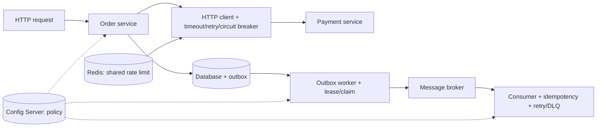
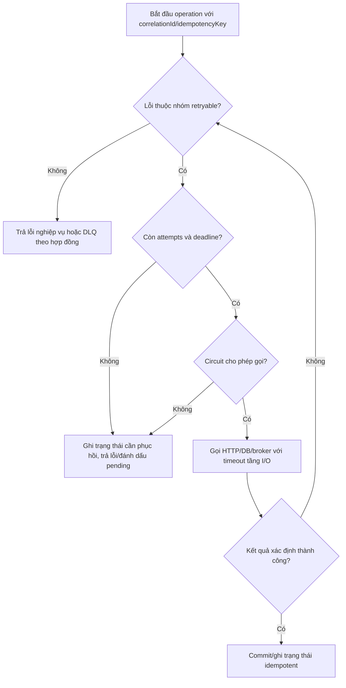

# Điều kiện kích hoạt resilience và cấu hình phân tán theo từng thư viện

Trong ứng dụng **Spring Boot Integration**, một luồng nghiệp vụ thường đi qua HTTP client, cơ sở dữ liệu, cache, broker và các adapter Spring Integration. Khi một phụ thuộc chậm hoặc mất kết nối, ứng dụng có thể cần *retry*, *circuit breaker*, *timeout*, *bulkhead*, *rate limiting* hoặc cơ chế phối hợp giữa các instance. Các khả năng này thường đến từ **thư viện bổ sung**, nhưng chỉ đưa dependency vào dự án chưa chắc đã kích hoạt cơ chế bảo vệ.

Điều dễ nhầm lẫn hơn là chữ **“phân tán”**. Cấu hình Resilience4j được tải giống nhau trên năm pod không làm trạng thái circuit breaker được chia sẻ giữa năm pod; tương tự, năm bộ rate limiter trong bộ nhớ có thể cho phép tổng lưu lượng lớn hơn giới hạn mong muốn của toàn hệ thống. Để chọn công cụ đúng, phải phân biệt rõ **điều kiện kích hoạt của từng thư viện**, **phạm vi trạng thái tại runtime** và **cách phân phối cấu hình hoặc phối hợp trạng thái giữa nhiều node**.

## 1. Mục tiêu và tình huống xuyên suốt

Sau bài học, bạn có thể:

- Phân biệt cơ chế resilience ở mức phương thức, HTTP client, message handler, gateway, lịch chạy nền và toàn cụm.
- Xác định khi nào phải thêm starter, annotation, AOP proxy, bean, factory, advice hoặc backend lưu trạng thái để tính năng **thực sự hoạt động**.
- Giải thích phạm vi cục bộ của các cơ chế trong Resilience4j, Spring Retry và Spring Cloud CircuitBreaker.
- Phân biệt **cấu hình tập trung**, **phát tán thay đổi cấu hình**, **trạng thái dùng chung** và **điều phối phân tán**.
- Thiết kế retry và timeout theo ngân sách thời gian, idempotency và ngữ nghĩa transaction của HTTP/database/broker.
- Nhận biết tình huống nên dùng Redis-backed rate limiting, ShedLock hoặc cơ chế durable job/outbox.
- Lập kế hoạch thử nghiệm khi tăng số replica, restart pod, thay đổi cấu hình hoặc gặp lỗi Redis/broker.

**Tình huống:** một dịch vụ Spring Boot nhận `POST /orders`, lưu đơn hàng vào PostgreSQL, gọi dịch vụ thanh toán qua HTTP rồi xuất sự kiện lên broker. Ứng dụng được triển khai ba replica và còn có job định kỳ chuyển các event trong bảng outbox sang broker. Đối tác thanh toán yêu cầu giới hạn chung 120 yêu cầu/phút cho toàn bộ khách hàng của dịch vụ. Các quyết định cần trả lời gồm: retry lỗi nào, circuit breaker nằm ở đâu, giới hạn 120 yêu cầu có dùng chung không, và ba replica có cùng chạy job outbox không.

## 2. Bốn câu hỏi phải trả lời trước khi thêm thư viện

Cùng một thư viện có thể được thêm vào dependency mà chưa thực sự ảnh hưởng tới execution path. Trước khi viết cấu hình, hãy xác định:

| Câu hỏi | Ý nghĩa | Ví dụ |
|---|---|---|
| **Kích hoạt bằng gì?** | Dependency, bean, annotation, AOP, auto-configuration, advice hay gateway filter? | `@Retry` của Resilience4j cần cơ chế Spring aspect phù hợp; `RetryTemplate` cần được gọi hoặc gắn vào handler |
| **Bao phủ đoạn xử lý nào?** | Một phương thức, HTTP call, inbound message, poller hay scheduled job? | Retry bao quanh HTTP client khác retry ở mức broker redelivery |
| **Trạng thái lưu ở đâu?** | Trong heap của pod, database, Redis hoặc trạng thái của broker? | Resilience4j CircuitBreaker mặc định giữ state trong từng JVM |
| **Khi thất bại thì sao?** | Retry, fail fast, DLQ, rollback, trả lỗi, tiếp tục queue hay chờ khôi phục? | Retry sau timeout của `POST` có thể tạo giao dịch trùng nếu thiếu idempotency key |

Nếu không biết ranh giới của hành động được bảo vệ, dễ mắc lỗi **retry chồng retry**, **timeout không cắt được thao tác I/O**, hoặc **circuit breaker mở nhưng không phản ánh tình trạng chung**.

### 2.1. Sơ đồ các vị trí áp dụng



Redis trong sơ đồ có thể lưu **trạng thái quota dùng chung**. Config Server cung cấp **giá trị cấu hình**. Broker điều phối **phân phối message**, còn database bảo vệ trạng thái nghiệp vụ. Không thành phần nào trong số đó tự làm cho mọi thư viện resilience chia sẻ cùng một trạng thái.

## 3. Ma trận điều kiện kích hoạt theo từng thư viện

Bảng sau là bản đồ lựa chọn; tên artifact minh họa cho hệ sinh thái Spring Boot 3.x. Khi dùng Spring Boot hoặc Spring Cloud major khác, phải đối chiếu BOM và tài liệu phiên bản đang dùng.

| Thư viện/cơ chế | Điều kiện kích hoạt thực tế | Trạng thái mặc định | Khi cần đa instance |
|---|---|---|---|
| **Resilience4j** (`CircuitBreaker`, `Retry`, `RateLimiter`, `Bulkhead`) | Có module phù hợp; gọi decorator/programmatic API hoặc annotation hoạt động qua Spring AOP/aspect | Trong mỗi JVM/registry | Phân phối **policy** qua config; nếu cần quota toàn cụm phải dùng giải pháp shared-state riêng |
| **Spring Retry** | Dùng `RetryTemplate` trực tiếp hoặc cấu hình `@EnableRetry` + `@Retryable`/proxy với dependency cần thiết | Retry context cho mỗi invocation, trong tiến trình | Giới hạn số lần retry của từng caller; không có distributed retry budget mặc định |
| **Spring Cloud CircuitBreaker** | Có starter provider và dùng `CircuitBreakerFactory`/reactive factory tại đoạn gọi cần bảo vệ | Theo provider, thường cục bộ | Đồng bộ policy bằng config; không mặc định chia sẻ breaker state |
| **Spring Integration retry advice** | Gắn `RequestHandlerRetryAdvice`/advice vào đúng message handler hoặc poller, cấu hình retry policy | Trong invocation của handler/poller | Phối hợp với cơ chế claim, broker redelivery và idempotency; không tự tạo shared retry state |
| **Bucket4j local** | Tạo bucket và gọi `tryConsume`/consume qua API thích hợp | Trong bộ nhớ của instance | Dùng extension/provider chia sẻ qua Redis, Hazelcast, JDBC… khi cần global quota |
| **Spring Cloud Gateway RedisRateLimiter** | Cấu hình `RequestRateLimiter` filter, `KeyResolver` và Redis-backed limiter đúng gateway route | Token bucket được phối hợp qua Redis | Nhiều gateway replicas dùng chung backend/key namespace và quota policy |
| **ShedLock** | Có provider lưu lock, `@EnableSchedulerLock` và `@SchedulerLock` hoặc API lock tương ứng | Lock record trong shared storage | Tất cả scheduler nodes phải dùng chung lock provider và tên khóa |
| **Spring Cloud Config / Bus** | Config client/import và, nếu cần, cơ chế refresh/distribution | **Giá trị cấu hình**, không phải trạng thái breaker/quota | Phân phối cấu hình và xác minh từng replica đã áp dụng; không thay Redis/DB shared state |

**Nguyên tắc đọc bảng:** “có dependency” chỉ giải quyết khâu đưa mã vào classpath. Muốn tính năng có hiệu lực phải có execution path thật đi qua wrapper/annotation/handler hoặc một route filter được cấu hình.

## 4. Resilience4j: điều kiện chạy và giới hạn trạng thái

Resilience4j cung cấp các module độc lập như circuit breaker, retry, time limiter, rate limiter và bulkhead. Nó có thể được dùng bằng **decorator/programmatic API** hoặc tích hợp Spring qua annotation/auto-configuration tùy module.

### 4.1. Dependency và điều kiện AOP

Một cấu hình Gradle phổ biến cho Spring Boot 3.x:

```groovy
dependencies {
    implementation 'io.github.resilience4j:resilience4j-spring-boot3'
    implementation 'org.springframework.boot:spring-boot-starter-aop'
    implementation 'org.springframework.boot:spring-boot-starter-actuator'
}
```

Ví dụ này dựa vào starter tích hợp Spring Boot 3 và bộ phiên bản do dự án quản lý. Với ứng dụng reactive hoặc tích hợp chuyên biệt, phải bổ sung module tương thích với kiểu trả về và stack đang sử dụng; riêng annotation chỉ có hiệu lực khi class/aspect tương ứng được đăng ký.

Những điểm cần kiểm tra:

1. Bean chứa phương thức có annotation phải được Spring quản lý và lời gọi phải đi **qua Spring proxy** khi sử dụng cơ chế AOP proxy.
2. `self-invocation` (phương thức trong cùng bean gọi trực tiếp phương thức có `@CircuitBreaker`) thường bỏ qua advice.
3. Class/method không thể được proxy theo cấu hình hiện tại, hoặc code tạo object bằng `new` ngoài Spring container, khiến annotation không hoạt động như kỳ vọng.
4. Cấu hình ở `resilience4j.*` không thể bảo vệ một HTTP client nếu không có call site được trang trí hoặc aspect tương ứng.
5. Tên instance trong annotation/API phải khớp với tên được cấu hình. Nếu không khớp, hệ thống có thể dùng config mặc định và khiến việc kiểm thử bằng mắt khó phát hiện.

### 4.2. Ví dụ CircuitBreaker cho HTTP client

```yaml
resilience4j:
  circuitbreaker:
    instances:
      billingApi:
        slidingWindowType: COUNT_BASED
        slidingWindowSize: 20
        minimumNumberOfCalls: 10
        failureRateThreshold: 50
        waitDurationInOpenState: 30s
        permittedNumberOfCallsInHalfOpenState: 3

  retry:
    instances:
      billingStatus:
        maxAttempts: 3
        waitDuration: 250ms

  ratelimiter:
    instances:
      billingApi:
        limitForPeriod: 40
        limitRefreshPeriod: 60s
        timeoutDuration: 0
```

`billingApi` trong phần `ratelimiter` là **giới hạn cục bộ theo registry trong một JVM**. Nếu mỗi replica có giới hạn 40 lần/phút, ba replica có thể tạo tổng lưu lượng tiến gần 120 lần/phút khi tải phân bố đều. Điều đó không chứng minh quota toàn cụm được thực thi chính xác: số replica, phân phối lưu lượng và thời điểm refresh có thể thay đổi.

Một service sử dụng annotation `@CircuitBreaker`:

```java
import io.github.resilience4j.circuitbreaker.annotation.CircuitBreaker;
import org.springframework.stereotype.Service;
import org.springframework.web.client.RestClient;

@Service
public class BillingStatusClient {

    private final RestClient restClient;

    public BillingStatusClient(RestClient restClient) {
        this.restClient = restClient;
    }

    @CircuitBreaker(name = "billingApi", fallbackMethod = "onFailure")
    public BillingStatus getStatus(String paymentId) {
        return restClient.get()
                .uri("/payments/{id}/status", paymentId)
                .retrieve()
                .body(BillingStatus.class);
    }

    private BillingStatus onFailure(String paymentId, Throwable cause) {
        // Không giả thành công khi chưa biết trạng thái thanh toán.
        throw new BillingStatusUnavailableException(paymentId);
    }
}
```

Các kiểu `BillingStatus` và `BillingStatusUnavailableException` là phần nghiệp vụ minh họa. Fallback phải giữ đúng hợp đồng: không trả trạng thái “đã thanh toán” chỉ vì endpoint đang lỗi. HTTP connect/read/response timeout cần được cấu hình ở **HTTP client thực tế**; việc mở circuit breaker không thay thế timeout mạng.

### 4.3. Retry, TimeLimiter và Bulkhead có ranh giới khác nhau

- **Retry** chạy lại một lời gọi sau lỗi được phân loại. Chỉ retry thao tác an toàn, hoặc thao tác ghi có idempotency key và cơ chế nhận diện kết quả trước đó.
- **Circuit breaker** ước lượng tình trạng lời gọi từ một cửa sổ kết quả để tránh gọi liên tục tới phụ thuộc lỗi. Nó không phải hàng đợi chứa request và không thay thế retry.
- **TimeLimiter** áp thời hạn cho một số kiểu thực thi bất đồng bộ/`CompletionStage` hoặc reactive được hỗ trợ. Timeout của wrapper không đảm bảo tác vụ chặn I/O ở tầng dưới đã thực sự bị hủy; phải đặt timeout ở network driver/client.
- **Bulkhead** giới hạn đồng thời/luồng thực thi để tránh cạn tài nguyên. Semaphore bulkhead và thread-pool bulkhead có hành vi khác nhau; thread-pool có thêm queue và chuyển execution context.
- **RateLimiter** giới hạn nhịp gọi; Resilience4j RateLimiter mặc định vận hành với trạng thái cục bộ trong mỗi tiến trình.

Khi đặt nhiều annotation trên cùng phương thức, **thứ tự aspect** quyết định retry nằm trong hay ngoài circuit breaker, số lần gọi được tính vào metric và thời điểm fallback xảy ra. Kiểm tra thứ tự được cấu hình cho phiên bản Resilience4j đang sử dụng; đừng phỏng đoán chỉ từ thứ tự hai annotation trong source.

## 5. Spring Retry: proxy, annotation và retry theo từng invocation

Spring Retry phù hợp để thử lại thao tác Java có chính sách lỗi rõ ràng. Nó không tự cấp quota phân tán hoặc circuit breaker cho toàn cluster.

Với Spring Retry 2.x, ví dụ:

```groovy
dependencies {
    implementation 'org.springframework.retry:spring-retry'
    implementation 'org.springframework.boot:spring-boot-starter-aop'
}
```

```java
import org.springframework.context.annotation.Configuration;
import org.springframework.retry.annotation.EnableRetry;

@Configuration
@EnableRetry
class RetryConfiguration {}
```

```java
import org.springframework.retry.annotation.Backoff;
import org.springframework.retry.annotation.Recover;
import org.springframework.retry.annotation.Retryable;
import org.springframework.stereotype.Service;

@Service
public class PartnerLookupClient {

    @Retryable(
            retryFor = TemporaryPartnerException.class,
            maxAttempts = 3,
            backoff = @Backoff(delay = 200, multiplier = 2)
    )
    public PartnerResult lookup(String requestId) {
        // Gọi HTTP client có timeout; ném TemporaryPartnerException
        // khi gặp lỗi thực sự có thể thử lại.
        return invokePartner(requestId);
    }

    @Recover
    public PartnerResult recover(
            TemporaryPartnerException error,
            String requestId
    ) {
        throw new PartnerUnavailableException(requestId);
    }
}
```

Các phương thức và kiểu nghiệp vụ chưa định nghĩa là placeholder để tập trung vào cơ chế retry. `@Recover` có thể trả giá trị dự phòng hoặc ném lỗi đã phân loại; không nên “nuốt” lỗi thành kết quả thành công. Phương thức phải được gọi qua Spring proxy mới chịu ảnh hưởng của `@Retryable`, và lời gọi nội bộ trong cùng bean có thể không kích hoạt retry.

**Điểm quan trọng về transaction:** nếu retry advice nằm **bên trong** một transaction đã mở, lần thử sau có thể gặp transaction đang rollback-only hoặc trạng thái dữ liệu không mong muốn. Với lỗi database cần retry toàn bộ transaction, hãy đặt retry ở **ngoài** mỗi lần bắt đầu transaction hoặc dùng retry service gọi sang transactional service khác, kiểm tra order giữa advice và transaction. Cũng không được giả định HTTP side effect có thể rollback cùng database.

### 5.1. Dùng `RetryTemplate` thay vì annotation

`RetryTemplate` phù hợp khi muốn quyết định ranh giới retry tường minh, chẳng hạn chỉ retry lời gọi bên ngoài vòng transaction:

```java
RetryTemplate retryTemplate = RetryTemplate.builder()
        .maxAttempts(3)
        .fixedBackoff(250)
        .retryOn(TemporaryPartnerException.class)
        .build();

PartnerResult result = retryTemplate.execute(
        context -> partnerClient.lookupOnce(requestId)
);
```

Trong ví dụ, `lookupOnce` chỉ thực hiện một lời gọi; nếu phương thức này cũng được bọc `@Retryable`, số lần thử thực tế có thể tăng theo tích của các lớp retry. Hãy có **một chủ sở hữu retry rõ ràng cho mỗi đoạn I/O**.

## 6. Spring Cloud CircuitBreaker: factory là lớp trừu tượng, provider mới quyết định hành vi

Spring Cloud CircuitBreaker cho phép truy cập circuit breaker qua API factory chung. Thư viện này cần **provider implementation** (chẳng hạn Resilience4j) và code phải gọi breaker từ factory; chỉ thêm starter không tự bảo vệ mọi lời gọi HTTP.

Ví dụ dependency theo Spring Cloud BOM tương thích với Spring Boot:

```groovy
dependencies {
    implementation 'org.springframework.cloud:spring-cloud-starter-circuitbreaker-resilience4j'
}
```

Sử dụng:

```java
import org.springframework.cloud.client.circuitbreaker.CircuitBreakerFactory;
import org.springframework.stereotype.Service;

@Service
public class InventoryGateway {
    private final CircuitBreakerFactory<?, ?> breakerFactory;

    public InventoryGateway(CircuitBreakerFactory<?, ?> breakerFactory) {
        this.breakerFactory = breakerFactory;
    }

    public InventorySnapshot load(String sku) {
        return breakerFactory.create("inventoryService").run(
                () -> fetchFromInventory(sku),
                error -> unavailableSnapshot(sku)
        );
    }
}
```

`fetchFromInventory` và `unavailableSnapshot` là hàm nghiệp vụ minh họa. Trong một flow đặt hàng, fallback trả dữ liệu tồn kho giả có thể gây bán vượt số lượng, nên lựa chọn an toàn hơn thường là kết quả “không xác định” hoặc lỗi có thể retry, tùy hợp đồng.

Đối với luồng `WebClient`/Reactor, chọn starter và **ReactiveCircuitBreakerFactory** dành cho reactive stack thay vì ép kiểu luồng. Khi ứng dụng dùng Spring Cloud LoadBalancer để chọn một instance downstream, cần xác định breaker được gắn ở ranh giới **service logic** hay theo từng endpoint/instance; đây là quyết định về metric và cô lập lỗi, không tự được quyết định bởi load balancer.

Với Spring Cloud, phiên bản **Spring Boot, Spring Cloud release train và provider Resilience4j** phải được chọn tương thích qua BOM. Không sao chép một con số version cho starter mà bỏ qua compatibility matrix.

## 7. Spring Integration: retry advice và error channel trong flow

Đối với các adapter và message handler của Spring Integration, retry thường được gắn trực tiếp vào handler hoặc poller bằng advice. Lớp retry ở đây không tương đương retry HTTP client và cũng không đồng nghĩa với broker redelivery.

Ví dụ cấu hình `RequestHandlerRetryAdvice` với Spring Retry:

```java
import org.springframework.context.annotation.Bean;
import org.springframework.context.annotation.Configuration;
import org.springframework.integration.handler.advice.RequestHandlerRetryAdvice;
import org.springframework.retry.support.RetryTemplate;

@Configuration
class IntegrationRetryConfiguration {

    @Bean
    RequestHandlerRetryAdvice integrationRetryAdvice() {
        RetryTemplate retry = RetryTemplate.builder()
                .maxAttempts(3)
                .fixedBackoff(300)
                .retryOn(TemporaryPartnerException.class)
                .build();

        RequestHandlerRetryAdvice advice =
                new RequestHandlerRetryAdvice();
        advice.setRetryTemplate(retry);
        return advice;
    }
}
```

Bean trên mới tạo ra advice; muốn có tác dụng phải **gắn nó vào đúng endpoint/handler** bằng cấu hình Java DSL/XML hoặc cơ chế endpoint advice phù hợp của phiên bản Spring Integration. Nếu handler không đi qua advice, cấu hình không bảo vệ được flow.

Các câu hỏi cần làm rõ khi thiết kế:

- Retry được kích hoạt trước hay sau transaction boundary của poller?
- Exception bị handler bắt và đổi thành error message, hay được ném ra để transaction rollback?
- Khi retry hết, message quay về broker để redelivery, đi vào `errorChannel`, gửi DLQ, hay được đánh dấu lỗi và lưu job?
- `Message<?>` hoặc payload có được xử lý lại an toàn không, nhất là khi một phần side effect đã commit?
- Flow có chuyển sang `ExecutorChannel`/async executor làm mất thread-bound transaction context không?

Ví dụ, consumer đọc một event rồi ghi database và ack broker. Nếu ghi DB thành công nhưng ack thất bại, broker có thể giao lại cùng event. Dù retry advice được cấu hình đúng, **idempotency ở database** mới giúp tránh ghi trùng. Khi lưu failed message vào error channel hoặc DLQ, cũng phải tuân thủ hợp đồng bảo vệ payload và credential.

### 7.1. Phân biệt ba nguồn retry

| Nguồn retry | Ai quyết định | Rủi ro cần kiểm soát |
|---|---|---|
| `RetryTemplate`/`@Retryable` quanh HTTP call | Ứng dụng | Một event có thể gọi HTTP nhiều lần |
| Spring Integration handler advice | Flow/endpoint | Một message có thể chạy lại handler nhiều lần |
| Broker redelivery sau reject/rollback/mất ack | Broker/session | Cả message được giao lại ở thời điểm khác, có thể trên instance khác |

Nếu mỗi lớp cho tối đa ba lần thử, số lần gọi tới đối tác trong trường hợp xấu có thể tăng rất nhanh. Giới hạn retry theo **ngân sách end-to-end**, phân loại lỗi và lưu idempotency key xuyên các lần thử; không đặt cùng một chiến lược retry ở cả ba lớp một cách độc lập.

## 8. Rate limiting: quota cục bộ và quota chia sẻ qua Redis

### 8.1. Bộ giới hạn cục bộ không phải quota của toàn cụm

Giả sử đối tác áp dụng một quota **120 yêu cầu/phút cho toàn bộ tài khoản**. Nếu ba replica mỗi nơi dùng một local limiter cho phép 120/phút, tổng lưu lượng tối đa có thể vượt đáng kể quota của đối tác. Ngay cả khi đặt 40/phút trên mỗi replica, scale lên bốn replica hoặc phân phối traffic không đều vẫn làm mô hình kém chính xác và sử dụng quota không hiệu quả.

Resilience4j RateLimiter là công cụ phù hợp khi mục tiêu là bảo vệ **mỗi JVM**. Khi yêu cầu là **một ngân sách thống nhất** chia sẻ giữa nhiều replica, cần backend phối hợp nguyên tử.

### 8.2. Bucket4j với backend dùng chung

Bucket4j cung cấp thuật toán token bucket và các tùy chọn tích hợp với storage phân tán qua những extension tương ứng. Khả năng phân tán không tự phát sinh khi thêm `bucket4j-core`.

Một triển khai cần:

1. Chọn backend lưu state, chẳng hạn Redis, cùng phiên bản adapter/extension tương thích.
2. Cấu hình bộ truy cập/proxy manager hoặc integration tương ứng để mỗi node xử lý trên **cùng bucket key**.
3. Định nghĩa policy: capacity, refill, giới hạn burst, thời hạn giữ key và xử lý khi backend không khả dụng.
4. Đặt bucket key theo danh tính quota thật (ví dụ `partner-account:billing-prod`), không tự chia quota theo hostname/pod.
5. Kiểm thử đồng thời nhiều instance, thời điểm refill, khi một node restart và khi Redis chậm/mất kết nối.

Nếu dùng cơ chế Redis-backed rate limiter của **Spring Cloud Gateway**, cần cấu hình `RequestRateLimiter` filter với `RedisRateLimiter` và `KeyResolver` rõ ràng tại các route liên quan. Gateway limiter chỉ bảo vệ lưu lượng **đi qua gateway đó**; các HTTP call phát sinh từ background worker hoặc một service khác có thể đi vòng qua gateway và không chịu giới hạn.

### 8.3. Quyết định khi Redis lỗi

| Chính sách | Hệ quả | Trường hợp cân nhắc |
|---|---|---|
| **Fail closed** (từ chối/chờ) | Bảo vệ quota nhưng làm giảm availability khi Redis lỗi | Quota cứng của đối tác, chống abuse, thao tác có chi phí cao |
| **Fail open** (tạm cho qua) | Dịch vụ tiếp tục nhưng có thể vượt quota | Tác vụ nội bộ ưu tiên availability, có giới hạn phụ và cảnh báo |
| **Fallback sang local limit nhỏ** | Tiếp tục với hạn mức bảo thủ, vẫn không đảm bảo quota cluster chính xác | Có kiểm soát số replica và chấp nhận trade-off |

Phải chỉ rõ ai sở hữu chính sách này, thời hạn timeout truy cập Redis, metric request bị chặn và cơ chế bảo vệ khi downstream báo `429 Too Many Requests`. Đừng đồng nhất lỗi Redis với “còn token”; đó là quyết định nghiệp vụ, không phải thuộc tính mặc định của mọi thư viện.

## 9. ShedLock và job phân tán: ngăn lịch chạy trùng, không thay idempotency

Với nhiều replica, mọi instance đều có thể kích hoạt cùng một `@Scheduled` job. Nếu job chỉ phát một lượt tổng hợp hoặc quét outbox, có thể muốn **chỉ một instance giữ quyền thực hiện tại một thời điểm**.

ShedLock sử dụng lock trong kho dùng chung như JDBC hoặc Redis, tùy provider được chọn. Một bản cấu hình khái niệm:

```java
import net.javacrumbs.shedlock.spring.annotation.EnableSchedulerLock;
import net.javacrumbs.shedlock.spring.annotation.SchedulerLock;
import org.springframework.context.annotation.Configuration;
import org.springframework.scheduling.annotation.EnableScheduling;
import org.springframework.scheduling.annotation.Scheduled;
import org.springframework.stereotype.Component;

@Configuration
@EnableScheduling
@EnableSchedulerLock(defaultLockAtMostFor = "PT10M")
class SchedulingConfiguration {}

@Component
class OutboxReconciliationJob {

    @Scheduled(fixedDelay = 30000)
    @SchedulerLock(
            name = "outbox-reconciliation",
            lockAtMostFor = "PT10M",
            lockAtLeastFor = "PT1S"
    )
    public void reconcile() {
        // Tìm outbox pending; publish/mark trạng thái có retry và idempotency.
    }
}
```

Đoạn trên **chưa đầy đủ để chạy độc lập**. Ứng dụng còn cần `shedlock-spring`, provider tương thích và một bean `LockProvider` dùng chung backend, ví dụ JDBC lock table hoặc Redis. Annotation chỉ có tác dụng khi cơ chế AOP/scheduling được thiết lập đúng với phiên bản ShedLock và Spring đang sử dụng.

Giới hạn phải hiểu rõ:

- ShedLock là **khóa có thời hạn lease**, không tạo transaction phân tán cho toàn bộ side effect.
- Nếu job chạy lâu hơn `lockAtMostFor`, lease có thể hết và instance thứ hai có thể bắt đầu trong khi instance thứ nhất chưa dừng.
- Khi worker chết sau khi publish event nhưng trước khi đánh dấu đã gửi, job lần sau phải xử lý được event bị phát lại.
- Với JDBC provider, nên dùng cơ chế thời gian của database nếu provider hỗ trợ để giảm ảnh hưởng lệch đồng hồ.
- Với workload lớn, chỉ khóa toàn bộ job có thể thành nút thắt. Một phương án khác là **claim từng bản ghi outbox** bằng database lock/lease, cho phép nhiều worker cùng xử lý các nhóm dữ liệu khác nhau.

Kết hợp ShedLock với outbox/idempotent consumer là hợp lý hơn kỳ vọng ShedLock đảm bảo “chỉ xử lý mỗi message đúng một lần”.

## 10. Cấu hình tập trung khác với trạng thái phân tán

Đây là khác biệt quan trọng nhất khi triển khai nhiều instance.

| Cơ chế | Dữ liệu chia sẻ | Có đồng bộ trạng thái runtime không? |
|---|---|---|
| Git repo chứa `application.yml` | File chính sách versioned | Không; mỗi instance tải cấu hình theo quy trình triển khai |
| Spring Cloud Config Server | Nguồn property tập trung | Không; chỉ cung cấp cấu hình cho client |
| Spring Cloud Bus / refresh | Sự kiện cập nhật cấu hình cho các node phù hợp | Không làm circuit breaker state hoặc token bucket đồng bộ |
| Resilience4j Registry | Cấu hình và state của breaker/retry/rate limiter trong JVM | Mặc định **không** |
| Redis-backed token bucket | Số token/giới hạn cho cùng bucket key | **Có**, trong phạm vi thuật toán/adapter dùng shared storage |
| ShedLock với shared provider | Bản ghi lock/lease | **Có**, trong phạm vi quyền chạy job |
| Database outbox/job table | Trạng thái nghiệp vụ bền vững | **Có** theo transaction/locking được thiết kế |
| Broker queue và subscription | Trạng thái phân phối và ack message | Theo ngữ nghĩa broker; không phải state của HTTP circuit breaker |

### 10.1. Ví dụ dùng Spring Cloud Config

Với ứng dụng sử dụng Spring Cloud Config Client phiên bản tương thích, cấu hình import có thể có dạng:

```yaml
spring:
  application:
    name: order-integration
  config:
    import: "configserver:http://config-service:8888"
```

Ứng dụng cần dependency Spring Cloud Config Client, cấu hình truy cập an toàn và quyền tới Config Server. Ví dụ không sử dụng `optional:` vì chính sách resilience quan trọng có thể cần fail-fast khi không tải được; một dự án có thể chọn chiến lược khác và lưu cấu hình dự phòng có kiểm soát.

Config Server có thể cung cấp cùng block `resilience4j.circuitbreaker.instances.billingApi` cho mọi pod. Tuy nhiên:

- Mỗi pod thường tạo **breaker state riêng**; việc một pod đang OPEN không tự khiến pod khác chuyển OPEN.
- Hai pod có thể đang dùng **hai phiên bản cấu hình** trong lúc rolling update hoặc refresh.
- Đẩy cấu hình mới qua Bus/`/actuator/refresh` không mặc định bảo đảm mọi bean, registry, annotation aspect đã được tái tạo. Cần kiểm thử cơ chế rebind/refresh của **đúng phiên bản thư viện**.
- Không nên expose endpoint refresh hay ghi secret vào config logs khi thiếu kiểm soát xác thực và phân quyền.

Nên quản lý cấu hình theo phiên bản triển khai, ghi nhận `configVersion` dưới dạng metadata an toàn và có khả năng rollback. Nếu thay đổi động policy, cần xác nhận trạng thái runtime sau refresh bằng metric hoặc integration test, không chỉ kiểm tra property source đã đổi.

### 10.2. Thay đổi quota toàn cụm là thay đổi state logic

Nếu đang dùng Redis-backed quota, đồng bộ YAML xuống mọi node chưa đủ để đảm bảo việc thay đổi capacity/refill diễn ra atomically và nhất quán. Tùy thư viện, có thể cần migration policy của bucket, versioned key hoặc cơ chế cập nhật cấu hình trên backend. Phải thiết kế rõ cách xử lý token đang tồn tại khi policy thay đổi; một cách cấu hình mới không tự trả lời vấn đề này.

## 11. Xếp lớp timeout, retry, circuit breaker và transaction

Một cấu hình có vẻ “an toàn” vẫn có thể khiến tích hợp tệ hơn nếu các lớp được xếp sai.

### 11.1. Ngân sách thời gian

Ví dụ một HTTP API có deadline 3 giây, còn mỗi lần gọi đối tác có timeout 2 giây và tối đa ba attempts. Nếu không quản lý deadline tổng, retry có thể làm yêu cầu mất hơn 3 giây, tiêu thụ connection pool và phát sinh hoạt động thừa sau khi client đã từ bỏ.

Cần xác định:

- Deadline của caller và budget cho toàn bộ flow.
- Connection timeout, read/response timeout ở HTTP client và timeout của các tầng database/broker.
- Max attempts, backoff/jitter và tổng thời gian chờ tối đa.
- Circuit breaker sẽ đếm **từng attempt** hay **một operation logic** theo thứ tự decorator thực tế.
- Trường hợp timeout có kết quả **không xác định** (upstream có thể đã xử lý trước khi response bị mất).

Không dùng TimeLimiter như cách thay thế connect/read timeout, và không mở transaction DB qua nhiều vòng HTTP retry kéo dài nếu không có lý do rõ ràng.

### 11.2. Phân loại lỗi có thể retry

| Lỗi | Gợi ý xử lý | Lý do |
|---|---|---|
| HTTP `429` từ đối tác | Tôn trọng `Retry-After` khi được cung cấp và hợp lệ; giới hạn retry | Quota/overload không được cải thiện bằng retry dồn dập |
| HTTP `500/502/503/504` | Có thể retry có kiểm soát theo hợp đồng và idempotency | Lỗi tạm thời, nhưng POST có thể đã được xử lý |
| Timeout/mất kết nối | Xem kết quả là chưa xác định; tra trạng thái/idempotency key | Không biết downstream đã commit chưa |
| HTTP `400` do payload sai | Thường không retry cùng payload | Lỗi dữ liệu không tự hết |
| HTTP `401/403` | Xử lý credential/quyền; tránh lặp vô hạn | Retry ngắn với cùng secret thường vô ích |
| DB unique constraint | Diễn giải conflict/idempotency, không retry mù quáng | Ràng buộc nghiệp vụ |
| Deadlock/transient DB failure | Có thể retry **toàn transaction** với budget ngắn | Cần transaction mới và phép ghi chịu lặp |
| Message broker redelivery | Consumer idempotent, DLQ khi không phục hồi | Message có thể đã gây side effect ở attempt trước |

Đối với cache, việc retry Redis nhiều lần khi Redis đang lỗi có thể tạo thác request; cân nhắc timeout nhỏ, degrade có kiểm soát và breaker cục bộ. Đối với broker, cấu hình retry của application không tự thay thế DLQ/requeue policy của broker.

### 11.3. Công thức thiết kế flow



Flow trên là **logic định hướng**, không thay thế thiết kế transaction cụ thể. Với side effect có trạng thái không xác định, cần bước kiểm tra trạng thái hoặc khóa idempotency trước khi retry.

## 12. Tình huống tổng hợp: ba replica và một quota đối tác

Giả sử hệ thống gồm ba instance `order-service`, một PostgreSQL, một Redis và broker dùng cho outbox.

| Nhu cầu | Công cụ có thể dùng | Ranh giới và điều kiện |
|---|---|---|
| Gọi đối tác thanh toán khi chậm/lỗi | Resilience4j CircuitBreaker + HTTP client timeout + retry phân loại | Gắn ở HTTP adapter; breaker cục bộ, request phải có idempotency key |
| Không vượt 120 request/phút **toàn cụm** | Bucket4j với shared Redis backend hoặc Redis-backed gateway limiter nếu tất cả call đi qua gateway | Một key quota chung; xử lý Redis failure, traffic không đi vòng limiter |
| Ghi order và thông tin cần publish nhất quán | DB transaction + outbox | Retry/gửi broker chạy sau commit và có checkpoint bền vững |
| Chỉ một job reconciliation định kỳ được khởi động | ShedLock với shared LockProvider | Cần xử lý lease expiry, job idempotent |
| Cho phép nhiều worker phát outbox song song | Claim từng record, DB lock/lease hoặc queue coordination | Phù hợp hơn một global job lock khi throughput lớn |
| Consumer xử lý message bị giao lại | Unique constraint/idempotency store + DLQ policy | Không phụ thuộc vào shared circuit breaker |
| Phát tán policy giống nhau | Spring Cloud Config hoặc deployment config versioned | Kiểm tra cấu hình đã áp dụng ở từng instance; không thay shared state |

### Ví dụ sự cố nhiều lớp

Một request mới tới pod A, HTTP đối tác timeout nhưng đối tác đã xử lý thành công. Pod A retry ngay mà không có idempotency key, đối tác tạo thêm một giao dịch. Circuit breaker của pod A sau đó OPEN, trong khi pod B và C vẫn tiếp tục gửi request, làm quota Redis cạn. Một outbox worker phát message xác nhận nhưng chết trước khi lưu trạng thái, nên broker nhận lại event khi worker khởi động lại.

Khả năng phục hồi đúng ở đây không chỉ là “thêm circuit breaker”: cần key idempotency của payment, shared quota có key ổn định, policy retry theo deadline và kết quả chưa xác định, outbox bền vững cùng consumer chịu duplicate. Các thư viện resilience bổ sung giúp điều tiết tải, nhưng **hợp đồng dữ liệu và tính đúng đắn của side effect** quyết định hệ thống có an toàn hay không.

## 13. Kiểm thử điều kiện kích hoạt và hành vi phân tán

Một bộ kiểm thử tốt phải chứng minh **cơ chế thực sự được gọi**, không chỉ xác nhận bean được tạo.

### 13.1. Kiểm thử kích hoạt cục bộ

- **Resilience4j:** gọi service qua Spring context/proxy, ép lỗi đủ vượt ngưỡng cấu hình, kiểm tra trạng thái breaker và số lần gọi downstream. Nếu dùng `@Retry`, kiểm tra đúng số attempts và loại lỗi được retry.
- **Spring Retry:** gọi method qua bean Spring, assert attempts, backoff ở mức hợp lý và nhánh `@Recover`. Thử self-invocation để phát hiện điểm không được proxy nếu code có nguy cơ này.
- **Spring Cloud CircuitBreaker:** test đúng path qua `CircuitBreakerFactory.create(...).run(...)` và hợp đồng fallback, thay vì chỉ kiểm tra starter có trên classpath.
- **Spring Integration:** gửi message vào endpoint thật có advice, kiểm tra lỗi được propagate/rollback hay đưa error channel, cùng ranh giới transaction.
- **ShedLock:** xác minh annotation thực sự dùng `LockProvider` và không có lần chạy chồng nhau trong trường hợp bình thường.

### 13.2. Kiểm thử đa instance

| Tình huống | Cách dựng test | Assertion |
|---|---|---|
| Hai instance cùng quota Redis | Chạy hai client có chung Redis/key và cùng policy | Tổng số request được cho phép theo bucket policy |
| Scale từ ba lên bốn replica | Thay số worker/instances trong test tải | Quota toàn cụm không tự tăng vì replica tăng |
| Redis bị chậm hoặc ngắt | Fault injection hoặc backend thử nghiệm có kiểm soát | Hành vi fail-open/fail-closed đã định và timeout có giới hạn |
| Hai scheduler cùng kích hoạt | Hai application contexts cùng LockProvider/store | Không chạy đồng thời khi lease còn hiệu lực; xử lý job quá thời hạn |
| Một worker chết sau publish | Dừng worker giữa gửi event và cập nhật outbox | Event có thể phát lại nhưng consumer vẫn xử lý idempotent |
| Config rollout không đồng bộ | Cho hai instance nhận policy ở thời điểm khác nhau | Hệ thống có metric version và khả năng chịu chuyển tiếp |
| HTTP timeout sau side effect | Fake upstream ghi request rồi trả timeout | Retry không tạo side effect trùng nhờ idempotency |

Trong CI, test một JVM không thể chứng minh cơ chế dùng chung giữa nhiều JVM. Với Redis hoặc ShedLock, nên có ít nhất một nhóm integration test thực sự dùng backend chia sẻ và **hai execution contexts độc lập**; với mức tin cậy cao hơn, chạy nhiều tiến trình/container.

### 13.3. Quan sát khi chạy

Cần theo dõi theo `dependency`, `operation`, `instance` và `configVersion` đã chuẩn hóa:

- Số request được permit/reject bởi breaker và rate limiter, trạng thái breaker, số lần retry, thời gian backoff.
- Timeout theo tầng: connect, response, tổng deadline; số lần bị bulkhead từ chối.
- HTTP `429/5xx` của đối tác, p95/p99 latency, pool saturation.
- Redis limiter latency/error, trạng thái fail-open/fail-closed và tỷ lệ quota bị từ chối.
- Tình trạng ShedLock: số lần job được chạy/bỏ qua, thời gian giữ lock, lease hết hạn, backlog.
- Outbox pending, tuổi event cũ nhất, số lần publish lại, DLQ và duplicate đã khử.

Không dùng message payload, access token hoặc email làm metric label/correlation ID. Với resilience theo từng instance, dashboard cần cho phép **xem từng pod và tổng hợp toàn dịch vụ** để không che khuất một breaker đang OPEN trên một pod.

## 14. Lỗi triển khai thường gặp

| Hiện tượng | Nguyên nhân có thể xảy ra | Kiểm tra đầu tiên |
|---|---|---|
| Đã thêm Resilience4j nhưng HTTP call vẫn gọi liên tục | Không dùng decorator; annotation không đi qua proxy; AOP/aspect thiếu | Có call site/bean/aspect thực tế? |
| `@Retryable` không thử lại | Thiếu `@EnableRetry`/AOP hoặc self-invocation; exception không nằm trong retry policy | Gọi qua bean Spring, kiểm tra actual exception và advice |
| Circuit breaker OPEN trên pod A, pod B vẫn gọi | Breaker state mặc định cục bộ | Có yêu cầu shared state thật không hay chỉ cần global rate limit? |
| Thêm Redis nhưng quota vẫn tăng theo số replica | Mỗi pod tạo local bucket hoặc dùng key khác nhau | Backend/key của mỗi request có trùng nhau không? |
| Redis lỗi kéo theo toàn bộ API treo | Chưa đặt timeout hoặc failure policy cho limiter | Timeout Redis, retry policy và fail mode |
| Spring Integration advice không hoạt động | Bean advice chưa được gắn vào handler/poller | Endpoint advice chain và vị trí transaction |
| Message được xử lý lặp dù có retry | Broker redelivery sau ack/commit không xác định | Idempotency store, DLQ và số attempts toàn luồng |
| ShedLock vẫn cho hai job chạy | Chưa cấu hình shared LockProvider; lock lease hết sớm | Lock table/key, tên job, lockAtMostFor, đồng hồ |
| Đổi YAML nhưng breaker vẫn giữ policy cũ | Refresh chỉ cập nhật property source, registry/aspect chưa rebind | Cơ chế refresh của phiên bản thư viện và runtime metric |
| HTTP timeout tổng cao hơn mong đợi | Retry lồng nhau; I/O timeout và deadline không nhất quán | Đếm attempts và đo thời gian ở từng lớp |

## 15. Checklist lựa chọn và phát hành

- [ ] Xác định từng đoạn cần bảo vệ: HTTP client, repository, consumer, adapter, scheduled job hoặc gateway.
- [ ] Ghi rõ library, starter/provider, Spring Boot/Cloud BOM và điều kiện kích hoạt cụ thể.
- [ ] Annotation AOP được gọi qua Spring proxy; thử nghiệm phát hiện self-invocation.
- [ ] Mỗi execution path có một chủ sở hữu retry, với phân loại lỗi, max attempts, backoff/jitter và deadline tổng.
- [ ] HTTP/DB/broker client có timeout thực tại tầng I/O; TimeLimiter không được dùng thay thế tất cả timeout.
- [ ] Các operation ghi/phát message có idempotency key và cơ chế đối soát kết quả chưa xác định.
- [ ] Circuit breaker, rate limiter và bulkhead được phân loại rõ **local state hay shared state**.
- [ ] Nếu cần quota toàn cụm, backend/key/policy phân tán được kiểm thử với nhiều replica.
- [ ] Nếu cần lịch chạy một lần ở mỗi thời điểm, lock provider được chia sẻ và job vẫn idempotent khi lease hết.
- [ ] Phân biệt hệ thống phân phối **config** với hệ thống lưu **runtime state**; có chiến lược rollout/rollback config.
- [ ] Spring Integration handler advice, error channel, broker redelivery và transaction boundary được kiểm thử cùng nhau.
- [ ] Quan sát được attempts, breaker state, limiter rejects, Redis errors, outbox backlog và duplicate theo instance.
- [ ] Có integration test cho lỗi mạng, pod restart, Redis failure, scale out, config rollout và crash giữa các side effect.

**Ghi nhớ:** khả năng resilience chỉ được kích hoạt khi **execution path thực sự đi qua cơ chế của thư viện** và các dependency/bean/proxy cần thiết tồn tại. Trong hệ thống nhiều replica, cấu hình giống nhau **không** có nghĩa trạng thái được chia sẻ. Hãy chọn đúng lớp điều khiển: Resilience4j/Spring Retry cho lời gọi cục bộ, Spring Integration advice cho handler, Redis-backed limiter cho quota chung, ShedLock cho lịch chạy và database/outbox/idempotency cho tính đúng đắn của giao dịch phân tán.

