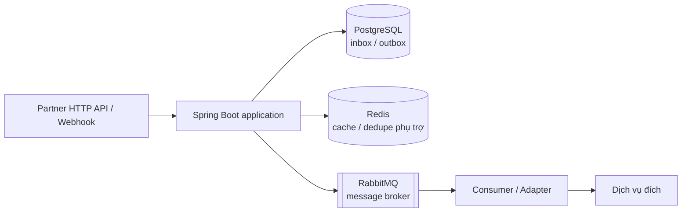
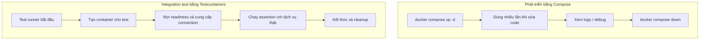
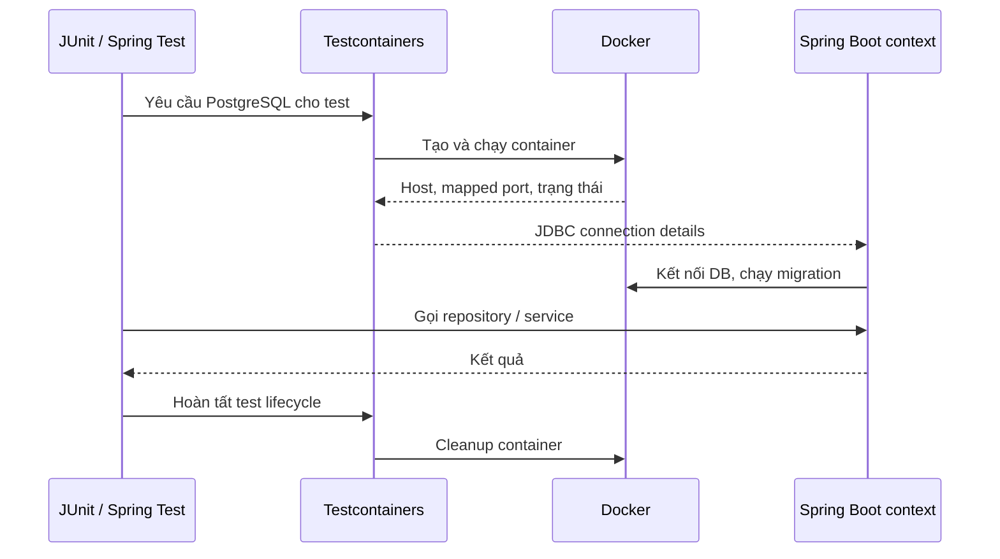
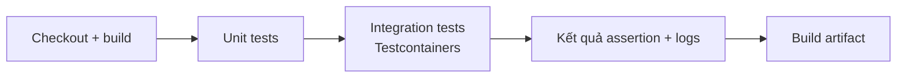

# Vai trò Docker Compose và Testcontainers trong phát triển tích hợp

Khi một ứng dụng Spring Boot gọi API bên ngoài, ghi dữ liệu vào PostgreSQL, dùng Redis để cache và trao đổi thông điệp qua RabbitMQ hoặc Kafka, chạy được riêng ứng dụng Java chưa đủ để chứng minh **luồng tích hợp** hoạt động. Nhà phát triển phải có những dịch vụ phụ thuộc phù hợp để thử kết nối, cấu hình, giao dịch, timeout, retry, xử lý trùng lặp và hành vi khi hệ thống khác gặp lỗi.

**Docker Compose** và **Testcontainers** đều tận dụng container để cung cấp hạ tầng cho phát triển và kiểm thử, nhưng giải quyết hai nhu cầu riêng:

- **Docker Compose** mô tả một tập dịch vụ có thể khởi chạy cùng nhau, rất hữu ích để dựng môi trường phát triển cục bộ và chạy thử luồng liên tục.
- **Testcontainers** cho phép bài kiểm thử tự tạo, kết nối tới và dọn dẹp các container phụ thuộc trong vòng đời test, giúp kiểm tra hành vi với database, cache hoặc broker thực tế và có thể chạy trong CI.

Bài thuộc chương **Dịch vụ phát triển** của module **SPRING_BOOT_INTEGRATION**, nơi ứng dụng được tổ chức để tích hợp qua HTTP client, SQL, cache, broker thông điệp và các adapter Spring Integration. Bài tập trung vào việc dựng môi trường đủ giống hệ thống thật để xác minh **cấu hình, hợp đồng dữ liệu, giao dịch, lỗi, idempotency, kiểm thử và quan sát** các luồng này.

## 1. Mục tiêu học tập

Sau bài này, bạn có thể:

1. Giải thích khác biệt giữa container, image, volume, network, Docker Compose và Testcontainers.
2. Dùng Compose khởi chạy PostgreSQL, Redis và RabbitMQ để phát triển ứng dụng Spring Boot.
3. Phân biệt kết nối từ ứng dụng chạy trên máy host và ứng dụng chạy trong cùng Docker network.
4. Hiểu cách Spring Boot hỗ trợ Docker Compose service connections và cách cấu hình thủ công khi cần.
5. Dùng Testcontainers tạo PostgreSQL tạm thời cho integration test có kiểm tra ràng buộc unique và cú pháp SQL thực.
6. Thiết kế test phù hợp cho cache, broker, giao dịch, retry, trùng lặp, lỗi và quan sát hệ thống.
7. Nhận diện các vấn đề thường gặp trong CI: Docker daemon, port, readiness, dữ liệu tồn dư và kiểm thử chạy song song.

## 2. Vì sao phát triển tích hợp cần dịch vụ bên ngoài?

Một unit test dùng mock có thể kiểm tra rằng service gọi `repository.insert(...)`, nhưng nó không xác nhận:

- JDBC driver có thực sự kết nối được PostgreSQL không.
- Câu SQL `ON CONFLICT DO NOTHING` có chạy đúng trên PostgreSQL và bảo vệ dữ liệu khi hai request đến đồng thời không.
- Redis có lưu và hết hạn khóa cache theo cấu hình mong muốn không.
- RabbitMQ có định tuyến message đúng exchange, routing key và queue không.
- Consumer có xử lý lại an toàn sau khi mất kết nối hoặc gặp duplicate message không.
- Ứng dụng có khởi động đúng khi thiếu biến môi trường hoặc một dependency chưa sẵn sàng không.

Đây là các hành vi thuộc **ranh giới tích hợp**: cần kiểm tra với hệ thống thực hoặc một phiên bản tương thích ở mức giao thức. Container giúp các nhà phát triển chạy cùng loại dịch vụ với cấu hình có thể chia sẻ và tái tạo.

Ví dụ luồng nhận sự kiện từ đối tác:



Trong phát triển, Compose có thể cung cấp PostgreSQL, Redis và RabbitMQ cho ứng dụng đang chạy. Trong integration test, Testcontainers có thể tạo từng dependency cần thiết và chuyển địa chỉ kết nối động cho một `@SpringBootTest`.

**Phạm vi bảo đảm:** Một container PostgreSQL kiểm tra hành vi PostgreSQL, không chứng minh endpoint của đối tác thật hoạt động. Với HTTP API ngoài, dùng mock server hoặc sandbox và contract test bổ sung. Tương tự, kiểm thử RabbitMQ không tự thay thế kiểm thử với Kafka nếu ứng dụng triển khai Kafka.

## 3. Các khái niệm nền tảng

| Khái niệm | Ý nghĩa trong phát triển tích hợp |
| --- | --- |
| **Image** | Gói hệ thống tệp và metadata để tạo container; ví dụ `postgres:16-alpine` |
| **Container** | Tiến trình được cách ly ở mức OS, chạy image cùng cấu hình môi trường và mạng |
| **Volume** | Nơi lưu dữ liệu bên ngoài vòng đời container; giúp DB phát triển còn dữ liệu sau restart |
| **Docker network** | Mạng giữa các container; trong Compose các service thường gọi nhau qua **service name** |
| **Published port** | Cổng của máy host được ánh xạ tới cổng bên trong container |
| **Docker Compose** | Cấu hình khai báo nhiều service, network và volume trong một project |
| **Testcontainers** | Thư viện điều khiển vòng đời container từ chương trình test, lấy host/port và thông tin kết nối lúc chạy |
| **Readiness / health check** | Kiểm tra dịch vụ sẵn sàng phục vụ, sâu hơn việc process đã khởi động |
| **Service connection** | Cơ chế Spring Boot dùng thông tin một dịch vụ đang chạy để tự cung cấp connection details cho client tương ứng |

### 3.1. Vòng đời sử dụng điển hình



Compose thường được dùng để duy trì môi trường trong một phiên phát triển; Testcontainers gắn vòng đời dịch vụ với test/class hoặc test suite theo cấu hình. Không nhất thiết phải chọn duy nhất một công cụ: cùng một dự án có thể dùng cả hai.

## 4. Dựng môi trường tích hợp cục bộ bằng Docker Compose

### 4.1. Tạo file Compose

Tại thư mục ứng dụng Spring Boot, tạo file `compose.yaml` (ví dụ minh họa):

```yaml
services:
  postgres:
    image: postgres:16-alpine
    environment:
      POSTGRES_DB: integration_db
      POSTGRES_USER: integration_app
      POSTGRES_PASSWORD: local_only_password
    ports:
      - "127.0.0.1:5432:5432"
    volumes:
      - postgres_data:/var/lib/postgresql/data
    healthcheck:
      test:
        - CMD-SHELL
        - pg_isready -U $$POSTGRES_USER -d $$POSTGRES_DB
      interval: 5s
      timeout: 3s
      retries: 15

  redis:
    image: redis:7-alpine
    ports:
      - "127.0.0.1:6379:6379"
    healthcheck:
      test: ["CMD", "redis-cli", "ping"]
      interval: 5s
      timeout: 3s
      retries: 15

  rabbitmq:
    image: rabbitmq:3-management
    environment:
      RABBITMQ_DEFAULT_USER: integration_app
      RABBITMQ_DEFAULT_PASS: local_rabbit_password
    ports:
      - "127.0.0.1:5672:5672"
      - "127.0.0.1:15672:15672"
    healthcheck:
      test: ["CMD", "rabbitmq-diagnostics", "-q", "ping"]
      interval: 5s
      timeout: 5s
      retries: 15

volumes:
  postgres_data:
```

Đây là **cấu hình local** để học tập và phát triển:

- `postgres` mở cổng 5432; volume `postgres_data` giữ dữ liệu khi khởi động lại container.
- `redis` mở 6379; ví dụ cache không lưu volume vì dữ liệu cache có thể tạo lại.
- `rabbitmq` mở 5672 cho AMQP và 15672 cho giao diện quản trị; image `-management` chứa plugin quản trị.
- `127.0.0.1` giới hạn published port ở loopback host trong cấu hình này, giảm việc vô tình mở dịch vụ development cho mạng bên ngoài.
- Các mật khẩu trong ví dụ là **giá trị giả dành riêng môi trường local**, không tái sử dụng ở production, không coi đó là secret an toàn.
- `healthcheck` cung cấp tín hiệu readiness cơ bản; healthcheck xanh **không chứng minh** mọi bảng, exchange, quyền hoặc migration nghiệp vụ đều đã đúng.

Trong cú pháp Compose, `$$POSTGRES_USER` và `$$POSTGRES_DB` dùng dấu `$$` để giữ biến cho shell **bên trong container** thay vì cho Compose nội suy ngay trên máy host.

> **Lưu ý phiên bản:** Tên image ở đây minh họa một phiên bản lớn được chọn cho môi trường phát triển. Với dự án thật, nên thống nhất image version giữa các máy, CI và hệ thống đích; pin tag cụ thể hoặc digest nếu yêu cầu khả năng tái lập cao. Không tự động dùng `latest` cho mọi môi trường.

### 4.2. Vận hành Compose

Ở terminal có Docker Engine/Docker Desktop và Docker Compose CLI:

```bash
docker compose version
docker compose config
docker compose up -d
docker compose ps
docker compose logs --tail=100 postgres
```

`docker compose config` kiểm tra và hiển thị cấu hình đã nội suy. `up -d` tạo/khởi chạy các service ở chế độ nền; `ps` cho biết trạng thái container và port. Khi cần xem log liên tục:

```bash
docker compose logs -f rabbitmq
```

Dừng môi trường:

```bash
docker compose down
```

Mặc định, `docker compose down` không xóa các named volume như `postgres_data`. Với môi trường thử nghiệm **được phép xóa toàn bộ dữ liệu local**, có thể dùng:

```bash
docker compose down -v
```

Lệnh `-v` xóa volume do project Compose quản lý, nên dữ liệu PostgreSQL trong volume mẫu sẽ mất. Chỉ dùng khi chủ động muốn reset môi trường thử nghiệm.

### 4.3. Hiểu địa chỉ kết nối: host khác network container

Đây là nguyên nhân rất phổ biến của lỗi kết nối:

| Ứng dụng Spring Boot chạy ở đâu? | PostgreSQL host/port | Redis host/port | RabbitMQ host/port |
| --- | --- | --- | --- |
| **Trực tiếp trên máy lập trình** | `localhost:5432` | `localhost:6379` | `localhost:5672` |
| **Trong container cùng Compose project/network** | `postgres:5432` | `redis:6379` | `rabbitmq:5672` |
| **Integration test Testcontainers** | Host và mapped port do Testcontainers trả | Host và mapped port động | Host và mapped port động |

`localhost` luôn chỉ **chính môi trường mạng của tiến trình đang gọi**. Bên trong một container ứng dụng, `localhost:5432` không tự động trỏ đến container `postgres`. Các container trong cùng Compose network thường phân giải service name qua DNS nội bộ.

Trong Testcontainers, không hardcode `localhost:5432` vì mapped port có thể thay đổi mỗi lần chạy và host có thể khác tùy môi trường Docker.

## 5. Kết nối Spring Boot tới các dịch vụ Compose

Có hai cách điển hình: **tự khai báo connection properties** hoặc **dùng tích hợp Docker Compose của Spring Boot** nếu phiên bản và loại dịch vụ được hỗ trợ.

### 5.1. Cách A: ứng dụng dùng cấu hình kết nối thủ công

Giả sử chạy Java **trực tiếp trên host**, còn PostgreSQL/Redis/RabbitMQ chạy qua Compose.

Dependency Gradle (Groovy DSL) minh họa:

```groovy
dependencies {
    implementation 'org.springframework.boot:spring-boot-starter-jdbc'
    implementation 'org.springframework.boot:spring-boot-starter-data-redis'
    implementation 'org.springframework.boot:spring-boot-starter-amqp'
    runtimeOnly 'org.postgresql:postgresql'

    testImplementation 'org.springframework.boot:spring-boot-starter-test'
}
```

Trong `application-local.yml`:

```yaml
spring:
  datasource:
    url: ${DB_URL:jdbc:postgresql://localhost:5432/integration_db}
    username: ${DB_USER:integration_app}
    password: ${DB_PASSWORD:local_only_password}
  data:
    redis:
      host: ${REDIS_HOST:localhost}
      port: ${REDIS_PORT:6379}
  rabbitmq:
    host: ${RABBIT_HOST:localhost}
    port: ${RABBIT_PORT:5672}
    username: ${RABBIT_USER:integration_app}
    password: ${RABBIT_PASSWORD:local_rabbit_password}
```

Chạy ứng dụng với profile `local`. Khi ứng dụng chạy **trong cùng Compose network**, phải đặt host `postgres`, `redis` và `rabbitmq` cho các biến tương ứng, hoặc dùng cấu hình profile riêng.

Điều quan trọng là những giá trị mặc định trong ví dụ chỉ dành cho **local demo**. Production nên lấy secret từ secret manager hoặc cơ chế triển khai được quản trị, dùng TLS/quyền truy cập tối thiểu, không để credential thật trong Git.

### 5.2. Cách B: Spring Boot hỗ trợ Docker Compose

Từ **Spring Boot 3.1**, Spring Boot cung cấp tích hợp Docker Compose khi module `spring-boot-docker-compose` có mặt và môi trường đáp ứng điều kiện. Với các service image được nhận diện, Spring Boot có thể tạo **service connection details** thay cho việc nhập JDBC URL, host và port thủ công.

Ví dụ Gradle:

```groovy
dependencies {
    implementation 'org.springframework.boot:spring-boot-starter-jdbc'
    implementation 'org.springframework.boot:spring-boot-starter-data-redis'
    implementation 'org.springframework.boot:spring-boot-starter-amqp'
    runtimeOnly 'org.postgresql:postgresql'

    developmentOnly 'org.springframework.boot:spring-boot-docker-compose'
}
```

Khi khởi động ứng dụng ở môi trường development có file `compose.yaml` và Docker Compose sẵn sàng, Spring Boot có thể khởi chạy các service cần thiết, phát hiện thông tin kết nối và cấu hình client tương ứng. Khi ứng dụng kết thúc, hành vi dừng service phụ thuộc vào trạng thái trước đó và chế độ quản lý vòng đời.

Một cấu hình tùy chọn:

```yaml
spring:
  docker:
    compose:
      enabled: true
      lifecycle-management: start-and-stop
```

Một số lưu ý khi sử dụng:

1. Tích hợp này phụ thuộc phiên bản Spring Boot, Docker Compose và **loại image** mà Spring Boot biết tạo service connection. Với image tùy biến, có thể cần metadata/label phù hợp hoặc cấu hình thủ công.
2. `developmentOnly` là phạm vi dependency cho môi trường phát triển trong cấu hình Gradle phù hợp; mục tiêu là tránh đưa cơ chế tự quản lý Compose vào bản triển khai production.
3. Nếu project đã có `application-local.yml` với URL/credential cấu hình thủ công, cần xác định rõ nguồn connection đang được dùng. Service connection do Spring Boot phát hiện có thể được ưu tiên hơn connection property tương ứng.
4. Tùy chế độ lifecycle và việc service đã chạy sẵn, Spring Boot có thể chỉ tái sử dụng service thay vì khởi động/dừng toàn bộ; không nên xem app lifecycle là công cụ quản lý dữ liệu local.
5. Để tắt cơ chế tự quản lý Compose ở một môi trường, dùng `spring.docker.compose.enabled=false` hoặc không đóng gói dependency phát triển.

Mẫu này giúp quá trình "checkout project → chạy app → có database/cache/broker" ít thao tác hơn. Nó vẫn **không tạo bảng nghiệp vụ**, không bảo đảm migration đúng và không cung cấp sẵn consumer idempotency.

## 6. Testcontainers làm gì trong integration test?

Khi dùng Docker Compose local, nhiều bài test có thể vô tình dựa vào **cùng một database đang chứa dữ liệu từ hôm qua**. Một test chạy thành công vì đã có bảng, đã seed dữ liệu hoặc service vẫn chạy, nhưng thất bại trên máy đồng nghiệp hay CI.

Testcontainers xử lý điều này theo hướng: **test tự khai báo dependency**, thư viện khởi chạy container khi cần, chờ sẵn sàng, cung cấp host/port/credential cho ứng dụng rồi thu dọn sau khi kiểm thử kết thúc.



Các lợi ích:

- **Đúng loại dependency**: test lệnh PostgreSQL trên PostgreSQL thay vì suy luận từ một database nhúng có dialect khác.
- **Địa chỉ động**: hạn chế trùng cổng giữa nhiều lần chạy hoặc nhiều tiến trình CI.
- **Tái tạo môi trường**: image version, container environment và schema được khai báo trong code/config test.
- **Tự quản lý vòng đời**: giảm phụ thuộc vào việc lập trình viên nhớ khởi động dịch vụ trước khi chạy test.
- **Có thể kết hợp** nhiều dependency trong cùng một bài test liên hệ SQL, cache và broker.

Tuy nhiên, Testcontainers cần Docker-compatible runtime có thể truy cập được. Nó không tự giải quyết schema migration sai, dữ liệu test rò rỉ giữa các trường hợp, bài toán ordering hoặc retry nghiệp vụ.

## 7. Ví dụ: kiểm thử ghi trùng sự kiện vào PostgreSQL thật

Giả sử service nhận `(partnerId, eventId)` từ HTTP webhook, lưu sự kiện trước khi chuyển cho consumer. Đối tác có thể gửi lại cùng một sự kiện khi timeout. Mục tiêu test: **chỉ một bản ghi được tạo**, kể cả khi nhận trùng.

Các ví dụ Java sau dành cho kiểu dự án **Spring Boot 3.x / Java 17+ với Testcontainers 1.x**. Nếu dependency management của dự án dùng Testcontainers 2.x hoặc phiên bản Spring Boot khác, hãy đối chiếu import/module với phiên bản đã chọn; nguyên tắc test và service connection không đổi.

### 7.1. Dependency cho integration test

Gradle (bên cạnh starter JDBC, JDBC driver và Spring Boot Test):

```groovy
dependencies {
    implementation 'org.springframework.boot:spring-boot-starter-jdbc'
    runtimeOnly 'org.postgresql:postgresql'

    // Nếu ứng dụng dùng Flyway cho schema:
    implementation 'org.flywaydb:flyway-core'
    implementation 'org.flywaydb:flyway-database-postgresql'

    testImplementation 'org.springframework.boot:spring-boot-starter-test'
    testImplementation 'org.springframework.boot:spring-boot-testcontainers'
    testImplementation 'org.testcontainers:junit-jupiter'
    testImplementation 'org.testcontainers:postgresql'
}
```

Khi dùng Spring Boot BOM, để cơ chế dependency management chọn các phiên bản tương thích. Việc Flyway cần module riêng cho PostgreSQL phụ thuộc phiên bản Flyway; mẫu trên minh họa bộ module phổ biến trong các phiên bản Flyway mới hơn. Nếu không dùng Flyway, có thể dùng Liquibase hoặc cơ chế khởi tạo schema đã được dự án xác định.

### 7.2. SQL migration

Ví dụ file migration `src/main/resources/db/migration/V1__create_received_event.sql`:

```sql
CREATE TABLE received_event (
    partner_id VARCHAR(64) NOT NULL,
    event_id VARCHAR(128) NOT NULL,
    received_at TIMESTAMPTZ NOT NULL DEFAULT CURRENT_TIMESTAMP,
    CONSTRAINT pk_received_event PRIMARY KEY (partner_id, event_id)
);
```

Ràng buộc `PRIMARY KEY (partner_id, event_id)` tạo khóa duy nhất ở database, chịu được trường hợp hai application instance ghi đồng thời. Nếu chỉ kiểm tra dữ liệu tồn tại bằng `SELECT` rồi `INSERT` mà không có constraint, thao tác kiểm tra và ghi có thể bị race condition.

### 7.3. Repository triển khai chức năng chống trùng

```java
package com.example.integration.inbox;

import org.springframework.jdbc.core.JdbcTemplate;
import org.springframework.stereotype.Repository;

@Repository
public class ReceivedEventRepository {
    private final JdbcTemplate jdbc;

    public ReceivedEventRepository(JdbcTemplate jdbc) {
        this.jdbc = jdbc;
    }

    public boolean insertOnce(String partnerId, String eventId) {
        int affectedRows = jdbc.update("""
                INSERT INTO received_event (partner_id, event_id)
                VALUES (?, ?)
                ON CONFLICT (partner_id, event_id) DO NOTHING
                """, partnerId, eventId);
        return affectedRows == 1;
    }
}
```

`ON CONFLICT` là cú pháp PostgreSQL. Test với đúng loại database giúp phát hiện lỗi SQL dialect, constraint, driver, mapping và transaction mà mock repository thường không phát hiện.

### 7.4. JUnit Testcontainers và Spring Boot service connection

```java
package com.example.integration.inbox;

import static org.junit.jupiter.api.Assertions.*;

import java.util.UUID;

import org.junit.jupiter.api.Test;
import org.springframework.beans.factory.annotation.Autowired;
import org.springframework.boot.test.context.SpringBootTest;
import org.springframework.boot.testcontainers.service.connection.ServiceConnection;
import org.springframework.jdbc.core.JdbcTemplate;

import org.testcontainers.containers.PostgreSQLContainer;
import org.testcontainers.junit.jupiter.Container;
import org.testcontainers.junit.jupiter.Testcontainers;

@SpringBootTest
@Testcontainers
class ReceivedEventRepositoryIT {

    @Container
    @ServiceConnection
    static PostgreSQLContainer<?> postgres =
            new PostgreSQLContainer<>("postgres:16-alpine");

    @Autowired
    ReceivedEventRepository repository;

    @Autowired
    JdbcTemplate jdbc;

    @Test
    void storesSamePartnerEventOnlyOnce() {
        String eventId = UUID.randomUUID().toString();

        assertTrue(repository.insertOnce("carrier-a", eventId));
        assertFalse(repository.insertOnce("carrier-a", eventId));

        Integer count = jdbc.queryForObject("""
                SELECT COUNT(*)
                FROM received_event
                WHERE partner_id = ? AND event_id = ?
                """, Integer.class, "carrier-a", eventId);

        assertEquals(1, count);
    }
}
```

Giải thích từng phần:

- `@Container` cùng `@Testcontainers` cho JUnit 5 quản lý vòng đời container. Container `static` trong mẫu này thường được dùng chung giữa các test method của class.
- `@ServiceConnection` là tiện ích **Spring Boot 3.1+**: Spring Boot nhận diện `PostgreSQLContainer` và tự cung cấp connection details cho datasource. Khi dùng cách này, không cần hardcode JDBC URL và port.
- Test chạy Spring context thật, inject repository cùng `JdbcTemplate`, rồi kiểm tra hàng dữ liệu trên PostgreSQL.
- Tên event mới dùng `UUID` để các lần chạy không dựa vào dữ liệu cũ. Với Testcontainers riêng của class, container được tạo cho vòng đời class, nhưng migration, transaction và dữ liệu vẫn cần được kiểm soát rõ.
- Đoạn test giả định migration `V1__create_received_event.sql` đã chạy thành công khi ứng dụng khởi tạo. Việc test không tạo bảng bằng lệnh thủ công giúp nó xác minh cả cấu hình migration của ứng dụng.

**Phân biệt phạm vi test:** Test trên xác nhận hai lần ghi tuần tự cùng khóa chỉ tạo một hàng. Để kiểm tra **race condition**, cần bổ sung test có hai luồng/transaction độc lập cùng insert một khóa và khẳng định chỉ một transaction có thể tạo bản ghi; chỉ gọi hai lần trong cùng một luồng chưa kiểm thử cạnh tranh.

### 7.5. Lựa chọn thay thế: DynamicPropertySource

Nếu không sử dụng `@ServiceConnection`, Spring Test có `@DynamicPropertySource` để đăng ký property từ container:

```java
import org.springframework.test.context.DynamicPropertyRegistry;
import org.springframework.test.context.DynamicPropertySource;

@DynamicPropertySource
static void databaseProperties(DynamicPropertyRegistry registry) {
    registry.add("spring.datasource.url", postgres::getJdbcUrl);
    registry.add("spring.datasource.username", postgres::getUsername);
    registry.add("spring.datasource.password", postgres::getPassword);
}
```

Đây là **phương án thay thế** cho `@ServiceConnection` trong class test, không cần dùng đồng thời cả hai cho cùng một datasource. Nó hữu ích khi Spring Boot không có service connection factory cho một công nghệ, hoặc dự án cần khai báo property đặc biệt.

Đừng lấy cổng bằng giá trị 5432 cố định ở máy host; dùng `postgres.getJdbcUrl()`, `getHost()` hoặc `getMappedPort(5432)` theo API container.

## 8. Kiểm thử Redis và broker bằng Testcontainers

Trong một luồng tích hợp, SQL đúng vẫn chưa đủ: cache có thể làm sai trạng thái, broker có thể phát lại message và consumer có thể acknowledge sai lúc.

### 8.1. Redis: cache không được trở thành nguồn sự thật vô tình

Các kịch bản hữu ích:

- Cache miss → truy vấn database → ghi cache → cache hit đọc lại.
- TTL thực sự hết hạn và dữ liệu được tải mới.
- Hai request cùng key không gây race condition ảnh hưởng tính đúng đắn.
- Redis không sẵn sàng: ứng dụng xử lý ra sao theo chính sách đã chọn (fail-open hay fail-closed).
- Khi invalidation thất bại, dữ liệu có thể stale bao lâu và có được chấp nhận không.

Ví dụ dùng Redis container động và trỏ `spring.data.redis.host`/`port` đến mapped endpoint; với phiên bản Spring Boot hỗ trợ `@ServiceConnection` cho Redis image phù hợp, có thể sử dụng service connection thay khai báo thủ công.

**Đừng test bằng HashMap thay Redis** rồi kết luận TTL, codec, key prefix, atomic operation hoặc network timeout đã hoạt động đúng.

### 8.2. RabbitMQ: xác nhận hành vi message

Kịch bản nên kiểm tra:

1. Producer publish message đúng exchange/routing key.
2. Message được định tuyến tới queue đã khai báo.
3. Consumer deserialize payload đúng contract.
4. Khi xử lý thất bại, message được nack/requeue hoặc đưa vào DLQ theo chính sách đã cấu hình.
5. Khi nhận lại cùng `eventId`, side effect của consumer không bị nhân đôi.

Testcontainers có module/container hỗ trợ RabbitMQ. Với Testcontainers 1.x, lớp `RabbitMQContainer` được dùng để dựng broker; kiểm tra package và artifact theo phiên bản dependency. Các test dài hơn có thể dùng cơ chế chờ có thời hạn (ví dụ Awaitility) để đợi kết quả consumer thay vì `Thread.sleep` với thời gian cố định dễ flake.

Một test broker chạy được không đủ kết luận **exactly-once end to end**. Broker acknowledgment, transaction SQL và HTTP side effect thuộc các ranh giới khác nhau, nên phải thiết kế idempotency, inbox/outbox và recovery tương ứng.

### 8.3. Kafka, HTTP và Spring Integration

Tùy luồng, có thể mở rộng bằng:

- **Kafka container**: xác nhận serialize/deserialize, topic, key, ordering trong phạm vi partition và hành vi consumer offset/retry.
- **HTTP mock server**: kiểm tra timeout, `429`, `503`, lỗi schema, header xác thực và hợp đồng request/response. HTTP fake cần có kịch bản lỗi, không chỉ trả `200 OK`.
- **Spring Integration flow**: kiểm tra transformer/router/filter khi message đi qua channel, bao gồm header và error channel.
- **Cả SQL + broker**: kiểm thử outbox: transaction ghi business record và outbox entry, worker publish, consumer xử lý lặp lại an toàn.

**Giới hạn thực tế:** Tạo quá nhiều container cho mỗi test làm suite chậm và khó chẩn đoán. Test nhỏ nên chỉ khởi chạy những phụ thuộc cần để xác minh hành vi, trong khi một số test đầu-cuối có thể yêu cầu nhiều dịch vụ hơn.

## 9. Compose và Testcontainers khác nhau ở điểm nào?

| Tiêu chí | Docker Compose | Testcontainers |
| --- | --- | --- |
| **Mục đích chính** | Môi trường dịch vụ cho phát triển, debug, demo hoặc kiểm thử theo môi trường | Hạ tầng được tạo và quản lý bởi quá trình test |
| **Nguồn cấu hình** | `compose.yaml`, environment, volume, network | Code/test configuration, image, wait strategy, properties |
| **Vòng đời** | Do người dùng, Compose CLI hoặc Spring Boot Compose integration quản lý | Do test runner/Testcontainers quản lý |
| **Port** | Thường cố định cho tiện truy cập local; vẫn có thể cấu hình động | Thường dùng mapped port động để tránh xung đột |
| **Dữ liệu giữa lần chạy** | Named volume có thể giữ trạng thái | Thường tạm thời; cô lập phụ thuộc cách tạo container/test |
| **Trải nghiệm debug** | Dễ mở dashboard, kết nối SQL client, gửi message thủ công | Dễ tái tạo bug từ automated test và đọc container log |
| **CI** | Có thể dùng để dựng cả môi trường CI test | Hữu ích cho test tự chủ, xác định dependency theo từng test |
| **Rủi ro chính** | State tồn dư, service chạy sai version, port conflict, drift giữa máy | Phụ thuộc Docker daemon, image pull, startup cost, data isolation |

Không phải lựa chọn loại trừ nhau. Một quy trình thực tế thường dùng:

- **Compose** cho lập trình viên sửa code, chạy app liên tục, gọi API bằng Postman/curl và xem log các dịch vụ.
- **Testcontainers** cho integration test tự chạy trong pipeline CI và khi cần tái hiện lỗi trong môi trường sạch.
- **Sandbox/contract test** cho hệ thống bên ngoài không thể đưa vào container, ví dụ API thanh toán hoặc hãng vận chuyển.

## 10. Thiết kế test cô lập, có thể tái lập và ít flake

### 10.1. Kiểm soát dữ liệu test

Các nguồn gây rò rỉ dữ liệu:

- Database dùng chung giữa nhiều test.
- Test dựa vào bản ghi tạo từ trường hợp chạy trước.
- Container được reuse nhưng schema/data không reset.
- Consumer xử lý bất đồng bộ còn chạy khi test khác bắt đầu.
- Cache hoặc queue còn key/message cũ.

Các chiến lược:

1. Dùng ID test độc lập, ví dụ prefix hoặc UUID, tránh phụ thuộc số thứ tự toàn cục.
2. Áp dụng migration như ứng dụng thực; tránh chỉnh tay schema một phía.
3. Xác định rollback, truncate, xóa queue/cache key hoặc tạo container riêng tùy mức cô lập cần thiết.
4. Không giả định `@Transactional` của test có thể rollback **message broker** hoặc thao tác HTTP đã được gửi ra ngoài.
5. Khi chạy song song, tránh cho hai test tạo cùng tên queue/topic hoặc cùng idempotency key, trừ khi đó là chủ đích của test concurrency.

**Container mới không tự động bảo đảm test độc lập** nếu nhiều test cùng dùng một container đang có dữ liệu, cache hoặc consumer background.

### 10.2. Readiness và startup order

Đợi container process chạy **không giống** đợi ứng dụng dependency sẵn sàng. PostgreSQL cần hoàn tất init DB, RabbitMQ cần khởi động broker, migration có thể còn đang thực hiện.

- Với Compose, dùng healthcheck phù hợp; nếu cần thứ tự dependency, Compose hỗ trợ `depends_on` cùng điều kiện health theo phiên bản/khả năng triển khai.
- Với Testcontainers, module container thường có wait strategy mặc định; nếu dịch vụ tùy biến cần thêm thời gian, khai báo wait strategy theo tín hiệu hữu ích.
- Với Spring Boot, xác định ứng dụng có retry kết nối khi phụ thuộc đang khởi động không; không coi thành công của healthcheck là migration hay contract đã đúng.

Đừng chữa flakiness bằng cách chỉ thêm `Thread.sleep(30000)` cho mọi test. Hãy đợi điều kiện cần thiết với timeout hợp lý và báo rõ nguyên nhân khi quá hạn.

### 10.3. Pin phiên bản và so khớp production

Ví dụ test PostgreSQL 16 nhưng production PostgreSQL 14 có thể bỏ sót khác biệt tính năng/SQL planner. Nếu production sử dụng Redis Cluster, Redis standalone local cũng chưa tái hiện được các khác biệt topology. Image giúp tạo môi trường lặp lại được, nhưng **độ giống production là một quyết định thiết kế**, không phải tính năng tự động của container.

Nên định kỳ kiểm tra sự khác nhau về phiên bản, extension, collation, timezone, TLS, auth, topology và tài nguyên giữa local/test/staging/production.

## 11. Kiểm thử failure mode: giá trị quan trọng nhất của hạ tầng thật

Thành công cơ bản ("connect được database") chỉ là bước đầu. Với tích hợp thực tế, cần xác minh các sự cố có thể xảy ra.

### 11.1. Ma trận kịch bản

| Sự cố | Câu hỏi cần kiểm tra | Kỳ vọng thiết kế |
| --- | --- | --- |
| PostgreSQL chưa sẵn sàng khi app khởi động | App fail fast hay retry? Thông báo có đủ rõ? | Tùy chính sách, có health/readiness |
| SQL transaction thất bại sau khi ghi outbox | Business record và outbox có rollback cùng nhau? | Không tồn tại một nửa giao dịch |
| Redis mất kết nối | Có được phục vụ dữ liệu stale? Có ảnh hưởng nghiệp vụ? | Fail-open/fail-closed theo yêu cầu |
| RabbitMQ restart giữa xử lý | Message có thể redeliver không? | Consumer idempotent |
| Consumer nhận duplicate event | Có xử lý side effect hai lần không? | Khóa nghiệp vụ/unique constraint |
| HTTP đích trả 429 | Có tôn trọng giới hạn và backoff không? | Retry được giới hạn và quan sát |
| HTTP đích timeout sau khi commit | Client có biết chắc kết quả không? | Tra cứu theo operation ID/idempotency |
| Bản ghi/version đến ngược thứ tự | Có cập nhật lùi trạng thái không? | Luật version/order rõ |
| Migration chưa chạy | Ứng dụng/test phát hiện thế nào? | Test thất bại có thể chẩn đoán |

Testcontainers giúp chạy các dependency trong môi trường có thể điều khiển, nhưng **không tự cung cấp fault injection**. Muốn mô phỏng đứt kết nối, latency hoặc restart đúng thời điểm, test phải chủ động điều khiển container/network hoặc dùng proxy/fault-injection tool phù hợp. Cần bảo đảm kịch bản có thể lặp lại, không dựa vào timing ngẫu nhiên.

### 11.2. Đúng phạm vi giao dịch

`@Transactional` trên một `DataSource` có thể bảo vệ nhiều lệnh SQL cùng giao dịch. Nó không tự biến các thao tác này thành một giao dịch phân tán với RabbitMQ hay HTTP.

Ví dụ:

```text
1. Ghi order và outbox_event trong cùng transaction SQL.
2. Commit SQL thành công.
3. Worker đọc outbox và publish message đến broker.
4. Worker lỗi trước khi đánh dấu outbox đã gửi.
5. Worker chạy lại và có thể publish lần nữa.
```

Test phải xác minh consumer hoặc hệ thống đích xử lý lặp lại an toàn. "Dùng Testcontainers và test xanh" không đồng nghĩa mọi side effect bên ngoài có bảo đảm exactly-once.

## 12. Chạy trong CI: những yêu cầu cần chuẩn bị

Testcontainers phù hợp với CI khi môi trường runner có Docker daemon hoặc runtime tương thích mà Testcontainers kết nối được. Chuỗi chạy điển hình:



Checklist vận hành:

- **Docker runtime:** CI runner có quyền truy cập Docker đúng cách; nếu không có, test phụ thuộc container không thể chạy. Cần xem policy bảo mật khi cấp socket Docker.
- **Image download:** registry truy cập được, có cache hợp lý, pin image version; tránh phụ thuộc vào tag thay đổi bất ngờ.
- **Tài nguyên:** đủ RAM/CPU/disk để chạy đồng thời nhiều database, cache và broker.
- **Port:** ưu tiên mapped port động của Testcontainers, không ép các test tranh nhau host port cố định.
- **Dữ liệu và secret:** dùng credential thử nghiệm và môi trường cô lập; không kết nối nhầm production.
- **Test report:** lưu stack trace, container logs đã lọc secret và chỉ số thời gian khi test lỗi.
- **Parallelism:** giới hạn số test container hóa chạy song song nếu hạ tầng CI có hạn; test không chia sẻ dữ liệu ngoài ý muốn.

Một số môi trường CI dùng Docker-in-Docker, Docker socket hoặc daemon từ xa. Cấu hình kết nối phụ thuộc nền tảng, nên cần kiểm tra cụ thể khả năng mạng và quyền tạo/xóa container. Việc có Docker CLI trong PATH **chưa bảo đảm** tiến trình test kết nối được daemon.

### 12.1. Có nên tái sử dụng container giữa nhiều test?

Có thể tối ưu bằng container cấp class/suite hoặc cơ chế reuse theo công cụ và phiên bản, nhưng phải xét đánh đổi:

- Reuse giúp giảm thời gian khởi động và pull image.
- Reuse làm tăng nguy cơ state giữa test/class ảnh hưởng lẫn nhau.
- Khi test chạy song song, consumer/broker/cache dùng chung phải có key/topic/queue độc lập hoặc cleanup đáng tin cậy.
- Cơ chế Testcontainers reusable containers cần cấu hình chủ động và phù hợp môi trường. Không mặc nhiên bật reuse cho CI vì có thể gây khó tái lập lỗi.

Bắt đầu với **test dễ hiểu, cô lập đúng mức**, sau đó tối ưu chi phí khởi động ở các nhóm test thật sự tốn tài nguyên.

## 13. Quan sát và chẩn đoán môi trường phát triển

Compose và Testcontainers đều cung cấp khả năng quan sát ở **tầng hạ tầng**; còn Spring Boot cần log/metric/trace ở tầng ứng dụng.

| Tín hiệu | Ở đâu quan sát | Công dụng |
| --- | --- | --- |
| Trạng thái container | `docker compose ps` hoặc API container | Phát hiện process dừng/restart |
| Startup logs | `docker compose logs` / Testcontainers logs | Tìm lỗi auth, migration, cấu hình |
| PostgreSQL kết nối và query | DB log/metric, HikariCP pool metric | Phân biệt SQL chậm với cạn connection |
| Redis cache hit/miss/latency | Client metric và Redis metric | Tìm cache stampede hoặc stale data |
| RabbitMQ queue depth / consumer | Management API/UI, application metric | Theo dõi backlog, redelivery, DLQ |
| HTTP outbound status và latency | HTTP client metric/log/traces | Phân biệt 429/5xx/timeout |
| Correlation ID / event ID | Log và distributed tracing | Theo dấu một nghiệp vụ xuyên nhiều adapter |

Lỗi thường gặp và cách xác định:

| Triệu chứng | Nguyên nhân có thể | Kiểm tra trước |
| --- | --- | --- |
| `Connection refused` khi app chạy trên host | Compose chưa up, sai port hoặc DB chưa ready | `docker compose ps`, health, published port |
| Container app gọi `localhost:5432` không được | `localhost` của app container, không phải PostgreSQL container | Dùng service name `postgres` trong network |
| `address already in use` | Port host 5432/6379/5672 đã bị dùng | Kiểm tra port đang publish; đổi host port nếu cần |
| Test chạy local nhưng CI fail | CI thiếu Docker daemon/permission, image không pull được | Kiểm tra kết nối Docker và image registry |
| `relation ... does not exist` | Migration chưa chạy hoặc kết nối sai DB/schema | Xác nhận JDBC URL, migration history |
| Test ngẫu nhiên fail | Dữ liệu chia sẻ, async timing, retry, queue còn message cũ | Dùng ID độc lập, condition wait, cô lập queue |
| Kết quả chênh với production | Version/schema/topology/extension khác | So khớp version và cấu hình đích |
| Test success dù Redis đang dừng | Mock bean/profile thay thế Redis thật | Xác minh context và client đang kết nối nơi nào |

**Bảo mật quan sát:** log kết nối không được để lộ password/token; tránh gửi toàn bộ payload nhạy cảm vào CI artifacts hoặc dashboard. Dùng mã sự kiện và correlation ID để chẩn đoán mà không cần lưu nội dung nhạy cảm.

## 14. Quy trình đề xuất cho một nhóm phát triển tích hợp

Ví dụ nhóm đang phát triển tính năng "nhận webhook → ghi SQL inbox → publish message → consumer cập nhật cache":

1. **Thiết kế hợp đồng:** ghi rõ event ID, version, schema, quy tắc xác thực webhook, điều kiện success và idempotency.
2. **Dựng Compose:** chạy PostgreSQL, Redis và RabbitMQ trên local, dùng image version thống nhất, có healthcheck và reset dữ liệu được kiểm soát.
3. **Chạy Spring Boot:** chọn kết nối thủ công hoặc Spring Boot Compose integration, không trộn cấu hình không rõ nguồn.
4. **Viết integration test đầu tiên:** Testcontainers PostgreSQL để xác minh JDBC driver, migration, unique constraint và giao dịch.
5. **Bổ sung test Redis/broker:** kiểm tra TTL, routing, acknowledgment, redelivery và tính an toàn khi xử lý lại.
6. **Thử kịch bản lỗi:** database chưa ready, timeout, broker restart, duplicate, version cũ và dữ liệu contract không hợp lệ.
7. **Tích hợp vào CI:** chạy test container hóa tự động, thu thập log khi lỗi, kiểm soát song song và tốc độ pull image.
8. **Quan sát luồng:** metric latency, SQL pool, cache hit, queue depth, retry, DLQ và correlation ID, dùng chính các tín hiệu này để chẩn đoán sự cố.

Chọn phạm vi theo rủi ro nghiệp vụ. Một microservice chỉ đọc PostgreSQL có thể chưa cần RabbitMQ container; một luồng outbox/consumer phải kiểm tra cả giao dịch SQL lẫn broker.

## 15. Câu hỏi tự kiểm tra

1. Tại sao unit test repository với mock không chứng minh được câu SQL `ON CONFLICT` hoạt động đúng trên PostgreSQL?
2. Compose volume giúp ích gì khi phát triển, và nó có thể khiến bài test khó tái lập bằng cách nào?
3. Khi ứng dụng Spring Boot chạy **bên trong container Compose**, nên gọi PostgreSQL qua `localhost` hay `postgres`? Vì sao?
4. Khi Testcontainers dùng mapped port động, vì sao test không được hardcode `localhost:5432`?
5. `@ServiceConnection` trong Spring Boot có tác dụng gì, và `@DynamicPropertySource` là lựa chọn thay thế trong tình huống nào?
6. Vì sao đã đợi container chạy vẫn có thể gặp lỗi migration hoặc query?
7. Test hai lần insert tuần tự cùng `eventId` khác gì với test hai request đồng thời?
8. Nếu consumer ghi SQL thành công rồi thất bại trước khi acknowledge RabbitMQ, test nào cần có?
9. Tại sao `@Transactional` trên database không tự rollback message đã gửi tới broker?
10. Một pipeline CI cần những điều kiện tối thiểu nào để chạy Testcontainers đáng tin cậy?
11. Khi test Redis pass bằng mock map, những hành vi Redis thật nào vẫn chưa được kiểm tra?
12. Docker Compose và Testcontainers hỗ trợ lẫn nhau thế nào trong vòng đời phát triển một luồng tích hợp?

### Bài tập thực hành

Hãy triển khai một endpoint nhận `POST /events` với các trường `source` và `eventId`. Dùng Compose để chạy PostgreSQL/RabbitMQ khi phát triển; viết migration có unique constraint cho `(source, eventId)`; dùng `JdbcTemplate` ghi sự kiện theo cơ chế idempotent. Sau đó:

- Viết Testcontainers PostgreSQL test gửi hai lần cùng khóa và kiểm tra chỉ lưu một dòng.
- Bổ sung test hai transaction ghi đồng thời cùng khóa.
- Bổ sung một trường hợp lỗi sau khi ghi transaction SQL để xác minh rollback.
- Nếu publish message, dùng RabbitMQ container xác minh consumer xử lý duplicate an toàn.
- Ghi nhận ít nhất ba metric hữu ích: sự kiện mới, sự kiện trùng và thời gian xử lý.

**Tiêu chí hoàn thành:** Test chạy được từ môi trường sạch có Docker, không cần dữ liệu cũ từ máy lập trình viên; fail có thông tin chẩn đoán; các kết quả lưu trữ và side effect phù hợp với hợp đồng nghiệp vụ.

## 16. Ghi nhớ

- **Docker Compose** thuận tiện cho môi trường local chứa nhiều dịch vụ được khai báo cùng nhau; hiểu network, port, volume và healthcheck là điều kiện để tránh các lỗi kết nối giả.
- **Testcontainers** giúp integration test tự quản lý dịch vụ thật trong vòng đời kiểm thử, kết nối bằng host/port được cấp động và giảm phụ thuộc môi trường thủ công.
- Spring Boot cung cấp **Docker Compose integration** và **`@ServiceConnection`** ở các phiên bản tương ứng, nhưng tính năng tự cấu hình không thay thế schema migration, hợp đồng dữ liệu hay test nghiệp vụ.
- **PostgreSQL, Redis và broker** cần được kiểm tra ở đúng ranh giới chúng ảnh hưởng: SQL constraints/transaction, cache semantics, message acknowledgment/retry và xử lý trùng.
- Container giúp kiểm thử dễ tái lập hơn; cần tiếp tục quản lý **version, test data, readiness, CI runtime, failure mode và observability** để có kết quả đáng tin.

Đối với module **SPRING_BOOT_INTEGRATION**, mục tiêu cuối cùng của Docker Compose và Testcontainers là tạo một nền tảng phát triển có thể lặp lại và một bộ kiểm thử tích hợp kiểm chứng được hành vi khi hệ thống thực trao đổi dữ liệu, chịu tải hoặc xảy ra lỗi.
