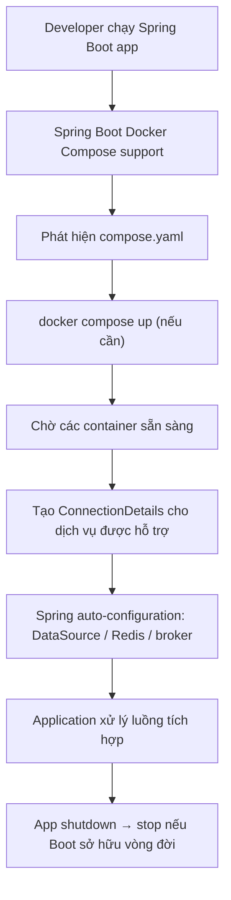
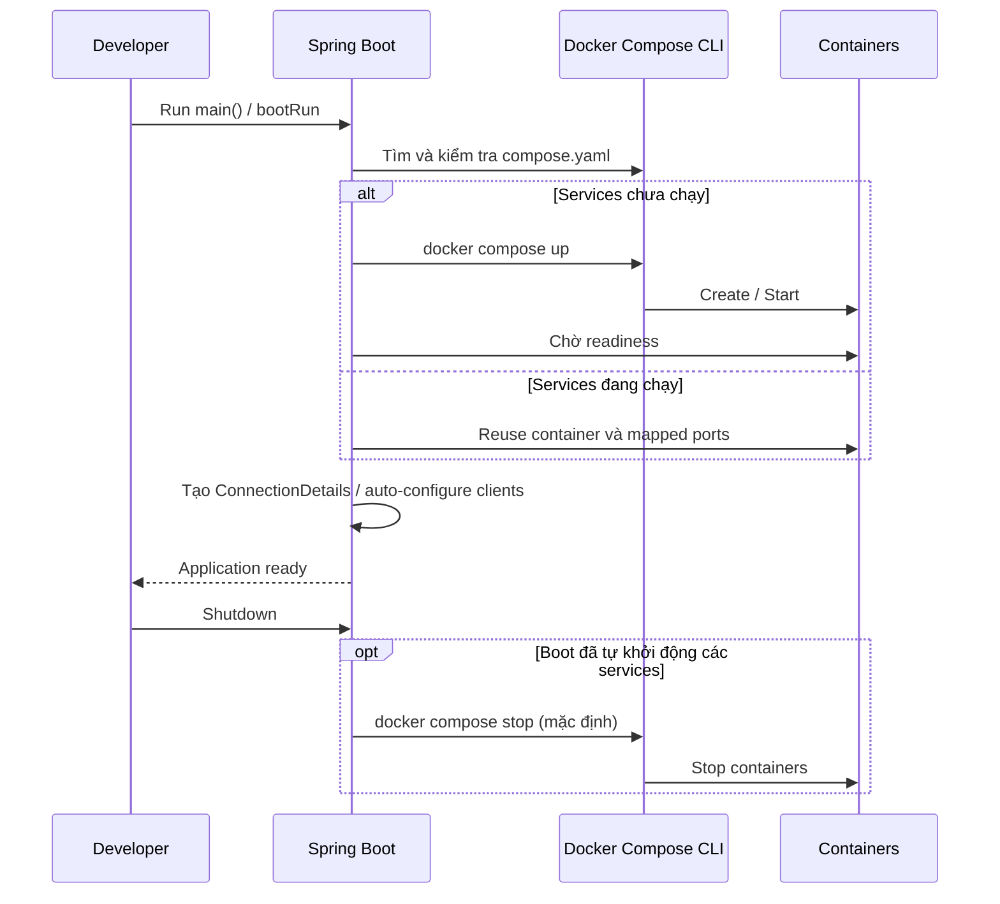
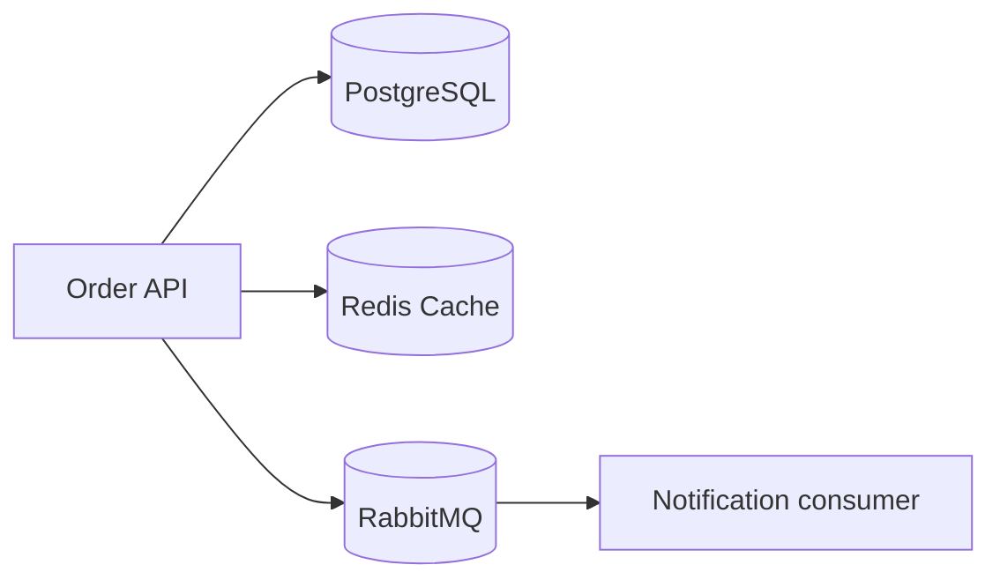
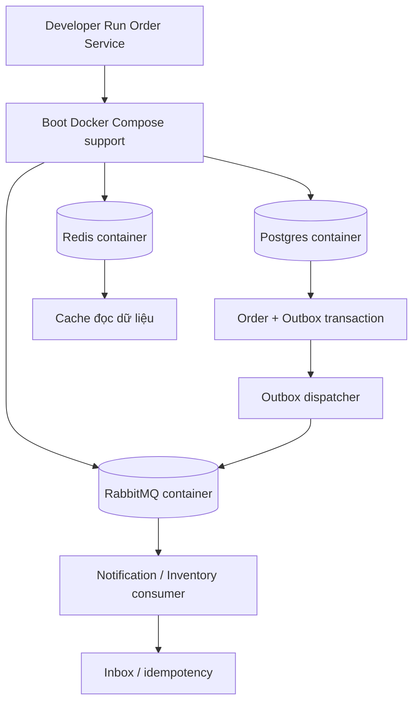

# spring-boot-docker-compose và vòng đời dịch vụ cục bộ

## 1. Vì sao Spring Boot cần quản lý dịch vụ phát triển?

Trong mô-đun **SPRING_BOOT_INTEGRATION**, một ứng dụng không chỉ chạy độc lập: nó có thể gọi HTTP API, kết nối PostgreSQL/MySQL, đọc Redis cache, đẩy sự kiện đến RabbitMQ/Kafka, hoặc sử dụng adapter của Spring Integration. Để phát triển một luồng tích hợp như “ghi đơn hàng → phát event → cập nhật cache”, lập trình viên thường cần nhiều dịch vụ bên ngoài chạy đồng thời.

Nếu mỗi người tự cài PostgreSQL, Redis và broker rồi tự đặt cổng/username/password, môi trường dễ khác nhau. Việc khởi động ứng dụng có thể thất bại vì thiếu broker hoặc kết nối nhầm database của dự án khác. **Docker Compose** giúp mô tả các container dịch vụ bằng YAML, còn **`spring-boot-docker-compose`** cho phép Spring Boot hỗ trợ vòng đời và cấu hình kết nối của các container đó trong khi phát triển.



Các câu hỏi cần trả lời trước khi dùng:

- **Dependency nào** cung cấp chức năng này và nó thuộc development runtime hay production artifact?
- **Ai sở hữu vòng đời** container: lập trình viên hay Spring Boot?
- Boot phát hiện **container nào** và kết nối qua **cổng nào**?
- Thế nào là “ready”: container đang chạy, mở được TCP hay đã chấp nhận thao tác nghiệp vụ?
- Khi restart app, chạy nhiều app, kiểm thử CI hoặc kết nối broker lỗi, dịch vụ được xử lý ra sao?

Bài học dùng quy ước **Spring Boot 3.x (từ 3.1 trở lên)**. API và property có thể thay đổi giữa các phiên bản; hãy đối chiếu tài liệu đúng phiên bản dự án đang dùng. Các lệnh Docker dưới đây để **minh họa workflow**, không cần chạy khi chỉ đọc bài.

## 2. Phân biệt Docker Compose, module hỗ trợ và Service Connection

Đây là ba lớp khác nhau:

| Lớp | Vai trò | Ví dụ |
| --- | --- | --- |
| **Docker Engine + Compose CLI** | Thực sự tạo, khởi động, dừng và theo dõi container | `docker compose up`, `docker compose ps` |
| **Compose file** | Khai báo image, environment, port mapping, volume, healthcheck | `compose.yaml` |
| **Spring Boot Docker Compose support** | Gọi Compose CLI theo vòng đời ứng dụng, phát hiện dịch vụ được hỗ trợ và cung cấp connection details | `spring-boot-docker-compose` |
| **Spring Boot auto-configuration** | Dùng connection details để cấu hình thư viện client tương ứng | `DataSource`, `RedisConnectionFactory`, `RabbitConnectionFactory` |

Module `spring-boot-docker-compose` **không phải một Docker Engine Java**, không thay thế CLI và không tự cung cấp PostgreSQL/Redis trong JAR. Nó cũng không biến mọi image thành một `ConnectionDetails` có sẵn: chỉ những loại dịch vụ được Spring Boot nhận diện và có hỗ trợ kết nối mới được cấu hình tự động.

**Service Connection** là cơ chế truyền thông tin kết nối (host, mapped port và đôi khi credentials/cấu hình khác) vào Spring Boot auto-configuration. Các bean connection details được dùng khi backend tương ứng có dependency phù hợp. **ConnectionDetails thường có độ ưu tiên cao hơn các thuộc tính kết nối tương ứng** như `spring.datasource.url` hoặc `spring.data.redis.host`. Đây là nguồn của nhiều tình huống “mình đã cấu hình host bằng properties nhưng ứng dụng lại kết nối sang container Compose”.

## 3. Điều kiện tiên quyết và dependency

### 3.1. Cài công cụ trên máy phát triển

Máy cần có:

1. Docker Engine hoặc Docker Desktop hoạt động và có quyền truy cập daemon.
2. Docker Compose CLI được Spring Boot hỗ trợ (đối với Spring Boot 3.5, tối thiểu Compose 2.2.0).
3. Đường dẫn thực thi `docker`/`docker compose` được tìm thấy trong môi trường chạy ứng dụng từ IDE hoặc terminal.
4. Khả năng kéo image từ registry, đủ RAM/CPU/đĩa và cổng mạng không bị chặn.

Kiểm tra bằng các lệnh phổ biến:

```bash
docker version
docker compose version
docker info
```

Nếu terminal chạy được nhưng IDE báo không tìm thấy Docker/Compose, kiểm tra biến môi trường `PATH` của tiến trình IDE và cấu hình Docker context. Nếu Docker daemon không truy cập được, chỉ có dependency `spring-boot-docker-compose` trên classpath vẫn không khởi động được container.

### 3.2. Thêm module vào ứng dụng Maven

```xml
<dependency>
    <groupId>org.springframework.boot</groupId>
    <artifactId>spring-boot-docker-compose</artifactId>
    <optional>true</optional>
</dependency>
```

Cấu hình Maven được quản lý bởi Spring Boot parent/BOM. `optional=true` cho biết dependency không nên trở thành phụ thuộc transitive mặc định của các module khác; đây là module phục vụ phát triển, không phải API của business logic.

**Theo cấu hình đóng gói mặc định của Spring Boot, module Docker Compose thường được loại khỏi executable archive được repackage.** Nếu chủ động cần đóng gói nó (không phải lựa chọn production thông thường), Maven Spring Boot Plugin có tùy chọn `excludeDockerCompose`; chỉ thay đổi khi hiểu rõ môi trường runtime và tác động vận hành.

### 3.3. Thêm module vào ứng dụng Gradle

```groovy
dependencies {
    developmentOnly("org.springframework.boot:spring-boot-docker-compose")
}
```

`developmentOnly` giúp module tham gia phiên chạy phát triển nhưng không được xem như phụ thuộc production của ứng dụng. Việc ứng dụng có tự chạy Compose hay không còn phụ thuộc **classpath thực tế của tác vụ chạy** và file Compose được phát hiện.

Chỉ thêm module này **không đủ** để ứng dụng truy cập Redis/JDBC/RabbitMQ: vẫn cần starter dành cho client:

```groovy
dependencies {
    implementation("org.springframework.boot:spring-boot-starter-jdbc")
    implementation("org.springframework.boot:spring-boot-starter-data-redis")
    implementation("org.springframework.boot:spring-boot-starter-amqp")
    runtimeOnly("org.postgresql:postgresql")
    developmentOnly("org.springframework.boot:spring-boot-docker-compose")
}
```

Đoạn trên là ví dụ một ứng dụng tích hợp ba backend. Chỉ thêm starter thật sự cần dùng; không kéo toàn bộ hạ tầng vào ứng dụng chỉ vì chúng cùng nằm trong một Compose file.

## 4. Một Compose file cho PostgreSQL, Redis và RabbitMQ

Tại thư mục chạy ứng dụng, tạo `compose.yaml` (hoặc dùng tên Compose phổ biến mà Boot phát hiện):

```yaml
services:
  postgres:
    image: postgres:16
    environment:
      POSTGRES_DB: orders
      POSTGRES_USER: devuser
      POSTGRES_PASSWORD: devpass
    ports:
      - "5432"
    volumes:
      - orders-pg-data:/var/lib/postgresql/data
    healthcheck:
      test: ["CMD-SHELL", "pg_isready -U devuser -d orders"]
      interval: 5s
      timeout: 3s
      retries: 12

  redis:
    image: redis:7
    ports:
      - "6379"
    healthcheck:
      test: ["CMD", "redis-cli", "ping"]
      interval: 5s
      timeout: 3s
      retries: 12

  rabbitmq:
    image: rabbitmq:3-management
    ports:
      - "5672"
      - "15672"
    healthcheck:
      test: ["CMD", "rabbitmq-diagnostics", "ping"]
      interval: 5s
      timeout: 5s
      retries: 12

volumes:
  orders-pg-data:
```

**Các thông tin `devuser/devpass` chỉ phục vụ ví dụ local** và không được dùng trong production, CI dùng chung hoặc môi trường có dữ liệu thật. Trong dự án thực tế, dùng secret/environment riêng cho từng máy, tránh commit secret.

Giải thích những điểm dễ nhầm:

- `ports: - "5432"` công bố **container port 5432 lên một host port được chọn động**. Nó không tương đương `"5432:5432"`, vốn cố định cổng 5432 phía host.
- Với cổng động, nhiều Compose project có thể chạy song song mà ít đụng cổng hơn. Spring Boot Docker Compose support dùng **mapped host port được Docker công bố**, không giả định host port bằng container port.
- PostgreSQL volume giúp dữ liệu còn lại sau `docker compose stop` và thường còn lại qua `docker compose down` thông thường; `down -v` có thể xóa named volume và mất dữ liệu local.
- `healthcheck` giúp phân biệt một container đã có process với một dịch vụ đã sẵn sàng ở mức được probe. Nó không thay thế việc kiểm tra schema migration, broker destination hoặc authentication của ứng dụng.
- Cổng RabbitMQ 15672 là giao diện quản trị khi image hỗ trợ management plugin; không cần công bố cổng này nếu không dùng. Không đưa cổng quản trị hoặc tài khoản mặc định ra mạng công cộng.

Với một ứng dụng Spring Boot chạy **trên host**, Boot có thể tạo connection details cho PostgreSQL, Redis và RabbitMQ nếu có các starter tương ứng. Việc tự thêm `spring.datasource.url=jdbc:postgresql://localhost:5432/...` trong cùng profile là không cần thiết và có thể gây hiểu nhầm vì Boot có thể dùng mapped port khác.

## 5. Vòng đời mặc định khi khởi động và dừng ứng dụng

Spring Boot Docker Compose support có hành vi mặc định phù hợp một ứng dụng local: khởi động dịch vụ khi cần, chuẩn bị service connections, và dừng các dịch vụ **mà nó đã tự quản lý khởi động** khi ứng dụng thoát.

Một vòng đời điển hình:



**Ngoại lệ quan trọng:** nếu các service Compose **đã chạy trước khi ứng dụng khởi động**, Boot thường chỉ tạo service connection và **không gọi up thêm cũng không dừng chúng khi app thoát**. Đây là cơ chế tránh “cướp quyền sở hữu” một stack dev do developer khác hoặc một app khác khởi động.

### 5.1. Bảng các tình huống

| Trạng thái trước khi chạy app | Hành động thông thường của Boot | Khi app dừng |
| --- | --- | --- |
| Chưa có container của Compose project | Gọi `docker compose up` | Gọi `docker compose stop` khi lifecycle mặc định |
| Container của project đang dừng | Gọi up/start theo cấu hình | Dừng phần do Boot đã đưa lên |
| Stack liên quan đã chạy sẵn | Kết nối tới service, thường bỏ qua lệnh up | **Không** dừng stack đã chạy sẵn |
| Bật `lifecycle-management=start-only` | Khởi động nếu cần | Giữ stack chạy |
| Bật `lifecycle-management=none` | Không điều khiển lệnh start/stop | Không điều khiển lệnh stop |
| Compose support bị tắt | Không điều khiển Compose và không tạo service connections từ module này | Không thực hiện |

Nếu app bị terminate cưỡng bức (kill -9, sập máy, JVM crash), shutdown hook có thể **không chạy**; container có thể vẫn đang chạy. Không dùng stop hook của ứng dụng làm cơ chế dọn tài nguyên chắc chắn 100%.

### 5.2. “App dừng thì service dừng” không có nghĩa dữ liệu bị xóa

`docker compose stop` dừng container nhưng không tự xóa volume; `docker compose down` gỡ container và network do project quản lý; thêm `--volumes` có thể xóa cả volume dữ liệu. Với database cục bộ, khác biệt này rất quan trọng khi debug schema/migration: dừng app không đồng nghĩa reset database.

Nếu cần môi trường hoàn toàn sạch, thực hiện thủ công quy trình reset được đồng đội thống nhất. Tránh đặt `stop.command=down` cùng đối số xóa volume như mặc định, vì dữ liệu local có thể bị xóa mỗi lần dừng ứng dụng.

## 6. Điều khiển vòng đời bằng spring.docker.compose.*

Cấu hình trong `application-dev.yml` (chỉ kích hoạt với Spring profile `dev`):

```yaml
spring:
  docker:
    compose:
      enabled: true
      lifecycle-management: start-and-stop
      start:
        command: up
      stop:
        command: stop
        timeout: 30s
      readiness:
        timeout: 2m
```

Bảng các thuộc tính quan trọng trong Spring Boot 3.5:

| Thuộc tính | Ý nghĩa | Mặc định tham khảo |
| --- | --- | --- |
| `spring.docker.compose.enabled` | Cho phép/tắt hỗ trợ Docker Compose | `true` khi module hoạt động |
| `spring.docker.compose.file` | Đường dẫn file Compose chỉ định; dùng khi không muốn Boot tự tìm | Không bắt buộc |
| `spring.docker.compose.lifecycle-management` | Chính sách điều khiển start/stop | `start-and-stop` |
| `spring.docker.compose.start.command` | Lệnh khởi động Compose | `up` |
| `spring.docker.compose.stop.command` | Lệnh dừng Compose | `stop` |
| `spring.docker.compose.stop.timeout` | Giới hạn thời gian stop | `10s` |
| `spring.docker.compose.start.skip` | Quy tắc bỏ qua lệnh start khi stack đã chạy | `if-running` |
| `spring.docker.compose.readiness.timeout` | Thời gian chờ readiness tổng | `2m` |
| `spring.docker.compose.readiness.wait` | Chính sách chờ readiness | `always` |
| `spring.docker.compose.skip.in-tests` | Mặc định bỏ qua Docker Compose trong test | `true` |
| `spring.docker.compose.profiles.active` | Kích hoạt Docker Compose profiles | Khi cần |
| `spring.docker.compose.arguments` | Đối số áp dụng cho Compose CLI | Khi cần |

Đây là tập property dành cho module Docker Compose trong các bản Spring Boot 3.x tương ứng, **không phải thuộc tính của Docker Compose YAML**. Nếu ứng dụng đang dùng phiên bản khác, kiểm tra metadata property của đúng bản trước khi copy.

### 6.1. Ba giá trị lifecycle-management

```yaml
spring:
  docker:
    compose:
      lifecycle-management: start-only
```

| Giá trị | Boot start Compose? | Boot stop Compose? | Dùng khi nào? |
| --- | --- | --- | --- |
| `start-and-stop` | Có, khi cần | Có, đối với dịch vụ do Boot khởi động | Mỗi ứng dụng có stack dev riêng |
| `start-only` | Có, khi cần | Không | Muốn container sống qua nhiều lần restart ứng dụng |
| `none` | Không | Không | Dịch vụ do người khác hoặc script riêng điều phối |

`none` **không đồng nghĩa `enabled=false`**. Khi để support hoạt động nhưng tắt quản lý vòng đời, Spring Boot vẫn có thể dùng thông tin container đang chạy để xây dựng service connections theo điều kiện cấu hình. Nếu muốn hoàn toàn không tương tác với Docker Compose qua Boot, chọn `spring.docker.compose.enabled=false` hoặc không đưa module vào runtime classpath.

### 6.2. Chọn up/start và stop/down

```yaml
spring:
  docker:
    compose:
      start:
        command: up
      stop:
        command: stop
```

- `up` có thể tạo container chưa tồn tại và áp cấu hình Compose. Đây là lựa chọn phù hợp cho onboarding hoặc local khi stack chưa được tạo.
- `start` chỉ start các container đã được tạo trước; sẽ không thay cho `up` để tạo mới toàn bộ.
- `stop` giữ container và volume; `down` gỡ tài nguyên Compose theo quy tắc Docker Compose.
- Các property `start.arguments`, `stop.arguments` và `arguments` cho phép bổ sung CLI flags. Đặc biệt thận trọng với `--volumes`, `--force-recreate` và `--build` vì tác động của chúng không chỉ là “bật app”.

Nếu cùng một máy có nhiều repo sử dụng Compose, nên xác định **project name** riêng hoặc tổ chức một Compose file chung có owner rõ ràng; tránh để hai app cùng điều khiển một nhóm container mà không biết nhau.

## 7. Boot tìm compose.yaml ở đâu?

Khi có dependency và hỗ trợ được bật, Spring Boot tìm một số tên Compose file phổ biến trong **working directory của tiến trình ứng dụng**. Working directory khi chạy từ IDE, Maven/Gradle hay project monorepo có thể khác nhau.

Nếu compose file được đặt bên ngoài thư mục hiện hành hoặc có tên khác, khai báo tường minh:

```yaml
spring:
  docker:
    compose:
      file: "../infra/compose.dev.yml"
```

Đường dẫn có thể là absolute path hoặc đường dẫn tương đối theo quy tắc ứng dụng/version được tài liệu hỗ trợ. Với monorepo, cách ổn định hơn là thống nhất working directory cho lệnh chạy và cấu hình file rõ ràng.

**Không cần đặt một Compose file ở mọi module nhỏ** nếu nhiều module dùng chung một tập PostgreSQL/Redis/broker. Tuy nhiên phải quyết định người nào sở hữu vòng đời stack: module A khởi động rồi module B dùng chung, hay một script phát triển ngoài Spring Boot khởi động cho tất cả.

### 7.1. Docker Compose profiles khác Spring profiles

Spring profiles (`spring.profiles.active=dev`) quyết định bean/configuration của ứng dụng; Docker Compose profiles quyết định service nào trong Compose file được bật. Chúng không tự đồng bộ theo tên.

Ví dụ trong Compose file:

```yaml
services:
  redis:
    image: redis:7
    ports: ["6379"]

  rabbitmq:
    image: rabbitmq:3-management
    profiles: ["messaging"]
    ports: ["5672"]
```

Trong Spring Boot:

```yaml
spring:
  docker:
    compose:
      profiles:
        active: "messaging"
```

Cấu hình này giúp Compose chạy service thuộc profile `messaging`. Nó **không bật Spring profile `messaging`**. Để tránh nhầm lẫn, dùng quy ước đặt tên rõ ràng như `SPRING_PROFILES_ACTIVE=dev` và `spring.docker.compose.profiles.active=messaging`.

## 8. Service Connection: ứng dụng biết host và port như thế nào?

Một trong những giá trị lớn nhất của integration là **Spring Boot đọc mapped host port của container và tạo bean ConnectionDetails** cho những image được nhận diện.

Ví dụ Compose:

```yaml
services:
  postgres:
    image: postgres:16
    environment:
      POSTGRES_DB: orders
      POSTGRES_USER: devuser
      POSTGRES_PASSWORD: devpass
    ports:
      - "5432"

  redis:
    image: redis:7
    ports:
      - "6379"
```

Docker có thể ánh xạ:

```text
postgres: container 5432  -> localhost:49174
redis:    container 6379  -> localhost:49175
```

Các host port chỉ là ví dụ. Nếu Boot nhận diện dịch vụ, `JdbcConnectionDetails` và `RedisConnectionDetails` (trong Spring Boot 3.5) cung cấp thông tin kết nối tương ứng. Khi có client starter/auto-configuration, `DataSource` và Redis client sử dụng các giá trị này.

Điều này giúp giảm nhu cầu duy trì một loạt property local:

```yaml
# Ví dụ cấu hình thủ công không còn nhất thiết phải khai báo
# nếu Boot đã cung cấp connection details tương ứng.
spring:
  datasource:
    url: jdbc:postgresql://localhost:5432/orders
    username: devuser
    password: devpass
  data:
    redis:
      host: localhost
      port: 6379
```

Khi có `ConnectionDetails`, các thuộc tính kết nối tương ứng có thể **bị ưu tiên sau** connection details. Vì vậy đừng dùng `application-dev.yml` để cố “ghi đè” host/port khi Boot đang lấy từ Docker Compose; hãy kiểm tra connection details và loại bỏ nguồn cấu hình thừa hoặc tắt integration có chủ đích.

### 8.1. Dịch vụ nào thường được nhận diện?

Các phiên bản Spring Boot 3.x hỗ trợ kết nối cho nhiều image thông dụng, ví dụ:

| Dịch vụ | Image thường gặp | Cơ chế connection details |
| --- | --- | --- |
| PostgreSQL | `postgres` | JDBC/R2DBC details theo dependency |
| MySQL/MariaDB | `mysql`, `mariadb` | JDBC/R2DBC details theo dependency |
| Redis | `redis`, một số Redis Stack images | Redis connection details |
| RabbitMQ | `rabbitmq` | Rabbit connection details |
| MongoDB | `mongo` | Mongo connection details |
| Elasticsearch | `elasticsearch` | Elasticsearch connection details |
| ActiveMQ Artemis | `apache/activemq-artemis` / `apache/artemis` | Artemis connection details |
| Neo4j | `neo4j` | Neo4j connection details |

Danh sách image/loại bean **phụ thuộc phiên bản Boot**, không suy ra mọi broker/kho dữ liệu đều có support. Ví dụ một REST mock server tự viết hoặc image công ty có tên lạ sẽ không tự trở thành HTTP client có service connection. Với HTTP API bên ngoài, ứng dụng vẫn thường cấu hình `WebClient` base URL theo profile/env riêng.

### 8.2. Custom image và Docker Compose label

Nếu công ty có image tương thích Redis nhưng tên không phải `redis`, Spring Boot có thể không nhận diện chỉ qua tên image. Có thể gắn label:

```yaml
services:
  redis:
    image: mycompany/customredis:7
    ports:
      - "6379"
    labels:
      org.springframework.boot.service-connection: redis
```

Label `org.springframework.boot.service-connection` gợi ý loại service connection cho Boot. Image custom vẫn phải thực sự tương thích về giao thức, environment và cách authentication; **label không thể biến một server tùy ý thành Redis**.

### 8.3. Bỏ qua container không thuộc trách nhiệm ứng dụng

```yaml
services:
  redis:
    image: redis:7
    ports:
      - "6379"
    labels:
      org.springframework.boot.ignore: true
```

Khi gắn label `org.springframework.boot.ignore`, Spring Boot bỏ qua container đó cho các phần liên quan của Docker Compose support. Tình huống hữu ích: cùng file Compose có một dashboard phụ, mock service hoặc container mà Spring app không cần kết nối tự động. Đừng gắn label này nếu ứng dụng lại mong chờ Redis ConnectionDetails từ chính container đó.

## 9. Readiness: container chạy chưa chắc database đã sẵn sàng

Docker báo “running” nghĩa là process/container đang hoạt động, chưa có nghĩa dịch vụ đã nhận được connection hoặc schema cần thiết. Spring Boot hỗ trợ chờ readiness của container; cách đáng tin cậy nhất là có **Docker Compose healthcheck** cho từng service.

Ví dụ:

```yaml
services:
  postgres:
    image: postgres:16
    environment:
      POSTGRES_DB: orders
      POSTGRES_USER: devuser
      POSTGRES_PASSWORD: devpass
    ports:
      - "5432"
    healthcheck:
      test: ["CMD-SHELL", "pg_isready -U devuser -d orders"]
      interval: 5s
      timeout: 3s
      retries: 12
```

Nếu thiếu healthcheck, Spring Boot còn hỗ trợ kiểm tra readiness bằng kết nối TCP tới **mapped port**. TCP mở được **không chứng minh** database đã có bảng, migration chạy xong, broker đã provision queue hoặc credential đúng. Với hệ tích hợp cần kiểm tra nghiệp vụ, bổ sung application health indicator/integration test tương ứng.

Điều chỉnh thời gian chờ:

```yaml
spring:
  docker:
    compose:
      readiness:
        timeout: 3m
        tcp:
          connect-timeout: 2s
          read-timeout: 2s
```

Giá trị này minh họa môi trường máy chậm cần pull image hoặc database khởi tạo; đặt timeout quá dài có thể che nguyên nhân startup treo. Tăng timeout chỉ là biện pháp phù hợp khi dịch vụ **thật sự cần thời gian**, không thay cho việc sửa healthcheck sai.

### 9.1. Khi TCP readiness check không phù hợp

Một số service dùng giao thức không dễ kiểm tra bằng TCP hoặc cần logic readiness riêng. Spring Boot hỗ trợ label để tắt **TCP readiness check** cho container được chọn:

```yaml
services:
  custom-service:
    image: example/custom-service:1
    ports: ["9000"]
    labels:
      org.springframework.boot.readiness-check.tcp.disable: true
```

Khi tắt TCP check, bạn phải hiểu chiến lược readiness còn lại và cách application xác định phụ thuộc đã sẵn sàng; không dùng label này để che một service thực sự đang lỗi.

### 9.2. depends_on không thay thế mọi kiểm tra

Docker Compose `depends_on` và các điều kiện như `service_healthy` giúp thứ tự phụ thuộc giữa **container trong Compose file**. Chúng không tự thay thế kiểm tra client thực trong Spring Boot, không tạo được schema và không bảo đảm một HTTP downstream luôn healthy sau startup.

Nếu migration Flyway/Liquibase chạy khi Spring app khởi động, cần thiết kế thời điểm migration và quyền truy cập riêng; việc PostgreSQL healthy chỉ có nghĩa DB server có thể sẵn sàng nhận kết nối.

## 10. Phân biệt vòng đời Spring Boot và Docker Compose khi nhiều ứng dụng dùng chung

Giả sử hai Spring Boot service (Order Service và Notification Service) cùng sử dụng RabbitMQ và Redis trên một máy. Mỗi app chạy với một `compose.yaml` tham chiếu cùng Docker Compose project có thể dẫn tới xung đột:

- App A khởi động stack, app B nhận ra container đã chạy.
- App A dừng và có thể dừng container mà app B còn cần.
- App B báo lỗi kết nối broker mặc dù vẫn đang chạy bình thường.

**Hướng tổ chức an toàn hơn:**

| Mô hình | Quyền sở hữu Compose | Cấu hình ứng dụng |
| --- | --- | --- |
| Mỗi repo có stack riêng | Mỗi app điều khiển project riêng | `start-and-stop` và project name phân tách |
| Stack hạ tầng dùng chung nhóm dev | Script/Make/terminal hoặc một app owner quản lý | App khác đặt `lifecycle-management=none` hoặc `enabled=false`, dùng cấu hình kết nối thống nhất |
| Muốn giữ DB/Redis sau restart app | Người phát triển | `start-only` và dừng thủ công khi cần |
| CI chạy nhiều test song song | Test runner/hạ tầng test điều phối | Service isolation; cân nhắc Testcontainers |

Đừng dựa vào logic “Boot thấy container chạy rồi nên không stop” như một giao thức sở hữu giữa nhiều app. Cơ chế đó hữu ích trong local, nhưng không thay thế project isolation, port separation và quy trình dọn dẹp.

### 10.1. Tách project name

Compose định danh nhóm container bằng **project name**. Khi hai repo cùng tên thư mục hoặc cùng dùng một file, có thể phát sinh tên project trùng nhau. Tùy tổ chức, đặt project name bằng Compose `name:`, biến môi trường `COMPOSE_PROJECT_NAME` hoặc tùy chọn CLI phù hợp.

Nếu cấu hình qua Spring Boot:

```yaml
spring:
  docker:
    compose:
      arguments:
        - "--project-name=orders-dev"
```

Đặt tên nhất quán để tránh app của repo khác tác động đến cùng một stack. Không sửa project name tùy tiện giữa các lần chạy nếu đang muốn tái sử dụng named volume và dữ liệu local.

## 11. Phân biệt Docker Compose integration và Testcontainers

Cả hai đều giúp cung cấp các dependency ngoài ứng dụng, nhưng mục tiêu thường khác nhau.

| Tiêu chí | Spring Boot Docker Compose support | Testcontainers |
| --- | --- | --- |
| Mô tả service | `compose.yaml` | Java/Kotlin API hoặc cấu hình container tương ứng |
| Chủ sở hữu vòng đời thường dùng | Spring Boot local run hoặc dev script | Test runner, JUnit, dev launcher |
| Tối ưu cho | Developer muốn app + hạ tầng local hoạt động nhanh | Integration test có cô lập và tự động dựng tài nguyên |
| Connection details | Từ image và mapped port của Compose | Qua `@ServiceConnection`/DynamicPropertySource khi cấu hình |
| Chạy test mặc định | **Bị bỏ qua** trong Spring Boot test | Phổ biến trong integration tests khi có Docker |
| Độ bền dữ liệu giữa lần chạy | Phụ thuộc named volume và `stop`/`down` | Thường tạo tài nguyên riêng; phụ thuộc cấu hình reuse/lifecycle |
| Chạy CI song song | Cần chú ý Compose project isolation | Có thể tạo container riêng theo test, vẫn cần kiểm soát tài nguyên |

Không nên coi một bài test chạy qua mocked repository là đủ để xác nhận integration với Redis hoặc RabbitMQ. Đối với kiểm thử contract, transaction, redelivery và idempotency, cần hạ tầng đủ giống production ở lớp giao thức tương ứng.

### 11.1. Cấu hình khi chạy test

Theo mặc định Spring Boot **không tự bật Docker Compose support trong test**. Có thể chủ động cho phép:

```yaml
spring:
  docker:
    compose:
      skip:
        in-tests: false
```

Trên Gradle, nếu dependency chỉ được thêm với `developmentOnly` mà không hiện diện trên test runtime, vẫn phải cấu hình classpath test thích hợp (trong một số phiên bản/plugin dùng `testAndDevelopmentOnly`). Không tự kết luận đặt property trên là đủ để test runner luôn tìm thấy module.

Với một CI pipeline cần isolation, Testcontainers thường là lựa chọn dễ tổ chức hơn, đặc biệt khi chạy nhiều test suite song song; nhưng vẫn phải thực hiện pin image version, healthchecks, dọn tài nguyên và bí mật môi trường.

## 12. Kiểm chứng luồng tích hợp chạy được sau khi dịch vụ đã sẵn sàng

Hãy tưởng tượng Order Service có các dependency:



Spring Boot Docker Compose support giúp khởi động và cấu hình các dịch vụ phù hợp, nhưng **không kiểm tra toàn bộ hợp đồng nghiệp vụ giữa các service**. Sau khi ứng dụng lên, cần kiểm chứng các hành vi cụ thể:

1. **JDBC:** có thể mở connection, chạy migration và transaction ghi/đọc; credential hợp lệ.
2. **Redis:** đọc/ghi một key, TTL và serializer theo hợp đồng; invalidation hoạt động.
3. **RabbitMQ:** exchange/queue/binding đã có, producer publish đúng routing key, consumer ack/retry/DLQ đúng.
4. **HTTP client:** base URL trỏ đúng mock/downstream local; Compose không tự tạo WebClient base URL cho image tùy ý.
5. **Idempotency:** cùng event ID được gửi lại không gây side effect trùng.
6. **Observability:** có correlation ID, metric latency, số lỗi và queue backlog.

Một ví dụ smoke test trong Spring Boot (giả định có JDBC starter, Redis starter, database migration đã chạy và bean tương ứng được cấu hình):

```java
import static org.assertj.core.api.Assertions.assertThat;

import org.junit.jupiter.api.Test;
import org.springframework.beans.factory.annotation.Autowired;
import org.springframework.boot.test.context.SpringBootTest;
import org.springframework.data.redis.core.StringRedisTemplate;
import org.springframework.jdbc.core.JdbcTemplate;

@SpringBootTest
class LocalDependenciesSmokeTest {

    @Autowired JdbcTemplate jdbc;
    @Autowired StringRedisTemplate redis;

    @Test
    void postgresAndRedisAreReachable() {
        Integer one = jdbc.queryForObject(
            "select 1", Integer.class
        );
        assertThat(one).isEqualTo(1);

        redis.opsForValue().set(
            "test:compose:ping", "ok",
            java.time.Duration.ofSeconds(30)
        );

        assertThat(redis.opsForValue()
            .get("test:compose:ping")).isEqualTo("ok");
    }
}
```

Test này là ví dụ để kiểm chứng **kết nối và thao tác tối thiểu**, không tự chứng minh consistency giữa DB/cache/broker. Nếu chạy trong `@SpringBootTest` theo mặc định, Docker Compose support thường bị skip như đã nói ở mục 11; hãy dùng môi trường test được provision sẵn hoặc bật hỗ trợ test một cách có chủ đích.

Không nên dùng Redis thật chung của nhóm và key không phân tách cho test; mỗi test suite cần namespace, cleanup/TTL và quyền ghi rõ ràng.

## 13. Lỗi phổ biến và cách điều tra

| Triệu chứng | Nguyên nhân thường gặp | Bước điều tra |
| --- | --- | --- |
| App báo không tìm thấy Docker Compose | Docker CLI không ở `PATH`, daemon/Compose chưa cài | `docker version`, `docker compose version`, PATH của IDE |
| Không thấy Boot tự chạy Compose | Thiếu module trên dev classpath, `enabled=false`, không tìm thấy file | Kiểm tra dependency/profile/working directory |
| Container được tạo nhưng app chờ readiness quá lâu | Healthcheck sai, DB khởi tạo chậm, port mapping lỗi | `docker compose ps`, logs và health status |
| App kết nối nhầm port 5432 | Port host được map động và cấu hình hard-code | Kiểm tra mapped port/ConnectionDetails thực tế |
| Đã đặt `spring.datasource.url` nhưng không được dùng | Service connection được ưu tiên hơn property | Kiểm tra Compose support và nguồn connection details |
| Image custom không được nhận diện | Tên image không khớp danh sách hỗ trợ | Dùng label `org.springframework.boot.service-connection` phù hợp |
| Container dừng khi app dừng | `start-and-stop` và Boot đã khởi động stack | Dùng `start-only` khi muốn giữ stack |
| Container không dừng sau khi app thoát | Stack đã chạy trước đó, hoặc stop hook không chạy | Kiểm tra ownership; dừng thủ công khi cần |
| `docker compose down -v` làm mất dữ liệu | Named volume bị xóa | Thiết lập quy trình backup/reset local rõ ràng |
| RabbitMQ kết nối được nhưng publish lỗi | Exchange/queue/ACL chưa đúng, migration topology thiếu | Provision topology, kiểm tra publisher confirms |
| Redis health tốt nhưng cache lỗi | Serializer/TTL/key prefix hoặc auth/ACL | Kiểm tra app logs, key namespace và contract |
| CI chạy được local nhưng thất bại | Compose không bật trong test, thiếu Docker daemon hoặc project name trùng | Kiểm tra test classpath và provisioning CI |

### 13.1. Bộ lệnh điều tra an toàn

```bash
# Xem cấu hình đã được Compose hợp nhất
docker compose config

# Xem container và host port đã publish
docker compose ps

# Xem log dịch vụ cụ thể
docker compose logs --tail=100 postgres
docker compose logs --tail=100 redis
docker compose logs --tail=100 rabbitmq

# Xem tất cả container đang chạy
docker ps
```

Thực thi tại đúng directory/Compose project. Tránh dùng lệnh xóa volume hoặc prune toàn cục khi mục tiêu chỉ là xem trạng thái. Các lệnh `config` có thể in environment đã resolve chứa secret; không copy nguyên output vào ticket/chat công khai.

### 13.2. Startup fail vì môi trường chưa sẵn sàng

Nếu ứng dụng cần Redis hoặc DB để tạo bean ngay khi startup, một lỗi readiness có thể làm app fail sớm. Đừng sửa bằng cách tăng `sleep` tùy ý trong Java main. Hãy kiểm tra:

- healthcheck của dịch vụ (ví dụ PostgreSQL có đúng user/database không);
- mapped port có thực sự được public ra host không;
- service details được tạo cho đúng image không;
- image pull bị timeout hoặc Docker daemon thiếu tài nguyên;
- container dùng version khác dẫn tới schema/client incompatibility.

Một healthcheck chỉ trả “healthy” nhưng schema migration vẫn thất bại nên được điều tra ở tầng database/application, không phải lỗi Docker Compose lifecycle đơn thuần.

## 14. Vận hành, an toàn dữ liệu và bảo mật cho môi trường local

Docker Compose development services giúp rút ngắn thời gian onboarding, nhưng không có nghĩa local environment được bỏ qua các nguyên tắc vận hành.

**Giới hạn dữ liệu:**

- Chỉ dùng synthetic data hoặc dữ liệu đã ẩn danh; không copy database production chứa PII xuống máy cá nhân tùy tiện.
- Giới hạn port publish, ưu tiên bind loopback khi cần. Port mở trên mọi interface có thể khiến service không xác thực bị truy cập từ mạng.
- Named volume chứa dữ liệu tồn tại qua restart; quy định cách reset dữ liệu và xử lý khi schema không tương thích.
- Không commit production secret vào Compose file hay để log in credential trên console.
- Pin phiên bản image phù hợp với môi trường đang học/kiểm thử; tránh `latest` cho nhóm muốn build tái lập.

**Giới hạn độ tin cậy:**

- Một container đơn không mô phỏng đầy đủ Redis Sentinel/Cluster, HA RabbitMQ hoặc PostgreSQL primary–replica.
- Mapped port trên host không mô phỏng network policy, DNS và TLS của Kubernetes.
- Local healthcheck không chứng minh SLA production. Broker có thể chấp nhận connection nhưng không có ACL/routing cần thiết.
- Dịch vụ chạy local thường cấu hình lỏng hơn production; phải có test staging cho TLS, authorization và fault tolerance.

**Observability:**

- Đo startup time của từng dependency, readiness wait, lỗi mở connection.
- Log loại service được kết nối và endpoint theo mức thông tin cho phép, nhưng không log passwords/tokens.
- Với broker, đo queue depth, số lần retry/DLQ; với Redis, đo cache latency và lỗi; với JDBC, đo pool saturation/migration.
- Gắn correlation ID cho toàn bộ flow HTTP → DB → broker/consumer để phân biệt lỗi của logic ứng dụng với lỗi hạ tầng local.

## 15. Mẫu cấu hình theo từng cách làm việc

### A. Chạy một Spring Boot app và để Boot quản lý stack riêng

```yaml
spring:
  docker:
    compose:
      file: "./compose.yaml"
      lifecycle-management: start-and-stop
```

Phù hợp developer làm việc độc lập. Mỗi lần app cần môi trường sạch về process thì Boot bật dịch vụ và dừng khi kết thúc; dữ liệu volume vẫn có thể được giữ lại.

### B. Nhiều lần restart ứng dụng nhưng giữ Redis/PostgreSQL chạy

```yaml
spring:
  docker:
    compose:
      lifecycle-management: start-only
```

Phù hợp khi cần hot reload/đổi code nhiều lần mà không muốn chờ DB và broker khởi động. Developer chịu trách nhiệm dừng stack khi kết thúc phiên làm việc.

### C. Hạ tầng local do một script chung quản lý

```yaml
spring:
  docker:
    compose:
      lifecycle-management: none
```

Boot không chủ động start/stop. Nếu chỉ muốn dùng `ConnectionDetails` từ container Compose sẵn có, cần bảo đảm support và cách phát hiện container phù hợp; nếu muốn hoàn toàn không dùng Docker Compose integration, chuyển sang `enabled=false` và cấu hình client qua properties/environment của app.

### D. Không chạy Docker Compose trong production

```yaml
spring:
  config:
    activate:
      on-profile: prod
  docker:
    compose:
      enabled: false
```

Trong production, thường **không đóng gói module development này**; container orchestration như Kubernetes hoặc hạ tầng cloud quản lý vòng đời database/broker. Property `enabled=false` bổ sung ý định rõ khi module vô tình hiện diện, nhưng không thay thế việc quản lý dependency theo scope phù hợp.

### E. Test runner sở hữu hạ tầng độc lập

Với integration tests quan trọng, ưu tiên một strategy rõ: Testcontainers, Compose do pipeline chủ động dựng, hoặc environment test được quản lý. Đừng để một loạt test class khởi động/dừng cùng một Compose project và xóa dữ liệu của nhau.

## 16. Bài tập tổng hợp: một môi trường tích hợp Order Service

**Yêu cầu:** Order Service ghi đơn hàng vào PostgreSQL, cache kết quả đọc trên Redis và phát `OrderCreated` qua RabbitMQ. Người phát triển muốn chạy ứng dụng bằng IDE mà không phải khởi động ba service thủ công mỗi ngày.

**Thiết kế:**

1. Khai báo `postgres`, `redis`, `rabbitmq` trong `compose.yaml` với image version cố định hợp lý, port mapping và healthcheck.
2. Thêm `spring-boot-docker-compose` ở development scope và starter JDBC/Data Redis/AMQP cho application.
3. Chạy ứng dụng trong IDE với working directory đúng; Boot tìm Compose file, khởi động service chưa chạy và chờ readiness.
4. Boot tạo connection details cho các image được hỗ trợ; client auto-configuration sử dụng mapped ports và credentials.
5. Order Service thực hiện database transaction để ghi order và outbox; publisher riêng gửi sự kiện tới broker sau commit.
6. Consumer cập nhật trạng thái bằng `eventId` idempotent, tránh xử lý trùng khi broker redeliver.
7. Test xác nhận database read/write, Redis TTL/invalidation, publish/consume RabbitMQ, retry và DLQ; những test này không được thay thế chỉ bằng việc container “healthy”.
8. Quan sát logs/metrics khi restart app hoặc cố tình stop broker để phân biệt lỗi dispatch, timeout, trạng thái đã commit và retry đúng.



**Các tình huống nên tự kiểm tra:**

- App chạy lần đầu khi chưa có container; port host được mapping động.
- App chạy lần hai khi stack đã được khởi động thủ công; khi app dừng, stack vẫn sống.
- Đổi `start-and-stop` thành `start-only`; xác nhận container được giữ lại sau shutdown.
- Tắt Docker Engine, đổi tên image thành custom image rồi kiểm tra error và service-connection label.
- Healthcheck Redis báo fail; xác minh app không chỉ “thành công giả” vì port mở.
- Lưu dữ liệu vào PostgreSQL, `stop` rồi `start`; kiểm tra dữ liệu vẫn còn trong volume.
- Kiểm tra một lần gọi HTTP ngoài Compose qua `WebClient`: module Docker Compose **không tự cung cấp URL cho mọi HTTP service**.

### Checklist triển khai

- [ ] Có Docker Engine, Compose CLI và quyền truy cập phù hợp?
- [ ] Dependency `spring-boot-docker-compose` chỉ nằm ở development scope/classpath dự định?
- [ ] Compose file và working directory được xác định tường minh?
- [ ] Image và dependency client đều thuộc nhóm được service-connection hỗ trợ?
- [ ] Cổng mapping là cổng host thực tế, không hard-code port container?
- [ ] Hiểu ai sở hữu vòng đời stack và ý nghĩa của `start-and-stop`, `start-only`, `none`?
- [ ] Có healthcheck, readiness timeout và diagnostic logs để điều tra startup?
- [ ] Không dùng secret thật, không mở cổng nhạy cảm công khai, tránh `down --volumes` ngoài ý muốn?
- [ ] Có integration test độc lập cho DB, Redis, broker và hợp đồng message?
- [ ] Có cơ chế giao dịch, outbox/inbox, retry và observability cho các luồng cần độ tin cậy?

**Kết luận:** `spring-boot-docker-compose` làm đơn giản hóa việc đưa **dịch vụ phụ thuộc cục bộ** vào vòng đời phát triển của Spring Boot: phát hiện Compose file, start/stop theo chính sách, chờ readiness và sinh connection details cho các container được hỗ trợ. Nhưng nó **không** thay thế Docker Compose, không kiểm chứng toàn bộ nghiệp vụ và không bảo đảm transaction xuyên HTTP, database, cache hay broker. Đối với ứng dụng tích hợp Spring Boot, cần lựa chọn lifecycle, quyền sở hữu tài nguyên, kiểm thử lỗi và hợp đồng dữ liệu một cách chủ động để môi trường local vừa thuận tiện vừa đáng tin cậy.

## Tài liệu tham khảo

- [Spring Boot 3.5 — Development-time Services: Docker Compose Support](https://docs.spring.io/spring-boot/3.5/reference/features/dev-services.html)
- [Spring Boot 3.5 — Common Application Properties: Docker Compose Properties](https://docs.spring.io/spring-boot/3.5/appendix/application-properties/index.html)
- [Docker Docs — Compose file reference](https://docs.docker.com/reference/compose-file/)
