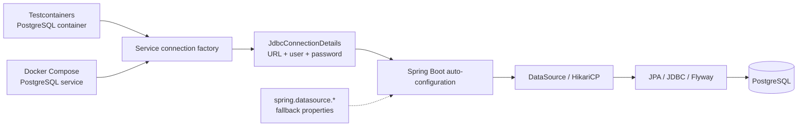
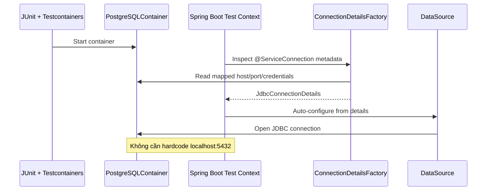
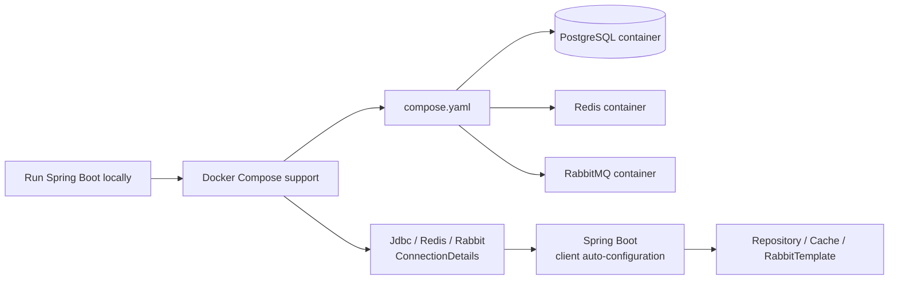
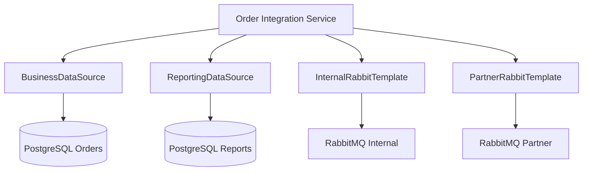
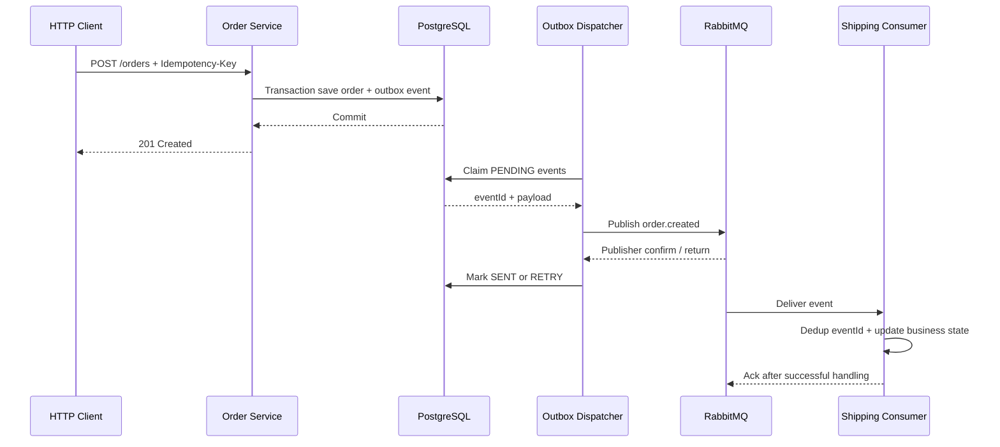
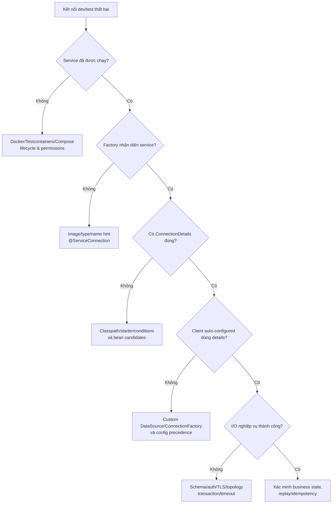

# Service connection và ConnectionDetails thay cho ghép URL thủ công

## 1. Đặt vấn đề: cổng và thông tin kết nối không còn cố định

Trong module **SPRING_BOOT_INTEGRATION**, một ứng dụng Spring Boot thường vừa dùng HTTP client, vừa lưu dữ liệu trong PostgreSQL, đọc cache Redis, publish sự kiện tới RabbitMQ hoặc chạy các adapter của Spring Integration. Mỗi hệ thống bên ngoài có **endpoint, tài khoản, cổng, giao thức và vòng đời riêng**.

Khi phát triển trên máy cá nhân hoặc chạy integration test, những hệ thống này có thể được khởi động bằng Docker Compose hoặc Testcontainers. Cổng được Docker gán động, container có thể bị tạo lại, mật khẩu chỉ dành cho test và host mà tiến trình Java truy cập chưa chắc giống hostname giữa các container.

Cách cấu hình thủ công thường gặp:

```yaml
spring:
  datasource:
    url: jdbc:postgresql://localhost:5432/orders
    username: app
    password: dev-password
  data:
    redis:
      host: localhost
      port: 6379
  rabbitmq:
    host: localhost
    port: 5672
```

Các URL cố định này dễ lỗi khi test chạy song song, cổng `5432` đã bị chiếm, CI dùng container network khác hoặc một môi trường có nhiều broker. Người phát triển có thể phải viết `@DynamicPropertySource` hoặc script tạo `spring.datasource.url` thủ công cho từng loại tài nguyên.

Spring Boot giải quyết một phần bài toán đó bằng khái niệm **service connection** và API **`ConnectionDetails`**: hạ tầng phát triển/test có thể cung cấp thông tin kết nối **có kiểu**, để auto-configuration của Boot khởi tạo JDBC, Redis, RabbitMQ, Kafka... mà ứng dụng không tự ghép host, port, username và JDBC URL.

### Mục tiêu của bài

1. Hiểu bản chất `ConnectionDetails`, `@ServiceConnection` và các factory tạo connection details.
2. Sử dụng Testcontainers để ứng dụng test được với database và broker thật, kể cả khi Docker gán cổng động.
3. Sử dụng hỗ trợ Docker Compose của Spring Boot cho development services.
4. Phân biệt **thông tin kết nối** với **hợp đồng dữ liệu, transaction, retry, bảo mật và độ sẵn sàng**.
5. Biết khi nào dùng ConnectionDetails, khi nào vẫn cần properties, và khi nào phải tự cấu hình client.
6. Kiểm thử một luồng tích hợp thực tế, gỡ lỗi các trường hợp bean không được tạo, sai dịch vụ hoặc chọn nhầm datasource.

> **Phạm vi phiên bản:** Cơ chế service connections được giới thiệu trong Spring Boot 3.1; những ví dụ dưới đây dùng cách tiếp cận của Spring Boot 3.x hiện đại. Spring Boot 4 và các thư viện Testcontainers phiên bản lớn khác có thể thay đổi package, starter hoặc artifact; kiểm tra tài liệu của đúng BOM trước khi sao chép code.

## 2. Tách ba lớp: service, ConnectionDetails và client bean

Một **service** là PostgreSQL, Redis, RabbitMQ hoặc hệ thống khác đang chạy. **ConnectionDetails** là đối tượng Java mô tả cách kết nối tới service đó. **Client bean** là `DataSource`, Redis connection factory, RabbitMQ connection factory hoặc đối tượng hạ tầng thực sự tạo socket và thực hiện I/O.



**Phân biệt:**

| Lớp | Câu hỏi | Ví dụ | Không có nghĩa là |
| --- | --- | --- | --- |
| **Service instance** | Tiến trình/tài nguyên nào đang chạy? | PostgreSQL container cổng host ngẫu nhiên | Spring đã có DataSource |
| **ConnectionDetails** | Client cần tham số nào để đến service? | JDBC URL, username, password | Có kết nối đang mở hoặc schema đã đúng |
| **Auto-configuration** | Dùng connection details để dựng bean nào? | `DataSource` hoặc `RabbitConnectionFactory` | Mọi custom client đều được cấu hình tự động |
| **Client bean** | Thành phần nào thực sự giao tiếp? | Hikari pool, `RabbitTemplate`, Redis connection | Giao dịch xuyên hệ thống được bảo đảm |
| **Business adapter** | Đọc/ghi/gửi dữ liệu theo hợp đồng nào? | Outbox repository, HTTP gateway, consumer | Retry/idempotency tự xuất hiện |

Ví dụ `JdbcConnectionDetails` có thể chứa đúng JDBC URL do Testcontainers tạo, nhưng Hibernate vẫn cần entity mappings, Flyway vẫn cần migration phù hợp, ứng dụng vẫn cần đặt ranh giới `@Transactional`. Tương tự, `RabbitConnectionDetails` không tự khai báo exchange, queue hoặc binding nghiệp vụ.

## 3. ConnectionDetails là gì?

`ConnectionDetails` trong Spring Boot là **marker abstraction** cho những object cung cấp thông tin để kết nối một external service. Các interface chuyên biệt mô tả dữ liệu có ý nghĩa với loại client cụ thể.

Ví dụ thường gặp, tùy phiên bản và dependency trên classpath:

| Kiểu chi tiết kết nối | Nhóm hạ tầng sử dụng | Thông tin điển hình |
| --- | --- | --- |
| `JdbcConnectionDetails` | JDBC `DataSource` | JDBC URL, username, password |
| `R2dbcConnectionDetails` | R2DBC `ConnectionFactory` | R2DBC connection options |
| `RedisConnectionDetails` | Redis client | Địa chỉ, credentials, SSL/tùy loại connection |
| `RabbitConnectionDetails` | RabbitMQ client | Host, port, username, password, vhost tùy loại |
| `KafkaConnectionDetails` | Kafka clients | Bootstrap servers |
| Một số `*ConnectionDetails` khác | MongoDB, Cassandra, Elasticsearch, v.v. | Kiểu thông tin theo protocol |

Tên interface và phạm vi hỗ trợ cần kiểm tra theo Spring Boot đang dùng. Không giả định mọi starter trên classpath đều có một connection-details factory tương ứng cho mọi loại container.

### 3.1. Typed object, không phải string URL toàn cục

Khi Spring Boot tạo `JdbcConnectionDetails` từ PostgreSQL container, nó có thể dùng các thông tin:

```text
JdbcConnectionDetails
  getJdbcUrl()   = jdbc:postgresql://localhost:<mapped-port>/orders
  getUsername()  = test_user
  getPassword()  = test_password
```

Đây là **minh họa cấu trúc**, không phải đầu ra thực tế của một phiên chạy. Mapped port là giá trị Docker cấp và có thể thay đổi ở lần chạy khác.

Một khác biệt rất quan trọng:

- `ConnectionDetails` **không phải** thao tác viết lại giá trị `spring.datasource.url` trong `Environment`.
- Một bean `DataSource` do auto-configuration hỗ trợ sẽ lấy thông tin cần thiết từ connection details khi được cung cấp.
- Code của ứng dụng vẫn dùng `@Value("${spring.datasource.url}")` có thể nhìn thấy cấu hình property **cũ, không tồn tại hoặc không phải địa chỉ thực**; không nên dùng cách đó để suy ra host/cổng test.
- Một HTTP client hoặc custom JDBC factory được tạo thủ công mà không tham gia integration với `ConnectionDetails` sẽ **không tự nhận** host/port được Docker cấp.

Vì vậy, nếu một lớp cần thao tác với database, **inject `DataSource`, `JdbcTemplate` hoặc repository đã được Boot cấu hình**, thay vì phân tích URL rồi tự tạo JDBC connection.

## 4. Vì sao bỏ cách ghép URL thủ công?

Một workaround quen thuộc trong test:

```java
// Cách cũ, vẫn có trường hợp hữu ích:
@DynamicPropertySource
static void registerDatabaseProperties(DynamicPropertyRegistry registry) {
    registry.add(
        "spring.datasource.url",
        postgres::getJdbcUrl
    );
    registry.add(
        "spring.datasource.username",
        postgres::getUsername
    );
    registry.add(
        "spring.datasource.password",
        postgres::getPassword
    );
}
```

Cách này dùng được khi phù hợp, nhưng kéo theo nhiều ràng buộc:

1. Lớp test phải biết chính xác tên property mà `DataSourceAutoConfiguration` cần.
2. Mỗi hệ thống ngoài có một nhóm property riêng: `spring.rabbitmq.*`, `spring.data.redis.*`, `spring.kafka.*`, v.v.
3. Một service có thể cần **nhiều loại client**. PostgreSQL có thể được truy cập qua JDBC và R2DBC; một URL JDBC không dùng trực tiếp cho R2DBC.
4. Cùng một code test phải ghép lại host, port, scheme, SSL mode hoặc credentials mỗi khi container thay đổi.
5. Test dễ quên cấu hình một thành phần đi kèm như Flyway, Redis client, broker publisher hoặc listener container.

Service connections giải quyết bằng cách chuyển **thông tin kết nối có kiểu** đến **auto-configurations hiểu kiểu đó**, thay vì dựa vào một chuỗi URL bạn tự ghép.

Tuy nhiên, `@DynamicPropertySource` **không bị thay thế trong mọi trường hợp**: nó vẫn hữu ích khi service không được Spring Boot hỗ trợ trực tiếp, client là thư viện tự cấu hình hoặc app cần một property không nằm trong giao diện ConnectionDetails. Chọn đúng công cụ theo ranh giới tích hợp.

## 5. @ServiceConnection kết nối với Testcontainers như thế nào?

Trong integration test, `@ServiceConnection` thông báo cho Spring Boot rằng container được đánh dấu là **nguồn của một hoặc nhiều connection details**.

Bộ phận tạo details dựa trên loại container hoặc metadata hình ảnh Docker. Chẳng hạn, với `PostgreSQLContainer` được nhận diện, Boot có thể tạo `JdbcConnectionDetails` để cấu hình DataSource.

Quy trình:



### Các dependency tối thiểu

Maven (các version do Spring Boot BOM quản lý khi tương thích):

```xml
<dependencies>
    <dependency>
        <groupId>org.springframework.boot</groupId>
        <artifactId>spring-boot-starter-data-jpa</artifactId>
    </dependency>
    <dependency>
        <groupId>org.postgresql</groupId>
        <artifactId>postgresql</artifactId>
        <scope>runtime</scope>
    </dependency>

    <dependency>
        <groupId>org.springframework.boot</groupId>
        <artifactId>spring-boot-testcontainers</artifactId>
        <scope>test</scope>
    </dependency>
    <dependency>
        <groupId>org.testcontainers</groupId>
        <artifactId>junit-jupiter</artifactId>
        <scope>test</scope>
    </dependency>
    <dependency>
        <groupId>org.testcontainers</groupId>
        <artifactId>postgresql</artifactId>
        <scope>test</scope>
    </dependency>
    <dependency>
        <groupId>org.springframework.boot</groupId>
        <artifactId>spring-boot-starter-test</artifactId>
        <scope>test</scope>
    </dependency>
</dependencies>
```

Đây là cú pháp artifact phổ biến với Testcontainers 1.x/Spring Boot 3.x; nếu dự án dùng Testcontainers 2.x hoặc Spring Boot thế hệ mới, tra lại artifact và BOM tương ứng. `@ServiceConnection` thuộc module **`spring-boot-testcontainers`**, không tự xuất hiện chỉ vì thêm dependency PostgreSQL driver.

## 6. Ví dụ integration test với PostgreSQL cổng động

Một test đầy đủ minh họa:

```java
import static org.assertj.core.api.Assertions.assertThat;

import org.junit.jupiter.api.Test;
import org.springframework.beans.factory.annotation.Autowired;
import org.springframework.boot.test.context.SpringBootTest;
import org.springframework.boot.testcontainers.service.connection.ServiceConnection;
import org.springframework.jdbc.core.JdbcTemplate;
import org.testcontainers.containers.PostgreSQLContainer;
import org.testcontainers.junit.jupiter.Container;
import org.testcontainers.junit.jupiter.Testcontainers;

@SpringBootTest
@Testcontainers
class DatabaseConnectionIT {

    @Container
    @ServiceConnection
    static PostgreSQLContainer<?> postgres =
        new PostgreSQLContainer<>("postgres:16-alpine")
            .withDatabaseName("integration_test")
            .withUsername("app_test")
            .withPassword("test_only_password");

    @Autowired
    JdbcTemplate jdbcTemplate;

    @Test
    void connectsToContainerDatabase() {
        Integer result = jdbcTemplate.queryForObject(
            "SELECT 1", Integer.class
        );
        assertThat(result).isEqualTo(1);
    }
}
```

Đoạn test giả định ứng dụng có `JdbcTemplate` auto-configured (thường có với JDBC/JPA starter và DataSource phù hợp). Không viết `spring.datasource.url` trỏ tới `localhost:5432`; Boot lấy JDBC connection details từ container.

**Lưu ý vòng đời:**

- `@Container` + `@Testcontainers` để Testcontainers JUnit extension quản lý container trong ví dụ này.
- `@ServiceConnection` để Spring Boot nhận thông tin kết nối, **không tự thay thế mọi quy tắc quản lý vòng đời của Testcontainers**.
- Container static thường được chia sẻ trong một lớp test; khi dùng cùng Spring test context cache ở nhiều test class, xem kỹ sự tương tác giữa vòng đời container và vòng đời context để tránh datasource còn trỏ tới container đã dừng.
- Port host được Docker gán, vì vậy test hoạt động cả khi cổng `5432` của máy phát triển đã được sử dụng.
- `SELECT 1` chỉ kiểm tra kết nối/query cơ bản, chưa chứng minh migration, transaction hay nghiệp vụ đúng.

Nếu test cần kiểm tra repository/outbox, hãy bổ sung migration Flyway/Liquibase và assert dữ liệu thực tế. Một connection test đơn giản không phải integration test đầy đủ của luồng nghiệp vụ.

## 7. ConnectionDetails được ưu tiên so với application properties ra sao?

Trong các auto-configurations của Spring Boot **có hỗ trợ service connections**, `ConnectionDetails` phù hợp thường được dùng **ưu tiên** hơn các thuộc tính kết nối như `spring.datasource.url` hoặc `spring.rabbitmq.host`.

Ví dụ:

```yaml
spring:
  datasource:
    url: jdbc:postgresql://production-db.example.internal:5432/orders
    username: app
    password: ${DB_PASSWORD}
```

Nếu test cung cấp một `JdbcConnectionDetails` từ `@ServiceConnection PostgreSQLContainer`, DataSource **do Boot quản lý** có thể sử dụng endpoint container thay vì JDBC URL ở trên.

Tuy nhiên, **không nên để cấu hình production thực trong `application.yml` được load bởi test**. Dùng profile, secret manager và test environment rõ ràng; service connections là cơ chế kết nối, **không** phải hàng rào bảo vệ chống dùng nhầm dữ liệu production.

### Phạm vi ưu tiên có giới hạn

| Tình huống | Kết quả kỳ vọng |
| --- | --- |
| DataSource do Boot auto-configured + `JdbcConnectionDetails` từ test container | DataSource sử dụng connection details phù hợp |
| Code tự đọc `@Value("${spring.datasource.url}")` để tạo socket | Vẫn đọc property trong Environment; không tự nhìn thấy details |
| Bạn tạo `DataSource` custom bằng `new HikariDataSource()` | Bạn chịu trách nhiệm dùng đúng details/config |
| Có nhiều `JdbcConnectionDetails` candidate và không phân giải được | Có thể gặp lỗi ambiguity/bean creation |
| Không có service connection tương ứng | Auto-configuration thường trở về cấu hình properties chuẩn |
| Custom `RSocketRequester` hoặc HTTP client không có factory details hỗ trợ | Không tự động nhận endpoint Docker từ service connection |

**Tóm lại:** ưu tiên ở **lớp auto-configuration có tích hợp với details**, chứ không phải một cơ chế global property override.

## 8. Truy cập ConnectionDetails khi cần

Thông thường ứng dụng nên inject client bean đã cấu hình: `DataSource`, `JdbcTemplate`, `RabbitTemplate`, Redis operations... Nhưng khi xây một adapter riêng, có thể inject interface details được hỗ trợ.

Ví dụ đọc `JdbcConnectionDetails` trong một thành phần chẩn đoán **chỉ dùng ở test/dev**:

```java
import org.springframework.boot.autoconfigure.jdbc.JdbcConnectionDetails;
import org.springframework.context.annotation.Profile;
import org.springframework.stereotype.Component;

@Component
@Profile("test")
public class JdbcConnectionDiagnostic {

    private final JdbcConnectionDetails details;

    public JdbcConnectionDiagnostic(JdbcConnectionDetails details) {
        this.details = details;
    }

    public String jdbcScheme() {
        String url = details.getJdbcUrl();
        return url.startsWith("jdbc:postgresql:")
            ? "postgresql"
            : "other";
    }
}
```

Ví dụ cố tình **không log** username/password hoặc toàn bộ URL; JDBC URL vẫn có thể lộ host, tên database hoặc tham số nhạy cảm. Khi triển khai, import đúng package của Spring Boot version đang dùng.

Không tạo vòng phụ thuộc kỳ lạ bằng cách lấy `DataSource` để suy JDBC URL, sau đó tạo lại `ConnectionDetails` cho chính DataSource đó. Nếu client đã tồn tại và được Boot quản lý, **hãy dùng client bean**.

### Không đồng nhất kiểu details với tính khả dụng

`JdbcConnectionDetails` chỉ cho biết **cách kết nối**. Nó không có nghĩa PostgreSQL hiện có schema đúng, đủ quyền INSERT hoặc đang đáp ứng query trong SLO. Để kiểm tra điều đó, phải thực hiện health/integration tests và theo dõi kết quả I/O thực tế.

## 9. Một container có thể cung cấp nhiều loại details

Cùng một PostgreSQL container có thể được truy cập bằng **JDBC** hoặc **R2DBC** khi thư viện, driver, client factories và Spring Boot version hỗ trợ. Kết nối JDBC và R2DBC dùng những định dạng/options khác nhau; không nên lấy chuỗi JDBC rồi thay tiền tố bằng phép nối string trong test.

Một số service-connection factories có khả năng cung cấp nhiều `ConnectionDetails` tương ứng từ một container. Nếu ứng dụng có cả hai persistence stacks, cần biết rõ client nào sẽ nhận details nào.

Trong các phiên bản Spring Boot hỗ trợ, `@ServiceConnection` có thuộc tính `type` để giới hạn loại connection details được tạo. Ví dụ về ý tưởng:

```java
@Container
@ServiceConnection(type = JdbcConnectionDetails.class)
static PostgreSQLContainer<?> postgres =
    new PostgreSQLContainer<>("postgres:16-alpine");
```

Khai báo trên giả định các imports và test dependencies phù hợp như mục 6; `JdbcConnectionDetails` có import như mục 8. Cách này hữu ích khi bạn **chỉ muốn JDBC details** mặc dù classpath có nhiều client type.

Không tự động giải quyết vấn đề **nhiều database**: nếu có PostgreSQL cho đơn hàng và PostgreSQL riêng cho analytics, cả hai cung cấp cùng `JdbcConnectionDetails` có thể khiến auto-configuration khó chọn. Trong ứng dụng nhiều datasource, phải đặt tên và bind từng DataSource/EntityManagerFactory/transaction manager có chủ đích.

## 10. Dùng RabbitMQ và Redis trong cùng bài integration test

Với luồng **Spring Boot Integration** có PostgreSQL để giữ outbox, RabbitMQ để gửi message và Redis làm cache, test có thể chạy ba container riêng.

Ví dụ khai báo test containers:

```java
import org.springframework.boot.testcontainers.service.connection.ServiceConnection;
import org.testcontainers.containers.GenericContainer;
import org.testcontainers.containers.PostgreSQLContainer;
import org.testcontainers.containers.RabbitMQContainer;
import org.testcontainers.junit.jupiter.Container;
import org.testcontainers.junit.jupiter.Testcontainers;
import org.testcontainers.utility.DockerImageName;

@Testcontainers
class IntegrationEnvironment {

    @Container
    @ServiceConnection
    static PostgreSQLContainer<?> postgres =
        new PostgreSQLContainer<>("postgres:16-alpine");

    @Container
    @ServiceConnection
    static RabbitMQContainer rabbitmq =
        new RabbitMQContainer("rabbitmq:3.13-management");

    @Container
    @ServiceConnection(name = "redis")
    static GenericContainer<?> redis =
        new GenericContainer<>(DockerImageName.parse("redis:7-alpine"))
            .withExposedPorts(6379);
}
```

Đây là **mẫu khai báo**, chưa phải một `@SpringBootTest` hoàn chỉnh. Nó minh họa hai cách nhận diện:

- Với `PostgreSQLContainer` và `RabbitMQContainer`, Boot có thể dựa vào **loại container chuyên dụng**.
- Với `GenericContainer`, `@ServiceConnection(name = "redis")` cung cấp **tên service chuẩn** để Boot tìm factory phù hợp; mở port không tự làm GenericContainer trở thành RedisConnectionDetails.
- Các factories chỉ được đăng ký khi module hỗ trợ và version tương ứng hiện diện.
- Dependencies của Redis, RabbitMQ và PostgreSQL clients vẫn cần nằm trong runtime/test classpath của ứng dụng muốn sử dụng chúng.

Khi tích hợp thực tế, thêm `@SpringBootTest` và test gọi `JdbcTemplate`, Redis client và `RabbitTemplate` đã được Spring Boot tạo. Không viết ba nhóm URL bằng cách nối `container.getHost()` với `getMappedPort()` chỉ để cấu hình lại các bean đã được Boot hỗ trợ.

### Không có nghĩa một test phải khởi động tất cả

Một test repository chỉ cần PostgreSQL. Một test consumer có thể cần RabbitMQ và database, nhưng không cần Redis nếu cache đã được thay bằng fake. Giới hạn dependency test giúp chạy nhanh và giảm xác suất test flaky. Hãy **nêu rõ các ranh giới thực sự được kiểm chứng**, không chạy mọi container để bài test trông “tích hợp hơn”.

## 11. Docker Compose development services là gì?

Khác với Testcontainers (tạo/quản lý container theo vòng đời test), Spring Boot có hỗ trợ **Docker Compose** để phát triển cục bộ. Khi bật hỗ trợ này, Boot có thể tìm compose file, làm việc với các service Docker Compose đang chạy hoặc khởi động chúng theo chính sách, rồi tạo `ConnectionDetails` cho những service được nhận diện.

Đây là một cách thay thế việc yêu cầu mọi developer chạy lệnh Docker thủ công rồi tự sao chép host/port vào `application-local.yml`.



### Dependency development-only

Gradle (với Spring Boot Gradle plugin hỗ trợ cấu hình `developmentOnly`):

```groovy
dependencies {
    developmentOnly 'org.springframework.boot:spring-boot-docker-compose'
}
```

Maven:

```xml
<dependency>
    <groupId>org.springframework.boot</groupId>
    <artifactId>spring-boot-docker-compose</artifactId>
    <optional>true</optional>
</dependency>
```

Đây là **hạ tầng phát triển**, không phải dependency bắt buộc của business module. Kiểm tra cấu hình build/plugin để bảo đảm hỗ trợ Docker Compose không được vô tình đưa vào artifact production. Trong Spring Boot, cơ chế đóng gói thường không đưa development-only Docker Compose support vào executable archive theo mặc định; không dựa vào điều đó thay cho kiểm tra pipeline.

## 12. Ví dụ compose.yaml cho PostgreSQL, Redis và RabbitMQ

Đặt một file `compose.yaml` tại vị trí mà Spring Boot Docker Compose support có thể tìm thấy theo cấu hình dự án:

```yaml
services:
  postgres:
    image: postgres:16-alpine
    environment:
      POSTGRES_DB: orders
      POSTGRES_USER: app
      POSTGRES_PASSWORD: local_only_password
    ports:
      - "5432"

  redis:
    image: redis:7-alpine
    ports:
      - "6379"

  rabbitmq:
    image: rabbitmq:3.13-management
    environment:
      RABBITMQ_DEFAULT_USER: app
      RABBITMQ_DEFAULT_PASS: local_only_password
    ports:
      - "5672"
      - "15672"
```

### Vì sao chỉ ghi "5432" thay vì "5432:5432"?

Trong Docker Compose, `ports: ["5432"]` xuất container port 5432 ra một **host port được Docker cấp động**. Cấu hình tương tự dùng cho Redis 6379 và RabbitMQ 5672. Điều này giảm xung đột khi hai dự án cùng dùng PostgreSQL trên máy phát triển.

Spring Boot Docker Compose support tìm **mapped port** và có thể tạo connection details với host/port phù hợp cho ứng dụng chạy **trên máy host**. Người dùng không phải tự tìm port qua `docker compose ps` rồi sửa `spring.datasource.url`.

Đừng dùng cách này mà không suy nghĩ nếu:

- Bạn cố tình muốn cổng cố định để công cụ SQL ngoài ứng dụng kết nối.
- App và broker đều chạy **trong cùng Docker network**, nơi container hostname/service name mới là địa chỉ phù hợp.
- Một service không expose đúng port được hỗ trợ; Boot không tự tìm ra địa chỉ chỉ từ tên YAML tùy ý.
- Image riêng của tổ chức không được factory nhận diện bằng repository name.

Tất cả mật khẩu trong ví dụ chỉ dành cho **development**. Production phải dùng secret manager, tài khoản có phân quyền, TLS và cơ chế network riêng.

## 13. Application YAML tối giản khi dùng Compose service connections

Khi Docker Compose service được nhận diện và các starter thích hợp có mặt, không nhất thiết cần khai báo host/port cho ba hệ thống ngoài:

```yaml
spring:
  application:
    name: order-integration

  jpa:
    open-in-view: false
    hibernate:
      ddl-auto: validate

  flyway:
    enabled: true

  rabbitmq:
    publisher-confirm-type: correlated
    publisher-returns: true
    template:
      mandatory: true
```

Ở đây:

- `ConnectionDetails` cung cấp **thông tin kết nối** được Spring Boot hỗ trợ.
- `spring.jpa.*` vẫn cấu hình **hành vi ORM**, không nằm trong ConnectionDetails.
- `spring.flyway.*` vẫn kiểm soát migration; ConnectionDetails không thay thế schema version.
- `spring.rabbitmq.publisher-*` vẫn quyết định publisher confirm/return; service connection không tự bật bảo đảm publish.
- Application vẫn phải có dependencies cho DataSource/JPA, Flyway, Redis và RabbitMQ mà nó sử dụng.

**Đừng bỏ các properties về behavior chỉ vì đã dùng service connections.** Chỉ những thông tin **kết nối được factory/client hỗ trợ** mới được cung cấp theo cơ chế này.

### Nếu Compose không chạy thì sao?

Khi hỗ trợ Compose không hoạt động (không có dependency, bị disable, file không được phát hiện hoặc Docker không khả dụng), ứng dụng quay lại cơ chế bình thường tùy cấu hình: properties, bean custom, hoặc startup failure nếu thiếu bắt buộc. Vì vậy cần có **profile/fallback có chủ ý** và log lỗi rõ ràng, không âm thầm kết nối tới một database mặc định không mong muốn.

## 14. Các thuộc tính Docker Compose hữu ích

Spring Boot hỗ trợ nhóm `spring.docker.compose.*` để kiểm soát môi trường development. Ví dụ:

```yaml
spring:
  docker:
    compose:
      enabled: true
      file: ./compose.yaml
      lifecycle-management: start-and-stop
```

Những nhóm thiết lập thường cần xem theo phiên bản:

| Tùy chọn | Ý nghĩa chính | Tình huống sử dụng |
| --- | --- | --- |
| `spring.docker.compose.enabled` | Bật/tắt Docker Compose support | Tắt ở CI hoặc môi trường không có Docker |
| `spring.docker.compose.file` | Chỉ định file Compose | Dự án dùng tên/vị trí không mặc định |
| `spring.docker.compose.lifecycle-management` | Chọn chính sách start/stop | Tránh Boot tự dừng resource đang dùng chung |
| Các tùy chọn readiness | Kiểm soát cách chờ service sẵn sàng | Broker khởi động chậm hoặc cần health check |
| Docker Compose labels liên quan | Gợi ý/loại trừ service khỏi service connections | Image riêng hoặc service không muốn quản lý |

Tên giá trị và hành vi vòng đời có thể thay đổi theo phiên bản; ví dụ `start-and-stop`, `start-only` hoặc `none` cần được kiểm tra theo tài liệu Spring Boot đang dùng.

### Vòng đời có quan trọng không?

Có. Hãy phân biệt:

- **App launch:** Spring Boot có thể tự khởi động compose services theo cấu hình.
- **App shutdown:** Boot có thể dừng services mà nó quản lý, tùy lifecycle policy.
- **Services đã chạy sẵn:** Boot có thể dùng chúng mà không khởi động lại; cơ chế dừng của chúng cần được hiểu đúng.
- **Nhiều IDE/process dùng cùng compose project:** nếu một process tắt Compose, process khác có thể mất database đang dùng.

Nếu một Docker Compose stack được nhiều ứng dụng/test dùng chung, lựa chọn `start-only` hoặc chính sách quản trị độc lập có thể phù hợp hơn. Điều đó phải dựa trên mục tiêu chia sẻ resource và version support, không sao chép mặc định máy móc.

## 15. Nhận diện service qua image và nhãn

Spring Boot có các factory nhận diện loại service để tạo connection details. Với Docker Compose, việc nhận diện thường liên quan **tên Docker image** hoặc metadata mà hỗ trợ Compose hiểu được. Với Testcontainers, còn có thể dựa trên **subclass** như `PostgreSQLContainer`.

Ví dụ một image nội bộ:

```text
registry.example.internal/team/custom-postgres:16
```

Nếu repository name không được factory mặc định nhận diện là PostgreSQL, Spring Boot có thể **không tạo JdbcConnectionDetails**, dù bên trong container thật sự chạy Postgres. Khi đó có những lựa chọn:

1. Dùng image chuẩn hoặc subclass Container được hỗ trợ nếu phù hợp test.
2. Đánh dấu tên service rõ bằng `@ServiceConnection(name = "postgres")` cho Testcontainers source phù hợp.
3. Với Docker Compose, kiểm tra cơ chế label nhận diện service mà phiên bản Spring Boot hỗ trợ.
4. Cấu hình kết nối qua properties hoặc bean `ConnectionDetails` tự cung cấp khi factory không đáp ứng.

Đừng sửa tên image hoặc thêm label chỉ dựa trên đoán mò. Đọc thông báo auto-configuration và kiểm tra interface details thực sự được tạo.

### GenericContainer thường cần tên service rõ

Khi sử dụng `GenericContainer`, Spring Boot không luôn biết image thực tế ngay lúc xây dựng bean definitions, nhất là với container được tạo qua `@Bean` method. `@ServiceConnection(name = "redis")` hoặc một tên hỗ trợ khác giải thích **kiểu service** mà container đại diện. Tên đó không đồng nghĩa Docker Compose service name tùy ý; phải khớp tên mà factory hỗ trợ.

## 16. @ServiceConnection trên @Bean trong test configuration

Một test suite muốn chia sẻ container do Spring quản lý có thể khai báo container như một bean thay vì một static field có `@Container`.

Ví dụ:

```java
import org.springframework.boot.test.context.TestConfiguration;
import org.springframework.boot.testcontainers.service.connection.ServiceConnection;
import org.springframework.context.annotation.Bean;
import org.testcontainers.containers.GenericContainer;
import org.testcontainers.utility.DockerImageName;

@TestConfiguration(proxyBeanMethods = false)
public class SharedRedisTestConfiguration {

    @Bean
    @ServiceConnection(name = "redis")
    GenericContainer<?> redisContainer() {
        return new GenericContainer<>(
            DockerImageName.parse("redis:7-alpine")
        ).withExposedPorts(6379);
    }
}
```

Một test có thể import configuration:

```java
import org.junit.jupiter.api.Test;
import org.springframework.boot.test.context.SpringBootTest;
import org.springframework.context.annotation.Import;

@SpringBootTest
@Import(SharedRedisTestConfiguration.class)
class RedisBackedIntegrationIT {

    @Test
    void contextUsesRedisServiceConnection() {
        // Thực hiện Redis operation để kiểm chứng thực tế,
        // không chỉ assert ApplicationContext start.
    }
}
```

Trong cách `@Bean` này, Spring Boot có cơ chế quản lý container lifecycle phù hợp. Không đặt `@Container` của Testcontainers JUnit lên bean method như thể đó là một static field do JUnit điều khiển. Khi chuyển từ `@Container` static sang `@Bean`, kiểm tra quy tắc start/stop và Spring context caching để tránh sử dụng container đã ngừng.

Đối với `@Bean` có return type quá chung như `GenericContainer<?>`, **name hint** thường đặc biệt cần thiết vì factory không thể suy image repository từ method signature trước khi bean được tạo. Nếu có nhiều container cùng loại, phải xác định rõ client tương ứng, tránh sinh nhiều details mơ hồ.

## 17. Tự tạo JdbcConnectionDetails khi không dùng container chuẩn

Service connections không buộc ứng dụng phải dùng Testcontainers hoặc Compose. Một ứng dụng có thể cung cấp bean details của riêng mình cho môi trường đặc thù, chẳng hạn một cơ sở dữ liệu phát triển được cấp động bởi hệ thống nội bộ.

Ví dụ **đơn giản để minh họa typed API**, không phải cấu hình bắt buộc của ứng dụng:

```java
import org.springframework.beans.factory.annotation.Value;
import org.springframework.boot.autoconfigure.jdbc.JdbcConnectionDetails;
import org.springframework.context.annotation.Bean;
import org.springframework.context.annotation.Configuration;
import org.springframework.context.annotation.Profile;

@Configuration(proxyBeanMethods = false)
@Profile("internal-dev-db")
class InternalDatabaseConnectionConfiguration {

    @Bean
    JdbcConnectionDetails internalJdbcDetails(
            @Value("${integration.dev-db.jdbc-url}") String url,
            @Value("${integration.dev-db.username}") String user,
            @Value("${integration.dev-db.password}") String password) {

        return new JdbcConnectionDetails() {
            @Override
            public String getJdbcUrl() {
                return url;
            }

            @Override
            public String getUsername() {
                return user;
            }

            @Override
            public String getPassword() {
                return password;
            }
        };
    }
}
```

Các `integration.dev-db.*` là **properties do ứng dụng tự định nghĩa**. Khi auto-configuration của DataSource nhận bean `JdbcConnectionDetails` phù hợp, nó dùng thông tin typed này thay cho việc chỉ dựa vào `spring.datasource.*`.

Điểm cần cân nhắc:

- Bean này có thể làm cấu hình thông thường **đổi nguồn kết nối** nếu profile vô tình bật ở production; cần kiểm soát profile, secret và quyền truy cập.
- Một `JdbcConnectionDetails` không tự giải quyết credential rotation của connection pool đang mở. Nếu secret thay đổi, cần chiến lược refresh/recreate pool phù hợp.
- Nếu dự án có hai JDBC datasources, một bean details mặc định không biểu diễn rõ mỗi nguồn; cần cấu hình custom tương ứng.
- Không log hoặc trả toàn bộ URL/password trong health endpoint.
- Nếu chỉ cần một JDBC URL cố định, dùng `spring.datasource.*` đơn giản hơn và không nhất thiết phải viết bean details.

## 18. Giới hạn: nhiều DataSource hoặc nhiều brokers

`@ServiceConnection` thuận tiện nhất khi ứng dụng có **một service thuộc một loại** và Boot auto-configures client tương ứng. Khi có hai PostgreSQL databases, hai RabbitMQ brokers hay Redis vừa dùng cho cache vừa dùng cho session, cần kiến trúc bean rõ ràng.



Nếu hai container cùng tạo `JdbcConnectionDetails` trong một Spring context, không nên giả định Boot sẽ tự chọn đúng container cho mỗi repository. Cách làm chuẩn phải định nghĩa **ownership**:

1. `DataSource`/`ConnectionFactory` nào dùng details của service nào?
2. Repository/EntityManagerFactory/Flyway migration nào thuộc database nào?
3. `@Transactional` dùng transaction manager nào?
4. `RabbitTemplate` và listener container nào gắn với broker nào?
5. Những secrets và permissions nào tách biệt giữa các đối tác?
6. Test nào chứng minh không gửi dữ liệu production sang broker test hoặc ngược lại?

Có thể dùng `@Qualifier`, `@Primary`, bean custom và các properties riêng; với trường hợp multi-connection phức tạp, **viết cấu hình thủ công có kiểu, minh bạch** đôi khi an toàn hơn cố áp dụng một service-connection mặc định cho tất cả.

## 19. ConnectionDetails không thay thế cấu hình nghiệp vụ

Service connection giúp Boot tạo client với endpoint phù hợp. Nó **không biết** những điều sau:

| Vấn đề | Ai chịu trách nhiệm? |
| --- | --- |
| Tên exchange, queue, routing key | Application topology / RabbitAdmin / IaC |
| JSON schema, Protobuf, DTO version | Producer/consumer contract |
| Transactional outbox | DB schema, transaction service và publisher worker |
| Deduplication | Event ID, unique constraint, idempotent consumer |
| Cache TTL và invalidation | Business/cache configuration |
| HTTP timeout, retry, circuit breaker | HTTP adapter/policy |
| Kafka consumer group, offset semantics | Kafka client config và application |
| DataSource pool sizing | Hikari/JDBC configuration |
| TLS trust store và authorization | Security/team operations, client transport |
| Migration schema | Flyway/Liquibase |
| Business completion | Workflow state và integration tests |

Ví dụ Boot có thể lấy RabbitMQ host/port từ một service connection, nhưng những properties sau vẫn cần nếu publish reliability quan trọng:

```yaml
spring:
  rabbitmq:
    publisher-confirm-type: correlated
    publisher-returns: true
    template:
      mandatory: true
```

Người viết ứng dụng còn phải xử lý correlation data, confirm ACK/NACK, returned message, trạng thái outbox và retry an toàn. `ConnectionDetails` không bảo đảm consumer đã commit hay message được giao chính xác một lần.

## 20. Luồng tích hợp thực tế: JDBC + RabbitMQ + outbox

Giả sử một API tạo đơn hàng:



Trong integration test của pipeline này:

- `@ServiceConnection PostgreSQLContainer` cấp `JdbcConnectionDetails` cho JDBC/JPA.
- `@ServiceConnection RabbitMQContainer` cấp connection details phù hợp cho Spring AMQP.
- Flyway chạy migration tạo `order`, `outbox_event`, `processed_event`.
- Application publish với event ID ổn định và theo dõi publisher confirms.
- Consumer xử lý trùng trong transaction database; test gửi cùng event hai lần.
- Các test asserts cần kiểm tra **DB state và broker routing thực**, không chỉ rằng các client beans được inject.

Nếu database commit rồi broker tắt, service connection vẫn có thể tồn tại nhưng thao tác publish sẽ thất bại. **Connection details không phải một cơ chế durability**; outbox giữ ý định publish để retry khi broker trở lại.

## 21. Các bước kiểm thử mà service connection thực sự giúp ích

### Test 1: xác minh DataSource trỏ đúng PostgreSQL container

Ví dụ ở mục 6 sử dụng `SELECT 1`. Để test mạnh hơn, lấy `Connection` từ DataSource, assert schema/migration mong đợi và chạy repository thực. Không in URL kèm credentials vào logs.

### Test 2: xác minh RabbitTemplate trỏ đúng broker

Một test với RabbitMQ container có thể khai báo exchange/queue/binding **chỉ cho test**, publish message và nhận ở queue test. Điều này chứng minh routing qua broker thật hơn là chỉ mock `RabbitTemplate.convertAndSend`. Dùng queue duy nhất cho mỗi test hoặc namespace riêng để tránh tranh chấp CI.

### Test 3: retry khi mất kết nối

Dừng hoặc tạm làm broker test unavailable, kiểm tra outbox vẫn `PENDING/RETRY`. Khôi phục broker, kiểm tra publisher gửi lại và consumer không áp dụng side effect trùng khi nhận event lặp.

### Test 4: schema migration

Chạy Flyway/Liquibase trên PostgreSQL container trống, khởi động JPA với `ddl-auto=validate` và lưu entity thực. Nếu migration sai thứ tự/thiếu unique constraint, bài test phải fail thay vì bật `ddl-auto=update` để “tự sửa”.

### Test 5: cache và serialization

Với Redis container, kiểm tra key schema, TTL, eviction/invalidation và serializer. Service connection chỉ chọn Redis endpoint; không chứng minh cache nhất quán với PostgreSQL.

**Cần định nghĩa scope của từng test.** Unit test domain rules có thể dùng mocks, component test dùng fake adapter, integration test dùng container thật, end-to-end test kiểm chứng hành trình qua nhiều dịch vụ.

## 22. So sánh @DynamicPropertySource, @ServiceConnection và Docker Compose

| Tiêu chí | `@DynamicPropertySource` | Testcontainers + `@ServiceConnection` | Spring Boot Docker Compose support |
| --- | --- | --- | --- |
| Nguồn endpoint | Function/lambda do test cung cấp | Container được annotation đánh dấu | Compose service/image/metadata được nhận diện |
| Dữ liệu chuyển vào Boot | Các key property do bạn chọn | Typed `ConnectionDetails` | Typed `ConnectionDetails` |
| Cần tự biết `spring.datasource.url`? | Thường có | Không khi factory hỗ trợ | Không khi factory hỗ trợ |
| Phù hợp | Custom properties hoặc client đặc thù | Integration tests cô lập | Local development |
| Vòng đời | Tùy test/hạ tầng tự quản lý | Testcontainers/JUnit hoặc Spring-managed container | Compose support + lifecycle policy |
| Cổng động | Phải tự đăng ký mapped port | Factory đọc mapped port | Đọc published/mapped port từ Compose |
| Hạn chế | Dễ lặp code và thiếu property | Chỉ factory/client types được hỗ trợ | Phụ thuộc Docker Compose và nhận diện image |
| Production use | Không phải cơ chế deployment chuẩn | Không phải cách tạo database production | Không nên bật làm production orchestration |

Không có một công cụ thắng tuyệt đối. Ví dụ khi bạn viết custom TCP client tới một hệ thống legacy không có `*ConnectionDetails` factory, `@DynamicPropertySource` có thể là lựa chọn đơn giản và minh bạch hơn.

### Một sai lầm cấu hình thường gặp

```java
// Không nên làm nếu Bean DataSource đã được Boot cấu hình:
// Tự ghép URL từ các biến môi trường giả định.
String url = "jdbc:postgresql://" + host + ":" + port + "/" + db;
DriverManager.getConnection(url, user, password);
```

Ở test có mapped port ngẫu nhiên hoặc môi trường có SSL/options đặc biệt, URL này có thể khác `JdbcConnectionDetails`. Hãy inject `DataSource` hoặc adapter do Boot quản lý.

## 23. Bảo mật: secret test không phải secret production

`ConnectionDetails` có thể chứa username/password. Dù là typed object, thông tin đó vẫn **nhạy cảm** khi tài nguyên không hoàn toàn cô lập.

Các nguyên tắc:

1. Password trong `compose.yaml` ví dụ chỉ dành local, không tái sử dụng làm production secret.
2. Khi cần TLS, cấu hình connection trust/identity đúng; service connection không nên được hiểu là tự bảo đảm mọi chứng chỉ an toàn.
3. Không ghi `details.getPassword()` hoặc toàn bộ JDBC URL nhạy cảm ra log/Actuator.
4. Không để CI service container kết nối được tới host production chỉ vì một biến môi trường vô tình được kế thừa.
5. Test dùng tài khoản và vhost/database riêng, quyền tối thiểu; không dùng `guest` từ xa hoặc admin credentials thật.
6. Nếu Docker socket được cấp cho CI, nhận thức rằng khả năng điều khiển Docker là quyền đáng kể; sử dụng runner cô lập.
7. Không tải dữ liệu cá nhân hoặc dữ liệu bí mật thật vào container test khi không có căn cứ và biện pháp bảo vệ.
8. Giới hạn log/tracing cho endpoint, hostnames, headers và payload nhạy cảm; làm rõ retention của test artifacts.

### SSRF và host tùy ý

Nếu app có chức năng kết nối tới nhiều hệ thống do người dùng tự nhập, không biến `ConnectionDetails` thành một cơ chế cho phép kết nối đến bất kỳ host nào. Quản lý allowlist, service discovery và phân quyền ở tầng ứng dụng, kiểm soát cả DNS rebinding hoặc endpoint nội bộ nhạy cảm khi đầu vào không đáng tin.

## 24. Readiness: container chạy chưa chắc dịch vụ đã sẵn sàng

Một container hiển thị `running` không đồng nghĩa PostgreSQL đã sẵn sàng nhận transaction hoặc RabbitMQ đã khởi tạo vhost/permission. Docker Compose support và Testcontainers có cơ chế chờ readiness/wait strategy, nhưng cần test nhu cầu thật.

Phân biệt:

| Mức | Ví dụ | Chưa chứng minh |
| --- | --- | --- |
| Docker container running | PID/container đang hoạt động | Port mở hoặc DB login được |
| Port reachable | TCP connect thành công | Auth/schema/API contract |
| JDBC/AMQP handshake | Client kết nối thành công | Migration/queue binding đúng |
| Probe query/health | `SELECT 1` hoặc broker ping | Business workflow đúng |
| Integration test | Ghi outbox, publish, xử lý event | Hệ thống sẽ không gặp lỗi khi production tải cao |

Một số readiness checks dựa vào TCP port hoặc healthcheck của service. Nếu RabbitMQ cần thời gian tạo users/vhost/queues hoặc PostgreSQL cần migration, ứng dụng vẫn phải có retry startup/test bounded và fail rõ ràng khi dependencies chưa đáp ứng.

**Không viết test bằng `Thread.sleep(5000)` để giả định đủ thời gian:** dùng wait strategies, health probes và eventual assertions có timeout, giúp CI ổn định hơn và báo đúng nguyên nhân lỗi.

## 25. Debug: vì sao @ServiceConnection không có hiệu lực?

Một số triệu chứng:

| Triệu chứng | Khả năng | Cách chẩn đoán |
| --- | --- | --- |
| `@ServiceConnection` không import được | Thiếu `spring-boot-testcontainers` hoặc sai version | Test dependency graph/BOM |
| Bean `DataSource` vẫn kết nối localhost:5432 | Không tạo `JdbcConnectionDetails`, DataSource custom hoặc test config khác | Conditions report, service connection factory, bean definitions |
| GenericContainer không tạo Redis details | Không nhận diện service/image | Dùng `@ServiceConnection(name="redis")`, kiểm tra factory support |
| PostgreSQLContainer đã chạy nhưng JPA startup fail | JDBC driver, migration/DDL hoặc properties sai | Exception gốc, migration history, Hibernate SQL |
| Một test pass, test khác fail connection | Container bị stop trong khi cached application context còn sống | Testcontainers lifecycle, static container reuse, Spring context cache |
| Docker Compose không được khởi động | Thiếu dependency, file không được phát hiện, Docker unavailable hoặc disabled | Compose file path, effective profile/config, logs |
| Compose chạy nhưng không có connection details | Image tùy biến chưa được nhận diện hoặc thiếu published port | Image name/labels, container ports, Boot support |
| `@Value("${spring.datasource.url}")` khác URL thật | Details không ghi đè Environment property | Inject DataSource/JdbcConnectionDetails thay vì đọc property |
| Hai databases cùng loại gây ambiguity | Nhiều details/candidate cùng type | Config multi-datasource, qualifiers, ownership |
| Docker container hoạt động nhưng test timeout | Dịch vụ chưa ready, network, auth hoặc resource starvation | Wait strategy, health checks, logs, container metrics |
| RabbitTemplate bean có nhưng publish không tới queue | Exchange/routing key/binding chưa đúng | Rabbit topology, publisher confirm/return |
| Test dùng nhầm production credentials | Property/profile/secrets bị trộn | Cô lập môi trường, guardrails và network ACL |

### Quy trình gỡ lỗi theo tầng



Khi cần, bật `--debug` để xem Conditions Evaluation Report hoặc xem Actuator `/actuator/conditions` và `/actuator/beans` trong môi trường được bảo vệ. Không expose chúng công khai chỉ để debug, vì metadata bean/conditions có thể chứa thông tin hữu ích cho kẻ tấn công.

## 26. Khi nào nên giữ URL properties thủ công?

Service connections không phải luôn là lựa chọn tốt nhất:

- **Production:** endpoint/secret thường được cấp từ secret manager, service discovery, cloud binding hoặc cấu hình deployment. Không chạy Testcontainers để tạo database production.
- **Legacy protocol:** không có connection-details interface/factory, cần custom client hoặc `@DynamicPropertySource`.
- **Rất nhiều datasources/brokers:** phải cấu hình explicit owner, qualifiers, routing, transaction managers.
- **Connection option chuyên biệt:** SSL, proxy, failover, cluster topology hoặc driver-specific settings cần cấu hình riêng ngoài details.
- **Chính sách bảo mật:** environment có ranh giới cứng, không được để auto-service discovery quyết định endpoint một cách mơ hồ.
- **Hạ tầng CI remote:** runner không có Docker socket, phải dùng service cố định do CI cấp; có thể dùng properties hoặc bean details tùy thiết kế.

**Mục tiêu không phải xóa sạch `spring.datasource.*`**, mà là tránh việc **đoán/gắn cứng endpoint động** trong development/test khi Spring Boot đã có abstraction phù hợp. Các thuộc tính về pool, transaction, retry và security vẫn cần.

## 27. Anti-pattern và cách thay thế

| Anti-pattern | Vì sao nguy hiểm | Cách thay |
| --- | --- | --- |
| Hardcode `localhost:5432` trong CI | Port conflict, runner khác mạng | Service connection với mapped port |
| Ghép JDBC URL bằng `getHost()+getMappedPort()` ở mọi test | Lặp code, bỏ sót options/credentials | `@ServiceConnection` khi factory hỗ trợ |
| Đọc `spring.datasource.url` để kiểm tra actual container URL | ConnectionDetails không chỉnh Environment property | Inspect DataSource/details ở phạm vi test |
| Mọi test cùng khởi động PostgreSQL, Redis, RabbitMQ | Chậm, dễ flaky | Chọn dependency theo test boundary |
| Bật Docker Compose support trên production | Lifecycle bất ngờ, Docker socket access, không phải orchestration production | Deployment orchestration và config/secrets chuẩn |
| Không có fallback khi image custom không được nhận diện | Client kết nối nhầm endpoint khác | Name hint/label/custom details hoặc config rõ |
| Tạo nhiều `JdbcConnectionDetails` mà không chọn client | Ambiguous bean và sử dụng sai DB | Explicit DataSources, qualifiers, context tách |
| Cho rằng healthcheck container đủ để chứng minh business correctness | Schema, route, transaction có thể sai | Integration tests nghiệp vụ |
| Log toàn bộ `ConnectionDetails` | Có thể lộ credentials | Redact, chỉ log service type/status |
| Dùng Compose password ví dụ cho môi trường thật | Rủi ro bị truy cập trái phép | Secret manager và least privilege |
| Ghi DB rồi gửi Rabbit trong một transaction và coi là atomic | Hai resource không commit đồng thời | Transactional outbox + idempotent consumer |
| Dùng cổng cố định cho mọi branch CI | Cạnh tranh giữa các job | Ephemeral ports, isolated projects |

## 28. Bài tập tình huống: từ ghép URL sang service connections

Một team Spring Boot có ba dịch vụ phụ thuộc: PostgreSQL (lưu đơn hàng/outbox), Redis (cache trạng thái) và RabbitMQ (publish sự kiện). Trước đây, file `application-test.yml` có:

```yaml
spring:
  datasource:
    url: jdbc:postgresql://localhost:5432/orders
    username: test
    password: test
  data:
    redis:
      host: localhost
      port: 6379
  rabbitmq:
    host: localhost
    port: 5672
```

Khi chạy hai CI jobs cùng runner, job thứ hai không bind được cổng. Developer sửa URL theo cổng của từng job, nhưng quên cấu hình `spring.rabbitmq.port`; test vẫn xanh vì mock `RabbitTemplate`.

### Cách thiết kế lại

1. **Chọn dependency đúng:** `spring-boot-testcontainers`, Testcontainers JUnit và modules PostgreSQL/RabbitMQ/Redis (GenericContainer khi phù hợp) cùng các Spring Boot starters cần thiết.
2. **Đặt @ServiceConnection:** dùng PostgreSQLContainer, RabbitMQContainer, GenericContainer `name="redis"`; để Docker cấp ephemeral ports.
3. **Đưa kết nối cho Boot:** không tự nối `spring.datasource.url`, Redis host/port hay RabbitMQ port nếu client auto-configuration đã nhận details phù hợp.
4. **Giữ cấu hình behavior:** Hibernate `ddl-auto=validate`, Flyway migrations, Redis TTL, Rabbit publisher confirms/returns, listener concurrency, timeout và retry.
5. **Kiểm thử thực:** assert repository ghi/đọc PostgreSQL; Redis set/get/TTL; RabbitTemplate publish message tới queue test và consumer xử lý.
6. **Kiểm tra lỗi quan trọng:** DB commit xong nhưng broker tắt thì outbox vẫn chờ; retry cùng event không gây business side effect trùng.
7. **Bảo vệ môi trường:** CI chỉ dùng containers riêng, không nạp production secrets; test qua connection details đã cấp và có guard fail-safe nếu profile sai.
8. **Local developer:** có thể dùng `spring-boot-docker-compose` với `compose.yaml`, để Boot tự xác định host/mapped port tương ứng thay cho sửa nhiều file properties.
9. **Quan sát:** lưu event ID, publish outcome, retry count, backlog, query/connection latency; không log credentials.
10. **Review multi-datasource:** nếu team thêm reporting database, phải chuyển sang mô hình bean ownership explicit; không giả định Boot tự định tuyến một loại `JdbcConnectionDetails` tới hai cơ sở dữ liệu.

**Kết luận của tình huống:** service connection giảm công việc cấu hình endpoint động và nâng tính lặp lại của integration test. Nó **không thay thế** hợp đồng dữ liệu, schema migration, routing, transaction, chống trùng và giám sát.

## 29. Checklist triển khai thực tế

- [ ] Kiểm tra Spring Boot version hỗ trợ service connections và Testcontainers/Compose modules đúng BOM.
- [ ] Dùng `@ServiceConnection` cho container phù hợp hoặc Docker Compose support trong development.
- [ ] Xác định `*ConnectionDetails` nào thực sự được tạo và client auto-configuration nào sử dụng nó.
- [ ] Không hardcode cổng host khi Docker chọn cổng động; không đọc URL trong `Environment` rồi suy ra URL thật.
- [ ] Với GenericContainer/image custom, kiểm tra service name/factory recognition.
- [ ] Dùng Spring-managed container và JUnit-managed container nhất quán, tránh lifecycle clash và context cache lỗi.
- [ ] Khi có nhiều datasource/brokers, định nghĩa bean ownership và transaction boundaries rõ ràng.
- [ ] Giữ nguyên các properties về JPA schema, Hikari pool, Redis TTL, publisher confirms, retry, TLS và auth theo yêu cầu.
- [ ] Cô lập Docker Compose/Testcontainers khỏi production; bảo vệ Docker socket, credentials và dữ liệu test.
- [ ] Kiểm thử dependency sẵn sàng thực sự, không chỉ container running hoặc context start.
- [ ] Chạy integration test với PostgreSQL/Redis/RabbitMQ thật cho các luồng cần chứng minh routing và transaction.
- [ ] Có outbox/inbox, event IDs, retry/backoff và idempotent consumer cho các tác động nghiệp vụ xuyên hệ thống.
- [ ] Theo dõi pool exhaustion, connection failures, queue depth, publish confirm/return và business outcome.
- [ ] Khi nâng cấp Boot/Testcontainers, kiểm tra packages/artifacts, factory coverage, annotations và Docker Compose lifecycle properties.

**Ghi nhớ:** **Service connection** là cách Spring Boot khám phá hoặc nhận thông tin kết nối từ dịch vụ phát triển/test. **`ConnectionDetails`** là abstraction có kiểu để auto-configuration tạo các client beans. **`@ServiceConnection`** thường dùng với Testcontainers, còn Docker Compose support tạo kết nối cho môi trường local khi service được nhận diện. Cơ chế này giúp tránh ghép URL thủ công nhưng **không** giải quyết thay hợp đồng dữ liệu, transaction, bảo mật, retry, idempotency và kiểm thử của một luồng **SPRING_BOOT_INTEGRATION**.

## Tài liệu tham khảo

- [Spring Boot Reference – Testcontainers](https://docs.spring.io/spring-boot/reference/testing/testcontainers.html): `@ServiceConnection`, container lifecycle và typed connection details.
- [Spring Boot Reference – Docker Compose Support](https://docs.spring.io/spring-boot/reference/features/dev-services.html): phát hiện services và development service connections.
- [Spring Boot Reference – Data Access](https://docs.spring.io/spring-boot/reference/data/sql.html): DataSource, JPA, JDBC và migration.
- [Spring Boot Reference – Messaging](https://docs.spring.io/spring-boot/reference/messaging.html): cấu hình message brokers và ứng dụng tích hợp.
- [Testcontainers for Java](https://java.testcontainers.org/): container lifecycle, các modules và test infrastructure.

Các tài liệu liên kết có thể mô tả bản mới hơn đang được sử dụng trong dự án. Khi thực thi, đối chiếu **phiên bản cụ thể** của Spring Boot, Testcontainers và image Docker, đặc biệt với thay đổi package/bean conditions hoặc cơ chế Compose lifecycle.
