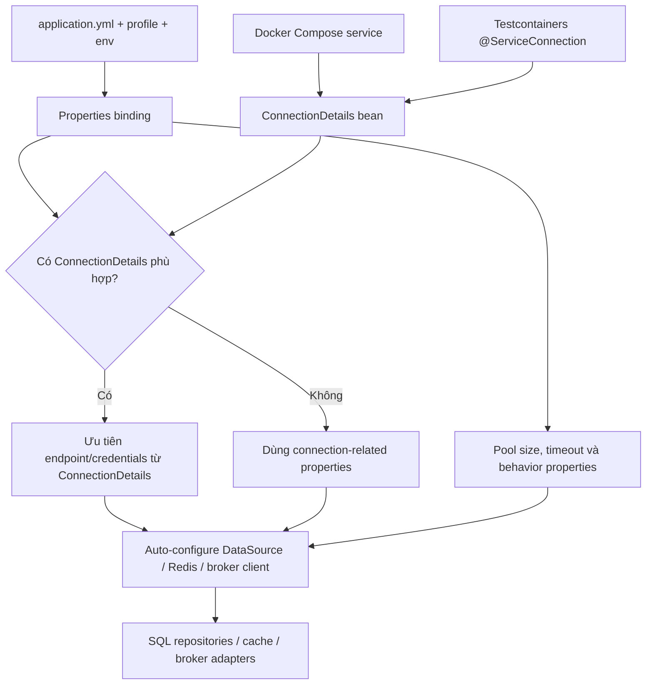
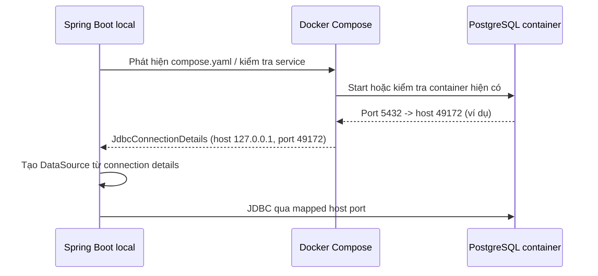
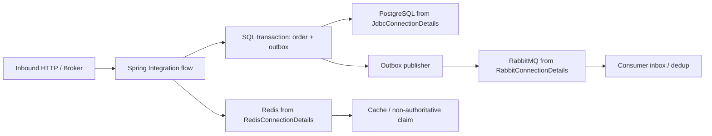

# Ưu tiên thông tin kết nối dịch vụ so với thuộc tính kết nối

> **Chương:** Dịch vụ phát triển  
> **Phạm vi:** Module **SPRING_BOOT_INTEGRATION** tổ chức tích hợp hệ thống trong Spring Boot qua HTTP client, cơ sở dữ liệu, cache, broker thông điệp và các adapter Spring Integration. Bài này giải thích vì sao **thông tin kết nối dịch vụ** (*service connection details*) do Docker Compose hoặc Testcontainers cung cấp có thể được **ưu tiên hơn các thuộc tính cấu hình kết nối** trong `application.yml`; đồng thời làm rõ phần nào vẫn được lấy từ properties, những ngoại lệ của auto-configuration, cách kiểm thử đúng đích và cách tránh kết nối nhầm môi trường.

## 1. Vấn đề thực tế: URL trong application.yml không phải lúc nào cũng là URL đang dùng

Giả sử một worker Spring Boot đọc đơn hàng từ PostgreSQL, lưu trạng thái idempotency và gửi sự kiện qua RabbitMQ. Trong `application.yml` có khai báo:

```yaml
spring:
  datasource:
    url: jdbc:postgresql://localhost:5432/orders_fallback
    username: local_user
    password: ${LOCAL_DB_PASSWORD:replace-me}
    hikari:
      maximum-pool-size: 8
  data:
    redis:
      host: localhost
      port: 6379
      timeout: 2s
```

Nhưng khi chạy ứng dụng cùng **Docker Compose development services**, PostgreSQL lại được Docker publish qua cổng ngẫu nhiên của máy phát triển, ví dụ `127.0.0.1:49172`. Nếu Boot phát hiện service tương ứng và tạo một `JdbcConnectionDetails` cho container, `DataSource` được auto-configure sẽ kết nối tới **cổng 49172**, không phải `5432` trong `spring.datasource.url`. Đây là hành vi đúng theo thiết kế, không phải lỗi ưu tiên environment variables.

Quy tắc cốt lõi:

> Khi **auto-configuration của Spring Boot hỗ trợ và sử dụng một bean `ConnectionDetails` phù hợp**, thông tin kết nối từ bean đó được **ưu tiên hơn những thuộc tính cấu hình liên quan tới kết nối**. Những thuộc tính **không phải thông tin kết nối**, như kích thước hoặc hành vi của connection pool, vẫn có thể tiếp tục được sử dụng.

Từ Spring Boot 3.1, khái niệm service connection được dùng cho hỗ trợ Docker Compose và Testcontainers. Bài sử dụng cách viết dành cho **Spring Boot 3.x (ví dụ 3.4/3.5), Java 17+**; các loại `ConnectionDetails`, image được nhận diện và API cấu hình có thể thay đổi ở những dòng Boot khác. Cần kiểm tra documentation/BOM của **version ứng dụng thực sự dùng**, đặc biệt khi nâng lên Boot 4.x.

**Mục tiêu học tập:** sau bài này, người học phải giải thích được *vì sao một property trông đúng lại không được dùng*, *thực sự component nào quyết định connection*, và *kiểm tra bằng cách nào để không ghi nhầm SQL, Redis hoặc broker*.

## 2. Phân biệt ba lớp cấu hình

Trong một ứng dụng thông thường, có ít nhất ba khái niệm dễ bị nhập làm một:

| Lớp | Ví dụ | Trách nhiệm |
| --- | --- | --- |
| **Configuration properties** | `spring.datasource.url`, `spring.data.redis.host`, `spring.rabbitmq.host` | Cấu hình mặc định hoặc cấu hình được nạp từ file, profile, environment, command line |
| **`ConnectionDetails`** | `JdbcConnectionDetails`, `R2dbcConnectionDetails`, `RedisConnectionDetails`, `RabbitConnectionDetails` | Cung cấp thông tin thực tế để **auto-configuration** kết nối tới một service |
| **Client/resource bean** | `DataSource`, R2DBC `ConnectionFactory`, `RedisConnectionFactory`, RabbitMQ `ConnectionFactory` | Tạo và sử dụng kết nối; tầng nghiệp vụ thật sự dùng bean này |

Một bean `ConnectionDetails` **không phải connection mở sẵn**, không phải `DataSource` và cũng không phải giá trị mới được ghi đè vào `Environment`. Nó là một nguồn thông tin mà auto-configuration có thể đọc để tạo client/resource.



Sơ đồ thể hiện **cơ chế khái niệm** của một auto-configuration có hỗ trợ service connections, không khẳng định mọi bean và mọi library đều đọc `ConnectionDetails`. Ví dụ, một custom HTTP client do ứng dụng tự tạo từ `@Value("${partner.url}")` sẽ **không tự đổi endpoint** chỉ vì dự án có Docker Compose.

### 2.1. Không nhầm với thứ tự ưu tiên PropertySource

Spring Boot có cơ chế ưu tiên nguồn configuration như command-line arguments, environment variables và profile YAML. Service connection là một **cơ chế bổ sung ở tầng auto-configuration**, không đơn giản là một `PropertySource` có ưu tiên cao hơn.

Ví dụ:

```text
application.yml:
  spring.datasource.url = jdbc:postgresql://localhost:5432/orders_fallback

command line:
  --spring.datasource.url=jdbc:postgresql://localhost:65432/orders_cli

Service connection:
  JdbcConnectionDetails -> jdbc:postgresql://127.0.0.1:49172/orders_dev

DataSource do Spring Boot tự cấu hình, nếu dùng JdbcConnectionDetails:
  KẾT NỐI THỰC TẾ -> 127.0.0.1:49172/orders_dev

Environment.getProperty("spring.datasource.url"):
  Có thể vẫn trả -> jdbc:postgresql://localhost:65432/orders_cli
```

Trong ví dụ, CLI có thể thắng `application.yml` ở tầng **Environment**, nhưng một bean `JdbcConnectionDetails` vẫn được auto-configuration dùng cho kết nối SQL. Vì vậy **đọc `Environment` không đủ để xác định database đang được truy cập**.

### 2.2. Bảng quyết định nhanh

| Tình huống | Nguồn endpoint thực tế thường được dùng |
| --- | --- |
| Không có `JdbcConnectionDetails` nào khác, Boot tự cấu hình JDBC `DataSource` | `spring.datasource.url` và các connection properties tương ứng |
| Docker Compose phát hiện PostgreSQL và tạo `JdbcConnectionDetails` phù hợp | Chi tiết container được phát hiện, gồm port được publish trên host |
| Testcontainers field có `@ServiceConnection` và được factory nhận diện | Connection details từ Testcontainers |
| Một `JdbcConnectionDetails` được khai báo thủ công, auto-configuration dùng nó | Giá trị do bean cung cấp |
| Chỉ có một container Redis, không có support/nhận diện tương ứng | Không có bảo đảm tự sinh service connection; có thể quay về Redis properties |
| Ứng dụng tự tạo `@Bean DataSource` bằng URL hardcode | Phụ thuộc **code tự tạo bean**, không có bảo đảm nó đọc `JdbcConnectionDetails` |
| Có nhiều connection details cùng loại mà auto-config không phân biệt được | Có thể gặp lỗi ambiguity hoặc chọn sai theo cấu hình; phải tách rõ tài nguyên |

**Điều kiện quan trọng nhất là “được auto-configuration sử dụng”**. Không diễn giải thành “cứ thêm `@ServiceConnection` thì mọi kết nối trong JVM đều tự động thay đổi”.

## 3. Phân biệt thuộc tính kết nối và thuộc tính hành vi

Nhóm properties **kết nối** là các giá trị xác định *đang kết nối tới đâu và bằng danh tính nào*:

- JDBC: URL, username, password, driver metadata tương ứng.
- R2DBC: connection URL, username/password và một số driver options liên quan.
- Redis: host, port, username/password, database/SSL tùy phiên bản và loại `ConnectionDetails`.
- RabbitMQ: host/port, credentials hoặc danh sách địa chỉ trong phạm vi nhà cung cấp hỗ trợ.
- Kafka hoặc broker khác: bootstrap servers, endpoint và cấu hình kết nối được tích hợp vào loại `ConnectionDetails` tương ứng.

Nhóm properties **hành vi** mô tả *client hoạt động thế nào sau khi biết endpoint*:

| Thuộc tính ví dụ | Thường thuộc nhóm | Khi có service connection |
| --- | --- | --- |
| `spring.datasource.url` | Connection | `JdbcConnectionDetails` có thể quyết định JDBC URL thực tế |
| `spring.datasource.username` / `password` | Connection | Có thể lấy từ container/bean `ConnectionDetails` |
| `spring.datasource.hikari.maximum-pool-size` | Pool behavior | **Vẫn được áp dụng** nếu auto-config tạo HikariCP từ properties |
| `spring.datasource.hikari.connection-timeout` | Pool behavior | **Vẫn được áp dụng** theo cấu hình HikariCP |
| `spring.data.redis.host` / `port` | Connection | `RedisConnectionDetails` có thể xác định endpoint |
| `spring.data.redis.timeout` | Client timeout | Tiếp tục có ý nghĩa theo cách auto-configuration/driver hỗ trợ |
| `spring.rabbitmq.listener.simple.concurrency` | Consumer behavior | Không thay đổi chỉ vì host broker được phát hiện từ service connection |
| `spring.cache.redis.time-to-live` | Cache retention | TTL vẫn do cache config quyết định, không phải Redis service connection |

Không phải mọi option cùng prefix đều được phân loại giống nhau giữa các bản Spring Boot. Ví dụ TLS, SSL bundle, topology nhiều node hoặc driver-specific connection option cần đối chiếu **interface ConnectionDetails của chính phiên bản đang chạy** và auto-configuration tương ứng. Tránh tuyên bố rằng một `ConnectionDetails` bất kỳ sẽ luôn thay **mọi** thuộc tính kết nối một cách giống nhau.

### 3.1. Ví dụ dễ nhớ: URL đổi nhưng pool size giữ nguyên

```yaml
spring:
  datasource:
    url: jdbc:postgresql://localhost:5432/old_db
    username: old_user
    password: ${OLD_DB_PASSWORD:unused-in-dev}
    hikari:
      pool-name: orders-dev-pool
      maximum-pool-size: 8
      minimum-idle: 2
      connection-timeout: 3s
```

Nếu Docker Compose tạo đúng `JdbcConnectionDetails`, `DataSource` do Boot tạo sử dụng URL/credentials của Compose nhưng HikariCP vẫn có thể mang tên `orders-dev-pool` và `maximumPoolSize=8`. Đây chính là ý nghĩa của **ưu tiên connection details mà không bỏ toàn bộ properties**.

**Hệ quả:** Khi thấy JDBC URL trong YAML không còn được dùng, không được kết luận rằng cấu hình Hikari, validation query, transaction timeout hoặc JPA properties cũng mất hiệu lực.

## 4. Docker Compose: từ container đến connection details

Spring Boot có module hỗ trợ development-time services bằng Docker Compose. Trong môi trường hỗ trợ, nó có thể đọc một file `compose.yaml`, khởi động/nhận diện container, lấy mapping port và tạo connection details cho những service được nhận dạng.

### 4.1. Dependency cho phát triển

Ví dụ Maven:

```xml
<!-- Dùng ở development; không nên đóng gói runtime production. -->
<dependency>
    <groupId>org.springframework.boot</groupId>
    <artifactId>spring-boot-docker-compose</artifactId>
    <optional>true</optional>
</dependency>
```

Trong Gradle có thể dùng configuration `developmentOnly`. Theo cách đóng gói mặc định thông dụng của Spring Boot, module Docker Compose được loại khỏi repackaged artifact; nếu cố ý đưa nó vào runtime thì phải hiểu rủi ro tự khởi động dịch vụ ngoài môi trường phát triển.

Yêu cầu môi trường: có Docker daemon và Compose CLI phù hợp, quyền truy cập Docker, file compose hợp lệ và Docker image được hỗ trợ/nhận diện.

### 4.2. File Compose cho PostgreSQL và Redis

```yaml
# compose.yaml - ví dụ local development
services:
  postgres:
    image: postgres:16-alpine
    environment:
      POSTGRES_DB: orders_dev
      POSTGRES_USER: orders_dev
      POSTGRES_PASSWORD: dev_password_only
    ports:
      - "5432"  # Docker chọn host port khả dụng, không cố định 5432.
    healthcheck:
      test: ["CMD-SHELL", "pg_isready -U orders_dev -d orders_dev"]
      interval: 5s
      timeout: 3s
      retries: 10

  redis:
    image: redis:7-alpine
    ports:
      - "6379"
    healthcheck:
      test: ["CMD", "redis-cli", "ping"]
      interval: 5s
      timeout: 3s
      retries: 10
```

Mật khẩu `dev_password_only` chỉ dùng để minh họa **môi trường local cô lập**; không tái sử dụng nó trong production hoặc commit secrets thật vào repository. Tránh publish Redis/PostgreSQL ra mạng công cộng; cấu hình Docker/network firewall theo môi trường. Phần `ports: ["5432"]` publish container port tới host port được cấp; nếu muốn cố định, có thể dùng mapping dạng `"127.0.0.1:15432:5432"` sau khi cân nhắc xung đột cổng.

Với hỗ trợ Compose phù hợp, Boot phát hiện image PostgreSQL để tạo `JdbcConnectionDetails` (và `R2dbcConnectionDetails` nếu các điều kiện tương ứng thỏa), và image Redis để tạo `RedisConnectionDetails`. Kết nối từ **ứng dụng chạy trên máy host** thường dùng **mapped host port**, không phải `postgres:5432` trong Docker network.



**Số 49172 chỉ là ví dụ**, không được đưa thành giá trị cố định vào tài liệu triển khai. Mapped port có thể đổi khi recreate container, vì vậy hardcode port trong `application.yml` dễ gây lỗi sau restart.

### 4.3. Application properties vẫn có chỗ đứng

```yaml
spring:
  datasource:
    # Fallback chỉ dành cho khi KHÔNG có service connection.
    url: ${JDBC_URL:jdbc:postgresql://localhost:5432/orders_fallback}
    username: ${JDBC_USER:fallback_user}
    password: ${JDBC_PASSWORD:unused-in-compose}
    hikari:
      maximum-pool-size: 8
      connection-timeout: 3s
  data:
    redis:
      host: ${REDIS_HOST:localhost}
      port: ${REDIS_PORT:6379}
      timeout: 2s
  cache:
    type: redis
    redis:
      time-to-live: 5m
```

Trong lúc service connection hoạt động, ứng dụng có thể lấy PostgreSQL/Redis endpoint từ container. Khi tắt Compose hoặc chạy bản package không chứa Docker Compose support, các fallback properties mới có thể được dùng, **nếu không có một nguồn ConnectionDetails khác**.

Một hệ thống cần chạy an toàn nên **không đặt fallback production nguy hiểm trong profile dev**. Ví dụ nếu production URL được đưa vào `spring.datasource.url` và Compose tạm thời không tạo details, ứng dụng dev có thể truy cập nhầm production. Hãy tách profile, secret, network và role, đồng thời có startup validation khi môi trường đích không như mong đợi.

## 5. Cách nhận diện Compose service và giới hạn

Spring Boot nhận diện một số container theo **image name/service label** và tạo loại `ConnectionDetails` mà nó hỗ trợ. Điều này phụ thuộc phiên bản: PostgreSQL/Redis thường là hai trường hợp phổ biến, nhưng một image lạ hoặc một dịch vụ HTTP tùy biến không mặc nhiên được hỗ trợ.

### 5.1. Image custom cần tên service rõ

```yaml
services:
  redis:
    image: registry.example.org/dev/redis-hardened:7
    ports:
      - "6379"
    labels:
      org.springframework.boot.service-connection: redis
```

Label `org.springframework.boot.service-connection` chỉ dẫn Boot nhận diện một image custom **như loại service được nêu**, với giả định image thực sự tương thích với giao thức, biến môi trường và cổng của image tiêu chuẩn. Label không chuyển một dịch vụ tùy ý thành Redis.

Nếu một container không được dùng làm service connection cho ứng dụng này:

```yaml
services:
  redis-experimental:
    image: redis:7-alpine
    ports:
      - "6379"
    labels:
      org.springframework.boot.ignore: true
```

Việc bỏ qua giúp tránh Boot vô tình tạo details cho một container phụ mà ứng dụng không nên dùng. Không áp dụng label ignore để che giấu sự cố thiếu service bắt buộc; cần báo lỗi rõ khi backend chính không được tìm thấy.

### 5.2. Nhiều container cùng công nghệ

Một Compose file có thể có hai PostgreSQL server cho orders và reports. **Không được giả định Boot sẽ tự biết orders `JdbcTemplate` phải chọn container nào** khi nhiều `JdbcConnectionDetails` có cùng vai trò. Một auto-configuration có thể kỳ vọng một candidate phù hợp; cấu hình đa datasource yêu cầu:

1. Đặt tên nguồn dữ liệu theo nghiệp vụ (orders/reports).
2. Tạo `DataSource`, `JdbcTemplate` và transaction manager riêng khi cần.
3. Dùng `@Qualifier` trên injection point để không ghi nhầm database.
4. Định nghĩa cách mỗi DataSource đọc đúng endpoint/details; auto-config mặc định không tự nhân thành hai nguồn độc lập chỉ vì có hai container.
5. Kiểm thử kết nối thực tế, không chỉ kiểm tra rằng application context khởi động.

Nếu muốn Compose chỉ cung cấp connection cho một container trong hai container, có thể cân nhắc label ignore cho container không thuộc auto-config, rồi cấu hình tài nguyên thứ hai bằng bean riêng. Đây là quyết định kiến trúc, không phải quy tắc chung cho mọi mô hình multi-tenant.

## 6. Testcontainers: @ServiceConnection cho integration test

Khi integration test cần một PostgreSQL thực để kiểm tra transaction, unique constraint, inbox/outbox hoặc một Redis thật để kiểm tra TTL, **Testcontainers** giúp tạo backend có vòng đời gắn với test.

Với Spring Boot hỗ trợ Testcontainers service connection, `@ServiceConnection` trên một container field/bean là tín hiệu để tạo `ConnectionDetails` tương ứng. Nó giúp tránh việc viết thủ công `@DynamicPropertySource` cho nhiều endpoint.

### 6.1. Dependency Maven ví dụ

```xml
<dependencies>
    <dependency>
        <groupId>org.springframework.boot</groupId>
        <artifactId>spring-boot-starter-jdbc</artifactId>
    </dependency>
    <dependency>
        <groupId>org.postgresql</groupId>
        <artifactId>postgresql</artifactId>
        <scope>runtime</scope>
    </dependency>

    <dependency>
        <groupId>org.springframework.boot</groupId>
        <artifactId>spring-boot-starter-test</artifactId>
        <scope>test</scope>
    </dependency>
    <dependency>
        <groupId>org.springframework.boot</groupId>
        <artifactId>spring-boot-testcontainers</artifactId>
        <scope>test</scope>
    </dependency>
    <dependency>
        <groupId>org.testcontainers</groupId>
        <artifactId>postgresql</artifactId>
        <scope>test</scope>
    </dependency>
    <dependency>
        <groupId>org.testcontainers</groupId>
        <artifactId>junit-jupiter</artifactId>
        <scope>test</scope>
    </dependency>
</dependencies>
```

Chọn version Testcontainers tương thích với Spring Boot BOM hoặc version management của dự án. Tên artifact và dependency ở đây dành cho bố cục Spring Boot 3.x. Trong các dòng thư viện mới hơn có thể có thay đổi về module; không bê nguyên một dependency tree cũ sang Boot 4.x mà không đối chiếu.

### 6.2. Integration test chứng minh ưu tiên thực tế

```java
package com.example.integration.devservices;

import static org.assertj.core.api.Assertions.assertThat;

import org.junit.jupiter.api.Test;
import org.springframework.beans.factory.annotation.Autowired;
import org.springframework.boot.autoconfigure.jdbc.JdbcConnectionDetails;
import org.springframework.boot.test.context.SpringBootTest;
import org.springframework.boot.testcontainers.service.connection.ServiceConnection;
import org.springframework.core.env.Environment;
import org.springframework.jdbc.core.JdbcTemplate;
import org.testcontainers.containers.PostgreSQLContainer;
import org.testcontainers.junit.jupiter.Container;
import org.testcontainers.junit.jupiter.Testcontainers;

@Testcontainers
@SpringBootTest(properties = {
    "spring.datasource.url=jdbc:postgresql://localhost:65432/wrong_db",
    "spring.datasource.username=wrong_user",
    "spring.datasource.password=wrong_password",
    "spring.datasource.hikari.maximum-pool-size=4"
})
class PostgresConnectionPriorityIT {

    @Container
    @ServiceConnection
    static PostgreSQLContainer<?> postgres =
            new PostgreSQLContainer<>("postgres:16-alpine")
                    .withDatabaseName("orders_test")
                    .withUsername("orders_test_user")
                    .withPassword("local_test_only");

    @Autowired JdbcTemplate jdbc;
    @Autowired Environment environment;
    @Autowired JdbcConnectionDetails connectionDetails;

    @Test
    void usesServiceDetailsInsteadOfWrongPropertyUrl() {
        assertThat(environment.getProperty("spring.datasource.url"))
                .contains("wrong_db");

        assertThat(connectionDetails.getJdbcUrl())
                .contains("orders_test");

        String actualDatabase =
                jdbc.queryForObject("select current_database()", String.class);

        assertThat(actualDatabase).isEqualTo("orders_test");
    }
}
```

Thử nghiệm cố tình đặt một JDBC URL trong properties **không thể kết nối đúng database**. Nếu test vẫn truy vấn được `orders_test`, nó chứng minh rằng datasource auto-configure đã dùng service connection từ container thay vì `spring.datasource.url`.

**Lưu ý thiết kế test:** container dùng `@Container` có vòng đời do JUnit Testcontainers extension quản lý. Nếu TestContext cache của Spring được tái sử dụng giữa nhiều test class sau khi một container đã dừng, một context còn cache có thể giữ connection tới container không còn tồn tại. Với các suite lớn, cân nhắc **quản lý container dưới dạng Spring bean** hoặc import một cấu hình container chung có lifecycle phù hợp.

Chưa thể khẳng định mọi schema migration đã chạy thành công chỉ từ `select current_database()`. Để kiểm chứng migrations, chạy thêm query vào bảng/migration history cụ thể trong database thử nghiệm.

### 6.3. Redis GenericContainer cần cung cấp tên

Với một container typed như `PostgreSQLContainer`, Spring Boot có thông tin kiểu để chọn factory tạo details. Với `GenericContainer<?>` của Redis, nên chỉ rõ service name vì Boot có thể không biết image đích ở giai đoạn xử lý bean definition:

```java
import org.springframework.boot.testcontainers.service.connection.ServiceConnection;
import org.testcontainers.containers.GenericContainer;
import org.testcontainers.utility.DockerImageName;
import org.testcontainers.junit.jupiter.Container;

@Container
@ServiceConnection(name = "redis")
static GenericContainer<?> redis =
        new GenericContainer<>(
                DockerImageName.parse("redis:7-alpine"))
                .withExposedPorts(6379);
```

Đây là **field minh họa đặt trong test class**, không phải một class Java hoàn chỉnh. Với dependency `spring-boot-starter-data-redis` và factory được version hỗ trợ, Boot có thể tạo `RedisConnectionDetails` để cấu hình `RedisConnectionFactory`.

Không nhầm **container Java variable name** (`redis`) với **service name** trong `@ServiceConnection(name = "redis")`. Annotation có ý nghĩa giúp factory nhận biết **công nghệ**; tên bean/qualifier để phân biệt **nhiều backend cùng công nghệ** là một vấn đề riêng.

## 7. So sánh @ServiceConnection và @DynamicPropertySource

Spring Test cung cấp `@DynamicPropertySource` để điền **các property động** vào `Environment`. Nó vẫn hữu ích khi service/driver chưa có `ConnectionDetails` được Spring Boot hỗ trợ, hoặc ứng dụng có custom client tự đọc property.

### 7.1. Fallback khi không có service connection support

```java
@Testcontainers
@SpringBootTest
class LegacyPostgresIT {

    @Container
    static PostgreSQLContainer<?> postgres =
            new PostgreSQLContainer<>("postgres:16-alpine");

    @DynamicPropertySource
    static void databaseProperties(DynamicPropertyRegistry registry) {
        registry.add("spring.datasource.url", postgres::getJdbcUrl);
        registry.add("spring.datasource.username", postgres::getUsername);
        registry.add("spring.datasource.password", postgres::getPassword);
    }
}
```

Các annotation/import `@DynamicPropertySource` và `DynamicPropertyRegistry` thuộc Spring Test. Đây là **khung test**, cần bổ sung imports, test method và dependencies tương ứng. Không gắn `@ServiceConnection` cho chính container này nếu đã chọn điều khiển kết nối hoàn toàn bằng dynamic properties mà chưa xác minh ưu tiên.

| Tiêu chí | `@ServiceConnection` | `@DynamicPropertySource` |
| --- | --- | --- |
| Đầu ra | Một hoặc nhiều bean `ConnectionDetails` qua factory phù hợp | Giá trị property thêm vào `Environment` |
| Cần biết tên property chi tiết? | Ít hơn, khi hỗ trợ container/technology | **Có**: phải khai báo URL/host/port/user... |
| Ưu tiên so với `spring.datasource.url` | Auto-config dùng connection details phù hợp nên ưu tiên nó | Thuộc cơ chế property-source precedence |
| Image/custom service | Có thể cần `name`, `type` hoặc factory riêng | Có thể đưa thuộc tính cho hầu hết custom client |
| Hỗ trợ nhiều tài nguyên | Phụ thuộc loại details và wiring auto-config | Có thể cung cấp nhiều nhóm property với tên riêng |
| Rủi ro | Bean không được tạo/không được tiêu thụ, nhiều details cùng kiểu | Trùng property, sai supplier, đẩy endpoint vào nguồn không mong muốn |

### 7.2. Không trộn hai cơ chế rồi đoán kết quả

Ví dụ một test vừa có `@ServiceConnection` cho PostgreSQL vừa khai báo:

```java
@DynamicPropertySource
static void overrideUrl(DynamicPropertyRegistry registry) {
    registry.add("spring.datasource.url",
            () -> "jdbc:postgresql://localhost:65432/not_the_container");
}
```

Nếu `DataSource` được tạo bởi auto-configuration dùng `JdbcConnectionDetails`, dynamic property URL **không nhất thiết điều khiển datasource đó**, dù có ưu tiên cao trong `Environment`. Chúng là hai cơ chế khác nhau.

**Quy tắc thực hành:** Chọn `@ServiceConnection` khi stack hỗ trợ và không cần nối properties thủ công. Nếu dùng `@DynamicPropertySource`, đừng đồng thời khai báo một bean `ConnectionDetails` trỏ nơi khác trừ khi đã thiết kế rõ ràng. Test **đích SQL/Redis thực tế** thay vì tranh luận dựa trên thứ tự load config.

## 8. Thông tin kết nối không tự cấu hình mọi bean

### 8.1. Một custom DataSource có thể bỏ qua JdbcConnectionDetails

```java
@Configuration
class ManualDataSourceConfiguration {
    @Bean
    DataSource dataSource(
            @Value("${spring.datasource.url}") String url,
            @Value("${spring.datasource.username}") String username,
            @Value("${spring.datasource.password}") String password) {
        return DataSourceBuilder.create()
                .url(url)
                .username(username)
                .password(password)
                .build();
    }
}
```

Đây là **ví dụ cố ý cho thấy bẫy**, không phải hướng dẫn production. Vì bean tự đọc `@Value` từ properties và không dùng `JdbcConnectionDetails`, nó có thể truy cập URL fallback ngay cả khi container Compose/Testcontainers đã sẵn sàng. Việc tự khai báo `DataSource` cũng có thể khiến Boot JDBC auto-configuration **back off**.

Khi viết custom datasource thực sự cần service connection, phải quyết định rõ **đọc từ `JdbcConnectionDetails` hay từ cấu hình riêng**; không thể chờ một annotation ở nơi khác tự sửa logic constructor của mình.

### 8.2. Nhiều DataSource và qualifier

Nếu service tích hợp vừa dùng PostgreSQL orders, vừa dùng reporting database, một `JdbcConnectionDetails` mặc định **không tự quyết định việc chọn đúng dữ liệu cho cả hai**. Cần cấu hình rõ:

```text
ordersDataSource        → orders DB
ordersJdbcTemplate      → ordersDataSource
ordersTransactionManager→ ordersDataSource

reportsDataSource       → reports DB
reportsJdbcTemplate     → reportsDataSource
reportsTransactionManager→ reportsDataSource
```

Ở service đọc/gửi dữ liệu, dùng `@Qualifier("ordersJdbcTemplate")` hoặc `@Qualifier("reportsJdbcTemplate")` theo nghiệp vụ; dùng `@Transactional(transactionManager = "ordersTransactionManager")` tương ứng với nguồn SQL. Service connection **không sửa lỗi dùng sai transaction manager**; local transaction không thể tự rollback một JDBC operation ở nguồn khác hoặc một HTTP POST tới đối tác.

### 8.3. HTTP client thường không được nhận diện tự động

`RestClient`, `WebClient` hoặc Spring Integration HTTP outbound gateway gọi API đối tác do ứng dụng định nghĩa **không mặc định có một service connection detail chung cho mọi URL HTTP**. Một service Docker Compose chứa HTTP API tùy chỉnh có thể cần properties riêng như `partner.base-url` hoặc một adapter/auto-configuration chuyên biệt.

Không diễn giải “Spring Boot hỗ trợ service connections” thành “mọi outbound HTTP call tự kết nối tới Docker container cùng tên”.

## 9. PostgreSQL: JDBC, R2DBC và migration là những người tiêu thụ khác nhau

Một PostgreSQL container có thể phục vụ cả JDBC, R2DBC và migration tool. Tuy nhiên:

| Tầng | Kiểu kết nối/API | Điều cần kiểm tra |
| --- | --- | --- |
| **JDBC/JPA** | `DataSource` với `JdbcConnectionDetails` | Driver JDBC, URL, user, pool, JPA transaction manager |
| **R2DBC** | `ConnectionFactory` với `R2dbcConnectionDetails` | Driver R2DBC riêng, `spring.r2dbc.*`, reactive transaction context |
| **Flyway/Liquibase** | Công cụ migration, thường dùng JDBC | URL, credentials, schema/migration location và loại details được hỗ trợ |
| **Outbox worker** | Sử dụng JDBC/JPA/R2DBC đã chọn | Đúng SQL DB; transaction lưu order + outbox phải atomic trong DB đó |

Nếu có `spring.r2dbc.url` và `spring.datasource.url`, **một connection detail cho JDBC không đồng nghĩa một kết nối R2DBC đã sẵn sàng**. Cần driver R2DBC và auto-configuration phù hợp. Ngoài ra, việc thêm R2DBC `ConnectionFactory` có thể tác động điều kiện auto-configure `DataSource` của Boot; muốn cả hai thì thiết kế riêng.

**Migration là ranh giới an toàn:** trước khi chạy Flyway/Liquibase, kiểm tra nó sẽ kết nối database nào. Nếu service connection tự đổi JDBC URL so với YAML, migration có thể nhắm tới container dev; đó thường là điều mong muốn trong test, nhưng không được phép vô tình chạy migration trên production. Cần profile, permission và kiểm thử schema history rõ ràng.

## 10. Redis, RabbitMQ và Kafka: ưu tiên kết nối không thay đổi hợp đồng nghiệp vụ

Tư duy `ConnectionDetails` áp dụng cho các backend được Spring Boot hỗ trợ, nhưng tên type và tập thông tin được cung cấp khác nhau:

| Tích hợp | Ví dụ bean details | Phần application vẫn phải tự thiết kế |
| --- | --- | --- |
| PostgreSQL JDBC | `JdbcConnectionDetails` | Schema, transaction, pool, unique key, outbox |
| PostgreSQL R2DBC | `R2dbcConnectionDetails` | Reactive transaction, pooling, retry đúng semantics |
| Redis | `RedisConnectionDetails` | Key prefix/tenant scope, TTL, serializer, cache consistency |
| RabbitMQ | `RabbitConnectionDetails` | Exchange/queue/binding, ack, DLQ, consumer idempotency |
| Kafka | `KafkaConnectionDetails` ở version/cấu hình hỗ trợ | Topic, serializer, schema version, offsets, retry/DLQ |

Tên các interface trong bảng được dùng theo các bản Spring Boot hỗ trợ chúng; **đối chiếu đúng version** trước khi import trong code. Khả năng nhận diện Kafka/Redis/RabbitMQ từ **Docker Compose** và từ **Testcontainers** không nhất thiết có cùng danh sách image/container type ở mọi bản Spring Boot.

**Connection details chỉ giải quyết việc kết nối, không mang bảo đảm giao dịch.** Ví dụ consumer RabbitMQ lấy host/port được phát hiện từ Compose vẫn có thể nhận cùng message nhiều lần sau mất ack. Cần inbox/unique constraint và chỉ ack theo chính sách sau khi side effect SQL được ghi bền vững.

Tương tự, Redis mà Boot tìm đúng container không tự tạo cache keys an toàn cho multi-tenant, không tự dọn TTL idempotency đúng SLA và không biến lệnh `SET NX` thành giao dịch ACID xuyên PostgreSQL.

## 11. Vòng đời development services và rủi ro theo môi trường

### 11.1. Docker Compose lifecycle

Với hỗ trợ Docker Compose được bật, Boot có thể khởi động dịch vụ theo file Compose rồi dừng khi ứng dụng tắt theo lifecycle được cấu hình. Một số tùy chọn phổ biến:

```yaml
spring:
  docker:
    compose:
      enabled: true
      lifecycle-management: start-and-stop
      # Nếu file không ở working directory mặc định:
      # file: ../infra/compose.yaml
```

Các lựa chọn lifecycle như `none`, `start-only` và `start-and-stop` có ý nghĩa khác nhau:

- `none`: ứng dụng không quản lý việc start/stop container; phù hợp khi hạ tầng do công cụ khác quản lý.
- `start-only`: Boot có thể khởi động dịch vụ lúc startup nhưng để chúng tiếp tục chạy sau khi ứng dụng tắt.
- `start-and-stop`: Boot có thể start và stop theo lifecycle ứng dụng trong điều kiện phù hợp.

Khi Compose services đã chạy từ trước, hành vi start/stop có thể khác so với dịch vụ được Boot tự khởi động; không tự xóa dữ liệu container nếu không có chủ đích. Dùng `docker compose down -v` trong môi trường có volume lưu dữ liệu thật có thể **xóa dữ liệu**.

### 11.2. Khi chạy test

Ở những bản Spring Boot hỗ trợ Docker Compose development services, Compose thường **được bỏ qua trong test theo mặc định**; thuộc tính `spring.docker.compose.skip.in-tests` điều khiển việc này. Nếu muốn test với Testcontainers, giữ chúng thành hai chiến lược rõ ràng thay vì vừa cho Boot start Compose vừa dùng container test khác mà không phân biệt được hai nguồn kết nối.

### 11.3. Đừng mang dev service vào production

| Môi trường | Nguồn connection nên được quản lý thế nào? |
| --- | --- |
| **Local dev** | Docker Compose hoặc Testcontainers development launcher, secrets giả lập, database cô lập |
| **Integration test/CI** | Testcontainers hay hạ tầng test có lifecycle xác định, fixture và assert endpoint thật |
| **Staging** | Service được quản lý, profile/secret riêng, schema/migration và permission được kiểm soát |
| **Production** | Config/secret/identity của hạ tầng chính thức; không cho dependency dev tự chạy Docker Compose |

**Không đặt production credentials như một fallback có thể đạt tới từ local dev.** Nếu development service không hoạt động mà application có thể tự fallback đến production, nguy cơ ghi dữ liệu thật cao hơn nhiều so với một lỗi khởi động sớm.

## 12. Chẩn đoán: vì sao properties đúng mà ứng dụng kết nối sai?

### 12.1. Quy trình điều tra có thứ tự

1. **Xác định loại client đang lỗi:** JDBC, R2DBC, Redis, RabbitMQ hay HTTP custom.
2. **Xác định bean thực sự được inject:** `DataSource`, `ConnectionFactory`, `RedisConnectionFactory`, bean custom hay bean auto-config.
3. **Tìm `ConnectionDetails` phù hợp:** có bean nào được tạo bởi Compose/Testcontainers hoặc custom `@Bean` không?
4. **Kiểm tra container phát hiện:** Docker Compose file, image name, label, mapped port, health/readiness và trạng thái container.
5. **Đối chiếu config thực tế:** properties trong `Environment` **và** details bean **và** connection/driver thực.
6. **Kiểm tra bean ambiguity:** hai details/connection factory cùng type, `@Primary`/`@Qualifier` hoặc profile khác nhau.
7. **Xác minh trên backend:** query database identity, Redis PING/key namespace, broker metadata theo quyền được phép.
8. **Chỉ sau khi biết đích thật**, mới sửa property, annotation, label hoặc custom factory.

### 12.2. Bảng lỗi thường gặp

| Triệu chứng | Nguyên nhân có thể | Biện pháp |
| --- | --- | --- |
| `spring.datasource.url` hiển thị đúng nhưng JDBC dùng port khác | Có `JdbcConnectionDetails` từ Compose/Testcontainers | Kiểm tra bean details và kết nối SQL thật; đây có thể là hành vi đúng |
| Application dùng port cũ sau recreate container | Client custom hardcode/mapped port hoặc lifecycle container chưa được refresh | Không hardcode port Compose, khởi tạo lại context theo lifecycle phù hợp |
| Không có `ConnectionDetails` cho image tự xây | Image name không được nhận diện | Gắn label Compose hoặc `@ServiceConnection(name = "...")` trong test |
| `@ServiceConnection` bị bỏ qua | Thiếu `spring-boot-testcontainers`, sai scope hoặc chưa được xử lý bởi factory | Kiểm tra dependency, annotation, container type và version |
| Boot không dùng details dù bean tồn tại | Có `@Bean DataSource` custom hoặc auto-config back off | Sửa custom factory để đọc details, hoặc để Boot tạo resource |
| SQL ghi nhầm database | Hai datasource/qualifier bị chọn sai | Tách bean/manager rõ, test `current_database()` |
| Test pass local nhưng fail CI | Docker daemon unavailable, image pull, port/firewall, secret hoặc test lifecycle | CI environment, image cache, timeout, log an toàn |
| Broker consumer nối đúng nhưng redelivery gây duplicate | Connection thành công không đồng nghĩa exactly-once | Inbox/unique constraint, ack/retry đúng policy |
| Hikari settings không có tác dụng | Tạo pool custom không bind `spring.datasource.hikari.*` | Kiểm tra actual pool bean và config, không suy đoán từ YAML |
| Redis cache trộn tenant | Key/schema/invalidation sai | Thiết kế key scope, serializer và quyền truy cập, không chỉ chỉnh host |

### 12.3. Công cụ quan sát bean graph

Trong môi trường phát triển, `debug=true` có thể hiển thị **Condition Evaluation Report**; Actuator `/actuator/beans` hoặc `/actuator/conditions` có thể hỗ trợ xem bean và auto-configuration nào đã match/back off. Cần giới hạn quyền truy cập vào các endpoint này vì chúng có thể làm lộ thông tin hệ thống.

Một test có thể inspect bean `JdbcConnectionDetails` trực tiếp, nhưng **không nên log nguyên password/connection string có chứa credential**. Với PostgreSQL, query read-only:

```sql
SELECT current_database() AS db_name,
       current_user AS login_role,
       inet_server_port() AS server_port;
```

`inet_server_port()` cho biết **cổng trên server PostgreSQL**, thường là 5432 bên trong container; nó **không phải host-mapped port** mà client dùng. Để kiểm tra mapped port, nhìn `JdbcConnectionDetails.getJdbcUrl()` sau khi redact hoặc `Connection.getMetaData().getURL()` trong test. Đây là ví dụ cho thấy quan sát đúng lớp rất quan trọng.

## 13. Kiểm thử ưu tiên thuộc tính và config an toàn

Không nên chỉ kiểm tra Spring context khởi động hoặc `Environment.getProperty(...)`. Một test đủ sức bắt lỗi precedence cần xác minh **backend được kết nối thực sự**, và những thuộc tính hành vi cần thiết vẫn còn hiệu lực.

### 13.1. Bảng test

| Kịch bản | Điều cần chứng minh |
| --- | --- |
| Không có service connection | Auto-config JDBC dùng URL/user từ properties như dự kiến |
| Có `JdbcConnectionDetails` và property URL cố tình sai | JDBC thực sự truy cập đúng database container |
| Có connection details và cấu hình Hikari | Pool size/timeout vẫn được cấu hình theo properties |
| Docker Compose publish port ngẫu nhiên | Datasource kết nối theo mapped port mới, không hardcode 5432 |
| Redis `@ServiceConnection(name="redis")` | Redis template truy cập đúng instance, TTL/cache policy riêng vẫn đúng |
| Container image chưa được nhận diện | Không giả định tự kết nối; phải có label/factory/properties rõ |
| Custom `DataSource` không đọc details | Regression test phát hiện kết nối tới fallback URL hoặc sai bean |
| Hai PostgreSQL container | Không có lựa chọn ngầm mơ hồ; orders/reports dùng đúng resource/manager |
| TestContext cache sau khi Testcontainers dừng | Không tái sử dụng bean trỏ container đã shutdown |
| Docker Compose bị vô hiệu hóa ở test/prod | Ứng dụng không vô tình gọi backend local hoặc production sai |
| Redis/broker tạm unavailable | Lỗi được phân loại và không tự nhân bản side effect trong retry |
| Recreate container giữa lần chạy | Cấu hình connection được cập nhật bằng vòng đời context hợp lệ |

### 13.2. Test Hikari vẫn nhận property khi JDBC URL bị thay

```java
@Autowired javax.sql.DataSource dataSource;

@Test
void poolSettingsStillApplyWithServiceConnection() {
    assertThat(dataSource)
            .isInstanceOf(com.zaxxer.hikari.HikariDataSource.class);

    var hikari = (com.zaxxer.hikari.HikariDataSource) dataSource;
    assertThat(hikari.getMaximumPoolSize()).isEqualTo(4);
}
```

Đoạn này bổ sung vào test `PostgresConnectionPriorityIT` ở mục 6, nơi đặt `spring.datasource.hikari.maximum-pool-size=4`. Giả định Boot auto-config chọn HikariCP và không có custom DataSource. Nó minh họa hai việc độc lập: **connection details thắng URL cấu hình**, nhưng **pool settings vẫn được bind**.

### 13.3. Đảm bảo test không vô tình dùng production database

Với CI hoặc local:

1. Chọn test profile riêng, có URL fallback trỏ vào **đích không tồn tại** hoặc một backend test có thể kiểm chứng.
2. Khi `@ServiceConnection` hoạt động, assert database name, role hoặc namespace dự kiến.
3. Dùng user test **chỉ có quyền trên database test**, không dùng production secret.
4. Không ghi toàn bộ môi trường/secret vào log khi test lỗi.
5. Nếu Docker unavailable, báo failure rõ, **không fallback tự động đến production** chỉ để test chạy.

## 14. Tác động tới giao dịch, idempotency và adapter Spring Integration

Một ứng dụng tích hợp có thể kết nối thành công tới PostgreSQL, Redis và RabbitMQ đã được nhận diện tự động. Nhưng ba hệ thống ấy vẫn là **ba ranh giới giao dịch khác nhau**:



**Service connection chỉ giúp chọn endpoint.** Nó không tự tạo ACID transaction trải rộng PostgreSQL, Redis và broker, không đồng bộ `@Transactional` của JDBC sang JMS/Kafka/RabbitMQ và không chống redelivery.

Trong một luồng an toàn:

- SQL lưu business state và outbox trong **cùng transaction** khi cần phát event chắc chắn sau commit.
- Publisher có thể gửi lại event với **event ID ổn định** sau lỗi broker acknowledgement.
- Consumer dùng inbox/unique constraint theo nguồn/event/handler để xử lý idempotent.
- Redis dùng làm cache/coordination khi phù hợp; TTL/eviction không thay DB ledger của side effect quan trọng.
- HTTP client bên ngoài cần riêng authentication, timeout, idempotency key và status lookup; không được suy ra nó đã được Docker Compose auto-config vì backend SQL dùng Compose.

Với integration test, khi một service connection trỏ tới **backend khác** so với YAML, mọi assertion về dữ liệu/transaction phải kiểm tra trên backend đó. Ví dụ nếu test ghi order vào container A nhưng một setup migration chạy trên database B do cấu hình nhầm, lỗi là **wiring/migration target** chứ không phải transaction semantics của repository.

## 15. Các nhầm lẫn cần tránh

1. **“Service connection chỉ là environment variable ưu tiên cao.”** Sai: `ConnectionDetails` là bean được auto-configuration tiêu thụ, không phải cập nhật bắt buộc vào `Environment`.
2. **“CLI `--spring.datasource.url` chắc chắn thắng mọi nguồn.”** Không đúng khi datasource auto-config đang sử dụng `JdbcConnectionDetails` phù hợp.
3. **“Có service connection thì mọi property `spring.datasource.*` bị bỏ qua.”** Sai: pool size/timeout và hành vi khác vẫn có thể áp dụng.
4. **“Chỉ cần có container là Boot tự tạo details.”** Sai: cần module, điều kiện, công nghệ/image được nhận diện hoặc đăng ký factory/label phù hợp.
5. **“Image tự xây luôn được nhận diện theo tên container.”** Sai: image repository và label/`@ServiceConnection(name)` có vai trò quan trọng.
6. **“`@ServiceConnection` thay thế mọi `@DynamicPropertySource`.”** Sai: client/custom technology không hỗ trợ có thể cần dynamic properties.
7. **“Một custom DataSource sẽ tự đọc ConnectionDetails.”** Sai: do code bean quyết định.
8. **“Nhiều PostgreSQL service sẽ tự tạo đúng hai DataSource.”** Sai: cần wiring, qualifier và transaction manager riêng.
9. **“JDBC và R2DBC đọc cùng URL/driver.”** Sai: chúng có SPI/driver, properties và transaction manager khác nhau.
10. **“Chỉ cần nhìn `application.yml` là biết DB đang dùng.”** Sai: phải xem details bean và kết nối thực.
11. **“Docker Compose dev service có thể đưa thẳng lên production.”** Sai: môi trường đích, secret, HA, lifecycle và quyền phải được kiểm soát riêng.
12. **“Kết nối broker đúng là thông điệp sẽ xử lý đúng một lần.”** Sai: vẫn cần ack/redelivery policy và consumer idempotency.
13. **“`inet_server_port()` bằng host-mapped port của Docker.”** Sai: đó thường là cổng của PostgreSQL server bên trong container.
14. **“Test context PASS nghĩa là config của Hikari/Flyway/Redis đều đúng.”** Sai: cần assert pool, migration target, TTL và backend identity.

## 16. Checklist trước khi áp dụng service connections

1. **Chốt phiên bản:** Spring Boot 3.1+ hỗ trợ khái niệm service connections; xác minh API và danh sách container/driver của bản dự án.
2. **Chọn một chiến lược dev/test:** Docker Compose, Testcontainers hoặc custom properties; tránh hai nguồn không có chủ đích cùng nhận một service.
3. **Kiểm tra module:** `spring-boot-docker-compose` hoặc `spring-boot-testcontainers` có trong đúng classpath/scope.
4. **Nhận diện container:** image name, `org.springframework.boot.service-connection` label hoặc `@ServiceConnection(name=...)`.
5. **Phân biệt config:** endpoint/credentials từ details; pool size/timeout, cache TTL và listener concurrency từ properties.
6. **Xác minh resource thật:** `DataSource`/`RedisConnectionFactory`/broker client có đang do Boot tạo và sử dụng details không?
7. **Cảnh giác custom bean:** nếu tự tạo client/resource, quyết định rõ nó lấy URL từ đâu.
8. **Cảnh giác multi-resource:** dùng tên bean, `@Qualifier`, transaction manager và migration target riêng.
9. **Bảo mật:** không cho dev fallback đến production, tách secret/role, giới hạn mapped port, không log password.
10. **Test và quan sát:** cố tình đặt fallback URL sai, verify actual backend, pool settings, transaction/outbox và idempotency.

### Câu hỏi tự kiểm tra

1. `ConnectionDetails` khác `spring.datasource.url` và `DataSource` như thế nào?
2. Tại sao một test có `@ServiceConnection` vẫn có thể đọc `spring.datasource.url` cũ từ `Environment` mà SQL lại chạy trên container mới?
3. Khi có `JdbcConnectionDetails`, `spring.datasource.hikari.maximum-pool-size` có còn ý nghĩa không?
4. Docker Compose publish PostgreSQL cổng 5432 sang host 49172. Tại sao không nên cố định `spring.datasource.url` vào 49172?
5. Vì sao `GenericContainer<?>` thường cần `@ServiceConnection(name = "redis")` để được nhận diện khi khai báo dưới dạng bean?
6. `@DynamicPropertySource` và `@ServiceConnection` khác nhau ở cơ chế nào?
7. Nếu một custom `@Bean DataSource` tự đọc `@Value("${spring.datasource.url}")`, nó có bắt buộc sử dụng `JdbcConnectionDetails` không?
8. Khi có orders DB và reports DB, vì sao vẫn cần `@Qualifier` và transaction manager được ghép đúng?
9. Có `JdbcConnectionDetails` cho PostgreSQL thì `R2dbcConnectionFactory` đã tự sẵn sàng chưa?
10. Vì sao `current_database()` và thông tin bean/resource thực đáng tin hơn việc chỉ xem `application.yml`?
11. Cần kiểm thử gì để chứng minh JDBC dùng container nhưng Hikari pool vẫn theo cấu hình?
12. Sau khi kết nối RabbitMQ tự động thành công, vì sao ứng dụng vẫn cần inbox/outbox và redelivery policy?

## 17. Tài liệu tham khảo

- [Spring Boot — Development-time Services](https://docs.spring.io/spring-boot/reference/features/dev-services.html): Docker Compose, nhận diện container, mapped ports, lifecycle và ưu tiên service connection details.
- [Spring Boot — Testcontainers](https://docs.spring.io/spring-boot/reference/testing/testcontainers.html): `@ServiceConnection`, `ConnectionDetails`, factory matching, custom image và `@DynamicPropertySource`.
- [Spring Boot 3.4 — Testcontainers](https://docs.spring.io/spring-boot/3.4/reference/testing/testcontainers.html): ví dụ tương thích với dòng Boot 3.x, `@ServiceConnection` và `GenericContainer`.
- [Spring Boot — Externalized Configuration](https://docs.spring.io/spring-boot/reference/features/external-config.html): thứ tự ưu tiên các nguồn property, phân biệt với cơ chế bean `ConnectionDetails`.

**Ghi nhớ:** Trong Spring Boot, **service connection details có thể được ưu tiên hơn connection-related properties khi auto-configuration tạo resource bean**. Điều này **không** có nghĩa Spring ghi đè giá trị `application.yml` trong `Environment`, không xóa cấu hình hành vi như pool size và không thay đổi mọi client tự viết. Với Docker Compose/Testcontainers, hãy kiểm tra **container được nhận diện, bean `ConnectionDetails` thực tế, bean kết nối mà application đang dùng và backend đích**. Khi hệ thống còn kết hợp SQL, Redis, broker và HTTP, độ tin cậy vẫn phụ thuộc vào transaction boundary, idempotency, retry/reconciliation và integration test — không chỉ vào việc kết nối tự động thành công.
