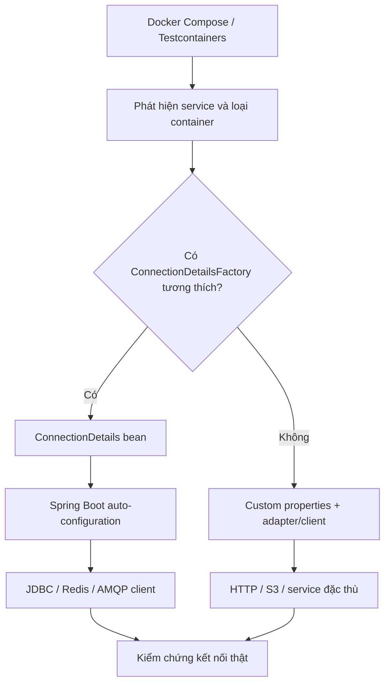
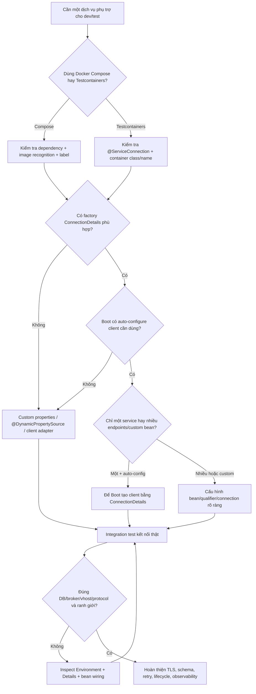
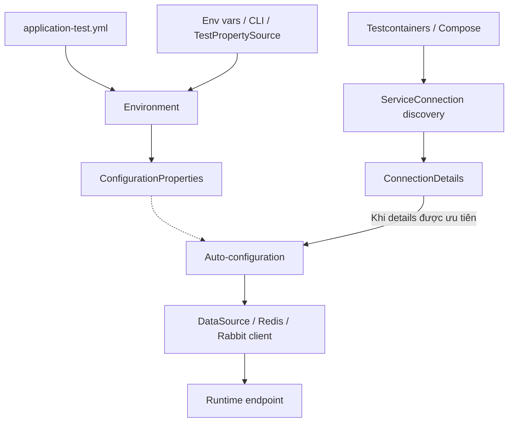

# Nhận diện dịch vụ được Boot hỗ trợ và trường hợp cần cấu hình riêng

## 1. Vấn đề thực tế: chạy dịch vụ phụ trợ không đồng nghĩa ứng dụng đã kết nối được

Trong quá trình phát triển một hệ thống tích hợp Spring Boot, nhóm thường cần nhiều dịch vụ bên ngoài: PostgreSQL cho đơn hàng, Redis cho cache, RabbitMQ cho message, Kafka cho event, một HTTP mock cho Inventory API và đôi khi object storage tương thích S3. Trước đây, developer phải bật từng container, tìm host/port được ánh xạ, tạo tài khoản, điền các property `spring.*`, sau đó tự chẩn đoán khi môi trường local và CI không nhất quán.

Spring Boot có cơ chế **development-time services** hỗ trợ kết nối thuận tiện với **một số loại dịch vụ đã biết** qua **Docker Compose** hoặc **Testcontainers**. Trong trường hợp tương thích, Boot có thể tìm service/container, lấy endpoint/credential và cung cấp bean **`ConnectionDetails`** để auto-configuration tạo client đúng địa chỉ. Nhưng có ba điều không được đánh đồng:

1. **Container/service đã chạy:** Docker có một process và cổng mạng.
2. **Boot nhận diện loại dịch vụ và có factory phù hợp:** ví dụ nhận diện PostgreSQL để tạo `JdbcConnectionDetails`.
3. **Client của ứng dụng thực sự sử dụng connection details:** ví dụ `DataSource` do Boot auto-configure thay vì một custom `DataSource` hardcode.

Không phải mọi image Docker đều được nhận diện; không phải mọi loại client đều có `ConnectionDetails`; và ngay cả khi property xuất hiện đúng trong `application.yml`, bean được xây từ `ConnectionDetails` vẫn có thể dùng endpoint khác.

Bài học thuộc chương **Dịch vụ phát triển** của module **SPRING_BOOT_INTEGRATION**. Module tổ chức tích hợp hệ thống Spring Boot qua HTTP client, cơ sở dữ liệu, cache, broker thông điệp và các adapter của Spring Integration, đặt trọng tâm vào **cấu hình, hợp đồng dữ liệu, transaction, lỗi, xử lý trùng lặp, kiểm thử và quan sát**. Vì thế, bài tập sẽ không chỉ “start container rồi thấy test xanh”, mà còn xác minh dịch vụ được hỗ trợ, quyết định khi nào cấu hình riêng và chứng minh đường kết nối thật.

### 1.1. Kết quả học tập

Sau bài học, bạn có thể:

- Giải thích cách **Docker Compose support**, **Testcontainers `@ServiceConnection`**, **`ConnectionDetails`** và auto-configuration phối hợp.
- Nhận diện service thường được Spring Boot hỗ trợ và hiểu **danh sách hỗ trợ phụ thuộc phiên bản/library**, không suy từ việc Docker chạy được image.
- Phân biệt nhận diện qua **tên image**, **loại Testcontainers container** và **tên service được chỉ định tường minh**.
- Cấu hình một stack local PostgreSQL–Redis–RabbitMQ với Compose và một integration test tương đương bằng Testcontainers.
- Chọn `@DynamicPropertySource`, `@ConfigurationProperties`, custom `ConnectionDetails` hoặc custom client khi dịch vụ chưa có hỗ trợ tự động.
- Chẩn đoán trường hợp `spring.datasource.url`/`spring.data.redis.host` “không có hiệu lực” vì connection details hoặc một property source có ưu tiên cao hơn.
- Viết test chống nhầm endpoint, tenant, database và broker vhost; kiểm soát lifecycle, TLS/secret và ranh giới local–CI–production.

> **Phạm vi phiên bản:** Các ví dụ hướng đến Java 17+, Spring Boot 3.2+ và Spring Framework 6.x; `@ServiceConnection` được giới thiệu trong Spring Boot 3.1. **Hỗ trợ image, bean `ConnectionDetails`, label và auto-configuration có thể thay đổi theo phiên bản**. Cần đối chiếu tài liệu tham chiếu chính xác cho phiên bản Spring Boot của dự án trước khi đưa một service mới vào CI/production. Ví dụ Java lược bớt import; code minh họa phải được bổ sung dependency và tài nguyên test phù hợp.

### 1.2. Tình huống xuyên suốt

Giả sử Order Service có:

| Phụ trợ | Đường tích hợp | Mục đích |
|---|---|---|
| PostgreSQL | Spring Data JPA/JDBC | Nguồn dữ liệu đơn hàng và transactional outbox |
| Redis | `RedisTemplate` | Cache tồn kho có TTL, không phải nguồn sự thật |
| RabbitMQ | Spring AMQP / Spring Integration AMQP | Phát và nhận event bất đồng bộ |
| HTTP mock Inventory | `RestClient`/`WebClient` | Mô phỏng hợp đồng HTTP của hệ thống ngoài |
| Object storage tương thích S3 | SDK/HTTP client tùy provider | Lưu tệp hóa đơn trước khi gửi email |

Ba service đầu **có thể** được Spring Boot nhận diện trong những cấu hình/phiên bản hỗ trợ thông dụng. Hai service cuối **không nên mặc định** có auto-generated connection details cho custom HTTP client hoặc mọi S3-compatible emulator: thường cần property/client configuration riêng, trừ khi đã có integration cụ thể hỗ trợ.



**Nguyên tắc cốt lõi:** “Boot hỗ trợ một dịch vụ” có nghĩa là có **tích hợp nhận diện + loại connection details + nơi tiêu thụ** phù hợp cho **một đường kết nối cụ thể**, không có nghĩa toàn bộ công nghệ ấy được tự cấu hình trong mọi trường hợp.

## 2. Mô hình Spring Boot development services

### 2.1. `ConnectionDetails` là gì?

Spring Boot định nghĩa các abstraction mô tả thông tin cần thiết để một loại client kết nối tới một service: host/port, JDBC URL, username/password, SSL/broker endpoint... tùy loại. Thay vì buộc mọi nguồn dữ liệu chuyển thành chuỗi property, các auto-configuration có thể hỏi một bean `ConnectionDetails` tương ứng.

Ví dụ những type thường gặp trong Spring Boot 3.x:

- `JdbcConnectionDetails` dùng cho auto-configuration JDBC `DataSource`.
- `R2dbcConnectionDetails` cho kết nối R2DBC reactive.
- `RedisConnectionDetails` cho Redis client/factory phù hợp.
- `RabbitConnectionDetails` cho RabbitMQ AMQP.
- `KafkaConnectionDetails` cho Kafka.
- Các service khác có connection details tương ứng khi phiên bản Boot/auto-configuration hỗ trợ.

Các abstraction trên **không phải** `javax.sql.DataSource`, `org.springframework.data.redis.connection.RedisConnectionFactory` hoặc một HTTP client đang mở socket. Chúng là **đầu vào mô tả kết nối**; auto-configuration/bean factory vẫn phải tạo client từ đó.

### 2.2. Tách nguồn discovery khỏi nơi tiêu thụ

```text
Nguồn connection information
  +-- application.yml / environment / command line
  +-- Docker Compose service được nhận diện
  +-- Testcontainers @ServiceConnection
  +-- custom ConnectionDetails bean
          |
          v
Auto-configuration / custom adapter
          |
          v
DataSource, R2DBC ConnectionFactory, RedisConnectionFactory,
Rabbit connection factory, Kafka client hoặc SDK tự viết
          |
          v
TCP/TLS connection và request thực
```

**Hai câu hỏi riêng biệt:**

1. Boot có tạo bean `JdbcConnectionDetails` hoặc bean details tương ứng không?
2. `DataSource`/repository/service thực tế có lấy bean đó không, hay ứng dụng định nghĩa một client riêng?

Khi trả lời câu hỏi thứ hai, phải kiểm tra cả bean custom, `@Primary`, `@Qualifier`, multi-datasource và auto-configuration conditions.

### 2.3. ConnectionDetails có ưu tiên khác với PropertySource precedence

Ví dụ `spring.datasource.url` trong `application-test.yml` vẫn là một giá trị cụ thể, nhưng `@ServiceConnection` có thể cung cấp `JdbcConnectionDetails` từ PostgreSQL Testcontainers. `DataSource` do Boot cấu hình sử dụng details này, trong khi:

```java
environment.getProperty("spring.datasource.url");
```

vẫn trả chuỗi từ YAML. Điều đó **không tự chứng minh một PropertySource ghi đè YAML**. Nó cho thấy **auto-configuration dùng đường cấp thông tin kết nối khác**.

Ngược lại, nếu `SPRING_DATASOURCE_URL` ở environment ghi đè `spring.datasource.url` trong file, giá trị `Environment` có thể thay đổi ngay vì **property precedence**. Hai cơ chế khác nhau phải được chẩn đoán riêng.

### 2.4. Không đồng nhất “dịch vụ được hỗ trợ” với “mọi endpoint của dịch vụ”

Một container PostgreSQL có thể cung cấp JDBC details, nhưng:

- Không tự chạy Flyway/Liquibase migration khi chưa có đúng dependency và cấu hình.
- Không bảo đảm JPA repositories đã scan đúng package/entity.
- Không tự tạo API HTTP cho database.
- Không chứng minh transaction manager đang dùng đúng datasource nếu có hai nguồn DB.
- Không có nghĩa PostgreSQL có TLS/HA/ACL tương đương production.

Tương tự, Redis nhận diện thành công không bảo đảm `RedisTemplate` đang dùng serializer, namespace, TTL hoặc logical DB mong muốn. RabbitMQ nhận diện được không tự khai báo exchange/queue/binding và không giải quyết consumer idempotency.

## 3. Docker Compose integration: từ service đang chạy tới client Boot

### 3.1. Dependency và phạm vi dùng

Thêm module Docker Compose hỗ trợ development-time cho Spring Boot:

```xml
<dependency>
    <groupId>org.springframework.boot</groupId>
    <artifactId>spring-boot-docker-compose</artifactId>
    <optional>true</optional>
</dependency>
```

Với Gradle Kotlin DSL, có thể đặt trong cấu hình development-only mà dự án đã tổ chức:

```kotlin
dependencies {
    developmentOnly("org.springframework.boot:spring-boot-docker-compose")
}
```

Mục tiêu là dùng Compose hỗ trợ **developer workflow**, không mặc định đưa quản lý Docker lifecycle vào production. Cách đóng gói của Maven/Gradle và Boot plugin ảnh hưởng dependency có xuất hiện trong executable artifact hay không; hãy kiểm tra profile/runtime thực thay vì chỉ đọc POM.

Máy developer/CI muốn dùng Compose phải có Docker Engine hoặc môi trường container tương thích và phiên bản Docker Compose được hỗ trợ. Thêm dependency **không cài Docker** và không bảo đảm service đã chạy.

### 3.2. Một Docker Compose stack nhỏ

Ví dụ file `compose.yaml` ở thư mục ứng dụng (minh họa, **không phải file đang được tạo bởi bài này**):

```yaml
services:
  postgres:
    image: postgres:16-alpine
    environment:
      POSTGRES_DB: orders
      POSTGRES_USER: orders_user
      POSTGRES_PASSWORD: local-only-password
    ports:
      - "127.0.0.1:5432:5432"
    healthcheck:
      test: ["CMD-SHELL", "pg_isready -U orders_user -d orders"]
      interval: 5s
      timeout: 3s
      retries: 10

  redis:
    image: redis:7.4-alpine
    ports:
      - "127.0.0.1:6379:6379"

  rabbitmq:
    image: rabbitmq:3.13-management-alpine
    ports:
      - "127.0.0.1:5672:5672"
      - "127.0.0.1:15672:15672"
```

**Lưu ý cú pháp cổng:** ví dụ dùng `127.0.0.1:5432:5432` để giới hạn host binding vào loopback và làm dễ thao tác thủ công. Host port cố định có thể **xung đột** với database/Redis/broker đang chạy hoặc dự án khác; trong dự án thật có thể dùng host port động theo cú pháp Compose được hỗ trợ, rồi để Boot lấy **mapped port** từ Docker, thay vì hardcode `localhost:5432` ở client. Luôn xác nhận mapping bằng `docker compose ps`.

Mật khẩu `local-only-password` **chỉ dành cho development cô lập**. Không copy sang production hoặc để Compose service bind cổng ra Internet. Image tag cần được pin/kiểm tra theo chính sách tổ chức; `postgres:16-alpine` không tự là một bản immutable theo digest.

Khi Spring Boot Compose integration nhận diện được các image hỗ trợ, nó có thể dùng **cổng host được Docker map** để tạo connection details. Vì ứng dụng chạy trên host khác mạng Docker, không nên mặc định rằng hostname `postgres` trong Compose cũng phân giải được từ process Java trên máy host.

### 3.3. Boot tìm Compose file và quản lý lifecycle

Trong cấu hình development-time thông thường, Boot có thể tìm Compose file ở location mặc định gần thư mục chạy ứng dụng; khi file ở đường dẫn khác có thể cấu hình `spring.docker.compose.file`. Nó có thể khởi động Compose services và đợi ready trước khi app kết nối, với lifecycle behavior tùy các property và trạng thái service đã tồn tại.

Ví dụ `application-local.yml`:

```yaml
spring:
  docker:
    compose:
      enabled: true
      file: ./compose.yaml
      lifecycle-management: start-and-stop
```

Các giá trị lifecycle phổ biến trong dòng Boot 3.x gồm `start-and-stop`, `start-only` và `none`; ý nghĩa chi tiết khi service **đã chạy trước startup**, khi app shutdown và trong test cần kiểm tra tài liệu chính xác của phiên bản. Không coi việc stop Spring Boot sẽ luôn hủy volume/database data hoặc dừng mọi container do người khác khởi động.

### 3.4. Readiness: container running không có nghĩa service sẵn sàng

Một PostgreSQL container có thể ở trạng thái `running` nhưng đang tạo database. Spring Boot Compose support có cơ chế kiểm tra readiness, trong đó có thể xem xét Docker healthcheck và kết nối TCP cho dịch vụ thích hợp. Tuy vậy:

- TCP port mở không chứng minh schema migration đã chạy.
- Một broker nhận TCP connection không chứng minh exchange/queue có sẵn.
- Redis trả PONG không chứng minh quyền key, TTL/serializer.
- Healthcheck container có thể kiểm tra riêng process nhưng chưa kiểm tra dependency của application.

Thiết kế readiness của ứng dụng phải phân biệt **dịch vụ phụ trợ đã nghe cổng**, **auto-configuration tạo bean được**, và **đường tích hợp nghiệp vụ hoạt động**. Đừng khởi động background job phát message/ghi DB trước khi migration/queue setup đã sẵn sàng theo contract.

### 3.5. Service discovery phụ thuộc loại image và hỗ trợ của Boot

Boot không đọc mọi `services:*` trong Compose rồi tự sinh client cho tất cả. Cơ chế thường dựa trên **image name/service type** được các connection details factory của Boot nhận diện. Cùng một container có thể chạy một giao thức phổ biến nhưng bị coi là image lạ khi registry dùng tên private như `registry.example.org/platform/my-postgres:custom`.

Đối với các image tùy biến dựa trên một dịch vụ đã được hỗ trợ, Compose integration ở các phiên bản có hỗ trợ cho phép khai báo label **`org.springframework.boot.service-connection`** với tên service phù hợp, chẳng hạn:

```yaml
services:
  postgres:
    image: registry.example.org/platform/postgres-with-extensions:dev
    labels:
      org.springframework.boot.service-connection: postgres
    ports:
      - "127.0.0.1:15432:5432"
```

Label làm rõ **loại service để nhận diện**, nhưng không cài driver/auto-configuration hoặc tự biến giao thức custom thành PostgreSQL. Nếu image thực không tương thích PostgreSQL, gắn label cũng không làm client hoạt động. Với image/service đặc thù không có factory, cần cấu hình riêng (mục 7–9).

### 3.6. Dịch vụ bị bỏ qua và giới hạn nhận diện

Một số phiên bản Boot hỗ trợ nhãn để **bỏ qua container khi tạo connection details** như `org.springframework.boot.ignore: true` trong Compose. Hãy xác minh cú pháp nhãn/hành vi trên phiên bản Boot được dùng. Bỏ qua một service có thể hữu ích khi bạn cần chạy nó nhưng muốn cấu hình client riêng; song nếu vẫn trông chờ Boot tạo Redis/JDBC details từ service ấy, nhãn bỏ qua sẽ gây lỗi khó hiểu.

Không coi việc “không thấy bean `ConnectionDetails`” chắc chắn là bug của Boot. Các nguyên nhân phổ biến gồm thiếu module Compose, file không được phát hiện, service có image không được nhận diện, service bị ignore, dependency client chưa có, profile/test bỏ qua Compose hoặc phiên bản Boot chưa hỗ trợ service đó.

## 4. Testcontainers `@ServiceConnection`: nhận diện ở môi trường kiểm thử

### 4.1. Hai dependency có vai trò khác nhau

Với một bài test tích hợp PostgreSQL:

```xml
<dependencies>
    <dependency>
        <groupId>org.springframework.boot</groupId>
        <artifactId>spring-boot-starter-data-jpa</artifactId>
    </dependency>
    <dependency>
        <groupId>org.postgresql</groupId>
        <artifactId>postgresql</artifactId>
        <scope>runtime</scope>
    </dependency>
    <dependency>
        <groupId>org.springframework.boot</groupId>
        <artifactId>spring-boot-starter-test</artifactId>
        <scope>test</scope>
    </dependency>
    <dependency>
        <groupId>org.springframework.boot</groupId>
        <artifactId>spring-boot-testcontainers</artifactId>
        <scope>test</scope>
    </dependency>
    <dependency>
        <groupId>org.testcontainers</groupId>
        <artifactId>junit-jupiter</artifactId>
        <scope>test</scope>
    </dependency>
    <dependency>
        <groupId>org.testcontainers</groupId>
        <artifactId>postgresql</artifactId>
        <scope>test</scope>
    </dependency>
</dependencies>
```

- **`spring-boot-testcontainers`** cung cấp tích hợp Spring Boot, ví dụ annotation `@ServiceConnection` và các connection-details factories.
- **`org.testcontainers:*`** cung cấp cách chạy/quản lý container và các class `PostgreSQLContainer`, `RabbitMQContainer`, `GenericContainer`.
- **JDBC driver và Spring Data/JPA** vẫn cần để tạo DataSource/repository; container không thay thế dependency ứng dụng.
- **`@Testcontainers`/`@Container`** của JUnit 5 quản lý vòng đời test container theo extension; `@ServiceConnection` là annotation của Spring Boot để cấp thông tin kết nối.

Không thay `spring-boot-testcontainers` bằng `spring-boot-docker-compose` và giả định hai cơ chế là một. Một cái tích hợp những container **do test tạo/điều phối**, cái kia hỗ trợ **Compose service** trong dev workflow, dù chúng đều có thể tạo `ConnectionDetails`.

### 4.2. Test đơn giản với PostgreSQLContainer

```java
// OrderRepositoryIT.java — imports lược bỏ
@SpringBootTest(
        webEnvironment = SpringBootTest.WebEnvironment.NONE,
        properties = {
                "spring.jpa.open-in-view=false"
        }
)
@Testcontainers
class OrderRepositoryIT {

    @Container
    @ServiceConnection
    static PostgreSQLContainer<?> postgres =
            new PostgreSQLContainer<>("postgres:16-alpine");

    @Autowired
    DataSource dataSource;

    @Test
    void datasourceUsesContainer() throws SQLException {
        try (Connection connection =
                     dataSource.getConnection()) {
            assertNotNull(connection);
            assertEquals(
                    "PostgreSQL",
                    connection.getMetaData()
                            .getDatabaseProductName());
        }
    }
}
```

Ví dụ giả định có `@SpringBootApplication` để Boot tìm thấy khi test khởi động, database schema phù hợp nếu repository có truy vấn, và máy CI có container runtime. `@ServiceConnection` cho phép Boot tạo những connection details phù hợp từ container đã được nhận diện; JDBC auto-configuration có thể dùng chúng để tạo DataSource với **mapped host port động**.

**Không nhất thiết đặt `spring.datasource.url` trong test:** nếu đã chọn `@ServiceConnection` và auto-configuration tương thích, để Boot kết nối container theo nguồn đã xác định. Nếu thêm một URL khác vào YAML, đọc property từ Environment có thể gây hiểu nhầm rằng app kết nối URL đó.

### 4.3. Container class giúp nhận diện

Với những class Testcontainers chuyên dụng như `PostgreSQLContainer` hoặc `RabbitMQContainer`, Spring Boot có thể dùng **loại container**, thông tin image và factory có sẵn để suy ra service type. Nhưng **một `GenericContainer<?>` không mô tả rõ công nghệ** chỉ nhờ kiểu Java chung; Boot thường cần xem image name hoặc một `name` được chỉ định.

Ví dụ Redis dùng GenericContainer:

```java
@Container
@ServiceConnection(name = "redis")
static GenericContainer<?> redis =
        new GenericContainer<>(
                DockerImageName.parse("redis:7.4-alpine"))
                .withExposedPorts(6379);
```

`name="redis"` là một **hint nhận diện service**, không phải bean name để inject và không phải hostname container. Khi dùng một image Redis tùy chỉnh trong private registry, hint này đặc biệt quan trọng; vẫn cần đúng port/giao thức và connection-details factory hỗ trợ Redis trong phiên bản Boot đang dùng.

### 4.4. Khi khai báo container bằng `@Bean`

Testcontainers integration có thể được khai báo bằng bean container trong một cấu hình test/development riêng, ví dụ:

```java
@TestConfiguration(proxyBeanMethods = false)
public class ContainerTestConfiguration {

    @Bean
    @ServiceConnection
    PostgreSQLContainer<?> postgresContainer() {
        return new PostgreSQLContainer<>(
                "postgres:16-alpine");
    }

    @Bean
    @ServiceConnection(name = "redis")
    GenericContainer<?> redisContainer() {
        return new GenericContainer<>(
                DockerImageName.parse("redis:7.4-alpine"))
                .withExposedPorts(6379);
    }
}
```

Một điểm về recognition: khi `@ServiceConnection` đặt trên **`@Bean` method**, Spring Boot có thể nhận biết **return type** khi bean còn chưa được tạo, nhưng không nhất thiết truy vấn được runtime Docker image name của container trước thời điểm khởi tạo. Với `GenericContainer<?>`, `name` tường minh giúp chọn factory. Với một dedicated subclass mà type đã biết, annotation không nhất thiết cần `name`.

Bean container được Spring Boot quản lý lifecycle theo cơ chế test/dev tương ứng; không đồng nhất với `@Container` JUnit static field. Không phối hợp cả hai dạng cho cùng một container một cách ngẫu nhiên vì dễ dẫn đến start/stop trùng hoặc bean/port không khớp.

### 4.5. Hạn chế type khi một container có nhiều đường kết nối

Một PostgreSQL container có thể hỗ trợ cả JDBC và R2DBC connection details nếu các factory/driver tương ứng hiện diện. Khi ứng dụng chỉ muốn JDBC, có thể hạn chế loại details mà annotation tạo **theo API của phiên bản Spring Boot đang dùng**:

```java
@Container
@ServiceConnection(type = JdbcConnectionDetails.class)
static PostgreSQLContainer<?> postgres =
        new PostgreSQLContainer<>("postgres:16-alpine");
```

Việc này hữu ích khi classpath có cả JDBC/R2DBC nhưng bài test chỉ có một đường kết nối. Không giả định `@ServiceConnection` luôn tạo đồng thời JDBC và R2DBC, cũng không mong JDBC driver có thể chạy R2DBC. Nếu dùng reactive query, cần starter/driver `r2dbc-postgresql` và kiểm tra `R2dbcConnectionDetails`/`ConnectionFactory` tương ứng.

### 4.6. Testcontainers không có nghĩa test chạy không cần Docker

Nếu CI không cung cấp Docker/container runtime tương thích, test có thể fail trước cả khi Spring context được tạo. Đây là lỗi **test infrastructure**, không nên xử lý bằng cách fallback ngầm sang production database. Những test tích hợp cần đúng network access, resource quota, image policy và lifecycle cleanup; nếu runtime không hỗ trợ, tách test unit/integration hoặc cung cấp fixture test riêng.

Không sử dụng `@ServiceConnection` để trỏ test tự động tới một database production. Nó dành cho những tài nguyên được kiểm soát trong dev/test. Khi cần một môi trường staging cố định, xem xét một profile cấu hình tường minh với credential an toàn và guard chống chạm nhầm dữ liệu thật.

## 5. Nhóm dịch vụ Boot có thể nhận diện: bảng tham chiếu có điều kiện

Danh sách hỗ trợ thay đổi theo Spring Boot release và dependency. Bảng sau là **nhóm điển hình trong họ Spring Boot 3.x**, **không phải danh sách cam kết đầy đủ cho mọi minor version**:

| Nhóm dịch vụ | Ví dụ image/container | Connection details/client thường liên quan | Điểm phải xác minh |
|---|---|---|---|
| PostgreSQL | `postgres`, `PostgreSQLContainer` | `JdbcConnectionDetails`, có thể `R2dbcConnectionDetails` | Driver, DB name, user/password, schema |
| MySQL/MariaDB | `mysql`, `mariadb`, dedicated containers | JDBC/R2DBC theo support/version | Dialect, port, init schema, TLS |
| SQL Server/Oracle và DB khác | Dedicated Testcontainers/image được hỗ trợ | JDBC details khi có factory | EULA, image support, driver, license |
| Redis | `redis`, GenericContainer có name hint | `RedisConnectionDetails`/Lettuce factory | URL vs host, ACL/TLS, serializer, logical DB |
| RabbitMQ | `rabbitmq`, `RabbitMQContainer` | `RabbitConnectionDetails` | Vhost, exchange/queue/binding, credentials |
| Kafka | Image Kafka tương thích, `KafkaContainer` | `KafkaConnectionDetails` | Advertised listeners và bootstrap endpoints |
| MongoDB | `mongo`, `MongoDBContainer` | Mongo connection details/client | Replica set, auth, codec, DB |
| Elasticsearch | Image/service đã biết | Elasticsearch connection details/client | HTTP vs transport, TLS, index lifecycle |
| Neo4j | `neo4j`, dedicated container | Neo4j connection details/driver | Bolt URI, credentials, DB |
| Cassandra | Image/container có factory hỗ trợ | Cassandra client details | Datacenter, keyspace, schema migration |
| Các dịch vụ khác | Pulsar, Couchbase, OpenSearch, Artemis, Zipkin... tùy phiên bản | Mỗi service có thể có details riêng hoặc không | Kiểm tra **support matrix của đúng Boot version** |

**Phân biệt “có image” với “có factory”:** ví dụ một image Kafka phân phối bởi vendor riêng có thể dùng protocol tương thích, nhưng Spring Boot không nhận diện tên image đó; cần label/name hint được hỗ trợ hoặc cấu hình bootstrap servers thủ công. Ngược lại, nhận diện image Kafka không tự cấu hình consumer group, serializer hay retry.

### 5.1. Bằng chứng một service được hỗ trợ gồm ba tầng

Để kết luận một dịch vụ đã được Boot hỗ trợ **trong dự án cụ thể**, cần xác minh:

1. **Discovery:** Boot thấy đúng Compose service/Testcontainers instance và nhận diện type tương ứng.
2. **Details:** context có bean `ConnectionDetails` thuộc loại được auto-configuration mong đợi.
3. **Consumer:** client/factory thực nhận thông tin đó; một lệnh/query/message trên service test xác nhận endpoint thực.

Chỉ kiểm tra tên image có chứa `postgres` hoặc Docker container ở trạng thái `healthy` là **chưa đủ**. Cũng không nên kiểm tra mỗi `Environment.getProperty("spring.datasource.url")` rồi kết luận vì details có thể được dùng mà không ghi đè property.

### 5.2. Một service có thể được hỗ trợ một phần

PostgreSQL là ví dụ rõ:

- Boot tạo `JdbcConnectionDetails` giúp JDBC `DataSource` kết nối container.
- Một `EntityManagerFactory` JPA có thể dùng `DataSource` đó khi có đúng JPA starter.
- Flyway/Liquibase chỉ tự chạy migration khi dependency, resources và property phù hợp.
- Một custom reporting `DataSource` với `@Bean` riêng có thể vẫn dùng URL khác.
- Một `R2dbcConnectionFactory` cần các điều kiện và driver riêng.

Vì vậy, **hỗ trợ connection bootstrap không đồng nghĩa hỗ trợ hoàn chỉnh mọi API/nghiệp vụ sử dụng service**.

### 5.3. Spring Boot không tự hỗ trợ mọi API tùy chỉnh

Những ví dụ cần phân tích trước khi tự động hóa:

- Một **REST API nội bộ** chạy trong một container `mycompany/inventory-mock`, được gọi qua `RestClient`.
- Một **S3-compatible object storage** emulator với endpoint, region và credential riêng.
- Một **gRPC service** cần channel, TLS, authority và service-discovery riêng.
- Một **GraphQL gateway** hoặc SaaS API có OAuth2 token.
- Một **Proprietary TCP service** với protocol nội bộ.

Trừ khi dự án có một integration/auto-configuration hỗ trợ đúng loại đó, Boot sẽ **không thể suy từ tên image ra cách tạo client**. Khi ấy, dùng `@ConfigurationProperties` + client adapter, `@DynamicPropertySource` trong test, hoặc tự định nghĩa `ConnectionDetails`/factory đúng chuẩn khi lợi ích tái sử dụng đủ lớn.

### 5.4. Ngay cả dịch vụ được nhận diện vẫn có phần phải cấu hình riêng

RabbitMQ connection details có thể cung cấp endpoint, user/password. Nó **không** tự biết rằng service cần:

```text
exchange = order.events.v1
queue = order.invoice.worker.v1
routingKey = order.confirmed
DLQ = order.invoice.worker.dlq
```

Tương tự, Redis connection details không tự định nghĩa `inventory:v1:stock:{sku}`, TTL 60 giây, serializer JSON, circuit breaker hay idempotency policy. Những phần này là **hợp đồng ứng dụng**, phải được cấu hình và kiểm thử riêng ngay cả khi kết nối được Boot dựng tự động.

## 6. Quy trình quyết định: dùng tự động hay cấu hình thủ công?



### 6.1. Trường hợp nên dùng auto-discovery

- Ứng dụng chỉ có **một PostgreSQL datasource** cho JPA/JDBC và dùng Boot auto-configuration.
- Integration test dùng **một PostgreSQLContainer** được `@ServiceConnection` nhận diện.
- Local development dùng Compose `redis` hoặc `rabbitmq` quen thuộc, client tạo bởi starter Boot tương ứng.
- Không cần tham số giao thức khác biệt ngoài những property vẫn được Boot hỗ trợ cùng connection details.

Ưu điểm: ít cấu hình endpoint trùng lặp, không hardcode mapped port, onboarding nhanh, test độc lập với database service cài trên máy.

### 6.2. Trường hợp cần cấu hình riêng hoặc kết hợp

- Image thuộc private registry hoặc protocol compatible nhưng Boot không nhận diện.
- Có **hai PostgreSQL datasources**, một cho orders và một cho analytics, với `EntityManagerFactory` và transaction manager riêng.
- Có hai Redis clusters/instances, hoặc một Redis dùng TLS/ACL client options đặc biệt.
- Custom HTTP/S3/gRPC service không có connection details factory phù hợp.
- Client được tạo thủ công với endpoint/protocol riêng, không đọc `spring.*` properties của Boot.
- Dự án cần **production-like TLS/mTLS**, proxy, certificate validation, broker vhost, failover/cluster hoặc các lựa chọn vendor-specific.

Nguyên tắc là **một nguồn cấu hình có ownership rõ cho từng client**. Không tạo đồng thời một `@ServiceConnection`, một `@DynamicPropertySource`, một hardcoded URL và một bean custom trỏ tới bốn endpoint khác nhau rồi kỳ vọng Spring tự hiểu mục đích.

## 7. Cấu hình riêng cho HTTP service không nằm trong danh sách nhận diện

### 7.1. Bài toán: Inventory API chạy trong một container tự tạo

Giả sử trong local/CI, ứng dụng cần một HTTP mock cho API:

```text
GET /api/v1/stock/SKU-42
Accept: application/json

200 OK
{
  "sku": "SKU-42",
  "available": 8,
  "revision": 17
}
```

Image HTTP mock có thể chạy bình thường bằng Docker Compose, nhưng **không có lý do mặc định** để Boot suy ra `integration.inventory.base-url` từ tên image đó. `JdbcConnectionDetails`, `RedisConnectionDetails` hay `RabbitConnectionDetails` đều không có nghĩa đối với REST Inventory API.

Giải pháp thường đơn giản và rõ nhất là: **giữ HTTP endpoint dưới một property ứng dụng**, rồi tạo client bằng `@ConfigurationProperties`. Nếu endpoint thay đổi vì Testcontainers mapped port, cấp property động từ container test.

### 7.2. Định nghĩa hợp đồng cấu hình và validate

```yaml
# application-local.yml
integration:
  inventory:
    base-url: http://localhost:18080
    response-timeout: 3s
```

```java
// InventoryClientProperties.java — imports rút gọn
@ConfigurationProperties(prefix = "integration.inventory")
public record InventoryClientProperties(
        URI baseUrl,
        Duration responseTimeout
) {
    public InventoryClientProperties {
        if (baseUrl == null
                || baseUrl.getScheme() == null
                || baseUrl.getHost() == null) {
            throw new IllegalArgumentException(
                    "integration.inventory.base-url không hợp lệ");
        }
        String scheme = baseUrl.getScheme();
        if (!"http".equalsIgnoreCase(scheme)
                && !"https".equalsIgnoreCase(scheme)) {
            throw new IllegalArgumentException(
                    "Chỉ hỗ trợ HTTP hoặc HTTPS");
        }
        if (responseTimeout == null
                || responseTimeout.isZero()
                || responseTimeout.isNegative()) {
            throw new IllegalArgumentException(
                    "response-timeout phải lớn hơn 0");
        }
    }
}
```

Property `integration.inventory.*` do **ứng dụng định nghĩa**, không tự là property của Spring Boot. Để binder tạo bean, dùng `@ConfigurationPropertiesScan` trên application class hoặc đăng ký qua `@EnableConfigurationProperties(InventoryClientProperties.class)`.

Ở production cần thêm chính sách cho **đích kết nối được phép**: không nhận `baseUrl` trực tiếp từ request người dùng và ghép thành arbitrary URL. Một HTTP client gọi endpoint tùy ý có thể tạo **SSRF** tới mạng nội bộ hoặc cloud metadata service; endpoint phải đến từ trusted configuration, có allowlist/TLS/authorization phù hợp.

### 7.3. Tạo RestClient từ property, không hardcode

```java
// InventoryHttpConfiguration.java — imports rút gọn
@Configuration(proxyBeanMethods = false)
@EnableConfigurationProperties(InventoryClientProperties.class)
public class InventoryHttpConfiguration {

    @Bean("inventoryRestClient")
    RestClient inventoryRestClient(
            RestClient.Builder builder,
            InventoryClientProperties config
    ) {
        SimpleClientHttpRequestFactory requestFactory =
                new SimpleClientHttpRequestFactory();
        requestFactory.setConnectTimeout(2_000);
        requestFactory.setReadTimeout(
                Math.toIntExact(
                    config.responseTimeout().toMillis()));

        return builder
                .baseUrl(config.baseUrl().toString())
                .requestFactory(requestFactory)
                .build();
    }
}
```

Ví dụ dùng `SimpleClientHttpRequestFactory` cho **một client đồng bộ đơn giản**, không phải khuyến nghị duy nhất cho workload lớn. Với Apache HttpClient/Jetty/Reactor Netty, connection pool, TLS, per-request deadline và timeout cần được cấu hình theo client factory thực. Spring `RestClient` có thể dùng `ClientHttpRequestFactory` khác nhau theo classpath; việc **chọn tường minh** factory giúp ví dụ predictable.

Khi có nhiều `RestClient` bean, inject `@Qualifier("inventoryRestClient")` hoặc bọc trong adapter `InventoryGateway` cụ thể. Không dùng một bean mặc định duy nhất cho mọi external service nếu từng service cần credential, base URL, circuit breaker và policy khác.

### 7.4. Adapter HTTP có hợp đồng rõ

```java
// StockSnapshot.java
public record StockSnapshot(
        String sku,
        long available,
        long revision
) {}

// InventoryGateway.java
@Component
public class InventoryGateway {
    private final RestClient client;

    public InventoryGateway(
            @Qualifier("inventoryRestClient") RestClient client
    ) {
        this.client = client;
    }

    public StockSnapshot getStock(String sku) {
        if (sku == null
                || !sku.matches("[A-Za-z0-9_-]{1,80}")) {
            throw new IllegalArgumentException("SKU không hợp lệ");
        }

        StockSnapshot stock = client.get()
                .uri("/api/v1/stock/{sku}", sku)
                .retrieve()
                .body(StockSnapshot.class);

        if (stock == null
                || !sku.equals(stock.sku())
                || stock.available() < 0
                || stock.revision() < 0) {
            throw new IllegalStateException(
                    "Inventory API trả dữ liệu không hợp lệ");
        }
        return stock;
    }
}
```

Đoạn code này cố ý **không retry vô hạn**. Trong production, xác định cách xử lý `404`, `429`, `5xx` và timeout; áp request/response validation, tracing, authentication, circuit breaker và overall retry budget. Khi Inventory API chỉ là nguồn dữ liệu tham khảo, có thể fallback cache; nếu endpoint phục vụ quyết định giữ hàng, phải tuân theo consistency contract và idempotency riêng.

### 7.5. Trong test: dùng mapped port thay vì endpoint cố định

Một HTTP mock được chạy bằng Testcontainers `GenericContainer` có thể dùng `@DynamicPropertySource` để cấp đúng URL:

```java
// InventoryHttpIT.java — imports rút gọn
@SpringBootTest(
        classes = InventoryHttpTestApplication.class,
        webEnvironment = SpringBootTest.WebEnvironment.NONE
)
@Testcontainers
class InventoryHttpIT {

    @Container
    static GenericContainer<?> fakeInventory =
            new GenericContainer<>(
                DockerImageName.parse("wiremock/wiremock:3.6.0"))
                .withExposedPorts(8080);

    @DynamicPropertySource
    static void inventoryProperties(
            DynamicPropertyRegistry registry
    ) {
        registry.add(
                "integration.inventory.base-url",
                () -> "http://" + fakeInventory.getHost()
                        + ":" + fakeInventory.getMappedPort(8080));
        registry.add(
                "integration.inventory.response-timeout",
                () -> "3s");
    }

    // Test hoàn chỉnh cần cấu hình WireMock stubs
    // hoặc mount mappings/responses vào container,
    // rồi gọi InventoryGateway và assert path/body/status.
}
```

`InventoryHttpTestApplication` là cấu hình bootstrap test riêng cần khai báo (ví dụ `@SpringBootConfiguration`, `@EnableAutoConfiguration`, `@Import({InventoryHttpConfiguration.class, InventoryGateway.class})` theo project). Image tag chỉ mang tính minh họa và cần pin/kiểm tra trong registry/CI; test thực phải tạo **stub response** trước khi gọi endpoint.

Không thêm `@ServiceConnection(name="inventory")` với hy vọng Boot tự tạo một `RestClient` Inventory: trừ khi dự án đã cung cấp đúng custom connection details factory và auto-configuration, annotation không có cơ chế tích hợp riêng cho mọi HTTP image.

### 7.6. Khi một HTTP endpoint chạy ở Compose service khác

Nếu Spring Boot chạy **trên máy host**, một mock HTTP có thể bind port `18080`:

```yaml
services:
  inventory-mock:
    image: wiremock/wiremock:3.6.0
    ports:
      - "127.0.0.1:18080:8080"
```

Và property `integration.inventory.base-url=http://localhost:18080` sẽ hoạt động trong mô hình host app. Nếu Spring Boot **cũng chạy trong Docker network**, endpoint có thể cần `http://inventory-mock:8080` thay vì host loopback. Đây là vấn đề **network topology**, không phải lỗi nhận diện `@ServiceConnection`.

## 8. Những trường hợp cần cấu hình kết nối thủ công rõ ràng

### 8.1. Multi-datasource và transaction manager

Nếu Order Service dùng một PostgreSQL cho order/outbox và một PostgreSQL khác cho báo cáo, **một** `JdbcConnectionDetails` mặc định không mô tả đủ hai datasource có ownership khác nhau. Cần cấu hình:

```text
ordersDataSource     -> ordersEntityManagerFactory     -> ordersTransactionManager
analyticsDataSource  -> analyticsEntityManagerFactory  -> analyticsTransactionManager
```

Mỗi nguồn có URL/credentials/schema/transaction manager riêng, repository scan/`@EnableJpaRepositories` phù hợp và test độc lập. Nếu hai container đều được nhận diện và tạo bean details cùng type, Spring có thể gặp **ambiguous beans** hoặc chọn sai khi custom config thiếu qualifier. Không giải quyết bằng `@Primary` đặt tùy tiện.

Trong test, có thể dùng hai `PostgreSQLContainer` rồi cấp URL riêng cho hai prefix ứng dụng qua `@DynamicPropertySource`, hoặc định nghĩa two named connection-details/bean wiring được hỗ trợ một cách rõ ràng. Dù cùng một PostgreSQL process, hai logical databases không tự có atomic commit chung; với workflow cross-DB cần outbox/saga hoặc transaction XA có hạ tầng thực sự hỗ trợ.

### 8.2. Hai Redis instances: cache và coordination

Ví dụ:

```yaml
app:
  redis:
    cache:
      host: cache.local.test
      port: 6379
    coordination:
      host: coordination.local.test
      port: 6380
```

Nếu ứng dụng dùng `spring.data.redis.*` cho Redis mặc định, nó không tự cấu hình **hai** `LettuceConnectionFactory` vì xuất hiện hai prefix `app.redis.*`. Cần hai bean factory/template với `@Qualifier`, cấu hình TLS/ACL/pool và selector ownership tường minh:

```java
// Phác thảo wiring ở mức component.
public record RedisEndpoint(
        String host, int port
) {}

// Được bind từ app.redis.cache và
// app.redis.coordination bằng @ConfigurationProperties.
@Bean("cacheRedisConnectionFactory")
RedisConnectionFactory cacheRedisConnectionFactory(
        RedisCacheProperties properties
) {
    RedisStandaloneConfiguration server =
            new RedisStandaloneConfiguration(
                    properties.host(), properties.port());
    return new LettuceConnectionFactory(server);
}
```

`RedisCacheProperties` là record/properties class **cần định nghĩa** trong dự án; đoạn này là khung, không bao gồm TLS, credentials, pool hay second factory nên **không** dùng như cấu hình production hoàn chỉnh. Quan trọng là nguồn và tên bean rõ, tránh một `StringRedisTemplate` vô tình dùng Redis coordination để lưu cache.

Nếu `@ServiceConnection` tự tạo Redis details cho một instance nhưng code cố gắng tạo hai factories riêng, phải kiểm chứng cả hai factories thực dùng endpoint nào. Không mặc định “Boot sẽ tự gắn đúng container theo bean name” nếu integration không cung cấp cơ chế mapping đó.

### 8.3. Redis Sentinel/Cluster, TLS và cấu hình vendor-specific

Một Redis standalone container đã được nhận diện chưa chắc mô phỏng được **Sentinel/Cluster**, TLS/mTLS, ACL hoặc managed-service proxy. Khi triển khai production có:

- Redis Cluster topology/`MOVED`/`ASK`.
- Redis Sentinel failover.
- Certificate truststore hoặc client certificate.
- Tài khoản ACL/secret rotation.
- Kích thước connection pool và command/read timeout.

cần cấu hình client và test topology tương ứng. Đừng gắn service label Redis rồi tuyên bố đã kiểm thử failover/SSL vì container local chỉ chạy cổng `6379` không TLS.

### 8.4. RabbitMQ và Kafka: nhận diện connection chưa đủ

Một `RabbitConnectionDetails` có thể cung cấp broker endpoint/credential, nhưng ứng dụng vẫn cần thiết kế:

- Exchange, queue, binding, routing key, virtual host.
- Publisher confirm/return, consumer ack, retry, DLQ.
- Message schema/version, deduplication và transaction boundary.

Kafka bootstrap details cũng không tự cấu hình topic ACL, consumer group, serializer/deserializer, offset policy, schema registry hoặc transactional producer. Trường hợp Kafka container báo host sai sau connect có thể liên quan **advertised listeners**, không nhất thiết do Boot không nhận diện image.

Với những thuộc tính chuyên biệt, giữ Boot connection details cho **bootstrap transport** và cấu hình application properties/adapter ở **lớp contract**. Chỉ custom toàn bộ connection factory khi auto-configuration không đáp ứng đúng nhu cầu.

### 8.5. Object storage/S3-compatible emulator

Một image object-storage giả lập có thể cung cấp endpoint HTTP, access key/secret, region, path-style access và bucket riêng. Nếu dự án không có integration Boot nhận diện image ấy, tạo client bằng SDK và properties tường minh:

```yaml
integration:
  object-storage:
    endpoint: http://localhost:19000
    region: us-east-1
    bucket: integration-fixtures
    # Credentials đặt bằng secret env ở config phù hợp,
    # không hardcode trong repository.
```

SDK thường cần chính sách path-style, bucket creation, TLS và token riêng. `@DynamicPropertySource` trong Testcontainers có thể cấp endpoint từ mapped port; các giá trị region/credential/namespace nên đến từ fixture đã được kiểm soát.

**Tránh đồng nhất “S3-compatible” với “mọi tính năng S3 đều có”:** emulator có thể khác về bucket policy, multipart upload, object versioning và consistency; test production-like cần xác minh những hành vi thực sự dùng.

### 8.6. Khi cần custom ConnectionDetails bean

Nếu nhiều service/ứng dụng dùng **một protocol tùy chỉnh** và bạn muốn tránh lặp configuration parser/client builder, có thể thiết kế abstraction:

```java
public interface InventoryConnectionDetails {
    URI baseUrl();
}

@Configuration(proxyBeanMethods = false)
class InventoryConnectionConfiguration {
    @Bean
    InventoryConnectionDetails inventoryConnectionDetails(
            InventoryClientProperties properties) {
        return properties::baseUrl;
    }
}
```

Đây là **abstraction do dự án tự định nghĩa**, không phải loại `ConnectionDetails` mặc định của Spring Boot. Một bean details riêng **không đủ** nếu không có auto-configuration hoặc adapter đọc nó. Muốn tích hợp sâu với nhận diện container, phải viết/đăng ký factory nhận diện tương thích với Spring Boot version, mapping image/port/auth và client consumer; chỉ đáng làm khi nhiều project hưởng lợi và test/maintenance được tổ chức tốt.

Trong phần lớn ứng dụng nhỏ, một `@ConfigurationProperties` cộng adapter rõ ràng đơn giản hơn một custom connection-details ecosystem.

## 9. Property precedence và lý do “tôi đã sửa YAML nhưng ứng dụng vẫn dùng container”

### 9.1. Hai cơ chế ưu tiên cần phân biệt

**Cơ chế A — PropertySource precedence:** các nguồn như `application.yml`, `application-local.yml`, environment variables, system properties, command-line arguments hoặc test properties cùng cấp một key. `Environment` chọn giá trị hiệu lực theo thứ tự ưu tiên.

**Cơ chế B — ConnectionDetails:** Boot auto-configuration có thể sử dụng bean details thay vì đọc trực tiếp connection properties để dựng client. `Environment` không nhất thiết thay đổi, dù connection runtime thay đổi.



Ví dụ:

```yaml
# application-test.yml
spring:
  datasource:
    url: jdbc:postgresql://localhost:5432/legacy_test
    username: legacy_user
    password: legacy_password
```

```java
@Container
@ServiceConnection
static PostgreSQLContainer<?> postgres =
        new PostgreSQLContainer<>("postgres:16-alpine");
```

Trong context có auto-configuration tương thích, `Environment.getProperty("spring.datasource.url")` **vẫn có thể là** `jdbc:postgresql://localhost:5432/legacy_test`, còn `DataSource` lại dùng `postgres.getJdbcUrl()`. Chỉnh YAML nhiều lần không ảnh hưởng đường JDBC runtime nếu connection details từ container được dùng.

**Phương pháp chẩn đoán:** đọc effective property, liệt kê bean `JdbcConnectionDetails`, xác định bean `DataSource` thực tế, rồi mở connection để xem JDBC metadata. Không dừng lại ở việc thấy một giá trị trong Actuator.

### 9.2. Kiểm tra bean details và client runtime

Ví dụ trong integration test:

```java
@Autowired
ApplicationContext context;

@Autowired
ConfigurableEnvironment environment;

@Autowired
DataSource dataSource;

@Test
void inspectJdbcConnection() throws SQLException {
    Map<String, JdbcConnectionDetails> details =
            context.getBeansOfType(
                    JdbcConnectionDetails.class);
    assertFalse(details.isEmpty());

    String propertyUrl =
            environment.getProperty("spring.datasource.url");

    try (Connection connection =
                 dataSource.getConnection()) {
        String runtimeUrl =
                connection.getMetaData().getURL();
        assertNotNull(runtimeUrl);
        // Trong test có @ServiceConnection từ Postgres
        // có thể assert runtimeUrl tương ứng container.
    }
}
```

Đây là phương pháp **kiểm tra trong test có điều kiện**, không phải yêu cầu production luôn có bean details riêng hay luôn có property URL. Khi có custom datasource/multi-datasource, cần kiểm tra chính xác bean/`@Qualifier` được repository dùng.

Không đưa password, JDBC URL chứa credential hoặc nội bộ private endpoints vào log public. `runtimeUrl` có thể chứa host/database name; chỉ emit nếu môi trường diagnostic cho phép, hoặc assert trong test mà không in toàn bộ.

### 9.3. Property được ghi đè ở tầng Environment

Giả sử:

```yaml
# application-local.yml
spring:
  data:
    redis:
      host: localhost
      port: 6379
```

Nhưng process được chạy với environment variable `SPRING_DATA_REDIS_HOST=redis-old.local`. Trong binding được hỗ trợ, variable có thể thắng file. Nếu không có ServiceConnection, auto-config Redis sẽ lấy property hiệu lực đó.

Trước khi kết luận Compose đã override:

1. Kiểm tra active profile và config files thực sự được load.
2. Kiểm tra `SPRING_DATA_REDIS_HOST`, `SPRING_DATA_REDIS_URL` và properties khác có thể quyết định endpoint.
3. Xem `@TestPropertySource`, `@DynamicPropertySource`, `@SpringBootTest(properties=...)` nếu là test.
4. Kiểm tra có `RedisConnectionDetails` từ Docker Compose/ServiceConnection không.
5. Kiểm tra có custom `RedisConnectionFactory` hoặc `StringRedisTemplate` đang dùng bean khác không.
6. Chứng minh endpoint bằng test key có namespace/TTL riêng trên Redis fixture.

### 9.4. Không phải mọi bean đều dùng Boot properties

Ví dụ:

```java
@Bean
DataSource reportsDataSource() {
    HikariDataSource ds = new HikariDataSource();
    ds.setJdbcUrl(
            "jdbc:postgresql://reports.internal:5432/reporting");
    return ds;
}
```

Bean này **hardcode** JDBC URL và có thể làm Boot back off ở cấu hình `DataSource` mặc định. `spring.datasource.url` và connection details của PostgreSQL container không tự áp lên bean custom. Để sửa, phải thay cấu hình bean, loại hardcode, bind properties đúng hoặc tiêu thụ details theo thiết kế; không thêm nhiều layers environment overrides vô nghĩa.

### 9.5. Actuator và condition evaluation report

Trong môi trường chẩn đoán **đã bảo vệ** có Spring Boot Actuator, một số endpoint hữu ích:

```text
GET /actuator/env/spring.datasource.url
GET /actuator/env/spring.data.redis.host
GET /actuator/configprops
GET /actuator/conditions
```

- `env` giúp tìm effective value/origin của một property tùy phiên bản và quyền hiển thị.
- `configprops` giúp xem các properties bean đã bind gì.
- `conditions` giúp giải thích auto-configuration có chạy hay bị back off do bean/class/condition.

**Các endpoint có thể lộ thông tin nội bộ hoặc secrets.** Không public ngoài mạng tin cậy, không bật `show-values=always` tùy tiện, không in toàn bộ response vào CI log. Ngay cả `/actuator/conditions` cũng có thể tiết lộ cấu trúc ứng dụng nên phải có kiểm soát truy cập.

## 10. Chọn công cụ development phù hợp từng môi trường

### 10.1. Docker Compose cho môi trường local tái sử dụng

Compose phù hợp khi developer muốn một stack phụ trợ khá ổn định qua nhiều lần khởi động ứng dụng:

- PostgreSQL và Redis có thể giữ data trên volume local nếu team muốn.
- RabbitMQ hoặc Kafka có thể chạy lâu để debug message flow.
- Docker Compose file phục vụ nhiều developers và dễ kiểm tra cấu hình bằng `docker compose ps`/`logs`.
- Spring Boot Compose integration giúp giảm thao tác nhập thủ công endpoint/credentials của một số image được hỗ trợ.

Nhược điểm: cổng fixed có thể xung đột, volume cũ làm test sai, credentials local dễ được copy sai sang môi trường khác, và cả ứng dụng có thể nhìn thấy state từ các lần chạy trước. Cần quy tắc reset/test data rõ, tránh dùng volume shared cho kiểm thử tự động có thể chạy song song.

### 10.2. Testcontainers cho integration test cô lập

Testcontainers thường phù hợp hơn cho test CI:

- Container được tạo theo test lifecycle, mapped port động.
- Một test database sạch hoặc dữ liệu khởi tạo bằng migration/fixtures có thể tái lập.
- Có thể kiểm tra đúng database engine (PostgreSQL thay vì H2).
- `@ServiceConnection` giảm cấu hình host/port thủ công khi type được hỗ trợ.

Nhược điểm: cần Docker/container runtime, thời gian startup, image download/registry policy, memory và quản lý test song song. Không dùng shared static container giữa tests nếu nó lưu dữ liệu/mutable state không được reset, trừ khi suite có quy tắc cô lập rõ.

### 10.3. Khi phát triển local bằng Testcontainers thay vì Compose

Spring Boot có khả năng dùng **Testcontainers trong quá trình development**, bằng một entry point riêng có thể nạp test configuration, ví dụ mẫu:

```java
// LocalDevelopmentApplication.java — trong source set development/test phù hợp
public class LocalDevelopmentApplication {
    public static void main(String[] args) {
        SpringApplication
                .from(OrderApplication::main)
                .with(ContainerTestConfiguration.class)
                .run(args);
    }
}
```

Trong ví dụ, `OrderApplication` là Spring Boot application chính, `ContainerTestConfiguration` là `@TestConfiguration` chứa các container beans ở mục 4.4. Cách này giúp local app dùng những container được code khai báo mà không phải chạy một test JUnit. Cần bảo đảm dependency test/dev xuất hiện ở classpath **của entry point này**, và không đóng gói nó vào production vô tình.

Chạy container theo đường development này khác với dùng `@Container` trong JUnit 5: lifecycle do Spring Boot/dev run và bean definitions quản lý. Hãy theo dõi tiến trình/container cleanup, không kỳ vọng stop IDE luôn xóa mọi Docker data/volume.

### 10.4. Không bật development services trong production một cách ngầm định

Production nên lấy endpoint/credential từ secret manager, deployment configuration hoặc service discovery của hạ tầng production, với network security, certificate policy và rollout được quản lý riêng.

Một app production không nên tự chạy Docker Compose/test fixtures để cấp database thật; điều đó tạo quyền Docker daemon không cần thiết, lifecycle khó kiểm soát và rủi ro khởi động nhầm database. Phân chia bằng runtime classpath, build profile, deployment policy và CI validation, **không chỉ bằng tên file `application-prod.yml`**.

### 10.5. So sánh hai workflow

| Thuộc tính | Docker Compose integration | Testcontainers ServiceConnection |
|---|---|---|
| Nguồn khai báo | `compose.yaml` và Docker service/image | Java container fields/beans |
| Cách nhận diện | Image/service labels được Boot hỗ trợ | Container class/image và `@ServiceConnection` hint |
| Đích chính | Local dev | Integration test, cũng có thể local dev |
| Lifecycle | Theo Compose integration và chính sách app | JUnit extension hoặc Boot-managed container bean |
| Port | Host-mapped ports của Compose | Testcontainers mapped ports thường động |
| ConnectionDetails | Có khi image/factory được nhận diện | Có khi annotation/factory tương ứng được nhận diện |
| Tái sử dụng state | Có thể dùng volume lâu dài | Có thể cô lập theo test lifecycle |
| Phần chưa tự làm | Schema, queue, business contract, custom client | Tương tự; thêm kiểm soát test data |
| Rủi ro lớn | Lệch state/profile/port và chạy nhầm môi trường | Docker CI thiếu, test state/cached context |

## 11. Test theo đường kết nối thực thay vì dựa vào tên image

### 11.1. Kiểm thử nhận diện ở ba tầng

Một integration test có ích nên xác nhận:

1. **Container/service đã sẵn sàng**: có thể nhận command hợp lệ.
2. **Bean auto-configured đúng**: context có client factory và connection details tương thích khi thiết kế cần.
3. **Đường nghiệp vụ thật hoạt động**: query database test, ghi/đọc Redis key, publish/consume message, gọi HTTP stub đúng contract.

Chỉ kiểm tra `contextLoads()`, `docker compose ps` hoặc `assertNotNull(dataSource)` không đủ để chứng minh service thực sự kết nối đúng nơi.

### 11.2. PostgreSQL: verify data-source runtime

```java
@Autowired
DataSource dataSource;

@Test
void connectsToPostgresFixture() throws SQLException {
    try (Connection connection = dataSource.getConnection()) {
        assertEquals("PostgreSQL",
                connection.getMetaData()
                        .getDatabaseProductName());
        assertFalse(connection.isClosed());
    }
}
```

Muốn kiểm tra **đúng container** thay vì một PostgreSQL bất kỳ, so sánh endpoint/schema/fixture marker an toàn với `postgres.getJdbcUrl()` hoặc một test row duy nhất. Khi driver normalize JDBC URL, so sánh database name/host/port theo contract thay vì string equality cứng.

Với Flyway/Liquibase, thêm test rằng migration đã chạy và bảng `customer_order`/`outbox_event` tồn tại. Client kết nối thành công không đồng nghĩa schema đã sẵn sàng.

### 11.3. Redis: verify template, serializer và TTL

```java
@Autowired
StringRedisTemplate redis;

@Test
void writesAndExpiresTestKey() {
    String key = "it:development-service:"
            + UUID.randomUUID();
    try {
        redis.opsForValue().set(
                key, "ok", Duration.ofSeconds(30));
        assertEquals("ok",
                redis.opsForValue().get(key));
        Long ttl = redis.getExpire(
                key, TimeUnit.SECONDS);
        assertNotNull(ttl);
        assertTrue(ttl > 0);
    } finally {
        redis.delete(key);
    }
}
```

Test này chứng minh một `StringRedisTemplate` có thể ghi/đọc key với TTL trên factory đang được inject. Để chứng minh endpoint **đúng Redis fixture**, kiểm tra key ở đúng container hoặc đối chiếu bean details/client configuration; không suy từ kết quả `PING` thành công vì có thể đang kết nối Redis khác.

Không dùng `FLUSHALL` để dọn test khi Redis chia sẻ với ứng dụng khác; dùng namespace test và xóa key đã tạo.

### 11.4. RabbitMQ: verify route, không chỉ connection

Một `RabbitTemplate` có thể kết nối đúng broker mà queue vẫn không nhận vì sai virtual host, exchange, binding hoặc routing key. Integration test cần:

- Khai báo exchange/queue/binding **riêng cho test**.
- Publish message với schema/headers xác định.
- Consumer test nhận/ack theo cấu hình; hoặc xác minh message ở queue test có deadline.
- Kiểm tra publish confirms/returns khi cần, không coi gọi `convertAndSend` luôn là broker đã nhận chắc chắn.

Không làm test với queue production, không để test consume message thật của một service khác.

### 11.5. HTTP mock: verify URL động và path thật

`@DynamicPropertySource` từ container HTTP mock có thể tạo URL `http://127.0.0.1:<mappedPort>`. Nhưng test phải **thực sự gọi** `InventoryGateway.getStock("SKU-42")` và dùng mock server assert request path, status, response JSON và header. Nếu custom RestClient vẫn hardcode `http://localhost:18080`, việc property có giá trị đúng sẽ không làm request tới mock container.

Khi fake server trả 404 hoặc 500, assert adapter phân loại lỗi theo contract; không để một test HTTP chỉ pass khi `getStock()` được mock hoàn toàn vì như vậy chưa kiểm tra wiring.

### 11.6. Kiểm thử sự khác nhau giữa YAML và ServiceConnection

Một test chuyên biệt có thể cố ý đặt:

```text
spring.datasource.url=jdbc:postgresql://127.0.0.1:1/unused
```

và thêm PostgreSQL `@ServiceConnection`. Nếu DataSource do Boot auto-configured và dùng details của container, truy vấn vẫn hoạt động. Kết quả đó chứng minh **ConnectionDetails được tiêu thụ** mà không cần Environment URL trùng endpoint.

Giữ bài test này tách khỏi những test business thông thường. Không đặt URL sai vào production hoặc staging, và không để chúng tự fallback sang database thật.

## 12. Chẩn đoán khi Boot không nhận diện hoặc không sử dụng service

### 12.1. Runbook tám bước

**Bước 1 — Xác định đúng process.** Ứng dụng chạy trên host, trong IDE, trên Docker network, CI runner hay Kubernetes? Những môi trường này có DNS/port và development-service activation khác nhau.

**Bước 2 — Xác định Spring Boot version và classpath.** Có `spring-boot-docker-compose` hay `spring-boot-testcontainers` đúng scope chưa? Có starter JDBC/Redis/RabbitMQ/Kafka và driver phù hợp không? Một module thiếu có thể khiến discovery không chạy hoặc details không được dùng.

**Bước 3 — Xác định nguồn container.** Đọc service name, image name, exposed/mapped ports, Docker healthcheck và status. Với Compose dùng `docker compose ps`/logs trong môi trường development; với Testcontainers dùng container object trong test.

**Bước 4 — Xác định nhận diện.** Image có thuộc danh sách factory được phiên bản Boot hỗ trợ không? `GenericContainer` có cần `name`? Compose custom image có label `org.springframework.boot.service-connection` không? Container có bị ignore?

**Bước 5 — Xem bean details.** Có `JdbcConnectionDetails`, `RedisConnectionDetails` hoặc bean tương ứng không? Nếu có nhiều bean cùng type, Boot chọn thế nào? Hãy kiểm tra bean name/type và auto-configuration conditions.

**Bước 6 — Xem client thật.** Có custom `DataSource`/`RedisConnectionFactory`/`RabbitConnectionFactory`/`RestClient` không? Bean được inject có đúng qualifier không? Client đang dùng host, port, TLS và credentials nào?

**Bước 7 — Kiểm tra đường tích hợp.** SQL test query, Redis key round-trip, publish/consume qua broker test, HTTP stub đúng path. Cũng kiểm tra schema, queue, serializer, tenant, logical DB/vhost và transaction boundary.

**Bước 8 — Sửa đúng lớp và thêm regression test.** Nếu image không được hỗ trợ, dùng name hint/label phù hợp hoặc custom configuration; nếu factory được nhận diện nhưng bean custom bỏ qua, sửa bean; nếu test chỉ cần port động, dùng dynamic properties. Sau sửa test cả lỗi mất kết nối/restart và ngăn accidental connection đến production.

### 12.2. Bảng triệu chứng và nguyên nhân

| Triệu chứng | Nguyên nhân có khả năng | Cách xác minh |
|---|---|---|
| Compose có service nhưng Boot không tạo details | Module Compose không ở runtime, file không được phát hiện, image không được hỗ trợ, service bị ignore | Classpath, logs startup, service label và conditions |
| GenericContainer chạy nhưng `@ServiceConnection` không có tác dụng | Không suy được service type hoặc thiếu factory | `name` hint, image/type, Boot version |
| PostgreSQLContainer có details nhưng không có DataSource | Thiếu JDBC starter/driver, auto-config bị exclude hoặc custom wiring | Bean report, condition evaluation |
| `spring.datasource.url` không điều khiển test | `JdbcConnectionDetails` được ưu tiên khi dựng DataSource | Compare Environment, details và JDBC metadata |
| Redis host trong YAML không tác dụng | Compose/ServiceConnection, `spring.data.redis.url` hoặc factory custom | Inspect details, effective properties và factory |
| RabbitMQ kết nối được nhưng consumer không nhận | Vhost, binding, routing key, ack/listener setup | Test queue/exchange/binding và publish confirm |
| Kafka container lên nhưng consumer không kết nối | Advertised listeners, bootstrap/client config, ACL | Broker metadata, consumer config và topic test |
| HTTP mock chạy nhưng RestClient gọi sai URL | Không có factory cho custom HTTP, hardcode base URL, wrong qualifier | Custom properties, bean construction, fake server requests |
| Container healthy nhưng JPA báo relation missing | Schema migration chưa chạy, nhầm DB/schema | Flyway/Liquibase status, JDBC current schema |
| CI fail, local pass | Docker runtime, image registry, profile, port, context caching | So sánh test runtime và dependencies |
| Hai test tác động nhau | Dùng chung DB/Redis/broker hoặc lifecycle không cô lập | Fixture reset, namespace, tests song song |
| Production app cố start Docker | Dev dependency/runtime/activation bị đóng gói sai | Deploy classpath, Spring profiles, compose.enabled |
| TLS lỗi khi chuyển managed service | Local service không TLS, CA/SAN/port/ACL khác | SSL handshake và client config production-like |

### 12.3. Debug đúng ba lớp để tránh kết luận sai

Giả sử log ứng dụng:

```text
spring.data.redis.host=localhost
RedisConnectionFactory connected to 127.0.0.1:<dynamic-port>
```

Không phải chắc chắn có lỗi; nếu Redis Testcontainers/Compose details cung cấp mapped port, đó có thể là hành vi mong đợi. Ngược lại, nếu port động xuất hiện trong Testcontainers object nhưng `StringRedisTemplate` dùng factory hardcode tới `localhost:6379`, annotation có thể đã tạo details mà **client thực không tiêu thụ**.

Ba lớp:

```text
[1] Effective properties
      spring.data.redis.host = ?
      spring.data.redis.url = ?
[2] Bean wiring
      RedisConnectionDetails = ?
      RedisConnectionFactory = ?
      StringRedisTemplate dùng factory nào?
[3] Runtime behavior
      Key test thực nằm ở Redis container nào?
```

Đừng chỉ xem `Environment` hoặc chỉ xem Docker `ps`. Một debug có ích phải xác định **source of connection configuration** và xác nhận đường dữ liệu.

### 12.4. Condition report và startup logs

Ở dev/test, có thể chạy Spring Boot với `--debug` để xem condition evaluation report hoặc dùng Actuator `/actuator/conditions` đã được bảo vệ. Tìm:

- Auto-configuration nào đã match hoặc không match.
- Bean custom nào khiến auto-configured client back off.
- Class/driver nào bị thiếu khỏi classpath.
- Property/profile nào khiến một component bị disable.
- Loại connection details nào được tạo hoặc không được tạo.

**Không mặc định** condition report hiển thị đầy đủ mọi port/credential đang dùng. Report hữu ích cho việc hiểu **vì sao có hoặc không có bean**, còn phép thử network mới xác nhận **đã kết nối tới đâu**.

### 12.5. Kiểm tra mapping khi ứng dụng chạy trong container

Compose service DNS như `postgres` thường hoạt động **bên trong Compose network**, còn ứng dụng chạy trên máy host có thể cần `localhost:<published-port>`. Nếu app cũng chạy trong container, `localhost` là chính container ứng dụng, **không phải** Docker host hay PostgreSQL container.

Testcontainers tương tự có thể dùng host/container networking theo runtime. Không nối chuỗi host/port theo trực giác; dùng `container.getHost()` và `container.getMappedPort(port)` khi viết dynamic properties, hoặc để `@ServiceConnection`/details cung cấp endpoint. Khi CI sử dụng remote Docker daemon hoặc containerized runner, mapping có thể khác localhost.

### 12.6. Xử lý “dịch vụ được Boot hỗ trợ, nhưng phiên bản image mới không nhận”

Không đổi ngẫu nhiên image sang `latest` hoặc tắt validation. Quy trình:

1. Xác định name/tag/digest image cũ và mới.
2. Kiểm tra Boot version có factory nhận diện family image mới không.
3. Nếu là một image compatible trong private registry, thử `@ServiceConnection(name=...)` hoặc Compose service-connection label theo tài liệu version.
4. Xác minh exposed port, healthcheck, authentication, TLS và protocol compatibility thực.
5. Viết integration test chứng minh client chạy với image mới và các command/queries dùng thật.
6. Nếu factory không hỗ trợ tính năng mới, dùng custom properties/client thay vì lạm dụng một label.

**Label/name chỉ là hint về loại service**, không phải bộ chuyển giao thức. Nếu image mới đổi protocol handshake, driver hoặc cổng, vẫn phải sửa client.

## 13. Nâng cấp Spring Boot và kiểm soát tương thích

### 13.1. Hỗ trợ service là một phần của compatibility matrix

Khi nâng Spring Boot từ một minor release sang release khác, kiểm tra cùng lúc:

| Thành phần | Điều cần đánh giá |
|---|---|
| Spring Boot version | ConnectionDetails factories, image matching, Compose lifecycle options |
| Spring Framework | API transaction/client/HTTP và Jakarta namespace |
| Testcontainers | Container class, image compatibility, JDBC/R2DBC URLs |
| Docker Compose plugin | File format, port mapping, profiles, healthcheck |
| PostgreSQL/MySQL driver | Auth, TLS, protocol, database server version |
| Lettuce/Redis | Cluster/Sentinel/TLS/ACL và command options |
| RabbitMQ/Kafka client | TLS, advertised endpoints, acknowledgment semantics |
| Dependency scopes | Dev-only/test-only modules không lẫn production |
| Configuration metadata | Property names/default values có thay đổi không |

Đừng gộp việc nâng Spring Boot, đổi tất cả image, chuyển JDBC sang R2DBC và đổi message broker trong cùng một PR nếu chưa có test phân biệt tác động của từng thay đổi.

### 13.2. Có thể phát sinh thêm auto-configuration sau upgrade

Một image trước đây **không được nhận diện** nhưng ở phiên bản Boot mới bắt đầu có factory phù hợp. Khi đó:

- Trước nâng cấp, client dùng `spring.datasource.url` trong YAML.
- Sau nâng cấp, Compose có thể tạo `JdbcConnectionDetails` từ image ấy.
- DataSource auto-configured bắt đầu dùng container endpoint thay vì URL người dùng mong đợi.

Đây là lý do cần **integration test assertion endpoint** sau nâng cấp, không chỉ assert context loads. Với môi trường có yêu cầu đặc biệt, dùng cấu hình tường minh để loại ambiguity và đặt quyết định ownership trong documentation.

### 13.3. Kiểm tra thay đổi trong tên property và profile

Spring Boot có thể chuyển property namespace hoặc thay default giữa các major/minor versions. Ví dụ trong Boot 3.x, Redis connection properties thường ở `spring.data.redis.*`; một cấu hình đời cũ `spring.redis.*` phải được kiểm tra metadata/migration để tránh bị bỏ qua.

Nếu hai property cùng tồn tại, đừng giữ cả hai dài hạn chỉ để “chắc chắn”: chúng có thể gây phân kỳ giữa dev/test/prod. Khi nâng cấp, đọc configuration metadata/changelog của phiên bản được chọn, chọn một dạng property chuẩn và viết test verify **bean thực**.

### 13.4. Test version matrix có chủ đích

Một ma trận regression tối thiểu:

```text
local:
  Boot version = target release
  Compose version = được team hỗ trợ
  PostgreSQL/Redis/RabbitMQ images = đã pin

CI integration:
  Testcontainers = BOM/versions hợp lệ
  PostgreSQL + Redis + RabbitMQ containers
  Dynamic-port assertions and real queries

staging:
  Managed endpoints/TLS/auth như production
  Không chạy Docker Compose/Testcontainers fixtures
```

Mỗi môi trường cần phân định rõ **mục tiêu kiểm thử**. Local/CI chứng minh wiring/behavior của container giả lập; staging cần chứng minh production network, certificate, ACL, failover và policies liên quan. Không coi một Redis container plaintext trên `localhost:6379` là bằng chứng managed Redis/TLS production đã được kiểm thử.

### 13.5. Không mặc định Docker Compose được bật trong tests

Spring Boot có chính sách riêng cho việc chạy Docker Compose support trong môi trường test, thường tránh khởi động Compose ngoài ý muốn khi chạy các `@SpringBootTest`. Ở một số phiên bản có property cấu hình việc **skip trong tests**, ví dụ `spring.docker.compose.skip.in-tests`.

Nếu integration test dùng `@ServiceConnection`, không nên ép Compose khởi động thêm các dịch vụ trùng chỉ vì file compose.yaml nằm trong repository. Khi cần test dựa trên Compose service có chủ đích, kiểm tra chính xác behavior/property của Boot version và tách fixture ownership rõ, tránh để test chạy đồng thời với một Compose DB dùng state của developer.

### 13.6. Chốt một đường cấu hình cho từng môi trường

Một chính sách dễ quản lý:

```text
Local profile:
  Compose service detection, dev-only images
  Custom HTTP base URL từ application-local.yml

Integration test:
  @ServiceConnection cho Postgres/Redis/RabbitMQ
  @DynamicPropertySource cho custom HTTP mock

Staging/production:
  Explicit managed-service endpoints + secret manager
  Custom TLS/auth/authorization, no Docker dev runtime
```

Cấu hình này không cấm dùng Compose trong test hay Testcontainers ở local, nhưng **làm rõ đường mặc định và tránh trộn nhiều nguồn**. Nếu team thay chính sách, ghi lý do, test và hướng reset fixture.

## 14. An toàn, hiệu năng và khả năng quan sát development services

### 14.1. Container “chỉ để dev” vẫn có thể làm rò rỉ dữ liệu

Một database local chứa dữ liệu demo cũng có thể bị truy cập từ mạng ngoài nếu port được publish lên tất cả interfaces. Một RabbitMQ management UI với tài khoản mặc định hoặc một Redis không có authentication không nên mở ra Internet.

Tối thiểu cần:

- Bind service ports vào `127.0.0.1` khi chỉ cần truy cập từ máy host local.
- Không copy secrets production vào Compose/test fixtures; dùng user/database test riêng.
- Không dùng database dump chứa dữ liệu cá nhân thật nếu chưa có chính sách ẩn danh/retention và quyền truy cập.
- Cấu hình `.gitignore`, mounted volumes, logs và artifacts để tránh commit credential/DB snapshots.
- Giới hạn quyền sử dụng Docker socket; một container có đặc quyền quá cao có thể làm hỏng host hoặc các dự án khác.
- Pin image tags/digests và scan theo chính sách CI; tránh bất ngờ khi `latest` thay đổi.
- Tránh để Docker Compose support/dev-only Testcontainers runner được bật ngoài ý muốn trong production.

**Không nên tin “container ở local” là một trust boundary đầy đủ.** Một app có vulnerability SSRF hoặc một Docker daemon remote mở sai quyền có thể truy cập vào service không có authentication. Cần network policy và credential phù hợp ngay cả trong môi trường phát triển chia sẻ.

### 14.2. TLS và authorization khác giữa dev và production

Ví dụ Redis local thường không bật TLS và có thể dùng cổng `6379`. Production managed Redis có thể yêu cầu TLS/ACL; PostgreSQL production có thể yêu cầu CA validation/mTLS, RabbitMQ dùng TLS/vhost-specific credentials, Kafka dùng SASL/SSL.

Nhận diện container thành công trong local chỉ chứng minh **một loại bootstrap connection**, không chứng minh các thuộc tính:

| Khía cạnh | Local/Testcontainers | Production cần kiểm tra |
|---|---|---|
| TLS | Có thể plaintext để đơn giản | CA chain, hostname verification, mTLS nếu yêu cầu |
| Credential | Fixture user/password | Secret manager, rotation, least privilege |
| Network | Loopback/Docker bridge | Private subnet/VPC, firewall, egress policy |
| Persistence | Volume local hoặc container ephemeral | Backup/restore, replication, retention |
| Availability | Một container | HA, cluster, failover, maintenance |
| Data separation | Namespace test | Tenant isolation và quyền dữ liệu |
| Observability | Console logs | Metrics/tracing/alerts với redaction |

Không “sửa” lỗi staging bằng cách tắt TLS verification hoặc bật anonymous access trong client cho giống local. Hãy tạo một integration environment có TLS test certificates/ACL tương ứng để kiểm tra trước.

### 14.3. Resource budgeting khi chạy nhiều dịch vụ

Một developer stack gồm PostgreSQL, Redis, RabbitMQ, Kafka và HTTP mock có thể tiêu tốn nhiều RAM/CPU, ảnh hưởng tốc độ build/test và làm CI thiếu tài nguyên. Nên:

1. Chỉ bật services cần cho module/use case đang test.
2. Dùng Compose profiles để tách broker/caches tùy nhu cầu; nếu Boot tích hợp Compose profile, kiểm tra property hỗ trợ của phiên bản trước khi dùng.
3. Pin version image, tối ưu layer cache hợp pháp và registry mirror được phê duyệt.
4. Đặt giới hạn concurrency/connection pool: số replica/test parallel × pool size có thể làm DB/broker quá tải.
5. Tạo data fixture nhỏ và có cleanup theo test ID; tránh làm đầy volume nhiều tuần.
6. Đo startup readiness/healthcheck và container restart; không dùng `Thread.sleep` tùy ý thay cho điều kiện ready có timeout.
7. Phân biệt lỗi thiếu memory/Docker networking với lỗi auto-configuration, vì biểu hiện có thể đều là `Connection refused`.

### 14.4. Tín hiệu cần theo dõi

| Tín hiệu | Nơi quan sát | Ý nghĩa |
|---|---|---|
| Container started/healthy | Docker/Compose/Testcontainers logs | Service đã chạy và readiness step diễn ra |
| Connection details bean type | Spring context/condition report | Boot có tạo abstraction phù hợp không |
| Auto-configured client type | Bean inventory/Actuator conditions | Client nào được tạo, có bị custom bean thay thế không |
| Connection errors | Driver/HTTP client logs và metrics | Auth/TLS/port/timeout có lỗi không |
| JDBC pool usage | Hikari/Micrometer khi bật | Test có giữ transaction/connection quá lâu không |
| Redis command latency | Lettuce/Redis metrics | Cache endpoint/timeout, slow commands |
| RabbitMQ queue depth/consumer lag | Broker dashboard/test metrics | Có queue/binding/routing đúng không |
| HTTP downstream latency/4xx/5xx | RestClient instrumentation/fake server | Client gọi đúng host/path/contract không |
| Outbox pending/duplicate | Application metrics | Tích hợp nghiệp vụ có tiếp tục sau commit không |

Không phải mọi metric xuất hiện chỉ vì có development services. `spring-boot-docker-compose` và `spring-boot-testcontainers` **không tự tạo toàn bộ dashboard tích hợp**; cần instrumentation ở ứng dụng, driver và backend.

### 14.5. Metric labels và log phải hạn chế cardinality

Nên dùng các label hữu hạn như `service_type=postgres/redis/rabbitmq`, `environment=local/test` và `outcome=connect_ok/connect_error`. Không đặt Docker container ID, host-port ngẫu nhiên, order ID, tenant ID hoặc raw JDBC URL làm metric labels vì tăng cardinality và có thể lộ metadata.

Khi điều tra một container cụ thể, lưu correlation/fixture ID trong **log nội bộ được kiểm soát** nếu cần; không in toàn bộ `Environment`, secret, SSL private key hoặc database contents. Tránh chụp màn hình Docker/Actuator chứa credentials đưa vào báo cáo public.

### 14.6. Lifecycle cleanup và tránh rò rỉ tài nguyên

- Với Compose, hiểu chính sách `start-and-stop`/`start-only`/`none` và hành vi khi container đã chạy trước ứng dụng.
- Với JUnit Testcontainers, `@Container` có lifecycle theo test class hoặc instance tùy field static/instance và extension.
- Với bean-managed containers trong development runner, Boot quản lý startup/shutdown theo integration version; test cụ thể stop/restart nếu cần.
- Không kỳ vọng dừng một container sẽ xóa Docker volume; `down -v` là thao tác **xóa dữ liệu**, không dùng khi chưa kiểm tra volume/path.
- Với CI parallel, tránh nhiều jobs cùng dùng host port cố định. Mapped port động và namespace test giúp cô lập.
- Khi test bị hủy đột ngột, container cleanup có thể phụ thuộc runtime/Ryuk/CI policy; giám sát resource leak thay vì coi JUnit teardown luôn chạy.

### 14.7. Đừng coi development service là một transaction manager

Boot có thể tạo `JdbcConnectionDetails` từ PostgreSQL container và Spring Data JPA có thể tạo `JpaTransactionManager`, nhưng hai điều này độc lập:

```text
ConnectionDetails: kết nối tới database nào?
JpaTransactionManager: quản lý commit/rollback ở đâu?
OrderApplicationService: use case cần atomic những bảng nào?
Outbox/consumer: broker message được phát sau commit ra sao?
```

Một integration test chỉ chứng minh DataSource kết nối PostgreSQL không thay thế test atomic commit Order+Outbox. RabbitMQ `@ServiceConnection` không tự tạo publisher confirms, retry/DLQ hoặc idempotency. Redis `@ServiceConnection` không tự ngăn cache stale hoặc duplicate reservation.

## 15. Thực hành: thiết kế môi trường tích hợp có mục đích

### 15.1. Bài tập A — Nhận diện service và đường kết nối

Tạo một stack gồm:

- PostgreSQL bằng image `postgres:16-alpine`.
- Redis bằng `redis:7.4-alpine`.
- RabbitMQ bằng `rabbitmq:3.13-management-alpine`.
- HTTP mock bằng `wiremock/wiremock` với response JSON hợp lệ.

Hãy lập bảng xác định Boot **có khả năng** tạo loại connection details nào cho mỗi service ở phiên bản dự án, starter/driver gì cần có, và phần nào bạn phải cấu hình thủ công. Ghi nhận evidence từ context, không chỉ dự đoán theo image name.

**Tiêu chí đạt:** JDBC query test thành công trên Postgres fixture, Redis test key round-trip có TTL, RabbitMQ test queue nhận một message, HTTP Inventory adapter gọi đúng stub. Mỗi path có failure test cơ bản và không chạm production.

### 15.2. Bài tập B — Image custom trong private registry

Giả sử team đổi `postgres:16-alpine` thành:

```text
registry.example.org/platform/postgres-with-extensions:dev
```

Hãy giải thích vì sao Docker container vẫn chạy nhưng Boot có thể không nhận diện image; sau đó:

1. Kiểm tra factory support của đúng Spring Boot version.
2. Thử Compose service-connection label `postgres` hoặc Testcontainers `@ServiceConnection(name="postgres")` khi API phù hợp.
3. Xác minh container port, driver, JDBC URL, authentication và migration.
4. Nếu không tương thích, dùng `@DynamicPropertySource` hoặc manual `DataSource` theo contract, không tự giả mạo PostgreSQL behavior.

### 15.3. Bài tập C — Hai nguồn Redis

Tạo Redis cache và Redis coordination bằng hai Testcontainers instances. Định nghĩa hai `RedisConnectionFactory` với tên bean/qualifier rõ, cấu hình TTL và serializer riêng. Kiểm tra key cache chỉ nằm ở Redis cache, coordination marker chỉ nằm ở Redis coordination. Giải thích vì sao một bean `RedisConnectionDetails` hoặc `StringRedisTemplate` mặc định không tự phân biệt được hai use cases.

### 15.4. Bài tập D — Cổng động cho HTTP mock

Một test tạo WireMock container với port 8080 nội bộ, mapped port do Docker chọn. `InventoryGateway` được tạo từ `integration.inventory.base-url`. Hãy:

1. Cấp base URL bằng `@DynamicPropertySource` từ `getHost()/getMappedPort(8080)`.
2. Tạo stub `GET /api/v1/stock/SKU-42`.
3. Assert `RestClient` gọi mock thật và deserialize `StockSnapshot`.
4. Làm test fail có chủ đích bằng cách hardcode `localhost:18080` để thấy property đúng chưa chắc client dùng đúng.
5. Đảm bảo không đè cùng key qua `@TestPropertySource` nếu test không chủ đích so precedence.

### 15.5. Bài tập E — Nâng cấp Boot có image recognition mới

Trong một test kiểm soát, giả lập tình huống sau nâng cấp Spring Boot xuất hiện thêm `JdbcConnectionDetails`. Trước đó DataSource lấy `spring.datasource.url` từ profile test. Sau đó:

- Xác minh property trong `Environment` có còn nguyên không.
- Inspect `JdbcConnectionDetails` và `DataSource` runtime.
- Quyết định behavior mong muốn: dùng Testcontainers hay database được cấu hình cố định.
- Sửa một nguồn cấu hình rõ ràng và thêm assertion/condition test.

**Không dùng một database production để kiểm chứng tình huống này.**

### 15.6. Câu hỏi tự kiểm tra

1. Sự khác nhau giữa container đang chạy, service được nhận diện và client kết nối thật là gì?
2. `spring-boot-docker-compose` và `spring-boot-testcontainers` phục vụ hai workflow khác nhau thế nào?
3. `@Container`/`@Testcontainers` và `@ServiceConnection` có cùng trách nhiệm không?
4. `ConnectionDetails` là kết nối đang mở hay metadata để auto-configuration tạo kết nối?
5. Tại sao `@ServiceConnection` trên `GenericContainer<?>` có thể cần `name`?
6. Khi `@ServiceConnection` nằm trên `@Bean` method, tại sao return type và name hint quan trọng?
7. Khi nào dùng Compose label `org.springframework.boot.service-connection` cho custom image?
8. Một image được nhận diện có đồng nghĩa client SDK/JPA/queue schema đã sẵn sàng không?
9. Vì sao chỉnh `spring.datasource.url` có thể không tác dụng khi có `JdbcConnectionDetails`?
10. Service HTTP tùy chỉnh nên dùng `@ConfigurationProperties` và `@DynamicPropertySource` như thế nào?
11. Mapped port của Testcontainers khác container port ở đâu?
12. Vì sao `localhost` trong một Docker container không phải database container khác?
13. Khi có hai datasources hoặc hai Redis connections, cần làm gì để chọn đúng client?
14. Spring Boot có tự bảo đảm TLS, ACL, HA và idempotency khi nhận diện Redis/RabbitMQ không?
15. `/actuator/env` và `/actuator/conditions` giúp trả lời hai câu hỏi khác nhau nào?
16. Đâu là dấu hiệu nên bỏ auto-recognition và dùng cấu hình riêng?
17. Khi nâng cấp Boot, làm sao kiểm tra một image mới bắt đầu được nhận diện?
18. Vì sao test kết nối thành công vẫn chưa chứng minh transaction/outbox/broker routing chính xác?

## 16. Checklist lựa chọn trước khi triển khai

- [ ] Đã xác định Spring Boot version, các starter/driver và module Docker Compose/Testcontainers được dùng đúng scope.
- [ ] Dịch vụ **có** factory nhận diện phù hợp, không chỉ chạy được Docker image.
- [ ] Biết nguồn recognition: Compose image/label hoặc Testcontainers class/name/type.
- [ ] Có bean `ConnectionDetails` tương ứng khi thiết kế dùng auto-configuration.
- [ ] Có client/factory phù hợp và **không bị custom bean bỏ qua** details.
- [ ] Đã xác minh host/port/database/vhost/TLS thật qua command hoặc request test.
- [ ] Không đặt nhiều property/annotation trùng vai trò mà thiếu mục tiêu precedence rõ.
- [ ] Custom HTTP/S3/gRPC service có property, client adapter và security validation riêng.
- [ ] Multi-datasource/Redis được phân tách bằng qualifiers, transaction managers, namespaces và ownership.
- [ ] Compose ports/dev credentials không bị expose lên public network.
- [ ] Testcontainers có Docker/runtime, image pin/version policy và cleanup rõ.
- [ ] Không để production khởi động dev services hoặc dùng test credentials.
- [ ] Có schema/migration, queue bindings, serializers, TTL và event contract phù hợp.
- [ ] Có test restart/error/timeout và không fallback âm thầm sang production.
- [ ] Có metrics/log/alerts đủ để phân biệt container health, client wiring và business outcome.
- [ ] Khi nâng cấp Boot/image/driver, đã chạy regression test theo ba tầng: discovery → details → connection runtime.

**Ghi nhớ:** Spring Boot hỗ trợ **một số dịch vụ phát triển** bằng cách nhận diện Docker Compose/Testcontainers và tạo **`ConnectionDetails`** cho những auto-configuration tương ứng. **Image chạy được chưa chắc được nhận diện; details tồn tại chưa chắc client sử dụng; client kết nối được chưa chắc hợp đồng tích hợp đã đúng.** Khi image/giao thức/client không thuộc factory được hỗ trợ, hãy dùng `@ConfigurationProperties`, `@DynamicPropertySource` hoặc cấu hình bean tường minh theo đúng ownership. Tách local–test–production, bảo vệ secrets/TLS, kiểm thử endpoint thật, schema, message flow và transaction/outbox để môi trường phát triển hỗ trợ việc học và kiểm thử mà không tạo ra sự nhất quán giả.
