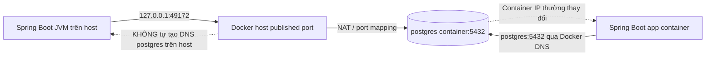
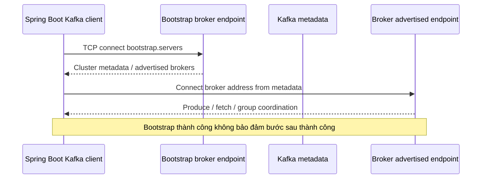
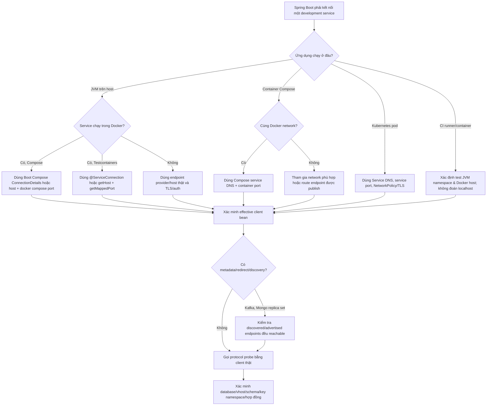

# Cổng động, địa chỉ container và địa chỉ ứng dụng thực sự sử dụng

> **Chương:** Dịch vụ phát triển  
> **Module:** SPRING_BOOT_INTEGRATION — tích hợp hệ thống trong Spring Boot qua HTTP client, cơ sở dữ liệu, cache, broker thông điệp và các adapter Spring Integration. Trọng tâm là quản lý cấu hình, hợp đồng dữ liệu, giao dịch, lỗi, xử lý trùng lặp, kiểm thử và quan sát những luồng tích hợp thực tế.

## 1. Vấn đề: container chạy tốt nhưng Spring Boot vẫn không kết nối được

Nhóm phát triển dùng PostgreSQL, Redis, MongoDB, RabbitMQ và Kafka để chạy ứng dụng Spring Boot ở máy cá nhân, trong Docker Compose và trong pipeline CI. Khi mở rộng số người hoặc chạy nhiều test suites song song, hệ thống gặp lỗi:

```text
Connection refused: localhost/127.0.0.1:5432
RedisConnectionFailureException: Unable to connect to localhost:6379
UnknownHostException: postgres
Failed to connect to node broker:9092
Communications link failure / connection timed out
```

Điều khó hiểu là lệnh `docker ps` cho thấy container đang chạy, thậm chí health check báo healthy. Nguyên nhân thường không ở câu SQL hay JSON mà ở **địa chỉ mạng được hiểu theo vị trí của tiến trình gọi**.

Ví dụ một PostgreSQL container lắng nghe cổng `5432` bên trong container, được Docker ánh xạ ra cổng `49172` trên máy host:

```text
Container:      postgres:5432 (internal)
Docker host:    127.0.0.1:49172 (published port)
Spring Boot IDE running on Docker host:
                jdbc:postgresql://127.0.0.1:49172/orders
Spring Boot container on the same Compose network:
                jdbc:postgresql://postgres:5432/orders
```

Hai URL đều có thể đúng, **nhưng cho hai vị trí chạy ứng dụng khác nhau**. Dùng `localhost:5432` ở IDE sẽ thất bại nếu cổng 5432 chưa được publish ở host; dùng `postgres:5432` ở IDE cũng thường thất bại vì tên `postgres` chỉ được phân giải qua Docker network.

### 1.1. Mục tiêu học tập

Sau bài này, bạn có thể:

1. Phân biệt **cổng container**, **cổng host được publish**, **địa chỉ container**, **tên service DNS** và **địa chỉ mà tiến trình Spring Boot phải sử dụng**.
2. Giải thích vì sao `localhost` trong ứng dụng chạy ở host khác `localhost` trong container và trong CI job.
3. Cấu hình Docker Compose với host port động và tìm ra cổng thực tế, không đoán `5432/6379/27017` trên host.
4. Dùng Spring Boot Docker Compose support hoặc Testcontainers `@ServiceConnection`/`@DynamicPropertySource` để cấp đúng địa chỉ runtime.
5. Phân biệt cấu hình địa chỉ thuần (URI/properties) với `ConnectionDetails` do Spring Boot tự cấp từ development services.
6. Kiểm chứng kết nối thực với JDBC/JPA/R2DBC, Redis, MongoDB, RabbitMQ, Kafka và HTTP client; xử lý đặc thù Kafka `advertised.listeners`.
7. Thiết kế test cô lập, không va chạm cổng, không kết nối nhầm production, có kiểm tra lỗi và quan sát tài nguyên.

### 1.2. Câu hỏi nền tảng trước khi debug

Hãy luôn hỏi theo thứ tự:

1. **Ứng dụng Spring Boot đang chạy ở đâu?** IDE/JVM host, trong Docker container, Kubernetes pod hay runner CI?
2. **Dịch vụ được chạy ở đâu?** Compose service, Testcontainers container, remote server, managed cloud?
3. **Cổng đích được publish ở namespace nào?** Cổng 5432 bên trong container có thể trở thành 49172 trên host.
4. **Ứng dụng có thực sự sử dụng URL đó không?** Có `ConnectionDetails` override properties không; có custom client bean không?
5. **Ứng dụng đã thử và xác minh kết nối thật chưa?** Container healthy không chứng minh JVM dùng đúng endpoint.

## 2. Ba không gian địa chỉ và cái bẫy localhost

### 2.1. Sơ đồ đường kết nối



Địa chỉ cần dùng tùy **network namespace** của tiến trình:

| Spring Boot chạy ở đâu? | PostgreSQL chạy ở đâu? | Địa chỉ điển hình |
| --- | --- | --- |
| JVM trên máy host | Docker container có port publish 49172→5432 | `127.0.0.1:49172` |
| Container cùng Docker Compose network | Compose service tên `postgres` | `postgres:5432` |
| Container khác trên cùng Docker user-defined network | Service/container có network alias `postgres` | `postgres:5432` |
| Container ngoài network đó | Compose `postgres` | Không tự phân giải `postgres`; phải kết nối network hoặc endpoint được route |
| CI job chạy trực tiếp trên runner host | Testcontainers-managed PostgreSQL | `container.getHost():getMappedPort(5432)` hoặc Spring `@ServiceConnection` |
| Spring Boot container chạy trong CI | PostgreSQL là service container cùng CI network | Hostname/alias do CI cấp, cổng nội bộ `5432` |
| Kubernetes pod | PostgreSQL Kubernetes Service | `postgres.<namespace>.svc.cluster.local:5432` theo service thực |
| JVM host | PostgreSQL cloud | DNS/port chính thức do provider cấp |

Các giá trị trên là **mô hình**, không mặc định Kubernetes service, Docker network, localhost DNS hay tên container nào cũng tồn tại. Phải xác minh nơi ứng dụng thật sự chạy.

### 2.2. localhost chỉ về chính namespace đang gọi

Trong một Docker container, `localhost`/`127.0.0.1` là loopback **của container đó**, không phải máy laptop. Một Spring Boot container gọi:

```text
jdbc:postgresql://localhost:5432/orders
```

thường đang tìm PostgreSQL **ngay trong Spring Boot container**. Nếu PostgreSQL chạy ở container khác, phải dùng service DNS hoặc endpoint publish đúng tuyến mạng.

Trong một Kubernetes pod, nhiều container có thể **chia sẻ network namespace của cùng pod**, nên `localhost` giữa sidecar và app container có thể hợp lệ. Đây là ngoại lệ khác Docker Compose services bình thường, không nên suy rộng.

### 2.3. Tên service DNS khác tên container hiển thị

Trong Docker Compose network, service name thường phân giải qua DNS nội bộ:

```yaml
services:
  postgres:
    image: postgres:16-alpine
  app:
    image: example.invalid/orders:dev
    depends_on:
      - postgres
```

Với hai services cùng network mặc định của Compose, ứng dụng trong `app` có thể dùng `postgres:5432`. Tên `postgres` ở đây là **Compose service name**, không phải hostname được tự động đưa vào DNS của hệ điều hành host.

Không hard-code IP container từ `docker inspect`: Docker có thể cấp IP khác sau restart/recreate, hoặc network có nhiều containers/instances. Dùng service DNS/network alias hoặc connection details runtime.

### 2.4. Host không nhất thiết là laptop hiện tại

Khi Docker daemon chạy trên máy remote hoặc qua môi trường máy ảo, `container.getHost()` có thể là một địa chỉ route được tới Docker host, không phải `localhost`. Trên Docker Desktop, network translation có thể khác Linux daemon trực tiếp. Không thay mọi giá trị host do Testcontainers trả thành `127.0.0.1` theo thói quen.

Với môi trường remote Docker, muốn host JVM kết nối mapped port cần:

- Host address thực sự route được từ nơi chạy JVM.
- Port mapping/firewall/network policy cho phép.
- TLS nếu lưu lượng đi qua ranh giới máy đáng tin khác.
- Không để auto-published ports mở ra interface công cộng không kiểm soát.

## 3. Cổng container, host port và địa chỉ runtime

### 3.1. Bốn khái niệm cần tách rời

| Khái niệm | Ví dụ | Ai sử dụng? |
| --- | --- | --- |
| **Container listening port** | PostgreSQL lắng nghe TCP `5432` | Client kết nối **trong cùng Docker network** |
| **Published host port** | Host `49172` → container `5432` | Client chạy **trên host/bên ngoài Docker network** |
| **Host interface/bind address** | `127.0.0.1` hoặc `0.0.0.0` | Quyết định từ đâu có thể truy cập published port |
| **Application effective endpoint** | `jdbc:postgresql://127.0.0.1:49172/orders` | URL thực sự được `DataSource`/driver sử dụng sau mọi config override |

`EXPOSE 5432` trong Dockerfile **không đồng nghĩa publish** cổng đó lên host; lệnh chỉ cung cấp metadata/documentation cho image. Tương tự `expose:` trong Compose không thay thế `ports:` khi JVM chạy ngoài Docker network cần truy cập.

### 3.2. Fixed mapping so với dynamic mapping

```yaml
services:
  postgres_fixed:
    image: postgres:16-alpine
    ports:
      - "15432:5432"

  postgres_dynamic:
    image: postgres:16-alpine
    ports:
      - "5432"
```

*Đoạn trên chỉ minh họa port syntax; không chạy đồng thời hai database với cùng dữ liệu/credentials nếu chưa cấu hình đủ.* Ý nghĩa:

- `"15432:5432"`: host port **15432**, container port **5432**; dễ nhớ nhưng có thể **đụng cổng** khi nhiều dự án cùng chạy.
- `"5432"`: chỉ khai báo **target container port**; Docker Compose có thể chọn **host port động**, không bảo đảm host `5432`.
- `"5432:5432"`: cố định cả hai; đơn giản khi chỉ một project nhưng dễ conflict và không phù hợp test song song.

Khi ứng dụng chạy ở cùng network, **không dùng host port 15432/49172** để gọi service `postgres`: hãy dùng port nội bộ `5432`.

### 3.3. Minh họa kiểm tra cổng động

```bash
docker compose ps
docker compose port postgres 5432
```

Ví dụ đầu ra (chỉ minh họa):

```text
127.0.0.1:49172
```

Khi ấy JVM chạy trên host có thể dùng `127.0.0.1:49172`; JVM chạy trong Compose dùng `postgres:5432`. Nếu Docker map `0.0.0.0:49172`, đó là **bind interface** của host, không phải một hostname mà mọi client nên cố gọi. Chọn địa chỉ cụ thể có thể route được và giới hạn exposure.

### 3.4. Vì sao container restart làm cổng thay đổi?

Cổng động được Docker cấp khi publish một container/service instance. Nếu container bị **recreate**, mapping có thể được cấp lại cổng khác; không nên lưu port đã in ra vào một file cấu hình tĩnh dùng nhiều ngày.

Các trạng thái:

```text
T0:  Docker Compose starts postgres, port 49172 → 5432
T1:  Spring Boot JVM uses localhost:49172
T2:  Container is removed/recreated
T3:  Docker publishes 49195 → 5432
T4:  Spring Boot still uses localhost:49172 → connection refused
```

Giải pháp không phải ép mọi container dùng `5432:5432`. Chọn cơ chế tự cung cấp **effective connection details mới** khi start test/dev application, hoặc restart/rebind client khi topology thay đổi.

### 3.5. Container healthy khác endpoint usable

Một health check kiểu `pg_isready` thực hiện **bên trong database container** có thể thành công, nhưng Spring Boot vẫn không vào được vì:

- JVM dùng sai cổng host hoặc namespace.
- User/password/database name sai.
- TLS, SASL hoặc certificate mismatch.
- Server lắng nghe interface khác với đường kết nối cần dùng.
- Firewall/ACL hoặc network alias không tồn tại.
- Spring Boot đã chọn một `ConnectionDetails` khác URL trong YAML.

Vì vậy quy trình test cần **cả readiness của service** và **một kết nối thật từ JVM ứng dụng với đúng credentials và endpoint runtime**.

## 4. Docker Compose cho development services

Spring Boot có hỗ trợ phát triển với Docker Compose: khi được cấu hình và phát hiện file Compose, Boot có thể phối hợp lifecycle của supported services và tạo **service connection details** từ các container/ports thực tế. Đây là công cụ giúp developer không phải chép host port động từ terminal vào `application-local.yml`.

### 4.1. Dependency và phạm vi

```groovy
// build.gradle — Spring Boot 3.2+ / 3.5.x như ví dụ.
dependencies {
    developmentOnly 'org.springframework.boot:spring-boot-docker-compose'
    implementation 'org.springframework.boot:spring-boot-starter-jdbc'
    runtimeOnly 'org.postgresql:postgresql'
    implementation 'org.springframework.boot:spring-boot-starter-data-redis'
}
```

`developmentOnly` dùng khi hỗ trợ Compose chỉ cần trong môi trường phát triển, không phải khi đóng gói production. Hãy kiểm tra Gradle plugin/BOM, task chạy ứng dụng, packaging và việc development-only dependency có thật sự nằm trên classpath của launcher đang dùng không.

### 4.2. Compose với hai ports được publish động

```yaml
# compose.yaml — chỉ dùng cho development, không đưa secret thật vào source.
services:
  postgres:
    image: postgres:16-alpine
    environment:
      POSTGRES_DB: orders_dev
      POSTGRES_USER: orders_dev
      POSTGRES_PASSWORD: ${DEV_POSTGRES_PASSWORD:?set DEV_POSTGRES_PASSWORD}
    ports:
      - "5432"        # dynamic HOST port -> container 5432
    healthcheck:
      test: ["CMD-SHELL", "pg_isready -U orders_dev -d orders_dev"]
      interval: 5s
      timeout: 3s
      retries: 10

  redis:
    image: redis:7-alpine
    ports:
      - "6379"        # dynamic HOST port -> container 6379
    healthcheck:
      test: ["CMD", "redis-cli", "ping"]
      interval: 5s
      timeout: 3s
      retries: 10
```

Nếu Boot auto nhận ra các container images được hỗ trợ và có connection details phù hợp, ứng dụng **chạy trên host** có thể được kết nối vào **host + mapped port** do Compose tạo. Không mặc định YAML `spring.datasource.url=jdbc:postgresql://localhost:5432/...` còn là nguồn địa chỉ thực tế.

**Bảo mật cổng phát triển:** khai báo `ports: ["5432"]` có thể publish tới interface rộng hơn loopback tùy Docker/Compose/environment. Khi host không tin cậy hoặc sử dụng Wi‑Fi công cộng, cần ràng buộc host IP bằng cấu hình publish được Docker Compose version đang dùng hỗ trợ (ví dụ loopback binding), firewall hoặc tránh publish nếu ứng dụng cũng chạy trong Docker network. Không coi cổng động mặc nhiên là cổng riêng tư.

### 4.3. Startup order không thay kiểm tra readiness

`depends_on` có thể điều phối thứ tự tạo/start containers. Một service đã **running** chưa chắc database đã sẵn sàng phục vụ query. Khi cần, dùng healthcheck và điều kiện dependency tương ứng với Compose version, đồng thời driver/client phải có startup retry có giới hạn.

Spring Boot Docker Compose support cũng có cách kiểm tra service readiness/connection details trên các services được hỗ trợ. Nhưng một DB có thể sẵn sàng kết nối mà **schema migration chưa hoàn thành**; các services phụ thuộc schema vẫn cần readiness riêng.

### 4.4. Docker Compose không phải Kubernetes service discovery

Compose service DNS `postgres` thường chỉ tồn tại trong network của project Compose. Khi triển khai production trên Kubernetes, DNS sẽ dựa trên Service name/namespace; trên cloud managed database là endpoint do provider cung cấp. Không chuyển literal `postgres:5432` từ Compose sang production mà không định nghĩa lại host/credentials/TLS và network routing.

## 5. Spring Boot Docker Compose support: ai quyết định JDBC URL?

Spring Boot có thể nhận diện một số loại dịch vụ trong Compose như PostgreSQL, Redis, MongoDB, RabbitMQ và Kafka (tùy phiên bản Boot, image/label được hỗ trợ). Khi dịch vụ khớp, Boot có thể đăng ký bean mô tả kết nối cho auto-configuration tương ứng.

### 5.1. Effective endpoint có thể khác application.yml

Ví dụ một developer để giá trị fallback:

```yaml
# application-dev.yml — minh họa; không phải nguồn chắc chắn có hiệu lực.
spring:
  datasource:
    url: jdbc:postgresql://localhost:5432/orders_dev
  data:
    redis:
      host: localhost
      port: 6379
```

Nhưng Compose vừa publish PostgreSQL `49501→5432` và Redis `49502→6379`. Với Docker Compose integration tạo các `ConnectionDetails` được auto-configuration sử dụng, URL do driver thực nhận có thể là:

```text
DataSource effective JDBC endpoint:
  jdbc:postgresql://127.0.0.1:49501/orders_dev

Redis connection effective endpoint:
  127.0.0.1:49502

spring.datasource.url in Environment:
  jdbc:postgresql://localhost:5432/orders_dev  (may still appear!)
```

Điểm cốt lõi: **giá trị property trong Spring Environment** không phải lúc nào cũng là **địa chỉ của bean client đã được cấu hình**. Một bean `JdbcConnectionDetails` hoặc `RedisConnectionDetails` có thể được dùng để xây client thay cho các properties về connection.

### 5.2. ConnectionDetails là gì?

Trong Spring Boot, nhiều auto-configurations biết lấy thông tin từ một **service connection details bean**, ví dụ:

| Resource | Dạng connection details điển hình | Client thực dùng |
| --- | --- | --- |
| PostgreSQL JDBC/JPA | `JdbcConnectionDetails` | `DataSource`, HikariCP, JDBC/JPA stack |
| PostgreSQL R2DBC | `R2dbcConnectionDetails` | R2DBC `ConnectionFactory` |
| Redis | `RedisConnectionDetails` | Lettuce/Jedis connection factory |
| MongoDB | `MongoConnectionDetails` | MongoDB driver `MongoClient` |
| RabbitMQ | `RabbitConnectionDetails` | Spring AMQP `ConnectionFactory` |
| Kafka | `KafkaConnectionDetails` | Kafka producer/consumer/admin bootstrap config |

Danh sách bean/type factory hỗ trợ phụ thuộc **Spring Boot version** và module có trên classpath. Các bean ConnectionDetails do Compose hoặc Testcontainers tạo thường được ưu tiên cho **auto-configured client** so với connection properties; nhưng một client tự tạo thủ công và hard-code host có thể **không sử dụng** các bean đó.

### 5.3. Cấu hình Docker Compose lifecycle có chủ đích

Một cấu hình phát triển:

```yaml
spring:
  docker:
    compose:
      enabled: true
      file: compose.yaml
      lifecycle-management: start-and-stop
```

Ví dụ dùng các properties hỗ trợ trong dòng Spring Boot 3.x. Khi chạy nhiều ứng dụng trên cùng Compose project, chính sách lifecycle rất quan trọng: một ứng dụng dừng **không nên vô tình dừng dịch vụ** mà ứng dụng khác vẫn dùng. Spring Boot có các chế độ quản lý lifecycle khác nhau (như quản lý start/stop hay chỉ start); chọn theo phiên bản và quy trình team, không sao chép mặc định.

Khi muốn chạy Compose độc lập bằng CLI (hoặc ứng dụng chạy trong container khác), cân nhắc **tắt Boot Compose lifecycle** cho process đó và cấp endpoint thích hợp. Không để hai cơ chế cùng quản lý resource rồi cho rằng shutdown/startup ordering luôn ổn.

### 5.4. Spring Boot cần nhận diện đúng image/service

Nếu service dùng image tùy biến, ví dụ `mycompany/postgres-hardened:dev`, Boot có thể không tự suy nó là PostgreSQL từ image name. Một số Boot versions hỗ trợ chỉ định service-connection bằng Docker Compose labels theo convention:

```yaml
services:
  postgres:
    image: mycompany/postgres-hardened:dev
    labels:
      org.springframework.boot.service-connection: postgres
    ports:
      - "5432"
```

Đoạn này **phụ thuộc phiên bản Boot và loại service supported**; phải xác minh giá trị label/registry với tài liệu đúng version. Không đặt nhầm label để khiến application kết nối sai loại service. Không tin rằng một container bất kỳ có exposed port 5432 đều là PostgreSQL sẵn sàng dùng.

### 5.5. Không dùng một startup log để kết luận kết nối đã đúng

Log “Compose containers are running” và “Application started” không đảm bảo:

- Flyway/Liquibase đã chạy vào **database mong đợi**.
- JPA EntityManager dùng cùng datasource với JdbcTemplate.
- R2DBC client có connection factory đúng, không lẫn JDBC.
- RedisTemplate sử dụng same Redis database/credentials.
- Broker management UI đang hiển thị đúng vhost/cluster mà ứng dụng nối tới.
- Custom client bean đã dùng ConnectionDetails thay vì một URI cũ.

Hãy bổ sung một test/smoke check có kiểm soát: từ **bean client thực tế** đọc tên database và server version, hoặc gọi một lệnh ping nhẹ, ghi lại endpoint sau khi **mask credentials**, rồi so với môi trường mong đợi.

## 6. Testcontainers: cổng động là một tính năng, không phải lỗi

Testcontainers khởi động dịch vụ thật trong container cho mỗi suite/class/context phù hợp. Để nhiều integration tests chạy cùng lúc và tránh xung đột, nó thường publish port của container lên một **host port được cấp động**.

### 6.1. Container port khác mapped port

```java
import org.testcontainers.containers.PostgreSQLContainer;

PostgreSQLContainer<?> postgres =
        new PostgreSQLContainer<>("postgres:16-alpine");

postgres.start();

String dockerHost = postgres.getHost();
int hostPort = postgres.getMappedPort(5432);
String jdbcUrl = postgres.getJdbcUrl();

// getMappedPort(5432) chỉ hợp lệ SAU khi container đã start.
// jdbcUrl đã chứa host/port/database do Testcontainers biết.
```

Ví dụ trên là **fragment lifecycle**; trong JUnit nên dùng `@Testcontainers + @Container` hoặc Spring-managed Testcontainers để khởi/dừng chính xác, thay vì viết `start()` rồi quên `stop()` ở mỗi method.

`getHost()` cho địa chỉ host Docker mà test JVM có thể gọi, không chắc là `localhost`. `getMappedPort(5432)` cho host port tương ứng với internal port 5432. `getJdbcUrl()` của `PostgreSQLContainer` thường là API ít sai hơn tự nối chuỗi JDBC.

### 6.2. Vì sao không dùng container IP?

```java
// Anti-pattern:
String wrong = "jdbc:postgresql://"
        + postgres.getContainerInfo()
                .getNetworkSettings()
                .getIpAddress()
        + ":5432/orders";
```

Container IP có thể thuộc một mạng mà JVM host không truy cập được, thay đổi khi recreate và không hoạt động đồng nhất trên Docker Desktop/remote daemon. Testcontainers chủ ý cung cấp `getHost()` và `getMappedPort(...)` để test JVM dùng đúng route **được host publish**.

### 6.3. @ServiceConnection trong Spring Boot integration test

```groovy
dependencies {
    implementation 'org.springframework.boot:spring-boot-starter-jdbc'
    runtimeOnly 'org.postgresql:postgresql'

    testImplementation 'org.springframework.boot:spring-boot-starter-test'
    testImplementation 'org.springframework.boot:spring-boot-testcontainers'
    testImplementation 'org.testcontainers:junit-jupiter'
    testImplementation 'org.testcontainers:postgresql'
}
```

```java
// RealPostgresConnectionTest.java
import org.junit.jupiter.api.Test;
import org.springframework.beans.factory.annotation.Autowired;
import org.springframework.boot.test.context.SpringBootTest;
import org.springframework.boot.testcontainers.service.connection.ServiceConnection;
import org.springframework.jdbc.core.JdbcTemplate;
import org.testcontainers.containers.PostgreSQLContainer;
import org.testcontainers.junit.jupiter.Container;
import org.testcontainers.junit.jupiter.Testcontainers;

import static org.assertj.core.api.Assertions.assertThat;

@SpringBootTest
@Testcontainers
class RealPostgresConnectionTest {

    @Container
    @ServiceConnection
    static final PostgreSQLContainer<?> postgres =
            new PostgreSQLContainer<>("postgres:16-alpine")
                    .withDatabaseName("orders_it")
                    .withUsername("it_user")
                    .withPassword("it_password");

    @Autowired JdbcTemplate jdbc;

    @Test
    void jdbcClientReallyConnectsToThisContainer() {
        String database = jdbc.queryForObject(
                "SELECT current_database()", String.class);

        assertThat(database).isEqualTo("orders_it");
        assertThat(postgres.isRunning()).isTrue();
    }
}
```

Ví dụ theo **Spring Boot 3.2–3.5 và Testcontainers API tương thích**. Spring context cần xác định ứng dụng Bootstrap configuration để `@SpringBootTest` hoạt động; test không chỉ gọi `postgres.isRunning()` mà còn dùng **chính JdbcTemplate được inject** chạy query trên server thật.

Trong test source với `@ServiceConnection`, Boot tạo connection details từ container được khai báo và cấp cho auto-configured datasource. Không cần hard-code `spring.datasource.url` từ một host port chưa biết. Nếu dự án có nhiều custom datasources, bạn phải xác định datasource nào cần nhận service connection; một bean tự tạo thủ công có thể bỏ qua nó.

### 6.4. @DynamicPropertySource khi cần điều khiển rõ

Nếu Testcontainers sử dụng generic image hoặc Boot không có factory nhận diện service, cấp properties từ container runtime:

```java
import org.springframework.test.context.DynamicPropertyRegistry;
import org.springframework.test.context.DynamicPropertySource;
import org.testcontainers.containers.GenericContainer;
import org.testcontainers.junit.jupiter.Container;
import org.testcontainers.junit.jupiter.Testcontainers;
import org.testcontainers.utility.DockerImageName;

@Testcontainers
class RedisConnectionTest {
    @Container
    static final GenericContainer<?> redis =
            new GenericContainer<>(
                    DockerImageName.parse("redis:7-alpine"))
                    .withExposedPorts(6379);

    @DynamicPropertySource
    static void redisProperties(
            DynamicPropertyRegistry registry) {
        registry.add("spring.data.redis.host", redis::getHost);
        registry.add("spring.data.redis.port",
                () -> redis.getMappedPort(6379));
    }

    // Với @SpringBootTest hoặc @DataRedisTest phù hợp,
    // inject StringRedisTemplate và thực hiện một lệnh thật.
}
```

Khi hoàn thiện skeleton, thêm `@SpringBootTest`/`@DataRedisTest`, Redis starter và test methods. Static `@Container` được JUnit extension start trước khi Spring lấy dynamic property suppliers trong setup tương ứng.

**Chú ý:** không gọi `redis.getMappedPort(6379)` trong static initializer trước khi container start; code minh họa truyền **supplier** để Spring resolve lúc thích hợp. Với `@ServiceConnection` đã được Boot hỗ trợ, ưu tiên dùng nó để tránh wiring lặp và phân tán.

### 6.5. Hai instances cùng cổng container vẫn chạy song song

```text
Test class A:
  postgres container:5432 -> host:49181

Test class B:
  postgres container:5432 -> host:49193

Both containers listen internally on 5432.
Their published host ports are DIFFERENT.
```

Đây là **hành vi đúng** giúp tests tránh xung đột. Nếu code test tự nối `jdbc:postgresql://localhost:5432/...`, cả hai tests có thể vô tình dùng PostgreSQL cài sẵn trên laptop hoặc connect refused, trong khi hai containers được khởi động hoàn toàn khỏe mạnh.

### 6.6. Thời gian sống của container và Spring context cache

Testcontainers `static @Container` thường được JUnit Jupiter extension quản lý theo **test class**. Spring TestContext có thể cache ApplicationContext qua **nhiều test classes**; nếu context bị giữ lại trong khi container của class trước đã dừng, bean datasource/cache có thể trỏ tới port không còn active.

Giải pháp:

- Sử dụng lifecycle phù hợp khi muốn share container giữa nhiều classes (ví dụ Spring-managed Testcontainers config) và kiểm tra framework version.
- Hoặc tạo context/resource độc lập theo class với data isolation.
- Không dùng global singleton container tự start trong một test rồi dừng ngẫu nhiên khi những contexts khác vẫn sử dụng.
- Không bật Testcontainers reusable mode bừa bãi trên shared CI để “sửa” lỗi lifecycle.
- Không dựa vào một port ngẫu nhiên của lần chạy trước trong test resources.

Đối với test suite quan trọng, assertion nên đọc **từ bean thực** trong từng context thay vì chỉ kiểm tra container đang chạy.

## 7. Ma trận địa chỉ theo vị trí chạy ứng dụng

### 7.1. Năm môi trường điển hình

| Môi trường | Điểm đến đúng | Sai lầm hay gặp |
| --- | --- | --- |
| IDE/Gradle trên host, Compose DB | Host address + **published host port**; Boot Compose connection details nếu có | Dùng `postgres:5432` ở host |
| IDE/Gradle trên host, Testcontainers DB | `getHost()` + `getMappedPort()` hoặc `@ServiceConnection` | Dùng `localhost:5432` hard-code |
| Spring Boot container, Compose DB cùng network | Compose service DNS + **container port** | Dùng `localhost:49172` trong app container |
| Spring Boot trong Kubernetes, DB service | Service DNS + service port theo cluster | Dùng Docker Compose service name trực tiếp |
| Spring Boot tại cloud VM, managed DB | Provider endpoint + credential/TLS/network allowlist | Nhầm container IP hoặc client chạy ở mạng nội bộ |

### 7.2. Một cấu hình không thể dùng cho mọi execution environment

```yaml
# application.yml: các giá trị config có thể được profile/env override.
integration:
  postgres:
    host: ${APP_POSTGRES_HOST:localhost}
    port: ${APP_POSTGRES_PORT:5432}

spring:
  datasource:
    url: jdbc:postgresql://${APP_POSTGRES_HOST:localhost}:${APP_POSTGRES_PORT:5432}/orders
    username: ${APP_POSTGRES_USERNAME:orders}
    password: ${APP_POSTGRES_PASSWORD}
```

Ví dụ chỉ dùng **một connection string** nếu không có ConnectionDetails override, với environment-specific values:

```text
# JVM chạy trên host, Compose expose port động:
APP_POSTGRES_HOST=127.0.0.1
APP_POSTGRES_PORT=49172

# JVM chạy trong cùng Compose network:
APP_POSTGRES_HOST=postgres
APP_POSTGRES_PORT=5432

# JVM chạy trong Kubernetes:
APP_POSTGRES_HOST=postgres.orders.svc.cluster.local
APP_POSTGRES_PORT=5432
```

**Không lưu hard-code `49172` vào git**, và không commit password. Với Boot Compose service connections, có thể bỏ connection URL thủ công ở profile dev và để Boot cấp endpoint; với production, dùng secret/config provider phù hợp.

### 7.3. host.docker.internal không phải lời giải phổ quát

`host.docker.internal` được một số môi trường Docker Desktop hỗ trợ để container kết nối tới host. Trên Linux Docker Engine hoặc các runtime khác, hostname này có thể không tồn tại nếu không cấu hình thêm. Nó **không phải tên service DNS** để container Compose gọi container PostgreSQL.

Nếu app và DB cùng Docker network, dùng `postgres:5432` thay vì vòng từ app container lên host published port rồi quay xuống DB container. Chỉ dùng host gateway khi thực sự cần gọi một dịch vụ đang chạy trên host; kiểm tra platform/security.

### 7.4. Docker host mapping khác Kubernetes NodePort

Một host port động Docker/Compose là ánh xạ trực tiếp từ Docker host đến container port. Kubernetes `Service` có ClusterIP/NodePort/LoadBalancer semantics riêng, có thể load-balance nhiều pod endpoints; không suy rằng `getMappedPort(5432)` hoặc `docker compose port` dùng được trong Kubernetes.

Trong Kubernetes, ứng dụng thường gọi ClusterIP service qua DNS; các bộ điều khiển cấu hình service discovery, network policies, TLS và credentials khác biệt. Cổng NodePort/Ingress chỉ liên quan nếu cần đường truy cập từ ngoài cluster theo thiết kế.

## 8. PostgreSQL: JDBC, JPA và R2DBC sử dụng địa chỉ nào?

### 8.1. Cùng PostgreSQL, hai giao thức client

PostgreSQL server lắng nghe TCP thường trên **5432**. JDBC và R2DBC đều kết nối tới server đó, nhưng dùng **driver và connection configuration khác nhau**:

```text
PostgreSQL container: internal port 5432
Host mapped port: 49237

JDBC:
  jdbc:postgresql://127.0.0.1:49237/orders_dev

R2DBC:
  r2dbc:postgresql://127.0.0.1:49237/orders_dev

Inside same Compose network:
  jdbc:postgresql://postgres:5432/orders_dev
  r2dbc:postgresql://postgres:5432/orders_dev
```

Đừng đưa chuỗi `jdbc:postgresql://...` vào `spring.r2dbc.url` hoặc chuỗi `r2dbc:postgresql://...` vào `spring.datasource.url`. Hai driver nhìn cùng địa chỉ/port nhưng có **URL scheme và transaction manager khác nhau**.

### 8.2. Cấu hình host-side JDBC không có auto service connection

```yaml
spring:
  datasource:
    url: jdbc:postgresql://${PG_HOST:127.0.0.1}:${PG_PORT:5432}/orders_dev
    username: ${PG_USER:orders_dev}
    password: ${PG_PASSWORD}
    hikari:
      maximum-pool-size: 8
      connection-timeout: 5000
```

`PG_PORT` phải là **host published port** khi ứng dụng JVM ở host; phải là **5432** nếu chạy container cùng Compose network và hostname `PG_HOST=postgres`. Tránh dùng default `5432` để che việc test đang đọc port động; trong integration test nên ưu tiên `@ServiceConnection`.

```java
// Khói thử từ chính DataSource đã được Spring inject.
import javax.sql.DataSource;
import java.sql.Connection;

void verifyJdbcTarget(DataSource ds) throws Exception {
    try (Connection connection = ds.getConnection()) {
        var meta = connection.getMetaData();
        String product = meta.getDatabaseProductName();
        String url = meta.getURL(); // Chỉ hiển thị khi đã sanitize.
        if (!product.equalsIgnoreCase("PostgreSQL")) {
            throw new IllegalStateException(
                    "Expected PostgreSQL, got " + product);
        }
        // Không in username/password hoặc query parameters nhạy cảm.
    }
}
```

Đoạn này là helper minh họa, không phải bằng chứng DB **đúng tên/đúng schema**. Một smoke test đáng tin nên chạy thêm `SELECT current_database(), current_schema()` và kiểm tra migration/schema version; nhiều PostgreSQL servers có cùng product name.

### 8.3. R2DBC phải kiểm tra reactive connection thật

```yaml
spring:
  r2dbc:
    url: r2dbc:postgresql://${PG_HOST:127.0.0.1}:${PG_PORT:5432}/orders_dev
    username: ${PG_USER:orders_dev}
    password: ${PG_PASSWORD}
```

```java
// Test fragment trong @SpringBootTest dùng R2DBC.
import org.springframework.r2dbc.core.DatabaseClient;
import reactor.test.StepVerifier;

StepVerifier.create(
        databaseClient.sql("SELECT current_database() AS database_name")
                .map((row, metadata) ->
                        row.get("database_name", String.class))
                .one())
        .expectNext("orders_dev")
        .verifyComplete();
```

`databaseClient` là bean `DatabaseClient` thực đã inject. Test cần driver R2DBC, container/ConnectionDetails đúng và `reactor-test`. Một publisher chưa được subscribe **không chứng minh đã connect**; `StepVerifier` làm thao tác thực thi và chờ kết quả.

### 8.4. Một ứng dụng có JDBC và R2DBC

Một Spring Boot app có thể dùng JDBC/JPA và R2DBC cùng kết nối PostgreSQL hoặc **hai databases khác nhau**. Không giả định:

- Một `JdbcConnectionDetails` tự cấu hình luôn cả `R2dbcConnectionDetails` trong custom setup.
- `@Transactional` JDBC sẽ tham gia giao dịch R2DBC.
- Flyway/Liquibase sẽ dùng đúng datasource nếu có nhiều beans/custom connections.
- Cấu hình `spring.datasource.url` luôn là endpoint của reactive repository.

Nếu cần hai resource clients, kiểm tra **từng bean thực**: `DataSource`, `ConnectionFactory`, manager, database name và schema. Nếu transaction chỉ bảo vệ JDBC nhưng R2DBC dùng connection khác, phải thiết kế consistency/recovery rõ.

### 8.5. Lỗi container URL đúng mà SQL vẫn fail

Khi JDBC query đã connect:

```text
ERROR: relation "orders" does not exist
```

thì mạng có thể **đã đúng**, nhưng schema/migration/search_path/database name sai. Tách lỗi:

| Dấu hiệu | Tầng thường gặp |
| --- | --- |
| Connection refused / timeout | Network/port/listener/readiness |
| UnknownHostException | DNS/namespace/service name |
| Password authentication failed | Credentials/pg_hba/TLS auth |
| Database "orders_dev" does not exist | Database provisioning |
| Relation/column does not exist | Migration/schema/search_path |
| Hikari pool exhausted | Pool leak/tải cao, không nhất thiết sai host |
| Lock wait timeout / deadlock | Transaction/concurrency |

Không sửa `relation does not exist` bằng cách đổi cổng tùy tiện; kiểm tra `current_database()` và migrations trên **đúng connection** trước.

## 9. Redis: port 6379, authentication và cache namespace

### 9.1. Redis host/container URL

Với Redis server thông thường:

```text
Redis container listens: 6379
Host publishes:       49301 → 6379

Spring Boot JVM on host:
  spring.data.redis.host=127.0.0.1
  spring.data.redis.port=49301

Spring Boot app container on same network:
  spring.data.redis.host=redis
  spring.data.redis.port=6379
```

`SpringDataRedis` có thể sử dụng Lettuce hoặc Jedis tùy classpath/config. Nếu dùng Spring Boot Docker Compose/Testcontainers service connection, `RedisConnectionDetails` có thể cung cấp endpoint thay host/port properties trong auto-configured connection factory.

### 9.2. Đọc Redis thật qua StringRedisTemplate

```java
// Test fragment với Redis thật, chỉ ghi key có prefix của test.
import java.time.Duration;
import java.util.UUID;
import org.springframework.data.redis.core.StringRedisTemplate;

String key = "it:connectivity:" + UUID.randomUUID();
redisTemplate.opsForValue()
        .set(key, "connected", Duration.ofSeconds(45));

String value = redisTemplate.opsForValue().get(key);
if (!"connected".equals(value)) {
    throw new AssertionError("Redis read-back mismatch");
}
redisTemplate.delete(key);
```

`redisTemplate` phải là **bean thật** inject từ Spring context, không phải mock. Test này kiểm tra đường ghi/đọc Redis qua serializer thực và remote endpoint. Với Redis có nhiều databases hoặc Redis Cluster, cần xác minh cả index/cluster topology và key prefix; chỉ ping server chưa chứng minh bạn đang dùng đúng namespace.

### 9.3. Redis TLS và ACL

Một deployment có thể dùng:

```text
redis://host:6379        (không mã hóa nếu server hỗ trợ)
rediss://host:6380       (TLS, tùy provider)
```

Port `6380` chỉ là một convention phổ biến ở một số providers, **không phải cổng TLS chuẩn áp cho mọi Redis**. Không cố đổi port 6379→6380 chỉ vì timeout. Kiểm tra provider endpoint, TLS certificate verification và ACL/password. Với URI chứa password/ký tự đặc biệt, cần encode chính xác hoặc cấp credentials qua config/secret riêng; không ghi raw URI có password vào log.

### 9.4. Port đúng nhưng dữ liệu “biến mất”

Các khả năng:

- Ứng dụng kết nối Redis instance/cluster khác.
- Khác Redis logical database index; Redis Cluster không giống một single-node server có nhiều DB indexes.
- Key prefix hoặc serializer khác giữa producer/consumer.
- TTL đã expire, key bị eviction, hoặc application đã invalidate.
- Hai test suites ghi cùng key không có namespace.
- Redis authentication dùng ACL user khác có quyền/key patterns khác.

Tách **lỗi địa chỉ** với **lỗi dữ liệu/cache semantics**. Với Redis dùng làm idempotency gate, nhầm database/key prefix có thể gây duplicate side effects dù network kết nối thành công.

### 9.5. Không dùng FLUSHALL để “xác minh đúng Redis”

`FLUSHALL` xóa dữ liệu trên server và có thể phá môi trường khác khi host/port bị nhầm. Test nên ghi một key thuộc namespace riêng rồi xóa **đúng key đó**. Nếu thực sự cần reset toàn Redis, chỉ thực hiện trên ephemeral container đã được tạo cho test và có bằng chứng rõ nó không chia sẻ với ai.

## 10. MongoDB: connection string còn chứa topology và authSource

### 10.1. MongoDB endpoint không chỉ là host:port

Trong bài toán phổ biến:

```text
mongod container port: 27017
Host published port:  49322

Host-side JVM:
  mongodb://127.0.0.1:49322/orders_dev

Same Compose network:
  mongodb://mongo:27017/orders_dev
```

Với user authentication, URI có thể chứa username/password/`authSource`, TLS, replicaSet, readPreference và options. Do vậy chép host/port rồi giữ nguyên tất cả options mà không hiểu topology có thể dẫn đến lỗi khó đoán.

### 10.2. Cấu hình MongoDB Spring Boot

```yaml
spring:
  data:
    mongodb:
      uri: ${MONGODB_URI}
```

Nếu không dùng Boot service connection, `MONGODB_URI` cần được cấp từ deployment environment và chỉ rõ database/auth options phù hợp. Với Testcontainers MongoDB, dùng URI do container cung cấp hoặc `MongoConnectionDetails` tương ứng, **không tự đoán host port**.

### 10.3. MongoDB replica set có thêm địa chỉ được quảng bá

Trong **replica set**, driver có thể kết nối tới seed URI rồi khám phá danh sách hosts/members mà MongoDB công bố. Nếu những hosts đó chỉ phân giải được **bên trong Docker network**, một JVM ngoài host có thể gặp:

```text
MongoSocketOpenException / MongoTimeoutException
Client initially connects to mapped port,
then discovered replica set member address is unreachable.
```

Tình huống này gần giống Kafka `advertised.listeners`: đường đến seed chưa chắc là đường đến các thành viên khác. Testcontainers `MongoDBContainer` có cơ chế dựng replica set/test URI phù hợp một số use cases, ví dụ API `getReplicaSetUrl()` ở các dòng được hỗ trợ. **Không tự thay mỗi phần `localhost:port` trong URI bằng `mongo:27017`** mà bỏ qua discovered hostnames và cấu hình replica set.

### 10.4. Kiểm tra dữ liệu qua MongoTemplate

```java
// Test fragment với MongoTemplate thật.
import org.bson.Document;
import org.springframework.data.mongodb.core.MongoTemplate;

String serverVersion = mongoTemplate.executeCommand(
        new Document("buildInfo", 1))
        .getString("version");

if (serverVersion == null || serverVersion.isBlank()) {
    throw new AssertionError("MongoDB buildInfo unavailable");
}
```

`buildInfo` có thể bị giới hạn theo user privileges/server policy; trong hệ thống cần quyền tối thiểu, dùng lệnh/query probe được cấp quyền rõ hoặc đọc collection test có namespace. Quan trọng là probe sử dụng **`MongoTemplate` thật của ứng dụng**, không một client mới tự dựng từ URL khác.

### 10.5. MongoDB có thể connect nhưng index/transaction vẫn sai

Một `MongoTemplate.find(...)` hoạt động không chứng minh:

- Unique index trên business key đã được tạo.
- Client đang dùng đúng database/collection.
- Multi-document transaction được hỗ trợ (thường cần replica set/sharded cluster và manager).
- Read preference/write concern phù hợp consistency SLA.
- TLS/authSource/roles chính xác cho tất cả operations, không chỉ ping.

Khi test integrated order projection, kiểm tra **unique index, write/read round-trip, transaction semantics và duplicate event ID**, không chỉ hostname.

## 11. RabbitMQ: AMQP 5672 khác Management UI 15672

### 11.1. Cùng một container, hai cổng có mục đích khác nhau

RabbitMQ có thể cung cấp:

- **AMQP listener**, thường TCP `5672`, dành cho `RabbitTemplate`, `@RabbitListener` và AMQP clients.
- **Management HTTP UI/API**, thường TCP `15672` khi plugin management được bật, dành cho dashboard, monitoring và administration.
- **AMQPS TLS**, thường TCP `5671` khi được cấu hình, không mặc định bật trên mọi image/instance.

```text
RabbitMQ container:
  AMQP:          5672
  Management:   15672

Docker publishes:
  host:49401 -> container:5672
  host:49402 -> container:15672

Spring Boot JVM on host (AMQP):
  spring.rabbitmq.host=127.0.0.1
  spring.rabbitmq.port=49401

Browser on host (management):
  http://127.0.0.1:49402

Spring Boot container on same Compose network:
  spring.rabbitmq.host=rabbitmq
  spring.rabbitmq.port=5672
```

Một dashboard RabbitMQ hoạt động trên cổng management **không chứng minh** ứng dụng có thể kết nối AMQP bằng credentials/vhost đúng. Đừng đặt `spring.rabbitmq.port=15672` chỉ vì mở UI được.

### 11.2. Cấu hình Spring AMQP với env properties

```yaml
spring:
  rabbitmq:
    host: ${RABBITMQ_HOST:localhost}
    port: ${RABBITMQ_PORT:5672}
    username: ${RABBITMQ_USER}
    password: ${RABBITMQ_PASSWORD}
    virtual-host: ${RABBITMQ_VHOST:/}
    publisher-confirm-type: correlated
    publisher-returns: true
    template:
      mandatory: true
```

Properties `publisher-confirm-type`, `publisher-returns` và `mandatory` liên quan bảo đảm **phát message**, không thay cơ chế xác định host/port. Một AMQP connection mở được nhưng publish vào **sai vhost** có thể không thấy exchange/binding dự kiến, dẫn tới `NOT_FOUND`/unroutable.

### 11.3. Vhost và URI encoding

RabbitMQ có virtual host mặc định `/`. Trong một AMQP URI, vhost là một thành phần path nên ký tự `/` cần được encode đúng tùy thư viện và parser; không ghép URL bằng string concatenation nếu username/password/vhost chứa ký tự đặc biệt.

Ưu tiên:

1. Dùng Spring Boot properties riêng `host/port/username/password/virtual-host` hoặc connection details.
2. Nếu dùng AMQP URI, để library/URI builder encode chính xác.
3. Xác minh vhost, exchange và queue thực sự được ứng dụng dùng, không chỉ nhìn UI trong vhost khác.

### 11.4. Readiness và topology là hai tầng

RabbitMQ process running, TCP port open và AMQP login thành công vẫn chưa có nghĩa:

- Exchange đã tồn tại.
- Queue có đúng durability/type/arguments.
- Binding đúng routing key.
- Publisher mandatory/returns/confirm đã được bật.
- Consumer đã đăng ký listener và đủ quyền read.

Một smoke test cho hệ thống tích hợp nên xác minh topology bằng cách an toàn, publish một event test có ID riêng và quan sát publisher confirm/return hoặc queue nhận message. Không xóa queue chứa dữ liệu thật để “refresh” topology.

### 11.5. Container RabbitMQ cho integration tests

```java
import org.springframework.boot.testcontainers.service.connection.ServiceConnection;
import org.testcontainers.containers.RabbitMQContainer;
import org.testcontainers.junit.jupiter.Container;
import org.testcontainers.junit.jupiter.Testcontainers;

@Testcontainers
class RabbitConnectionFragment {
    @Container
    @ServiceConnection
    static final RabbitMQContainer rabbit =
            new RabbitMQContainer("rabbitmq:4.1-management");
}
```

Đây là skeleton: cần Spring Boot context, `spring-boot-testcontainers` và `org.testcontainers:rabbitmq`, cũng như `spring-boot-starter-amqp` để inject `RabbitTemplate`/connection factory. Boot cấp AMQP connection details phù hợp; đừng lấy management mapped port rồi đưa vào `RabbitTemplate`.

## 12. Kafka: bootstrap port chưa đủ, advertised.listeners phải truy cập được

Kafka phức tạp hơn nhiều database thông thường vì client **không chỉ sử dụng bootstrap address một lần**. Client bootstrap, lấy metadata cluster, sau đó kết nối tới **broker addresses được trả về trong metadata**.

### 12.1. Hai bước kết nối Kafka



Giả sử:

```text
Kafka broker container internal address:
  kafka:9092

Host published bootstrap port:
  127.0.0.1:49551

Spring Boot JVM runs on Docker host:
  spring.kafka.bootstrap-servers=127.0.0.1:49551

But broker advertises:
  kafka:9092  (resolvable only within Docker network)
```

Client có thể mở bootstrap connection rồi mất kết nối ở bước metadata:

```text
UnknownHostException: kafka
Connection to node -1 ... disconnected
Bootstrap broker disconnected
Timed out waiting for a node assignment
```

Thông điệp lỗi cụ thể thay đổi theo Kafka client version, nhưng điểm chung là **địa chỉ broker được quảng bá không route được từ network namespace của client**.

### 12.2. Bootstrap khác advertised listener

| Thành phần | Ý nghĩa | Tại sao quan trọng? |
| --- | --- | --- |
| `bootstrap.servers` | Một hoặc nhiều entrypoints client dùng ban đầu | Chỉ để khám phá cluster và metadata |
| `listeners` | Những địa chỉ/ports broker tự bind để nhận kết nối | Quyết định socket phía broker |
| `advertised.listeners` | Những host:port broker công bố cho clients qua metadata | Phải route được từ mạng của client tương ứng |
| Listener name/security protocol | Ví dụ INTERNAL/EXTERNAL, PLAINTEXT/SSL/SASL | Client phải dùng đúng listener và bảo mật |
| Broker ID/node ID và metadata | Client dùng sau bootstrap để tìm partition leaders/coordinator | Không thể chỉ NAT bootstrap nếu metadata sai |

Trong development Compose, thường cần **hai listener types**:

- **INTERNAL:** quảng bá `kafka:9092` cho containers trong cùng network.
- **EXTERNAL:** quảng bá host/mapped port route được, ví dụ `127.0.0.1:49551` cho JVM chạy trên host.

Tên/ports/security protocol cấu hình cụ thể phụ thuộc Kafka distribution (Apache Kafka image, Confluent, Bitnami), KRaft controller/broker topology và version. **Không** copy một docker compose snippet của image A sang image B chỉ vì cả hai có Kafka; biến môi trường và cách khai báo listeners có thể khác hoàn toàn.

### 12.3. Vì sao Kafka Testcontainers cung cấp getBootstrapServers?

Testcontainers Kafka container thường tự cấu hình broker/listeners để test JVM có thể gọi qua mapped host port và metadata phù hợp:

```java
// Fragment cho Testcontainers 1.x / KafkaContainer tương thích.
import org.testcontainers.containers.KafkaContainer;
import org.testcontainers.utility.DockerImageName;

KafkaContainer kafka = new KafkaContainer(
        DockerImageName.parse("confluentinc/cp-kafka:7.7.1"));
kafka.start();

String bootstrap = kafka.getBootstrapServers();
// Sử dụng giá trị này thay vì tự ghép localhost:9092.
```

Đây là fragment; quản lý lifecycle phù hợp và không start container trong static initializer mà quên stop. Với Testcontainers phiên bản khác có thể dùng container classes/packages khác (ví dụ module Kafka chuyên biệt); chọn API đúng BOM. Testcontainers không chỉ cho **host port**, nó còn giúp **advertised brokers** tương thích với endpoint test.

Khi dùng Spring Boot:

```java
@Container
@ServiceConnection
static final KafkaContainer kafka = new KafkaContainer(
        DockerImageName.parse("confluentinc/cp-kafka:7.7.1"));
```

Trong test context với integration support tương ứng, Boot dùng Kafka connection details cho producer, consumer và admin. Nếu bạn tự tạo một `KafkaConsumer` bằng `new KafkaConsumer(props)`, nó **không tự lấy** ConnectionDetails trừ khi bạn cấp `bootstrap.servers` từ container hoặc injected configuration.

### 12.4. Kiểm tra Kafka connection thực

Test cần hơn một TCP connect:

1. Dùng **KafkaAdmin/AdminClient thật** từ cùng bootstrap configuration để describe cluster/topic.
2. Tạo hoặc tìm test topic với replication factor phù hợp test broker.
3. Gửi một record có test eventId bằng `KafkaTemplate`/producer thật.
4. Nhận record từ một consumer group thử nghiệm hoặc dùng end-offset observation có kiểm soát.
5. Xác nhận địa chỉ broker trong metadata route được và producer future hoàn tất, không chỉ bootstrap resolve.

```java
// Fragment — KafkaTemplate<String,String> và topic thật đã provision.
import java.util.concurrent.TimeUnit;

var result = kafkaTemplate
        .send("connectivity.it", "order-42", "probe-event")
        .get(15, TimeUnit.SECONDS);

int actualPartition = result.getRecordMetadata().partition();
long actualOffset = result.getRecordMetadata().offset();
```

Khi dùng test topic, tránh chỉ nhìn broker ACK để khẳng định consumer đã xử lý nghiệp vụ. Một record sent thành công không chứng minh group offsets, database commit hay data contract.

### 12.5. Kafka Compose integration và hai loại client

Một Docker Compose project có thể chạy **cả Kafka và Spring Boot app trong Docker**, trong khi developer trên host cũng dùng CLI/Kafka UI. Hai nhóm client này cần đường truy cập khác nhau:

```text
Spring Boot IDE host:
  bootstrap = host:published-external-port
  metadata = externally reachable advertised host:port

Spring Boot service inside Compose:
  bootstrap = kafka:internal-listener-port
  metadata = network-resolvable advertised host:port

Kafka UI inside Compose:
  same internal network listener
```

Không giả định Kafka image cứ có `ports: ["9092"]` là Spring Boot host client dùng được: bạn phải kiểm tra **broker advertised listeners và metadata**, không chỉ Docker mapping. Nếu Spring Boot Docker Compose support có service connection cho Kafka image đó, dùng nó theo version được hỗ trợ và kiểm chứng producer/consumer thật.

### 12.6. Confluent/Apache Kafka/KRaft và phiên bản

Kafka ecosystem có nhiều image families và group protocols, đặc biệt sau khi chuyển sang KRaft. Port controller riêng không phải port bootstrap client. Một image mới có thể thay đổi setup listeners so với tài liệu cũ dựa vào ZooKeeper; không dùng `9093`/controller listener cho application producer chỉ vì nó mở TCP.

Với production SASL_SSL/mTLS, kiểm tra certificate SAN/hostname theo **advertised DNS**. Một TLS connection tới bootstrap DNS hợp lệ có thể lỗi ở broker thứ hai nếu advertised hostname khác certificate.

## 13. HTTP client và callback: port động cũng ảnh hưởng integration adapter

### 13.1. External HTTP stub chạy ở host port động

WireMock/MockWebServer hoặc một service Testcontainers có thể mở HTTP port nội bộ `8080` rồi publish trên host `49601`. Spring Boot JVM chạy trên host cần gọi `http://127.0.0.1:49601`, không phải `http://wiremock:8080` trừ khi nó cùng Docker network.

```java
// Fragment Testcontainers GenericContainer cho stub HTTP.
import org.testcontainers.containers.GenericContainer;
import org.testcontainers.utility.DockerImageName;

GenericContainer<?> stub =
        new GenericContainer<>(
                DockerImageName.parse("wiremock/wiremock:3.10.0"))
                .withExposedPorts(8080);

stub.start();
String baseUrl = "http://" + stub.getHost()
        + ":" + stub.getMappedPort(8080);
```

Khi đưa vào Spring Boot integration test, cấp `baseUrl` qua `@DynamicPropertySource` thay vì hard-code. Image/tag và container port tùy WireMock version; cần chọn image thực sự được dự án sử dụng. Với MockWebServer chạy trực tiếp trong test JVM, dùng `server.url("/")`, không cần Docker port mapping.

### 13.2. Spring HTTP interface phải dùng đúng base URL

```java
import org.springframework.web.client.RestClient;
import org.springframework.web.client.support.RestClientAdapter;
import org.springframework.web.service.invoker.HttpServiceProxyFactory;

RestClient client = RestClient.builder()
        .baseUrl(runtimeBaseUrl)
        .build();

var proxy = HttpServiceProxyFactory
        .builderFor(RestClientAdapter.create(client))
        .build()
        .createClient(PartnerOrdersApi.class);
```

`PartnerOrdersApi` là interface @HttpExchange được định nghĩa trong ứng dụng, `runtimeBaseUrl` đến từ môi trường test/connection details đã xác minh. Nếu bạn tạo proxy trước khi Testcontainers start và đóng băng một `localhost:8080` tĩnh, test có thể trỏ sai server.

### 13.3. URL callback/webhook có hướng ngược lại

Khi app gọi HTTP stub cần một callback về chính app:

```text
App → Partner stub:
  baseUrl = http://host:49601

Partner stub → App callback:
  callbackUrl = http://<address reachable from stub>:<app-port>/callbacks
```

Địa chỉ callback **không tự bằng** `localhost:server.port` của Spring Boot:

- Nếu stub chạy trong container, `localhost` ở stub trỏ về **stub container**.
- Nếu app chạy ở host, stub container cần host gateway/name/port route được từ Docker network.
- Nếu app chạy trong cùng Compose network, callback có thể dùng `app:8080` theo service DNS.
- Nếu app chạy trên remote CI runner, việc expose host port có thể bị firewall chặn.

Thiết kế test có callback phải kiểm chứng **hai chiều**. Không publish public webhook URL tùy tiện hoặc mở port bừa bãi để “cho test pass”; dùng sandbox và network policy.

### 13.4. Spring Integration inbound/outbound adapters

Spring Integration flows có thể dùng HTTP outbound gateway, AMQP outbound adapter, Kafka handlers hoặc JDBC/R2DBC adapters. Các adapter này **vẫn sử dụng client/connection factory và network namespace của ứng dụng**, không có đường đi mạng riêng do framework tự tạo.

Nếu một outbound HTTP gateway được cấp URI từ config tĩnh, Spring Boot Docker Compose không tự chuyển nó sang host port mới trừ khi bạn tích hợp với connection details hoặc dynamic property tương ứng. Tương tự, adapter Kafka/RabbitMQ có thể dùng **bean custom** không nhận Boot service connection. Phải xác nhận dependency injection và effective bean.

### 13.5. URL động không được đưa vào hợp đồng nghiệp vụ lâu dài

Host port 49601 của một WireMock test không nên được persist trong PostgreSQL outbox để worker chạy ngày mai gọi lại: lúc ấy container có thể đã chết hoặc cổng được gán cho dịch vụ khác. Phân biệt:

- **Logical destination:** partner name, route template, tenant/service ID.
- **Runtime endpoint:** host:port thực tế, DNS/TLS/proxy.
- **Durable business intent:** operation/event ID và payload, không gắn với ephemeral test port nếu cần replay.

Một outbox worker có thể lấy logical destination, tra connection configuration mới tại thời điểm dispatch, rồi dùng ổn định idempotency key qua retries.

## 14. Chẩn đoán từ ứng dụng: endpoint nào thực sự được sử dụng?

Một file YAML có thể chứa một địa chỉ, environment khác chứa địa chỉ thứ hai, còn Spring Boot auto-configuration dùng `ConnectionDetails` thứ ba. Để tránh kết luận sai, kiểm tra **theo ba tầng**:

1. **Configuration input:** profile, environment variables, properties đã được load.
2. **Effective client bean:** URL/host/port mà `DataSource`, Redis/Mongo/RabbitMQ/Kafka client thực sự sử dụng.
3. **Network + service behavior:** connection/ping/query/publish thực sự thành công từ đúng process.

### 14.1. Property không phải bằng chứng cuối cùng

```java
// Fragment trong một diagnostic/test bean.
import org.springframework.core.env.Environment;

String configuredJdbcUrl =
        environment.getProperty("spring.datasource.url");

// Chỉ dùng để kiểm tra nguồn cấu hình.
// JDBC client có thể được tạo từ JdbcConnectionDetails thay vì property.
```

`environment` là Spring `Environment` đã inject. Nếu một test in `spring.datasource.url=localhost:5432` mà query thực tế tới container ở mapped port 49491, điều đó không tự mâu thuẫn: auto-configuration có thể dùng `ConnectionDetails`. **Không log property password hoặc toàn bộ URI chứa secret**.

### 14.2. Kiểm tra ConnectionDetails và DataSource cùng nhau

```java
// Fragment test: dùng chính beans được Spring Boot tạo.
import java.sql.Connection;
import javax.sql.DataSource;
import org.junit.jupiter.api.Test;
import org.springframework.beans.factory.annotation.Autowired;
import org.springframework.boot.autoconfigure.jdbc.JdbcConnectionDetails;

import static org.assertj.core.api.Assertions.assertThat;

@Autowired DataSource dataSource;
@Autowired JdbcConnectionDetails jdbcConnectionDetails;

@Test
void effectiveJdbcConnectionMatchesContainer() throws Exception {
    assertThat(jdbcConnectionDetails.getJdbcUrl())
            .startsWith("jdbc:postgresql:");

    try (Connection connection = dataSource.getConnection()) {
        assertThat(connection.getMetaData().getDatabaseProductName())
                .isEqualTo("PostgreSQL");
        assertThat(connection.getCatalog()).isNotBlank();
    }
}
```

Đây là **test method + fields để chèn vào một test class** có `@SpringBootTest` và PostgreSQL container, không phải file Java độc lập. Một số custom contexts có thể không đăng ký `JdbcConnectionDetails` theo cách ví dụ giả định; test khi đó cần tìm đúng nguồn configuration và bean cụ thể, thay vì tự `new` datasource thay thế.

### 14.3. Kiểm tra port của server thật, nhưng tránh log credentials

Với PostgreSQL, query:

```sql
SELECT
    current_database() AS database_name,
    current_user AS db_user,
    inet_server_port() AS postgres_listening_port;
```

Nếu kết quả `postgres_listening_port=5432` trong khi JVM gọi host port 49172, **đó là bình thường**: câu SQL chạy **trên PostgreSQL server bên trong container** và báo listening port nội bộ. Nó không nhất thiết trả lại host published port qua NAT.

Để xác minh mapping, kiểm tra `docker compose port` hoặc `getMappedPort(5432)` ở bên test JVM. Để xác minh client đã vào **đúng database**, kiểm tra `current_database()`, schema và dữ liệu fixture trên đúng connection.

### 14.4. Xem log Spring Boot mà không lộ thông tin nhạy cảm

Trong dev/test có thể tăng log chọn lọc cho:

```yaml
logging:
  level:
    org.springframework.boot.autoconfigure: INFO
    org.testcontainers: INFO
    org.springframework.jdbc: INFO
    org.springframework.kafka: INFO
```

Khi cần debug riêng auto-configuration, Spring Boot có condition evaluation report (chẳng hạn flag `--debug` trong môi trường phát triển) và Actuator diagnostics khi được bật có kiểm soát. Những cơ chế này có thể in cấu hình hoặc metadata nhạy cảm, nên **không bật tất cả DEBUG logs ở production** hay chia sẻ startup logs chứa passwords/URIs.

**Logs từ driver** nên mask username/password, auth tokens, hostname nhạy cảm nếu là private infrastructure; nhiều lỗi JDBC/Mongo/AMQP có thể chứa full connection URI.

### 14.5. Không tự tạo client khác để làm smoke test

Đây là một test dễ gây “pass giả”:

```java
// Không xác nhận bean JDBC thực của ứng dụng:
Connection testConnection = DriverManager.getConnection(
        "jdbc:postgresql://localhost:5432/orders",
        "orders",
        "password");
```

Nếu `DataSource` của ứng dụng dùng mapped port 49172 nhưng test tạo connection riêng tới local PostgreSQL 5432, test có thể vẫn pass trong khi business repositories trỏ nơi khác.

Ưu tiên inject **cùng client bean** mà ứng dụng sử dụng. Với Spring Integration, xác minh adapter đang inject đúng `DataSource`/`RabbitTemplate`/`KafkaTemplate`/`WebClient`. Nếu có nhiều clients, test **từng bean theo qualifier** và namespace riêng.

### 14.6. Vì sao port check không đủ?

Một công cụ `nc -z host port` hoặc `Test-NetConnection` chỉ cho biết TCP socket mở được; nó **không chứng minh**:

- Database login thành công.
- TLS handshake/certificate tin cậy.
- Database name và schema đúng.
- Kafka metadata advertised endpoints route được.
- RabbitMQ vhost/exchange/queue binding đúng.
- Redis ACL và key prefix đúng.
- MongoDB replica set members reachable.

**Kết luận connectivity** nên dựa trên thao tác giao thức nhỏ và an toàn từ **client thật**, không phải chỉ lệnh ping port.

## 15. Runbook lỗi địa chỉ và cổng động

### 15.1. Bảng triệu chứng → nguyên nhân → hành động

| Triệu chứng | Nguyên nhân có khả năng | Kiểm tra và sửa |
| --- | --- | --- |
| `localhost:5432` refused trên IDE | Host port Docker động, không phải 5432 | `docker compose port postgres 5432` hoặc Boot connection details |
| `UnknownHostException: postgres` trên IDE | Compose service name không nằm trong host DNS | Dùng host + published port, không hard-code container DNS |
| `localhost:5432` refused từ app container | `localhost` trỏ vào app container | Dùng `postgres:5432` trong cùng Docker network |
| `postgres:5432` refused trong Compose | DB chưa ready hoặc listener/network sai | Healthcheck, network, credentials, logs |
| Cổng đúng trước restart nhưng sai sau | Container được recreate, host port thay đổi | Lấy mapping mới, restart/rebind client |
| Host port đã bị chiếm | Fixed mapping `5432:5432`/`6379:6379` | Dùng dynamic port hoặc chọn port riêng theo project |
| Client đi vào database cài sẵn ở laptop | Hard-code localhost default, bỏ qua Testcontainers | Test database name/server identity qua bean thực |
| PostgreSQL connect nhưng bảng trống | Sai database/schema hoặc migration chưa chạy | `current_database()`, `current_schema()`, migration history |
| Redis ping OK nhưng cache miss | Khác Redis DB/key prefix/TTL/serializer | Đọc key thật của test, kiểm tra DB/codec |
| MongoDB seed connect rồi timeout | Replica set advertises host không route được | Dùng container-provided URI, kiểm tra topology/discovery |
| RabbitMQ UI mở được, AMQP lỗi | Nhầm 15672 với 5672 hoặc sai vhost | Xác minh AMQP port, user/vhost và bindings |
| Kafka bootstrap OK nhưng producer timeout | `advertised.listeners` trả hostname không route | Inspect broker metadata; dùng listener phù hợp namespace |
| Kafka SSL handshake lỗi trên broker thứ hai | Advertised hostname không khớp certificate | SAN, listener security mapping, TLS config |
| WireMock stub chạy nhưng HTTP client gọi sai | Cứng cổng 8080 thay vì mapped port | Inject dynamic base URL/port supplier |
| Webhook callback không đến app | Stub container gọi `localhost` của chính nó | Expose callback từ network của stub, verify reverse path |
| Compose không tự tạo bean JDBC details | Không có dependency Compose support/unsupported image | Kiểm tra classpath, image/labels, auto-config conditions |
| @ServiceConnection không có tác dụng | Testcontext không nhận annotation/container lifecycle | Boot test dependency, static field, driver, scope |
| @DynamicPropertySource trả port lỗi | Port được lấy trước container start | Dùng supplier và Testcontainers lifecycle |
| CI xanh cục bộ nhưng đỏ trên runner | Remote Docker host/network/firewall, image pull | Không hard-code localhost, kiểm tra CI runtime |
| Multiple tests bị lỗi ngẫu nhiên | Port fixed hoặc container/context lifecycle bị đụng | Dynamic ports, isolate test data, quản lý context |
| Không connect qua TLS | Server expects TLS, CA/SAN không đúng | Driver/connector TLS config, đừng tắt verify |

### 15.2. Trình tự điều tra chuẩn

1. **Xác định process location:** Spring Boot chạy ở IDE host, Compose container, Kubernetes pod hay CI job?
2. **Xác định service location:** DB/broker chạy container, VM, cloud hay pod nào? Thu tên image/instance, không thu credentials.
3. **Xác nhận port mapping:** Kiểm tra container listening port, Docker published host port và interface bind.
4. **Kiểm tra DNS/network:** Tên Compose service chỉ có ý nghĩa khi client ở network phù hợp. Kiểm tra firewall và TLS.
5. **Xem effective client:** Client thực dùng ConnectionDetails nào, property nào, có custom bean override không?
6. **Thực hiện protocol probe:** Query database, Redis key, Rabbit publish, Kafka metadata/record, HTTP request thật.
7. **Phân biệt kết nối và hợp đồng:** Port đúng nhưng schema, auth, transaction, queue binding hoặc event contract vẫn có thể sai.
8. **Khắc phục và viết regression test:** Không chỉ đổi localhost để test pass; kiểm chứng sau recreate và trên CI.

### 15.3. Bộ lệnh kiểm tra không phá dữ liệu

```bash
# Docker Compose — liệt kê services và port đã publish:
docker compose ps
docker compose port postgres 5432
docker compose port redis 6379
docker compose port rabbitmq 5672

# Kiểm tra cấu hình Compose đã render/env-substitute:
docker compose config

# Kiểm tra logs riêng từng service:
docker compose logs --tail=100 postgres
docker compose logs --tail=100 rabbitmq
```

**Cảnh báo bảo mật:** `docker compose config` có thể render cả biến môi trường/password đã nội suy. Không dán đầu ra nguyên vẹn lên ticket/chat công khai, không lưu trong CI artifacts không kiểm soát. Các lệnh trên dành cho môi trường dev đã được ủy quyền, không thao tác production.

Khi app nằm trong Compose:

```bash
# Chạy lệnh trong app container nếu image có sẵn shell/network tools:
docker compose exec app sh
# Từ bên trong: kiểm tra hostname postgres được phân giải và port.
```

Một số container images distroless/Alpine tối giản không có `bash`, `curl`, `nc` hoặc `getent`. Đừng cài tool debug tùy tiện vào production container; dùng ephemeral debug container đúng network và quyền khi cần.

### 15.4. Đừng làm “được việc” bằng cách tắt bảo mật

Các anti-pattern nên tránh:

- Mở `0.0.0.0:5432` hoặc `0.0.0.0:6379` trên laptop/cloud VM không có firewall/auth chỉ vì `localhost` không hoạt động.
- Tắt PostgreSQL auth/Redis ACL/RabbitMQ vhost auth để tránh sửa URI.
- Tắt TLS hostname verification khi Kafka/Mongo trả hostname khác.
- Copy credentials từ Docker Compose sang GitHub Actions log.
- Ghi full JDBC/Redis/Mongo URI chứa password vào metric labels.
- Đổi tất cả Kafka broker advertised listeners thành `localhost` khi còn có clients trong Docker network.
- Tự `docker network prune` hoặc `docker compose down -v` trên project dùng chung khi chưa biết dữ liệu/volumes liên quan.

Một cổng host **ngẫu nhiên** giúp tránh conflict, **không phải cơ chế xác thực hoặc tường lửa**. Vẫn phải giới hạn interface publish, credentials và TLS theo môi trường.

## 16. Kiểm thử nhiều development services cùng lúc

Một integration workflow thực tế có thể ghi PostgreSQL, invalidation Redis cache, sau đó publish RabbitMQ hoặc Kafka. Test đúng cần xác minh **mỗi bean kết nối đến dịch vụ được tạo cho test**, không chỉ mỗi container có trạng thái running.

### 16.1. Khởi PostgreSQL và Redis với hai port mappings độc lập

Ví dụ dưới dùng PostgreSQL chuyên dụng và Redis generic container:

```java
// DevelopmentServicesConnectivityTest.java
import java.time.Duration;
import java.util.UUID;
import org.junit.jupiter.api.Test;
import org.springframework.beans.factory.annotation.Autowired;
import org.springframework.boot.test.context.SpringBootTest;
import org.springframework.boot.testcontainers.service.connection.ServiceConnection;
import org.springframework.data.redis.core.StringRedisTemplate;
import org.springframework.jdbc.core.JdbcTemplate;
import org.springframework.test.context.DynamicPropertyRegistry;
import org.springframework.test.context.DynamicPropertySource;
import org.testcontainers.containers.GenericContainer;
import org.testcontainers.containers.PostgreSQLContainer;
import org.testcontainers.junit.jupiter.Container;
import org.testcontainers.junit.jupiter.Testcontainers;
import org.testcontainers.utility.DockerImageName;

import static org.assertj.core.api.Assertions.assertThat;

@SpringBootTest
@Testcontainers
class DevelopmentServicesConnectivityTest {

    @Container
    @ServiceConnection
    static final PostgreSQLContainer<?> postgres =
            new PostgreSQLContainer<>("postgres:16-alpine")
                    .withDatabaseName("orders_it")
                    .withUsername("orders_it")
                    .withPassword("local_test_only");

    @Container
    static final GenericContainer<?> redis =
            new GenericContainer<>(
                    DockerImageName.parse("redis:7-alpine"))
                    .withExposedPorts(6379);

    @DynamicPropertySource
    static void configureRedis(DynamicPropertyRegistry props) {
        props.add("spring.data.redis.host", redis::getHost);
        props.add("spring.data.redis.port",
                () -> redis.getMappedPort(6379));
    }

    @Autowired JdbcTemplate jdbc;
    @Autowired StringRedisTemplate redisTemplate;

    @Test
    void bothSpringClientsUseRealEphemeralServices() {
        assertThat(jdbc.queryForObject(
                "SELECT current_database()", String.class))
                .isEqualTo("orders_it");

        String key = "it:connectivity:" + UUID.randomUUID();
        redisTemplate.opsForValue().set(
                key, "OK", Duration.ofSeconds(30));

        assertThat(redisTemplate.opsForValue().get(key))
                .isEqualTo("OK");
        redisTemplate.delete(key);
    }
}
```

Đây là một **integration test class hoàn chỉnh ở mức connection smoke test**, với các giả định:

- Spring Boot test tìm được main configuration/application để khởi động context.
- Có JDBC starter, PostgreSQL driver, Redis starter, Spring Boot Testcontainers support và các test dependencies tương ứng.
- Redis Docker image chạy không có password trong **test container cô lập**, không sử dụng cấu hình bảo mật production.
- Test không import thêm custom `DataSource`/Redis connection factory bỏ qua Boot auto-configuration.
- Không bật đồng thời một Docker Compose service connection khác trong cùng test context nếu nó có thể làm client chọn nhầm endpoint.

Chỉ test connectivity **chưa đủ cho workflow**. Cần thêm test transaction/idempotency/retry riêng, nhưng nó là bước cần để chắc chắn các assertion nghiệp vụ không chạy trên một database/cache khác ngoài ý muốn.

### 16.2. Chứng minh hai container độc lập bằng dữ liệu

Nếu hai test classes khởi PostgreSQL containers có cùng database name `orders_it`:

1. Tạo row có một test-only UUID ở class A.
2. Trong class B, không được mặc định nhìn thấy row của class A.
3. Xác minh host/ports do Testcontainers cấp cho từng container, nhưng không dùng port number làm unique business key.
4. Không rely vào cleanup của class khác.
5. Nếu suite cố tình share một container giữa classes để tăng tốc, phải có schema/tenant namespace riêng hoặc transaction cleanup.

Hai containers cùng nói `current_database()="orders_it"` nhưng vẫn là **hai instances độc lập**; để xác minh mạnh hơn, dùng dữ liệu fixture độc nhất hoặc server identity tại đúng resource.

### 16.3. Test “port recreation” có kiểm soát

Một bài test resilience có thể:

```text
1. Start ephemeral PostgreSQL container A.
2. Spring client connects using A's mapped host port.
3. Stop/recreate test service deliberately in isolated environment.
4. Discover a new effective endpoint B.
5. Restart/recreate the Spring context or connection factory
   according to application recovery contract.
6. Verify client reconnects to B and migrations/queries work.
```

Không giả định HikariCP hay Kafka/Redis client có thể tự **đổi hostname/port** khi một container mới được publish ở port khác. Connection pool thường có thể hồi phục khi **cùng endpoint** trở lại; chuyển sang **endpoint mới** có thể đòi hỏi reload config, rebuild bean, service discovery hoặc restart process.

Đặc biệt trong Testcontainers unit/integration tests, thông thường **không cần tự restart container giữa tests**. Test thứ ba chỉ dành cho cơ chế reconnect/reconfiguration được thiết kế có chủ đích, tránh làm các tests khác đang share resource bị hỏng.

### 16.4. @DynamicPropertySource và các factory/custom beans

```java
@DynamicPropertySource
static void customPartnerProperties(
        DynamicPropertyRegistry registry) {
    registry.add("integration.partner.base-url",
            () -> stubBaseUrlProvidedByContainer());
}
```

Đây là **fragment**, giả định helper `stubBaseUrlProvidedByContainer()` lấy host/port khi stub đã start. Nếu application tự cấu hình `RestClient`:

```java
@Bean
PartnerApi partnerApi(
        RestClient.Builder builder,
        @Value("${integration.partner.base-url}")
                String baseUrl) {
    RestClient client = builder.baseUrl(baseUrl).build();
    return HttpServiceProxyFactory
            .builderFor(RestClientAdapter.create(client))
            .build()
            .createClient(PartnerApi.class);
}
```

`PartnerApi` là interface @HttpExchange của ứng dụng, và code cần imports `RestClient`, `RestClientAdapter`, `HttpServiceProxyFactory`, `@Bean` và `@Value` tương ứng. Với client HTTP custom, Boot không thể tự biết `integration.partner.base-url` tương ứng container nào, nên application phải dùng property/dynamic wiring rõ ràng.

### 16.5. Test phát hiện “kết nối nhầm local service”

Một failure mode nguy hiểm:

```text
Developer laptop:
  Local PostgreSQL installed on localhost:5432

Integration test:
  Testcontainers PostgreSQL at localhost:49525

Bug:
  App DataSource accidentally uses localhost:5432

Symptoms:
  SELECT 1 succeeds
  App context starts
  Tests may insert/drop data in local developer database
```

**Không** chỉ `SELECT 1` để kết luận endpoint đúng. Dùng database name được đặt chỉ trong container test, schema/fixture kiểm soát, connection details consistency và mọi cleanup có điều kiện xác minh tài nguyên disposable. Đừng để test tự xóa bảng trong một database không xác nhận nguồn.

### 16.6. Testcontainers resources không cần host port fixed

Ở các test thông thường, **không sử dụng**:

```java
// Anti-pattern:
postgres.setPortBindings(
        java.util.List.of("5432:5432"));
```

Việc ép host port cố định gây race giữa test suites, xung đột với ứng dụng local và phụ thuộc runner environment. Testcontainers cung cấp endpoint runtime chính là để tránh yêu cầu này. Nếu một external client thực sự không thể nhận dynamic port, ưu tiên sửa client/config adapter hoặc dùng network alias nội bộ cho các containers liên quan thay vì khóa mọi test trên host port.

## 17. CI, Docker remote và khả năng tái lập

### 17.1. CI job chạy ở đâu?

Một pipeline có thể có:

```text
Architecture A:
  Test JVM runs on CI host
  Docker daemon starts PostgreSQL container
  JVM connects via Docker host + published dynamic port

Architecture B:
  Test JVM runs inside a CI container
  Docker daemon may be remote / Docker-in-Docker
  Published port may not be localhost inside test container

Architecture C:
  CI system provides PostgreSQL service container
  Test job connects via service alias over CI network
  No local Testcontainers mapping is involved
```

Không được áp cấu hình `localhost` của Architecture A cho Architecture B/C mà không xác minh network. Với remote Docker, `getHost()`/test runtime connection settings phụ thuộc Docker environment và khả năng route từ JVM tới published ports.

### 17.2. Một pipeline test chạy nhiều resources

CI cần bảo đảm:

- Docker/container runtime tương thích và được phép truy cập từ test JVM.
- Khả năng pull images từ registry hoặc mirror, đúng phiên bản được pin.
- Đủ CPU/RAM/disk để chạy cùng PostgreSQL, Redis, MongoDB, RabbitMQ, Kafka.
- Không hard-code host ports để chạy song song nhiều jobs/runners.
- Không bật test resources truy cập Internet hoặc production trừ khi test được ủy quyền và có isolation.
- Container cleanup trên job cancel/timeout, không để volumes/ports rò rỉ.
- Credentials và env vars chỉ là secrets thử nghiệm, không dùng tài khoản thật.
- Nếu Docker unavailable, integration test **báo thiếu điều kiện**, không âm thầm chuyển sang H2/Map fake rồi coi như đã kiểm chứng behavior.

### 17.3. Reuse/restart strategy

| Cách chạy | Ưu điểm | Rủi ro |
| --- | --- | --- |
| Mỗi test class một container | Cô lập tốt, dễ cleanup | Tốn startup time |
| Static container trong class | Test methods dùng chung, nhanh hơn | Phải cleanup data |
| Spring-managed container bean | Lifecycle gắn với ApplicationContext | Kiểm tra Boot/Testcontainers version và context reuse |
| Reusable container ở máy developer | Giảm thời gian khởi động cục bộ | Data leak/inter-test coupling, không phù hợp CI shared |
| Docker Compose service chạy cả ngày | Dev tiện, có data bền nếu volume dùng lại | Host port thay đổi khi recreate; schema/state drift |
| Managed/shared staging | Giống môi trường gần production | Test race, credentials/rủi ro xóa dữ liệu, khó tái lập |

Một container chạy lâu không nhất thiết “ổn định hơn”; nếu PostgreSQL schema cũ tồn tại trong volume và migration code đã đổi, developer A có thể thấy lỗi khác developer B. Để tái lập, pin image versions, quản lý schema migrations và test data lifecycle.

### 17.4. Docker Desktop, Linux Engine, rootless Podman

Các runtime có thể khác nhau về:

- Host/gateway address và khả năng NAT localhost.
- Docker API compatibility và container network features.
- Quản lý rootless port forwarding/firewall.
- IPv4/IPv6 DNS resolution.
- Volume/file permission và SELinux/AppArmor.
- Khả năng chạy privileged containers hoặc các broker nhiều ports.

Không giả định Testcontainers/Mongo replica set/Kafka listeners hoạt động như nhau trên mọi runtime. Khi chuyển environment, hãy chạy **connectivity smoke tests** và so sánh effective endpoints thay vì đổi hard-code trong source.

### 17.5. Kubernetes không dùng Docker Compose port mapping

Trong Kubernetes:

- Application pod gọi `Service DNS`, không dùng `docker compose port`.
- Pod IP có thể thay đổi theo restart; dùng Service và readiness/probes đúng.
- ClusterIP service port có thể khác container targetPort; xác minh selectors/endpoints.
- NetworkPolicy, mTLS/service mesh, certificates có thể ảnh hưởng connectivity.
- Managed Kafka/RabbitMQ ngoài cluster cần advertised endpoints và TLS route được.

Một Docker Compose integration test rất hữu ích để phát hiện lỗi code/config, nhưng không thay thế deployment verification của Kubernetes service discovery, IAM và network policies.

## 18. Quan sát địa chỉ runtime và cảnh báo đúng

### 18.1. Metrics có ích khi debug kết nối

| Signal | Phân biệt tình trạng nào? | Lưu ý |
| --- | --- | --- |
| Connection attempts/success/failure theo client type | Endpoint đã kết nối được chưa? | Phân biệt startup với runtime reconnect |
| Connection establishment latency | DNS, TCP, TLS/auth có chậm không? | Không gom với SQL query latency |
| JDBC Hikari active/idle/pending | Client bị nghẽn connection pool không? | Host đúng nhưng pool vẫn có thể hết |
| R2DBC pending acquisition/errors | Reactive connection factory chậm hay lỗi | Không dùng JDBC pool metrics thay thế |
| Redis command latency/timeouts | Command/key operation có chậm không? | TTL/key miss là vấn đề khác connection |
| MongoDB server selection timeout | URI/discovered hosts có reachable không? | Replica set/topology đáng kiểm tra |
| RabbitMQ connection recovery/channel errors | AMQP login/vhost/broker connectivity | Management UI up không đủ |
| Kafka metadata/connection failures | Bootstrap vs advertised listener | Phải phân biệt broker node endpoint |
| HTTP client connection pool/timeout | URL động/proxy/TLS có hợp lệ không? | 4xx là business/contract error, không phải port |
| Testcontainers start time + port mapping | Container readiness và startup cost | Không in secrets của container |
| Development service restart count | Port dynamic có thể đổi khi recreate? | Client có rebind/restart policy không |

Không dùng **host port động** làm metric label vì mỗi lần chạy đổi cổng tạo series mới và không có giá trị business lâu dài. Dùng logical service name, environment, client type, outcome và version có giới hạn cardinality.

### 18.2. Log startup ngắn nhưng có ích

Ví dụ log đã sanitize:

```text
environment=local
service=orders-api
dependency=postgresql
endpointKind=compose-connection-details
logicalTarget=orders_dev
hostBinding=loopback
connectivity=OK
migrationState=VALID

dependency=redis
endpointKind=testcontainers-dynamic-property
connectivity=OK
redisTestKeyReadBack=OK

dependency=kafka
bootstrapConnectivity=OK
metadataBrokerConnectivity=OK
```

Đây là **format minh họa**, không phải log Spring Boot tự động tạo. Không ghi `password`, token, toàn bộ MongoDB connection string, RabbitMQ virtual host nhạy cảm hay DNS nội bộ production vào log public. Nếu cần IP/port chính xác để debug, hiển thị trong môi trường có quyền truy cập phù hợp và lọc trước khi xuất báo cáo.

### 18.3. Truy vết là bằng chứng về luồng thực, không thay connect test

Trace HTTP request → JDBC query → Redis command → Kafka publish có thể xác nhận đường đi nghiệp vụ sau khi các operations **thực sự diễn ra**. Nhưng một trace không xuất hiện có thể vì:

- Request chưa chạm ứng dụng.
- Instrumentation chưa bật.
- Sampling bỏ qua trace.
- Client chưa thực hiện do lazy reactive publisher không subscribe.
- Connection lỗi trước khi span được tạo.

Vì vậy kết hợp **connectivity probe**, metrics từ driver, trace và persisted state; không dùng một tín hiệu duy nhất để chẩn đoán tất cả loại lỗi.

## 19. Cây quyết định chọn địa chỉ cho development service



### 19.1. Tóm tắt bằng một bảng chọn endpoint

| Resource | Internal service endpoint | Host endpoint khi publish động | Điều cần kiểm tra thêm |
| --- | --- | --- | --- |
| PostgreSQL | `postgres:5432` | `host:mappedPort(5432)` | Database, credentials, migration, SSL |
| PostgreSQL R2DBC | `postgres:5432` | `host:mappedPort(5432)` | R2DBC URL, reactive manager, subscription |
| Redis | `redis:6379` | `host:mappedPort(6379)` | Auth/ACL, DB, serializer, TTL |
| MongoDB | `mongo:27017` | `host:mappedPort(27017)` | Replica discovery, authSource, indexes |
| RabbitMQ AMQP | `rabbitmq:5672` | `host:mappedPort(5672)` | Vhost, exchange, queue/bindings, confirms |
| RabbitMQ UI | `rabbitmq:15672` | `host:mappedPort(15672)` | UI/API riêng, **không** thay AMQP |
| Kafka | `kafka:internalListener` | Bootstrap endpoint được container cung cấp | Advertised listeners/metadata/SSL |
| HTTP stub | `stub:8080` | `http://host:mappedPort(8080)` | URL path, response contract, callback direction |

`host:mappedPort(...)` là **ký hiệu khái niệm**, không phải literal hostname hay code chạy được. Trong Testcontainers, lấy host qua `getHost()` và mapped port qua `getMappedPort(internalPort)`; với Docker Compose, dùng `docker compose port` hoặc Spring Boot service connection details.

## 20. Bài tập thực hành: cổng động nhưng ứng dụng luôn kết nối đúng

### 20.1. Bối cảnh

Một team phát triển Spring Boot app dùng:

- PostgreSQL cho đơn hàng và transactional outbox.
- Redis cho cache và idempotency marker.
- RabbitMQ cho event publish có confirms/returns.
- Kafka cho event consumer group.
- Một HTTP stub đại diện cho hệ thống giao vận.

Đội ngũ muốn cho ba developers và CI jobs chạy song song mà không tranh cổng 5432, 6379, 5672, 9092 hay 8080.

### 20.2. Yêu cầu triển khai

1. Viết `compose.yaml` có PostgreSQL và Redis với host published ports **động**; các services dùng internal ports 5432 và 6379.
2. Cho Spring Boot chạy từ IDE trên host, thêm Boot Docker Compose support đúng version để nhận service connections hoặc tự cấp env host/mapped port khi không có integration.
3. Dùng `docker compose port postgres 5432` và `docker compose port redis 6379` để ghi nhận published host ports trong phạm vi terminal dev, không commit chúng vào source.
4. Viết smoke test dùng **injected `JdbcTemplate`** để đọc `current_database()` và một test key qua **injected `StringRedisTemplate`**.
5. Chạy app vào container cùng Compose network, đổi connection target sang `postgres:5432` và `redis:6379`; giải thích vì sao `localhost:<mapped port>` không phải default tốt trong container.
6. Chạy hai PostgreSQL Testcontainers instances đồng thời, kiểm chứng mỗi instance có host port được map riêng; không dùng `setPortBindings("5432:5432")`.
7. Viết `@SpringBootTest` dùng `@ServiceConnection` cho PostgreSQL và `@DynamicPropertySource` cho Redis; tránh duplicate datasource.
8. Thêm MongoDB container và kiểm tra một document round-trip; với replica set, dùng URI/container configuration hỗ trợ discovery.
9. Thêm RabbitMQ container và kiểm tra có hai loại port khác nhau: AMQP dùng để publish, management dùng để quan sát; xác minh vhost/binding.
10. Thêm Kafka container và gửi/nhận một event qua `getBootstrapServers()` hoặc Boot connection details; kiểm tra advertised endpoints chứ không chỉ TCP bootstrap.
11. Thêm HTTP stub container, inject runtime base URL cho `RestClient`/HTTP interface; kiểm tra HTTP 201 + Location và 503.
12. Cho HTTP stub gọi callback ngược về application; chứng minh `localhost` phía stub **không** trỏ tới app trên host.
13. Recreate Compose PostgreSQL để cổng host đổi; xác định test/application cần nhận endpoint mới như thế nào.
14. Chạy suite trên CI agent có Docker network khác môi trường máy local; không hard-code localhost hoặc exposed ports.
15. Viết runbook khi `UnknownHostException`, `Connection refused`, Kafka metadata timeout, Mongo server selection timeout và RabbitMQ vhost mismatch.

### 20.3. Ba tình huống mô phỏng cần giải thích

**Tình huống A:**

```text
docker compose port postgres 5432
  127.0.0.1:49233

Spring Boot runs from IntelliJ on host
spring.datasource.url =
  jdbc:postgresql://postgres:5432/orders

Result: UnknownHostException: postgres
```

**Giải thích:** IDE JVM không nằm trong Docker Compose network. Dùng Boot Compose connection details hoặc host + published port 49233.

**Tình huống B:**

```text
Spring Boot runs as Compose service "app"
PostgreSQL runs as Compose service "postgres"

app JDBC URL:
  jdbc:postgresql://localhost:49233/orders

Result: Connection refused
```

**Giải thích:** localhost của app container trỏ vào chính app container; dùng service DNS `postgres:5432`. Cổng 49233 là host mapping, không phải cổng lắng nghe bên trong PostgreSQL container.

**Tình huống C:**

```text
Kafka client in IDE:
  bootstrap.servers=127.0.0.1:49551

Bootstrap succeeds.
Kafka metadata advertises: kafka:9092

Producer send times out.
```

**Giải thích:** client không thể route tới broker advertised hostname. Cần listener external đúng và metadata route được, hoặc dùng Testcontainers Kafka endpoint được cấu hình phù hợp; không chỉ thay bootstrap port.

### 20.4. Tiêu chí nghiệm thu

| Tiêu chí | Bằng chứng |
| --- | --- |
| Không va chạm cổng giữa projects/tests | Hai instances cùng port nội bộ nhưng host ports được map khác |
| Ứng dụng host-side kết nối đúng service | Query/command từ Spring bean thực, database/test key đúng |
| Ứng dụng container-side kết nối đúng service | Compose DNS + internal ports, không hard-code localhost |
| Spring Boot config chính xác | Hiểu property vs `ConnectionDetails`, không bị client custom bỏ qua |
| Kafka hoạt động end-to-end | Bootstrap + metadata broker + send/receive thực |
| RabbitMQ đúng protocol | AMQP publish trên 5672 internal/mapped; không dùng management port |
| MongoDB đúng topology | URI/replica discovery kết nối được, read/write document |
| HTTP callback hai chiều | Stub → app route được và có bảo vệ network/auth |
| CI reproducibility | Không phụ thuộc cổng local hoặc server cài sẵn; test resources ephemeral |
| Bảo mật | Secrets ngoài git, không publish DB/Redis công khai ngoài ý muốn |

## 21. Checklist production và câu hỏi tự kiểm tra

### 21.1. Checklist khi review Docker Compose/Testcontainers

- [ ] Đã xác định nơi **Spring Boot process** chạy, thay vì giả định nó cùng network với container?
- [ ] Phân biệt rõ internal service port với published host port?
- [ ] Có hiểu `localhost` ở host, app container, sidecar pod và CI job là các loopback khác nhau?
- [ ] Không hard-code container IP hoặc host mapped port động vào source?
- [ ] Không dùng `postgres`/`redis`/`kafka` service DNS trên host khi không có route/DNS phù hợp?
- [ ] Với Docker Compose, biết khi nào dùng Boot service connections và khi nào dùng explicit URI?
- [ ] Có kiểm tra dependency/version và lifecycle của `spring-boot-docker-compose`?
- [ ] Có kiểm tra image/label được Boot nhận diện đúng loại service?
- [ ] Không giả định Environment property luôn bằng endpoint của client bean khi có `ConnectionDetails`?
- [ ] Với Testcontainers, dùng `@ServiceConnection` hoặc `@DynamicPropertySource` đúng version và container lifecycle?
- [ ] Không gọi `getMappedPort()` trước khi container start?
- [ ] Dùng `getHost()` thay vì ép tất cả Docker hosts thành localhost?
- [ ] Không fixed-bind `5432:5432` cho nhiều concurrent tests?
- [ ] Static container lifecycle và Spring TestContext caching không trỏ tới container đã dừng?
- [ ] Có smoke test từ injected JDBC/Redis/Mongo/RabbitMQ/Kafka/HTTP client thực?
- [ ] PostgreSQL connect đúng database/schema/migration, không chỉ `SELECT 1`?
- [ ] Redis dùng đúng DB/prefix/codec và không `FLUSHALL` trên shared server?
- [ ] MongoDB replica members/URI/authSource được driver khám phá và truy cập đúng?
- [ ] RabbitMQ client dùng AMQP port, đúng vhost, không lấy port của Management UI?
- [ ] Kafka advertised listeners route được từ đúng namespace sau bootstrap?
- [ ] HTTP stub URL runtime được cấp qua dynamic config, callback chiều ngược cũng được kiểm tra?
- [ ] Dev/CI/prod profiles không vô tình trỏ production khi chạy destructive tests?
- [ ] Port publishing có giới hạn host interface/firewall/TLS/credentials?
- [ ] Logs/metrics không lộ full URIs, passwords, tokens hay PII?
- [ ] Có test khi container recreate/endpoint đổi nếu ứng dụng phải hỗ trợ hot-reconnect?
- [ ] Runbook phân biệt connection, auth, schema, consumer contract và business transaction failures?

### 21.2. Câu hỏi tự kiểm tra

1. Docker container lắng nghe PostgreSQL cổng 5432 nhưng host publish 49172: ứng dụng chạy trong IDE dùng cổng nào?
2. Cũng container đó, Spring Boot chạy trong cùng Docker Compose network dùng hostname/port nào?
3. Vì sao `localhost` trong app container không giống `localhost` trên laptop?
4. Compose service name có luôn được DNS hệ điều hành host phân giải không?
5. `EXPOSE 5432` trong Dockerfile có đồng nghĩa host mở cổng 5432 không?
6. Cú pháp Compose `ports: ["5432"]` khác `ports: ["5432:5432"]` ra sao?
7. Vì sao hai Testcontainers PostgreSQL có thể cùng dùng internal port 5432 mà không conflict?
8. Khi Docker container được recreate, mapped host port có thể đổi không?
9. `getHost()` và `getMappedPort(5432)` giải quyết hai phần nào của địa chỉ?
10. Tại sao không nên dùng container IP trong JDBC URL của test JVM?
11. `@ServiceConnection` khác `@DynamicPropertySource` về cách Spring Boot nhận endpoint như thế nào?
12. Vì sao `Environment.getProperty("spring.datasource.url")` có thể khác DataSource effective URL?
13. Test `SELECT 1` có chứng minh ứng dụng kết nối **đúng database** hay không?
14. Trong ứng dụng có JDBC và R2DBC, một JDBC URL có thể dùng thẳng cho R2DBC không?
15. Redis port 6379 đã reachable nhưng app vẫn cache miss: những giả thuyết nào cần kiểm tra?
16. Vì sao dùng `FLUSHALL` để dọn integration test có thể nguy hiểm?
17. MongoDB replica set khiến client có thêm yêu cầu gì ngoài seed host:port?
18. RabbitMQ port 15672 và 5672 khác nhau ở mục đích gì?
19. Vì sao Kafka producer có thể timeout **sau khi** kết nối bootstrap thành công?
20. `listeners` và `advertised.listeners` khác nhau như thế nào?
21. Tại sao một Kafka advertised hostname `kafka` có thể hợp lệ trong Docker nhưng sai ở IDE?
22. Vì sao HTTP callback từ stub container không thể mặc định gọi `localhost` của Spring Boot trên host?
23. Testcontainers `static @Container` và Spring TestContext cache có thể không khớp lifecycle ra sao?
24. Trong CI Docker-in-Docker hoặc remote Docker, tại sao không nên hard-code `127.0.0.1`?
25. Dynamic host port có làm dịch vụ an toàn hơn một cách đủ để bỏ auth/TLS không?
26. Khi JDBC kết nối được nhưng báo `relation does not exist`, nên debug network hay migration/schema trước?
27. Vì sao cần tách logical destination khỏi ephemeral runtime endpoint trong transactional outbox?
28. Làm sao chứng minh một RabbitTemplate/KafkaTemplate/RestClient custom thực sự dùng endpoint do development service cấp?

**Ghi nhớ:** cổng bên trong container **không phải cổng host được publish**; `localhost` luôn được hiểu theo **network namespace của tiến trình gọi**; tên service Compose chỉ tự phân giải trong network thích hợp. Với Spring Boot, endpoint mà application **thực sự dùng** có thể đến từ `ConnectionDetails` của Docker Compose/Testcontainers, không phải chuỗi hiển thị trong application.yml. Với Kafka và MongoDB replica set, còn phải kiểm tra **địa chỉ được broker/server khám phá hoặc quảng bá sau kết nối ban đầu**. Hãy dùng client bean thật thực hiện query/publish/probe, quản lý lifecycle và ports động, đồng thời giữ bảo mật và test isolation rõ ràng.

### Tài liệu tham khảo

- [Spring Boot — Development-time Services](https://docs.spring.io/spring-boot/3.5/reference/features/dev-services.html)
- [Spring Boot — Docker Compose Support](https://docs.spring.io/spring-boot/3.5/reference/features/dev-services.html#features.dev-services.docker-compose)
- [Spring Boot — Testcontainers](https://docs.spring.io/spring-boot/3.5/reference/testing/testcontainers.html)
- [Spring Boot — SQL Databases](https://docs.spring.io/spring-boot/3.5/reference/data/sql.html)
- [Spring Boot — Redis](https://docs.spring.io/spring-boot/3.5/reference/data/nosql.html)
- [Spring Boot — Kafka](https://docs.spring.io/spring-boot/3.5/reference/messaging/kafka.html)
- [Docker Docs — Compose Networking](https://docs.docker.com/compose/how-tos/networking/)
- [Docker Docs — Publishing and Exposing Ports](https://docs.docker.com/get-started/docker-concepts/running-containers/publishing-ports/)
- [Docker Docs — Compose File Ports](https://docs.docker.com/reference/compose-file/services/#ports)
- [Testcontainers Java — Networking](https://java.testcontainers.org/features/networking/)
- [Testcontainers Java — PostgreSQL](https://java.testcontainers.org/modules/databases/postgres/)
- [Testcontainers Java — Kafka](https://java.testcontainers.org/modules/kafka/)
- [PostgreSQL JDBC Driver — Connecting](https://jdbc.postgresql.org/documentation/use/)
- [Spring Data Redis — Reference](https://docs.spring.io/spring-data/redis/reference/)
- [Spring Data MongoDB — Reference](https://docs.spring.io/spring-data/mongodb/reference/)
- [MongoDB — Connection String URI Format](https://www.mongodb.com/docs/manual/reference/connection-string/)
- [RabbitMQ — Networking](https://www.rabbitmq.com/docs/networking)
- [Apache Kafka — Documentation](https://kafka.apache.org/documentation/)
- [Spring Integration — Reference](https://docs.spring.io/spring-integration/reference/)


