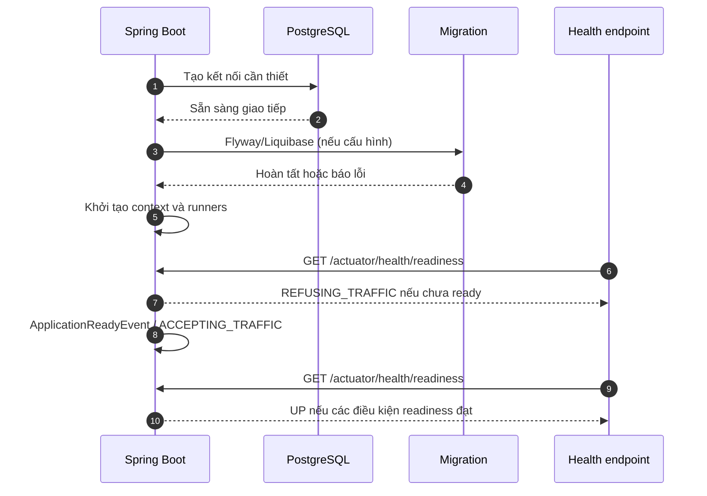
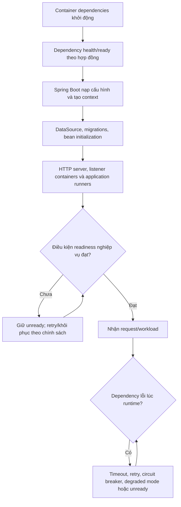

# Health check, thời điểm dịch vụ sẵn sàng và thứ tự kết nối

Một ứng dụng Spring Boot có thể khởi động trong khi PostgreSQL còn tạo database, Redis đã mở cổng nhưng chưa nhận được lệnh, Kafka broker đã chạy nhưng listener chưa lấy được metadata, hoặc một REST API trả về HTTP 200 cho health endpoint nhưng các chức năng nghiệp vụ chưa dùng được. Trong môi trường phát triển, những tình huống này thường tạo ra lỗi lúc chạy lần đầu, lỗi không ổn định trong integration test và những đoạn `sleep(30)` khó bảo trì.

Bài học thuộc chương **Dịch vụ phát triển** của mô-đun **SPRING_BOOT_INTEGRATION**. Mục tiêu là tổ chức việc kết nối Spring Boot với HTTP client, cơ sở dữ liệu, cache, message broker và các adapter tích hợp sao cho thời điểm khởi động, trạng thái sẵn sàng, giao dịch, retry, lỗi và kiểm thử có thể giải thích và quan sát được.

Hai ý phải luôn đi cùng nhau:

1. **Thứ tự khởi động** giúp tránh kết nối quá sớm ở những bước đầu tiên.
2. **Cơ chế tự phục hồi khi đang chạy** giúp xử lý kết nối bị mất sau khi mọi dịch vụ đã từng sẵn sàng.

Health check không thể thay thế hoàn toàn một trong hai ý trên.

## 1. Mục tiêu học tập

Sau bài này, bạn có thể:

- Phân biệt process đã chạy, port đã mở, protocol hoạt động, dependency dùng được và ứng dụng sẵn sàng phục vụ nghiệp vụ.
- Phân biệt **liveness**, **readiness**, **startup** và health check của Docker Compose, Spring Boot Actuator, Testcontainers.
- Giải thích giới hạn của `depends_on`, `service_healthy`, `sleep` và TCP port check.
- Thiết kế thứ tự khởi động cho PostgreSQL, Redis, Kafka, RabbitMQ và dịch vụ HTTP.
- Sử dụng Spring Boot Docker Compose support, service connections và Testcontainers đúng phạm vi.
- Chọn ranh giới giữa fail fast, retry có giới hạn, degraded mode và chặn readiness.
- Viết phép kiểm thử gây trễ, gây lỗi, restart và mất kết nối để xác nhận hệ thống phục hồi.

## 2. Định nghĩa chính xác “dịch vụ đã sẵn sàng”

Không tồn tại một thời điểm “ready” có ý nghĩa giống nhau với mọi loại dịch vụ. Hãy phân biệt các cấp độ:

| Cấp độ | Dấu hiệu | Điều **chưa** được đảm bảo |
|---|---|---|
| **Process started** | Tiến trình/container đang chạy | Cổng có thể chưa lắng nghe |
| **Port listening** | TCP connect thành công | TLS, authentication, protocol và nghiệp vụ có thể thất bại |
| **Protocol responsive** | Trả lời `PING`, `SELECT 1` hoặc request phù hợp | Schema/topic/queue/permission có thể chưa sẵn |
| **Dependency usable** | Ứng dụng truy cập được chức năng cần thiết với credential thực | Toàn bộ workflow nhiều dependency có thể chưa hoàn tất |
| **Application ready** | Ứng dụng quyết định có thể nhận workload theo hợp đồng | Dependency có thể hỏng ngay sau health check |
| **Business workflow complete** | Một giao dịch end-to-end được thực hiện đúng và bền vững | Không thể suy ra chỉ từ TCP hoặc health endpoint đơn giản |

Ví dụ với PostgreSQL:

```text
T0  Docker báo container RUNNING
T1  PostgreSQL tạo cluster và khởi chạy
T2  TCP 5432 kết nối được
T3  pg_isready báo server đang nhận kết nối
T4  Ứng dụng xác thực bằng tài khoản của mình thành công
T5  Flyway/Liquibase hoàn tất migration
T6  Query nghiệp vụ truy cập đúng bảng/cột
T7  Spring Boot hoàn tất khởi tạo và chuyển readiness sang ACCEPTING_TRAFFIC
```

Các mốc không nhất thiết cách đều nhau. Một health check tại `T3` chỉ giải quyết được điều kiện mà nó đã kiểm tra; không thể dùng nó làm bằng chứng cho `T5` hoặc `T6`.

Vì vậy trước khi viết health check, cần trả lời:

> **Ai sẽ tiêu thụ kết quả health check này và họ cần bằng chứng gì để quyết định hành động?**

Docker Compose cần biết có thể bắt đầu service phụ thuộc chưa. Kubernetes cần biết có nên chuyển traffic tới Pod hay restart container. Một test cần biết đã có thể gửi request/record chưa. Một operator cần biết là lỗi của process hay lỗi của hệ thống phụ thuộc.

## 3. Liveness, readiness và startup không cùng một câu hỏi

### 3.1. Liveness: tiến trình còn khả năng tiến bộ không?

Liveness trả lời: **Có cần khởi động lại instance này để nó phục hồi không?**

Ví dụ liveness thất bại khi ứng dụng rơi vào trạng thái không thể tự khôi phục, thread chết dẫn tới ngừng tiến bộ, hoặc runtime hỏng nghiêm trọng. Liveness nên phản ánh sức khỏe **bản thân tiến trình**.

Không nên gắn liveness với kết nối PostgreSQL hoặc một REST API dùng chung. Nếu database tạm thời ngừng phục vụ, việc restart đồng loạt các instance ứng dụng thường chỉ làm gián đoạn thêm và có thể tạo vòng lặp restart.

### 3.2. Readiness: có nên giao thêm workload cho instance?

Readiness trả lời: **Có thể giao request hoặc công việc mới cho instance này ngay bây giờ không?**

Ứng dụng đang chạy nhưng phải chờ hoàn tất migration, tạo cache ban đầu hoặc đồng bộ một điều kiện quan trọng có thể ở trạng thái *alive nhưng chưa ready*. Readiness thất bại thường khiến hệ thống điều phối ngừng chuyển traffic đến instance, **không đồng nghĩa phải restart**.

Việc đưa một dependency vào readiness là quyết định nghiệp vụ:

- Nếu thiếu database thì mọi request ghi đơn hàng đều thất bại, việc đánh dấu unready có thể hợp lý.
- Nếu chỉ mất cache dẫn xuất và hệ thống có thể đọc trực tiếp database, có thể vẫn ready nhưng báo tình trạng degraded qua metric/health bổ sung.
- Nếu API đối tác dùng chung đang lỗi, khiến toàn bộ replica unready có thể làm mất cả các chức năng không phụ thuộc API đó.
- Nếu tiến trình chỉ là Kafka consumer không phục vụ HTTP traffic, readiness còn phải được diễn giải theo cách nền tảng triển khai worker kiểm soát nhận công việc.

### 3.3. Startup: còn đang trong thời gian khởi động hợp lệ không?

Startup probe, khi nền tảng hỗ trợ (chẳng hạn Kubernetes), cho phép ứng dụng có khoảng khởi động dài như tải dữ liệu, tạo kết nối hoặc warm-up mà không bị liveness probe restart quá sớm. Khi startup probe thành công, liveness/readiness được đánh giá theo vòng đời thông thường.

### 3.4. Docker health status là một cơ chế khác

Docker Healthcheck chạy câu lệnh **bên trong container** và trả trạng thái `starting`, `healthy` hoặc `unhealthy`. Nó không tự đồng nghĩa với liveness/readiness của Spring Boot hay Kubernetes. Docker Engine không mặc nhiên restart container chỉ vì health status là `unhealthy`; cần hiểu chính sách giám sát và orchestration đang dùng.

| Loại kiểm tra | Chủ thể quan sát | Câu hỏi chính | Hành động thường gặp |
|---|---|---|---|
| Docker `healthcheck` | Docker/Compose | Container này đã đáp ứng kiểm tra được định nghĩa chưa? | Cho phép `service_healthy`; hiển thị health status |
| Spring Boot Actuator `/health/liveness` | Platform/operator | Process còn khả năng vận hành không? | Khởi động lại khi orchestrator có cấu hình |
| Spring Boot Actuator `/health/readiness` | Router/orchestrator/operator | Instance nên nhận workload mới không? | Chuyển hoặc ngừng chuyển traffic |
| Kubernetes `startupProbe` | Kubelet | Container đã vượt qua giai đoạn startup chưa? | Trì hoãn liveness/readiness đến khi startup xong |
| Testcontainers wait strategy | Test framework | Dependency đã đáp ứng điều kiện để test bắt đầu chưa? | Chờ hoặc báo lỗi setup test |

Một lệnh health check thành công tại thời điểm `t` không đảm bảo dịch vụ vẫn khỏe tại `t+1`. Mọi client vẫn cần timeout và xử lý lỗi tại chính lần gọi của mình.

## 4. Docker Compose: bắt đầu container khác với bắt đầu một workflow an toàn

Docker Compose có hai cách khai báo quan hệ phụ thuộc phổ biến:

```yaml
# Cách ngắn: chỉ mô tả thứ tự khởi động/dừng cơ bản.
services:
  api:
    depends_on:
      - postgres
  postgres:
    image: postgres:16-alpine
```

Với dạng ngắn, Compose không có đủ tín hiệu để khẳng định PostgreSQL đã sẵn sàng nhận query khi `api` được bắt đầu. Thứ tự tạo/chạy container có thể đúng mà kết nối ứng dụng vẫn thất bại.

Dạng dài cho phép chỉ định điều kiện:

```yaml
services:
  api:
    depends_on:
      postgres:
        condition: service_healthy
  postgres:
    image: postgres:16-alpine
    healthcheck:
      test: ["CMD-SHELL", "pg_isready -U postgres"]
      interval: 3s
      timeout: 3s
      retries: 20
```

Với `condition: service_healthy`, Compose chờ health check của dependency đạt `healthy` trước khi bắt đầu service phụ thuộc. Điều kiện này **chỉ giúp điều phối lúc khởi động**: nếu PostgreSQL mất kết nối sau đó, container `api` không tự được “khóa” khỏi mọi request hay được reconnect hộ.

Compose còn có `condition: service_completed_successfully` cho công việc chạy một lần, chẳng hạn migration job được tổ chức như một service riêng và phải exit code 0 trước khi app bắt đầu. Chỉ dùng kiểu này với job thực sự có thể kết thúc; một broker chạy liên tục sẽ không “completed successfully” theo nghĩa của điều kiện này.

### 4.1. Đọc đúng các tham số healthcheck

| Thuộc tính | Ý nghĩa |
|---|---|
| `test` | Lệnh phát hiện trạng thái, exit code 0 là thành công |
| `interval` | Khoảng giữa các lần thực hiện health check |
| `timeout` | Thời gian tối đa cho một lần kiểm tra |
| `retries` | Số lần thất bại liên tiếp cần thiết để bị coi là unhealthy |
| `start_period` | Khoảng khởi động mà lỗi check chưa bị tính vào ngưỡng thất bại theo quy tắc Docker; check thành công có thể kết thúc giai đoạn grace |

`start_period` không thay thế thời gian timeout của toàn bộ hệ thống và cũng không có nghĩa Docker sẽ dừng container khi nó hết. Lệnh `test` phải tồn tại trong **image đang chạy**; đừng viết `curl` hoặc `wget` trong healthcheck của image tối giản nếu image đó không có binary tương ứng.

### 4.2. Ví dụ local development với PostgreSQL và Redis

Một file `compose.yaml` cho hai dependency của ứng dụng Spring Boot:

```yaml
services:
  postgres:
    image: postgres:16-alpine
    environment:
      POSTGRES_DB: orders
      POSTGRES_USER: orders
      POSTGRES_PASSWORD: orders_dev
    ports:
      - "127.0.0.1:55432:5432"
    healthcheck:
      test:
        - CMD-SHELL
        - "pg_isready -U $$POSTGRES_USER -d $$POSTGRES_DB"
      interval: 3s
      timeout: 3s
      retries: 20
      start_period: 15s

  redis:
    image: redis:7-alpine
    ports:
      - "127.0.0.1:56379:6379"
    healthcheck:
      test: ["CMD", "redis-cli", "PING"]
      interval: 3s
      timeout: 2s
      retries: 20
      start_period: 5s
```

Ở đây:

- `127.0.0.1:55432` và `127.0.0.1:56379` là cổng publish trên **máy chạy Compose** để ứng dụng chạy trên host kết nối được.
- `postgres:5432` và `redis:6379` là địa chỉ thường dùng khi ứng dụng chạy như container **trong cùng Compose network**.
- `$$POSTGRES_USER` và `$$POSTGRES_DB` giữ dấu `$` đến lúc shell **bên trong container** mở rộng biến môi trường; nếu dùng một dấu `$`, Compose có thể thay biến ngay trên host.
- `pg_isready` xác nhận PostgreSQL báo đang chấp nhận kết nối; nó **không đủ** để chứng minh thông tin xác thực ứng dụng hợp lệ, migration đã chạy hoặc table đã tồn tại.
- `redis-cli PING` chứng minh kết nối và lệnh PING trong điều kiện thực thi healthcheck; môi trường có ACL, TLS hoặc credential riêng cần một probe đúng cách kết nối của ứng dụng.

Có thể quan sát:

```bash
docker compose up -d
docker compose ps
docker compose logs postgres
docker compose logs redis
```

Với phiên bản Docker Compose hỗ trợ, `docker compose up --wait` cho phép đợi các service đạt trạng thái running/healthy theo định nghĩa Compose. Nhưng bước chờ này không chứng minh logic SQL, luồng xử lý Kafka hoặc API nghiệp vụ đã sẵn sàng.

### 4.3. Nếu ứng dụng cũng chạy trong Compose

Thêm service ứng dụng (minh họa với dự án đã có Dockerfile):

```yaml
  api:
    build: .
    depends_on:
      postgres:
        condition: service_healthy
      redis:
        condition: service_healthy
    environment:
      SPRING_DOCKER_COMPOSE_ENABLED: "false"
      SPRING_DATASOURCE_URL: jdbc:postgresql://postgres:5432/orders
      SPRING_DATASOURCE_USERNAME: orders
      SPRING_DATASOURCE_PASSWORD: orders_dev
      SPRING_DATA_REDIS_HOST: redis
      SPRING_DATA_REDIS_PORT: "6379"
```

Đây là **đoạn thêm vào bên dưới `services:`** của file trước, không phải YAML độc lập. `SPRING_DOCKER_COMPOSE_ENABLED=false` phù hợp khi container ứng dụng chỉ tiêu thụ các dependency do Compose bên ngoài đã quản lý, không cần chính Spring Boot khởi chạy Compose một lần nữa.

Không dùng `localhost:55432` cho ứng dụng nằm trong container `api`: ở đó, `localhost` trỏ đến chính container ứng dụng. Không dùng `postgres:5432` cho ứng dụng chạy trực tiếp trên máy host nếu host không có cách resolve tên `postgres`; host nên sử dụng published port hoặc connection details được Spring Boot cung cấp.

## 5. Spring Boot Docker Compose support: điều phối dependency khi chạy ứng dụng trên host

Spring Boot có cơ chế tích hợp Docker Compose dành cho trải nghiệm local development. Khi được thêm vào classpath đúng cách và có file Compose được nhận diện, Spring Boot có thể:

1. Khởi động các dịch vụ Compose theo vòng đời được cấu hình.
2. Chờ service dependency sẵn sàng theo healthcheck hoặc kiểm tra TCP với dịch vụ không có healthcheck.
3. Tạo **service connection details** cho những loại dịch vụ được hỗ trợ, sử dụng thông tin cổng đã publish để ứng dụng kết nối.
4. Quản lý việc dừng Compose theo lifecycle, nếu ứng dụng là bên khởi động và cấu hình cho phép.

Với Gradle:

```groovy
dependencies {
    developmentOnly("org.springframework.boot:spring-boot-docker-compose")
}
```

Ví dụ tùy chọn cấu hình:

```yaml
spring:
  docker:
    compose:
      enabled: true
      file: compose.yaml
      readiness:
        timeout: 2m
```

Các property và hỗ trợ service connection phụ thuộc phiên bản Spring Boot; hãy xác nhận phiên bản đang dùng khi chọn image broker, database hoặc custom container. `readiness.timeout` là **ngân sách chờ container sẵn sàng lúc startup**, không phải timeout cho mọi SQL hoặc HTTP request trong vòng đời ứng dụng.

### 5.1. Service connection khác với hardcode host/port

Giả sử PostgreSQL được publish ở `55432` thay vì `5432`. Khi Spring Boot nhận diện dependency Compose và tạo `JdbcConnectionDetails` thích hợp, ứng dụng có thể nhận host, port và credential từ service connection mà không phải tự cài một JDBC URL cố định cho local run.

Nếu chủ động quản lý dependency bằng `docker compose up -d` nhưng **không** dùng Spring Boot Docker Compose integration, ứng dụng chạy trên host có thể cấu hình tường minh:

```yaml
spring:
  datasource:
    url: jdbc:postgresql://localhost:55432/orders
    username: orders
    password: orders_dev
  data:
    redis:
      host: localhost
      port: 56379
```

Đây là hai **chiến lược kết nối** khác nhau. Đừng trộn connection details tự động với URL hardcode rồi suy đoán thuộc tính nào đang có hiệu lực; hãy đọc cấu hình và log cuối cùng của môi trường đang chạy. Trong Spring Boot, khi một loại `ConnectionDetails` được cung cấp, nó thường được ưu tiên khi tạo client tương ứng so với các property kết nối trực tiếp của auto-configuration.

### 5.2. Đừng coi Boot Compose readiness là kiểm thử nghiệp vụ

Ví dụ PostgreSQL healthcheck đã đạt và Boot Compose đã cho phép khởi tạo `DataSource`, nhưng ứng dụng vẫn có thể gặp:

- Credential trong app không đúng quyền.
- Migration SQL sai hoặc bị tranh chấp khóa.
- Broker Kafka có port mở nhưng `advertised.listeners` trả địa chỉ không thể kết nối từ app.
- Redis ACL cho phép `PING` nhưng chặn lệnh ghi mà workflow cần.
- HTTP dependency chấp nhận TCP nhưng endpoint chức năng vẫn trả 503.

Cần xử lý các lỗi này bằng cấu hình, migration, retry và readiness nghiệp vụ ở tầng ứng dụng.

### 5.3. Trong integration test

Docker Compose support của Spring Boot có quy tắc riêng khi chạy tests và thường được tắt mặc định trong test context. Nếu test phải phụ thuộc Docker Compose, cấu hình thử nghiệm và vòng đời container cần được chỉ rõ. Trong đa số integration test cần cô lập, Testcontainers với service connection thường cung cấp môi trường tái tạo rõ ràng hơn.

## 6. Testcontainers: chờ dịch vụ trong integration test

Testcontainers khởi chạy container cho test và có cơ chế chờ readiness theo từng loại container. Các container chuyên biệt như `PostgreSQLContainer` thường có wait strategy phù hợp hơn so với việc tự kiểm tra một cổng TCP của container bất kỳ.

Ví dụ Spring Boot integration test:

```java
import org.junit.jupiter.api.Test;
import org.springframework.boot.test.context.SpringBootTest;
import org.springframework.boot.testcontainers.service.connection.ServiceConnection;
import org.testcontainers.containers.PostgreSQLContainer;
import org.testcontainers.junit.jupiter.Container;
import org.testcontainers.junit.jupiter.Testcontainers;

@Testcontainers
@SpringBootTest
class OrderRepositoryIntegrationTest {

    @Container
    @ServiceConnection
    static PostgreSQLContainer<?> postgres =
        new PostgreSQLContainer<>("postgres:16-alpine")
            .withDatabaseName("orders")
            .withUsername("orders")
            .withPassword("test_only");

    @Test
    void canPersistOrder() {
        // Kiểm tra repository, giao dịch và schema đã được migration.
    }
}
```

Ví dụ giả định project đã có các dependency thử nghiệm tương ứng như Testcontainers JUnit Jupiter, PostgreSQL module, Spring Boot Testcontainers và JDBC driver. `@ServiceConnection` tạo connection details cho Spring Boot trong các phiên bản hỗ trợ; cách đó tránh việc tự lắp địa chỉ host/port random của Testcontainers.

### 6.1. Các wait strategy phổ biến

| Chiến lược | Điều kiện được chứng minh | Giới hạn |
|---|---|---|
| Listening port | Có tiến trình lắng nghe port | Chưa chứng minh protocol/auth/schema |
| HTTP endpoint | Endpoint trả mã/trạng thái mong đợi | Chất lượng phụ thuộc ngữ nghĩa endpoint |
| Docker healthcheck | Container báo `healthy` | Healthcheck trong image có thể quá nông |
| Log message | Log có chuỗi nhất định | Chuỗi log có thể thay đổi; không chứng minh service tiếp tục khỏe |
| SQL/khởi tạo chuyên biệt | Query hoặc bước init chạy được | Chỉ chứng minh yêu cầu đã thực hiện tại thời điểm kiểm tra |

Với một HTTP service do team sở hữu, có thể chờ endpoint readiness:

```java
import java.time.Duration;
import org.testcontainers.containers.GenericContainer;
import org.testcontainers.containers.wait.strategy.Wait;

GenericContainer<?> partner = new GenericContainer<>("example/partner-api:dev")
    .withExposedPorts(8080)
    .waitingFor(
        Wait.forHttp("/actuator/health/readiness")
            .forPort(8080)
            .forStatusCode(200)
            .withStartupTimeout(Duration.ofMinutes(2))
    );
```

`example/partner-api:dev` là tên image **minh họa**, phải thay bằng image thực có endpoint tương ứng. Một endpoint `200 OK` có ích chỉ khi phía dịch vụ định nghĩa `200` là đủ điều kiện để test bắt đầu.

### 6.2. Ready của database chưa phải ready của ứng dụng

Testcontainers có thể khẳng định PostgreSQL chấp nhận kết nối, nhưng Flyway/Liquibase của Spring Boot vẫn cần chạy trước khi repository hoạt động. Hãy để Spring context khởi tạo và kiểm tra hành vi thật của repository hoặc API. Không dùng Testcontainers wait strategy như một phép chứng minh schema nghiệp vụ đúng.

## 7. Spring Boot Actuator và ApplicationAvailability

Spring Boot Actuator cung cấp health endpoint; đối với các phiên bản hỗ trợ availability probes, có nhóm health dành cho **liveness** và **readiness**. Thêm dependency:

```groovy
dependencies {
    implementation("org.springframework.boot:spring-boot-starter-actuator")
}
```

Cấu hình minh họa:

```yaml
management:
  endpoint:
    health:
      probes:
        enabled: true
  endpoints:
    web:
      exposure:
        include: health,info
```

Các URL thường gặp nếu ứng dụng dùng cổng HTTP mặc định:

```text
GET http://localhost:8080/actuator/health
GET http://localhost:8080/actuator/health/liveness
GET http://localhost:8080/actuator/health/readiness
```

Theo cách ánh xạ HTTP mặc định của health endpoint, trạng thái `UP` thường trả `200`; `DOWN` hoặc `OUT_OF_SERVICE` thường trả `503`. Cần kiểm tra cấu hình status mapping nếu project đã tùy biến.

### 7.1. Readiness state của Spring Boot

Spring Boot theo dõi trạng thái availability bằng các loại như:

- `LivenessState.CORRECT` và `LivenessState.BROKEN`.
- `ReadinessState.REFUSING_TRAFFIC` và `ReadinessState.ACCEPTING_TRAFFIC`.

Trong vòng đời khởi động thông thường, readiness ban đầu từ chối traffic, rồi chuyển sang chấp nhận sau khi startup và các application runner hoàn tất. Việc web server mở cổng sớm hơn **không** tự có nghĩa ứng dụng đã đạt readiness.



Sơ đồ là luồng điển hình. Một số bean/client tạo kết nối lazy, hoặc listener Kafka nhận assignment bất đồng bộ, nên sự kiện `ApplicationReadyEvent` **không chứng minh** mọi luồng ngoài đã hoàn tất khởi tạo.

### 7.2. Readiness và các dependency thiết yếu

Nhóm readiness mặc định dựa chủ yếu vào `readinessState`, thay vì mặc nhiên đưa mọi health indicator vào readiness. Nếu nghiệp vụ yêu cầu DB kết nối được trước khi nhận request, có thể cấu hình thêm `db`:

```yaml
management:
  endpoint:
    health:
      probes:
        enabled: true
      group:
        readiness:
          include: readinessState,db
```

Ví dụ này cần có `db` health indicator thực sự được đăng ký qua Actuator/DataSource. Với các dependency tùy chọn hoặc môi trường không có indicator đó, phải điều chỉnh membership; Spring Boot có cơ chế kiểm tra tên thành viên health group để phát hiện cấu hình sai.

**Lựa chọn nhóm readiness là quyết định kiến trúc**, không phải cứ thêm `db,redis,kafka,rabbit` càng nhiều càng an toàn. Đưa shared dependency vào readiness có thể khiến mọi replica đều bị ngắt traffic cùng lúc khi dependency đó lỗi; đây có thể là hành vi mong muốn với endpoint bắt buộc cần dependency, nhưng cũng có thể làm tê liệt các chức năng vẫn còn hoạt động.

### 7.3. Health probe trên cổng ứng dụng

Nếu cổng quản trị Actuator nằm riêng với cổng API, health endpoint trên cổng quản trị có thể vẫn trả kết quả trong khi cổng HTTP chính gặp vấn đề. Với Spring Boot hỗ trợ property này, có thể bật thêm probe paths trên cổng server chính:

```yaml
management:
  endpoint:
    health:
      probes:
        enabled: true
        add-additional-paths: true
```

Khi đó các đường dẫn bổ sung thông thường là `/livez` và `/readyz` trên cổng ứng dụng. Chỉ dùng các đường dẫn này sau khi xác minh chúng được bật trong version và cấu hình đang chạy.

### 7.4. Custom health indicator khi “sẵn sàng” có ý nghĩa nghiệp vụ

Ví dụ một worker phải nạp ruleset trước khi xử lý đơn hàng. Có thể xuất một health indicator phản ánh trạng thái đó:

```java
import java.util.concurrent.atomic.AtomicBoolean;
import org.springframework.boot.actuate.health.Health;
import org.springframework.boot.actuate.health.HealthIndicator;
import org.springframework.stereotype.Component;

@Component("rulesReady")
public class RulesReadyHealthIndicator implements HealthIndicator {

    private final AtomicBoolean initialized = new AtomicBoolean(false);

    public void markReady() {
        initialized.set(true);
    }

    public void markNotReady() {
        initialized.set(false);
    }

    @Override
    public Health health() {
        return initialized.get()
            ? Health.up().build()
            : Health.outOfService()
                .withDetail("reason", "rules not loaded")
                .build();
    }
}
```

Ứng dụng phải gọi `markReady()` sau khi ruleset đã được nạp và xác minh; gọi `markNotReady()` khi điều kiện thiết yếu không còn được đáp ứng. Chỉ khai báo bean không làm ruleset tự sẵn sàng.

Đưa indicator vào readiness:

```yaml
management:
  endpoint:
    health:
      probes:
        enabled: true
      group:
        readiness:
          include: readinessState,rulesReady
```

Không thực hiện hàng loạt query nặng hoặc gọi mạng với timeout vô hạn ngay trong mỗi lần health check. Nếu cần truy vấn dependency, giới hạn timeout và tần suất, hoặc cập nhật một trạng thái nội bộ được refresh có kiểm soát. Probe treo có thể tiêu tốn thread và làm bệnh trạng hệ thống nặng hơn.

## 8. Khởi động Spring Boot: thứ tự kết nối thường thấy

Spring Boot không có một thứ tự kết nối mạng duy nhất áp dụng cho mọi starter. Bean có thể khởi tạo eagerly hoặc lazily; một consumer Kafka có thể bắt đầu nhận assignment sau khi context tạo xong; HTTP client thường chỉ kết nối khi có request đầu tiên.

Một trình tự tham khảo:



Thứ tự chính xác của từng thành phần phụ thuộc auto-configuration và lifecycle. Không dùng sơ đồ này như cam kết rằng mọi network client kết nối trước `ApplicationReadyEvent`.

### 8.1. Ba mốc quan trọng trong application lifecycle

| Mốc | Ý nghĩa | Có thể còn thiếu |
|---|---|---|
| Spring context refresh | Các bean chính được khởi tạo và context sẵn | Worker async chưa đồng bộ hoàn toàn |
| `ApplicationRunner` / `CommandLineRunner` hoàn tất | Các bước startup đồng bộ được thực hiện xong | Công việc đã launch vào thread khác có thể vẫn chạy |
| `ApplicationReadyEvent` và readiness chuyển sang accepting | Spring Boot đánh dấu startup thông thường đã xong | Dependency tùy chọn hoặc workflow async có thể chưa dùng được |

Với một bước phải hoàn tất trước lúc nhận traffic, có thể tổ chức nó như startup task đồng bộ, bean initialization có kiểm soát, hoặc custom readiness gate. Nếu task có thể kéo dài rất lâu, cân nhắc thời gian startup probe và khả năng trả trạng thái cho người vận hành.

### 8.2. Kafka/RabbitMQ adapter cần điều kiện khác port check

Ví dụ với Kafka:

1. Bootstrap server chấp nhận TCP.
2. TLS và SASL (nếu dùng) có thể xác thực.
3. Metadata broker trả về các advertised addresses mà app truy cập được.
4. Topic/partition/ACL đáp ứng yêu cầu.
5. Producer gửi record thành công hoặc consumer join group và được assignment phù hợp.

Một TCP check ở bước 1 không chứng minh bước 3, 4, 5. Đặc biệt với Kafka trong Docker, `advertised.listeners=localhost:...` có thể dùng được từ máy host nhưng không dùng được từ container khác; cần đúng topology network của client.

Với RabbitMQ, node trả lời healthcheck chưa chắc vhost, exchange, queue, binding và quyền của account nghiệp vụ đã sẵn. Với Redis, `PING` chưa khẳng định các key/command và ACL được phép. Với HTTP client, cần phân biệt `/health`, `/ready` và endpoint nghiệp vụ theo contract của hệ thống đối tác.

## 9. Thiết kế health check đúng mức cho từng dịch vụ

| Dịch vụ | Kiểm tra bước đầu | Kiểm tra mạnh hơn khi bắt buộc |
|---|---|---|
| PostgreSQL | `pg_isready` hoặc TCP | Kết nối bằng credential app, `SELECT 1`, migration/schema version |
| MySQL/MariaDB | Ping từ client phù hợp | Login, truy cập schema/bảng và quyền của ứng dụng |
| Redis | `redis-cli PING` | Auth/ACL, thao tác thực tế với key test an toàn |
| Kafka | Broker TCP/metadata | Metadata advertised listeners, topic, ACL, producer send, consumer assignment |
| RabbitMQ | Diagnostics/node health | Vhost, queue, exchange, binding, quyền publish/consume |
| MongoDB | `ping` command | Auth, replica-set/read-write state và collection/index cần thiết |
| HTTP service | TCP hoặc HTTP `/ready` | Hợp đồng endpoint cụ thể, TLS/auth, timeout phù hợp |
| Spring Boot app | Actuator readiness | Điều kiện business-specific, test API hoặc message flow |

Không dùng các thao tác ghi thẳng dữ liệu nghiệp vụ thật trong một health probe chạy liên tục. Nếu cần thao tác ghi/đọc để kiểm chứng, hãy dùng tài nguyên health riêng, TTL, quyền hạn chế và tần suất phù hợp; những kiểm tra end-to-end đắt đỏ nên tách khỏi probe liên tục.

## 10. Retry, timeout, backoff và fail fast

Ngay cả khi Compose hoặc Testcontainers đợi dependency healthy, một request đầu tiên có thể thất bại do race condition, kết nối cũ hoặc transient network error. **Readiness check giảm xác suất kết nối quá sớm; retry có kiểm soát xử lý sự kiện thất bại thực tế.**

Một chính sách kết nối cần phân loại lỗi:

| Lỗi | Cách xử lý thường phù hợp |
|---|---|
| Connection refused trong giai đoạn service đang startup | Retry có backoff trong ngân sách startup |
| Timeout ngắn, tạm thời | Retry giới hạn nếu thao tác an toàn để lặp |
| HTTP 429 hoặc 503 | Backoff theo contract và `Retry-After` khi có |
| Credential sai, chứng chỉ sai, schema không tương thích | Fail fast và báo cấu hình; retry vô hạn không khắc phục |
| Invalid payload, validation error | Không retry mù quáng; đưa vào luồng xử lý lỗi nghiệp vụ |
| Kafka producer không chắc broker đã nhận | Kiểm tra idempotence và contract giao nhận; tránh tạo duplicate side effects |
| Database bị mất giữa transaction | Rollback và retry cả đơn vị giao dịch idempotent theo thiết kế |

### 10.1. Retry budget và backoff

Ví dụ kết nối HTTP có thể dùng chính sách:

```text
attempt 1: t = 0 ms
attempt 2: t ≈ 300 ms + jitter
attempt 3: t ≈ 900 ms + jitter
attempt 4: t ≈ 2100 ms + jitter
deadline tổng thể: 6 giây
```

Thời gian chỉ minh họa. Jitter giúp tránh nhiều instance retry cùng lúc. Timeout của một lần gọi phải nằm trong ngân sách deadline tổng thể, và retry chỉ dành cho lỗi tạm thời đã phân loại. Nếu nhiều lớp (HTTP client, service, gateway, broker listener) đều tự retry, số lần gọi cuối có thể tăng rất lớn; xác định rõ lớp sở hữu retry.

### 10.2. Idempotency là điều kiện của retry có tác dụng phụ

Với `GET` an toàn theo hợp đồng, retry thường đơn giản hơn so với `POST` tạo thanh toán hay gửi đơn. Nếu request `POST` timeout, server có thể đã xử lý thành công nhưng response bị mất. Gửi lại mà không có idempotency key có thể tạo giao dịch trùng.

Trong consumer Kafka, retry sau DB commit nhưng trước offset commit cũng có thể phát lại event. Vì vậy phải có deduplication, transaction boundary hoặc idempotent processing. Chạy được healthcheck không làm thay đổi những rủi ro này.

### 10.3. Fail fast và degraded mode

Chọn một trong ba hành vi có cơ sở:

- **Bắt buộc:** Không có dependency thì app không thể hoàn thành chức năng cốt lõi. Startup có thể fail fast sau một khoảng retry hữu hạn, hoặc tiếp tục chạy với readiness chưa đạt.
- **Tùy chọn:** Dependency mất nhưng chức năng chính vẫn hoạt động. Giữ readiness theo contract, ghi metric/log và dùng fallback/degraded mode.
- **Bất đồng bộ:** App có thể chấp nhận tác vụ và lưu bền vững vào queue/outbox trước khi dependency ngoài sẵn sàng. Khi ấy readiness có thể chỉ cần chứng minh **khả năng tiếp nhận bền vững**, trong khi worker hoàn tất tác vụ sau.

Điều kiện chấp nhận request phải khớp với cam kết thật sự mà API cung cấp. Không trả thành công rồi làm rơi công việc vì broker chưa hoạt động.

## 11. Thứ tự xử lý Flyway/Liquibase, schema và message broker

Sự khác nhau giữa **dependency ready** và **application ready** rất rõ khi cần migration hoặc khởi tạo tài nguyên.

Một mô hình:

```text
PostgreSQL container healthy
        |
        v
Ứng dụng xác thực và có DB connection
        |
        v
Flyway/Liquibase hoàn tất schema migration
        |
        v
Repository/consumer handler có thể đọc ghi schema đúng phiên bản
        |
        v
Ứng dụng công bố readiness ACCEPTING_TRAFFIC
```

Hãy xác định nơi sở hữu migration:

1. **Migration trong Spring Boot startup:** Ứng dụng tự chạy migration trước khi phục vụ, phù hợp local development nhưng cần xử lý khi nhiều replica startup cùng lúc.
2. **Migration job riêng:** CI/CD hoặc Compose job chạy trước app; có thể dùng `service_completed_successfully` trong local Compose, nhưng môi trường production cần job orchestration rõ ràng.
3. **Schema được quản lý trước deployment:** App kiểm tra compatibility/version và fail fast nếu sai.

Không vừa chạy migration bằng một job riêng vừa để mọi replica tự migration mà chưa xác định chính sách tương thích và khóa migration. Nếu thay đổi schema không tương thích với code cũ, thứ tự migration và rollout ảnh hưởng trực tiếp đến zero-downtime deployment.

Với Kafka/RabbitMQ, cần quyết định ai tạo topic/queue/binding. Việc broker healthy không đồng nghĩa topology nghiệp vụ đã tồn tại. Tạo tài nguyên bằng startup provisioning hoặc quản lý hạ tầng, rồi kiểm tra kết quả và quyền. Chỉ sau đó mới cho consumer/producer nhận workload theo hợp đồng.

## 12. Sử dụng readiness đúng trong Kubernetes

Nếu ứng dụng Spring Boot được triển khai lên Kubernetes, probes không đảm bảo thứ tự startup giữa các Pod kiểu `depends_on`. Kubernetes tạo Pod theo scheduler; mỗi instance phải chờ dependency hoặc tự phục hồi trong môi trường phân tán.

Với Spring Boot đã bật `management.endpoint.health.probes.add-additional-paths=true`, đoạn container spec minh họa:

```yaml
containers:
  - name: orders-api
    image: example/orders-api:1.0
    ports:
      - containerPort: 8080
    startupProbe:
      httpGet:
        path: /livez
        port: 8080
      periodSeconds: 2
      failureThreshold: 30
    livenessProbe:
      httpGet:
        path: /livez
        port: 8080
      periodSeconds: 10
      failureThreshold: 3
    readinessProbe:
      httpGet:
        path: /readyz
        port: 8080
      periodSeconds: 5
      failureThreshold: 2
```

Đây là **phần `containers:`**, cần đặt trong Pod template hợp lệ và thay image/cổng theo hệ thống thật. Các con số biểu thị ví dụ về cửa sổ phát hiện, không phải thông số tối ưu phổ quát. Nếu dùng đường dẫn `/actuator/health/liveness` và `/actuator/health/readiness` thay cho `/livez`/`/readyz`, phải kiểm tra endpoint đang nằm trên đúng port mà kubelet có thể gọi.

### 12.1. Vì sao không đặt DB vào liveness?

Giả sử 10 replica cùng dùng PostgreSQL:

```text
DB tạm mất kết nối trong 20 giây
  -> tất cả replica liveness DOWN
  -> kubelet lần lượt restart các replica
  -> Hikari pools, cache warm-up, migration/check kết nối tạo thêm tải
  -> DB phục hồi nhưng client đang khởi động lại hàng loạt
```

Nếu app còn sống và có thể reconnect, liveness nên tiếp tục UP. Readiness có thể chuyển DOWN với các route thật sự không thể dùng được. Với shared dependency, cân nhắc tác động khi **mọi** replica không còn ready: dịch vụ có thể không còn endpoint nhận traffic dù vẫn có những chức năng không phụ thuộc DB.

### 12.2. Graceful shutdown

Khi triển khai hoặc scale down, readiness cần chuyển trạng thái hợp lý để ngừng nhận workload mới trước khi process kết thúc. Nếu ứng dụng có in-flight HTTP requests, Kafka consumer hoặc transaction, cần có chính sách graceful shutdown, timeout và xử lý phần công việc chưa commit.

Không đánh đồng HTTP readiness với việc Kafka consumer đã dừng pull hoặc đã commit offset; lifecycle của message listener phải được thiết kế và kiểm thử riêng.

## 13. Với Spring Integration adapters: sự kiện “đã kết nối” chưa phải “đã hoàn tất”

Module SPRING_BOOT_INTEGRATION bao gồm các luồng adapter, ví dụ inbound Kafka/RabbitMQ, JDBC polling, HTTP outbound và cache. Mỗi adapter có ranh giới bắt đầu khác nhau:

| Adapter/luồng | Mốc khởi động quan sát được | Điều kiện nghiệp vụ quan trọng |
|---|---|---|
| JDBC inbound poller | Scheduler/poller được bật | DB có schema, credentials, query đọc được |
| Kafka inbound adapter | Listener container `running` | Consumer join group, assignment, topic/ACL phù hợp |
| AMQP inbound adapter | Listener container đã start | Broker/vhost/queue/binding và consumer hoạt động |
| HTTP outbound gateway | Bean/client được tạo | DNS/TLS/auth và endpoint thực sự gọi được |
| Redis cache adapter | Connection factory được tạo | Lệnh cache, TTL, serializer/ACL hoạt động |
| File/SFTP adapter | Poller hoặc phiên kết nối khởi tạo | Directory/quyền truy cập/định dạng file phù hợp |

**Không nên bật nhận message trước khi handler có các dependency thiết yếu**, nếu sự kiện nhận sẽ bị ack/commit/ghi thành công sai thời điểm. Có thể đặt listener auto-startup theo chính sách và kích hoạt sau khi dependency được chuẩn bị, hoặc để listener chạy cùng error handler/retry/idempotency. Cách nào đúng phụ thuộc việc downtime ngắn có được phép giữ message ở broker và cách commit/ack của adapter.

Với Spring Integration `SmartLifecycle`, thứ tự phase có thể điều khiển lifecycle của một số component. Tuy nhiên phase **không kiểm tra network readiness**, và thứ tự bean startup không thay thế timeout/retry của client. Nếu adapter có một dependency đang chờ, hãy đưa điều kiện đó vào quá trình readiness có chủ đích.

### 13.1. Phân biệt consumer ready và handler ready

Một listener Kafka có thể đã gọi subscribe nhưng chưa được gán partition. Ngược lại, một instance trong group có thể hợp lệ khi **không** được gán partition do số instance nhiều hơn số partition. Vì vậy không nên đánh dấu unready chỉ vì instance không có assignment nếu điều đó vẫn đúng với vai trò của nó.

Nếu use case thực sự yêu cầu một partition assignment trước khi job có thể hoạt động, cần nêu điều kiện đó rõ và test các tình huống rebalance. Đừng áp dụng rule “ít nhất một partition” một cách mù quáng cho mọi consumer.

## 14. Các anti-pattern thường gặp

### 14.1. Dùng `sleep(30)` trước khi gọi dịch vụ

```java
Thread.sleep(30_000);
connection.open();
```

Sau 30 giây, dependency **có thể** ready hoặc **vẫn chưa** ready. Môi trường nhanh thì chờ thừa, môi trường chậm vẫn lỗi. Dùng readiness check có timeout và retry phù hợp; tránh để UI startup không có thông tin tình trạng.

### 14.2. Chỉ kiểm tra TCP port

TCP port check chứng minh network path và process lắng nghe, không chứng minh login DB, TLS certificate, Kafka advertised listeners, queue permission hay schema. Dùng nó như mức tối thiểu khi dependency không hỗ trợ probe sâu hơn, nhưng đừng gọi đó là “nghiệp vụ đã ready”.

### 14.3. Nhồi toàn bộ dependency vào liveness

Khi một dịch vụ ngoài hỏng, mọi replica có thể bị restart vô ích. Liveness nên đo sức khỏe process; readiness hoặc metric riêng thể hiện dependency.

### 14.4. Cho rằng `depends_on: service_healthy` sẽ xử lý mất kết nối lúc runtime

`service_healthy` xử lý dependency startup order của Compose. Khi DB restart lúc app đang chạy, client vẫn phải phát hiện connection error, retry/reconnect, rollback transaction hoặc báo degraded readiness.

### 14.5. Health endpoint gọi SQL nặng mỗi vài giây

Hàng trăm instance có thể cùng probe và gây tải thêm lên DB đang suy yếu. Sử dụng phép kiểm tra nhẹ, timeout ngắn, cache kết quả hợp lý hoặc tách synthetic transaction sâu ra khỏi liveness/readiness tần suất cao.

### 14.6. Báo ready trước khi hoàn thành migration

Traffic đến sớm có thể thấy missing table/column. Đặt migration trong startup đồng bộ hoặc buộc readiness chờ schema contract được đáp ứng.

### 14.7. Chờ broker healthy rồi bỏ qua lỗi publish/consume

Broker có thể đổi leader hoặc lỗi mạng sau healthcheck. Producer vẫn cần xử lý send failure, consumer cần error handler/commit strategy và chống duplicate.

### 14.8. Dùng một check cho mọi bối cảnh

`/actuator/health` tổng thể có thể báo lỗi chỉ vì một component tùy chọn, trong khi `/health/liveness` hoặc `/health/readiness` cần quy tắc riêng. Điều chỉnh group theo hành động mà hệ thống quan sát sẽ thực hiện.

## 15. Quan sát và chẩn đoán sự cố khởi động

Khi “máy tôi chạy được nhưng CI hay fail”, điều đầu tiên cần làm là tập hợp **mốc thời gian**. Ghi các sự kiện:

1. Container dependency được tạo/khởi chạy.
2. Healthcheck đầu tiên thành công hay thất bại; thuộc tính `retries` và `start_period`.
3. Spring Boot bắt đầu tạo connection pool, consumer hoặc HTTP client.
4. SQL migration bắt đầu/kết thúc.
5. Kafka/RabbitMQ listener được start, join/subscribe và có trạng thái cần thiết.
6. Readiness chuyển sang accepting; request/message đầu tiên xử lý thành công.
7. Reconnect/retry/rebalance sau sự cố.

Lệnh hữu ích ở môi trường Compose:

```bash
docker compose ps
docker compose logs --timestamps postgres
docker compose logs --timestamps redis
docker compose logs --timestamps api

curl -i http://localhost:8080/actuator/health/liveness
curl -i http://localhost:8080/actuator/health/readiness
```

`api` chỉ có nếu Compose file thực sự định nghĩa service ứng dụng. `curl` được gọi từ host trong ví dụ và phải có trên máy thực hiện; healthcheck Docker bên trong container cần binary riêng.

Ở Kubernetes, kiểm tra:

```bash
kubectl get pods
kubectl describe pod orders-api-xxxxx
kubectl logs orders-api-xxxxx
```

Tên Pod là ví dụ. Các Kubernetes events và log giúp phân biệt `startupProbe failed`, `readinessProbe failed`, lỗi image, OOM/restart và lỗi kết nối dependency.

### 15.1. Chỉ số nên theo dõi

| Chỉ số | Giúp phát hiện |
|---|---|
| Thời gian dependency healthy | Startup chậm, container init bất thường |
| Thời gian từ process start đến `ApplicationReadyEvent` | Migrations hoặc application runner chậm |
| Readiness transitions theo thời gian | Chập chờn do dependency hoặc business gate |
| Connection timeout/refused và auth failures | Sai port, dependency chưa ready, credential lỗi |
| Hikari pool acquisition time/connection failures | DB pool nghẽn hoặc DB gián đoạn |
| Kafka consumer assignment/rebalance, producer error | Broker khả dụng nhưng message flow không ổn |
| RabbitMQ reconnect, consumer cancel, failed publish | Queue/broker/permission thay đổi |
| Retry count, retry exhausted, circuit breaker state | Dependency liên tục suy yếu |
| Synthetic success/latency theo workflow | Có thực sự hoàn thành nghiệp vụ không |

Nên có correlation ID giữa startup log, request/message log và trace. Không log plaintext password, token hoặc DSN chứa bí mật khi báo lỗi cấu hình.

## 16. Kiểm thử có chủ đích các thời điểm sẵn sàng

Chỉ test startup “mọi thứ chạy nhanh” bỏ sót race condition. Một bộ integration test hợp lý cần có trạng thái **chưa ready**, **vừa ready** và **mất ready sau khi từng hoạt động**.

| Kịch bản | Cách mô phỏng | Kết quả mong đợi |
|---|---|---|
| DB chưa nhận kết nối | Trì hoãn PostgreSQL startup | App giữ unready/retry hoặc fail fast theo policy |
| DB TCP mở nhưng schema thiếu | Bỏ hoặc trì hoãn migration | API chưa nhận workload cần schema; lỗi có thông tin rõ |
| Redis tạm dừng | Chặn kết nối Redis | Nếu cache optional, app tiếp tục với fallback; nếu required, readiness thể hiện đúng |
| Kafka port mở nhưng metadata sai | Cấu hình advertised listener không truy cập được | Producer/consumer báo lỗi rõ; không tự coi broker ready |
| RabbitMQ khỏe nhưng queue thiếu | Không provision queue hoặc thiếu ACL | Adapter không nhận message sai hợp đồng; có alert/failure |
| HTTP phụ thuộc trả 503 | Stub endpoint trả lỗi tạm thời | Retry giới hạn, timeout và fallback đúng |
| Dependency hỏng sau khi app ready | Stop/restart container dependency | Client reconnect hoặc chuyển unready rồi phục hồi |
| Container healthcheck sai | Lệnh probe không có trong image | Trạng thái unhealthy được phát hiện, không tăng sleep mù |
| Migration sai | Script DB throw exception | Startup thất bại hoặc unready, không nhận traffic |
| Liveness vẫn UP khi DB lỗi ngắn | Tắt DB trong khi process còn khỏe | Không restart application vô ích |
| Testcontainers random port | Test chạy với port mapping tự động | App kết nối qua `@ServiceConnection`, không hardcode |

### 16.1. Kiểm tra thay vì sleep cố định

Trong test, đợi **điều kiện** bằng polling có timeout:

```java
import static org.assertj.core.api.Assertions.assertThat;
import static org.awaitility.Awaitility.await;

import java.time.Duration;

await()
    .atMost(Duration.ofSeconds(30))
    .pollInterval(Duration.ofMillis(250))
    .untilAsserted(() ->
        assertThat(readReadinessStatusFromApp()).isEqualTo("UP")
    );
```

`readReadinessStatusFromApp()` là hàm **giả định do bài test tự triển khai** để gọi health endpoint và đọc trạng thái; ví dụ yêu cầu thư viện Awaitility. Test nên kiểm tra riêng một request/query nghiệp vụ sau khi readiness đạt nếu mục tiêu là xác nhận xử lý end-to-end.

### 16.2. Một test phục hồi sau restart dependency

```text
Given:
  PostgreSQL và ứng dụng Spring Boot đều ready.
  Gửi OrderCreatedEvent A -> database lưu thành công.

When:
  Ngắt kết nối database bằng Testcontainers/Toxiproxy.
  Gửi OrderCreatedEvent B trong thời gian DB unavailable.
  Khôi phục database.

Then:
  Liveness của process vẫn đúng nếu app có thể tự khôi phục.
  Readiness/metric phản ánh trạng thái theo hợp đồng.
  B được retry/replay hoặc lưu bền vững để xử lý sau.
  Không mất record và không sinh duplicate side effect.
  Sau recovery, trạng thái readiness trở lại bình thường.
```

Đối với Kafka, hãy xác minh kết quả theo message offset, commit và idempotency. Đối với HTTP, xác minh HTTP status/deadline và trạng thái nghiệp vụ. “Test hết timeout mà không có exception” chưa phải bằng chứng đã xử lý đúng.

## 17. Tình huống phân tích

**Tình huống A — `depends_on` mà vẫn Connection refused**

Compose có `api depends_on postgres` dạng danh sách. PostgreSQL container chạy nhưng app báo `Connection refused` trong vài giây đầu.

*Giải thích:* Compose khởi động PostgreSQL trước, không đợi giao thức database sẵn. Thêm healthcheck phù hợp với `condition: service_healthy`, đồng thời chọn fail-fast/retry cho trường hợp dependency mất kết nối về sau.

**Tình huống B — Docker healthy nhưng Spring Boot không ready**

`pg_isready` thành công; app liên tục trả `503` tại `/actuator/health/readiness` và log cho thấy Flyway migration không tìm thấy quyền tạo table.

*Giải thích:* PostgreSQL khỏe ở cấp server, schema migration vẫn thất bại do quyền/SQL. Sửa lỗi migration/credential; tăng `start_period` sẽ không giải quyết lỗi nghiệp vụ.

**Tình huống C — Kafka bootstrap TCP thành công, producer vẫn timeout**

Ứng dụng trong container gọi bootstrap broker thành công nhưng metadata trả về broker địa chỉ `localhost` mà chỉ broker tự truy cập được.

*Giải thích:* Cần cấu hình `advertised.listeners` phù hợp với mạng của client; TCP bootstrap check là quá nông.

**Tình huống D — DB outage làm hàng loạt Pod restart**

Liveness được cấu hình bao gồm `db` indicator. Database gặp sự cố vài chục giây, toàn bộ Pod bị kubelet restart.

*Giải thích:* Dependency outage bị diễn giải sai là process chết. Tách liveness khỏi DB; readiness/metric thể hiện tình trạng truy cập DB, client tự reconnect theo chính sách.

**Tình huống E — Testcontainers healthy nhưng test repository fail**

PostgreSQLContainer start thành công, nhưng test query vào bảng `orders` nhận lỗi bảng chưa tồn tại.

*Giải thích:* Container ready chỉ chứng minh dependency đủ điều kiện tạo kết nối. Kiểm tra migration trong Spring test context và thứ tự khởi tạo schema.

**Tình huống F — Đã ready nhưng RabbitMQ bị restart**

`orders-api` đánh dấu ready khi khởi động, nhưng RabbitMQ restart lúc runtime. Listener mất kết nối; API vẫn trả “đã gửi message” dù publish không xác nhận.

*Giải thích:* Startup readiness không thay thế runtime error handling. Cần producer confirms/returns hoặc giao dịch/outbox theo contract, reconnect và quan sát lỗi message; tùy cam kết API để chuyển degraded readiness.

## 18. Checklist triển khai

- [ ] Định nghĩa rõ với từng dịch vụ: `started`, `healthy`, `ready` và `business usable` có ý nghĩa gì.
- [ ] Docker healthcheck chạy được **trong image**, có timeout/interval/retries/start_period hợp lý.
- [ ] Nếu cần phụ thuộc startup của Compose, dùng `service_healthy` hoặc `service_completed_successfully` đúng loại.
- [ ] Phân biệt app chạy trên **host** và trong **Compose network** để chọn host/port đúng.
- [ ] Không hardcode port Testcontainers; sử dụng service connection hoặc host/mapped port từ container.
- [ ] Có kế hoạch cho migrations, topic/queue provisioning và quyền truy cập trước khi nhận workload.
- [ ] Liveness đo sức khỏe process; readiness đo điều kiện nhận workload; startup probe cấp ngân sách khởi động.
- [ ] Không dùng HTTP 200 hay TCP open làm bằng chứng end-to-end khi contract đòi hỏi nhiều hơn.
- [ ] Client có connect/request timeout, retry hữu hạn và jitter; lỗi cấu hình không retry vô hạn.
- [ ] Tác vụ có side effect có idempotency/deduplication trước khi cho phép retry/replay.
- [ ] Đã kiểm thử mất dependency **sau khi** ứng dụng từng ready.
- [ ] Có log, metric, trace và runbook cho startup delay, unhealthy, unready, reconnect và migration error.

## 19. Ghi nhớ cốt lõi

**“Chạy” không đồng nghĩa “sẵn sàng”.** Container `running`, TCP port mở, Docker `healthy`, Spring Boot `readiness UP` và workflow nghiệp vụ thành công là những khẳng định khác nhau, có mức độ mạnh yếu khác nhau. Health check chỉ có giá trị khi điều kiện mà nó đo tương thích với quyết định mà hệ thống sẽ đưa ra.

Trong môi trường phát triển Spring Boot Integration, hãy sử dụng Docker Compose hoặc Testcontainers để tạo và chờ dependency; dùng service connection để tránh nhầm host/port; đặt migration và provisioning ở đúng thời điểm; dùng Actuator readiness/liveness để diễn đạt trạng thái ứng dụng; và luôn thiết kế timeout, retry, idempotency, observability cho lỗi xảy ra **sau thời điểm khởi động**.
