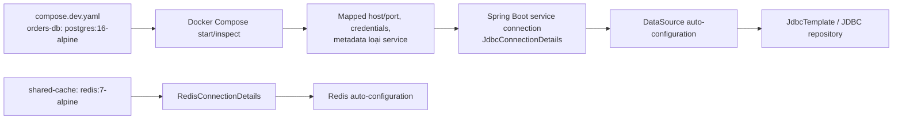
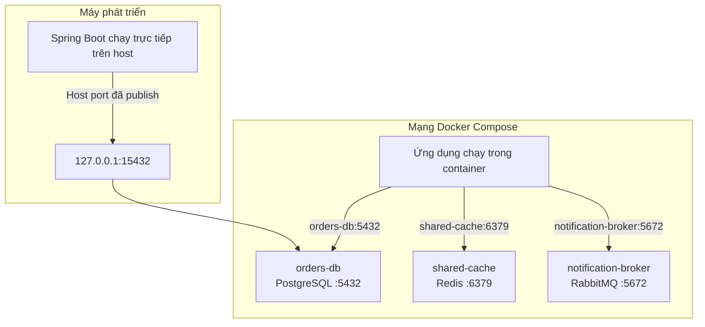
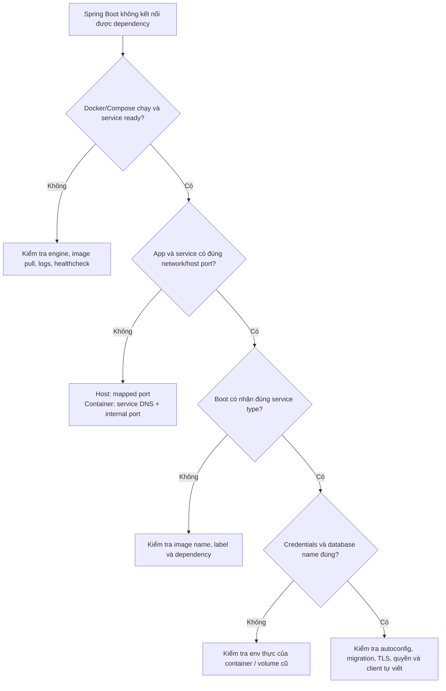

# Tùy chỉnh tên image, ánh xạ dịch vụ và cấu hình môi trường

## 1. Vấn đề cần giải quyết khi phát triển luồng tích hợp

Một ứng dụng Spring Boot tích hợp nhiều hệ thống thường cần PostgreSQL để lưu giao dịch, Redis để cache hoặc giữ khóa tạm, RabbitMQ/Kafka để nhận thông điệp và một HTTP service giả lập đối tác. Để phát triển và kiểm thử cục bộ, nhóm muốn khởi động những phụ thuộc này nhanh, đồng nhất giữa các máy và không phải tự điền mọi host/port tùy lần chạy.

Spring Boot cung cấp cơ chế **development-time services** thông qua hỗ trợ Docker Compose và Testcontainers. Chúng có thể tự tạo **service connection details**, tức các bean mô tả thông số kết nối mà auto-configuration của Spring Boot sử dụng cho DataSource, Redis, broker và những dịch vụ được hỗ trợ.

Vấn đề phát sinh khi dự án dùng:

- Image chuẩn như `postgres:16`, `redis:7`, `rabbitmq:3-management`.
- Image nội bộ như `registry.example.com/team/postgres-custom:16` hoặc image được mirror qua private registry.
- Tên service Compose có chủ đích nghiệp vụ như `orders-db`, `shared-cache`, `notification-broker`.
- Nhiều profile `local`, `test`, `staging` và `production` với cấu hình hoặc quyền truy cập khác nhau.
- Một số dịch vụ Spring Boot nhận diện được tự động, số khác cần khai báo thủ công.

**Mục tiêu của bài học:** cấu hình image, ánh xạ dịch vụ sang đúng loại kết nối và tách cấu hình môi trường theo cách có thể tái tạo, dễ kiểm tra và không vô tình trỏ ứng dụng phát triển vào database hoặc broker của production.

Bài thuộc nhóm **Dịch vụ phát triển** của module `SPRING_BOOT_INTEGRATION`. Mọi ví dụ hướng tới việc kiểm thử luồng tích hợp Spring Boot qua HTTP client, cơ sở dữ liệu, cache, broker và adapter; chúng cũng phục vụ kiểm soát cấu hình, hợp đồng, lỗi, giao dịch, xử lý trùng lặp và khả năng quan sát.

## 2. Phân biệt tên image, tên service, tên container và loại kết nối

Nhiều lỗi cấu hình bắt nguồn từ việc dùng lẫn bốn khái niệm:

| Khái niệm | Ví dụ | Chức năng |
| --- | --- | --- |
| **Docker image name** | `postgres:16-alpine` | Xác định phần mềm và phiên bản container sẽ chạy |
| **Docker Compose service name** | `orders-db` | Khóa định danh dịch vụ trong file Compose; cũng thường là DNS name giữa các container cùng mạng |
| **Container name/ID** | Tên/ID do Compose tạo cho instance | Định danh tiến trình container cụ thể, không nên phụ thuộc vào để kết nối ứng dụng |
| **Service connection type** | `postgres`, `redis`, `rabbitmq` | Cho Spring Boot biết nên tạo loại `ConnectionDetails` nào |

Ví dụ:

```yaml
services:
  orders-db:
    image: postgres:16-alpine
```

`orders-db` là **tên service**; `postgres:16-alpine` là **tên image**. Spring Boot Docker Compose hỗ trợ nhận diện nhiều dịch vụ thông qua **tên image**. Việc đặt tên service `orders-db` không làm nó tự trở thành loại `postgres` nếu image tùy biến không được nhận diện.

Tương tự, Spring Boot chỉ có thể sinh cấu hình cho dịch vụ mà module hỗ trợ và có auto-configuration tương ứng. Một nhãn hợp lệ giúp xác định **loại dịch vụ**, nhưng không tự cài JDBC driver, không tạo schema, không biến một container khác giao thức thành PostgreSQL.

Đối với ứng dụng chạy **trên máy host**, Spring Boot dùng cổng đã publish từ container ra host. Đối với **ứng dụng cũng chạy trong Docker Compose**, kết nối thường dùng DNS tên service nội bộ và cổng container, ví dụ `orders-db:5432`. Hai đường đi này không hoán đổi cho nhau.

## 3. Hai cơ chế phát triển thường gặp trong Spring Boot

| Tiêu chí | Docker Compose support | Testcontainers support |
| --- | --- | --- |
| Điểm bắt đầu | File `compose.yaml` hoặc file Compose được chỉ định | Container được định nghĩa trong Java/test configuration |
| Mục đích phổ biến | Chạy ứng dụng local cùng bộ phụ thuộc | Integration test tự khởi tạo phụ thuộc có vòng đời rõ |
| Phát hiện loại dịch vụ | Tên image hoặc label `org.springframework.boot.service-connection` | Kiểu container, metadata image và `@ServiceConnection` |
| Cấu hình kết nối | Spring Boot tạo `ConnectionDetails` từ dịch vụ Compose được nhận diện | Spring Boot tạo `ConnectionDetails` cho các container được gắn `@ServiceConnection` |
| Host port | Phụ thuộc mapping của Docker Compose | Testcontainers thường cấp host port động |
| Cách bật | Dependency `spring-boot-docker-compose` và cấu hình phù hợp | Dependency `spring-boot-testcontainers` cùng Testcontainers |
| Tính cô lập | Có thể chia sẻ dịch vụ local giữa nhiều lần chạy | Thường mỗi test suite/test lifecycle tạo môi trường phù hợp riêng |

Hai cơ chế đều tiện cho development, nhưng không làm thay đổi yêu cầu nghiệp vụ: database vẫn cần migration chính thức, consumer vẫn cần idempotency, broker vẫn có retry/ack, HTTP client vẫn cần timeout và bảo vệ dữ liệu.

Trong CI, Testcontainers thường giúp giảm phụ thuộc vào trạng thái dịch vụ đã chạy sẵn. Trong local development, Compose có lợi nếu cần quan sát container, volume và cổng truy cập bằng các công cụ bên ngoài.

## 4. Chuẩn bị Spring Boot Docker Compose support

Với Maven và Spring Boot dependency management:

```xml
<dependency>
    <groupId>org.springframework.boot</groupId>
    <artifactId>spring-boot-docker-compose</artifactId>
    <scope>runtime</scope>
    <optional>true</optional>
</dependency>
```

Ví dụ starter phục vụ một ứng dụng tích hợp:

```xml
<dependency>
    <groupId>org.springframework.boot</groupId>
    <artifactId>spring-boot-starter-jdbc</artifactId>
</dependency>
<dependency>
    <groupId>org.springframework.boot</groupId>
    <artifactId>spring-boot-starter-data-redis</artifactId>
</dependency>
<dependency>
    <groupId>org.springframework.boot</groupId>
    <artifactId>spring-boot-starter-amqp</artifactId>
</dependency>
<dependency>
    <groupId>org.postgresql</groupId>
    <artifactId>postgresql</artifactId>
    <scope>runtime</scope>
</dependency>
```

Ứng dụng chỉ cần những starter thực sự sử dụng; không thêm cả ba chỉ vì ví dụ có ba container. Với dependency Compose có mặt, Docker/Compose CLI sẵn sàng và dự án có file Compose được hỗ trợ, Spring Boot có thể điều phối vòng đời dịch vụ phát triển lúc ứng dụng chạy.

Điều kiện phải kiểm tra:

1. Docker Engine và Docker Compose CLI hoạt động trên máy.
2. Image có thể được pull/build theo quyền registry hiện có.
3. Có đường publish cổng mà ứng dụng host có thể kết nối.
4. Dependency kết nối và driver của ứng dụng đầy đủ.
5. Spring Boot nhận đúng loại service và bean kết nối mà ứng dụng sử dụng.
6. Cấu hình profile phù hợp, tránh khởi động Compose trong deployment không mong muốn.

Hỗ trợ Compose của Spring Boot dành chủ yếu cho development. Không nên biến việc ứng dụng production khởi động database/broker bằng Docker Compose thành kiến trúc vận hành mặc định.

## 5. Ví dụ Compose hoàn chỉnh với PostgreSQL, Redis và RabbitMQ

File `compose.dev.yaml` ở thư mục làm việc dự án:

```yaml
services:
  orders-db:
    image: postgres:16-alpine
    environment:
      POSTGRES_DB: orders_dev
      POSTGRES_USER: orders_dev
      POSTGRES_PASSWORD: ${DEV_DB_PASSWORD:-dev_only_change_me}
    ports:
      - "127.0.0.1:15432:5432"
    volumes:
      - orders-db-data:/var/lib/postgresql/data
    healthcheck:
      test: ["CMD-SHELL", "pg_isready -U $$POSTGRES_USER -d $$POSTGRES_DB"]
      interval: 5s
      timeout: 3s
      retries: 10

  shared-cache:
    image: redis:7-alpine
    ports:
      - "127.0.0.1:16379:6379"

  notification-broker:
    image: rabbitmq:3-management
    environment:
      RABBITMQ_DEFAULT_USER: orders_dev
      RABBITMQ_DEFAULT_PASS: ${DEV_MQ_PASSWORD:-dev_only_change_me}
    ports:
      - "127.0.0.1:15672:5672"
      - "127.0.0.1:15673:15672"

volumes:
  orders-db-data:
```

Ý nghĩa:

- `image` định nghĩa phiên bản phần mềm cần chạy. Trong dự án thực tế, cố định phiên bản đã kiểm thử, đánh giá cập nhật và có thể pin digest nếu yêu cầu tái tạo mạnh hơn.
- `ports` có dạng `host-ip:host-port:container-port`. App chạy trên máy host truy cập PostgreSQL qua `127.0.0.1:15432`, Redis qua `127.0.0.1:16379` và RabbitMQ qua `127.0.0.1:15672`.
- `127.0.0.1` giới hạn publish cổng trên giao diện loopback của máy phát triển; đây là lựa chọn có chủ đích cho dịch vụ không cần truy cập từ mạng ngoài.
- `POSTGRES_DB`, `POSTGRES_USER` và `POSTGRES_PASSWORD` được truyền **vào container** để image PostgreSQL khởi tạo database/tài khoản khi data directory mới. Chúng không tự trở thành thuộc tính `spring.datasource.*` của process Java đang chạy trên host.
- `healthcheck` giúp kiểm tra PostgreSQL sẵn sàng nhận kết nối. Ký hiệu `$$POSTGRES_USER` tránh Compose nội suy sớm, giữ việc mở rộng biến môi trường bên trong container.
- Volume `orders-db-data` giữ dữ liệu qua những lần container được stop/start. Xóa volume có thể xóa toàn bộ dữ liệu dev; chỉ thực hiện khi thật sự muốn reset.

Dùng giá trị mật khẩu minh họa ở trên chỉ trong môi trường local cô lập. Với dự án thực tế, tạo giá trị phát triển riêng ngoài Git, dùng file môi trường được quản lý và không sao chép credential sản xuất.

### 5.1. Cấu hình profile local của Spring Boot

File `application-local.yml`:

```yaml
spring:
  config:
    activate:
      on-profile: local

  docker:
    compose:
      file: ./compose.dev.yaml
      enabled: true
      lifecycle-management: start-and-stop

logging:
  level:
    org.springframework.boot.docker.compose: INFO
```

Khởi động local:

```bash
java -jar build/libs/integration-service.jar --spring.profiles.active=local
```

Ví dụ lệnh dùng file JAR do dự án tạo; đường dẫn JAR có thể khác khi build bằng Maven hoặc theo cấu hình build cụ thể. Khi dự án dùng Docker Compose support, Spring Boot có thể khởi động các service cần thiết và nhận các cổng đã publish.

Nếu những dịch vụ Compose đã chạy từ trước, cần hiểu rằng Spring Boot có thể tái sử dụng chúng và **không tự dừng** chúng khi ứng dụng kết thúc. Đừng giả định mọi container sẽ bị xóa khi tắt process Java.

### 5.2. ConnectionDetails được tạo như thế nào?

Với image tiêu chuẩn được Spring Boot nhận diện, kết nối thường theo ý tưởng:



ConnectionDetails có thể được auto-configuration ưu tiên so với các property kết nối tương ứng như `spring.datasource.url` hoặc `spring.data.redis.host`. Vì vậy, khi development service đã được nhận diện, không cần hard-code `localhost:15432` trong `application-local.yml` chỉ để Spring Boot kết nối DataSource. Nhưng **custom client tự xây dựng** không nhất thiết dùng ConnectionDetails nếu code của bạn chỉ đọc `@Value` hoặc một property `host` riêng.

Cần kiểm tra type được tạo theo service thực tế: PostgreSQL có thể đóng góp JDBC/R2DBC details tùy dependency và auto-configuration; Redis và RabbitMQ cũng cần starter/connection factory tương ứng. Đừng kỳ vọng một bean connection details tự tạo JDBC schema hoặc một ứng dụng hoàn toàn không dùng Redis tự kết nối tới Redis.

## 6. Tùy chỉnh tên image: khi nào Spring Boot không nhận diện được?

Image nội bộ thường có tên khác image chuẩn:

```yaml
services:
  orders-db:
    image: registry.example.com/platform/postgres-hardened:16
```

Container có thể chạy PostgreSQL hoàn toàn hợp lệ, nhưng Spring Boot Docker Compose support **không nhất thiết suy ra loại dịch vụ từ image tùy chỉnh**. Kết quả là container đang chạy nhưng `DataSource` vẫn dùng cấu hình cũ, hoặc auto-configuration báo thiếu URL/driver theo trạng thái ứng dụng.

Cách khai báo minh bạch là gắn nhãn:

```yaml
services:
  orders-db:
    image: registry.example.com/platform/postgres-hardened:16
    labels:
      org.springframework.boot.service-connection: postgres
    environment:
      POSTGRES_DB: orders_dev
      POSTGRES_USER: orders_dev
      POSTGRES_PASSWORD: ${DEV_DB_PASSWORD}
    ports:
      - "127.0.0.1:15432:5432"
```

Nhãn `org.springframework.boot.service-connection` giúp Spring Boot nhận biết loại service connection mong muốn. Trong ví dụ, giá trị `postgres` nói rằng container thực sự cung cấp PostgreSQL tương thích; tên image có thể đến từ private registry, nhưng container phải phục vụ đúng giao thức, môi trường và cổng mà Spring Boot hỗ trợ.

**Nhãn không phải một alias DNS.** Nó không đổi tên Compose service `orders-db`, không sửa Docker network và cũng không làm biến `POSTGRES_DB` xuất hiện trong process Spring Boot. Nó là metadata để Spring Boot chọn service connection phù hợp.

Tương tự, khi một private image triển khai Redis:

```yaml
services:
  shared-cache:
    image: registry.example.com/platform/redis-internal:7
    labels:
      org.springframework.boot.service-connection: redis
    ports:
      - "127.0.0.1:16379:6379"
```

Nếu image là một API mock HTTP không nằm trong tập công nghệ có service connection factory, đừng gán nhãn `postgres` hoặc `redis` chỉ để né lỗi. Hãy cấu hình endpoint mock bằng property riêng hoặc viết integration có khả năng đọc loại ConnectionDetails phù hợp nếu dự án thực sự hỗ trợ.

### 6.1. Phân biệt registry mirror với dịch vụ mới

Ví dụ thay image:

```text
postgres:16-alpine
    → registry.company.example/internal/postgres:16-alpine
```

Đây có thể chỉ là thay địa chỉ registry, nhưng tên image từ góc nhìn Spring Boot đã khác. Cần xác minh cơ chế nhận diện và đặt nhãn service connection nếu cần. Cũng phải kiểm tra:

- Cổng PostgreSQL có đúng là 5432 không?
- Cách image cấp username/password/database có tương thích không?
- Entry point, healthcheck và dữ liệu persistent có hoạt động như kỳ vọng?
- Chứng chỉ TLS, authentication, kiến trúc CPU hoặc policy của image có thay đổi không?
- Nếu đã tồn tại volume, biến môi trường khởi tạo DB mới có còn ảnh hưởng không?

Đừng chỉ nhìn nhãn để kết luận custom image an toàn và tương thích.

### 6.2. Bỏ qua container không phải dependency của ứng dụng

Một số container trong Compose chỉ hỗ trợ quan sát, seed dữ liệu hoặc quản trị, không cần sinh `ConnectionDetails`. Spring Boot Docker Compose hỗ trợ nhãn để bỏ qua việc xử lý service tương ứng, ví dụ:

```yaml
services:
  tools-dashboard:
    image: registry.example.com/dev/tools-dashboard:1
    labels:
      org.springframework.boot.ignore: "true"
```

Việc bỏ qua **service connection** không có nghĩa Docker Compose bỏ khởi động container; nó chỉ liên quan đến cơ chế Spring Boot xử lý dịch vụ đó. Nếu muốn không khởi động container theo profile, dùng cơ chế Docker Compose profiles hoặc định nghĩa riêng file Compose.

## 7. Ánh xạ dịch vụ: tên Compose và địa chỉ mạng

Sơ đồ sau minh họa hai tình huống:



| Ứng dụng chạy ở đâu? | PostgreSQL address nên dùng | Vì sao? |
| --- | --- | --- |
| Spring Boot chạy trên máy host | `127.0.0.1:15432`, hoặc ConnectionDetails do Boot nhận cổng mapped | Host truy cập qua cổng publish |
| Spring Boot chạy trong cùng Compose network | `orders-db:5432` | DNS service name dùng giữa các container |
| Spring Boot chạy trong container/network độc lập | Không mặc định dùng `orders-db` | Phải có network/routing được cấu hình rõ |
| Spring Boot CI test bằng Testcontainers | Host + mapped port do Testcontainers trả về | Host port thường thay đổi mỗi lần chạy |

**Lỗi phổ biến:** gán `spring.datasource.url=jdbc:postgresql://orders-db:5432/orders_dev` trong application chạy bằng IDE trên host. DNS `orders-db` thường chỉ có trong Docker network; khi chạy trên host, service connection do Boot tạo hoặc `localhost:15432` mới phù hợp.

Ngược lại, bên trong container application, `localhost` là **chính container application**, không phải container PostgreSQL. Nếu không có service discovery và port mapping phù hợp, dùng `localhost:5432` có thể luôn báo connection refused.

## 8. Cấu hình môi trường: Compose, Spring profile và secret

### 8.1. Ba nguồn cấu hình phục vụ ba đối tượng

| Nguồn | Ai đọc? | Ví dụ | Tác động |
| --- | --- | --- | --- |
| `compose.dev.yaml`, `environment` | Docker Compose chuyển vào container | `POSTGRES_DB=orders_dev` | Cấu hình server PostgreSQL bên trong container |
| `.env` hoặc environment khi chạy Compose | Docker Compose dùng cho nội suy biến | `DEV_DB_PASSWORD=...` | Cung cấp giá trị cho `${DEV_DB_PASSWORD}` trong Compose |
| `application-local.yml` và env của Java process | Spring Boot Environment | `spring.docker.compose.enabled=true` | Cấu hình vòng đời Compose, HTTP client, datasource hoặc properties ứng dụng |

File `.env` của Compose **không tự đồng nghĩa** với các biến môi trường đã được export cho tiến trình Spring Boot. Nó phục vụ cơ chế nội suy của Docker Compose theo quy tắc Compose CLI; nếu Spring Boot cần đọc trực tiếp một biến, phải cấp nó cho Java process hoặc đưa vào nguồn property mà Spring Boot sử dụng.

Ví dụ file môi trường **minh họa, không commit secret thật**:

```dotenv
DEV_DB_PASSWORD=local_db_password_only
DEV_MQ_PASSWORD=local_mq_password_only
PARTNER_BASE_URL=http://localhost:18080
```

Trong Compose, cú pháp `${DEV_DB_PASSWORD:-dev_only_change_me}` nghĩa là có thể dùng giá trị mặc định khi biến không được cấp theo quy tắc interpolation. Với dự án cần kiểm soát mật khẩu chặt hơn, bỏ giá trị mặc định, yêu cầu cung cấp biến trước khi chạy hoặc dùng secret management. Tuyệt đối không đưa thông tin production vào file local được commit.

### 8.2. Tổ chức profile minh bạch

File `application.yml` giữ cấu hình chung:

```yaml
spring:
  application:
    name: order-integration

integration:
  partner:
    connect-timeout: 3s
    read-timeout: 10s
```

File `application-local.yml`:

```yaml
spring:
  docker:
    compose:
      enabled: true
      file: ./compose.dev.yaml
      lifecycle-management: start-and-stop

integration:
  partner:
    base-url: ${PARTNER_BASE_URL:http://localhost:18080}
```

File `application-prod.yml`:

```yaml
spring:
  docker:
    compose:
      enabled: false

integration:
  partner:
    base-url: ${PARTNER_BASE_URL}
```

Ở production, PostgreSQL, Redis và broker cần được cấp thông số qua secret/config có quản trị hoặc cơ chế service discovery thực tế; **không dựa vào dịch vụ Compose local**. Nếu dependency Compose không được đóng gói ở runtime production thì càng nên giữ rõ chủ đích và kiểm tra pipeline để không kết nối nhầm.

Các properties về timeout, hợp đồng HTTP, retry/circuit breaker và idempotency nên được áp dụng nhất quán giữa các profile; khác biệt về URL hoặc tài khoản không được làm lỏng validation dữ liệu.

### 8.3. Nguồn cấu hình và quyền ưu tiên

Spring Boot có cơ chế precedence giữa config files, profile-specific files, environment variables và command-line arguments. Đồng thời, khi `ConnectionDetails` bean tồn tại, một auto-configuration có thể sử dụng nó thay cho các properties host/port tương ứng.

Vì vậy cần **phân biệt hai câu hỏi**:

1. `spring.datasource.url` cuối cùng trong Spring Environment đến từ đâu?
2. DataSource auto-configuration **thực sự lấy kết nối từ ConnectionDetails hay từ property đó**?

Chỉ in giá trị property không phải bằng chứng DataSource sẽ dùng URL ấy nếu service connection đã được tạo. Khi nghi ngờ, xem auto-configuration report/log và kiểm tra kết nối thật của datasource/connection factory.

Không log password, token hoặc toàn bộ danh sách environment để debug. Actuator endpoints liên quan cấu hình cũng cần được bảo vệ và che giá trị nhạy cảm.

## 9. Không phải dịch vụ nào cũng có ánh xạ tự động

Đối với database, cache và broker được Spring Boot hỗ trợ, image chuẩn hoặc nhãn phù hợp có thể tạo ConnectionDetails. Nhưng một HTTP mock server, SFTP server thử nghiệm hoặc dịch vụ độc quyền có thể không có factory nhận diện.

Ví dụ một mock partner HTTP:

```yaml
services:
  partner-mock:
    image: mockserver/mockserver:5.15.0
    ports:
      - "127.0.0.1:18080:1080"
```

File `application-local.yml`:

```yaml
integration:
  partner:
    base-url: http://localhost:18080
```

Đối với ứng dụng chạy trong cùng Compose network, URL sẽ khác:

```yaml
integration:
  partner:
    base-url: http://partner-mock:1080
```

Ví dụ minh họa cơ chế ánh xạ, chưa bao gồm rule/expectation của MockServer. Đây là endpoint **do ứng dụng tự cấu hình**; không có lý do gán nhãn `postgres` hoặc `redis` cho nó.

Trong Spring Boot, có thể tạo `@ConfigurationProperties` cho client:

```java
import java.net.URI;
import org.springframework.boot.context.properties.ConfigurationProperties;

@ConfigurationProperties(prefix = "integration.partner")
public record PartnerClientProperties(URI baseUrl) {}
```

Service/HTTP client dùng property đó để tạo base URL, kèm timeout và chính sách retry. Nhờ vậy việc thay endpoint local/staging/production được điều khiển tập trung, không rải chuỗi địa chỉ vào nhiều controller hoặc adapter.

Nếu dịch vụ thật cần custom ConnectionDetails, có thể triển khai loại details và cấu hình riêng theo API framework. Nhưng với URL HTTP ngoài chưa được Spring Boot tích hợp tự động, `@ConfigurationProperties` thường đủ và dễ theo dõi hơn.

## 10. Testcontainers: tùy chỉnh tên image qua @ServiceConnection

Docker Compose phù hợp khi developer cần một bộ phụ thuộc chạy lâu để quan sát. Trong integration test, Testcontainers thường cấp container riêng, host port động và vòng đời gắn với test.

Dependency Maven minh họa:

```xml
<dependency>
    <groupId>org.springframework.boot</groupId>
    <artifactId>spring-boot-testcontainers</artifactId>
    <scope>test</scope>
</dependency>
<dependency>
    <groupId>org.testcontainers</groupId>
    <artifactId>junit-jupiter</artifactId>
    <scope>test</scope>
</dependency>
<dependency>
    <groupId>org.testcontainers</groupId>
    <artifactId>postgresql</artifactId>
    <scope>test</scope>
</dependency>
```

Khai báo test sử dụng PostgreSQL:

```java
import org.junit.jupiter.api.Test;
import org.springframework.boot.test.context.SpringBootTest;
import org.springframework.boot.testcontainers.service.connection.ServiceConnection;
import org.testcontainers.containers.PostgreSQLContainer;
import org.testcontainers.junit.jupiter.Container;
import org.testcontainers.junit.jupiter.Testcontainers;

@Testcontainers
@SpringBootTest
class OrderRepositoryIntegrationTest {

    @Container
    @ServiceConnection
    static PostgreSQLContainer<?> postgres =
            new PostgreSQLContainer<>("postgres:16-alpine")
                    .withDatabaseName("orders_test")
                    .withUsername("orders_test")
                    .withPassword("test_only_password");

    @Test
    void writesAndReadsOrders() {
        // Test repository/JdbcTemplate thực tế sau migration.
    }
}
```

`@ServiceConnection` khai báo rằng Spring Boot có thể tạo connection details từ container đó. Vì Testcontainers publish host port động, ứng dụng test không nên hard-code `localhost:5432`. Đồng thời, test thật cần migration schema, fixture, assert dữ liệu và kiểm tra transaction; ví dụ trên chỉ là **khung cấu hình**.

### 10.1. GenericContainer cần khai báo loại kết nối

Khi dùng `@Bean` trả về `GenericContainer<?>`, tại lúc Spring Boot xác định connection details, thông tin image có thể chưa xác định từ return type. Cần chỉ định tên service connection rõ ràng:

```java
import org.springframework.boot.test.context.TestConfiguration;
import org.springframework.boot.testcontainers.service.connection.ServiceConnection;
import org.springframework.context.annotation.Bean;
import org.testcontainers.containers.GenericContainer;
import org.testcontainers.utility.DockerImageName;

@TestConfiguration(proxyBeanMethods = false)
public class RedisTestContainersConfiguration {

    @Bean
    @ServiceConnection(name = "redis")
    GenericContainer<?> redisContainer() {
        return new GenericContainer<>(
                DockerImageName.parse("redis:7-alpine"))
                .withExposedPorts(6379);
    }
}
```

Import cấu hình này vào test context:

```java
@SpringBootTest
@Import(RedisTestContainersConfiguration.class)
class RedisIntegrationTest {
    // Kiểm tra RedisTemplate và cache thật.
}
```

Cần import `org.springframework.context.annotation.Import` theo project. Các container khai báo bằng bean có thể được Spring Boot quản lý vòng đời trong bối cảnh test thích hợp. Nên kiểm tra tính tương thích và cơ chế khởi động trên version đang dùng.

### 10.2. Tên image tùy chỉnh trong Testcontainers

Một PostgreSQL image nội bộ tương thích có thể dùng:

```java
DockerImageName image = DockerImageName
        .parse("registry.example.com/team/postgresql-custom:16")
        .asCompatibleSubstituteFor("postgres");

PostgreSQLContainer<?> postgres =
        new PostgreSQLContainer<>(image)
                .withDatabaseName("orders_test");
```

`asCompatibleSubstituteFor("postgres")` là cách Testcontainers được thông báo rằng image tùy chỉnh tương thích với image gốc mà module PostgreSQL chấp nhận. Đây là cơ chế **của Testcontainers**, khác với label `org.springframework.boot.service-connection` trong Docker Compose.

Nếu container của test không có subtype chuyên biệt, `@ServiceConnection(name = "redis")` giúp Spring Boot xác định loại kết nối được mong đợi. Nhưng cả hai cơ chế **không tự sửa giao thức, port, readiness hoặc credential** nếu custom image khác chuẩn.

## 11. Compose profile và lựa chọn bộ dịch vụ theo môi trường

Một dự án không nhất thiết cần cả database, cache, broker và mock API trong mọi lần chạy. Docker Compose hỗ trợ **profiles** để bật các dịch vụ tùy mục đích.

Ví dụ:

```yaml
services:
  orders-db:
    image: postgres:16-alpine
    environment:
      POSTGRES_DB: orders_dev
      POSTGRES_USER: orders_dev
      POSTGRES_PASSWORD: ${DEV_DB_PASSWORD:-dev_only_change_me}
    ports:
      - "127.0.0.1:15432:5432"

  shared-cache:
    image: redis:7-alpine
    ports:
      - "127.0.0.1:16379:6379"

  notification-broker:
    image: rabbitmq:3-management
    profiles: ["messaging"]
    ports:
      - "127.0.0.1:15672:5672"
      - "127.0.0.1:15673:15672"
```

Với Spring Boot Docker Compose, có thể bật profile Compose tương ứng thông qua thuộc tính được hỗ trợ:

```yaml
spring:
  docker:
    compose:
      file: ./compose.dev.yaml
      profiles:
        active: messaging
```

Khi profile `messaging` không được kích hoạt, `notification-broker` không khởi động chỉ vì nằm trong file Compose. Nếu ứng dụng vẫn tạo RabbitMQ connection factory và consumer bắt buộc, startup hoặc thao tác broker có thể thất bại. Cần liên kết profile ứng dụng và profile Compose theo mục tiêu chạy, thay vì dựa vào một fallback không rõ ràng.

Với các trường hợp CI cần tách dữ liệu hoặc phần mềm theo phiên bản, có thể tạo file Compose riêng cho test hoặc chuyển sang Testcontainers. Tránh gắn tất cả vào một file Compose nhiều nhánh mà nhóm không biết cấu hình thực sự nào đang chạy.

## 12. Vòng đời dịch vụ, readiness và bản chất của trạng thái running

Spring Boot Docker Compose support có các lựa chọn vòng đời; ví dụ cấu hình local:

```yaml
spring:
  docker:
    compose:
      enabled: true
      file: ./compose.dev.yaml
      lifecycle-management: start-and-stop
```

Một số chế độ thường gặp:

| Chế độ | Ý nghĩa vận hành |
| --- | --- |
| `start-and-stop` | Khi Spring Boot là bên khởi động dịch vụ, nó có thể dừng dịch vụ khi ứng dụng đóng |
| `start-only` | Chỉ tập trung khởi động, không tự dừng khi đóng app |
| `none` | Không điều phối start/stop; dựa trên dịch vụ Compose đã chạy |

Nếu container đã được khởi chạy bên ngoài trước khi ứng dụng startup, Spring Boot có thể tái sử dụng nhưng không dừng chúng khi ứng dụng shutdown. Kiểm tra trạng thái bằng `docker compose ps` và công cụ vận hành thật, không suy từ việc đóng IDE.

**Running chưa chắc ready.** PostgreSQL container có process đang chạy nhưng chưa sẵn sàng nhận kết nối; RabbitMQ đang load definitions; Redis còn chờ khởi tạo. Readiness cần được kiểm soát bằng healthcheck/connection check tương ứng và timeout hợp lý. Spring Boot có cơ chế readiness cho Compose services được hỗ trợ, nhưng một dịch vụ tùy chỉnh không nên được xem là ready chỉ vì Docker trả trạng thái running.

Không nên chữa lỗi readiness bằng cách đặt một `Thread.sleep(10000)` cứng trong startup. Hãy kiểm tra healthcheck, error log và retry với giới hạn rõ ràng.

## 13. Gắn tên, cấu hình và phiên bản với hợp đồng tích hợp

Development service là phần hạ tầng hỗ trợ phát triển; nó không thay thế kiểm thử hợp đồng. Các thay đổi image có thể ảnh hưởng đến ứng dụng:

- **Database:** đổi version PostgreSQL ảnh hưởng kiểu dữ liệu, SQL, JDBC, migration, transaction isolation và index behavior.
- **Redis:** thay đổi image/config có thể ảnh hưởng auth, persistence, TTL, command compatibility và cache serialization.
- **RabbitMQ/Kafka:** đổi broker version ảnh hưởng giao thức, acknowledgment, topology, retry/DLQ, routing hoặc header.
- **Mock HTTP service:** thay đổi đường dẫn/contract có thể làm integration test thông qua dù endpoint thật không tương thích.

Nên ghi version image đủ rõ, thường pin major/minor được kiểm thử; khi cần khả năng tái tạo chính xác có thể pin digest. Với image tùy chỉnh, không thay tag âm thầm trong registry vì hai developer có thể pull nội dung khác nhau với cùng tag.

Quy trình thay image có thể gồm:

1. Cập nhật image/tag và nhãn service connection khi cần.
2. Kiểm tra Compose file có render đúng biến và port mapping.
3. Khởi động service, xác minh health và cơ chế Spring Boot connection details.
4. Chạy migration schema với công cụ đã chọn; không dùng Hibernate tự `update` làm cách né mismatch.
5. Chạy integration test qua JDBC/Redis/broker/API mock.
6. Kiểm tra error handling, retry, idempotency và transaction với các dependency thật.
7. Nếu dữ liệu từ volume cũ không tương thích, có kế hoạch backup/reset **chỉ cho dev** đã được thông báo rõ.

## 14. Kiểm tra cổng động và cách tránh port conflict

Ví dụ đầu dùng cổng host cố định vì dễ kết nối từ IDE hay công cụ quản trị. Nhưng cùng một máy có hai dự án cùng publish `15432` sẽ gặp port conflict.

Docker Compose có thể publish một container port và để Docker chọn cổng host động, ví dụ:

```yaml
services:
  orders-db:
    image: postgres:16-alpine
    ports:
      - "5432"
```

Khi đó phải tra **published host port thực tế**, không giả định nó là 5432:

```bash
docker compose -f compose.dev.yaml ps
docker compose -f compose.dev.yaml port orders-db 5432
```

Nếu Spring Boot Docker Compose support đã nhận diện container, ConnectionDetails giúp app tìm đúng host port. Tuy nhiên, với công cụ quản trị bên ngoài hoặc client tự viết không dùng ConnectionDetails, bạn vẫn phải lấy port thực tế từ Docker Compose.

Cổng được publish tự động có thể phụ thuộc cấu hình host binding của Docker. Với dữ liệu local nhạy cảm hoặc máy dùng chung mạng, cần bảo đảm chỉ mở cổng trên interface cho phép hoặc dùng proxy/tunnel theo chính sách. Cổng cố định bind `127.0.0.1` dễ kiểm soát hơn nhưng đổi lại có nguy cơ xung đột giữa các dự án.

## 15. Khi có nhiều service cùng một loại

Một hệ thống tích hợp có thể cần hai PostgreSQL độc lập: `orders-db` và `audit-db`, hoặc hai Redis dành cho cache và lock. Nếu cả hai cùng tạo một loại `ConnectionDetails` cho cùng auto-configuration, Spring Boot không tự biết đâu là datasource nghiệp vụ chính.

Ví dụ:

```yaml
services:
  orders-db:
    image: postgres:16
    ports:
      - "127.0.0.1:15432:5432"

  audit-db:
    image: postgres:16
    ports:
      - "127.0.0.1:25432:5432"
```

Cần **quyết định ownership rõ**:

- Chỉ một database được auto-configure làm `DataSource` mặc định; database thứ hai cấu hình `DataSource` riêng qua `@ConfigurationProperties` hoặc một cơ chế phân biệt connection details có chủ đích.
- Nếu một container chỉ phục vụ công cụ nội bộ, dùng label ignore để tránh sinh connection details không cần thiết.
- Với nhiều datasource, khai báo bean và transaction manager riêng, dùng qualifier và cấu hình rõ repository nào dùng datasource nào.
- Trong test, tránh tạo hai `@ServiceConnection` cùng loại rồi kỳ vọng framework suy ra vai trò từ tên biến Java.
- Kiểm tra migration và quyền DDL cho từng schema; không cho một development connection thao tác nhầm database còn lại.

Một service name như `audit-db` là gợi ý cho người đọc; nó **không tự ánh xạ thành bean `auditDataSource`**. Việc ánh xạ theo nghiệp vụ phải được thể hiện trong application config/code.

## 16. Quy trình kiểm tra cấu hình khi kết nối thất bại

Khi ứng dụng không kết nối được, tránh sửa ngẫu nhiên host hoặc credential. Kiểm tra có hệ thống:



Một số lỗi phổ biến:

| Triệu chứng | Nguyên nhân có khả năng | Kiểm tra/hướng xử lý |
| --- | --- | --- |
| Container đang chạy nhưng app cần `spring.datasource.url` | Image nội bộ không được nhận diện hoặc thiếu dependency/auto-config | Thêm label đúng loại, kiểm tra ConnectionDetails |
| `UnknownHostException: orders-db` khi chạy IDE | Dùng DNS service Compose từ host | Kết nối mapped host port hoặc dùng Boot Compose support |
| `Connection refused localhost:5432` | Host port thật là 15432 hoặc động | Dùng `docker compose port`, kiểm tra URL thực |
| Authentication failed | Password/container env hoặc dữ liệu volume cũ khác kỳ vọng | Kiểm tra cách image khởi tạo credential và volume |
| Có hai DataSource/ConnectionDetails bị ambiguous | Nhiều service cùng loại không được ánh xạ rõ | Tách ownership/qualifier, bỏ qua service không liên quan |
| App vẫn kết nối localhost khi muốn staging | Profile chưa đúng hoặc Compose enabled ngoài ý muốn | Kiểm tra active profile, config precedence và endpoint thực |
| HTTP mock chạy nhưng app vẫn gọi đối tác thật | Base URL client được hard-code hoặc profile sai | Bind qua `@ConfigurationProperties` và test |
| Compose không được gọi khi chạy integration test | Spring Boot thường bỏ qua Compose support trong test | Dùng Testcontainers hoặc chủ động cấu hình theo test policy |
| Image mirror chạy nhưng không có Redis connection | Không có label loại Redis, service connection provider không hỗ trợ | Kiểm tra image/label và starter |
| Healthcheck xanh nhưng xử lý lỗi | Service “ready” không đồng nghĩa schema/permissions/contract đúng | Chạy migration, integration test và quan sát logs |

Các lệnh kiểm tra cơ bản:

```bash
docker compose -f compose.dev.yaml config
docker compose -f compose.dev.yaml ps
docker compose -f compose.dev.yaml logs --tail 100 orders-db
docker compose -f compose.dev.yaml port orders-db 5432
```

Lệnh `config` có thể xuất nội dung đã nội suy, kể cả credential hoặc thông tin nhạy cảm. Không paste nguyên kết quả lên issue công khai; luôn che secret trước khi chia sẻ.

## 17. Kiểm thử cấu hình theo từng môi trường

Một matrix kiểm thử có ích:

| Kịch bản | Điều cần xác nhận |
| --- | --- |
| Local, image chuẩn PostgreSQL | Container ready, DataSource dùng đúng DB/cổng và truy vấn thành công |
| Local, image PostgreSQL nội bộ | Label `service-connection: postgres` hoạt động, driver và credentials hợp lệ |
| Local, image Redis nội bộ | RedisConnectionDetails được tạo đúng cổng; cache đọc/ghi thành công |
| Local, dịch vụ HTTP mock tùy chỉnh | Client đọc đúng `integration.partner.base-url` |
| Local với cổng host thay đổi | Spring Boot nhận đúng mapped port, không hard-code `localhost:5432` |
| Local Compose profile chỉ bật database | App chỉ yêu cầu những dependency thực sự được bật hoặc fail rõ ràng |
| Integration test với Testcontainers | Container tự chạy, host port động, migration và nghiệp vụ đúng |
| Test với custom image Testcontainers | Khai báo tương thích image và `@ServiceConnection` đúng |
| Multiple PostgreSQL/Redis instances | Bean/datasource dùng đúng nguồn, không viết chéo DB |
| CI khi Docker unavailable | Test thất bại có thông báo phù hợp, không fallback vào production |
| Production profile | Không khởi động Compose local, không dùng credential dev |
| Service đã running trước app | Xác nhận lifecycle stop/start và data retention đúng |
| Đổi image major version | Hợp đồng dữ liệu, migration, retry và transaction vẫn hoạt động |

Khi dùng `@SpringBootTest`, Spring Boot thường không tự bật Docker Compose support trong test; thuộc tính `spring.docker.compose.skip.in-tests` điều khiển hành vi này theo phiên bản được hỗ trợ. Nên ưu tiên Testcontainers cho integration test cần môi trường cô lập, và chỉ cho phép Compose trong test khi có lý do cùng kiểm soát rõ vòng đời/trạng thái dữ liệu.

Đối với ứng dụng xử lý broker, test nên kiểm tra cả duplicate message, retry, DLQ và quan sát; việc “kết nối được RabbitMQ” không có nghĩa semantics tiêu thụ đã đúng.

## 18. Tình huống tổng hợp: chuyển sang image nội bộ cho một hệ thống đơn hàng

Giả sử `order-integration` đang phát triển cục bộ bằng:

- PostgreSQL chứa bảng đơn hàng và bảng outbox.
- Redis cache trạng thái tạm.
- RabbitMQ làm kênh nhận thông điệp cập nhật đơn hàng.
- Mock HTTP service thay đối tác thanh toán.

Ban đầu nhóm dùng image chuẩn. Sau đó tổ chức yêu cầu PostgreSQL và Redis đi qua private registry có cấu hình bảo mật riêng. Một thay đổi chỉ thay `image:` có thể khiến Spring Boot không nhận ra dịch vụ, dù Docker Compose báo container đang chạy.

Cách thực hiện có kiểm soát:

1. Thay đúng image/tag do tổ chức cung cấp; kiểm tra image thực sự tương thích PostgreSQL/Redis.
2. Bổ sung `org.springframework.boot.service-connection: postgres` và `...: redis` khi nhận diện tự động không còn phù hợp.
3. Giữ service name `orders-db`, `shared-cache` nếu không có lý do thay; code chạy trong Docker network vẫn dùng các tên này.
4. Đối chiếu env khởi tạo DB, volume cũ, healthcheck, user/password và mapped host port với image mới.
5. Với HTTP mock, dùng property `integration.partner.base-url`; không ép nó vào một loại service connection không liên quan.
6. Chạy ứng dụng với profile `local`, xác minh các bean JDBC/Redis/AMQP kết nối tới đúng container.
7. Chạy migration và integration test tạo đơn hàng, ghi outbox, publish RabbitMQ, đọc cache và xử lý retry/idempotency.
8. Kiểm tra profile production không mang theo Compose local hoặc credential dev; lưu quyết định image/label trong tài liệu kỹ thuật.

Nhờ phân biệt image, tên service và connection details, nhóm có thể thay đổi nguồn cung cấp image mà vẫn giữ hợp đồng kết nối, test và vận hành nhất quán.

## 19. Những hiểu lầm thường gặp

| Nhận định dễ sai | Cách hiểu đúng |
| --- | --- |
| “Đặt tên Compose service `postgres` là đủ.” | Spring Boot thường nhận diện qua image name hoặc label; service name là khái niệm khác |
| “Có nhãn `service-connection: postgres` là mọi container đều thành PostgreSQL.” | Container phải triển khai giao thức và cổng PostgreSQL thực sự |
| “`POSTGRES_PASSWORD` trong Compose là biến của Java process.” | Đó là environment trong container; Java process có nguồn config riêng |
| “App chạy từ IDE có thể dùng URL `orders-db:5432`.” | DNS Compose thường dành cho các container cùng network |
| “Spring Boot luôn dùng `spring.datasource.url` nếu tôi đã điền.” | Auto-config có thể ưu tiên bean `ConnectionDetails` nếu tồn tại |
| “Mọi dịch vụ HTTP đều có auto service connection.” | Chỉ những loại được framework hỗ trợ; dịch vụ khác cần property/custom config |
| “Đổi `image:` không ảnh hưởng connection setup.” | Image tùy chỉnh có thể làm mất khả năng nhận diện và thay đổi hành vi runtime |
| “Đã có Testcontainers thì không cần migration.” | Database mới vẫn cần schema đúng để integration test có ý nghĩa |
| “`docker compose ps` running nghĩa là đã ready.” | Readiness còn cần health/connection/schema check |
| “Đóng ứng dụng là Docker xóa hết container/volume.” | Lifecycle phụ thuộc ai khởi động và chế độ cấu hình; volume có thể còn |
| “Có hai PostgreSQL thì Boot tự nhận cái nào là audit.” | Cần ánh xạ rõ ownership và bean/datasource |
| “Profile production chỉ khác local ở tên file.” | Phải kiểm tra endpoint, secret, Compose enabled, quyền và dependency thật |

## 20. Checklist cấu hình dịch vụ phát triển

- [ ] Đã xác định ứng dụng chạy trên host hay trong Docker network và host/port phù hợp.
- [ ] Image được pin phiên bản phù hợp, có nguồn registry và cơ chế xác thực an toàn.
- [ ] Custom image được ánh xạ tới đúng loại `service-connection` khi Spring Boot hỗ trợ.
- [ ] Không dùng nhãn service connection để nhận diện sai một dịch vụ khác giao thức.
- [ ] `spring-boot-docker-compose` chỉ hoạt động trong môi trường development theo chủ đích.
- [ ] Docker Compose service name, container port và published host port được phân biệt rõ.
- [ ] Environment của container, Compose interpolation và Spring Boot Environment được quản lý riêng.
- [ ] Secret không được commit hoặc ghi vào log/config output công khai.
- [ ] Các service không được hỗ trợ tự động có property rõ ràng cho client và profile.
- [ ] Có readiness/healthcheck, timeout, retry và giới hạn tải phù hợp.
- [ ] Nhiều DB/broker cùng loại có owner và cấu hình bean/connection rõ ràng.
- [ ] Integration test kiểm tra migration, dữ liệu, cache, broker, HTTP và các trường hợp lỗi.
- [ ] Production không trỏ vào localhost/dev container hoặc kéo theo credentials local.
- [ ] Có quy trình nâng cấp image và xác minh lại hợp đồng dữ liệu/semantics tích hợp.

**Kết quả mong muốn:** nhóm có thể đổi image chuẩn sang image nội bộ, đổi tên service theo nghiệp vụ và thay môi trường local/test/production mà không phải sửa cứng URL trong code hoặc đánh mất cấu hình tự động của Spring Boot. Việc ánh xạ image sang service connection chỉ là một phần; cấu hình đúng nơi thực thi, giới hạn quyền, migration và kiểm thử xuyên luồng mới làm dịch vụ phát triển đáng tin cậy.
