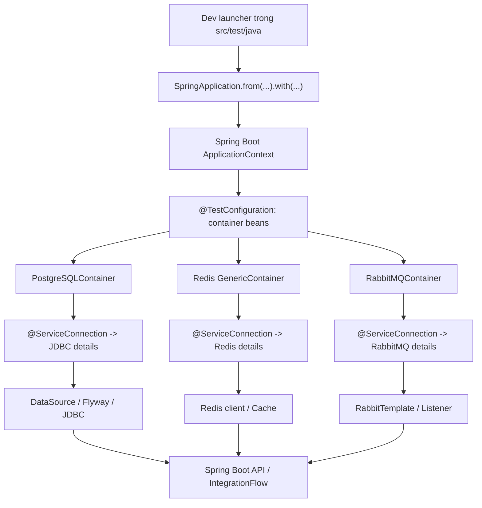
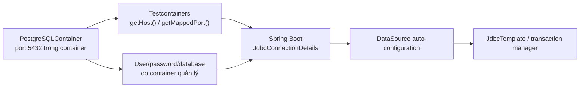

# Testcontainers chạy cùng ứng dụng trong chế độ phát triển

## 1. Bối cảnh: chạy Spring Boot với các dịch vụ tích hợp thật trong lúc lập trình

Một ứng dụng tích hợp Spring Boot thường không thể hoạt động đầy đủ nếu chỉ khởi động JVM. Nó còn cần PostgreSQL để lưu đơn hàng và outbox, Redis để cache hoặc giữ dữ liệu tạm, RabbitMQ/Kafka để gửi nhận message, đôi khi thêm dịch vụ giả lập HTTP của đối tác. Nếu mỗi lập trình viên cài các thành phần này trực tiếp lên máy, phiên bản và trạng thái dữ liệu dễ lệch nhau: người dùng PostgreSQL 14, người khác 16; mật khẩu, port hoặc exchange được tạo thủ công không giống nhau.

**Testcontainers** là thư viện Java dùng Docker-compatible runtime để khởi chạy các container phụ thuộc theo cấu hình của chương trình. Dù thường được nhắc tới trong integration test, từ Spring Boot 3.1, Spring Boot có hỗ trợ **development-time Testcontainers**: dùng cấu hình container đặt trong test source set nhưng khởi động **cùng một bản ứng dụng đang chạy để phát triển**, không bắt buộc chạy một bài JUnit test.

Ví dụ, một developer cần khởi động API `order-integration` trong IDE rồi gọi `POST /orders`. Testcontainers có thể cung cấp PostgreSQL, Redis và RabbitMQ cho chính process Spring Boot đó. Các kết nối được chuyển vào auto-configuration qua `@ServiceConnection`, giúp tránh hard-code các cổng Docker được ánh xạ động.

Bài học **“Testcontainers chạy cùng ứng dụng trong chế độ phát triển”** thuộc chương **Dịch vụ phát triển** của module `SPRING_BOOT_INTEGRATION`. Trong module này, các container giúp thử luồng tích hợp HTTP client, cơ sở dữ liệu, cache, broker và adapter của Spring Integration, cùng những yêu cầu thực tế về cấu hình, schema migration, giao dịch, retry, idempotency, kiểm thử và khả năng quan sát.

**Mục tiêu:** biết cách tổ chức cấu hình Testcontainers ngoài mã production, tạo dev launcher, sử dụng `@ServiceConnection` đúng loại dịch vụ, kiểm soát vòng đời và dữ liệu, đồng thời nhận biết giới hạn khi áp dụng cho nhiều môi trường.

## 2. Hiểu đúng cụm từ “chạy cùng ứng dụng”

Cần phân biệt ba mô hình:

| Mô hình | Application chạy ở đâu? | Container do ai quản lý? | Mục đích |
| --- | --- | --- | --- |
| **Integration test** | Test ApplicationContext hoặc process trong quá trình chạy test | Testcontainers/JUnit/Spring test context | Xác minh nghiệp vụ rồi kết thúc test |
| **Development-time Testcontainers** | Spring Boot chạy như một application để lập trình, debug và gọi API | Testcontainers qua cấu hình dev do Spring Boot nạp | Có database/broker thật trong suốt phiên phát triển |
| **Docker Compose development services** | Thường là Spring Boot chạy trên host, Compose chạy các dependency | Docker Compose cùng hỗ trợ của Spring Boot | Dùng một file Compose định nghĩa bộ dịch vụ local |

Điểm khác của development-time Testcontainers là developer khởi chạy **một lớp main dành riêng cho phát triển**, lớp đó nạp các bean container vào application context trước khi ứng dụng bắt đầu sử dụng datasource, cache hoặc broker. Với hỗ trợ tương thích của Spring Boot, các container được khởi động, thông số kết nối được cung cấp và ứng dụng chạy bình thường.



Đây vẫn là **một Spring Boot application thật**; nó không tự trở thành môi trường production. Những controller, service, message listener, transaction manager và IntegrationFlow đang chạy trong context chính của ứng dụng. Chỉ phần định nghĩa container và entrypoint phát triển được đặt riêng.

## 3. Điều kiện tiên quyết và phạm vi phiên bản

Mô hình ở đây hướng đến Spring Boot 3.x với hỗ trợ `spring-boot-testcontainers` và Testcontainers tương thích. Một số class, package, artifact Maven/Gradle hoặc hành vi vòng đời có thể thay đổi khi nâng major version; trước khi áp dụng phải kiểm tra phiên bản do Spring Boot dependency management của project quản lý.

Chuẩn bị:

1. JDK và Spring Boot version được project hỗ trợ.
2. Docker Engine hoặc runtime container tương thích đang chạy và CLI/quyền truy cập đã sẵn sàng.
3. Testcontainers Java và module container cho từng loại phụ thuộc.
4. `spring-boot-testcontainers` để tích hợp `@ServiceConnection`.
5. Dependency ứng dụng như JDBC driver, Spring Data Redis, Spring AMQP hoặc Spring Kafka tùy service thực sự dùng.
6. Quyền pull image từ registry, mạng tới registry và tài nguyên máy đủ cho các container.
7. Một bản cấu hình dev tách biệt production, không mang secret thật vào image test.

Không nên coi Testcontainers là một cách bỏ qua xác thực hoặc mô hình bảo mật. Dù chạy local, các container vẫn cần cấu hình cổng, tài khoản, dữ liệu và giới hạn tải phù hợp với máy phát triển.

## 4. Cấu trúc project: giữ cấu hình dev ở test source set

Một cách tổ chức rõ ràng:

```text
order-integration/
├── pom.xml
├── src/
│   ├── main/
│   │   ├── java/com/example/integration/
│   │   │   ├── OrderIntegrationApplication.java
│   │   │   ├── order/...
│   │   │   └── messaging/...
│   │   └── resources/
│   │       ├── application.yml
│   │       └── application-local.yml
│   └── test/
│       └── java/com/example/integration/
│           ├── LocalContainersConfiguration.java
│           ├── LocalOrderIntegrationApplication.java
│           └── OrderRepositoryIntegrationTest.java
```

Trong cách tổ chức này:

- `OrderIntegrationApplication` là **main class chính** để build/deploy production.
- `LocalContainersConfiguration` định nghĩa các container phát triển.
- `LocalOrderIntegrationApplication` là **main class dev** khởi chạy application thật cùng những bean Testcontainers.
- Các integration test có thể import lại cấu hình container khi phù hợp, nhưng không bắt buộc phải dùng cùng lifecycle hay state.
- Những class chỉ thuộc test source set và dependency test scope thường **không được đóng gói trong production artifact**. Đây là một ranh giới quan trọng để không bắt production phụ thuộc Docker daemon.

Không đặt `LocalOrderIntegrationApplication` vào `src/main/java` nếu mục tiêu là không đưa các dependency và hành vi phát triển vào production. Cũng không cho một `@TestConfiguration` phát triển chứa password và image registry nội bộ bị quét/import vào application production ngoài ý muốn.

## 5. Khai báo dependency: ứng dụng và công cụ phát triển tách biệt

### 5.1. Maven với Spring Boot dependency management

Ví dụ nếu ứng dụng thực sự dùng PostgreSQL, Redis và RabbitMQ:

```xml
<!-- Các dependency nghiệp vụ cần khi ứng dụng chạy -->
<dependency>
    <groupId>org.springframework.boot</groupId>
    <artifactId>spring-boot-starter-jdbc</artifactId>
</dependency>
<dependency>
    <groupId>org.postgresql</groupId>
    <artifactId>postgresql</artifactId>
    <scope>runtime</scope>
</dependency>
<dependency>
    <groupId>org.springframework.boot</groupId>
    <artifactId>spring-boot-starter-data-redis</artifactId>
</dependency>
<dependency>
    <groupId>org.springframework.boot</groupId>
    <artifactId>spring-boot-starter-amqp</artifactId>
</dependency>

<!-- Chỉ dùng cho dev/test classpath -->
<dependency>
    <groupId>org.springframework.boot</groupId>
    <artifactId>spring-boot-testcontainers</artifactId>
    <scope>test</scope>
</dependency>
<dependency>
    <groupId>org.testcontainers</groupId>
    <artifactId>postgresql</artifactId>
    <scope>test</scope>
</dependency>
<dependency>
    <groupId>org.testcontainers</groupId>
    <artifactId>rabbitmq</artifactId>
    <scope>test</scope>
</dependency>
<dependency>
    <groupId>org.testcontainers</groupId>
    <artifactId>junit-jupiter</artifactId>
    <scope>test</scope>
</dependency>
```

Đây là ví dụ cho các dòng Spring Boot/Testcontainers tương thích với các tọa độ module trên. Khi dùng Testcontainers major version mới, tên artifact có thể thay đổi; không tự trộn module từ các major version khác nhau. Để Boot dependency management hoặc BOM được project chấp thuận quản lý version và kiểm tra bằng dependency tree khi có lỗi.

Với Redis dùng `GenericContainer`, module Testcontainers cơ bản được đưa vào theo dependency phù hợp. Không thêm RabbitMQ, PostgreSQL hoặc Redis starter nếu application thực tế không sử dụng công nghệ đó.

### 5.2. Gradle

Mô hình tương đương khi dùng Gradle Kotlin DSL:

```kotlin
dependencies {
    implementation("org.springframework.boot:spring-boot-starter-jdbc")
    runtimeOnly("org.postgresql:postgresql")
    implementation("org.springframework.boot:spring-boot-starter-data-redis")
    implementation("org.springframework.boot:spring-boot-starter-amqp")

    testImplementation("org.springframework.boot:spring-boot-testcontainers")
    testImplementation("org.testcontainers:postgresql")
    testImplementation("org.testcontainers:rabbitmq")
    testImplementation("org.testcontainers:junit-jupiter")
    testImplementation("org.springframework.boot:spring-boot-starter-test")
}
```

Cú pháp trên giả định Gradle project có Spring Boot plugin và version management thích hợp. Với dependency `testImplementation`, lớp main dev cần được chạy bằng **test runtime classpath**, không phải classpath chỉ gồm `src/main`.

## 6. Tạo cấu hình Testcontainers cho ba phụ thuộc tích hợp

Một lớp `@TestConfiguration` cung cấp các container như Spring bean.

```java
package com.example.integration;

import org.springframework.boot.test.context.TestConfiguration;
import org.springframework.boot.testcontainers.service.connection.ServiceConnection;
import org.springframework.context.annotation.Bean;
import org.testcontainers.containers.GenericContainer;
import org.testcontainers.containers.PostgreSQLContainer;
import org.testcontainers.containers.RabbitMQContainer;
import org.testcontainers.utility.DockerImageName;

@TestConfiguration(proxyBeanMethods = false)
public class LocalContainersConfiguration {

    @Bean
    @ServiceConnection
    PostgreSQLContainer<?> postgresContainer() {
        return new PostgreSQLContainer<>("postgres:16-alpine")
                .withDatabaseName("orders_dev")
                .withUsername("orders_dev")
                .withPassword("local_only_password");
    }

    @Bean
    @ServiceConnection(name = "redis")
    GenericContainer<?> redisContainer() {
        return new GenericContainer<>(
                DockerImageName.parse("redis:7-alpine"))
                .withExposedPorts(6379);
    }

    @Bean
    @ServiceConnection
    RabbitMQContainer rabbitContainer() {
        return new RabbitMQContainer("rabbitmq:3-management");
    }
}
```

Ba phần cần hiểu:

1. `@Bean`: container là một bean do Spring Boot quản lý trong bối cảnh phát triển/test phù hợp, tạo điều kiện cho việc khởi động và dừng cùng vòng đời ứng dụng.
2. `@ServiceConnection`: Spring Boot tìm `ContainerConnectionDetailsFactory` phù hợp để cung cấp thông số kết nối cho auto-configuration.
3. **Loại container và tên image:** `PostgreSQLContainer`/`RabbitMQContainer` cung cấp type metadata rõ; `GenericContainer<?>` không nói rằng service chạy Redis, nên cần `name = "redis"`.

`withExposedPorts(6379)` giúp Testcontainers publish cổng Redis ra một host port được cấp động. Không hard-code `localhost:6379` trong cấu hình ứng dụng trừ khi có lý do kiểm soát host port riêng.

Trong production, tài khoản/password không nên cố định như ví dụ. Với dev container, những giá trị đơn giản được dùng để dễ hiểu; nếu project lưu dữ liệu nhạy cảm hoặc chia sẻ máy, phải dùng credential riêng và bảo vệ dữ liệu, không sao chép từ production.

### 6.1. Vì sao không dùng @Container trên mỗi @Bean?

`@Container` là annotation phục vụ tích hợp vòng đời với **JUnit Jupiter Testcontainers extension** khi đặt trên field test phù hợp. Trong mô hình **bean-based** ở trên, Spring Boot xử lý container beans, và `@ServiceConnection` khai báo kết nối. Không cần gắn `@Container` lên phương thức `@Bean`.

Điều này khác với test kiểu:

```java
@Testcontainers
@SpringBootTest
class SomeIntegrationTest {
    @Container
    @ServiceConnection
    static PostgreSQLContainer<?> database =
            new PostgreSQLContainer<>("postgres:16-alpine");
}
```

Hai mô hình đều hữu ích nhưng sở hữu lifecycle khác nhau. Không cố kết hợp annotation bừa để nhiều framework cùng khởi động/dừng một container không rõ chủ sở hữu.

## 7. Tạo dev launcher chạy chính ứng dụng với container beans

Trong `src/test/java/com/example/integration/LocalOrderIntegrationApplication.java`:

```java
package com.example.integration;

import org.springframework.boot.SpringApplication;

public class LocalOrderIntegrationApplication {

    public static void main(String[] args) {
        SpringApplication.from(OrderIntegrationApplication::main)
                .with(LocalContainersConfiguration.class)
                .run(args);
    }
}
```

`OrderIntegrationApplication` là main class production:

```java
package com.example.integration;

import org.springframework.boot.SpringApplication;
import org.springframework.boot.autoconfigure.SpringBootApplication;

@SpringBootApplication
public class OrderIntegrationApplication {

    public static void main(String[] args) {
        SpringApplication.run(OrderIntegrationApplication.class, args);
    }
}
```

Điểm mấu chốt là `SpringApplication.from(...).with(...).run(args)` giúp **bổ sung cấu hình Testcontainers vào application chạy thực tế** khi khởi động qua entrypoint dev.

`@TestConfiguration` không tự được component scan như cấu hình production bình thường. Việc dùng `with(LocalContainersConfiguration.class)` khiến cấu hình container được đưa vào ngữ cảnh của ứng dụng một cách chủ động. Điều này giảm nguy cơ vô tình khởi động Docker khi chạy main class production.

Mô hình này **không chạy một bài JUnit test**: developer có thể giữ ứng dụng mở, gọi REST API, đặt breakpoint trong service hoặc listener và quan sát database/broker cho tới khi dừng phiên làm việc.

## 8. Cách chạy bằng IDE, Maven và Gradle

### 8.1. IDE: con đường trực tiếp nhất

Các bước phổ biến:

1. Chạy Docker Engine hoặc container runtime Testcontainers được cấu hình.
2. Đảm bảo project tải dependency test và có thể biên dịch `src/test/java`.
3. Tạo Run Configuration cho main class `LocalOrderIntegrationApplication` bằng **test classpath** của module.
4. Đặt active profile `local`, ví dụ program argument `--spring.profiles.active=local`.
5. Chạy, quan sát log Testcontainers/Spring Boot để biết container nào được tạo và ApplicationContext đã sẵn sàng chưa.
6. Gọi API hoặc gửi message từ công cụ local, sau đó đặt breakpoint kiểm tra transaction, retry và IntegrationFlow.
7. Dừng application bằng cơ chế shutdown bình thường; xác nhận container lifecycle và dữ liệu đã được dọn/giữ đúng như mong muốn.

Nếu IDE báo không tìm thấy `org.testcontainers...` hoặc `@ServiceConnection`, thường là run configuration chưa có **test runtime classpath**, hoặc dependency chưa được import đúng.

### 8.2. Maven: hỗ trợ test-run khi phiên bản plugin có cung cấp

Trong các phiên bản Spring Boot Maven plugin hỗ trợ dev-time Testcontainers, có goal `spring-boot:test-run` dùng classpath thử nghiệm và main class phù hợp. Ví dụ:

```bash
./mvnw spring-boot:test-run -Dspring-boot.run.profiles=local
```

Nếu có nhiều main class, cần chỉ định dev main class qua cấu hình main class của goal/plugin được phiên bản đang dùng hỗ trợ. Không mặc định plugin sẽ chọn đúng `LocalOrderIntegrationApplication` chỉ vì nó nằm trong `src/test`.

Lệnh `spring-boot:run` thông thường dùng mô hình classpath khác với goal test-run; nếu test scope không sẵn, container configuration sẽ không được tìm thấy.

### 8.3. Gradle: task chạy với test classpath

Các phiên bản Spring Boot Gradle plugin có hỗ trợ development-time Testcontainers cung cấp task `bootTestRun`. Ví dụ:

```bash
./gradlew bootTestRun --args='--spring.profiles.active=local'
```

Cũng như Maven, hãy chọn đúng dev main class trong cấu hình task nếu có nhiều entrypoint và phiên bản plugin không tự xác định như mong muốn. Nếu project không có task đó, kiểm tra phiên bản plugin và task hiện có thay vì tự giả định tên task áp dụng được cho mọi dòng Spring Boot.

**Quy tắc quan trọng:** chạy entrypoint có Testcontainers **trên test classpath**. Không chuyển container dependency thành `implementation` chỉ để làm cho launcher chạy trong production jar.

## 9. ServiceConnection: thông số kết nối được cấp vào Spring Boot ra sao?

Một container được khởi động thường có **host port động**. Ví dụ PostgreSQL trong container lắng nghe ở 5432, nhưng Docker publish ra cổng 32791 trên máy phát triển. Giá trị đó thay đổi mỗi lần chạy.

Không nên ghi cố định:

```yaml
spring:
  datasource:
    url: jdbc:postgresql://localhost:5432/orders_dev
```

thay vì để container được khai báo với `@ServiceConnection` cung cấp chi tiết kết nối cho `DataSource`.

### 9.1. Vòng đi của thông tin



Với service được hỗ trợ, Spring Boot sử dụng `ConnectionDetails` do container cung cấp thay vì yêu cầu lập trình viên chép giá trị host, mapped port, username và password sang YAML. Những bean connection details cần **starter/driver và auto-configuration** tương ứng; chúng không tự tạo business schema hay table.

Ngoài `JdbcConnectionDetails`, các tích hợp khác có thể tạo connection details thích hợp cho Redis, RabbitMQ, Kafka hoặc driver tương ứng nếu Spring Boot/extension đang dùng có factory hỗ trợ. Danh sách factory thay đổi theo framework version; hãy kiểm tra môi trường thực tế và không suy rằng mọi `GenericContainer` đều tự được nhận diện.

### 9.2. Ưu tiên ConnectionDetails so với properties truyền thống

Khi auto-configuration nhận `ConnectionDetails` bean, nó có thể dùng các giá trị từ đó thay vì `spring.datasource.url`, `spring.data.redis.host` hoặc property tương ứng.

Do đó cần tách hai câu hỏi:

- Spring `Environment` đang chứa giá trị property nào?
- DataSource/RedisConnectionFactory/RabbitConnectionFactory đang **thực sự sử dụng ConnectionDetails nào**?

Khi hai nguồn cấu hình tồn tại, chỉ in property value là chưa đủ để kết luận app sẽ nối tới server nào. Xem auto-configuration report, log được che secret và thực hiện một query/command kiểm chứng qua kết nối thật.

### 9.3. Tại sao GenericContainer cần name?

Ví dụ:

```java
@Bean
@ServiceConnection(name = "redis")
GenericContainer<?> redisContainer() {
    return new GenericContainer<>("redis:7-alpine")
            .withExposedPorts(6379);
}
```

Method return type là `GenericContainer<?>` nên Spring Boot không biết nó đại diện cho dịch vụ gì chỉ từ type. `name = "redis"` là metadata giúp factory chọn kết nối tương thích. Nó **không đổi DNS, port hoặc giao thức của container**. Container vẫn phải chạy Redis thật trên cổng và auth mà connection factory dự kiến.

Nếu container là HTTP mock server không có `ConnectionDetailsFactory` tương ứng, gắn tên giả `redis` hoặc `postgres` là sai. Hãy cấu hình một base URL riêng hoặc cung cấp integration custom được kiểm soát.

## 10. Image tùy chỉnh và sự khác biệt giữa Testcontainers với Compose

Một tổ chức có thể buộc developer dùng PostgreSQL image từ private registry:

```text
registry.example.com/team/postgres-internal:16
```

Với `PostgreSQLContainer`, Testcontainers có thể cần biết image đó tương thích với image gốc của module:

```java
import org.testcontainers.containers.PostgreSQLContainer;
import org.testcontainers.utility.DockerImageName;

DockerImageName image = DockerImageName
        .parse("registry.example.com/team/postgres-internal:16")
        .asCompatibleSubstituteFor("postgres");

PostgreSQLContainer<?> postgres =
        new PostgreSQLContainer<>(image)
                .withDatabaseName("orders_dev");
```

`asCompatibleSubstituteFor("postgres")` là chỉ báo tương thích **cho Testcontainers**. Nó không chứng minh image có cùng entrypoint, healthcheck hoặc phiên bản giao thức; phải kiểm tra khả năng khởi động và JDBC thực tế.

Phân biệt với Docker Compose:

| Cơ chế | Cách khai báo |
| --- | --- |
| Testcontainers với subclass PostgreSQLContainer | `DockerImageName.asCompatibleSubstituteFor("postgres")` khi cần |
| Spring Boot Testcontainers với GenericContainer | `@ServiceConnection(name = "redis")` để chỉ ra loại service |
| Spring Boot Docker Compose support | Label `org.springframework.boot.service-connection: postgres` trên service dùng image tùy chỉnh |

Ba cơ chế này liên quan đến **ba nơi khác nhau**: chấp nhận image trong Testcontainers module, nhận diện loại container trong connection details và nhận diện Compose service. Không thay thế lẫn nhau.

## 11. Tách profile phát triển khỏi cấu hình production

Đặt container trong `src/test` là một lớp bảo vệ, nhưng chưa đủ. Khi chạy local, ứng dụng còn có endpoint HTTP, API key giả lập, topic names, lịch scheduler hoặc flag phát message cần được xác định rõ.

Ví dụ `application-local.yml`:

```yaml
spring:
  config:
    activate:
      on-profile: local

  docker:
    compose:
      enabled: false

  flyway:
    enabled: true

integration:
  partner:
    base-url: http://localhost:18080
    connect-timeout: 2s
    read-timeout: 5s
  messaging:
    enabled: true
```

Trong ví dụ, `spring.docker.compose.enabled=false` tránh việc Boot đồng thời điều phối Compose services khi dev launcher đang dùng Testcontainers. Không phải lúc nào dùng cả hai là sai, nhưng **không nên tạo hai PostgreSQL hoặc Redis cùng chức năng rồi không biết ConnectionDetails được chọn từ đâu**.

Với file `application-prod.yml`:

```yaml
spring:
  docker:
    compose:
      enabled: false

integration:
  partner:
    base-url: ${PARTNER_BASE_URL}
```

Production nên dùng kết nối và credentials do hạ tầng production cấp; không sử dụng container dev, localhost, mock partner endpoint hay password minh họa. Có thể validate host, scheme HTTPS, tên namespace, broker authentication và TLS tại startup để fail-fast nếu profile không đúng.

**Không** dựa vào `@TestConfiguration` để thay đổi URL của một đối tác thật nếu app vẫn đọc `application-prod.yml` vì active profile sai. Dev launcher cần kích hoạt profile phát triển minh bạch và được test bằng một request thực tế tới stub/localhost.

## 12. PostgreSQL: migration, transaction và dữ liệu mẫu

PostgreSQLContainer cho bạn **server PostgreSQL đang chạy**, không cấp sẵn bảng nghiệp vụ. Nếu application sử dụng Flyway/Liquibase, migration cần chạy trên DataSource Testcontainers trước khi repository hoặc listener bắt đầu làm việc.

Một cấu hình local tham khảo:

```yaml
spring:
  flyway:
    enabled: true

  sql:
    init:
      mode: never

  jpa:
    hibernate:
      ddl-auto: validate
```

Phần `jpa` chỉ có ý nghĩa nếu project dùng JPA; bỏ khi ứng dụng chỉ có JDBC. Nếu team chọn Liquibase, dùng Liquibase làm nguồn migration duy nhất; tránh vừa bật Flyway vừa bật Liquibase trên cùng schema mà không có chính sách rõ.

Mục tiêu kiểm thử khi dev app khởi động:

1. DataSource kết nối đúng container mới, không nhầm database cài trên host.
2. Migration tạo bảng `orders`, `outbox_event`, `processed_event` hoặc schema tương ứng.
3. Giao dịch DB và row-level constraints hoạt động giống production ở các điểm quan trọng.
4. Duplicate event ID bị loại theo unique constraint/idempotency.
5. Transaction rollback khi một bước xử lý thất bại.
6. Database reset/persistent data có chính sách rõ; không tưởng rằng restart app luôn giữ dữ liệu.

Ví dụ bảng bảo vệ idempotency:

```sql
CREATE TABLE processed_event (
    consumer_name VARCHAR(120) NOT NULL,
    event_id VARCHAR(120) NOT NULL,
    processed_at TIMESTAMPTZ NOT NULL DEFAULT CURRENT_TIMESTAMP,
    PRIMARY KEY (consumer_name, event_id)
);
```

Nếu consumer cập nhật bảng nghiệp vụ và ghi `processed_event`, hai thao tác cần cùng transaction. Testcontainers chỉ cung cấp môi trường DB thật; bản thân nó không giải quyết tính nhất quán giữa DB, HTTP và broker.

### 12.1. Seed dữ liệu dev

Có thể seed dữ liệu qua migration dành riêng cho dev, script, API hoặc một bean có profile chỉ phục vụ local. Cần bảo đảm seed **idempotent**, không tạo thêm đơn hàng mỗi lần restart một cách vô ý.

Một số dự án muốn thử kịch bản sạch sau mỗi lần run; dự án khác cần giữ DB vài giờ để debug. Cần lựa chọn rõ:

- Dữ liệu **ephemeral**: mỗi vòng đời container tạo trạng thái mới, phù hợp chạy test/đối chiếu.
- Dữ liệu **có chủ đích giữ lại**: dùng cơ chế volume/reuse được hiểu đầy đủ, có chính sách reset/backup chỉ cho dev.

Không dùng chức năng reuse một cách mặc định trong CI vì có nguy cơ dữ liệu test trước ảnh hưởng kết quả test sau.

## 13. Redis: ánh xạ cổng động và kiểm thử cache

Redis có thể dùng `GenericContainer` với `@ServiceConnection(name = "redis")` nếu factory của Spring Boot hỗ trợ. Phần thực tế cần xác minh là `RedisConnectionFactory` đã nối đúng host/mapped port.

Một phép thử local:

```java
import org.springframework.data.redis.core.StringRedisTemplate;

@Service
public class CacheProbeService {
    private final StringRedisTemplate redis;

    public CacheProbeService(StringRedisTemplate redis) {
        this.redis = redis;
    }

    public void verifyLocalCache() {
        redis.opsForValue().set("dev:healthcheck", "ok");
        String value = redis.opsForValue().get("dev:healthcheck");
        if (!"ok".equals(value)) {
            throw new IllegalStateException("Redis round-trip failed");
        }
    }
}
```

Đây là đoạn minh họa và cần import `org.springframework.stereotype.Service`. Trong production, không chạy phép thử ghi dữ liệu vô thời hạn mỗi request health; dùng endpoint readiness/health phù hợp.

Khi application dùng Redis cho cache TTL, distributed lock hoặc idempotency, test không nên chỉ assert “PING thành công”. Hãy xác minh TTL, serialization, key namespace và xử lý lỗi khi Redis không khả dụng. Redis container local có thể chưa bật auth/TLS như production; khác biệt này cần được ghi nhận và kiểm thử riêng.

## 14. RabbitMQ: topology, consumer và tình huống lỗi thực tế

`RabbitMQContainer` cung cấp broker tương thích để ứng dụng dùng `RabbitTemplate`, `@RabbitListener` hoặc adapter AMQP của Spring Integration. Tuy nhiên:

- Queue, exchange, routing key và binding phải được ứng dụng hoặc script provisioning khai báo theo hợp đồng.
- Dead-letter exchange/queue và retry topology không tự xuất hiện chỉ vì `RabbitMQContainer` đã chạy.
- Số consumer, prefetch, acknowledgment mode, requeue và retry vẫn do application cấu hình.
- Một consumer có thể bắt đầu xử lý message ngay khi app startup; nên kiểm soát seed/test message và thứ tự migration/ready.
- Các message phát khi đang debug có thể tạo side effect thật trên database dev; cần idempotency và khả năng xóa dữ liệu dev an toàn.

Ví dụ topology:

```text
orders.exchange -- routingKey=orders.created --> orders.created.queue
                                                 |
                                                 +--> @RabbitListener
                                                       |
                                                       +--> DB update/outbox
                                                       +--> ack sau xử lý
                                                 |
                                                 +--> DLX khi reject theo policy
```

Một bài kiểm thử local có giá trị:

1. Phát một event `OrderCreated(eventId=evt-101)`.
2. Kiểm tra consumer ghi DB và ack.
3. Phát lại cùng event ID; xác minh DB không ghi trùng.
4. Giả lập handler lỗi trước commit; xác minh retry/DLQ theo cấu hình.
5. Giả lập handler commit xong rồi kết nối broker lỗi trước ack; redelivery phải vô hại nhờ idempotency.

Cùng một local dev launcher có thể chạy REST API và listener. Điều này tiện debug, nhưng cần hiểu listener có thể chạy liên tục trong khi developer không gọi API nào.

## 15. Kafka hoặc broker khác: dùng container chuyên biệt khi cần

Không nhất thiết lúc nào cũng cần RabbitMQ. Nếu ứng dụng tích hợp Kafka, có thể dùng container module tương ứng để nhận bootstrap servers hợp lệ và đặt `@ServiceConnection`.

Phác thảo cấu hình Testcontainers với container Kafka chuyên biệt tùy version:

```java
// Kiểu Kafka container cụ thể phụ thuộc phiên bản Testcontainers.
// Ví dụ dùng KafkaContainer ở các dòng Testcontainers hỗ trợ type này.

@Bean
@ServiceConnection
KafkaContainer kafkaContainer() {
    return new KafkaContainer(
            DockerImageName.parse("confluentinc/cp-kafka:<compatible-version>"));
}
```

Đây là **phác thảo có placeholder version**, không phải đoạn copy-paste tự chạy. Testcontainers major version có thể thay package/class và image được phép; ví dụ một số dòng cung cấp `org.testcontainers.kafka.ConfluentKafkaContainer` hoặc container Kafka khác. Khi áp dụng phải chọn class, image và artifact theo cùng phiên bản và bảo đảm broker listeners được Testcontainers cấu hình đúng.

Không tự nối Kafka tới `localhost:9092` nếu container publish cổng động hoặc broker advertised listener khác. Service connection từ loại container chuyên biệt thường giải quyết việc lấy bootstrap servers đúng cho application host.

Đối với JMS, PostgreSQL-compatible DB khác, MongoDB hoặc Pulsar, hãy tìm container module và connection details factory mà Spring Boot của project hỗ trợ. Nếu không có hỗ trợ tự động, cần cấu hình kết nối thủ công có kiểm soát; không nên gán sai tên `@ServiceConnection` chỉ để cưỡng ép Spring tạo connection factory.

## 16. Dịch vụ HTTP mock: không phải container nào cũng tự sinh ConnectionDetails

Một ứng dụng có thể cần giả lập HTTP partner để tránh gọi dịch vụ thật từ máy phát triển. Ví dụ mock server chạy qua Testcontainers:

```java
@Bean
GenericContainer<?> partnerMockContainer() {
    return new GenericContainer<>(
            DockerImageName.parse("mockserver/mockserver:5.15.0"))
            .withExposedPorts(1080);
}
```

Container được tạo qua bean configuration, nhưng **không có nghĩa Spring Boot tự cung cấp** một bean kiểu `PartnerHttpConnectionDetails`. Với dịch vụ tùy biến, cần thiết kế cách lấy host/mapped port và cấu hình `integration.partner.base-url`:

- Nếu muốn URL được tạo động, có thể cung cấp một bean cấu hình client/custom connection details dựa trên container **sau khi container đã start**, rồi inject trực tiếp vào HTTP adapter.
- Nếu chỉ muốn thử API từ một stub cố định ở local, cấu hình property riêng và quản lý endpoint đó theo một profile được kiểm soát.
- Nếu dùng WireMock/MockServer trong test, có thể dùng extension/API chuyên dụng để lấy endpoint; không trộn bừa các lifecycle/test extension với bean-based dev container.
- Không đọc `getMappedPort(1080)` khi container còn chưa start; Testcontainers chưa có mapped port để trả về.

Một interface có thể biểu diễn endpoint của đối tác:

```java
public interface PartnerEndpointProvider {
    URI baseUri();
}
```

Ở dev context, implementation dùng `GenericContainer.getHost()` và `getMappedPort(1080)` khi container đã running; ở production, implementation đọc endpoint từ configuration và được validate. Cách tách interface giúp không đưa dependency Testcontainers vào `src/main`.

Lưu ý `URI` phải dùng `java.net.URI`; ví dụ chỉ nêu hợp đồng interface, chưa bao gồm bean implementation để tránh giả định một thứ tự startup/initialization sai.

## 17. Vòng đời container, dữ liệu và quá trình stop/start

Một điểm quan trọng khi chạy Testcontainers cùng ứng dụng là **vòng đời**.

```text
IDE start dev launcher
    -> Spring Boot tạo context và container beans
    -> Testcontainers khởi động PostgreSQL/Redis/RabbitMQ
    -> Spring Boot nhận ConnectionDetails
    -> DB migration, message listener, REST API sẵn sàng
    -> Developer debug và tương tác
IDE stop / application shutdown
    -> Context shutdown
    -> Container beans được dừng/cleanup theo lifecycle tích hợp
```

Thời điểm cụ thể phụ thuộc container bean lifecycle và Spring Boot version; nếu developer dùng cách khởi động/dừng khác ngoài cơ chế Boot quản lý, cần xác minh tài nguyên được cleanup.

### 17.1. Restart application thường không đồng nghĩa dữ liệu vẫn còn

Trong cấu hình Testcontainers mặc định, container được tạo mới và dọn khi vòng đời kết thúc, vì vậy database có thể trở về trạng thái mới ở lần khởi động sau. Không dựa vào trạng thái trước đó nếu không có cơ chế persistence/reuse được kiểm soát.

Tính ephemeral có lợi cho debug và test:

- Dễ tái tạo lỗi trên một bản dữ liệu sạch.
- Mỗi developer tránh ảnh hưởng đến database local của người khác.
- Migration được kiểm tra thường xuyên từ trạng thái chưa có schema.
- Lỗi “chỉ xuất hiện sau khi DB đã cài từ năm trước” dễ được phát hiện.

Nhưng nếu cần theo dõi một giao dịch qua nhiều lần restart, nên tạo fixture/seed tái tạo được hoặc chính sách giữ dữ liệu chỉ trong local, thay vì cố tái sử dụng bừa một container có state không rõ.

### 17.2. Container reuse: chọn rất thận trọng

Testcontainers có khả năng tái sử dụng container ở một số phiên bản/cấu hình. Việc bật reuse thường yêu cầu opt-in của môi trường phát triển và có thể khiến state tồn tại ngoài vòng đời test thông thường.

**Không bật reuse mặc định cho CI hoặc các test cần isolation.** Nếu nhóm cho phép reuse khi debug local, phải ghi rõ cách reset dữ liệu, hậu quả khi schema version thay đổi, quyền truy cập volume và cách dọn container cũ. Không cho phép application production vô tình kết nối vào container reuse của máy developer.

### 17.3. Testcontainers resource cleanup

Testcontainers sử dụng các cơ chế quản lý/cleanup tài nguyên Docker tùy phiên bản và cấu hình, có thể có thành phần hỗ trợ dọn tài nguyên bị bỏ quên. Không tắt cơ chế cleanup vì thấy thêm container phụ mà chưa hiểu hậu quả. Khi IDE bị kill hoặc máy mất điện, có thể vẫn cần kiểm tra các container còn sót và dọn đúng môi trường local.

## 18. So sánh Testcontainers chạy cùng ứng dụng và Docker Compose

| Tiêu chí | Testcontainers dev-time | Docker Compose support |
| --- | --- | --- |
| Nơi định nghĩa | Java container bean trong `src/test` | File `compose.yaml` |
| Cách chạy | Dev launcher trên test classpath | Spring Boot/Compose CLI với dependency tương ứng |
| Phiên bản image | Java `DockerImageName` và module | `image:` trong Compose |
| Host port | Thường được cấp động | Có thể cố định hoặc động theo `ports` |
| Service connection | `@ServiceConnection` và container factory | Tên image hoặc label `org.springframework.boot.service-connection` |
| Lifecycle | Bean/container lifecycle do Boot và Testcontainers điều phối | Compose start/stop/lifecycle-management theo config |
| Tính cô lập | Thường dễ tạo mới cho test/dev session | Dễ giữ một bộ dịch vụ local lâu dài |
| Tái sử dụng config trong test | Import `@TestConfiguration` | Cần quyết định chủ động có dùng Compose trong test |
| Quan sát bằng Docker CLI | Có | Có |
| Dễ khai báo topology phức tạp | Tùy code/fixture | Thường thuận tiện trong Compose file |
| Rủi ro chính | Docker thiếu/port động, startup chậm, lifecycle state | Đụng cổng, lệch dữ liệu local, profile/volume không rõ |

Một số dự án dùng Compose cho trải nghiệm local và Testcontainers cho integration test; dự án khác dùng Testcontainers cho cả hai để tái sử dụng phần cấu hình. **Không cần cố dùng cả hai trong cùng một dev session** trừ khi có yêu cầu rõ và cách phân biệt service connections.

## 19. Cấu hình mạng, cổng và bảo mật môi trường local

### 19.1. Host port động

Với Testcontainers, một container chạy PostgreSQL tại cổng 5432 trong network riêng có thể được publish ra một cổng host bất kỳ. Testcontainers cung cấp:

```java
String host = postgresContainer.getHost();
int hostPort = postgresContainer.getMappedPort(5432);
```

Chỉ gọi sau khi container đã start. Giá trị `host` không phải lúc nào cũng là chuỗi `localhost`, đặc biệt với Docker chạy từ xa hoặc trong môi trường CI. Service connection loại JDBC biết cách lấy host/port tương ứng, vì vậy không nên thay bằng một giá trị cố định trong YAML.

### 19.2. Không cấp quyền Docker vượt nhu cầu

Docker daemon là một bề mặt quyền cao. Việc cho phép developer hoặc CI truy cập Docker socket cần được quản lý theo chính sách tổ chức. Không mount `/var/run/docker.sock` hoặc cấp privileged container vào application chỉ vì muốn chạy Testcontainers mà chưa đánh giá rủi ro.

Nếu chạy trên máy dùng chung hoặc môi trường phát triển từ xa, kiểm tra network, khả năng lộ cổng và quyền truy cập image registry. Testcontainers không phải là boundary bảo mật tuyệt đối cho dữ liệu thật.

### 19.3. Tách credentials dev khỏi production

Các password hard-code trong bài chỉ dành cho ví dụ dev cô lập. Với code thật:

- Không ghi secret production vào `src/test` hoặc Git.
- Không in raw connection strings có password vào log.
- Không mount thư mục chứa token/cert thật vào container không đáng tin cậy.
- Không cho dev launcher tự gọi endpoint thanh toán/gửi email production.
- Nếu cần mTLS/credential để kiểm thử, dùng certificate và account thử nghiệm riêng, có thời hạn và quyền hạn nhỏ.
- Không đưa payload khách hàng thật vào topic, queue hoặc database dev chưa được bảo vệ.

## 20. Khả năng kiểm thử lại configuration trong @SpringBootTest

Một lợi ích của `@TestConfiguration` là có thể nhập lại cùng một nhóm container vào test, nhưng cần hiểu test lifecycle:

```java
package com.example.integration;

import org.junit.jupiter.api.Test;
import org.springframework.beans.factory.annotation.Autowired;
import org.springframework.boot.test.context.SpringBootTest;
import org.springframework.context.annotation.Import;
import org.springframework.jdbc.core.JdbcTemplate;

@SpringBootTest
@Import(LocalContainersConfiguration.class)
class OrderRepositoryIntegrationTest {

    @Autowired
    JdbcTemplate jdbcTemplate;

    @Test
    void databaseIsReadyAndMigrated() {
        Integer count = jdbcTemplate.queryForObject(
                "SELECT COUNT(*) FROM processed_event", Integer.class);
        if (count == null) {
            throw new AssertionError("Expected a count from database");
        }
    }
}
```

Trong test trên, bảng `processed_event` phải được migration tạo trước. Câu lệnh chỉ kiểm tra đường JDBC và schema đơn giản; một integration test có ý nghĩa còn phải tạo dữ liệu, kiểm tra unique constraint và transaction.

**Khác biệt quan trọng:** chạy dev launcher giữ application sống để thao tác thủ công; chạy `@SpringBootTest` có các assertion và vòng đời test context. Có thể import cùng một `@TestConfiguration`, nhưng không nên giả định DB state của test sẽ tồn tại bên phiên dev app hay ngược lại.

Nếu muốn giảm thời gian chạy bộ test, cần thiết kế chiến lược context caching/container lifecycle hợp lệ; reuse hoặc singleton container không được làm test phụ thuộc thứ tự chạy và dữ liệu cũ.

### 20.1. @ServiceConnection trên field và bean khác nhau ra sao?

Có hai mô hình thường gặp:

```java
// Phù hợp cho test class với JUnit extension:
@Container
@ServiceConnection
static PostgreSQLContainer<?> postgres =
        new PostgreSQLContainer<>("postgres:16-alpine");
```

và:

```java
// Phù hợp cho cấu hình dev-time import vào Spring context:
@Bean
@ServiceConnection
PostgreSQLContainer<?> postgresContainer() {
    return new PostgreSQLContainer<>("postgres:16-alpine");
}
```

Mô hình field thường do JUnit/Testcontainers extension sở hữu lifecycle trong test; mô hình bean được Spring Boot quản lý. Chọn một cơ chế sở hữu chính cho container, tránh chạy trùng hai PostgreSQL rồi ứng dụng kết nối tới cái không mong muốn.

## 21. Troubleshooting: application không kết nối được khi chạy dev launcher

| Triệu chứng | Nguyên nhân thường gặp | Cách kiểm tra |
| --- | --- | --- |
| `Could not find a valid Docker environment` | Docker Engine không chạy, quyền daemon hoặc runtime chưa tương thích | Kiểm tra Docker/daemon, quyền và cấu hình Testcontainers |
| `NoClassDefFoundError: ...Testcontainers` | Chạy main dev bằng main classpath | Chọn test classpath hoặc goal/task test-run phù hợp |
| Application start nhưng không có container | Dev main không nạp `LocalContainersConfiguration` | Kiểm tra `SpringApplication.from(...).with(...)`, classpath và bean |
| Container khởi động nhưng thiếu DataSource | Thiếu JDBC starter/driver hoặc `@ServiceConnection` không có factory phù hợp | Kiểm tra auto-configuration, container type, dependency |
| Redis dùng nhầm localhost:6379 | Tự hard-code host/port thay vì nhận connection details | Kiểm tra `@ServiceConnection(name="redis")` và connection factory |
| Auth PostgreSQL thất bại | DB user/password hoặc image volume khác kỳ vọng | Kiểm tra cấu hình container và log khởi tạo |
| Migration chạy sai DB | Có property kết nối khác hoặc nhiều connection details | Kiểm tra DataSource thực, profile, loại bean và migration |
| Rabbit listener không nhận message | Queue/exchange/binding chưa được khai báo | Kiểm tra topology và consumer startup |
| Docker image không pull được | Private registry auth, network, tag sai hoặc rate limit | Kiểm tra image reference và quyền registry |
| Mock HTTP vẫn gọi đối tác thật | `integration.partner.base-url` còn giá trị production | Kiểm tra profile và endpoint của HTTP client |
| Start chậm bất thường | Pull image, startup DB/broker, migration và healthcheck | Phân tích log/timestamp từng giai đoạn |
| Restart làm mất dữ liệu | Container ephemeral | Seed lại hoặc chọn chính sách reuse/persistence có chủ đích |
| Có cả Compose và Testcontainers | Hai nguồn connection details/trùng service | Tắt một cơ chế hoặc phân tách ownership rõ |
| CI chạy trên agent không có Docker | Testcontainers không tạo được container | Cấp runtime được hỗ trợ hoặc skip theo policy rõ; không fallback production |

Quy trình kiểm tra ngắn:

1. Xác định **main class đang chạy**: production main hay local dev launcher?
2. Kiểm tra active profile và nguồn cấu hình endpoint.
3. Xác nhận Docker daemon, image pull và container logs.
4. Kiểm tra container beans và `@ServiceConnection` có được Spring nạp.
5. Xác minh application có starter/driver và auto-configuration cần thiết.
6. Đọc thông tin host/mapped port sau khi container chạy, đối chiếu connection thật.
7. Kiểm tra migrations, broker topology và seed.
8. Mô phỏng một nghiệp vụ có thể kiểm chứng end-to-end.
9. Nếu cần, dừng phiên dev, dọn đúng container thử nghiệm rồi chạy lại từ state sạch.

Không xử lý bằng cách đưa username/password production hoặc URL database dùng chung vào `application-local.yml` để làm lỗi kết nối biến mất.

## 22. Observability: đo những gì ngoài trạng thái “container running”?

Trong các luồng tích hợp thực tế, container chạy chưa đủ để chứng minh ứng dụng khỏe. Cần quan sát:

- **Startup thời gian:** pull image, container start, readiness, migration và ApplicationContext ready.
- **Connection health:** DataSource query, Redis round-trip, broker connection và listener readiness.
- **Flow business:** số đơn hàng được ghi, outbox chờ publish, message consumer nhận/ack, retry và DLQ.
- **Latency & load:** thời gian HTTP client gọi mock partner, số connection pool đang dùng, queue depth.
- **Error classification:** phân biệt lỗi start Docker, lỗi schema migration, lỗi giao thức và lỗi nghiệp vụ.
- **Resource use:** heap JVM, CPU/RAM container, số container còn sót, disk/volume tiêu thụ.
- **Correlation:** request ID/event ID qua REST → DB → broker → consumer → HTTP adapter.

Spring Boot Actuator và Micrometer giúp bổ sung thông tin ứng dụng, nhưng không tự thay thế việc kiểm thử container health, broker topology hoặc tính đúng đắn giao dịch. Không đưa raw payload nhạy cảm hoặc event ID cardinality cao vào metric labels.

Có thể dùng Docker tooling để xem resource và log của container **trong phạm vi môi trường phát triển đã được phép**, nhưng tài liệu/CI phải tránh công khai connection string và secrets.

## 23. Tình huống tổng hợp: debug luồng đặt hàng trên máy phát triển

Giả sử ứng dụng `order-integration` có REST API `POST /orders`, một `IntegrationFlow` nhận lệnh, PostgreSQL lưu đơn hàng và outbox, RabbitMQ phát `OrderCreated`, Redis giữ cache trạng thái, còn một outbound HTTP client gọi hệ thống thanh toán mock.

### 23.1. Thiết lập

1. Developer chạy `LocalOrderIntegrationApplication` qua IDE trên test classpath, profile `local`.
2. `LocalContainersConfiguration` khởi tạo PostgreSQL, Redis và RabbitMQ.
3. `@ServiceConnection` tạo thông số kết nối từ các container; Spring Boot auto-configure JDBC/Redis/AMQP.
4. Flyway tạo schema và dữ liệu mẫu trong database dev.
5. RabbitMQ queue/exchange/binding được khai báo theo cấu hình của project.
6. HTTP partner client trỏ tới mock endpoint, không trỏ production.

### 23.2. Chạy một kịch bản có lỗi

Giả lập request có `requestId=req-4711`:

```text
POST /orders
  -> validate order contract
  -> transaction insert orders + outbox
  -> outbox publishes OrderCreated to RabbitMQ
  -> consumer receives event
  -> Redis cache update
  -> HTTP mock partner returns 503 once, then 200
  -> retry policy applies
  -> idempotent consumer prevents duplicate DB side effects
```

Quan sát:

- Database có đúng một đơn hàng và event ID được ghi vào bảng dedupe.
- Broker message được ack sau khi xử lý bền vững hoặc chuyển lỗi sang đường phục hồi đã thiết kế.
- Retry không làm gửi lặp thao tác nghiệp vụ khi HTTP timeout sau khi mock đã nhận request.
- Cache thể hiện trạng thái cuối và TTL đúng hợp đồng.
- Correlation ID nối các log/trace.
- Dừng và khởi động lại dev launcher giúp kiểm tra migration/idempotency ở database sạch (nếu không bật reuse).

### 23.3. Điều Testcontainers không tự giải quyết

Testcontainers giúp có **dịch vụ thật cho phát triển** nhưng không tự bảo đảm:

- Distributed transaction giữa PostgreSQL, broker và HTTP.
- Exactly-once end-to-end.
- Retry/DLQ chính xác nếu chưa cấu hình listener và broker topology.
- Schema compatibility giữa ứng dụng với đối tác thật.
- Dữ liệu mẫu bao quát mọi edge case.
- Xác thực và network giống production.
- Tự động biến một bài manual debug thành integration test có assertions.

Muốn bảo đảm những tính chất đó cần test cụ thể, database constraints, outbox, idempotency keys, contract validation, resilience policies và observability.

## 24. Các sai lầm thường gặp

| Nhận định/sai lầm | Hậu quả | Cách hiểu đúng |
| --- | --- | --- |
| “Testcontainers chỉ dùng được trong `@Test`.” | Bỏ lỡ dev launcher tiện debug | Có thể chạy cùng application qua cấu hình dev-time của Spring Boot |
| Đặt container configuration trong main source set | Nguy cơ kéo dependency Docker vào runtime production | Đặt trong `src/test` và chạy trên test classpath |
| Chạy production main từ IDE nhưng chờ Testcontainers tự start | Không có container được nạp | Chạy dev main có `with(LocalContainersConfiguration.class)` |
| Dùng `localhost:5432` trong ứng dụng | Sai host port động | Dùng `@ServiceConnection` hoặc mapped port sau khi start |
| Gắn `@Container` lên method `@Bean` | Lẫn vòng đời JUnit với Spring | Dùng bean-based lifecycle khi chạy dev-time |
| Gắn `@ServiceConnection` cho một HTTP mock không có factory | Không tự có base URL đúng | Cấp property hoặc endpoint provider riêng |
| Quên `name = "redis"` cho GenericContainer | Spring Boot có thể không nhận diện service | Chỉ rõ loại service hợp lệ |
| Vừa bật Compose vừa chạy Testcontainers cho cùng DB | Có thể tạo hai bean details/DB khác nhau | Chọn một owner cho mỗi dịch vụ |
| Dùng password dev giống production | Rủi ro lộ credential | Tách secrets và profile |
| Mong database giữ dữ liệu qua mọi restart | Mất dữ liệu khi container ephemeral | Seed lại hoặc reuse có chủ đích |
| Dùng reuse mặc định trong CI | Test phụ thuộc state cũ, kết quả không tin cậy | Ưu tiên isolation, cleanup |
| Chỉ kiểm tra container healthy | Không kiểm tra contract/transaction/retry | Chạy kịch bản tích hợp end-to-end |
| Bỏ qua custom image compatibility | Container/module không chấp nhận image | Kiểm tra `DockerImageName` và runtime thực |
| Quá nhiều container trong một dev launcher | Startup tốn tài nguyên | Chỉ bật các service cần cho workflow đang làm |

## 25. Checklist áp dụng development-time Testcontainers

- [ ] Spring Boot, JDK, Testcontainers module và Docker runtime tương thích.
- [ ] Container classes và dev launcher được đặt trong test source set, không đóng vào production artifact.
- [ ] Dev launcher nạp đúng `@TestConfiguration` bằng `SpringApplication.from(...).with(...)`.
- [ ] IDE/Maven/Gradle chạy đúng entrypoint trên **test runtime classpath**.
- [ ] Mỗi dịch vụ có container type hoặc `@ServiceConnection(name=...)` phù hợp.
- [ ] Không hard-code host port; lấy thông số từ ConnectionDetails hoặc mapped port thật.
- [ ] Đã kiểm tra image tùy chỉnh và quyền pull từ private registry.
- [ ] Docker Compose và Testcontainers không cùng sở hữu một dependency một cách mơ hồ.
- [ ] Local profile không mang endpoint/secret production; HTTP mock được chỉ định rõ.
- [ ] Database migration/seed, Redis TTL, broker topology và auth được chuẩn bị đúng.
- [ ] Có giới hạn CPU/RAM/container count và cơ chế cleanup/reuse được ghi rõ.
- [ ] Có test transaction, duplicate, retry/DLQ và lỗi HTTP/DB/broker trong luồng tích hợp.
- [ ] Có metric/log cho startup, readiness, connection, retry và kết quả nghiệp vụ.
- [ ] CI dùng môi trường Docker được phép và không dựa vào state dev đang tồn tại.
- [ ] Có runbook reset dữ liệu local mà không gây hại database/volume khác.

**Kết luận:** development-time Testcontainers giúp Spring Boot chạy với PostgreSQL, Redis, RabbitMQ/Kafka và các dependency thật ngay khi developer mở ứng dụng trong IDE. Kết hợp `@TestConfiguration`, `@ServiceConnection` và một dev launcher dùng test classpath, nhóm có thể giảm khác biệt giữa các máy và debug luồng tích hợp thực tế. Tuy nhiên, cần quản lý rõ version, môi trường, vòng đời, migration, dữ liệu, quyền truy cập và kiểm thử kết quả nghiệp vụ; container chạy thành công mới chỉ là điều kiện ban đầu của một integration đáng tin cậy.
