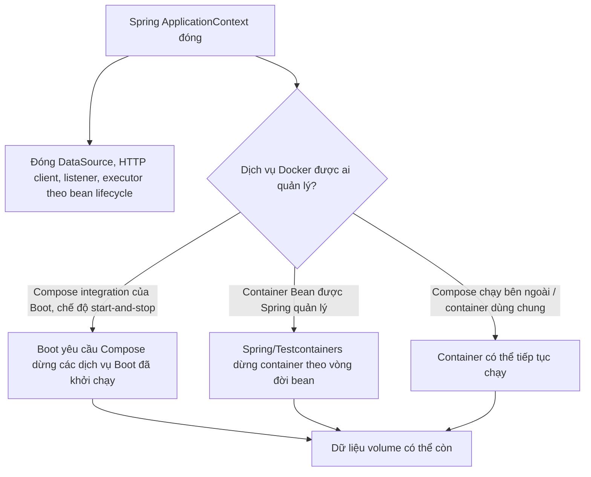
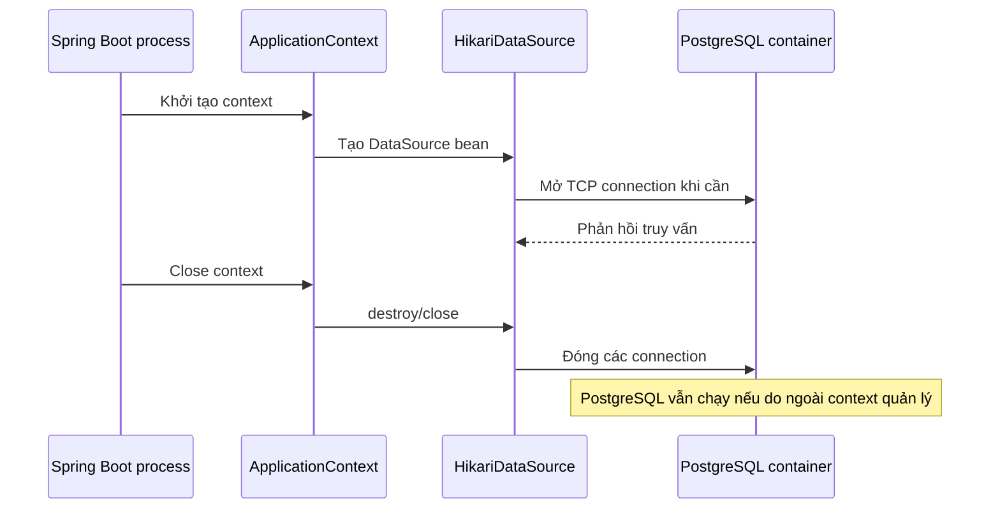
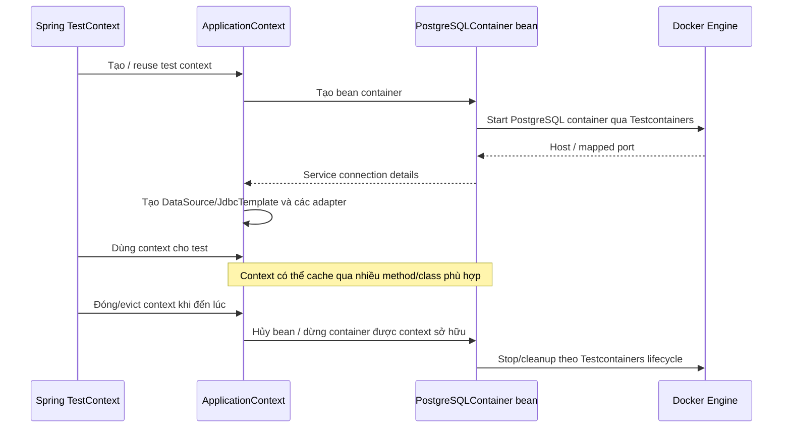
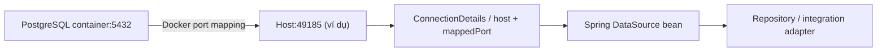
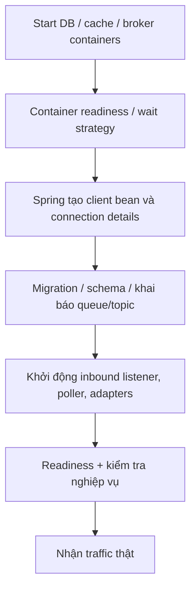

# Phân biệt vòng đời container với vòng đời ApplicationContext

## 1. Vì sao hai vòng đời thường bị nhầm?

Khi phát triển một ứng dụng **Spring Boot**, ta thường chạy PostgreSQL, Redis, RabbitMQ, Kafka hoặc một kho NoSQL trong Docker. Ứng dụng kết nối đến các dịch vụ này bằng `DataSource`, HTTP client, connection factory hoặc các adapter của Spring Integration. Mọi thứ có thể khởi động cùng một lệnh, tạo cảm giác **container Docker** và **Spring `ApplicationContext`** là một thực thể có cùng vòng đời.

Thực tế, chúng quản lý những đối tượng và tài nguyên khác nhau:

- **Container** là một đơn vị chạy do Docker/container runtime quản lý. Nó có tiến trình, network, filesystem, volume, health status và chính sách dừng/xóa riêng.
- **`ApplicationContext`** là container quản lý bean của **Spring**: khởi tạo configuration, dependency injection, HTTP client, `DataSource`, listener, scheduler, adapter và callback hủy bean khi context đóng. Từ “container” trong Spring IoC **không phải** Docker container.
- **Dữ liệu và các tài nguyên ngoài process** có thể tồn tại lâu hơn cả hai: Docker volume, database schema, broker topic, queue, object storage, message chưa được xử lý.

Bài này thuộc chương **Dịch vụ phát triển** của module **SPRING_BOOT_INTEGRATION**, tập trung vào kết nối HTTP client, cơ sở dữ liệu, cache, broker và adapter Spring Integration. Việc phân biệt vòng đời giúp tránh trạng thái connection cũ, container bị tắt khi context vẫn đang dùng, dữ liệu test bị nhiễm giữa các lần chạy và những kết luận sai về giao dịch, xử lý trùng lặp hoặc sức khỏe của luồng tích hợp.

Sau bài này, người học có thể:

1. Xác định ai sở hữu việc **start/stop** container: người dùng, Docker Compose integration của Boot, Testcontainers/JUnit hay Spring bean lifecycle.
2. Giải thích vì sao `ApplicationContext` khởi động/đóng **không** đồng nghĩa container sẽ khởi động/dừng trong mọi cấu hình.
3. Sử dụng `@ServiceConnection` để đưa thông tin kết nối từ dịch vụ phát triển vào Spring Boot mà vẫn hiểu rõ chủ sở hữu vòng đời.
4. Nhận ra tác động của Spring TestContext cache, `@DirtiesContext`, DevTools restart và Testcontainers reuse.
5. Thiết kế kiểm thử, dọn tài nguyên và quan sát đúng cho các luồng HTTP → database/cache → broker.

## 2. Ba phạm vi vòng đời cần tách biệt

| Phạm vi | Đối tượng và chủ sở hữu | Những chuyển trạng thái thường gặp | Cái gì có thể tồn tại sau khi đóng? |
|---|---|---|---|
| **Docker container** | Docker Engine, Compose project, Testcontainers hoặc script vận hành. | Created → Running → Stopped/Exited → Removed. | Image, volume và dữ liệu trên volume; container có thể vẫn tồn tại ở trạng thái stopped. |
| **Spring `ApplicationContext`** | Spring Boot/Spring Framework và vòng đời ứng dụng hoặc test context. | Created → Refresh/Started → Ready → Closing/Closed. | Dữ liệu đã commit ở dịch vụ ngoài; log, trace đã xuất; container ngoài Spring nếu chưa bị chủ sở hữu dừng. |
| **Trạng thái tích hợp** | Database/broker/cache/adapter và nghiệp vụ. | Accepted → Pending → Committed/Published/Failed tùy thiết kế. | Hàng đợi, dữ liệu bền vững, dedup key, pending outbox hoặc tác động ở downstream. |

Ví dụ một process Spring Boot kết thúc:



Hình trên mô tả các **cấu hình cụ thể**; không phải mọi cách khai báo `@Bean` hoặc mọi lệnh `docker compose up` đều tự tạo liên kết start/stop với Spring.

## 3. `ApplicationContext` tạo và hủy những gì?

Khi Spring Boot khởi động, nó xây dựng `ApplicationContext`, đọc cấu hình và đăng ký bean, thực hiện dependency injection, khởi tạo các tích hợp theo điều kiện, sau đó khởi động các thành phần có lifecycle phù hợp. Một ứng dụng tích hợp có thể có:

- `DataSource` và connection pool (ví dụ HikariCP) trỏ đến PostgreSQL trong Docker.
- `RedisConnectionFactory` và Redis client trỏ đến Redis container.
- `RabbitConnectionFactory` hoặc Kafka client trỏ đến broker container.
- `RestClient`, `WebClient` hoặc adapter HTTP gọi dịch vụ khác.
- `IntegrationFlow`, inbound adapter, message listener container, poller, scheduler, executor và transaction manager.

Khi context đóng đúng quy trình, Spring gọi các lifecycle callback tương ứng (chẳng hạn `stop()` với các thành phần lifecycle thích hợp, `@PreDestroy` hoặc destroy method của bean). Nó có thể đóng **socket, thread, consumer và client pool** nhưng không mặc định yêu cầu PostgreSQL, Redis hay Kafka ở ngoài process tự tắt.

Ví dụ:



**Điểm then chốt:** “database connection bị đóng” và “database container bị dừng” là hai sự kiện khác nhau. Một context mới có thể kết nối lại vào chính container/dữ liệu cũ, hoặc vào container mới với port/credential khác, tùy cơ chế quản lý dịch vụ.

### Bean được quản lý không đồng nghĩa Docker container được quản lý

Một `@Bean RedisConnectionFactory` tạo **client kết nối đến Redis**; hủy bean thường dừng client/tài nguyên liên quan. Redis server trong Docker không phải đối tượng mà bean này tự sở hữu. Ngược lại, một bean có kiểu `PostgreSQLContainer<?>` do Spring Boot Testcontainers integration quản lý có thể kéo theo start/stop **container thật**, vì bean đó đại diện trực tiếp cho Testcontainers container.

Đừng suy vòng đời từ tên kiểu “container” mà không xem bean là **client, adapter, listener** hay **Testcontainers container**.

## 4. Ai quản lý start/stop trong từng mô hình?

| Mô hình | Ai khởi động container? | Ai thường dừng container? | Quan hệ với `ApplicationContext` |
|---|---|---|---|
| `docker run` hoặc `docker compose up -d` do developer tự chạy | Developer/CI/script hạ tầng. | Developer/CI/script hạ tầng. | Context chỉ kết nối; có thể tạo/đóng lại nhiều lần trong khi container chạy liên tục. |
| Spring Boot **Docker Compose support**, chế độ `start-and-stop` | Boot gọi Compose khi ứng dụng khởi động nếu dịch vụ chưa chạy theo quy tắc hỗ trợ. | Boot gọi Compose stop khi ứng dụng dừng, đối với dịch vụ mà Boot quản lý khởi động. | Vòng đời Compose được gắn với **lifecycle của ứng dụng**, nhưng đó vẫn là các process Docker độc lập. |
| Spring Boot Docker Compose `start-only` | Boot có thể khởi động dịch vụ khi cần. | Boot không tự dừng khi ứng dụng tắt. | Hữu ích khi muốn giữ dịch vụ qua các lần restart ứng dụng. |
| Spring Boot Docker Compose `none` | Boot không quản lý start/stop. | Chủ sở hữu bên ngoài. | Có thể tận dụng thông tin kết nối mà không cần Boot điều khiển vòng đời; cần dịch vụ chạy sẵn. |
| Testcontainers với JUnit `@Testcontainers` + `@Container` | JUnit Testcontainers extension. | Theo lifecycle test class/instance mà extension quản lý. | Context test có cache riêng; container có thể dừng trong khi context được cache vẫn còn. |
| Testcontainers được khai báo bằng `@Bean` trong test config và quản lý bởi Boot | Spring Boot/Testcontainers lifecycle integration. | Gắn với lifecycle của bean/context tương ứng. | Phù hợp khi muốn container sống cùng context test. |
| Testcontainers chạy bằng mã thủ công `start()` | Mã gọi `start()` hoặc một tiến trình khác. | Mã gọi `stop()`/cleanup theo cách thiết kế. | Không tự suy được mối liên hệ với context nếu không được cấu hình. |

**Cần nhớ:** Docker Compose có thể tìm thấy dịch vụ đã chạy **trước khi** Boot khởi động. Trong cơ chế hỗ trợ thông thường, Boot không nhận quyền sở hữu để tự dừng những dịch vụ đang chạy sẵn đó. Kiểm tra log, Compose project và phiên bản Boot thay vì giả định mọi service liên quan sẽ dừng cùng ứng dụng.

Khi đánh giá một setup, luôn trả lời: **Ai tạo? Ai start? Ai stop? Ai xóa? Ai giữ volume?** Năm câu hỏi này thường có năm câu trả lời khác nhau.

## 5. Ví dụ A — Docker Compose support của Spring Boot

Với Spring Boot 3.1+ và Docker Compose tương thích, ta có thể bổ sung hỗ trợ phát hiện dịch vụ phát triển:

```kotlin
dependencies {
    implementation("org.springframework.boot:spring-boot-starter-data-jpa")
    implementation("org.springframework.boot:spring-boot-starter-data-redis")
    runtimeOnly("org.postgresql:postgresql")
    developmentOnly("org.springframework.boot:spring-boot-docker-compose")
}
```

Ví dụ một file `compose.yaml` ở thư mục dự án:

```yaml
services:
  postgres:
    image: postgres:16-alpine
    environment:
      POSTGRES_DB: integration_dev
      POSTGRES_USER: integration
      POSTGRES_PASSWORD: dev_only_change_me
    ports:
      - "5432"
    volumes:
      - pg_dev_data:/var/lib/postgresql/data
    healthcheck:
      test: ["CMD-SHELL", "pg_isready -U integration -d integration_dev"]
      interval: 5s
      timeout: 3s
      retries: 10

  redis:
    image: redis:7-alpine
    ports:
      - "6379"

volumes:
  pg_dev_data:
```

Trong Docker Compose, `"5432"` hoặc `"6379"` ở danh sách `ports` minh họa việc **publish cổng container lên một host port được chọn**. Đây không phải dạng `"5432:5432"` cố định host port; hãy dùng `docker compose ps` để quan sát mapping thực. Redis trong ví dụ chỉ dùng cho máy phát triển cô lập, không có cấu hình xác thực và tuyệt đối không nên mở cổng này ra Internet.

Ứng dụng có thể chọn rõ lifecycle:

```yaml
spring:
  docker:
    compose:
      enabled: true
      file: ./compose.yaml
      lifecycle-management: start-and-stop
```

Khi Compose integration nhận diện image dịch vụ được hỗ trợ và container có port phù hợp, Spring Boot có thể tạo **`ConnectionDetails`** cho PostgreSQL và Redis từ thông tin host/port do Docker công bố. Auto-configuration của DataSource/Redis client dùng các chi tiết này. Điều đó giúp tránh hard-code cổng host ngẫu nhiên.

Một vài giới hạn quan trọng:

1. **Boot chỉ hỗ trợ các loại dịch vụ/nhãn được nhận diện** bởi phiên bản đang dùng. Một image hoặc adapter tự viết không tự có service connection.
2. **Connection details không phải dữ liệu hay migration.** Tạo được `DataSource` không đồng nghĩa schema PostgreSQL hoặc key Redis đã được chuẩn bị.
3. **Quy tắc precedence của `ConnectionDetails`** có thể khiến một URL cấu hình tĩnh không phải URL thực tế client dùng. Cần kiểm tra host/port đã inject và nguồn connection details.
4. **Container khỏe** không chứng minh nghiệp vụ khỏe. Một PostgreSQL đã đáp ứng health check vẫn có thể thiếu schema hoặc quyền ghi.
5. **Volume còn lại** sau `docker compose stop`. Với `pg_dev_data` trong ví dụ, data có thể được dùng lại ở lần chạy tiếp; dừng container không làm mất dữ liệu volume.

### Trường hợp Compose đang chạy trước

Giả sử developer tự chạy `docker compose up -d`, sau đó mới khởi động ứng dụng Spring Boot. Khi Boot phát hiện services đang hoạt động, nó có thể kết nối vào dịch vụ hiện có mà không tự start/stop chúng. Sau khi Spring Boot tắt:

- `ApplicationContext` được đóng, connection pool và các adapter phía ứng dụng dừng.
- Compose service vốn chạy từ trước có thể **tiếp tục chạy**.
- PostgreSQL trong ví dụ vẫn giữ data trên named volume.

Điều này không phải leak nếu chủ sở hữu vòng đời được xác định là **developer hoặc môi trường**. Ngược lại, nếu CI yêu cầu môi trường sạch, script CI phải sở hữu riêng bước cleanup.

### Phân biệt `stop` với `down`

`docker compose stop` dừng các container đang chạy và giữ chúng để có thể start lại. `docker compose down` thường dừng rồi **xóa các container và network của project**; volume có tên không tự bị xóa chỉ bởi `down` trừ khi yêu cầu thêm xóa volume. Không được dùng `down -v` tùy tiện trên dữ liệu phát triển còn cần giữ.

Ứng dụng Spring Boot Docker Compose lifecycle có cơ chế gọi lệnh được định nghĩa theo cấu hình của nó; không được suy rằng “đóng context” luôn tương đương `docker compose down -v`.

## 6. Ví dụ B — Testcontainers theo vòng đời Spring test context

Spring Boot có tích hợp **Testcontainers** để test với PostgreSQL, Redis hoặc broker thật trong container. Khi chọn khai báo container bằng bean trong test configuration, vòng đời container có thể được quản lý phù hợp với `ApplicationContext`.

Dependency minh họa cho ứng dụng Spring Boot 3.1+:

```kotlin
dependencies {
    testImplementation("org.springframework.boot:spring-boot-starter-test")
    testImplementation("org.springframework.boot:spring-boot-testcontainers")
    testImplementation("org.testcontainers:junit-jupiter")
    testImplementation("org.testcontainers:postgresql")
}
```

Khai báo container thành bean trong test source:

```java
import org.springframework.boot.test.context.TestConfiguration;
import org.springframework.boot.testcontainers.service.connection.ServiceConnection;
import org.springframework.context.annotation.Bean;
import org.testcontainers.containers.PostgreSQLContainer;

@TestConfiguration(proxyBeanMethods = false)
class IntegrationContainersConfiguration {

    @Bean
    @ServiceConnection
    PostgreSQLContainer<?> postgresContainer() {
        return new PostgreSQLContainer<>("postgres:16-alpine")
                .withDatabaseName("integration_test")
                .withUsername("integration")
                .withPassword("test_password");
    }
}
```

Áp dụng vào integration test:

```java
import org.junit.jupiter.api.Test;
import org.springframework.beans.factory.annotation.Autowired;
import org.springframework.boot.test.context.SpringBootTest;
import org.springframework.context.annotation.Import;
import org.springframework.jdbc.core.JdbcTemplate;

import static org.assertj.core.api.Assertions.assertThat;

@SpringBootTest
@Import(IntegrationContainersConfiguration.class)
class OrderRepositoryIntegrationTest {

    @Autowired
    JdbcTemplate jdbcTemplate;

    @Test
    void databaseIsReachable() {
        Integer one = jdbcTemplate.queryForObject("select 1", Integer.class);
        assertThat(one).isEqualTo(1);
    }
}
```

Ví dụ giả định ứng dụng có JDBC/JPA starter thích hợp và schema được quản lý bởi migration hoặc test setup. Bean `PostgreSQLContainer<?>` đại diện **container Testcontainers**, còn `JdbcTemplate` và `DataSource` là **bean client** sử dụng dịch vụ đó. Trong chế độ Boot hỗ trợ, `@ServiceConnection` tạo connection details cho auto-configuration của PostgreSQL; nó **không tự sinh schema** hoặc làm tất cả kiểm thử trở nên độc lập dữ liệu.

**Vòng đời trong thiết kế này** có thể hiểu như sau:



Với container bean được Boot quản lý theo `ApplicationContext`, khởi tạo context và dừng context có liên hệ đến start/stop container tương ứng. Tuy nhiên, chi tiết thứ tự lifecycle phải theo phiên bản Boot/Testcontainers. Không đồng nhất sự kiện “test method kết thúc” với “context đóng”: Spring TestContext có cơ chế **cache context**, nên container cũng có thể còn chạy giữa các test dùng chung context.

### `@ServiceConnection` giải quyết phần nào?

`@ServiceConnection` giúp Spring Boot suy ra connection details phù hợp với loại container đã được hỗ trợ, ví dụ JDBC URL, username, password hoặc các cấu hình client cần thiết; nó **không** cung cấp transaction phân tán, migration, broker topic, quyền truy cập nghiệp vụ hay cleanup dữ liệu test.

Với `GenericContainer<?>`, việc Boot không biết loại dịch vụ từ kiểu Java có thể yêu cầu khai báo tên dịch vụ rõ ràng (ví dụ `@ServiceConnection(name = "redis")`), tùy image/loại kết nối và phiên bản Boot. Nếu không có ConnectionDetails factory phù hợp, tự cấu hình client/adapter bằng host và mapped port của container.

## 7. Ví dụ C — `@Container` của JUnit và bẫy cache context

Một cấu hình Testcontainers khác dùng JUnit Jupiter extension:

```java
import org.junit.jupiter.api.Test;
import org.springframework.boot.test.context.SpringBootTest;
import org.springframework.boot.testcontainers.service.connection.ServiceConnection;
import org.testcontainers.containers.PostgreSQLContainer;
import org.testcontainers.junit.jupiter.Container;
import org.testcontainers.junit.jupiter.Testcontainers;

@Testcontainers
@SpringBootTest
class PaymentRepositoryTest {

    @Container
    @ServiceConnection
    static PostgreSQLContainer<?> postgres =
            new PostgreSQLContainer<>("postgres:16-alpine");

    @Test
    void testRepositoryBehavior() {
        // Thử repository/transaction của ứng dụng.
    }
}
```

Ở đây **JUnit extension** quản lý `@Container` static theo lifecycle của **test class**. `ApplicationContext` lại được Spring TestContext cache để tái sử dụng giữa các test class có cùng cache key.

Rủi ro thường gặp:

1. Test class A chạy, JUnit start PostgreSQL container; Spring context được tạo và kết nối vào mapped port.
2. A kết thúc, JUnit dừng container static của class A.
3. Test class B được Spring tái sử dụng context từ cache, nhưng `DataSource` trong context có thể vẫn trỏ đến host/port của container đã dừng.
4. B gặp lỗi connection refused, timeout hoặc lỗi chỉ xảy ra khi chạy cả test suite, dù từng class chạy độc lập vẫn qua.

Đây không phải lỗi của JDBC hay Docker; đó là **hai chủ sở hữu vòng đời khác nhau**.

Khi cần cùng một context qua nhiều test class, cân nhắc **container bean gắn với context** hoặc thiết kế lại phạm vi cache/container. `@DirtiesContext` có thể ép evict một context khi cần cô lập trạng thái, nhưng dùng tràn lan làm test chậm, tạo container nhiều lần và không thay thế việc quản lý dữ liệu test đúng cách.

### Khi nào nên dùng từng cách?

| Nhu cầu | Cách thường hợp lý | Điều phải xác minh |
|---|---|---|
| Một test class cần service tạm thời | `@Testcontainers` + `@Container`. | Container sống đủ lâu cho context và test; cleanup sau class. |
| Nhiều test class reuse Spring context | `@Bean` container trong `@TestConfiguration` có tích hợp Spring Boot. | Container/context sharing, DB data isolation và test parallelism. |
| App chạy phát triển cục bộ với database bền vững | Docker Compose external hoặc Spring Boot Compose `start-only`. | Cơ chế giữ container/volume sau app restart. |
| CI cần môi trường cô lập mỗi job | Container test hoặc Compose trong job được cleanup có chủ sở hữu. | Không chia sẻ port/schema/volume ngoài ý muốn giữa job. |
| Test cần state sạch giữa method | Truncate/reset dữ liệu có kiểm soát, transaction rollback khi phù hợp, hoặc recreate environment. | Test không phụ thuộc thứ tự và không làm hỏng luồng async. |

## 8. Spring DevTools restart và sự thật về “khởi động lại”

Trong môi trường phát triển, DevTools có thể kích hoạt **application restart**, tức tạo lại lớp ứng dụng và context trong cùng JVM. Đây **không luôn là** restart Docker container, và khác với việc dừng hẳn JVM rồi chạy lại.

Các tình huống cần tách:

| Hành động | Spring context | Docker/container service |
|---|---|---|
| `ApplicationContext.close()` hoặc process tắt bình thường | Bean được hủy theo lifecycle của context. | Phụ thuộc chủ sở hữu: external Compose có thể vẫn chạy; context-managed Testcontainers bean có thể dừng; Boot Compose start-and-stop có thể dừng service nó sở hữu. |
| DevTools restart do đổi mã | Context ứng dụng được thay thế/restart; client bean thường được tạo lại. | Container có thể tồn tại qua restart nếu được giữ bằng scope/lifecycle phù hợp; không mặc định mọi container restart theo context. |
| `docker restart service` khi ứng dụng còn chạy | Spring context vẫn tồn tại. | Container restart, connection cũ có thể bị đóng, mapped port hay trạng thái service có thể thay đổi. |
| `@DirtiesContext` ở test | Context bị đóng và evict khỏi cache theo cấu hình. | Bean container do context quản lý có thể dừng; container do JUnit/external process quản lý có lifecycle khác. |
| Reuse Testcontainers hoặc dùng Compose external | Có thể đóng và tạo context mới. | Container có thể tiếp tục tồn tại; dữ liệu test/dev không tự reset. |

Khi dùng **development-time Testcontainers** và DevTools, Spring Boot có cơ chế như `@RestartScope` (ở phiên bản hỗ trợ) để một số bean container tồn tại qua các lần restart của ứng dụng trong quá trình phát triển. Chỉ dùng sau khi xác minh lifecycle thật bằng log/container ID và behavior của phiên bản đang chạy. Nếu giữ container lâu hơn context, client bean trong context mới vẫn cần kết nối lại bằng địa chỉ/port hiện tại.

**Hệ quả nghiệp vụ:** nếu container database được giữ qua DevTools restart, dữ liệu cũ còn đó. Một message adapter có thể nhận lại event chưa ack hoặc một outbox worker có thể xử lý job pending sau restart. Do đó idempotency phải dựa trên khóa và lưu trữ đủ bền, không dựa vào biến `static` hay cache bộ nhớ của context trước.

## 9. Testcontainers reuse không phải reset dữ liệu

Testcontainers có một số cơ chế tái sử dụng container giữa các lần chạy trong môi trường phát triển khi được bật rõ ràng và thỏa yêu cầu của phiên bản. Cần phân biệt:

- **Context caching:** Spring TestContext giữ `ApplicationContext` trong bộ nhớ process test để tránh dựng lại bean.
- **Container reuse:** Testcontainers/Docker có thể giữ container đã tạo để dùng lại theo cấu hình reuse tương ứng; không có nghĩa context cũ còn sống.
- **Named volume persistence:** dữ liệu có thể sống sót sau khi container dừng/xóa tùy cách mount và cleanup.
- **Docker image caching:** image được lưu trên Docker host nhưng không chứa transaction mới phát sinh trong container chạy, trừ khi chủ động lưu thành image/volume.

Không nên bật reuse một cách tùy tiện cho CI hoặc các bài test cần cô lập nghiêm ngặt. Một test sử dụng lại PostgreSQL container với `orders` còn từ lần chạy trước có thể pass sai hoặc fail do khóa trùng. Tương tự, queue RabbitMQ chưa consume hết hoặc Redis key TTL chưa hết có thể làm flow báo duplicate không dự đoán được.

Mỗi test cần định nghĩa dữ liệu bắt đầu và dọn dẹp bằng migration/fixture/reset phù hợp. **Container còn chạy** là điều kiện hạ tầng; **trạng thái nghiệp vụ sạch và hợp lệ** là điều kiện kiểm thử khác.

## 10. ConnectionDetails, mapped port và khả năng reconnect

Các container phát triển thường lộ ra cổng host **được map động**. Một PostgreSQL lắng nghe `5432` bên trong container có thể được publish thành `localhost:49185` ở máy phát triển. Nếu Spring context mới tiếp tục dùng JDBC URL `localhost:5432` đã hard-code, nó có thể kết nối sai service hoặc thất bại.



Những điều cần kiểm chứng:

1. **Nguồn connection details:** từ Spring Boot Docker Compose, `@ServiceConnection`, `@DynamicPropertySource`, cấu hình env/property hay khai báo bean thủ công?
2. **Thời điểm resolve:** container đã start và có mapped port trước khi client cần kết nối chưa?
3. **Tính ổn định:** container restart/replace có thay đổi mapped port, credential hoặc endpoint không? Client pool đã tạo có cần được dựng lại không?
4. **Nhiều context:** mỗi context/test có đang kết nối đến đúng instance/container của mình không?
5. **Bảo mật:** tự tạo kết nối bằng URI không đồng nghĩa kết nối có TLS, authentication hoặc quyền cần thiết.

Với Testcontainers, không lấy container IP/port nội bộ và dùng như thể client chạy ở cùng Docker network nếu ứng dụng đang chạy trên host. Hãy dùng API `getHost()` và `getMappedPort(...)` của container khi tự wiring, hoặc dùng `ConnectionDetails` được Spring Boot hỗ trợ.

Khi container bị restart từ bên ngoài trong lúc application còn chạy, JDBC pool/Redis client/broker consumer có thể giữ connection đã hỏng. Cần cấu hình timeout, reconnect/retry theo semantics client cụ thể và bảo đảm các nghiệp vụ retry **idempotent**. Spring không tự phục hồi đúng mọi tác động ở downstream chỉ vì endpoint đã hoạt động lại.

## 11. Trình tự khởi động và sẵn sàng phục vụ

Một flow tích hợp thường cần nhiều chặng sẵn sàng: database nhận connection, schema có hiệu lực, broker khai báo topic/queue, adapter đăng ký listener và service HTTP được bật readiness.

| Mốc | Thí dụ | Vì sao chưa đủ |
|---|---|---|
| Container `running` | Docker process tồn tại. | Server trong container có thể vẫn bootstrap hoặc trả lỗi. |
| Docker health check `healthy` | PostgreSQL `pg_isready` trả OK. | Chưa chứng minh schema, permission, migration hoặc transaction thực tế phù hợp. |
| Client bean tạo thành công | `DataSource`/`RabbitTemplate` tồn tại trong Spring. | Kết nối có thể lazy; downstream lỗi khi request đầu tiên. |
| `ApplicationContext` refreshed | Spring đã khởi tạo các bean không bị lỗi bắt buộc. | Listener có thể chưa bắt kịp dữ liệu hoặc hạ tầng chưa phục vụ đầy đủ nghiệp vụ. |
| Actuator readiness có trạng thái phục vụ | Ứng dụng công bố sẵn sàng theo cấu hình probe/health. | Mức bảo đảm phụ thuộc health indicator và dependency được kiểm tra; không chứng minh end-to-end. |
| Integration test end-to-end pass | Request → DB/cache/broker có tác động mong đợi. | Chỉ áp dụng cho tình huống và workload đã kiểm; vẫn cần kiểm tra lỗi, redelivery, tải. |

Spring Boot Compose support có thể đợi container “sẵn sàng” theo cơ chế hỗ trợ trước khi cấu hình kết nối; Testcontainers có **wait strategy** của riêng mình. Một wait strategy như “port đang mở” không thay thế lệnh chuẩn bị schema hoặc cơ chế migration.

Tổ chức flow hợp lý:



Đây là **trình tự mục tiêu cần thiết kế**, không phải bảo đảm Boot sẽ tự thực hiện mọi bước theo thứ tự đó. Trong một số ứng dụng, listener có thể bắt đầu ngay trong quá trình context refresh; khi đó phải cấu hình phụ thuộc startup, retry hoặc cơ chế tạm dừng nhận traffic phù hợp.

## 12. Vòng đời container tác động thế nào đến transaction và message?

Một container tồn tại lâu hơn context không làm side effect nghiệp vụ biến mất. Giả sử flow xử lý đơn hàng:

```text
HTTP request
    -> ghi order trong PostgreSQL
    -> ghi outbox event trong cùng DB transaction
    -> worker publish tới RabbitMQ
    -> consumer cập nhật read model/Redis cache
```

Nếu Spring context dừng sau khi transaction PostgreSQL commit nhưng trước khi publish RabbitMQ:

- Database container còn chạy và transaction **đã commit**; đóng context không rollback giao dịch đã commit.
- Outbox record còn lại để worker khởi động sau tiếp tục xử lý, **nếu lưu bền vững và thiết kế đúng**.
- Broker container có thể đang chạy hoặc dừng; việc broker đang chạy không chứng minh event đã publish.
- Restart worker có thể đọc lại một message chưa ack; cần idempotency key và consumer xử lý trùng.
- Redis cache có thể giữ giá trị cũ qua restart nếu container được giữ; cần invalidation/reconciliation.

Nếu đóng cả database container, dữ liệu có tồn tại tiếp hay không phụ thuộc persistence/volume và thao tác xóa. Một database test dùng filesystem tạm bên trong container bị remove có thể mất dữ liệu; database trên named volume có thể vẫn giữ.

**Vì vậy “restart ứng dụng”, “restart container” và “đặt lại nghiệp vụ về trạng thái ban đầu” là ba hành động độc lập.** Để có thử nghiệm có thể lặp lại, phải xác định chính xác trạng thái khởi đầu và cơ chế cleanup dữ liệu/queue/cache.

## 13. Kiểm thử vòng đời có chủ đích

### Bộ kịch bản tối thiểu

| Kịch bản | Thao tác | Kết luận cần chứng minh |
|---|---|---|
| **A. Context đóng, container external giữ nguyên** | Chạy Compose bên ngoài, start/close Spring context. | Client pool dừng; container và dữ liệu vẫn tồn tại; context mới kết nối lại được. |
| **B. Context-managed Testcontainers** | Tạo context có `@Bean` container, dùng DB, đóng/evict context. | Bean container khởi động cùng context và được cleanup khi context đóng theo cấu hình. |
| **C. JUnit class lifecycle khác cache** | Dùng `@Container` static ở nhiều class reuse context. | Phát hiện hoặc tránh trường hợp context còn cache nhưng container đã dừng. |
| **D. Container restart khi context đang chạy** | Restart một service phát triển trong môi trường test riêng. | Client nhận lỗi rõ; có khả năng reconnect theo thiết kế, không báo sai dữ liệu thành công. |
| **E. DevTools restart** | Chỉnh mã, để DevTools restart context. | Xác định container ID có giữ nguyên, client mới có dùng đúng endpoint và dữ liệu có còn. |
| **F. Persistence/volume** | Stop/start Compose rồi test truy vấn; lặp lại với môi trường thật sự sạch. | Phân biệt state còn nhờ volume với dữ liệu dựng mới từ migration/fixture. |
| **G. In-flight message** | Dừng context khi outbox/consumer đang xử lý. | Pending event được xử lý lại an toàn; không nhân đôi side effect sau restart. |

Khi test chia sẻ context, nên xác minh cả **container state** và **Spring bean state**:

```java
import static org.assertj.core.api.Assertions.assertThat;

import org.junit.jupiter.api.Test;
import org.springframework.beans.factory.annotation.Autowired;
import org.springframework.boot.test.context.SpringBootTest;
import org.springframework.context.annotation.Import;
import org.testcontainers.containers.PostgreSQLContainer;

@SpringBootTest
@Import(IntegrationContainersConfiguration.class)
class ContainerConnectionLifecycleTest {

    @Autowired
    PostgreSQLContainer<?> postgresContainer;

    @Test
    void springContextUsesRunningContainer() {
        assertThat(postgresContainer.isRunning()).isTrue();
        assertThat(postgresContainer.getMappedPort(5432)).isPositive();
    }
}
```

Đây là kiểm tra trạng thái ở **thời điểm test chạy**, không tự chứng minh cleanup sau context close. Muốn xác nhận dừng khi context bị evict, cần một test harness điều khiển lifecycle riêng và kiểm tra trước/sau close; không gọi `ApplicationContext.close()` tùy tiện bên trong test dùng context cache chung rồi làm hỏng các test sau. Không cần viết test chỉ để kiểm tra container chạy nếu test thật đã truy vấn DB thành công; mục tiêu là minh họa sự phân biệt các vòng đời.

### Tránh test phụ thuộc thứ tự

Một test ghi `order-001` vào PostgreSQL rồi không dọn có thể khiến test sau gặp unique conflict. Nếu dùng queue/broker, message còn từ test trước có thể bị xử lý khi listener của context mới khởi động. Vì thế nên sử dụng khóa event riêng cho test, rollback/cleanup dữ liệu khi phù hợp, purge queue có kiểm soát hoặc tạo environment cô lập. `@Transactional` trong method test không tự rollback những tác động bất đồng bộ bên ngoài transaction/test thread.

## 14. Quan sát và xử lý sự cố

Để biết một lỗi xuất phát từ lifecycle nào, cần thu thập tín hiệu theo ba phạm vi:

| Nơi đo | Tín hiệu gợi ý | Câu hỏi |
|---|---|---|
| **Docker/Compose/Testcontainers** | Container ID, state, health, restart count, logs, mapped ports, image tag, volume, Compose project. | Service có đang chạy? Có bị recreate hay đổi port? |
| **Spring ApplicationContext** | Startup/close events, bean creation/destroy, active profile, connection details, Actuator health/readiness, listener lifecycle. | Context nào đang tồn tại? Client bean kết nối đi đâu? |
| **Luồng tích hợp** | HTTP error rate, DB pool active/idle/pending, Redis timeout, broker lag, retry/DLQ, outbox age, event duplicate/conflict. | Nghiệp vụ đang hoàn thành hay bị kẹt? |

Ví dụ khi log xuất hiện `Connection refused` ngay sau DevTools restart:

1. Xác định container ID cũ có còn chạy không và host/mapped port hiện tại là gì.
2. Xác định Spring context mới có tạo client bean mới không, và URL/credentials đến từ nguồn nào.
3. Kiểm tra container bị stop/recreate bởi Compose integration, JUnit extension hay script ngoài.
4. Kiểm tra server trong container có healthy và schema/topic cần thiết đã sẵn sàng hay chưa.
5. Thử một truy vấn/round-trip vô hại, rồi kiểm tra retry/backlog và idempotency của adapter.

Nếu Docker container vẫn chạy nhưng application health DOWN, không kết luận Docker có lỗi. Có thể DataSource đang dùng port cũ, credential thay đổi, pool bị cạn hoặc migration thất bại. Ngược lại, `ApplicationContext` đã refresh không chứng minh broker hoặc cache đủ khỏe để xử lý tải.

### Các sự kiện Spring giúp chẩn đoán

Có thể quan sát thời điểm context đóng mà không cần điều khiển Docker:

```java
import org.springframework.context.event.ContextClosedEvent;
import org.springframework.context.event.EventListener;
import org.springframework.stereotype.Component;

@Component
class ContextShutdownLogger {

    @EventListener(ContextClosedEvent.class)
    public void onClosed(ContextClosedEvent event) {
        log.info("Spring ApplicationContext closing: id={}",
                event.getApplicationContext().getId());
    }
}
```

Sự kiện này cho biết Spring context đang đóng; **nó không chứng minh container Docker đã dừng**. Nếu cần xác nhận container stop, phải kiểm tra Docker/Testcontainers/Compose hoặc nguồn giám sát tương ứng. Tránh log secret, JDBC password hoặc đầy đủ connection URL có credential.

## 15. Những nhầm lẫn phổ biến

| Nhận định sai | Vấn đề thực tế | Cách hiểu và xử lý đúng |
|---|---|---|
| “Spring `ApplicationContext` đóng thì tất cả Docker container cũng dừng.” | Container do người dùng/CI start vẫn tồn tại. | Tra chủ sở hữu start/stop; Spring mặc định hủy client bean, không điều khiển tất cả external service. |
| “`@ServiceConnection` tự quản lý mọi vòng đời Docker.” | Annotation chủ yếu cung cấp connection details theo tích hợp hỗ trợ. | Xem container được quản lý bởi Boot bean, JUnit extension hay external process. |
| “Kết thúc một `@Test` thì Spring context đóng.” | Spring TestContext có cache, bean/container có thể còn giữa các test. | Hiểu context cache key và `@DirtiesContext` khi cần. |
| “`@Container` static có cùng lifecycle với cache context.” | JUnit có thể stop container khi class kết thúc trong khi context vẫn còn. | Dùng context-managed container hoặc thiết kế lại phạm vi context/container. |
| “Container `running` là đã sẵn sàng giao dịch.” | Database chưa migrate, broker chưa có topic/queue, quyền chưa đúng. | Kiểm tra readiness và thao tác nghiệp vụ thật. |
| “`docker compose stop` xóa luôn dữ liệu.” | Named volume vẫn giữ dữ liệu. | Kiểm tra volume và semantics stop/down/reset. |
| “Restart DevTools sẽ làm sạch Redis, queue và DB.” | Các dịch vụ ngoài context vẫn giữ trạng thái. | Chủ động quản lý dữ liệu test và idempotency. |
| “Container restart không ảnh hưởng các bean đang tồn tại.” | Connection pool có thể giữ socket cũ, mapped port có thể đổi. | Tái xác lập client/connection details và kiểm tra reconnect. |
| “Chỉ cần test endpoint 200 là vòng đời toàn flow đúng.” | Broker có thể chưa ack, outbox pending, cache chưa đồng bộ. | Kiểm thử trạng thái cuối và failure/restart path. |
| “Dùng Testcontainers reuse thì test lúc nào cũng sạch.” | Dữ liệu và queue từ test trước có thể còn. | Tạo fixture/reset rõ ràng hoặc dùng môi trường độc lập. |

## 16. Checklist trước khi triển khai workflow phát triển

- [ ] Xác định **chủ sở hữu start, stop, remove, volume** của từng PostgreSQL/Redis/broker container.
- [ ] Biết context nào tạo `DataSource`, client, listener, poller và lúc nào chúng được close.
- [ ] Chọn một cơ chế quản lý phù hợp: Compose external, Spring Boot Docker Compose support, Testcontainers JUnit hoặc Testcontainers bean.
- [ ] Xác minh `@ServiceConnection`/`ConnectionDetails`, loại service được hỗ trợ và host/mapped port thực tế.
- [ ] Không hard-code cổng động hoặc dựa vào IP nội bộ container khi ứng dụng chạy trên host.
- [ ] Định nghĩa readiness từ container health đến migration/topic/queue và phép xử lý nghiệp vụ.
- [ ] Kiểm soát Spring TestContext cache, `@DirtiesContext`, `@Container` static và container bean để tránh lifetime mismatch.
- [ ] Kiểm tra DevTools restart, cách giữ/khởi động lại container và việc client được kết nối lại.
- [ ] Thiết kế cô lập dữ liệu test, volume lifecycle, queue cleanup và Testcontainers reuse nếu sử dụng.
- [ ] Kiểm thử lúc container bị stop/restart trong khi context còn sống, bảo đảm timeout/retry và error mapping đúng.
- [ ] Dùng idempotency, outbox và ack semantics thích hợp cho message đang xử lý khi context đóng/restart.
- [ ] Theo dõi cả Docker state, Spring context lifecycle và metric nghiệp vụ; không coi một tín hiệu là đại diện cho tất cả.

**Ghi nhớ:** Docker container cung cấp **dịch vụ đang chạy**; Spring `ApplicationContext` cung cấp **các bean và adapter sử dụng dịch vụ đó**. Chúng chỉ có quan hệ start/stop trực tiếp khi cách tích hợp được chọn thiết lập quan hệ ấy. Dữ liệu database, queue và side effect có thể sống lâu hơn cả hai, nên mỗi luồng tích hợp thực tế phải quản lý cấu hình, kết nối, trạng thái, lỗi và khôi phục theo đúng ranh giới vòng đời.
