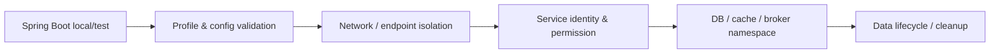
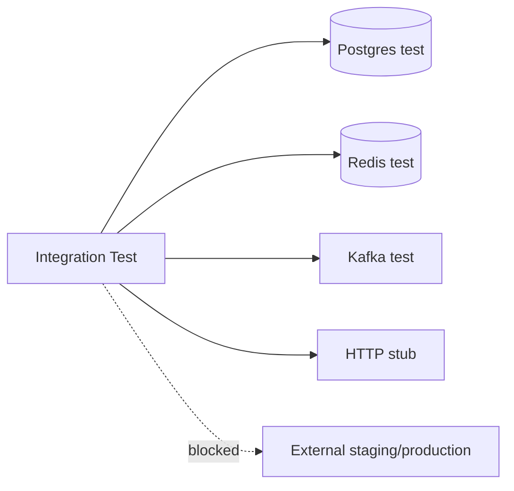

# Cô lập dữ liệu, volume và thông tin bí mật giữa các môi trường

## 1. Vấn đề: dịch vụ phát triển có thể chạm vào dữ liệu thật

Trong module **SPRING_BOOT_INTEGRATION**, Spring Boot thường kết nối đồng thời đến nhiều hệ thống: HTTP API, cơ sở dữ liệu, Redis, Kafka/RabbitMQ và các adapter của Spring Integration. Khi phát triển, những thành phần này có thể chạy bằng Docker Compose, Testcontainers hoặc tài nguyên dùng chung của nhóm. Một cấu hình sai đôi khi không làm ứng dụng khởi động thất bại; nó **kết nối thành công tới nhầm môi trường** và bắt đầu đọc, sửa, xóa dữ liệu thật.

Ví dụ, developer khởi động `order-service` ở máy cá nhân, nhưng biến môi trường `SPRING_DATASOURCE_URL` vẫn trỏ tới database staging. Job `@Scheduled` tiếp tục quét outbox, đẩy sự kiện lên Kafka staging; consumer khác lại xử lý những sự kiện thử nghiệm như nghiệp vụ thật. Dù mọi kết nối đều sử dụng TLS và credential hợp lệ, ranh giới môi trường đã bị phá vỡ.

Một hệ thống phát triển tốt cần cô lập đồng thời:

1. **Dữ liệu và tác động nghiệp vụ:** không cho phép dữ liệu test đi vào production, cũng không dùng dữ liệu production trực tiếp cho bài kiểm thử.
2. **Không gian lưu trữ:** volume, database, schema, bucket, topic, queue và key namespace không dùng chung ngoài chủ đích.
3. **Danh tính và bí mật:** credential, token, chứng chỉ, tài khoản dịch vụ thuộc từng môi trường, với quyền tối thiểu.
4. **Đường kết nối và vòng đời:** DNS, network, URL, profile, container lifecycle và cơ chế dọn dẹp được giới hạn rõ ràng.

Mục tiêu là khi một thành phần phát triển bị lỗi, bị dọn dẹp hoặc bị khai thác, tác động của nó nằm trong phạm vi phát triển được phép.

## 2. Hiểu đúng các mức cô lập

### 2.1. Phân chia môi trường

| Môi trường | Dữ liệu | Dịch vụ phụ trợ | Credential | Vòng đời |
| --- | --- | --- | --- | --- |
| Local development | Dữ liệu giả/làm sạch, có thể reset | Compose, dịch vụ cục bộ hoặc giả lập | Secret dành riêng local, quyền hẹp | Có thể giữ volume dev nhưng phải reset có kiểm soát |
| Automated integration test | Dữ liệu kiểm thử tạo riêng cho mỗi lượt chạy | Testcontainers hoặc dịch vụ test độc lập | Credential dùng một lần/ngắn hạn | Tạo mới và thu hồi, tránh lây trạng thái giữa test |
| Shared development | Dữ liệu thử của nhóm; phân định người/nhánh nếu cùng dùng | Cluster/sandbox chia sẻ theo namespace | Identity riêng cho ứng dụng/nhóm | Có quota, TTL, chính sách cleanup |
| Staging/UAT | Dữ liệu tổng hợp hoặc bản đã ẩn danh theo chính sách | Hạ tầng gần production | Secret và account staging, không dùng prod | Triển khai/khôi phục có kiểm soát |
| Production | Dữ liệu thật | Hạ tầng vận hành thật | Identity production riêng, quản lý tập trung | Backup/retention/audit và kiểm soát thay đổi nghiêm ngặt |

**Tách tên môi trường không đồng nghĩa với cô lập thực tế.** Hai Spring profile khác nhau nhưng cùng JDBC URL, cùng Kafka cluster và chung password vẫn có khả năng ảnh hưởng cùng dữ liệu. Tương tự, thêm prefix `test_` vào tên bảng không đủ nếu tài khoản test vẫn có quyền sửa bảng production.

### 2.2. Mô hình lớp bảo vệ



Các lớp này có chức năng khác nhau:

- **Spring profile** chọn cấu hình; không tự tạo network hoặc rào chắn quyền.
- **Docker Compose project** phân nhóm tên container, network và volume được Compose quản lý; không phải biên giới bảo mật giữa các tenant trên một Docker daemon.
- **Testcontainers** giúp tạo dịch vụ test với vòng đời được quản lý; không được dùng như bằng chứng rằng test chắc chắn không truy cập production nếu cấu hình bên ngoài vẫn trỏ về production.
- **IAM/ACL/GRANT** giới hạn quyền của tài khoản; chúng phải được thực thi ở hệ thống đích.
- **Network policy/egress** chặn kết nối ngoài phạm vi; cần đồng hành với kiểm tra identity và resource.

## 3. Nguy cơ phổ biến ở từng loại tài nguyên

| Tài nguyên | Kiểu dùng chung nguy hiểm | Biện pháp cô lập |
| --- | --- | --- |
| PostgreSQL/MySQL | Cùng database/user cho local và staging | Instance/database độc lập, role riêng, kiểm tra endpoint và identity |
| Redis | Khác prefix nhưng credential có quyền `FLUSHALL` / mọi key | Instance hoặc logical namespace được ACL thực thi; với dữ liệu nhạy cảm ưu tiên instance riêng |
| Kafka | Khác topic prefix nhưng chung account quản trị | Cluster hoặc topic/group namespace riêng, ACL theo principal, kiểm soát consumer offset |
| RabbitMQ | Chung vhost, queue và user | Vhost/queue/exchange riêng, quyền `configure/write/read` tối thiểu |
| Object storage/SFTP | Cùng bucket/thư mục nguồn, test tự xóa file | Bucket hoặc prefix và identity riêng; kiểm tra đường dẫn, chính sách xóa |
| HTTP API | Token test nhưng URL thật, hoặc token production bị dùng ở local | Sandbox endpoint, token đúng audience/scope, allowlist host và TLS |
| Docker volume | Dùng `external: true` hoặc tên volume cố định toàn máy | Named volume riêng project/test, không gắn nhầm volume chứa dữ liệu thật |
| Secret manager | Một workload đọc được secret của tất cả môi trường | Namespace/project/policy riêng, secret injection và audit theo workload |

**Đặc biệt với Redis:** Chỉ đổi số database logic (`SELECT 0`, `SELECT 1`) không tạo biên giới bảo mật mạnh, và một số chế độ cluster không hỗ trợ chọn database logic theo cách đó. Khi cần cô lập môi trường, dùng instance/ACL/credential tách biệt thay vì dựa duy nhất vào DB index.

## 4. Docker Compose: phân tách project, network và volume

### 4.1. Một Compose project phát triển mẫu

Ví dụ sau tạo PostgreSQL lưu dữ liệu bằng volume riêng và Redis dành cho dữ liệu giả tại máy phát triển. PostgreSQL đọc mật khẩu từ file secret cục bộ; không có mật khẩu thật trong YAML.

```yaml
# compose.yaml, ví dụ chỉ cho local development
services:
  postgres:
    image: postgres:17
    environment:
      POSTGRES_DB: integration_dev
      POSTGRES_USER: integration_dev
      POSTGRES_PASSWORD_FILE: /run/secrets/pg_password
    secrets:
      - pg_password
    volumes:
      - postgres_data:/var/lib/postgresql/data
    ports:
      - "127.0.0.1:15432:5432"
    healthcheck:
      test: ["CMD-SHELL", "pg_isready -U integration_dev -d integration_dev"]
      interval: 5s
      timeout: 3s
      retries: 12

  redis:
    image: redis:7-alpine
    # Chỉ dùng dữ liệu giả; không bật persistence cho ví dụ Redis local.
    command: ["redis-server", "--save", "", "--appendonly", "no"]
    ports:
      - "127.0.0.1:16379:6379"

volumes:
  postgres_data:

secrets:
  pg_password:
    file: ./.local-secrets/postgres-password.txt
```

Trước khi khởi động, tạo file `.local-secrets/postgres-password.txt` với một mật khẩu **riêng cho môi trường local**, đặt quyền truy cập file phù hợp, thêm `.local-secrets/` vào quy tắc bỏ qua version control và secret scan. Ví dụ không cung cấp mật khẩu cụ thể để tránh người học sao chép credential mặc định vào môi trường thật.

Chạy một project độc lập theo tên xác định:

```bash
docker compose -p integration-dev up -d
docker compose -p integration-dev ps
```

Khi chạy song song nhiều project từ cùng một Compose file:

- Compose thường tạo network mặc định theo project, ví dụ `integration-dev_default`.
- Named volume `postgres_data` thường được đặt tên theo project, chẳng hạn `integration-dev_postgres_data`.
- Tên service DNS `postgres` có ý nghĩa **bên trong network Compose**. Ứng dụng chạy trực tiếp trên host dùng `127.0.0.1:15432` như ví dụ, không dùng hostname `postgres` trừ khi có cơ chế DNS thích hợp.
- Port được bind vào `127.0.0.1` để hạn chế việc mở dịch vụ từ máy khác. Đây là giới hạn giao diện host, không bảo đảm mọi container trên Docker host bị chặn truy cập cùng mạng.
- Hai project khác nhau nhưng cùng bind cổng `15432` trên một host sẽ xung đột; cần port/Compose profile riêng, host port tự cấp phát hoặc không publish port cho service chỉ dùng trong network nội bộ.

Tên project là thành phần **của định danh tài nguyên**, vì vậy nên chọn một quy ước rõ như `integration-dev-alice`, `integration-dev-bob`, `integration-ci-1234`. Tuy nhiên, Docker daemon và quyền dùng socket Docker có thể truy cập/quản lý nhiều project; để cô lập mạnh giữa các nhóm không tin cậy nhau, cần daemon/VM/runner riêng và kiểm soát truy cập ở hạ tầng.

### 4.2. Những cấu hình dễ vô tình dùng chung volume

```yaml
volumes:
  postgres_data:
    external: true
    name: shared_pg_data
```

Đây là **ví dụ nguy cơ**, không nên dùng trong Compose local nếu `shared_pg_data` có thể trỏ vào volume của project khác. `external: true` yêu cầu dùng tài nguyên đã có; tên rõ ràng như `name: shared_pg_data` bỏ qua phạm vi tên volume theo project. Tương tự, bind mount một đường dẫn tuyệt đối tới thư mục có dữ liệu môi trường khác có thể làm hai container thao tác chung dữ liệu.

Kiểm tra định danh volume và project **trước khi cleanup**. Lệnh dạng:

```bash
# Chỉ là ví dụ minh họa cho project thử nghiệm đúng tên.
docker compose -p integration-dev down --volumes
```

có thể **xóa vĩnh viễn các named volume do project đó quản lý và anonymous volume liên quan**, mất dữ liệu local. Không chạy lệnh dọn volume theo thói quen trên project chứa dữ liệu cần giữ; kiểm tra tên project, mapping, backup và mục đích xóa. Volume external thường không bị xóa bằng `down --volumes`, nhưng việc sử dụng nó vẫn có nguy cơ đọc/ghi nhầm dữ liệu.

### 4.3. Secret của Compose không tự trở thành secret manager production

Phần `secrets` trên Compose giúp khai báo file secret để mount cho container được chỉ định. Nhưng file nguồn `.local-secrets/...` vẫn tồn tại trên host: người có quyền đọc file, truy cập Docker daemon hoặc điều khiển container có thể tiếp cận. Điều này phù hợp cho **local secret có phạm vi hẹp**, không tạo ra cùng mức bảo vệ như một hệ thống secret manager với audit, rotation và workload identity.

File secret của DB và credential client Spring Boot phải **khớp nhau** nhưng nên được cấp qua kênh được bảo vệ tương ứng. Đừng chép mật khẩu vào shell script commit để “đồng bộ” hai phía. Trong môi trường nhóm hoặc CI, dùng secret store/runner secret thay cho file chia sẻ qua Git.

## 5. Spring Boot profiles và cấu hình kết nối

### 5.1. Cấu hình mặc định chỉ chứa phần dùng chung

`application.yml` nên mô tả hành vi độc lập môi trường và không chứa URL production hoặc bí mật mặc định:

```yaml
spring:
  application:
    name: order-integration
  jpa:
    hibernate:
      ddl-auto: validate

integration:
  jobs:
    outbox-polling-enabled: false
```

Với dữ liệu tích hợp có tác động thật, việc để `ddl-auto: validate` làm mặc định giúp tránh tự sửa schema ngoài ý muốn; migration được quản lý bằng Flyway/Liquibase hoặc cơ chế triển khai riêng. Tùy ứng dụng, có thể không dùng JPA; ví dụ nhấn mạnh chính sách schema. `integration.jobs.outbox-polling-enabled` là **property tùy chỉnh**, cần được code ứng dụng đọc và thực thi; Spring Boot không tự hiểu property này.

`application-local.yml` dùng khi ứng dụng chạy **trên host** và Docker Compose publish cổng như ở trên:

```yaml
spring:
  config:
    activate:
      on-profile: local
  datasource:
    url: jdbc:postgresql://127.0.0.1:15432/integration_dev
    username: integration_dev
    password: ${LOCAL_DB_PASSWORD}
  data:
    redis:
      host: 127.0.0.1
      port: 16379
  docker:
    compose:
      enabled: false

integration:
  environment: local
  jobs:
    outbox-polling-enabled: false
```

`spring.docker.compose.enabled: false` trong profile này có nghĩa ví dụ **chủ động chạy Compose bằng CLI**, nên không yêu cầu Spring Boot tự quản lý container thêm lần nữa. Khi muốn dùng tích hợp Docker Compose của Spring Boot, cần cấu hình và kiểm thử vòng đời theo phiên bản Spring Boot đang dùng; Spring Boot có thể nhận diện service connection và thay thế một số thông tin kết nối tự cấu hình. Không giả định URL từ profile luôn là endpoint thực tế nếu có một cơ chế auto-configuration khác đang hoạt động.

Điểm cần lưu ý:

- `LOCAL_DB_PASSWORD` được cung cấp lúc chạy từ nguồn local được bảo vệ, cùng giá trị đã cấp cho Postgres qua file secret. Không đưa giá trị thật vào repository.
- Ứng dụng chạy **trong** network Compose thường dùng `jdbc:postgresql://postgres:5432/integration_dev` và `redis:6379`; không lấy địa chỉ host `127.0.0.1:15432` đưa vào container vì `localhost` lúc đó là chính container.
- `application-staging.yml` và `application-prod.yml` cần dùng connection/identity riêng, không sao chép secret local. Những file cấu hình có thể chứa tên biến hoặc tham chiếu secret, không chứa giá trị credential.
- Đừng để profile mặc định tự chọn production. Với cấu hình thiếu môi trường bắt buộc, **thất bại khi khởi động** thường an toàn hơn âm thầm kết nối một endpoint mặc định.

### 5.2. Property precedence có thể làm cấu hình khác với file đang nhìn

Spring Boot nhận cấu hình từ nhiều nguồn: file YAML, biến môi trường, system properties, command-line arguments, test properties và các nguồn cấu hình được import. Nguồn có độ ưu tiên cao có thể override `application-local.yml`; ví dụ một biến môi trường còn sót `SPRING_DATASOURCE_URL` có thể thay JDBC URL local.

Do đó, câu hỏi vận hành không chỉ là "**file YAML đang ghi gì?**" mà là "**giá trị có hiệu lực ở runtime đang trỏ đến đâu?**". Cần xác minh endpoint/identity đang sử dụng bằng công cụ được kiểm soát, không dump toàn bộ `Environment` hoặc `DataSource` vào log vì có thể làm lộ password/token.

Đối với tích hợp tự động, có thể tạo **startup guard** chỉ chấp nhận các target đã phê duyệt cho profile hiện hành, kết hợp giới hạn egress ở network và danh tính không có quyền sản xuất. Guard nên kiểm tra ít nhất environment marker đáng tin cậy, domain/cluster identifier hoặc thông tin định danh dịch vụ; kiểm tra một chuỗi hostname đơn lẻ không phải biên giới bảo mật hoàn chỉnh.

### 5.3. Một mẫu kiểm tra chéo DB và môi trường

Ví dụ PostgreSQL có bảng `integration_control.environment_marker` được provision sẵn, chỉ chứa một hàng đánh dấu môi trường. Account runtime có quyền `SELECT` trên bảng này. Mẫu guard:

```java
import java.sql.Connection;
import java.sql.ResultSet;
import java.sql.Statement;
import javax.sql.DataSource;
import org.springframework.beans.factory.annotation.Value;
import org.springframework.boot.ApplicationArguments;
import org.springframework.boot.ApplicationRunner;
import org.springframework.context.annotation.Profile;
import org.springframework.stereotype.Component;

@Profile({"local", "staging", "prod"})
@Component
class DatabaseEnvironmentGuard implements ApplicationRunner {
    private final DataSource dataSource;
    private final String expectedEnvironment;

    DatabaseEnvironmentGuard(
        DataSource dataSource,
        @Value("${integration.environment}") String expectedEnvironment
    ) {
        this.dataSource = dataSource;
        this.expectedEnvironment = expectedEnvironment;
    }

    @Override
    public void run(ApplicationArguments args) throws Exception {
        try (Connection connection = dataSource.getConnection();
             Statement stmt = connection.createStatement();
             ResultSet rs = stmt.executeQuery(
                "SELECT environment FROM integration_control.environment_marker"
             )) {
            if (!rs.next()
                || !expectedEnvironment.equals(rs.getString(1))
                || rs.next()) {
                throw new IllegalStateException("Database environment mismatch");
            }
        }
    }
}
```

Đây là một **guard minh họa**, được bật qua `@Profile` cho local/staging/prod; profile `test` của ví dụ Testcontainers phía dưới không khởi tạo bean này. Ở môi trường có guard, migration/provisioner phải tạo bảng marker, giới hạn quyền ghi đối với principal runtime và cấp quyền đọc cần thiết. Khi thiếu bảng hoặc thiếu quyền, startup phải lỗi có chủ đích; không “bỏ qua guard” cho kịp chạy. Mỗi môi trường có guard phải khai báo `integration.environment` đúng và không nên dựa vào profile mặc định. Để biết một DB staging và production cùng ghi nhãn `prod` có bị nhầm nhau hay không, cần marker/instance identity đặc thù hoặc kiểm tra bổ sung, và giới hạn mạng/credential. **Guard không thay thế IAM, ACL hay cô lập network.**

Nếu ứng dụng có nhiều DataSource, phải kiểm tra **từng** kết nối; chỉ kiểm tra primary DB không ngăn secondary database, Redis, broker hoặc HTTP adapter kết nối nhầm môi trường.

## 6. Testcontainers: tài nguyên thử nghiệm có vòng đời riêng

Với integration test, mục tiêu là khởi động hạ tầng có tính thực tế (database, cache, broker) nhưng không phụ thuộc dữ liệu tồn tại từ lần chạy trước. **Testcontainers** cung cấp container được khởi tạo từ test, thường dùng cùng JUnit; Docker/engine tương thích phải khả dụng trên máy hoặc CI runner.

### 6.1. Ví dụ PostgreSQL dành riêng cho một nhóm test

```java
import org.junit.jupiter.api.Test;
import org.springframework.boot.test.context.SpringBootTest;
import org.springframework.test.context.ActiveProfiles;
import org.springframework.test.context.DynamicPropertyRegistry;
import org.springframework.test.context.DynamicPropertySource;
import org.testcontainers.containers.PostgreSQLContainer;
import org.testcontainers.junit.jupiter.Container;
import org.testcontainers.junit.jupiter.Testcontainers;

@Testcontainers
@SpringBootTest(properties = {
    "spring.docker.compose.enabled=false",
    "integration.jobs.outbox-polling-enabled=false"
})
@ActiveProfiles("test")
class OutboxRepositoryIntegrationTest {

    @Container
    static final PostgreSQLContainer<?> postgres =
        new PostgreSQLContainer<>("postgres:17");

    @DynamicPropertySource
    static void setDatabaseProperties(DynamicPropertyRegistry registry) {
        registry.add("spring.datasource.url", postgres::getJdbcUrl);
        registry.add("spring.datasource.username", postgres::getUsername);
        registry.add("spring.datasource.password", postgres::getPassword);
    }

    @Test
    void savesOutboxRecord() {
        // Gọi repository/service thật và kiểm tra bản ghi theo hợp đồng test.
    }
}
```

Đây là **khung kiểm thử**: cần dependency Spring Boot Test, Testcontainers JUnit 5/PostgreSQL, JDBC driver, migration/schema test và test assertion cụ thể; method trống chỉ minh họa chỗ đặt assertion nghiệp vụ. `@DynamicPropertySource` làm cho DataSource trong Spring test context dùng JDBC URL/user/password do container cấp. `@ActiveProfiles("test")` và property tắt Docker Compose giảm rủi ro chạy nhầm dịch vụ phát triển khác.

Trong bộ test đa class, test context caching và vòng đời static container có thể ảnh hưởng khả năng dùng lại connection; cấu hình test phải phù hợp với test framework và không dùng container đã dừng sau khi context được reuse. Đối với test yêu cầu cách ly chặt, tắt chế độ container reuse (`withReuse(true)` hoặc cấu hình reuse tương đương) và dùng DB/schema dữ liệu riêng từng test hoặc cleanup được kiểm soát.

### 6.2. Không phải mọi kiểu reuse đều an toàn

| Cách làm | Ưu điểm | Rủi ro |
| --- | --- | --- |
| Container mới cho suite/integration test | Có lifecycle và endpoint riêng | Chi phí khởi động, phải quản lý context/test data |
| Reuse container trong cùng một test suite | Nhanh hơn | State giữa test có thể ảnh hưởng nhau |
| Reusable container còn tồn tại giữa nhiều lần chạy | Tăng tốc local | Dữ liệu/credential từ lần chạy trước còn sót; dễ tạo test phụ thuộc trạng thái |
| Shared DB staging dùng cho automated test | Không phải khởi động container | Test chạy song song gây nhiễu, cleanup có thể xóa dữ liệu nhóm khác |

Đừng dùng tài khoản database production trong Testcontainers chỉ vì dùng được qua biến môi trường. Khi tạo container test, chính **địa chỉ được inject bởi container** mới là endpoint được phép. Vẫn cần kiểm tra rằng không có configuration source khác override nó.

### 6.3. Phối hợp test DB, Redis, Kafka và broker khác

Một bài integration test hoàn chỉnh có thể cần PostgreSQL, Redis, Kafka/RabbitMQ và HTTP stub. Nên tạo **một tập resource test độc lập**, cùng network/container lifecycle hoặc endpoint do test cung cấp, rồi inject tất cả connection settings vào Spring context. Mock HTTP server cũng phải là endpoint test riêng; không trỏ tới API đối tác thật chỉ vì token có sẵn.

Kiểm tra event flow end-to-end: HTTP stub → ghi DB/outbox → publish Kafka test topic → consumer test group → cập nhật cache test; cuối test kiểm chứng dữ liệu và không có event đi tới broker ngoài phạm vi.

## 7. Cô lập dữ liệu qua hợp đồng nghiệp vụ

### 7.1. Seed, migration và data masking

Test dữ liệu có ích khi phản ánh đúng schema và các ràng buộc như unique key, foreign key, idempotency key, TTL, partition và format message. Tuy vậy, không nên copy thẳng dump production về laptop hoặc môi trường CI.

Lựa chọn theo mức yêu cầu:

- **Synthetic fixtures:** Tự tạo dữ liệu test không liên quan khách hàng thật; phù hợp phần lớn unit/integration tests.
- **Anonymized/pseudonymized dataset:** Chỉ dùng khi cần mô phỏng phân bố và quan hệ phức tạp; phải đánh giá khả năng tái nhận diện, loại secret và tuân thủ chính sách truy cập dữ liệu.
- **Snapshot đã làm sạch:** Tạo từ quy trình được kiểm soát, lưu trong bucket/volume có quyền và thời hạn riêng; không phát tán dump trong repository.

Migration test nên chạy trên DB test do migration tool có tài khoản phù hợp thực hiện. Account runtime của ứng dụng chỉ cần quyền DML theo hợp đồng; không cần tự tạo/xóa mọi bảng. Với staging và production, tránh cấu hình Hibernate `create`/`create-drop` khi dùng DataSource có dữ liệu cần giữ.

### 7.2. Cô lập dữ liệu chưa đủ nếu side effect còn trỏ ra ngoài

Một test có database Testcontainers nhưng HTTP webhook vẫn trỏ tới production có thể tạo đơn hàng thật. Tương tự, một job dùng Redis local nhưng phát Kafka event sang staging sẽ làm bẩn luồng nghiệp vụ. Cần kiểm tra **toàn bộ outbound adapters**:



Trong integration tests, dùng explicit test endpoints hoặc network egress restrictions để biến kết nối ngoài phạm vi thành thất bại rõ ràng. Test không có credential production; không để fallback URL/token production nếu thiếu biến test.

## 8. Cô lập Kafka, RabbitMQ, Redis và storage

### 8.1. Kafka: cluster, topic, group và offset

Nếu Kafka có thể chạy riêng cho test/local (Testcontainers hoặc một cluster riêng) thì mức cô lập rõ ràng nhất. Nếu chia sẻ Kafka cho nhiều nhóm, cần đồng thời:

- Tách namespace topic, chẳng hạn `dev.alice.orders.events` và `dev.bob.orders.events`.
- Tách consumer group ID; cùng group ID trên cùng cluster có thể khiến consumer của hai môi trường tranh partition hoặc chia trạng thái offset.
- Tách producer/consumer principal và ACL theo topic/group; chỉ đổi prefix mà dùng tài khoản có `ALL` mọi topic chưa an toàn.
- Tách schema registry subject, Kafka Connect connector, DLQ/DLT, compacted topic và dữ liệu replay nếu những thành phần đó được dùng.
- Quy định retention, cleanup policy, TTL, quota; không để test phát dữ liệu nhạy cảm vào topic chia sẻ.

Kafka `client.id` thường phục vụ nhận diện/metric client, **không thay cho ACL hoặc group ID**. Nếu test reuse group ID và topic của staging, nó có thể tiêu thụ/commit offset khiến ứng dụng staging bỏ qua dữ liệu hoặc xử lý sai.

### 8.2. RabbitMQ: vhost và queue

RabbitMQ vhost là ranh giới tài nguyên tiện dụng. Ví dụ dùng vhost `/integration-dev-alice` cho môi trường local của Alice, vhost `/integration-dev-bob` cho Bob. Tên queue, exchange, DLX và routing key vẫn phải được quản lý theo thiết kế.

Tài khoản local chỉ có quyền trên vhost được cấp, với các regex quyền `configure/write/read` hẹp. Consumer test không được dùng user quản trị để tránh khả năng xóa queue/stream ngoài phạm vi. Khi flow có auto-declaration từ Spring AMQP/Spring Integration, quyết định rõ ứng dụng cần quyền `configure` hay topology nên được provision trước.

### 8.3. Redis: key namespace không đủ để bảo mật

Với Redis dùng chung, prefix `dev:alice:orders:*` giúp quản lý logic dữ liệu, nhưng phải có Redis ACL giới hạn đúng key pattern và command, hoặc tốt hơn là instance riêng khi có yêu cầu cô lập dữ liệu/tenant. Hạn chế `FLUSHDB`, `FLUSHALL`, `KEYS` và các lệnh nguy hiểm ngoài nhu cầu thực tế.

Đối với Spring Cache, định nghĩa cache names/key generator có prefix môi trường để tránh xung đột logic. Xác minh serializer, TTL và eviction policy: test có thể xóa cache của môi trường khác nếu dùng chung namespace hoặc account quyền rộng.

### 8.4. Object storage, file và external API

- Dùng bucket hoặc namespace riêng cho môi trường; nếu chỉ dùng prefix, IAM policy phải giới hạn prefix đúng.
- Không cho test ghi đè file thuộc production; file ingestion phải dùng thư mục input, processing, processed và quarantine được tách rõ.
- Secret dùng để truy cập SFTP/HTTP phải thuộc sandbox tương ứng; URL host phải được allowlist.
- Test flow gửi email/SMS/webhook phải có fake transport, sink endpoint hoặc môi trường sandbox. Đổi database không ngăn được thông báo gửi tới người thật.
- Thêm TTL/cleanup và giới hạn dung lượng để dữ liệu thử không tồn tại vô thời hạn trên storage chia sẻ.

## 9. Quản lý bí mật theo vòng đời và ranh giới môi trường

### 9.1. Secret nào phải tách?

| Bí mật | Cô lập theo môi trường | Phân quyền và lưu trữ |
| --- | --- | --- |
| JDBC password / DB IAM token | User/role local, test, staging, prod riêng | Secret manager hoặc file runtime bảo vệ; không commit |
| Redis password / ACL user | Identity và key namespace riêng | Quyền command/key tối thiểu |
| Kafka SASL/SCRAM password, cert/key | Principal/ACL và chứng chỉ theo môi trường | Không log `sasl.jaas.config`, private key |
| RabbitMQ user | User/vhost riêng | Quyền queue/exchange đúng nhu cầu |
| OAuth2 client secret, access token | Client registration/audience/scope riêng | Token service, secret manager, HTTPS |
| API key của đối tác | Sandbox key tách khỏi live key | Host allowlist, rotate/revoke |
| Storage/SFTP credentials | Bucket/path account riêng | ACL/IAM đúng prefix, môi trường |

Một password local không nên đồng thời hợp lệ trên staging hoặc production. Khi một credential bị lộ, khả năng sử dụng của nó phải bị giới hạn ở môi trường và tài nguyên đã cấp.

### 9.2. Nguyên tắc injection

1. Lưu secret ngoài source code, test fixture, Dockerfile, image layer và artifact CI.
2. Inject ở runtime qua secret store, mount file hoặc cơ chế workload identity; chỉ tiến trình cần dùng có quyền đọc.
3. Không log giá trị secret qua `Environment`, Actuator, Kafka client config, stack trace, debug HTTP wiretap hoặc command-line argument.
4. Dùng TLS xác thực server và giới hạn egress; một secret có thể bị gửi tới host lạ nếu cấu hình đích không được kiểm soát.
5. Có vòng đời tạo, rotate, thu hồi, audit và rà soát quyền; secret staging/prod có thời hạn, người sở hữu và chính sách rõ.
6. Khi nghi lộ credential, rotate/revoke **credential thực**; xóa nó khỏi Git hiện tại chưa vô hiệu hóa bản sao trong lịch sử, log hoặc backup.

**Biến môi trường không phải két an toàn tuyệt đối**: người có quyền vào process, chụp dump, xem diagnostic hoặc cấu hình CI sai có thể đọc được biến. Dù dùng env var, vẫn cần hạn chế quyền truy cập, loại bỏ việc in config và kiểm soát vòng đời secret.

### 9.3. Phân tách vai trò migration, runtime và provisioning

Account migration cần tạo/sửa schema, account runtime chỉ cần DML, account provisioning tạo Kafka topic/RabbitMQ queue/ACL, account quan sát chỉ đọc metric/log. Không dùng chung password quản trị vì “môi trường test cho nhanh”; điều đó khiến test không phát hiện lỗi thiếu quyền hoặc accidentally delete một tài nguyên quan trọng.

Trong production, nếu có workload identity thay cho static password thì mỗi workload vẫn phải có policy/scope riêng. Một role cloud chung với quyền đọc mọi secret không phải least privilege dù không có password lưu trong file.

## 10. Tác vụ nền có thể làm bẩn dữ liệu ngay khi khởi động

Một ứng dụng integration thường có `@Scheduled`, Spring Integration poller, `@KafkaListener`, `@RabbitListener`, Job/Quartz hoặc lifecycle hook tự chạy lúc startup. Nếu chỉ tách database mà để listener/poller tự động hoạt động với broker ngoài phạm vi, môi trường local có thể gây side effect trước khi người phát triển kịp kiểm tra.

Các biện pháp thiết kế:

- Để các job có side effect lớn ở trạng thái tắt mặc định trong môi trường phát triển/test, rồi bật có chủ đích qua property được code thực thi.
- Dùng consumer group, topic/queue và credential riêng; không để local listener đọc/cập nhật offset của group production.
- Với outbound API, cấu hình sandbox endpoint, mock transport, token sandbox và allowlist host trước khi bật flow.
- Kiểm soát Spring Integration inbound poller/adapter start/stop và `autoStartup` khi phù hợp. Chỉ bật sau khi kiểm tra trạng thái kết nối.
- Mọi thao tác ghi có event ID/idempotency key và cơ chế deduplication phù hợp; nếu test bắn lại sự kiện, downstream không tạo giao dịch trùng.
- Tránh auto-initialize hoặc auto-migrate đối với môi trường không thuộc phạm vi; việc xóa/tạo bảng phải được thực hiện trên tài nguyên test được xác nhận.

### 10.1. Tách “không chạy” khỏi “không có quyền”

Flag `integration.jobs.outbox-polling-enabled=false` giúp ngăn một job nếu code ứng dụng thực sự tôn trọng cờ ấy. Nó **không thay thế** network policy, ACL hoặc credential riêng: một lời gọi nhầm từ flow khác vẫn có thể dùng cùng connector. Đồng thời, account local có quyền chỉ tới local broker/DB giúp tránh được sự cố ngay cả khi cờ job bị bật nhầm.

### 10.2. Retry và transaction không được vượt ranh giới

HTTP retry, Kafka producer retry, RabbitMQ redelivery và scheduler backfill có thể gửi lại thao tác tới downstream đã xử lý một phần. Trên dữ liệu test, điều đó cần được kiểm thử; nhưng test không được dùng endpoint thật để kiểm chứng idempotency. Với DB–Kafka, dùng outbox hoặc cơ chế phối hợp giao dịch phù hợp thay vì trông chờ một lệnh rollback DB đảo ngược event đã publish.

## 11. Kiểm thử ranh giới và kiểm soát sai cấu hình

Một kiểm thử thành công khi kết nối local DB **chưa đủ**. Cần kiểm tra rằng tài nguyên ngoài môi trường *không thể* bị truy cập bằng identity/cấu hình đang dùng.

| Kịch bản | Dàn dựng | Kết quả cần khẳng định |
| --- | --- | --- |
| JDBC URL bị override | Đặt nguồn config ưu tiên cao trỏ tới DB staging giả lập | Startup guard từ chối hoặc network/identity chặn |
| Sai môi trường trên DB | Marker DB là `staging`, app khai `local` | Khởi động thất bại trước side effect |
| Compose project khác nhau | Khởi động hai project với volume tên logic `postgres_data` | Volume thực tế độc lập; thay dữ liệu A không ảnh hưởng B |
| Volume external dùng chung | Cấu hình thử với volume đã tồn tại riêng ở môi trường test | Detect/cảnh báo cấu hình và không ghi nhầm |
| Testcontainers isolation | Hai lần chạy test độc lập | Không đọc được bản ghi của lượt trước nếu không cố tình giữ state |
| Kafka topic/group | Hai môi trường dùng cluster test chung với ACL khác nhau | Consumer không đọc/commit offset hoặc publish topic của môi trường kia |
| Redis namespace | Local account thử đọc `prod:*` hoặc chạy `FLUSHALL` trên server test có ACL | Bị từ chối |
| Secret access | Workload local thử đọc secret staging | IAM từ chối; không hiển thị secret trong log |
| HTTP outbound | API trả redirect tới host chưa duyệt | Không gửi bearer token hay payload sang host đó |
| Job chạy ngay khi startup | Môi trường test bật ứng dụng nhưng không bật cờ job | Không gửi event, email, webhook hoặc gọi API live |
| Cleanup | Dọn project test đúng tên | Chỉ volume/resource test bị dọn; tài nguyên nhóm khác giữ nguyên |
| Recovery | Restart container hoặc job giữa lúc xử lý | Checkpoint, retry và idempotency không làm bẩn môi trường khác |

### 11.1. Xác nhận endpoint/identity có hiệu lực

Trước khi chạy integration test có tác động, xác minh an toàn:

- Profile đang hoạt động và **tên môi trường mong đợi** từ nguồn cấu hình được kiểm soát.
- Tên database/marker, cluster ID hoặc identity có thể kiểm chứng từ phía server.
- DNS/host, port và protocol thực tế của mọi adapter, kể cả bootstrap Kafka và broker addresses trong metadata.
- Principal có quyền thực sự ở resource server/DB/broker, không chỉ username do client khai báo.
- Các background job và listener có đang chạy hay không.

Không in nguyên JDBC URL kèm credential, token, connection factory, secret path nhạy cảm hay toàn bộ object cấu hình để debug. Có thể log đích ở dạng **tên logic** (`postgres-local`, `kafka-test`), role không nhạy cảm và hash/identifier được phê duyệt.

### 11.2. Phối hợp kiểm thử unit, integration và failure

- **Unit:** Xác minh chọn profile/config, tính window ID, định tuyến adapter theo môi trường và fail-fast validation.
- **Integration:** Khởi động Postgres/Redis/Kafka test, seed dữ liệu giả, kiểm tra quyền và đường đi thông điệp.
- **Failure:** Thử sai secret, sai CA/hostname, broker timeout, container restart, job chạy lại và cleanup.
- **Isolation:** Hai project/test suite cùng chạy; đảm bảo không share volume, topic/group, key và credential ngoài ý muốn.

Không chạy các bài test xóa bảng, xóa volume hay flush cache trên staging/production để “xác nhận test thật”. Dùng sandbox cô lập, resource và account thử nghiệm rõ ràng.

## 12. Quan sát và xử lý sự cố rò rỉ ranh giới

Những tín hiệu nên theo dõi:

| Chỉ số/cảnh báo | Mục đích |
| --- | --- |
| Kết nối từ local/test tới endpoint prod | Phát hiện sai cấu hình hoặc thông tin xác thực bị dùng ngoài phạm vi |
| Số thao tác bị `authorization_denied` theo môi trường | Kiểm tra ACL/IAM có đang thực thi |
| Topic/group hoặc bucket dùng chung bất thường | Phát hiện resource namespace lẫn nhau |
| Secret access từ workload không liên quan | Phát hiện lộ hoặc cấp quyền rộng |
| Data retention / volume growth test | Tránh lưu dữ liệu thử lâu hoặc hết dung lượng |
| Outbound event/webhook sau khi bật test | Nhận diện side effect ngoài phạm vi |
| Consumer offset, retry, DLQ của test | Ngăn message thử bị xử lý bởi flow khác |

Các hệ thống quan sát nên có nhãn môi trường và resource logical ID, không dùng access token, mật khẩu, PII, raw URL hoặc toàn bộ payload làm metric tag. Logs của các môi trường cũng cần được phân quyền và retention phù hợp; staging logs có thể chứa dữ liệu gần thật dù đã che các header nhạy cảm.

### 12.1. Khi phát hiện môi trường local/test đã kết nối nhầm production

1. **Ngắt kết nối và dừng các job/consumer/poller tạo side effect** qua cơ chế vận hành được phép.
2. **Xác định phạm vi:** endpoint, identity, khoảng thời gian, query/command, event ID, topic/group, volume hoặc key đã chạm tới.
3. **Thu hồi/rotate credential** nếu credential sản xuất có thể đã bị lộ ở local/CI; rà soát quyền của identity.
4. **Đối chiếu dữ liệu và sự kiện:** dùng audit log, DB change history, outbox/consumer offsets, broker logs và đối tác để xác định tác động.
5. **Khôi phục theo nghiệp vụ** (reconcile, compensation, deduplication); tránh tự xóa dữ liệu production theo suy đoán.
6. **Ngăn tái diễn:** sửa cấu hình/secret policy, thêm startup guard, egress restriction và test phủ định.

Không coi việc đổi một URL trong `application-local.yml` là đủ: cần xác minh nguồn override, secret đã sử dụng, workload khác có cùng cấu hình và tác động dữ liệu đã phát sinh.

## 13. Checklist trước khi chia sẻ môi trường phát triển

- [ ] Mỗi môi trường có endpoint, credential, identity, network và dữ liệu được chỉ định rõ; không tái sử dụng tài khoản production.
- [ ] Compose project có tên riêng, volume và network không trỏ đến tài nguyên ngoài phạm vi.
- [ ] Kiểm tra bind mount, `external: true` và `name:` trước khi chạy hoặc xóa volume.
- [ ] Chỉ publish cổng local cần thiết, giới hạn host bind; không coi Docker network là biên giới an toàn duy nhất.
- [ ] Secret local nằm ngoài version control; CI dùng nguồn secret được bảo vệ; secret production không được mount vào laptop/test.
- [ ] Spring profiles không chứa URL/credential production mặc định; thiếu cấu hình thì fail fast.
- [ ] Xác minh property precedence và endpoint có hiệu lực, không log nguyên config/secret.
- [ ] Integration tests inject endpoint từ Testcontainers hoặc sandbox riêng, không dùng state cũ ngoài chủ đích.
- [ ] DB seed dùng dữ liệu tổng hợp/đã xử lý theo chính sách; migration, DDL và cleanup chỉ chạy trên đúng resource.
- [ ] Kafka topic/group/ACL, RabbitMQ vhost/queue, Redis namespace/ACL và storage bucket/path tách biệt.
- [ ] Các job, listener và webhook có side effect tắt mặc định trong test/local, chỉ bật khi đã cấu hình đúng.
- [ ] Có test cho kết nối sai môi trường, secret bị từ chối, tài nguyên dùng chung và cleanup.
- [ ] Có backup/retention, quota, audit, metric và quy trình phát hiện/khôi phục khi xảy ra nhầm môi trường.

### Câu hỏi tự kiểm tra

1. Hai Compose project có tên khác nhau nhưng cùng dùng volume `external: true`. Điều gì có thể xảy ra với dữ liệu?
2. Vì sao đổi prefix Redis hoặc Kafka topic mà giữ tài khoản có quyền quản trị vẫn chưa đủ để cô lập bảo mật?
3. Ứng dụng dùng `application-local.yml` nhưng `SPRING_DATASOURCE_URL` trỏ tới staging. Bạn sẽ kiểm tra giá trị runtime nào trước khi chạy job?
4. Testcontainers tạo PostgreSQL riêng; vậy vì sao một HTTP webhook hoặc `@KafkaListener` vẫn có thể tác động production?
5. Khi ứng dụng Spring Boot chạy trong Compose network, JDBC hostname `postgres` và `127.0.0.1` khác nhau ở điểm nào?
6. Tại sao không nên đưa mật khẩu production vào Compose secret file ở máy local dù file đó không được commit?
7. Nếu integration test cần xử lý lại cùng Kafka event sau lỗi, cơ chế nào giúp không tạo thêm tác động ghi trùng?
8. Một quy trình cleanup volume cần kiểm tra những định danh và giới hạn nào trước khi thực thi?

**Ghi nhớ:** Cô lập môi trường là bảo vệ **đích kết nối + dữ liệu + storage + identity + vòng đời tác vụ** cùng lúc. Docker Compose, Testcontainers và Spring profiles hỗ trợ phát triển thuận tiện, nhưng ranh giới thực tế phải được xác minh bằng endpoint/ACL/secret riêng, kiểm thử phủ định và quy trình vận hành an toàn.
