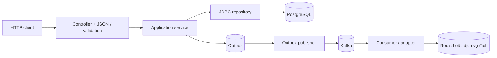

# Phân biệt unit test, integration test và end-to-end test

Trong **SPRING_BOOT_INTEGRATION**, một yêu cầu có thể đi qua HTTP controller, DTO và validation, service nghiệp vụ, JDBC, Redis cache, broker thông điệp, HTTP client gọi đối tác và các adapter của Spring Integration. Một hàm được kiểm thử đúng không bảo đảm toàn bộ luồng hoạt động: SQL có thể sai dialect, JSON không khớp hợp đồng, consumer có thể nhận trùng message và một lần gửi broker có thể thất bại sau khi transaction database đã commit.

Vì vậy, chương **Kiểm thử tích hợp** cần phân biệt rõ **unit test**, **integration test** và **end-to-end (E2E) test** theo *ranh giới và hành vi được xác minh*, thay vì chỉ dựa vào annotation hoặc tên lớp test. Mục tiêu là kiểm chứng cấu hình, hợp đồng dữ liệu, giao dịch, lỗi, idempotency và khả năng quan sát của luồng thực tế với chi phí kiểm thử hợp lý.

## 1. Mục tiêu học tập

Sau bài học, bạn có thể:

- Xác định một bài test thuộc cấp nào dựa trên thành phần chạy thật và thành phần bị thay thế.
- Chọn test phù hợp cho logic thuần, HTTP adapter, repository SQL, cache, broker và một hành trình nghiệp vụ hoàn chỉnh.
- Viết unit test với JUnit/Mockito, integration test dùng Spring Test/Testcontainers và E2E test đi qua HTTP thật.
- Giải thích vì sao `@SpringBootTest`, `MockMvc`, mock, embedded database hay Testcontainers **không tự động** quyết định một test là E2E.
- Kiểm chứng transaction rollback, retry, redelivery, xử lý trùng và eventual consistency mà không dựa vào thời gian chờ tùy ý.
- Xây dựng chiến lược chạy test nhanh trong vòng phát triển, đồng thời giữ các kiểm tra quan trọng trước khi phát hành.

## 2. Phân biệt ba cấp bằng ranh giới được kiểm thử

| Tiêu chí | Unit test | Integration test | End-to-end test |
| --- | --- | --- | --- |
| Câu hỏi chính | Một đơn vị logic có đúng không? | Các thành phần khi nối với nhau có đúng hợp đồng không? | Một hành trình sử dụng thực có hoạt động từ điểm bắt đầu đến kết quả quan sát được không? |
| Phạm vi | Hàm, class hoặc nhóm logic nhỏ và độc lập | Một hoặc vài ranh giới: service–DB, controller–JSON, producer–broker, client–HTTP | Luồng ứng dụng gồm nhiều tầng và những dependency thật cần thiết trong phạm vi đã tuyên bố |
| Thành phần thay thế | Các dependency ngoài phạm vi thường là fake/mock/stub | Giữ thành phần được tích hợp là thật; có thể giả lập những hệ thống ngoài phạm vi | Giữ đường đi chính và các tương tác có ý nghĩa là thật; chỉ giả lập hệ thống ngoài phạm vi E2E đã định nghĩa |
| Khởi động Spring context | Thường không cần | Có thể dùng test slice hoặc toàn context tùy mục tiêu | Thường chạy ứng dụng đầy đủ, nhận request qua HTTP/cổng thực hoặc entrypoint vận hành thực |
| Độ nhanh và chẩn đoán lỗi | Thường nhanh, lỗi xác định | Trung bình; phụ thuộc môi trường và tài nguyên thật | Thường chậm hơn; lỗi có thể đến từ nhiều tầng |
| Ví dụ | Service từ chối số tiền âm | Repository ghi PostgreSQL và rollback đúng | `POST /payments` → DB/outbox → broker → consumer quan sát được sự kiện |

**Điểm phân loại quyết định:** Một test gọi service bằng Java rồi mock toàn bộ repository/broker là unit test dù đặt tên `PaymentIntegrationTest`. Một test với `@SpringBootTest` nhưng mọi kết nối ngoài đều bị mock chủ yếu xác minh wiring/service flow trong bộ nhớ. Một test chạy ứng dụng với PostgreSQL thật và gửi request HTTP thật có thể là E2E cho đoạn **HTTP → database**, nhưng chưa phải E2E của luồng **HTTP → database → Kafka → hệ thống nhận** nếu Kafka chưa tham gia.

Không có một vạch ranh giới toàn ngành cho mọi dự án. Cách gọi tên có thể thay đổi giữa nhóm, nhưng mỗi test phải công bố được **phạm vi**, **phụ thuộc thật** và **những điều chưa được xác minh**.



Trên cùng luồng này, ta có thể dùng unit test cho quyết định của service, integration test cho JDBC/PostgreSQL hoặc producer/Kafka, và E2E test cho hành trình từ request đến kết quả ở hệ thống đích.

## 3. Tình huống xuyên suốt: tiếp nhận thanh toán từ hệ thống khác

Giả sử API `POST /api/payments` nhận một yêu cầu có `eventId`, `orderId` và `amountCents`. Khi xử lý lần đầu, hệ thống ghi thanh toán vào PostgreSQL, đồng thời tạo bản ghi **outbox** trong cùng transaction. Một publisher gửi sự kiện `PaymentAcceptedV1` từ outbox tới Kafka; consumer tiếp theo cập nhật cache hoặc hệ thống đích. Nếu cùng `eventId` được gửi lại, không được tạo thêm thanh toán.

Hợp đồng đầu vào minh họa:

```json
{
  "eventId": "evt-123",
  "orderId": "ord-456",
  "amountCents": 125000
}
```

Yêu cầu kiểm thử chính:

1. Dữ liệu sai định dạng hoặc số tiền không hợp lệ bị từ chối rõ ràng.
2. `eventId` mới tạo đúng một thanh toán và một dòng outbox.
3. Gửi lặp cùng sự kiện không nhân đôi tác động; nếu cùng ID nhưng nội dung mâu thuẫn, hệ thống phải có chính sách xung đột tường minh.
4. Lỗi ở lệnh ghi thứ hai khiến toàn bộ transaction được rollback.
5. Publisher có thể thử lại sau lỗi mạng mà không đánh mất sự kiện; consumer phải chịu được phát trùng.
6. Luồng có tín hiệu quan sát đủ để giải thích event nào thành công, lỗi hoặc đang chờ.

Những yêu cầu này phân bố vào **nhiều cấp kiểm thử**: không có một test khổng lồ duy nhất thay thế được tất cả.

## 4. Unit test: xác minh quyết định nghiệp vụ khi cô lập dependency

Unit test kiểm tra hành vi của một đơn vị logic, chủ động thay thế repository/HTTP client/broker bằng mock hoặc fake. Nó trả lời các câu hỏi: tham số nào hợp lệ, nhánh nào được chọn, khi nguồn báo "đã xử lý" service trả kết quả gì, có gọi dependency trong trường hợp bị từ chối không?

Ví dụ cốt lõi dưới đây dùng **Java 17+**, JUnit Jupiter và Mockito. Các `public` top-level type cần được đặt trong file Java riêng khi dùng trong dự án; việc đặt chung ở đây phục vụ trình bày.

```java
public record PaymentCommand(
        String eventId,
        String orderId,
        long amountCents
) {}

public enum Acceptance { ACCEPTED, DUPLICATE }

public interface PaymentStore {
    // true khi ghi lần đầu; false khi cùng sự kiện đã được xử lý.
    boolean recordOnce(PaymentCommand command);
}

public final class PaymentService {
    private final PaymentStore store;

    public PaymentService(PaymentStore store) {
        this.store = store;
    }

    public Acceptance accept(PaymentCommand command) {
        if (command == null
                || command.eventId() == null || command.eventId().isBlank()
                || command.orderId() == null || command.orderId().isBlank()
                || command.amountCents() <= 0) {
            throw new IllegalArgumentException("Invalid payment command");
        }
        return store.recordOnce(command)
                ? Acceptance.ACCEPTED : Acceptance.DUPLICATE;
    }
}
```

Unit test:

```java
import static org.junit.jupiter.api.Assertions.*;
import static org.mockito.Mockito.*;

import org.junit.jupiter.api.BeforeEach;
import org.junit.jupiter.api.Test;

class PaymentServiceTest {
    private PaymentStore store;
    private PaymentService service;

    @BeforeEach
    void setUp() {
        store = mock(PaymentStore.class);
        service = new PaymentService(store);
    }

    @Test
    void rejectsInvalidAmountBeforeWriting() {
        var command = new PaymentCommand("evt-1", "ord-1", -100);

        assertThrows(IllegalArgumentException.class,
                () -> service.accept(command));
        verifyNoInteractions(store);
    }

    @Test
    void returnsAcceptedWhenStoreRecordsFirstDelivery() {
        var command = new PaymentCommand("evt-2", "ord-2", 5000);
        when(store.recordOnce(command)).thenReturn(true);

        assertEquals(Acceptance.ACCEPTED, service.accept(command));
        verify(store).recordOnce(command);
    }

    @Test
    void reportsDuplicateWhenStoreAlreadyRecordedEvent() {
        var command = new PaymentCommand("evt-3", "ord-3", 5000);
        when(store.recordOnce(command)).thenReturn(false);

        assertEquals(Acceptance.DUPLICATE, service.accept(command));
    }
}
```

**Điều được chứng minh:** logic kiểm tra đầu vào, cách service diễn giải kết quả từ `PaymentStore` và việc không ghi dữ liệu khi lệnh không hợp lệ. **Điều chưa được chứng minh:** câu SQL hợp lệ, unique constraint hoạt động, transaction có rollback, Jackson có deserialize đúng, HTTP status đúng, outbox được publish hoặc broker được ack.

Đừng dùng mock để xác minh chi tiết triển khai không liên quan hành vi, ví dụ đếm mọi lệnh gọi private helper hoặc snapshot thứ tự nội bộ. Ưu tiên test trên đầu ra, lỗi và các tác động có ý nghĩa qua interface. Nếu logic thuần quá đơn giản, có thể không cần nhiều unit test lặp lại các dòng implementation; dồn trọng tâm vào quy tắc rủi ro cao.

> **Giới hạn của ví dụ:** `PaymentStore.recordOnce` giả định cùng `eventId` luôn đại diện cùng nội dung. Trong ứng dụng thật cần so sánh fingerprint hoặc dữ liệu đã lưu và trả lỗi xung đột nếu hai payload khác nhau dùng chung ID. Unit test phải bao phủ chính sách này tại nơi nó được cài đặt.

## 5. Integration test: kiểm tra một ranh giới thật

Integration test ghép **ít nhất hai thành phần** theo cách có ý nghĩa và dùng triển khai thật cho ranh giới đang kiểm tra. Có thể kiểm thử repository với PostgreSQL, controller với bộ chuyển JSON/validation của Spring MVC, HTTP client với một HTTP server giả lập, hoặc Kafka adapter với broker thật.

Chọn **test slice** khi chỉ cần một phần context; chọn `@SpringBootTest` khi cần wiring giữa nhiều cấu hình hoặc transaction/service thực. Tiêu chí là mức độ tích hợp cần chứng minh, không phải annotation nào trông "đầy đủ" hơn.

### 5.1. Repository và transaction với PostgreSQL

Để kiểm chứng idempotency và outbox, cần một database có đúng **dialect, constraint, transaction** như production. Ví dụ schema PostgreSQL:

```sql
CREATE TABLE processed_event (
    event_id      VARCHAR(120) PRIMARY KEY,
    processed_at  TIMESTAMPTZ NOT NULL DEFAULT NOW()
);

CREATE TABLE payment (
    event_id      VARCHAR(120) PRIMARY KEY
                  REFERENCES processed_event(event_id),
    order_id      VARCHAR(120) NOT NULL,
    amount_cents  BIGINT NOT NULL CHECK (amount_cents > 0)
);

CREATE TABLE outbox (
    event_id      VARCHAR(120) PRIMARY KEY
                  REFERENCES processed_event(event_id),
    event_type    VARCHAR(80) NOT NULL,
    created_at    TIMESTAMPTZ NOT NULL DEFAULT NOW(),
    published_at  TIMESTAMPTZ
);
```

Ứng dụng phải triển khai adapter JDBC/transaction tương ứng, ví dụ:

```java
import org.springframework.jdbc.core.namedparam.MapSqlParameterSource;
import org.springframework.jdbc.core.namedparam.NamedParameterJdbcTemplate;
import org.springframework.stereotype.Repository;
import org.springframework.transaction.annotation.Transactional;

@Repository
public class JdbcPaymentStore implements PaymentStore {
    private final NamedParameterJdbcTemplate jdbc;

    public JdbcPaymentStore(NamedParameterJdbcTemplate jdbc) {
        this.jdbc = jdbc;
    }

    @Override
    @Transactional
    public boolean recordOnce(PaymentCommand command) {
        var params = new MapSqlParameterSource()
                .addValue("eventId", command.eventId())
                .addValue("orderId", command.orderId())
                .addValue("amount", command.amountCents());

        int claimed = jdbc.update("""
                INSERT INTO processed_event (event_id)
                VALUES (:eventId)
                ON CONFLICT (event_id) DO NOTHING
                """, params);
        if (claimed == 0) {
            return false;
        }

        jdbc.update("""
                INSERT INTO payment (event_id, order_id, amount_cents)
                VALUES (:eventId, :orderId, :amount)
                """, params);
        jdbc.update("""
                INSERT INTO outbox (event_id, event_type)
                VALUES (:eventId, 'PaymentAcceptedV1')
                """, params);
        return true;
    }
}
```

`@Transactional` yêu cầu method được gọi qua Spring-managed bean/proxy và JDBC phải dùng `DataSource` do transaction manager quản lý. Vì cả ba câu lệnh ghi cùng transaction, lỗi ở lệnh ghi thanh toán hay outbox phải rollback cả dòng `processed_event`. `ON CONFLICT` trong ví dụ là cú pháp PostgreSQL; cần kiểm thử đúng dialect thay vì giả định H2 hành xử tương đương. Khi dùng idempotency thực tế, thêm phép so sánh payload với bản ghi đã lưu để phát hiện cùng ID nhưng dữ liệu khác nhau.

### 5.2. Chạy database thật trong Testcontainers

Giả sử project đã có Spring Boot JDBC, PostgreSQL driver, migrations tạo các bảng ở trên, `spring-boot-starter-test`, `org.testcontainers:junit-jupiter` và `org.testcontainers:postgresql`. Thí dụ test:

```java
import static org.junit.jupiter.api.Assertions.*;

import java.util.UUID;
import org.junit.jupiter.api.Test;
import org.springframework.beans.factory.annotation.Autowired;
import org.springframework.boot.test.context.SpringBootTest;
import org.springframework.jdbc.core.JdbcTemplate;
import org.springframework.test.context.DynamicPropertyRegistry;
import org.springframework.test.context.DynamicPropertySource;
import org.testcontainers.containers.PostgreSQLContainer;
import org.testcontainers.junit.jupiter.Container;
import org.testcontainers.junit.jupiter.Testcontainers;

@SpringBootTest
@Testcontainers
class JdbcPaymentStoreIT {
    @Container
    static final PostgreSQLContainer<?> db =
            new PostgreSQLContainer<>("postgres:16-alpine");

    @DynamicPropertySource
    static void databaseProperties(DynamicPropertyRegistry registry) {
        registry.add("spring.datasource.url", db::getJdbcUrl);
        registry.add("spring.datasource.username", db::getUsername);
        registry.add("spring.datasource.password", db::getPassword);
    }

    @Autowired PaymentStore store;
    @Autowired JdbcTemplate jdbc;

    @Test
    void duplicateEventDoesNotCreateSecondPaymentOrOutboxRow() {
        String eventId = UUID.randomUUID().toString();
        var command = new PaymentCommand(eventId, "ord-123", 125000);

        assertTrue(store.recordOnce(command));
        assertFalse(store.recordOnce(command));

        Integer payments = jdbc.queryForObject(
                "SELECT COUNT(*) FROM payment WHERE event_id = ?",
                Integer.class, eventId);
        Integer events = jdbc.queryForObject(
                "SELECT COUNT(*) FROM outbox WHERE event_id = ?",
                Integer.class, eventId);

        assertEquals(1, payments);
        assertEquals(1, events);
    }

    @Test
    void failedPaymentInsertRollsBackClaimedEventId() {
        String eventId = UUID.randomUUID().toString();
        var invalid = new PaymentCommand(eventId, "ord-err", -1);

        assertThrows(org.springframework.dao.DataIntegrityViolationException.class,
                () -> store.recordOnce(invalid));

        Integer claimed = jdbc.queryForObject(
                "SELECT COUNT(*) FROM processed_event WHERE event_id = ?",
                Integer.class, eventId);
        assertEquals(0, claimed);
    }
}
```

Đây là **integration test của repository + database**, dù dùng `@SpringBootTest` để wiring đơn giản. Nó kiểm tra SQL thật, ràng buộc `CHECK`/unique, số dòng và rollback. Test dùng ID riêng để giảm xung đột dữ liệu giữa các lần chạy; trong dự án lớn cần quản lý sạch database bằng migration/fixture hoặc cleanup có kiểm soát.

**Cẩn trọng với `@Transactional` trên chính method test:** Test transaction thường rollback khi kết thúc, rất tiện để dọn dữ liệu. Tuy nhiên nó có thể che lỗi về thời điểm commit hoặc `ack` của listener, và khiến việc kiểm tra sự kiện bất đồng bộ không quan sát được dữ liệu đã commit. Với các tình huống cần chứng minh commit/rollback xuyên qua transaction boundary, nên để transaction nằm ở code ứng dụng và kiểm tra trạng thái sau khi method trả về.

### 5.3. Web slice: kiểm tra hợp đồng HTTP, chưa phải E2E

Với Spring MVC, `@WebMvcTest(PaymentController.class)` thường khởi tạo controller, cơ chế binding JSON, validation và các thành phần web cần thiết; service phía dưới có thể được thay bằng mock. Ví dụ giao diện request:

```java
import jakarta.validation.constraints.NotBlank;
import jakarta.validation.constraints.NotNull;
import jakarta.validation.constraints.Positive;

public record PaymentRequest(
        @NotBlank String eventId,
        @NotBlank String orderId,
        @NotNull @Positive Long amountCents
) {}
```

Controller minh họa:

```java
import jakarta.validation.Valid;
import org.springframework.http.ResponseEntity;
import org.springframework.web.bind.annotation.*;

@RestController
@RequestMapping("/api/payments")
public class PaymentController {
    private final PaymentService service;

    public PaymentController(PaymentService service) {
        this.service = service;
    }

    @PostMapping
    ResponseEntity<Void> accept(@Valid @RequestBody PaymentRequest request) {
        var outcome = service.accept(new PaymentCommand(
                request.eventId(), request.orderId(), request.amountCents()));
        return outcome == Acceptance.ACCEPTED
                ? ResponseEntity.accepted().build()
                : ResponseEntity.ok().build();
    }
}
```

Đoạn `@WebMvcTest` dưới đây dùng bean mock do test tự khai báo, tránh phụ thuộc vào tên annotation đăng ký mock thay đổi qua các đời Spring Boot:

```java
import static org.mockito.ArgumentMatchers.any;
import static org.mockito.Mockito.when;
import static org.springframework.test.web.servlet.request.MockMvcRequestBuilders.post;
import static org.springframework.test.web.servlet.result.MockMvcResultMatchers.status;

import org.junit.jupiter.api.Test;
import org.springframework.beans.factory.annotation.Autowired;
import org.springframework.boot.test.autoconfigure.web.servlet.WebMvcTest;
import org.springframework.boot.test.context.TestConfiguration;
import org.springframework.context.annotation.Bean;
import org.springframework.context.annotation.Import;
import org.springframework.http.MediaType;
import org.springframework.test.web.servlet.MockMvc;

@WebMvcTest(PaymentController.class)
@Import(PaymentControllerWebTest.MockServiceConfig.class)
class PaymentControllerWebTest {
    @TestConfiguration
    static class MockServiceConfig {
        @Bean
        PaymentService paymentService() {
            return org.mockito.Mockito.mock(PaymentService.class);
        }
    }

    @Autowired MockMvc mvc;
    @Autowired PaymentService service;

    @Test
    void validJsonIsAccepted() throws Exception {
        when(service.accept(any(PaymentCommand.class)))
                .thenReturn(Acceptance.ACCEPTED);

        mvc.perform(post("/api/payments")
                .contentType(MediaType.APPLICATION_JSON)
                .content("""
                        {"eventId":"evt-1","orderId":"ord-1","amountCents":5000}
                        """))
                .andExpect(status().isAccepted());
    }

    @Test
    void rejectsInvalidRequestBeforeInvokingService() throws Exception {
        mvc.perform(post("/api/payments")
                .contentType(MediaType.APPLICATION_JSON)
                .content("""
                        {"eventId":"evt-1","orderId":"ord-1","amountCents":-1}
                        """))
                .andExpect(status().isBadRequest());

        org.mockito.Mockito.verifyNoInteractions(service);
    }
}
```

Để validation hoạt động, ứng dụng cần Bean Validation provider, thường qua `spring-boot-starter-validation`. Nếu có Spring Security, slice test cũng có thể áp dụng filter bảo mật: phải chuẩn bị identity/quyền phù hợp, tránh tắt toàn bộ security rồi coi test đó chứng minh phân quyền.

Test này xác minh phần **HTTP adapter** và JSON/validation; nó không mở HTTP server thực, không kết nối database và không chứng minh broker hoạt động. Nếu project gọi đây là integration test của **Spring MVC slice**, cách gọi vẫn hợp lý khi phạm vi được mô tả đúng.

### 5.4. HTTP client, broker, cache và Spring Integration adapter

Không phải mọi integration test đều cần toàn ứng dụng:

| Ranh giới cần kiểm tra | Tài nguyên/test thường phù hợp | Điều cần assert |
| --- | --- | --- |
| HTTP outbound đến đối tác | `RestClient`/`WebClient` thật + WireMock/MockWebServer | URL, method, headers, DTO JSON, status/error mapping, timeout, retry và idempotency key. |
| JDBC/jOOQ | DB cùng dialect qua Testcontainers | SQL, mapping, constraint, transaction, locking và retry. |
| Kafka/AMQP/JMS | Broker thật trong container hoặc môi trường test cô lập | Serialization, topic/queue, consumer group, ack/offset, redelivery, DLQ. |
| Redis cache | Redis thật trong Testcontainers | TTL, key namespace, serialization, invalidation và tenant isolation. |
| Spring Integration flow | `IntegrationFlow`, channel, endpoint và nguồn/đích trong phạm vi test | Wiring, routing, filter, poller, error channel, timeout và lifecycle. |
| File/SFTP adapter | Thư mục tạm có kiểm soát hoặc SFTP server thử nghiệm | Filter, phát hiện file hoàn tất, xử lý trùng, archive/quarantine, restart. |

WireMock là **server giả lập tương tác HTTP**, khác với việc mock một Java interface. Nó kiểm tra client thật đã phát một request HTTP đúng hợp đồng, nhưng chưa chứng minh hệ thống đối tác thật sẽ đáp ứng giống fixture. Có thể bổ sung **consumer-driven contract test** hoặc môi trường thử nghiệm của đối tác khi hợp đồng cần được xác minh giữa hai bên.

Testcontainers giúp đưa cơ sở dữ liệu, Redis hoặc broker thật vào môi trường test. Tuy nhiên, dùng container chưa đủ để gọi test là E2E nếu bạn chỉ gọi một repository và không chạy những tầng khác của hành trình.

## 6. End-to-end test: kiểm chứng hành trình qua entrypoint thực

E2E test bắt đầu từ một **điểm tiếp xúc thực tế** (HTTP request, command/event đi vào broker, thao tác UI, file xuất hiện trong thư mục nhận) và quan sát **kết quả có ý nghĩa** sau khi các bước cần thiết hoàn thành. Tên và mức độ “end” phải ghi rõ: E2E của API HTTP–DB khác với E2E của toàn tuyến HTTP–Kafka–consumer–cache.

Ví dụ dưới kiểm tra từ **HTTP thật đến PostgreSQL/outbox thật**. Các bean `PaymentController`, `PaymentService`, `JdbcPaymentStore` được ứng dụng khai báo; `PaymentService` cần được đăng ký làm Spring bean, ví dụ `@Service` hoặc qua `@Bean`. Giả định migration đã tạo schema và cấu hình Testcontainers đúng như phần trước.

```java
import static org.junit.jupiter.api.Assertions.assertEquals;

import java.util.UUID;
import org.junit.jupiter.api.Test;
import org.springframework.beans.factory.annotation.Autowired;
import org.springframework.boot.test.context.SpringBootTest;
import org.springframework.boot.test.web.client.TestRestTemplate;
import org.springframework.http.HttpStatus;
import org.springframework.http.ResponseEntity;
import org.springframework.jdbc.core.JdbcTemplate;
import org.springframework.test.context.DynamicPropertyRegistry;
import org.springframework.test.context.DynamicPropertySource;
import org.testcontainers.containers.PostgreSQLContainer;
import org.testcontainers.junit.jupiter.Container;
import org.testcontainers.junit.jupiter.Testcontainers;

@SpringBootTest(webEnvironment = SpringBootTest.WebEnvironment.RANDOM_PORT)
@Testcontainers
class PaymentHttpToDatabaseE2ETest {
    @Container
    static final PostgreSQLContainer<?> db =
            new PostgreSQLContainer<>("postgres:16-alpine");

    @DynamicPropertySource
    static void databaseProperties(DynamicPropertyRegistry registry) {
        registry.add("spring.datasource.url", db::getJdbcUrl);
        registry.add("spring.datasource.username", db::getUsername);
        registry.add("spring.datasource.password", db::getPassword);
    }

    @Autowired TestRestTemplate http;
    @Autowired JdbcTemplate jdbc;

    @Test
    void acceptsRequestAndStoresOutboxExactlyOncePerEventId() {
        String eventId = UUID.randomUUID().toString();
        var request = new PaymentRequest(eventId, "ord-101", 9900L);

        ResponseEntity<Void> first =
                http.postForEntity("/api/payments", request, Void.class);
        ResponseEntity<Void> duplicate =
                http.postForEntity("/api/payments", request, Void.class);

        assertEquals(HttpStatus.ACCEPTED, first.getStatusCode());
        assertEquals(HttpStatus.OK, duplicate.getStatusCode());
        assertEquals(1, countFor("payment", eventId));
        assertEquals(1, countFor("outbox", eventId));
    }

    private int countFor(String table, String eventId) {
        // Tên bảng là hằng số nội bộ đã kiểm soát, không lấy từ input.
        return jdbc.queryForObject(
                "SELECT COUNT(*) FROM " + table + " WHERE event_id = ?",
                Integer.class, eventId);
    }
}
```

`RANDOM_PORT` khởi động HTTP server thật; `TestRestTemplate` gửi request qua cổng mạng local của ứng dụng. Vì test không mở transaction bao ngoài hai request HTTP, commit của repository xảy ra trong luồng xử lý request và kết quả DB có thể được quan sát sau response. Đây là minh họa E2E **trong phạm vi HTTP → PostgreSQL/outbox**. Nó **chưa chứng minh** outbox publisher gửi Kafka hay consumer cập nhật cache.

Để kiểm chứng toàn tuyến, mở rộng fixture như sau:

1. Khởi động PostgreSQL, Kafka và Redis cô lập bằng Testcontainers (hoặc một môi trường staging được quản lý).
2. Khởi động ứng dụng với publisher và consumer **thật**, dùng topic, group, key prefix riêng cho test.
3. Gửi HTTP request từ bên ngoài process/port ứng dụng hoặc qua client thực như ví dụ trên.
4. Chờ **điều kiện quan sát được**: ví dụ consumer ghi trạng thái nhận sự kiện hoặc cache xuất hiện giá trị mong đợi. Dùng thư viện chờ có điều kiện như Awaitility với deadline, không `Thread.sleep(5000)`.
5. Kiểm tra outbox đã được đánh dấu, message được xử lý đúng một lần về **tác động nghiệp vụ**, và việc phát trùng không tạo thêm tác động.
6. Chủ động làm hỏng publisher hoặc consumer trong một test riêng để xác minh cách retry và khôi phục.

Nếu thay Kafka bằng mock trong bước 1, test có thể là E2E của phần **HTTP → outbox**, nhưng không thể kết luận về serializer/consumer group/ack hay redelivery Kafka. Nếu staging dùng dịch vụ thật của bên thứ ba, cần dữ liệu test riêng và cách dọn dẹp tương thích với hệ thống đó; không gửi tác động kinh doanh không thể hoàn tác chỉ để có một test.

## 7. Kiểm thử reliability: lỗi, retry, transaction và trùng lặp

Trong tích hợp hệ thống, nhiều lỗi nghiêm trọng chỉ xuất hiện ở **ranh giới thời điểm**. Ví dụ, database đã commit nhưng response HTTP thất lạc; broker đã nhận message nhưng producer timeout; consumer hoàn tất DB rồi chết trước khi ack. Test thành công một lần không chứng minh khả năng chịu các tình huống này.

| Tình huống gây lỗi | Unit test có thể xác minh | Integration/E2E cần xác minh |
| --- | --- | --- |
| Request thiếu field, sai kiểu hoặc số tiền âm | Quy tắc service/validator thuần | Jackson, Bean Validation và mã phản hồi HTTP thật (`400`). |
| Cùng `eventId` gửi lại | Nhánh kết quả `DUPLICATE`, không gọi side effect thêm | Unique constraint DB; hai yêu cầu cạnh tranh; trạng thái thanh toán/outbox chỉ một. |
| Cùng `eventId` với payload khác | Quy tắc quyết định conflict theo fingerprint | Store đọc payload cũ và trả `409` theo hợp đồng, không âm thầm nhận là duplicate giống nhau. |
| Insert thanh toán thành công, ghi outbox lỗi | Service chọn thông điệp lỗi thích hợp | Transaction rollback cả bảng dữ liệu và dấu đã xử lý. |
| Publisher gửi được nhưng không nhận ack | Chính sách retry/idempotency trên mock | Broker có thể nhận nhiều bản sao; consumer xử lý hiệu ứng một lần. |
| Consumer ghi DB rồi chết trước ack | Logic handler xác định khóa event | Redelivery sau restart, transaction/ack và unique constraint thật. |
| HTTP đối tác timeout sau khi đã xử lý | Lựa chọn retry dựa vào status/exception | HTTP mock server cho timeout; idempotency key giữ nguyên; không gửi yêu cầu có tác động trùng ngoài ý muốn. |
| Redis cache chưa cập nhật sau commit | Quy tắc fallback/invalidate | TTL và invalidation thực, eventual consistency có deadline rõ ràng. |

### Chống trùng là thuộc tính của tác động nghiệp vụ

Một consumer nhận message hai lần vẫn có thể hợp lệ theo cơ chế **at-least-once delivery**. Điều cần kiểm chứng là trạng thái cuối cùng không bị nhân đôi: không tạo hai payment, không tăng số dư hai lần, không gửi hai email nếu hợp đồng yêu cầu chỉ một. `eventId` cần ổn định qua retry; lưu nó vào kho có unique constraint hoặc cơ chế tương đương, cùng transaction với hiệu ứng khi có thể.

Transaction JDBC **không tự bao gồm** broker, HTTP, Redis và filesystem. Transactional outbox giúp ghi dữ liệu nghiệp vụ và sự kiện dự định phát trong một transaction DB; producer có thể phát lại, nên consumer vẫn cần idempotency. Test cần mô phỏng crash ở cả hai phía của commit/publish/ack để xác minh hành vi được thiết kế, không tuyên bố “exactly once” cho cả hệ thống chỉ vì test happy path đi qua một lần.

### Kiểm thử bất đồng bộ không phụ thuộc thời gian may rủi

Thay đoạn kiểm tra kiểu:

```java
Thread.sleep(5000);
assertEquals(1, readConsumedMessages());
```

bằng chờ một điều kiện **quan sát được** có timeout:

```java
import static org.awaitility.Awaitility.await;
import java.time.Duration;

await()
    .atMost(Duration.ofSeconds(10))
    .pollInterval(Duration.ofMillis(100))
    .untilAsserted(() ->
        assertEquals(1, readConsumedMessages()));
```

Ở đây `readConsumedMessages()` là hàm test đọc trạng thái consumer đã ghi; nó phải quan sát được kết quả mà không tự tạo side effect. Awaitility là dependency riêng (ví dụ `org.awaitility:awaitility`, thường có trong bộ dependency test tùy starter/phiên bản). Một deadline đủ để phát hiện lỗi hệ thống và dừng test; không kéo dài không giới hạn để che lỗi. Với test chạy CI, kiểm tra các điều kiện sẵn sàng của container và endpoint trước khi gửi message thay vì tăng `sleep` tùy tiện.

## 8. Chiến lược fake, mock, stub, container và môi trường staging

Tài nguyên test cần được chọn theo **hợp đồng muốn chứng minh**:

| Công cụ | Mạnh ở đâu | Không thể tự chứng minh |
| --- | --- | --- |
| Mock Java interface (Mockito) | Logic và tương tác ở biên một class | Driver SQL/HTTP, network, broker, transaction thật. |
| Fake in-memory repository | Kiểm tra business flow với trạng thái nhanh, dễ kiểm soát | SQL dialect, transaction isolation, unique constraint DB production. |
| HTTP stub server (WireMock/MockWebServer) | JSON, status, timeout và retry HTTP client thực | Hệ đối tác thật tuân thủ hoàn toàn hợp đồng, tải và bảo mật thực tế. |
| H2 hoặc database nhúng | Test JDBC nhanh cho SQL đơn giản hoặc demo | Hành vi PostgreSQL/MySQL đặc thù như `ON CONFLICT`, lock, kiểu timestamp và transaction. |
| Testcontainers PostgreSQL/Kafka/Redis | Giao thức và hành vi engine thật trong môi trường cô lập | Cấu hình mạng, phân quyền hoặc tải của production đầy đủ. |
| Staging với các dịch vụ thật | Hành trình liên dịch vụ, config và deployment gần thực tế | Độ phủ mọi tình huống hiếm, sản lượng và sự cố production nếu không chủ động mô phỏng. |

Chẳng hạn, nếu adapter dùng câu SQL PostgreSQL `ON CONFLICT`, H2 có thể không hỗ trợ hoặc cho kết quả khác. Khi quy tắc quan trọng phụ thuộc vào constraint/locking, dùng PostgreSQL thật là lựa chọn đáng tin cậy hơn. Nếu cần test deserialization JSON từ một đối tác HTTP, fake class `PartnerClient` không đủ; hãy kiểm tra HTTP client trước một server stub có request/response xác định.

**Contract test** là một góc nhìn bổ sung, không nhất thiết là cấp thứ tư đứng giữa unit và E2E. Nó kiểm tra sự tương thích giữa **producer/consumer** hoặc **client/server** về schema và semantics. Hợp đồng JSON/OpenAPI/Avro/Protobuf có thể được kiểm tra trong test nhỏ hoặc môi trường tích hợp; điều quan trọng là hai phía chia sẻ cam kết được xác minh, nhất là khi phát hành độc lập.

## 9. Spring Boot test slice và sự khác biệt với full context

Các annotation phổ biến là công cụ chọn **những phần Spring context được tải**:

| Cấu hình test | Phạm vi chính | Dùng khi |
| --- | --- | --- |
| JUnit 5 thuần + Mockito | Không dựng Spring context | Kiểm thử quy tắc và phép chuyển đổi độc lập. |
| `@WebMvcTest` | Spring MVC slice, controller, JSON, validation, filter liên quan | Kiểm tra HTTP adapter với service giả lập. |
| `@JsonTest` | JSON serialization/deserialization và cấu hình Jackson | Kiểm tra contract của DTO, enum, `Instant`, field nullable. |
| `@JdbcTest` | JDBC slice với `DataSource`/JDBC support theo điều kiện | Kiểm tra SQL, `RowMapper`, repository/adapter cần import. |
| `@DataJpaTest` | JPA slice và entity/repository | Kiểm tra mapping JPA, query, constraint nếu có DB phù hợp. |
| `@SpringBootTest` | Toàn Spring application context theo cấu hình test | Test phối hợp service/adapter, transaction hoặc app wiring rộng. |
| `@SpringBootTest(webEnvironment = RANDOM_PORT)` | Toàn app cùng embedded HTTP server thật | Test qua network port HTTP; kết hợp tài nguyên thật để kiểm tra hành trình. |

`@JdbcTest` và `@DataJpaTest` có thể tự thay `DataSource` bằng embedded database tùy dependency và cấu hình. Nếu cần engine thật, dùng Testcontainers và chỉ định chính sách thay database phù hợp (ví dụ `@AutoConfigureTestDatabase(replace = NONE)` với phiên bản Boot hỗ trợ). Slice test cũng có thể tự rollback transaction sau mỗi bài test; điều đó thuận tiện cho isolation nhưng không thay được kiểm tra **commit và side effect sau commit**.

`@AutoConfigureMockMvc` trên `@SpringBootTest` cho phép gửi request qua `MockMvc` khi cần full context **nhưng không mở cổng HTTP thật**; vì vậy nó không kiểm tra kết nối network. `@SpringBootTest(webEnvironment = RANDOM_PORT)` với `TestRestTemplate` (Spring MVC) hoặc HTTP client phù hợp mới đi qua HTTP server của ứng dụng. Dù vậy, E2E luôn cần nêu rõ broker, database và dịch vụ ngoài nào thực sự có mặt.

Với Spring Integration, một test dùng channel giả để gọi handler có thể chỉ là unit/integration test của **flow nội bộ**. Nếu muốn chứng minh Kafka adapter hoặc file poller thật, phải đưa message/file qua **nguồn ngoài** và xác minh endpoint nhận, chuyển đổi, phát lỗi và vận hành đúng sau restart.

## 10. Thiết kế fixture và quản lý trạng thái để test lặp lại được

Test tích hợp rất dễ bị flaky khi dùng chung database, topic, queue, cache key hoặc thư mục. Một bộ test tốt cần:

1. **Dữ liệu độc lập:** tạo ID ngẫu nhiên/định danh rõ ràng cho mỗi lần test, không phụ thuộc thứ tự chạy và không dựa vào dữ liệu còn sót.
2. **Schema có thể tái tạo:** chạy migration giống ứng dụng, không tự tạo một schema khác logic production chỉ cho test.
3. **Tài nguyên cô lập:** topic/group riêng, Redis prefix riêng, thư mục tạm, database/schema riêng khi có thể.
4. **Clock có kiểm soát:** inject `Clock` cho logic dựa trên thời gian, tránh test phụ thuộc giờ máy và timezone.
5. **Deadline được định nghĩa:** retry, backoff và chờ eventual consistency có giới hạn; assert điều kiện cuối cùng thay vì sleep cố định.
6. **Lỗi có chủ đích:** dùng fault injection/mock server/container network controls khi cần; reset lỗi sau mỗi test.
7. **Cleanup có thứ tự:** dọn bản ghi, outbox, message và tài nguyên test mà không xóa nhầm dữ liệu của môi trường khác.
8. **Bảo vệ bí mật:** credential thử nghiệm và payload giả; không log token hoặc dữ liệu cá nhân thật chỉ để debug test.

Môi trường chạy container có thể cần Docker/engine container khả dụng. CI phải chuẩn bị sẵn engine, cache image hợp lý và tài nguyên phù hợp. Nếu test phụ thuộc mạng bên ngoài không do nhóm kiểm soát, độ ổn định kém đi; chỉ giữ loại phụ thuộc đó ở các test staging/certification có chủ đích.

## 11. Phân chia trách nhiệm kiểm thử theo thành phần trong Spring Boot Integration

| Thành phần | Unit test nên chứng minh | Integration test nên chứng minh | E2E nên chứng minh |
| --- | --- | --- | --- |
| HTTP inbound | DTO/domain validation và error mapping thuần | JSON binding, `@Valid`, auth, route, status qua MVC | Client HTTP thật gửi request và nhận kết quả đúng. |
| HTTP outbound | Chọn URL/headers, retry policy, phân loại lỗi | Client gọi stub server đúng format/timeout | Luồng với đối tác thật hoặc sandbox được công bố, theo phạm vi test. |
| JDBC/jOOQ | Mapping và branch xử lý kết quả | SQL, constraint, isolation, transaction với DB đúng dialect | Thao tác qua entrypoint làm thay đổi DB đúng nghiệp vụ. |
| Cache | Quy tắc key, TTL/invalidation logic | Redis thật, serialize, phân quyền key/tenant | Giá trị người dùng nhìn thấy cập nhật sau thay đổi nguồn dữ liệu. |
| Kafka/AMQP/JMS | Handler và chính sách duplicate/retry | Broker, producer/consumer, ack, DLQ, serializer | Event đi qua broker tới hệ tiêu thụ và tạo kết quả quan sát được. |
| Spring Integration | Transformer/filter/router thuần | Channel, gateway, poller, endpoint, error channel | Message từ nguồn thực đi qua các adapter tới đích như dự kiến. |

Các mức test có **vùng chồng lắp có chủ đích**. Ví dụ validation amount có thể được kiểm tra bằng unit test để biết nguyên nhân chính xác, bằng MVC slice để biết HTTP `400`, và bằng một E2E test tiêu biểu để phát hiện cấu hình thiếu Bean Validation. Không cần nhân bản mọi combination ở cả ba cấp; chọn một số kịch bản quan trọng cho E2E và để test nhỏ bao phủ phần lớn nhánh logic.

## 12. Chiến lược chạy trong CI/CD và đọc kết quả thất bại

Một cách phân bổ thực tế cho nhiều dịch vụ Spring Boot:

| Thời điểm | Bộ test ưu tiên | Mục đích |
| --- | --- | --- |
| Khi lập trình và mỗi commit | Unit test + test DTO/mapper nhanh | Phản hồi sớm, khoanh vùng lỗi logic. |
| Khi tạo pull request | Unit + web slice + repository/broker integration quan trọng | Phát hiện lỗi hợp đồng, SQL, config và adapter trước khi merge. |
| Trước phát hành / sau triển khai staging | E2E đại diện cho luồng cốt lõi + smoke test | Phát hiện lỗi wiring, dependency, secret/network và deployment. |
| Theo lịch hoặc khi sửa phần reliability | Test lỗi hiếm, restart, concurrency, redelivery và chaos có kiểm soát | Kiểm chứng khả năng phục hồi với chi phí thực thi cao hơn. |

Đây là chiến lược gợi ý, không phải quy luật cố định: ứng dụng có ràng buộc an toàn/tiền tệ cao có thể cần nhiều integration và E2E test hơn. Thước đo giá trị là **rủi ro được giảm và tốc độ phát hiện lỗi**, không phải số lượng test theo hình tháp đẹp mắt hay phần trăm code coverage đơn độc.

Khi một test thất bại, đọc chứng cứ theo thứ tự: tên hành vi và giả định của test; request/message và correlation ID; trạng thái container/dependency; lỗi/stack trace đầu tiên; trạng thái DB/outbox/topic/cache; retry/ack và event timeline. Đừng khắc phục test flaky bằng cách tăng mọi timeout. Cần xác định nó thất bại do logic, race thật, môi trường chưa sẵn sàng, tài nguyên bị chia sẻ hay điều kiện chờ sai.

**Observability trong test** nên sử dụng ID ổn định của request/event để nối log của controller, service, publisher và consumer. Metrics về outbox backlog, số lần retry, DLQ, latency xử lý và pool kết nối giúp giải thích test E2E thất bại đúng vị trí. Không thay việc assert hành vi bằng việc chỉ xem log “success”.

## 13. Những cách hiểu sai thường gặp

**“Có `@SpringBootTest` thì là E2E.”** Không. Annotation này chỉ nói application context được dựng thế nào. Hãy xem request có đi qua endpoint thật không và những dependency nào là mock.

**“Đã mock repository và Kafka thì transaction chắc chắn ổn.”** Không. Mock không có unique constraint, lock, isolation level hoặc hành vi ack của broker. Phải có test với tài nguyên thật cho rủi ro đó.

**“H2 chạy xanh nghĩa là PostgreSQL sẽ chạy.”** Không luôn đúng. SQL dialect, kiểu dữ liệu và concurrency khác nhau. Dùng đúng engine khi hành vi DB là một phần hợp đồng.

**“E2E phải không mock bất cứ thứ gì.”** Không nhất thiết. E2E được định nghĩa theo **ranh giới mục tiêu**; dịch vụ thanh toán bên ngoài có thể được stub để tránh tác động thật, nhưng khi đó phải mô tả giới hạn và kiểm tra hợp đồng đối tác ở nơi khác.

**“Mọi test async nên chờ vài giây.”** Không. Chờ điều kiện với deadline và xác minh trạng thái. `sleep` cố định khiến test vừa chậm vừa không ổn định khi CI tải cao.

**“Chỉ kiểm tra HTTP `200` là đủ.”** Không. Luồng tích hợp có thể trả status thành công khi outbox chưa publish hoặc cache chưa cập nhật. Cần assert tác động cuối có ý nghĩa trong phạm vi của bài test.

**“Test retry thành công một lần chứng minh exactly once.”** Không. Retry có thể làm message giao trùng; cần test idempotency và ranh giới transaction/ack để chứng minh trạng thái nghiệp vụ không bị nhân đôi.

## 14. Checklist chọn cấp test cho một thay đổi tích hợp

Trước khi viết test, trả lời các câu hỏi sau:

1. **Hành vi/rủi ro nào đổi?** Logic thuần, JSON contract, SQL, cấu hình Spring, giao tiếp broker, cache hay toàn hành trình?
2. **Cần chứng minh phụ thuộc nào?** Mock port, HTTP stub server, PostgreSQL thật, Redis, Kafka hay hệ thống staging?
3. **Biên quan sát là gì?** Giá trị trả về, mã lỗi HTTP, số dòng DB, outbox, message được nhận, cache được làm mới hay trạng thái nghiệp vụ cuối cùng?
4. **Tình huống xấu nào quan trọng?** Timeout, dữ liệu sai, transaction rollback, concurrent duplicate, mất ack, restart, eventual consistency?
5. **Có thể tái chạy độc lập không?** Fixture riêng, migration thực, cleanup, topic/group riêng, deadline và clock kiểm soát?
6. **Test sẽ chạy khi nào?** Mỗi commit, pull request, trước phát hành hay theo lịch? Chi phí chạy có tương xứng rủi ro không?
7. **Khi thất bại có chẩn đoán được không?** Correlation ID, assertion đủ cụ thể, log/metrics của đúng adapter và đủ thông tin nguyên nhân chưa?

**Ghi nhớ:** **Unit test** chứng minh quyết định của thành phần nhỏ trong điều kiện cô lập; **integration test** chứng minh các thành phần thật phối hợp đúng qua một hoặc vài ranh giới; **E2E test** chứng minh một hành trình từ đầu vào đến kết quả có thể quan sát trong phạm vi đã định nghĩa. Với Spring Boot tích hợp HTTP, JDBC, cache, broker và Spring Integration, kết hợp ba cấp cùng contract test và kiểm thử lỗi có chủ đích mới tạo được sự tin cậy thực tế về dữ liệu, giao dịch, retry và xử lý trùng.
