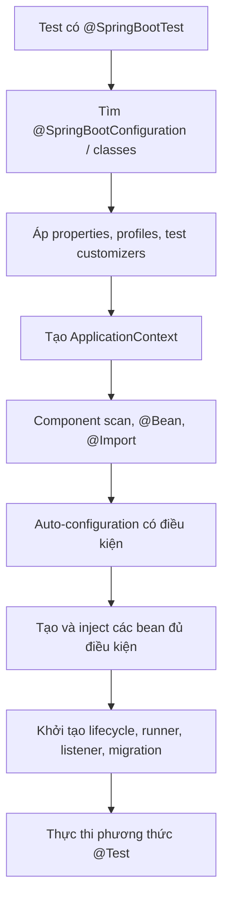
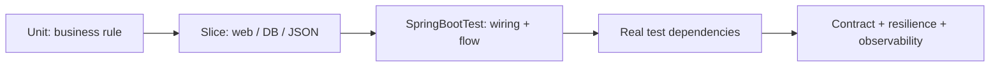

# @SpringBootTest và phạm vi thành phần được khởi tạo

## 1. Mục tiêu của bài học

Một ứng dụng Spring Boot có thể chạy tốt khi kiểm thử riêng từng service nhưng vẫn lỗi khi khởi động thật: bean không được quét, thiếu cấu hình database, bộ lọc bảo mật hoạt động khác mong đợi, hoặc listener bắt đầu nhận message trước khi dữ liệu test sẵn sàng. Ngược lại, nếu mọi phép thử đều khởi động toàn bộ ứng dụng, bộ test có thể chậm, khó cô lập và phụ thuộc vào database, cache hay broker dù không cần thiết.

**`@SpringBootTest` khởi tạo một `ApplicationContext` bằng cơ chế chạy ứng dụng Spring Boot trong môi trường kiểm thử.** Cần phân biệt *phạm vi bean đã được nạp* với *những ranh giới tích hợp đã thực sự được thực thi*. Có bean HTTP client trong context không có nghĩa đã gửi HTTP request; có bean repository không đồng nghĩa database đã vượt qua mọi kiểm thử giao dịch.

Đây là bài thuộc chương **Kiểm thử tích hợp** của module **SPRING_BOOT_INTEGRATION**. Module tập trung tổ chức tích hợp hệ thống trong Spring Boot qua HTTP client, cơ sở dữ liệu, cache, broker và adapter Spring Integration; chú trọng **quản lý cấu hình, hợp đồng dữ liệu, giao dịch, lỗi, xử lý trùng lặp, kiểm thử và quan sát** những luồng thực tế.

Sau bài học, bạn có thể:

- Giải thích cách `@SpringBootTest` tìm cấu hình gốc, nạp profile, tạo bean và chạy lifecycle.
- Chọn đúng `webEnvironment`: `MOCK`, `RANDOM_PORT`, `DEFINED_PORT` hoặc `NONE`.
- Phân biệt full context test với unit test và test slice (`@WebMvcTest`, `@DataJpaTest`, `@DataR2dbcTest`).
- Dùng mock, fake, `@TestConfiguration`, test properties và Testcontainers để kiểm soát dependency.
- Tránh các bẫy về transaction rollback, listener, migration, context cache, dữ liệu bẩn và việc kết luận quá phạm vi test.

> **Phiên bản:** Ví dụ hướng đến Java 17+, Spring Boot 3.2+ và JUnit 5. Ví dụ dùng Spring MVC với `MockMvc`/`TestRestTemplate`; ứng dụng WebFlux sẽ dùng `WebTestClient` và các API reactive phù hợp. `@MockBean` tương thích Spring Boot 3.2–3.3; từ Spring Boot 3.4/Spring Framework 6.2, có `@MockitoBean` để thay thế tùy phiên bản.

## 2. `@SpringBootTest` khởi tạo những gì?

### 2.1. Bootstrap từ cấu hình ứng dụng

Spring Boot Test dùng `SpringApplication` để tạo context. Nếu không ghi `classes`, test framework tìm `@SpringBootConfiguration` ở package của test và các package cha; thường đây là lớp có `@SpringBootApplication`.

```java
// src/main/java/com/example/order/OrderApplication.java
@SpringBootApplication
public class OrderApplication {
    public static void main(String[] args) {
        SpringApplication.run(OrderApplication.class, args);
    }
}
```

```java
// src/test/java/com/example/order/OrderContextIT.java
@SpringBootTest
class OrderContextIT {
    @Autowired
    ApplicationContext context;

    @Test
    void contextStarts() {
        assertNotNull(context);
    }
}
```

Nếu test nằm ngoài cây package chứa cấu hình gốc hoặc dự án có nhiều cấu hình, có thể chỉ định tường minh:

```java
@SpringBootTest(classes = OrderApplication.class)
class ExplicitConfigurationIT {
    @Test
    void startsWithOrderApplication() {}
}
```

Tham số `classes` quyết định **nguồn cấu hình tạo context**. Truyền một `@Configuration` rất nhỏ có thể tạo context hẹp và bỏ qua bean sản phẩm thực tế; khi chỉ cần kiểm thử một tầng, test slice hoặc unit test thường thể hiện mục đích chính xác hơn.



**Full application context không có nghĩa mọi class đều là bean.** Thành phần phải được scan, import, khai báo bằng `@Bean` hoặc auto-configuration và đáp ứng các điều kiện `@Profile`, `@ConditionalOn...`, classpath và properties. Singleton không lazy thường được khởi tạo khi refresh context; lazy/prototype có thể chỉ được tạo khi được yêu cầu.

### 2.2. Phạm vi thành phần thường xuất hiện

| Nhóm | Ví dụ bean/hạ tầng | Khi nào có mặt và rủi ro |
|---|---|---|
| Nghiệp vụ | `@Service`, mapper, validator | Được scan/import và đúng profile |
| HTTP inbound | `@RestController`, MVC mapping, Jackson, security filter | Có starter web và môi trường web phù hợp |
| HTTP outbound | `RestClient`, `WebClient`, interceptor, gateway | Có bean chưa chắc đã gọi mạng |
| Database | `DataSource`, JPA repositories, transaction manager | Có thể mở kết nối hoặc chạy schema migration lúc startup |
| Reactive data | `ConnectionFactory`, R2DBC repositories | Cần driver và cấu hình reactive hợp lệ |
| Cache | `CacheManager`, Redis connection | Có thể tạo/kiểm tra kết nối lúc dùng hoặc khởi tạo |
| Message broker | JMS/Kafka/RabbitMQ listener, connection factory | Listener có thể tự động nhận message |
| Hạ tầng | Actuator, observation, scheduler, runner | Tùy dependency, profile và lifecycle |

Khi context tạo bean `RestClient` mà test mock `InventoryGateway`, ta đang kiểm tra wiring/logic phía ứng dụng nhưng **chưa kiểm tra HTTP contract outbound**. Tương tự, bean JMS listener có thể có mặt nhưng bị tắt auto-start; cần bài kiểm thử broker riêng để kiểm chứng delivery và redelivery.

Một số cơ chế có thể gây side effect ngay khi khởi động: `ApplicationRunner`, `CommandLineRunner`, `@PostConstruct`, `SmartLifecycle`, Flyway/Liquibase, `@Scheduled` và các listener container. `@SpringBootTest` không tự bảo vệ khỏi tài nguyên production; chọn profile test và cô lập chúng trước khi khởi tạo context.

### 2.3. Đặt cạnh unit test không cần Spring

```java
class AvailabilityServiceUnitTest {
    @Test
    void positiveStockIsAvailable() {
        InventoryGateway gateway = sku -> new StockView(sku, 8);
        AvailabilityService service = new AvailabilityService(gateway);

        AvailabilityResponse response = service.check("SKU-42");

        assertTrue(response.available());
    }
}
```

Test này chỉ tạo đối tượng Java và fake gateway. Nó kiểm tra logic nhưng không xác minh Spring dependency injection, MVC routing, serialization, security filter hay auto-configuration.

## 3. Bốn chế độ `webEnvironment`

`@SpringBootTest` mặc định dùng `SpringBootTest.WebEnvironment.MOCK`. Tên `MOCK` chỉ nói về **web environment**, không có nghĩa toàn bộ service/repository đều là Mockito mock.

| Chế độ | Môi trường tạo ra | Mục đích điển hình |
|---|---|---|
| `MOCK` (mặc định) | Mock servlet environment hoặc reactive web context phù hợp; **không mở cổng HTTP** | Kiểm thử MVC/filter/JSON bằng `MockMvc` hoặc WebFlux test client |
| `RANDOM_PORT` | Web server embedded thực với cổng ngẫu nhiên | Gửi HTTP request thực vào endpoint ứng dụng |
| `DEFINED_PORT` | Web server embedded trên `server.port` đã cấu hình | Kịch bản đặc thù cần cổng cố định; dễ xung đột chạy song song |
| `NONE` | Context không có web environment | Kiểm thử persistence, job, messaging hoặc service không cần web server |

```java
@SpringBootTest(webEnvironment = SpringBootTest.WebEnvironment.MOCK)
class MockWebIT {}

@SpringBootTest(webEnvironment = SpringBootTest.WebEnvironment.RANDOM_PORT)
class LiveHttpIT {}

@SpringBootTest(webEnvironment = SpringBootTest.WebEnvironment.NONE)
class NonWebIT {}
```

**`@SpringBootTest` không tự inject `MockMvc`.** Với ứng dụng Spring MVC, thêm `@AutoConfigureMockMvc` để đăng ký test client đó. Với WebFlux có thể dùng `@AutoConfigureWebTestClient` và `WebTestClient` khi test dependencies phù hợp. `RANDOM_PORT` và `DEFINED_PORT` tạo HTTP server thật nhưng một adapter outbound vẫn có thể bị thay bằng mock theo cấu hình bài test.

## 4. Ví dụ ứng dụng: Controller → Service → Inventory HTTP gateway

Giả sử Order Service có endpoint `GET /api/availability/{sku}`. Controller dùng service; service gọi gateway truy vấn tồn kho ở Inventory Service. Đây là tình huống điển hình cần quyết định chính xác tầng nào chạy thật.

### 4.1. Các lớp dùng chung trong ví dụ

```java
// StockView.java
public record StockView(String sku, long available) {}

// AvailabilityResponse.java
public record AvailabilityResponse(
        String sku, boolean available, long count
) {}

// InventoryGateway.java
public interface InventoryGateway {
    StockView getStock(String sku);
}
```

```java
// RestInventoryGateway.java
@Component
public class RestInventoryGateway implements InventoryGateway {
    private final RestClient client;

    public RestInventoryGateway(
            RestClient.Builder builder,
            @Value("${integration.inventory.base-url}") String baseUrl
    ) {
        this.client = builder.baseUrl(baseUrl).build();
    }

    @Override
    public StockView getStock(String sku) {
        return client.get()
                .uri("/v1/stocks/{sku}", sku)
                .retrieve()
                .body(StockView.class);
    }
}
```

```java
// AvailabilityService.java
@Service
public class AvailabilityService {
    private final InventoryGateway gateway;

    public AvailabilityService(InventoryGateway gateway) {
        this.gateway = gateway;
    }

    public AvailabilityResponse check(String sku) {
        StockView stock = gateway.getStock(sku);
        if (stock == null || stock.available() < 0) {
            throw new IllegalStateException(
                    "Inventory trả về tồn kho không hợp lệ");
        }
        return new AvailabilityResponse(
                stock.sku(), stock.available() > 0, stock.available()
        );
    }
}
```

```java
// AvailabilityController.java
@RestController
@RequestMapping("/api/availability")
public class AvailabilityController {
    private final AvailabilityService service;

    public AvailabilityController(AvailabilityService service) {
        this.service = service;
    }

    @GetMapping("/{sku}")
    public AvailabilityResponse get(@PathVariable String sku) {
        return service.check(sku);
    }
}
```

Adapter `RestInventoryGateway` ở đây được giản lược để tập trung vào phạm vi test. Khi chạy production, cần cấu hình URL, timeout, TLS, auth và error mapping phù hợp; ví dụ chưa phải triển khai transport hoàn chỉnh.

### 4.2. Full context + `MockMvc` + mock gateway outbound

```java
// AvailabilityFlowIT.java — imports/static imports lược bỏ
@SpringBootTest(
    webEnvironment = SpringBootTest.WebEnvironment.MOCK,
    properties = "integration.inventory.base-url=http://localhost:9999"
)
@AutoConfigureMockMvc
class AvailabilityFlowIT {
    @Autowired
    MockMvc mockMvc;

    @MockBean
    InventoryGateway gateway;

    @Test
    void controllerAndServiceWorkTogether() throws Exception {
        when(gateway.getStock("SKU-42"))
                .thenReturn(new StockView("SKU-42", 8));

        mockMvc.perform(get("/api/availability/{sku}", "SKU-42"))
                .andExpect(status().isOk())
                .andExpect(jsonPath("$.sku").value("SKU-42"))
                .andExpect(jsonPath("$.available").value(true))
                .andExpect(jsonPath("$.count").value(8));

        verify(gateway).getStock("SKU-42");
    }
}
```

Trong test này:

- **Thật:** Spring application context, `AvailabilityController`, `AvailabilityService`, MVC request mapping, JSON serialization và các web filter được cấu hình.
- **Giả lập:** `InventoryGateway` được thay bởi Mockito mock, nên không có HTTP request outbound thật.
- **Không có listening HTTP port:** `MockMvc` gọi qua MVC test infrastructure.
- **Có thể vẫn tồn tại:** database, cache, broker và những bean auto-configuration khác nếu classpath/properties cho phép.

`@MockBean` đưa mock vào test context và thay thế bean thích hợp theo type/name. Với Boot 3.4+ hãy đối chiếu `@MockitoBean`. Giá trị `localhost:9999` chỉ là placeholder để cấu hình ví dụ; vì gateway bị thay, test **không kiểm chứng** service thật ở địa chỉ đó.

### 4.3. Full context với HTTP server thật

```java
// AvailabilityHttpIT.java
@SpringBootTest(
    webEnvironment = SpringBootTest.WebEnvironment.RANDOM_PORT,
    properties = "integration.inventory.base-url=http://localhost:9999"
)
class AvailabilityHttpIT {
    @Autowired
    TestRestTemplate client;

    @MockBean
    InventoryGateway gateway;

    @Test
    void acceptsRequestOnEmbeddedServer() {
        when(gateway.getStock("SKU-42"))
                .thenReturn(new StockView("SKU-42", 8));

        ResponseEntity<AvailabilityResponse> response =
                client.getForEntity(
                        "/api/availability/SKU-42",
                        AvailabilityResponse.class
                );

        assertEquals(HttpStatus.OK, response.getStatusCode());
        assertNotNull(response.getBody());
        assertTrue(response.getBody().available());
    }
}
```

Với Spring MVC và Spring Boot test starter tương ứng, `TestRestTemplate` dùng URL/cổng server test khi gọi đường dẫn tương đối. Nếu cần số cổng, inject `@LocalServerPort int port` (package `org.springframework.boot.test.web.server`). Test gửi HTTP **inbound thật** vào server embedded, nhưng Inventory outbound vẫn là mock. Đây chưa phải test contract HTTP giữa Order và Inventory.

## 5. So sánh full context và test slice

Không phải lúc nào cũng cần nạp toàn bộ context.

| Cách kiểm thử | Phạm vi thường có | Phù hợp khi |
|---|---|---|
| JUnit/Mockito thuần | Các đối tượng được tạo tường minh | Quy tắc nghiệp vụ, pure function |
| `@WebMvcTest(Controller.class)` | Controller và web MVC infrastructure phù hợp, không nạp mọi service | Mapping, validation, JSON, web layer |
| `@JsonTest` | JSON serialization/deserialization | DTO và cấu hình Jackson |
| `@DataJpaTest` | Hạ tầng JPA, entity/repository, datasource test | SQL/JPA mapping và repository |
| `@DataR2dbcTest` | Hạ tầng Spring Data R2DBC | Repository và reactive query |
| `@SpringBootTest` | Context ứng dụng theo cấu hình gốc | Wiring và luồng qua nhiều tầng |

Một slice web thường không tự nạp `AvailabilityService`; cần mock hoặc cung cấp test bean cho nó:

```java
@WebMvcTest(AvailabilityController.class)
class AvailabilityControllerSliceTest {
    @Autowired
    MockMvc mvc;

    @MockBean
    AvailabilityService service;

    @Test
    void serializesAvailability() throws Exception {
        when(service.check("SKU-42"))
                .thenReturn(
                        new AvailabilityResponse("SKU-42", true, 8));

        mvc.perform(get("/api/availability/SKU-42"))
                .andExpect(status().isOk())
                .andExpect(jsonPath("$.available").value(true));
    }
}
```

Ở slice này, `AvailabilityService` **không chạy logic thật**. Test MVC + mock gateway ở mục 4 sâu hơn vì nó kiểm tra controller gọi service thật. `@WebMvcTest` có thể tải Spring Security filter và dẫn đến `401/403` nếu chưa cấu hình authentication; hãy quyết định có muốn kiểm tra security hay chỉ MVC serialization trước khi sửa test.

**Chọn nhanh:** logic đơn lẻ → unit test; mapping một tầng → test slice; kết hợp service, transaction và repository → `@SpringBootTest` với DB test; giao tiếp mạng/queue và failover → `@SpringBootTest` kết hợp HTTP stub, Testcontainers hoặc broker thật. Một bài test nạp nhiều bean chưa đồng nghĩa đã kiểm tra đầu-cuối tất cả hệ thống.

## 6. Kiểm soát cấu hình và bean trong test

### 6.1. Profile, test properties và nguồn cấu hình

```java
@SpringBootTest(
    webEnvironment = SpringBootTest.WebEnvironment.NONE,
    properties = {
        "integration.inventory.base-url=http://localhost:9999",
        "spring.jms.listener.auto-startup=false"
    }
)
@ActiveProfiles("test")
class NonWebIntegrationIT {
    @Test
    void loadsWithTestProfile() {}
}
```

`@ActiveProfiles("test")` kích hoạt cấu hình profile test, chẳng hạn `src/test/resources/application-test.yml`. `@SpringBootTest(properties=...)` đặt thuộc tính riêng cho bài test; `@TestPropertySource` và `@DynamicPropertySource` là các cơ chế khác của Spring Test. Khi nhiều property source có cùng một khóa, chúng có quy tắc ưu tiên; cần kiểm tra **giá trị effective** trong `Environment` nếu kết quả khác mong đợi.

Ví dụ cấu hình test tách tài nguyên ngoài:

```yaml
# src/test/resources/application-test.yml
integration:
  inventory:
    base-url: http://localhost:9999
spring:
  jms:
    listener:
      auto-startup: false
```

Ở môi trường thực tế, cũng cần URL/credential của DB, Redis và broker test nếu bean tương ứng được tạo. Không đưa thông tin đăng nhập production vào test properties. Thuộc tính `spring.jms.listener.auto-startup=false` chỉ tác động tới JMS listener được Boot cấu hình phù hợp, **không tự tắt** mọi job `@Scheduled`, Kafka listener, Spring Integration flow hoặc custom startup runner.

### 6.2. Thay dependency bằng mock, fake hoặc bean thử nghiệm

| Cách | Lợi ích | Giới hạn cần nhớ |
|---|---|---|
| `@MockBean` / `@MockitoBean` | Thay bean trong `ApplicationContext` bằng Mockito mock | Không thực thi implementation thật của bean bị thay |
| `@TestConfiguration` + `@Import` | Tạo fake/test-specific bean, override logic ở ranh giới có chủ đích | Dễ trùng bean nếu không dùng qualifier/primary hoặc cấu hình loại trừ |
| HTTP fake server | Gửi request qua HTTP thật, trả response có kiểm soát | Chưa chứng minh provider production chấp nhận contract |
| Database/broker test | Kiểm chứng driver, transaction, listener, persistence và delivery | Khởi động chậm hơn, cần cô lập dữ liệu và tài nguyên |

Ví dụ fake bean do test cung cấp:

```java
@TestConfiguration(proxyBeanMethods = false)
class FakeInventoryConfiguration {
    @Bean
    @Primary
    InventoryGateway fakeInventoryGateway() {
        return sku -> new StockView(sku, 8);
    }
}

@SpringBootTest(
    properties = "integration.inventory.base-url=http://localhost:9999"
)
@Import(FakeInventoryConfiguration.class)
class AvailabilityWithFakeIT {
    @Autowired
    AvailabilityService service;

    @Test
    void acceptsFakeData() {
        assertTrue(service.check("SKU-42").available());
    }
}
```

`@Primary` ưu tiên fake khi inject vào service, nhưng **không nhất thiết ngăn bean adapter thật khởi tạo**. Nếu adapter thật tạo kết nối ở constructor, có thể vẫn có side effect. Muốn thay hẳn bean, chọn cơ chế mock/override phù hợp hoặc cấu hình điều kiện để production adapter không xuất hiện ở profile test.

### 6.3. Những side effect có thể xảy ra trước `@Test`

Full application context có thể khởi động:

1. `CommandLineRunner` và `ApplicationRunner`; các lệnh này có thể gọi HTTP hoặc phát message.
2. Flyway/Liquibase hoặc SQL initializer; schema có thể bị thay đổi khi context boot.
3. JMS/Kafka/RabbitMQ listener container; consumer có thể nhận và ack message.
4. Scheduler `@Scheduled`, Spring Integration poller hoặc `SmartLifecycle` bean.
5. Custom `@PostConstruct`/factory dùng Redis, database hoặc secret manager.

Do đó, nếu mục tiêu chỉ là kiểm tra bean wiring, cần cô lập startup tasks, khai báo profile và điều kiện bật/tắt rõ ràng. Không nên thiết lập timeout cực lớn rồi mong các dependency production tự sẵn sàng; test phải có tài nguyên thử nghiệm chủ động.

### 6.4. Xác định bean nào thật, bean nào bị mock

Khi cần kiểm tra phạm vi, có thể inject `ApplicationContext` và xác minh bean quan trọng đang được dùng; không nên biến test thành một danh sách assert đếm hàng trăm bean phụ thuộc chi tiết framework.

```java
@SpringBootTest(
    properties = "integration.inventory.base-url=http://localhost:9999"
)
class ComponentWiringIT {
    @Autowired
    ApplicationContext context;

    @Test
    void expectedApplicationBeansExist() {
        assertNotNull(context.getBean(AvailabilityService.class));
        assertNotNull(context.getBean(AvailabilityController.class));
        assertNotNull(context.getBean(InventoryGateway.class));
    }
}
```

Test này xác nhận dependency injection và điều kiện tạo bean trong **configuration hiện tại**. Nó chưa kiểm tra endpoint có status đúng hay HTTP gateway hoạt động với Inventory. Nếu chỉ cần xem lý do bean auto-configuration được hoặc không được tạo, có thể bật condition evaluation report ở môi trường debug/test thay vì đoán từ tên starter.

## 7. Kết hợp `@SpringBootTest` với Testcontainers

### 7.1. Vì sao dùng database/broker thật trong một số bài test?

Repository mock không kiểm tra được SQL, mapping, transaction isolation, database constraint hoặc migration. H2 không bảo đảm tương đương PostgreSQL về `JSONB`, locking và dialect. Một JMS listener mock không cho thấy redelivery hay DLQ của ActiveMQ/Artemis. Vì vậy các bài test ở ranh giới này nên chạy với dependency test thuộc **cùng loại hệ thống** như production.

Với Spring Boot 3.2+, Testcontainers có thể cung cấp database test và Boot `@ServiceConnection` giúp tự cấu hình connection details. Cần các dependency test riêng, ví dụ:

```xml
<dependency>
    <groupId>org.springframework.boot</groupId>
    <artifactId>spring-boot-testcontainers</artifactId>
    <scope>test</scope>
</dependency>
<dependency>
    <groupId>org.testcontainers</groupId>
    <artifactId>junit-jupiter</artifactId>
    <scope>test</scope>
</dependency>
<dependency>
    <groupId>org.testcontainers</groupId>
    <artifactId>postgresql</artifactId>
    <scope>test</scope>
</dependency>
```

Ví dụ sau dành cho ứng dụng **đã có JDBC/JPA và `JdbcTemplate`**, dùng PostgreSQL test (đồng thời cần JDBC driver PostgreSQL trên classpath):

```java
// DatabaseContextIT.java — imports lược bỏ
@SpringBootTest(
    webEnvironment = SpringBootTest.WebEnvironment.NONE,
    properties = "integration.inventory.base-url=http://localhost:9999"
)
@Testcontainers
class DatabaseContextIT {
    @Container
    @ServiceConnection
    static PostgreSQLContainer<?> postgres =
            new PostgreSQLContainer<>("postgres:16-alpine");

    @Autowired
    JdbcTemplate jdbc;

    @Test
    void connectionUsesTestPostgresql() {
        Integer result = jdbc.queryForObject(
                "SELECT 1", Integer.class);
        assertEquals(1, result);
    }
}
```

Với `@ServiceConnection` và dependency đúng, Spring Boot có thể tạo `JdbcConnectionDetails` từ PostgreSQL container. **Đây chưa phải test schema nghiệp vụ:** nó chỉ chứng minh kết nối và truy vấn tối thiểu. Nếu muốn kiểm tra repository/transaction, cần chạy migration, tạo fixture và assert trạng thái database.

Cũng có thể cung cấp thuộc tính từ container bằng `@DynamicPropertySource` (một cách thay thế khi không dùng `@ServiceConnection`):

```java
@DynamicPropertySource
static void databaseProperties(DynamicPropertyRegistry registry) {
    registry.add("spring.datasource.url", postgres::getJdbcUrl);
    registry.add("spring.datasource.username", postgres::getUsername);
    registry.add("spring.datasource.password", postgres::getPassword);
}
```

Hai cấu hình trên chỉ áp dụng khi `postgres` là container đã khai báo ở test class tương ứng. Không cần khai báo cả hai nếu một cơ chế đã cấp đúng connection details. Testcontainers yêu cầu môi trường chạy container (Docker hoặc runtime tương thích); code trong bài là ví dụ minh họa, không khẳng định đã chạy Docker hoặc broker ngoài thực tế.

### 7.2. Ma trận chọn phụ thuộc thật/giả theo mục tiêu

| Mục tiêu | Phần nên là thật | Phần có thể giả lập |
|---|---|---|
| Controller + service | Spring MVC, service, JSON mapping | Outbound Inventory gateway |
| Persistence | Repository, transaction manager, PostgreSQL test, migration | HTTP client, broker không liên quan |
| HTTP client outbound | `RestClient`/`WebClient`, serialization, HTTP transport | Downstream qua WireMock/MockWebServer |
| JMS consumer và chống trùng | Listener container, broker test, database test | Dịch vụ notification nằm ngoài flow |
| Luồng end-to-end có kiểm soát | HTTP inbound, service, DB, outbox, broker, consumer cần kiểm tra | Phần hệ thống không thuộc ranh giới mục tiêu |

Trong bài kiểm thử outbound HTTP, `MockRestServiceServer` có thể khẳng định URI/header/body và HTTP status với `RestClient`. Tuy vậy nó không thực hiện TCP/TLS; muốn kiểm tra certificate, hostname verification hoặc timeout mạng, cần HTTP server test thật. Với JMS, việc mock `JmsTemplate` không chứng minh độ bền, redelivery và dead-letter policy của broker.

## 8. Transaction và dữ liệu kiểm thử

### 8.1. `@Transactional` của test không bao trùm mọi request

Spring Test có thể mở transaction cho một test method khi transaction manager phù hợp hiện diện:

```java
@SpringBootTest
@Transactional
class RepositoryIntegrationIT {
    // Các thao tác DB tham gia test-managed transaction
    // có thể được rollback sau khi phương thức test kết thúc.
}
```

Nhưng với `@SpringBootTest(webEnvironment=RANDOM_PORT)`, HTTP client trong test và server xử lý request thường chạy **trên các thread khác nhau**. Transaction gắn với test method không tự lan sang transaction bên server. Do đó, test gắn `@Transactional` **không bảo đảm rollback dữ liệu đã commit từ HTTP handler**. Với `MockMvc` xử lý đồng bộ trong cùng thread, tình huống có thể khác; vẫn phải kiểm tra transaction boundary cụ thể thay vì dựa vào cảm giác.

Một `@Transactional` của database cũng không tự rollback message đã gửi broker, thao tác Redis hay lời gọi HTTP sang hệ thống khác. Với những thao tác này, cần resource test riêng, cleanup/đối soát, outbox hoặc cơ chế idempotency tương ứng.

### 8.2. Chiến lược cô lập dữ liệu và test song song

- **SQL:** migration/fixture có version và dữ liệu riêng; test transaction, truncate hoặc reset schema theo mô hình test.
- **Redis/cache:** namespace test, TTL và dọn key; tránh đọc nhầm dữ liệu từ test khác.
- **Broker:** queue/topic hoặc consumer group riêng; cleanup/replay có kiểm soát, không dùng queue production.
- **HTTP stub:** reset expectations và request journal giữa các test.
- **Clock và ID:** inject clock nếu nghiệp vụ phụ thuộc thời gian; chọn operation ID/fixture dễ tái lập và không đụng nhau giữa test song song.

`@Sql` là tiện ích phổ biến để nạp/dọn dữ liệu SQL trong Spring Test với JDBC phù hợp. Với R2DBC, cần kiểm tra công cụ khởi tạo dữ liệu hỗ trợ reactive hay vẫn cần một bước JDBC riêng; không tự coi transaction test JDBC và R2DBC là cùng một transaction.

## 9. Context cache, hiệu năng và lỗi khởi động

Spring Test **cache `ApplicationContext`** có cấu hình tương đương để tái sử dụng giữa các test. Một test đã boot context rộng có thể giúp các test cùng cấu hình tiết kiệm thời gian; ngược lại, thay đổi liên tục profiles, properties, mock beans, import hoặc web environment có thể khiến nhiều context khác nhau được tạo.

Những yếu tố thường ảnh hưởng cache key gồm cấu hình nguồn, active profiles, test properties, mock/test context customizers và web configuration. `@DirtiesContext` buộc Spring bỏ context cache khi thật sự cần. **Đừng dùng `@DirtiesContext` ở mọi test** chỉ để giải quyết dữ liệu bẩn; dọn DB/cache/message đúng phạm vi rẻ hơn và làm rõ nguyên nhân.

| Giai đoạn lỗi | Dấu hiệu | Điều cần kiểm tra |
|---|---|---|
| Tìm root config | Không thấy `@SpringBootConfiguration` | Package của test, `classes` và cấu hình gốc |
| Tạo/inject bean | `UnsatisfiedDependencyException`, bean không tồn tại/không duy nhất | Scan, `@Profile`, conditional, mock/fake và qualifier |
| Auto-configuration | Thiếu driver, URL, credential hoặc module | Starter, dependency tree, properties, bean tự định nghĩa |
| Initialization | Migration lỗi, broker/DB không lên, runner ném exception | Test resources, startup side effects, schema |
| Khi chạy test | HTTP status sai, message không đến, transaction không rollback | Ranh giới thực, handler, broker policy, thread/transaction |
| Sau test | Dữ liệu bẩn, leak connection, phụ thuộc thứ tự | Fixture, cleanup, lifecycle, context reuse |

Test `contextLoads()` xanh chỉ cho biết **context khởi động thành công trong cấu hình đó**. Nó không chứng minh contract HTTP, kết quả nghiệp vụ, redelivery JMS hoặc timeout/TLS hoạt động.

## 10. Thiết kế test đúng ranh giới tích hợp

### 10.1. HTTP, hợp đồng dữ liệu và lỗi mạng

Khi kiểm tra outbound HTTP, cần xác minh request method, URL template, header, JSON DTO, phản hồi `4xx/5xx` và mapping exception. Mock gateway ở tầng service giúp test nhanh nhưng phải có **bài riêng** cho adapter thật. Khi kiểm tra retry, timeout và TLS, dùng fake server có mạng thật với phản hồi chậm/cert sai, đồng thời giới hạn số lần retry và ngân sách thời gian.

### 10.2. Database, cache và transaction

Test repository bằng database cùng họ với production để bắt khác biệt schema, constraint, lock và transaction isolation. Cache cần test hit/miss, TTL và invalidation: một cache hit có thể làm repository hoàn toàn không được gọi. Khi một request đồng thời cập nhật database và phát event, kiểm tra outbox/consistency ở ranh giới SQL/broker thay vì chỉ assert response thành công.

### 10.3. Broker, redelivery, DLQ và idempotency

Nếu consumer nhận lại message do crash giữa database commit và JMS ack, nó cần nhận ra `operationId` cũ và không trừ hàng hai lần. Test bằng broker + database thật, cố ý phát lại cùng lệnh, kiểm tra trạng thái không bị nhân đôi. Poison message phải qua chính sách retry/DLQ thực của broker; `@SpringBootTest` tạo listener bean nhưng không tự cung cấp cấu hình DLQ đúng.

### 10.4. Spring Integration adapter và flow

Với Spring Integration, test transformer/router/filter/channel bằng test thành phần khi có thể. Khi cần chứng minh flow thực, dùng `@SpringBootTest` với input channel và adapter tương ứng, cùng broker/HTTP stub phù hợp. Có bean Spring Integration trong context **chưa có nghĩa message thực sự đi qua flow**.



Các lớp kiểm thử hỗ trợ nhau. Không cần mọi test chạy toàn bộ hệ thống; quan trọng là có đủ test để kiểm chứng các hợp đồng và điểm lỗi quan trọng.

## 11. Checklist nghiệm thu bài kiểm thử

| Câu hỏi | Điều cần xác minh |
|---|---|
| Có cần full context không? | Liệt kê service/bean cần tham gia, cân nhắc slice nếu chỉ một tầng |
| `webEnvironment` đã hợp lý? | `MOCK` dùng MVC test, `RANDOM_PORT` có server thật, `NONE` cho non-web |
| Bean nào sẽ được tạo? | Component scan, profile, conditional auto-config, test customizers |
| Downstream nào là thật? | Cụ thể hóa DB, Redis, broker, HTTP server; ghi rõ adapter bị mock |
| Startup có tác động ngoài? | Runner, scheduler, listener, migration, connection initializer |
| Dữ liệu test có cô lập? | Schema/container, queue, cache namespace, fixture và cleanup |
| Transaction có đúng phạm vi? | Test thread, HTTP server thread, transaction DB và broker riêng |
| Có kiểm tra lỗi chưa? | Timeout, `4xx/5xx`, JSON sai, duplicate message, DLQ và rollback |
| Có tái lập được? | Không dựa vào thứ tự test, cổng cố định, dữ liệu dùng chung |
| Kết luận có quá mức? | Phân biệt context khởi động, integration flow, contract và end-to-end |

### Câu hỏi tự kiểm tra

1. `@SpringBootTest` tìm cấu hình `@SpringBootConfiguration` ra sao và khi nào cần `classes`?
2. Full context có đồng nghĩa mọi bean ngoài đã thực sự kết nối hoặc được gọi không?
3. `MOCK` và `RANDOM_PORT` khác gì? `@AutoConfigureMockMvc` có tác dụng gì?
4. Nếu mock `InventoryGateway`, những phần nào trong Controller → Service → Gateway vẫn được kiểm tra?
5. Vì sao một `@WebMvcTest` thường cần mock service nhưng `@SpringBootTest` có thể nạp service thật?
6. Khi nào cần PostgreSQL Testcontainers và lúc nào một repository mock đã đủ?
7. Vì sao `@Transactional` trên test `RANDOM_PORT` không rollback dữ liệu do server-side request ghi?
8. Các thành phần nào có thể chạy trước phương thức `@Test`?
9. Vì sao `@DirtiesContext` quá nhiều làm bộ test chậm?
10. Cần kiểm tra những gì để khẳng định JMS consumer xử lý message lặp an toàn?

**Ghi nhớ:** `@SpringBootTest` dựng **ApplicationContext theo cấu hình kiểm thử**, thường có phạm vi bean rộng. Hãy chọn `webEnvironment` đúng, biết bean nào thật và bean nào bị thay, cô lập side effect lúc khởi động, quản lý transaction/dữ liệu test và bổ sung slice/contract/test infrastructure phù hợp. Một context khởi động thành công chỉ là điểm bắt đầu; độ tin cậy tích hợp được chứng minh bằng **luồng và trường hợp lỗi đã thật sự chạy qua đúng ranh giới cần kiểm thử**.
