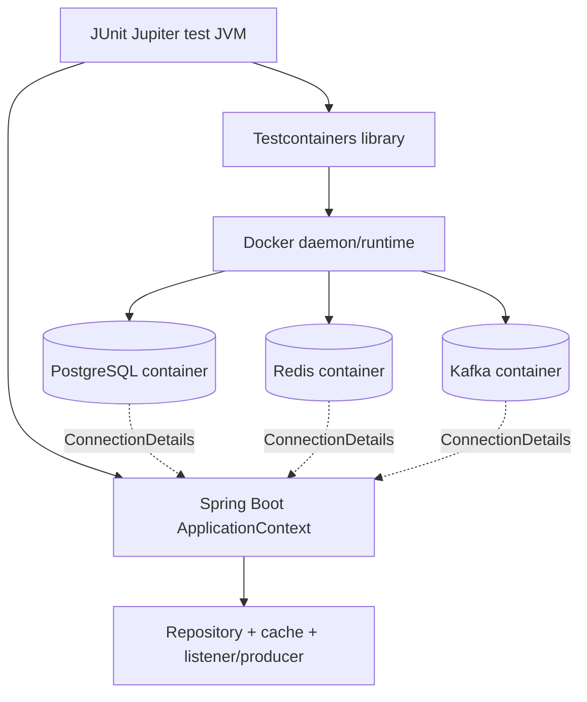
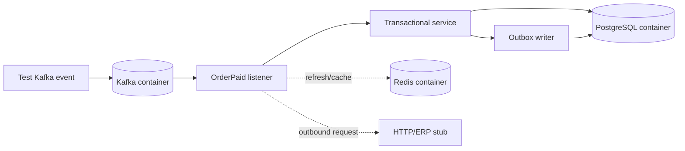

# Testcontainers, `@Container` và `@ServiceConnection`

## 1. Vì sao kiểm thử tích hợp cần dịch vụ thật, không chỉ mock?

Trong module **SPRING_BOOT_INTEGRATION**, ứng dụng Spring Boot kết nối nhiều hệ thống qua HTTP client, cơ sở dữ liệu, cache, broker thông điệp và các adapter Spring Integration. Một luồng ví dụ: consumer nhận `OrderPaid` từ Kafka, ghi trạng thái đơn hàng và outbox trong PostgreSQL, đọc Redis để trả kết quả nhanh, rồi gọi hệ thống ERP qua HTTP/SOAP. Unit test với mock giúp kiểm tra nhánh nghiệp vụ, nhưng khó phát hiện các lỗi chỉ xuất hiện khi **driver, giao dịch, network, schema và broker thực sự hoạt động**.

Những lỗi thường lọt qua mock:

- PostgreSQL xử lý `ON CONFLICT`, JSONB, khóa hàng, isolation hoặc unique constraint khác H2.
- Flyway migration chạy sai thứ tự, thiếu index hoặc không khởi tạo schema như production.
- Redis serializer không đọc được DTO, TTL không hoạt động như dự tính hoặc key prefix sai.
- Kafka bootstrap server/advertised listeners không thể kết nối từ JVM test; consumer commit offset sớm.
- Một lệnh DB đã commit nhưng message publish thất bại, khiến retry tạo side effect trùng.
- Spring Boot cấu hình sai `DataSource`, `RedisConnectionFactory` hoặc broker properties trong test context.

**Testcontainers** cho phép test khởi chạy các dịch vụ cô lập trong Docker container: một database PostgreSQL thật, một Redis thật, một Kafka broker thử nghiệm, rồi dừng và làm sạch sau khi test hoàn tất. **`@Container`** thuộc tích hợp JUnit Jupiter của Testcontainers, còn **`@ServiceConnection`** thuộc Spring Boot để kết nối auto-configuration với container mà không phải tự chép host/port/credentials.

Mục tiêu bài học:

1. Hiểu vai trò, vòng đời và giới hạn của Testcontainers, `@Testcontainers` và `@Container`.
2. Tạo kiểm thử tích hợp Spring Boot với PostgreSQL và `@ServiceConnection`, biết cách kiểm tra migration/transaction thật.
3. Biết khi nào chọn `@DynamicPropertySource` thay vì hoặc bên cạnh `@ServiceConnection`.
4. Kết nối Redis/Kafka và phối hợp kiểm thử luồng tích hợp nhiều dependency.
5. Quản lý tính lặp lại, cleanup, dữ liệu test, tốc độ CI, độ ổn định và bảo mật.
6. Phân biệt điều mà container test chứng minh được với contract/production behavior vẫn cần test riêng.

## 2. Chọn loại test theo ranh giới cần xác minh

| Loại test | Thành phần thực sự chạy | Chứng minh tốt điều gì? | Giới hạn |
|---|---|---|---|
| Unit test | Domain/service + mocks/fakes | Quy tắc nghiệp vụ, mapping, nhánh lỗi. | Không kiểm tra SQL driver/broker/network thật. |
| Slice test như `@DataJdbcTest`/`@DataJpaTest` | Một phần Spring context, repository và dependency được cấu hình. | Mapping, query, transaction của lớp persistence. | Không đi toàn luồng ứng dụng. |
| Integration test với Testcontainers | Spring context + PostgreSQL/Redis/Kafka thật trong container. | Kết nối, serialization, migration, transaction và tương tác broker. | Không chứng minh được môi trường production giống hệt. |
| HTTP/SOAP contract test | Client/server stub kiểm tra request/response theo hợp đồng. | Header, URI, JSON/XML, SOAP Fault, backward compatibility. | Stub có thể không phản ánh trạng thái đối tác thực. |
| End-to-end/staging test | Nhiều dịch vụ triển khai cùng nhau. | Routing, credentials, network policies, tương thích triển khai. | Chậm, tốn công, phụ thuộc dữ liệu/môi trường. |

**Đừng thay mọi unit test bằng container test.** Một hệ thống nhanh và đáng tin cậy thường dùng unit test cho phần lớn quyết định nghiệp vụ, tập trung Testcontainers vào những ranh giới mà mock không đại diện được: JDBC SQL đặc thù, Flyway, Redis serialization, Kafka acknowledgment hoặc idempotency ở database.

Ngược lại, thay PostgreSQL bằng H2 chỉ để test chạy nhanh có thể che giấu lỗi. Nếu production dùng PostgreSQL, những query dựa trên `INSERT ... ON CONFLICT`, `FOR UPDATE SKIP LOCKED` hay kiểu `JSONB` nên được kiểm tra bằng PostgreSQL thật.

## 3. Kiến trúc Testcontainers ở mức tổng quát

Testcontainers là thư viện điều khiển container runtime (thường Docker) từ test JVM. Nó khởi tạo container, đợi sẵn sàng theo chiến lược tương ứng, cấp địa chỉ/port được map về host, và cung cấp API lấy JDBC URL hoặc bootstrap server.



Có ba lớp cơ chế cần tách biệt:

- **Vòng đời container:** ai start, ai stop, chạy một lần cho class hay mỗi test method?
- **Thông tin kết nối:** từ container lấy URL, host, mapped port, username/password bằng cách nào?
- **Spring auto-configuration:** thông tin ấy được chuyển vào `DataSource`, `RedisConnectionFactory`, Kafka clients và các bean liên quan như thế nào?

`@Container` giải quyết lớp thứ nhất thông qua JUnit Jupiter. `@ServiceConnection` giải quyết lớp thứ ba nhờ **ConnectionDetails** của Spring Boot. Không annotation nào tự bảo đảm business workflow được rollback hoặc cleanup đúng; phần đó thuộc thiết kế test và hệ thống.

## 4. Dependency và yêu cầu môi trường

Ví dụ với Gradle Kotlin DSL cho ứng dụng Spring Boot dùng PostgreSQL:

```kotlin
dependencies {
    implementation("org.springframework.boot:spring-boot-starter-jdbc")
    implementation("org.springframework.boot:spring-boot-starter-actuator")

    runtimeOnly("org.postgresql:postgresql")

    testImplementation("org.springframework.boot:spring-boot-starter-test")
    testImplementation("org.springframework.boot:spring-boot-testcontainers")
    testImplementation("org.testcontainers:junit-jupiter")
    testImplementation("org.testcontainers:postgresql")
}
```

Nếu test Redis/Kafka, bổ sung starter ứng dụng và module Testcontainers tương ứng theo nhu cầu. Ví dụ:

```kotlin
dependencies {
    implementation("org.springframework.boot:spring-boot-starter-data-redis")
    implementation("org.springframework.kafka:spring-kafka")

    testImplementation("org.springframework.kafka:spring-kafka-test")
    testImplementation("org.testcontainers:kafka")
}
```

Phần trên giả định ứng dụng sử dụng **Spring Boot dependency management/BOM tương thích** để quản lý phiên bản. Đừng ghim Spring Boot, Testcontainers, PostgreSQL driver và Spring Kafka rời rạc khi chưa xác nhận tương thích. Một số phiên bản Testcontainers thay đổi package hoặc module của Kafka; phải đối chiếu import/module theo dependency thực tế.

Với Maven, các dependency chủ đạo có thể khai báo scope `test`:

```xml
<dependency>
    <groupId>org.springframework.boot</groupId>
    <artifactId>spring-boot-starter-test</artifactId>
    <scope>test</scope>
</dependency>
<dependency>
    <groupId>org.springframework.boot</groupId>
    <artifactId>spring-boot-testcontainers</artifactId>
    <scope>test</scope>
</dependency>
<dependency>
    <groupId>org.testcontainers</groupId>
    <artifactId>junit-jupiter</artifactId>
    <scope>test</scope>
</dependency>
<dependency>
    <groupId>org.testcontainers</groupId>
    <artifactId>postgresql</artifactId>
    <scope>test</scope>
</dependency>
```

**`@ServiceConnection` có từ Spring Boot 3.1+** trong cơ chế được tài liệu Boot mô tả; ví dụ sử dụng API thuộc thế hệ đó. Các phiên bản Boot mới có thể hỗ trợ thêm loại service connection, container image hoặc cơ chế bean. Đối chiếu metadata/version của dự án thay vì giả định mọi snippet của thế hệ khác dùng nguyên vẹn được.

### 4.1. Docker/runtime là điều kiện tiên quyết

Máy chạy test phải truy cập được Docker daemon hoặc container runtime tương thích mà Testcontainers hỗ trợ; có quyền pull image, tạo container/network, ánh xạ port và cleanup. Điều này không giống việc chỉ có Docker CLI cài sẵn.

Các tình huống thường gặp: Docker Desktop chưa chạy, CI runner không mount/cho phép Docker socket, rootless runtime có hạn chế, proxy chặn pull image, chứng chỉ registry không tin cậy, hoặc policy chặn container phụ trợ cleanup. Cần test kiểm tra điều kiện sớm với log rõ ràng, không âm thầm biến toàn bộ integration suite thành skipped.

## 5. `@Testcontainers` và `@Container` có nhiệm vụ gì?

Tích hợp với **JUnit Jupiter** nằm ở `org.testcontainers:junit-jupiter`:

```java
import org.junit.jupiter.api.Test;
import org.testcontainers.containers.PostgreSQLContainer;
import org.testcontainers.junit.jupiter.Container;
import org.testcontainers.junit.jupiter.Testcontainers;

@Testcontainers
class PostgresLifecycleTest {

    @Container
    static PostgreSQLContainer<?> postgres =
            new PostgreSQLContainer<>("postgres:16-alpine");

    @Test
    void containerIsRunning() {
        org.junit.jupiter.api.Assertions.assertTrue(postgres.isRunning());
    }
}
```

`@Testcontainers` kích hoạt JUnit extension để quản lý các field gắn `@Container`. Khi dùng **static field**, container thường được khởi động **một lần cho test class** và dừng khi class hoàn tất. Khi dùng **instance field**, container thường được khởi động/dừng **cho từng test method**. Vòng đời chi tiết và việc chạy song song phải theo JUnit/Testcontainers version.

| Khai báo | Scope thường gặp | Lợi ích | Rủi ro |
|---|---|---|---|
| `static @Container` | Dùng chung giữa methods trong một class. | Tiết kiệm startup; thuận tiện cho `@SpringBootTest`. | Dữ liệu test có thể rò giữa các methods. |
| Instance `@Container` | Container riêng cho từng method. | Cô lập state mạnh hơn. | Tốn thời gian start/migration; cần kiểm tra timing Spring context. |
| Container tạo và start thủ công | Do code/test utility sở hữu. | Kiểm soát lifecycle tùy chỉnh. | Dễ leak nếu không stop; dễ xung đột với Spring context cache. |
| Bean container do Spring Boot quản lý | Theo ApplicationContext nếu cơ chế tương ứng hỗ trợ. | Phù hợp development/test configuration. | Không dùng `@Container` JUnit lẫn bean lifecycle mà không hiểu ownership. |

**Lỗi thường gặp:** một static container kết thúc sau test class, nhưng một Spring `ApplicationContext` đã được cache/reuse cho class test khác vẫn giữ connection URL/bean tới container cũ. Cần tổ chức base test/lifecycle/context cache nhất quán hoặc cô lập context khi dùng nhiều lớp, tránh giả định static field tự là singleton của toàn test suite.

### 5.1. `@Container` khác `@ServiceConnection`

- `@Container` thuộc **Testcontainers JUnit Jupiter**: start/stop container theo lifecycle test.
- `@ServiceConnection` thuộc **Spring Boot**: tìm `ConnectionDetails` phù hợp cho bean container để Spring auto-configuration sử dụng.
- `@Testcontainers` thuộc **JUnit extension**: kích hoạt quản lý các field gắn `@Container`.
- `@SpringBootTest` thuộc **Spring Boot Test**: nạp application context cho kiểm thử tích hợp.

Các annotation này bổ sung nhau, không thay thế nhau. Chỉ gắn `@ServiceConnection` lên một object bất kỳ không có cơ chế khởi chạy container không có nghĩa container tự start đúng thời điểm trong mọi cấu hình.

## 6. `@ServiceConnection`: Boot nhận kết nối từ container thế nào?

Trước Spring Boot hỗ trợ service connection, test thường lấy `postgres.getJdbcUrl()`, `getUsername()`, `getPassword()` rồi gán vào `spring.datasource.*`. `@ServiceConnection` giảm boilerplate bằng cách để Boot nhận diện container và tạo các bean **ConnectionDetails** tương ứng.

Đường đi:

```mermaid
flowchart LR
    C[PostgreSQLContainer] --> A[@ServiceConnection]
    A --> F[ConnectionDetails factory của Boot]
    F --> J[JdbcConnectionDetails]
    J --> B[DataSource auto-configuration]
    B --> D[(PostgreSQL test container)]
    B --> M[JDBC/JPA repositories]
```

Ví dụ với `PostgreSQLContainer`, Boot có thể cung cấp `JdbcConnectionDetails` và khi phần hạ tầng tương ứng hiện diện, cả R2DBC connection details tùy classpath/factory được hỗ trợ. Nếu nhiều factories cùng nhận một container, có thể thu hẹp bằng thuộc tính `type` của `@ServiceConnection` khi cần.

**Điểm cốt lõi:** `ConnectionDetails` là một nguồn thông tin kết nối cho **auto-configuration**. Nó không tự xác thực migration, không tự tạo bảng, không tự đặt isolation và không biến PostgreSQL, Kafka, Redis thành một transaction chung.

### 6.1. Test PostgreSQL với `@Container` và `@ServiceConnection`

```java
import org.junit.jupiter.api.Test;
import org.springframework.beans.factory.annotation.Autowired;
import org.springframework.boot.test.context.SpringBootTest;
import org.springframework.boot.testcontainers.service.connection.ServiceConnection;
import org.springframework.jdbc.core.JdbcTemplate;
import org.testcontainers.containers.PostgreSQLContainer;
import org.testcontainers.junit.jupiter.Container;
import org.testcontainers.junit.jupiter.Testcontainers;

import static org.junit.jupiter.api.Assertions.assertEquals;

@SpringBootTest
@Testcontainers
class JdbcServiceConnectionIT {

    @Container
    @ServiceConnection
    static PostgreSQLContainer<?> postgres =
            new PostgreSQLContainer<>("postgres:16-alpine")
                .withDatabaseName("orders_it")
                .withUsername("test")
                .withPassword("test");

    @Autowired
    JdbcTemplate jdbc;

    @Test
    void usesRealPostgreSQL() {
        Integer answer = jdbc.queryForObject(
                "SELECT 1", Integer.class);
        assertEquals(1, answer);
    }
}
```

Khi phần dependency/configuration phù hợp, test không cần khai báo `spring.datasource.url`, username hay password cho PostgreSQL test; Boot dùng connection details từ container. Test `SELECT 1` chỉ chứng minh kết nối hoạt động, **không đủ** chứng minh migration và repository nghiệp vụ chính xác. Phần sau sẽ mở rộng sang schema và transaction.

### 6.2. Container image tag và sự tương thích

`postgres:16-alpine` là ví dụ một image cụ thể. Trong dự án thật, chọn phiên bản tương thích với production (major version, extension, collation khi ảnh hưởng truy vấn), và pin tag/digest theo chính sách reproducibility. Tránh luôn dùng `latest` khiến CI thay đổi server ngoài ý muốn.

Không đặt password production, token dịch vụ hoặc dữ liệu khách hàng thật vào container test. Thông tin đăng nhập `test/test` chỉ phục vụ instance test tạm thời.

## 7. Điều kiện để `@ServiceConnection` hoạt động

Bốn yếu tố phải cùng đúng:

1. Có module **`spring-boot-testcontainers`** trên test classpath.
2. Bean/field container được Boot nhìn thấy theo hình thức mà phiên bản đó hỗ trợ.
3. Loại container hoặc image/service name được một **ConnectionDetails factory** nhận diện.
4. Auto-configuration của dependency đích (JDBC/JPA/Redis/Kafka...) thực sự dùng connection details đó.

Nếu dùng một `GenericContainer` mà không có tên gợi ý, Boot có thể không biết đó là Redis hay một dịch vụ khác. Nếu thư viện mới không có factory tương ứng, annotation không tự tạo hỗ trợ cho nó.

### 7.1. Nhận diện theo loại container và theo image name

Với specialized container như `PostgreSQLContainer`, Boot thường biết kết nối tương ứng nhờ kiểu. Với `GenericContainer<?>`, hãy thêm **`@ServiceConnection(name = "redis")`** (trong phiên bản Boot có Redis service connection factory) để chỉ rõ service.

```java
import org.springframework.boot.testcontainers.service.connection.ServiceConnection;
import org.testcontainers.containers.GenericContainer;
import org.testcontainers.junit.jupiter.Container;
import org.testcontainers.utility.DockerImageName;

@Container
@ServiceConnection(name = "redis")
static GenericContainer<?> redis =
        new GenericContainer<>(DockerImageName.parse("redis:7-alpine"))
            .withExposedPorts(6379);
```

Đoạn field trên được đặt bên trong test class có `@Testcontainers` và `@SpringBootTest`. Phải có Spring Data Redis/Redis auto-configuration nếu muốn Boot tạo Redis connection; `@ServiceConnection` không biến `GenericContainer` thành một Redis client.

### 7.2. Trường hợp container khai báo qua `@Bean`

Ở một số phiên bản Boot, có thể khai báo container bằng `@Bean` trong test configuration và đánh dấu `@ServiceConnection` trên method. Khác với static field, Boot có thể **chưa thể gọi bean method để biết đầy đủ Docker image name** khi tạo ConnectionDetails factory; do đó với `GenericContainer` nên nêu `name` tường minh:

```java
@TestConfiguration(proxyBeanMethods = false)
class TestServicesConfiguration {

    @Bean
    @ServiceConnection(name = "redis")
    GenericContainer<?> redisContainer() {
        return new GenericContainer<>(
                DockerImageName.parse("redis:7-alpine"))
                .withExposedPorts(6379);
    }
}
```

Đây là **một cách khác** để Spring quản lý container bean, không phải lời khuyên gắn thêm `@Container` JUnit lên chính cùng object đó. Với field `@Container`, JUnit Jupiter sở hữu lifecycle; với `@Bean` do Spring Boot quản lý, test/application context sở hữu lifecycle theo hỗ trợ version. Không dùng hai owner khiến container start/stop lặp hoặc context giữ URL trỏ tới container đã chết.

## 8. `@DynamicPropertySource`: lựa chọn thay thế và bổ sung

`@DynamicPropertySource` của Spring Test cho phép cung cấp properties động từ container qua `DynamicPropertyRegistry`. Nó hữu ích khi:

- Dự án chạy phiên bản Spring Boot trước khi có `@ServiceConnection`.
- Container là custom protocol/client chưa có `ConnectionDetails` factory.
- Cần gán **application-specific property** như `integration.partner.base-url`.
- Cần cấu hình một tham số không được service connection abstraction bao phủ.

Ví dụ PostgreSQL tương đương:

```java
import org.springframework.test.context.DynamicPropertyRegistry;
import org.springframework.test.context.DynamicPropertySource;

@Container
static PostgreSQLContainer<?> postgres =
        new PostgreSQLContainer<>("postgres:16-alpine");

@DynamicPropertySource
static void registerProperties(DynamicPropertyRegistry registry) {
    registry.add("spring.datasource.url", postgres::getJdbcUrl);
    registry.add("spring.datasource.username", postgres::getUsername);
    registry.add("spring.datasource.password", postgres::getPassword);
}
```

Với `@ServiceConnection`, nhiều service-specific properties trên không cần khai báo. **Tránh trộn cả hai cách cho cùng datasource** nếu không có lý do rõ ràng, vì thứ tự ưu tiên giữa connection details và URL properties có thể khiến việc debug cấu hình khó hơn.

| Khía cạnh | `@ServiceConnection` | `@DynamicPropertySource` |
|---|---|---|
| Cách liên kết | Boot nhận container, tạo ConnectionDetails. | Test gán property bằng supplier. |
| Độ gọn với DB/Redis/Kafka phổ biến | Thường ít boilerplate. | Tự đăng ký URL, user, port, bootstrap. |
| Dịch vụ custom chưa có factory | Có thể cần tự viết factory. | Thường dễ dùng ngay. |
| Gán property ứng dụng riêng | Không thay thế mọi property custom. | Rất phù hợp. |
| Phụ thuộc Spring Boot testcontainers module | Có. | Không cần module này chỉ để gán property. |
| Phụ thuộc lifecycle container | Có, phải start hợp lý. | Có, supplier được gọi khi property cần. |

### 8.1. Tránh dùng port cố định

Sai:

```properties
spring.datasource.url=jdbc:postgresql://localhost:5432/orders_it
```

Đúng với Testcontainers:

```java
registry.add("spring.datasource.url", postgres::getJdbcUrl);
```

Container port như 5432 ở **bên trong** container thường được map ngẫu nhiên sang port của host. Giá trị từ `getJdbcUrl()`/`getMappedPort(5432)` đã phản ánh host/port mà JVM test cần dùng. Không hard-code 5432 để tránh xung đột với database cài trên developer machine và lỗi CI khi chạy song song.

## 9. Test PostgreSQL: schema, migration và ràng buộc thật

Một bài kiểm thử repository có giá trị không nên dừng ở `SELECT 1`. Hãy để Spring Boot chạy Flyway/Liquibase migration như khi startup ứng dụng, rồi kiểm tra hành vi dữ liệu thực tế.

Ví dụ bảng minh họa do migration của dự án tạo:

```sql
CREATE TABLE orders (
    id BIGINT PRIMARY KEY,
    status VARCHAR(30) NOT NULL,
    version BIGINT NOT NULL DEFAULT 0
);

CREATE TABLE consumed_events (
    event_id VARCHAR(100) PRIMARY KEY,
    payload_hash VARCHAR(64) NOT NULL
);

CREATE TABLE outbox_events (
    id BIGSERIAL PRIMARY KEY,
    aggregate_id BIGINT NOT NULL,
    event_type VARCHAR(100) NOT NULL,
    payload TEXT NOT NULL,
    published_at TIMESTAMPTZ
);
```

**Không chạy DDL như giải pháp tạm trong mỗi test rồi quên migration production.** Ưu tiên sử dụng chính migration được đóng gói cùng ứng dụng để phát hiện sớm schema drift, thứ tự migration hoặc thiếu index/constraint.

Ví dụ test với `JdbcClient` (Spring Framework 6.1+):

```java
@SpringBootTest
@Testcontainers
class OrderRepositoryIT {

    @Container
    @ServiceConnection
    static PostgreSQLContainer<?> postgres =
            new PostgreSQLContainer<>("postgres:16-alpine");

    @Autowired JdbcClient jdbc;

    @Test
    void uniqueEventIdPreventsDuplicateProcessing() {
        String eventId = "event-" + java.util.UUID.randomUUID();

        int first = jdbc.sql("""
                INSERT INTO consumed_events(event_id, payload_hash)
                VALUES (:id, :hash)
                ON CONFLICT(event_id) DO NOTHING
                """)
            .param("id", eventId)
            .param("hash", "same-payload")
            .update();

        int second = jdbc.sql("""
                INSERT INTO consumed_events(event_id, payload_hash)
                VALUES (:id, :hash)
                ON CONFLICT(event_id) DO NOTHING
                """)
            .param("id", eventId)
            .param("hash", "same-payload")
            .update();

        assertEquals(1, first);
        assertEquals(0, second);
    }
}
```

Ví dụ này giả định migration đã tạo `consumed_events` như trên và class có imports cho Testcontainers, Spring Boot, `JdbcClient`, `@Test` và assertion. Nó kiểm tra **ràng buộc PostgreSQL thật**: hai lần ghi cùng business ID không tạo hai dòng. Trong kiểm thử nghiệp vụ hoàn chỉnh, còn phải xác minh payload hash, trạng thái đơn và bản ghi outbox được commit/rollback cùng nhau.

### 9.1. Test transaction thật

Nếu handler ghi order và outbox trong một `@Transactional`, cần tạo tình huống làm insert outbox thất bại, rồi xác minh **không còn order update hoặc consumed event sau transaction rollback**. Chỉ mock repository rồi assert `verify(repository).save(...)` không chứng minh atomicity.

Lưu ý `@Transactional` **trên test method** thường khiến framework rollback test transaction khi kết thúc, hữu ích để dọn dữ liệu nhưng có thể làm che giấu behavior sau commit. Để kiểm tra `AFTER_COMMIT`, outbox dispatcher và commit thật, có thể **không gắn `@Transactional` lên test**, hoặc dùng `TestTransaction` của Spring Test khi cần chủ động kết thúc transaction test.

## 10. Redis: kiểm tra TTL, serializer và cache thật

Mock `CacheManager` có thể xác minh annotation `@Cacheable` được gọi, nhưng không phát hiện được lỗi serialization, TTL hoặc kết nối Redis. Với Spring Boot có Redis service connection factory, dùng `GenericContainer` kèm `name="redis"`:

```java
import org.junit.jupiter.api.Test;
import org.springframework.beans.factory.annotation.Autowired;
import org.springframework.boot.test.context.SpringBootTest;
import org.springframework.boot.testcontainers.service.connection.ServiceConnection;
import org.springframework.data.redis.core.StringRedisTemplate;
import org.testcontainers.containers.GenericContainer;
import org.testcontainers.junit.jupiter.Container;
import org.testcontainers.junit.jupiter.Testcontainers;
import org.testcontainers.utility.DockerImageName;

import static org.junit.jupiter.api.Assertions.assertEquals;

@SpringBootTest
@Testcontainers
class RedisServiceConnectionIT {

    @Container
    @ServiceConnection(name = "redis")
    static GenericContainer<?> redis =
            new GenericContainer<>(DockerImageName.parse("redis:7-alpine"))
                .withExposedPorts(6379);

    @Autowired StringRedisTemplate template;

    @Test
    void readsValueWrittenToRedis() {
        String key = "it:order:" + java.util.UUID.randomUUID();

        try {
            template.opsForValue().set(key, "PAID");
            assertEquals("PAID", template.opsForValue().get(key));
        } finally {
            template.delete(key);
        }
    }
}
```

Đây là test kết nối/round-trip đơn giản. Với ứng dụng thật, nên dùng **chính `RedisCacheManager` và serializer của ứng dụng** để kiểm tra:

- DTO được serialize/deserialize đúng, kể cả khi schema thay đổi.
- TTL/expiration phù hợp, không có negative caching tồn tại quá lâu.
- Prefix phân tách tenant/environment.
- `@CacheEvict` sau database commit, không ghi giá trị chưa commit.
- Redis lỗi thì policy fail-open/fail-closed có phù hợp nghiệp vụ không.

Tránh test TTL bằng `Thread.sleep(5000)` khi có thể điều khiển clock của lớp nghiệp vụ hoặc thiết kế TTL test riêng có thời gian chờ có giới hạn. Redis expiration chạy theo thời gian thật; nếu cần kiểm tra đặc tính ấy, cho phép sai số và dùng polling có deadline.

## 11. Kafka: bootstrap, producer, consumer và xử lý lại message

Với Kafka, `@ServiceConnection` có thể cung cấp bootstrap server cho Spring Kafka auto-configuration khi container Kafka thuộc loại được version Boot nhận diện. Tên class/package và image tương thích có thay đổi giữa các phiên bản Testcontainers; ví dụ sau mô tả **ý tưởng** theo một thế hệ API dùng specialized Kafka container:

```java
// Đoạn minh họa: chọn KafkaContainer/ConfluentKafkaContainer
// và image tương thích với phiên bản Testcontainers của dự án.
@Container
@ServiceConnection
static KafkaContainer kafka = new KafkaContainer(
        DockerImageName.parse("confluentinc/cp-kafka:7.6.1"));
```

Nếu phiên bản dự án dùng package hoặc class Kafka container khác, hãy cập nhật import/API theo Testcontainers BOM; đừng trộn class `org.testcontainers.containers.KafkaContainer` và `org.testcontainers.kafka.KafkaContainer` một cách tùy tiện. Với `@DynamicPropertySource`, có thể đăng ký bootstrap server từ container:

```java
@DynamicPropertySource
static void kafkaProperties(DynamicPropertyRegistry registry) {
    registry.add("spring.kafka.bootstrap-servers",
                 kafka::getBootstrapServers);
}
```

Chỉ dùng một phương pháp cho cùng nguồn kết nối trừ khi có lý do. Kafka container không đồng nghĩa listener/topic/consumer group đã đúng; mỗi test cần quản lý topic, group ID, producer/consumer lifecycle và điểm xác nhận xử lý.

### 11.1. Test message-driven workflow

Một test có ý nghĩa cho `OrderPaid`:

1. Khởi tạo database/test data cần thiết và consumer group riêng.
2. Đảm bảo listener sẵn sàng/đã assign partition trước khi gửi event, hoặc dùng cơ chế chờ hợp lệ.
3. Producer gửi `OrderPaid(eventId, orderId)` vào topic test.
4. Đợi **điều kiện nghiệp vụ quan sát được**: DB có order status `PAID` và một outbox record tương ứng.
5. Gửi lại cùng `eventId`, xác minh không tạo duplicate side effect.
6. Cho handler thất bại có kiểm soát, kiểm tra retry/DLQ và acknowledgment theo thiết kế.

Đừng dùng `Thread.sleep(...)` với kỳ vọng “broker xử lý xong sau 2 giây”. Sử dụng polling có deadline (ví dụ Awaitility nếu dự án có dependency) để chờ trạng thái cuối, và báo assertion rõ nếu timeout.

### 11.2. Exactly-once không tự có nhờ container

Testcontainers chỉ tạo broker Kafka **đúng hành vi giao tiếp**, nó không bảo đảm database commit + Kafka offset commit là một transaction phân tán. Một kết quả test đáng tin cậy cần mô phỏng **DB đã commit nhưng ack/offset commit chưa thành công**, sau đó message được xử lý lại mà không tạo lệnh trùng.

Với RabbitMQ, nguyên tắc tương tự: Testcontainers RabbitMQ thực cho phép kiểm tra queue/exchange binding, ack/nack, DLQ, redelivery và độ bền. Cần dùng container/module và `ConnectionDetails` tương ứng mà phiên bản Boot hỗ trợ, hoặc `@DynamicPropertySource` nếu không có factory.

## 12. Nhiều container trong cùng một test: phạm vi nào là cần thiết?

Một end-to-end-style integration test có thể cần cả PostgreSQL, Redis và Kafka. Tuy nhiên, mỗi test không nên khởi động toàn bộ dependency nếu mục tiêu chỉ là một SQL query.



Tách thành những lớp kiểm thử:

- Persistence test: PostgreSQL, migrations, SQL, isolation, rollback.
- Cache test: Redis, serializer, TTL và cache invalidation.
- Messaging test: Kafka/RabbitMQ, producer/listener, ack/retry/DLQ.
- Contract test: HTTP server stub/WireMock hoặc SOAP `MockWebServiceServer`.
- Workflow integration: kết hợp đủ phụ thuộc để xác minh một luồng quan trọng, nhưng giữ môi trường và fixture tối giản.

Mô hình này giảm thời gian chạy, giúp tìm đúng nguyên nhân khi test fail và giữ CI ổn định.

## 13. HTTP/SOAP client: Testcontainers không thay thế contract tests

Với outbound REST/SOAP, dùng một **HTTP stub** (WireMock, MockWebServer hoặc server kiểm thử của Spring) thường đơn giản hơn việc khởi động một container cho mọi tình huống. Hãy kiểm tra:

- HTTP method, URL, headers, content type, status, timeout/retry.
- JSON schema, nullable fields, versioning và error body.
- SOAP Envelope namespace, `SOAPAction`, WSDL/XSD, XML marshalling và Fault.
- Kết quả **không xác định** khi client timeout sau lệnh ghi: request có thể đã được phía đối tác xử lý.

Nếu upstream phụ thuộc một sản phẩm server cụ thể và cần xác minh network/protocol/extension thực, có thể dùng container server test thích hợp. Nhưng đối với hợp đồng của một API bên ngoài mà bạn không sở hữu, Testcontainers không tự sao chép đúng production behavior; cần contract từ đối tác, sandbox hoặc staging.

### 13.1. Kết hợp HTTP stub với DB container

Một tình huống tốt: service gọi ERP HTTP stub trả `503`, sau đó kiểm tra PostgreSQL vẫn có outbox record cần retry, không tạo duplicate khi gọi lại. Khi stub trả `200`, kiểm tra transaction cập nhật `SUCCEEDED` và dispatcher không publish lặp. **DB container** bảo đảm các ràng buộc ghi thật; **HTTP stub** kiểm soát thời điểm và payload lỗi.

## 14. Thứ tự khởi động, readiness và wait strategy

Container process đã start không đồng nghĩa service bên trong **sẵn sàng nhận kết nối**. Testcontainers có các readiness/wait strategy tương ứng cho module database/broker; với `GenericContainer` tùy chỉnh có thể cần thêm wait strategy rõ ràng.

Ví dụ Redis chờ log readiness (minh họa, không phụ thuộc text log cứng khi version thay đổi):

```java
GenericContainer<?> redis =
    new GenericContainer<>(DockerImageName.parse("redis:7-alpine"))
        .withExposedPorts(6379)
        .waitingFor(
            org.testcontainers.containers.wait.strategy.Wait
                .forListeningPort());
```

Chờ port mở là điều kiện kỹ thuật ban đầu, **không chứng minh** toàn bộ schema/consumer/topic/nghiệp vụ sẵn sàng. PostgreSQL cần chờ DB có thể nhận query; Kafka listener cần chờ consumer partition assignment; ứng dụng cần chờ migration hoàn tất trước khi gửi request.

Các tín hiệu nên sử dụng:

| Thành phần | Readiness phù hợp |
|---|---|
| PostgreSQL | Container-specific readiness, sau đó query test `SELECT 1`/migration. |
| Redis | Ping/port/connection command qua client đúng config. |
| Kafka | Bootstrap thành công, topic được tạo/metadata sẵn, listener assigned. |
| HTTP stub | Endpoint health/test response sẵn sàng. |
| Integration flow | Consumer/subscriber được đăng ký, resource còn hoạt động. |

Nếu cần tăng `startupTimeout`, hãy tìm hiểu image pull, network và readiness thực; tăng timeout vô hạn làm CI chậm và che giấu sự cố.

## 15. Host, mapped port và network: tránh lỗi `localhost`

Testcontainers container thường có **port nội bộ** và **port được Docker map ra host**:

```text
Test JVM trên host:
  postgres.getHost() + postgres.getMappedPort(5432)
      -> cổng ngẫu nhiên trên host tới 5432 trong container

Container khác trong Docker network:
  dùng network alias và container port theo topology container-to-container
```

Đừng hard-code `localhost:5432`. Trong CI hoặc Docker-in-Docker/remote Docker daemon, host có thể không phải localhost mà là địa chỉ do Testcontainers cung cấp qua `getHost()`.

Khi test JVM chạy trên host, dùng `getJdbcUrl()`/`getBootstrapServers()` hoặc connection details. Khi **container A cần gọi container B**, dùng shared Testcontainers `Network` và network aliases hoặc cơ chế expose host port thích hợp, không giả định host-mapped port/localhost truy cập như nhau từ mọi container.

Một test chạy được trên laptop nhưng fail trên CI remote Docker có thể do **địa chỉ broker quảng bá (advertised listeners), mapped port hoặc network DNS**, không phải lỗi nghiệp vụ Kafka.

## 16. Quản lý dữ liệu test và tính độc lập

Với static `@Container`, các test methods dùng chung database. Nếu test A insert order `id=1`, test B cũng dùng `id=1`, thứ tự chạy có thể khiến test B fail ngẫu nhiên.

Các kỹ thuật:

- Dùng UUID/business key riêng cho mỗi test thay vì ID cố định toàn suite.
- `@Sql` scripts hoặc repository fixtures setup/cleanup phù hợp.
- Transaction rollback cho test thuần DB khi **không** cần xác minh commit thật.
- `TRUNCATE`/delete có kiểm soát khi test commit thật; xem foreign key và dữ liệu baseline.
- Tạo topic/group ID riêng cho messaging tests để tránh consumer nhận message của test trước.
- Dùng namespace/key prefix riêng cho Redis, dọn trong `finally` hoặc test teardown.
- Tránh `FLUSHALL` trên Redis dùng chung nếu có bất kỳ nguy cơ chạm dữ liệu ngoài test.
- Khi chạy song song, dùng resource isolation hoặc tắt parallel execution cho test shared resources.

### 16.1. Spring context cache có thể khiến test bị nhiễm nhau

`@SpringBootTest` sử dụng cache ApplicationContext để tăng tốc. Nếu hai class có cùng cấu hình Spring nhưng mỗi class khởi động một static container mới, context có thể được tái sử dụng với connection factory trỏ tới container cũ. Kết quả là `Connection refused` ở class sau hoặc datasource kết nối sai instance.

Hướng phòng tránh:

1. Đặt container cùng lifetime với context được reuse nếu muốn chia sẻ.
2. Thiết kế một fixture/base class/test configuration ổn định cho nhóm test chung nguồn.
3. Dùng `@DirtiesContext` khi thực sự cần ép context mới, hiểu rằng nó tăng startup cost.
4. Không dựa vào thứ tự test classes để giữ container sống.
5. Cân nhắc Spring-managed container bean khi cơ chế này phù hợp version/lifecycle.

Không coi Testcontainers `reuse` là giải pháp cho vấn đề context cache: reuse container giữa các test runs có thể làm dữ liệu và cấu hình leak qua lần chạy khác.

## 17. Transaction, rollback và after-commit trong bài test

Khi một method `@Transactional` tham gia transaction của test, hành vi khác lúc production:

```java
@SpringBootTest
@Transactional
class MisleadingTransactionIT {

    @Test
    void mayHideAfterCommitBehavior() {
        // Gọi service cập nhật DB và publish @TransactionalEventListener.
        // Test transaction thường rollback khi kết thúc.
        // AFTER_COMMIT callback có thể không chạy như production.
    }
}
```

Ví dụ này minh họa phản mẫu, không phải test hữu ích. Để kiểm tra after-commit handler, dùng **transaction thật và kết thúc commit**. Khi dùng TestTransaction trong test có `@Transactional`:

```java
// Mã minh họa bên trong test transaction đã được Spring Test mở:
org.springframework.test.context.transaction.TestTransaction.flagForCommit();
org.springframework.test.context.transaction.TestTransaction.end();

// Từ đây, assert trạng thái đã commit và sự kiện AFTER_COMMIT,
// sau đó khởi tạo transaction mới nếu test cần tiếp tục bằng TestTransaction.start().
```

Phương pháp đơn giản hơn ở nhiều integration tests: **không đánh dấu `@Transactional` lên test method**, để application service tự sở hữu transaction, rồi assert DB/outbox sau khi lời gọi hoàn tất. Sau test cleanup bằng business key duy nhất.

### 17.1. Test propagation và concurrency

Nếu đang kiểm tra `REQUIRES_NEW`, `NESTED` hoặc isolation `READ_COMMITTED`/`SERIALIZABLE`, cần database thật và nhiều connection/transaction độc lập. H2 và các fakes khác có thể khác PostgreSQL. Sử dụng `CountDownLatch`/barrier để cố định interleaving thay vì `Thread.sleep()`, và giới hạn thời gian chờ để CI không treo.

## 18. Khả năng lặp lại: phiên bản image, thời gian và môi trường

Một test tốt phải cho kết quả giống nhau khi chạy trên laptop, CI và khi chạy riêng lẻ. Cần cố định:

| Yếu tố | Vì sao ảnh hưởng |
|---|---|
| Image tag/digest | PostgreSQL/Redis/Kafka đổi version có thể đổi protocol/query behavior. |
| DB extension/locale/time zone | Sort, decimal/date formatting, timestamp có thể khác. |
| Application/test profile | Cấu hình pool, migration, security, serializer có thể thay đổi. |
| Thời điểm tạo dữ liệu | TTL/time-based assertions và race dễ flaky. |
| Random port | Cần lấy host/mapped port động, không hard-code. |
| Test concurrency | Các class chia sẻ container/context có thể ảnh hưởng lẫn nhau. |
| Image pull/proxy/network | CI chậm không nhất thiết do application logic. |
| CPU/memory quota | Kafka/PostgreSQL startup và timing biến động theo runner. |

Không lưu snapshot dữ liệu production vào test image. Nếu test cần dữ liệu đại diện, sinh synthetic fixtures không chứa PII hoặc token thật. Nếu dùng `withCopyFileToContainer` hoặc init SQL, bảo đảm file có trong test resources, version hóa rõ và không chứa bí mật.

### 18.1. `withInitScript` và migration

`withInitScript("...")` có thể seed schema/data khi container khởi tạo, nhưng không nên thay luôn migration production bằng test-specific DDL mà không có lý do. Với ứng dụng chạy Flyway/Liquibase, ưu tiên cho ứng dụng chạy migration; dùng `@Sql`/fixtures cho dữ liệu test. Khi startup cần một DB role/extension đặc thù, init script có thể bổ sung môi trường nền theo chính sách có kiểm soát.

## 19. Tốc độ CI: giữ test có giá trị nhưng không quá chậm

Testcontainers đòi hỏi image pull/startup. Nếu mỗi test method khởi tạo PostgreSQL mới, suite vài trăm test có thể rất chậm. Đổi lại, dùng một container chia sẻ cho tất cả tests không có chiến lược dọn dữ liệu sẽ gây flaky.

Chiến lược cân bằng:

1. Nhóm repository tests theo cấu hình database chung, dùng static container ở phạm vi class/fixture phù hợp.
2. Tận dụng Spring `ApplicationContext` caching khi container lifecycle tương thích.
3. Khởi động **đúng dependency cần thiết**; không thêm Kafka vào test chỉ kiểm tra SQL.
4. Giữ image tương đối nhỏ và pin phiên bản; dùng cache layer của CI khi được phép.
5. Hạn chế test E2E dài, nhưng giữ một số luồng quan trọng qua DB + broker thực.
6. Chỉ bật reuse container trong local development khi hiểu rủi ro state leakage; **không dựa vào reuse như yêu cầu bắt buộc của CI**.
7. Không vô hiệu hóa test vì Docker không sẵn trong CI mà vẫn báo build xanh; nên kiểm tra và báo lỗi hạ tầng rõ ràng.

Testcontainers có cơ chế hỗ trợ resource cleanup; không tắt container cleanup phụ trợ hoặc cho phép reuse tùy tiện để “tăng tốc” nếu chưa đánh giá an toàn. Trên shared CI, bảo vệ Docker socket và registry credentials: truy cập Docker daemon thường có quyền rất cao trên runner.

## 20. Chẩn đoán khi container hoặc Spring context không khởi động

| Triệu chứng | Nguyên nhân cần kiểm tra | Hướng xử lý |
|---|---|---|
| “Could not find a valid Docker environment” | Docker daemon không chạy/không được quyền hoặc runner policy. | Kiểm tra Docker access và cấu hình CI. |
| Image pull timeout/unauthorized | Registry, proxy, credentials, network hoặc tag sai. | Xác minh image/tag và registry access. |
| Container start nhưng test không kết nối | Mapped port/host sai; readiness chưa đủ; firewall. | Dùng `getHost()`, `getMappedPort(...)`, connection details và wait strategy. |
| `@ServiceConnection` không thay datasource | Thiếu `spring-boot-testcontainers`, container không được nhận diện, custom bean dùng URL riêng. | Kiểm tra Boot version, factory và Condition Evaluation Report. |
| `GenericContainer Redis` không có connection details | Thiếu `name="redis"` hoặc Redis factory/dependency không sẵn. | Thêm name hint và starter/auto-config phù hợp. |
| Dùng `@Container` nhưng container không start | Thiếu `@Testcontainers` JUnit extension hoặc lifecycle do code khác kiểm soát. | Kiểm tra annotation imports và test engine. |
| Port 5432 conflict | Test hard-code host port hoặc có bind cố định. | Dùng dynamic mapped port. |
| Class thứ hai `Connection refused` | Spring context cache giữ connection tới static container đã stop. | Đồng bộ lifetime, fixture hoặc `@DirtiesContext` khi cần. |
| Migration failed | Schema/privileges/version DB khác, migration thứ tự sai. | Đọc Flyway/Liquibase log, fix migration. |
| Kafka client không kết nối broker | Advertised listeners, bootstrap server hoặc image/module không tương thích. | Dùng specialized Kafka container và bootstrap từ chính container. |
| Test messaging thỉnh thoảng fail | Race listener readiness hoặc group offset/state từ test khác. | Chờ assignment, dùng group/topic riêng, polling assertion. |
| Redis test không thấy cache value | Sai serializer/cache manager/TTL/key prefix. | Kiểm tra client thật, keyspace và test config. |
| CI pass khi không có Docker | Test bị skip âm thầm bởi điều kiện môi trường. | Tách job integration cần Docker và bắt fail khi thiếu dependency. |

### 20.1. Thu thập log để sửa đúng nguyên nhân

Ví dụ với container PostgreSQL:

```java
System.out.println(postgres.getLogs());
```

Chỉ in log container vào CI khi chẩn đoán hoặc thu thập có kiểm soát; log có thể chứa user, SQL, token hay payload của fixture. Ngoài log, kiểm tra lifecycle events, datasource URL được che, migration status, consumer assignment, số retries và timeout exception.

Khi test bị timeout, hãy tách **thời gian pull/start container** khỏi **thời gian xử lý business test**. Tăng timeout cho toàn suite có thể che giấu consumer deadlock hoặc kết nối sai.

## 21. Các kịch bản failure nên kiểm thử trong hệ thống tích hợp

Testcontainers không chỉ để kiểm tra happy path. Khi thiết kế hệ thống chịu lỗi, cần xác minh các kịch bản:

| Failure injection | Kỳ vọng đúng |
|---|---|
| PostgreSQL unique constraint từ chối event trùng | Consumer không tạo side effect lặp và ack theo policy. |
| Transaction ghi order + outbox ném exception giữa chừng | Cả hai thay đổi rollback. |
| DB commit rồi Kafka ack không hoàn tất | Redelivery idempotent, không có duplicate business write. |
| Kafka tạm không khả dụng sau DB commit | Outbox còn record chưa publish và dispatcher có thể retry. |
| Redis mất kết nối khi cache miss | Fallback hoặc fail-closed theo hợp đồng, không gây DB thundering herd. |
| HTTP ERP trả 429/503 | Backoff và retry budget phù hợp, không bão tải. |
| SOAP Fault có mã nghiệp vụ | Không retry mù; error mapping đúng contract. |
| HTTP read timeout sau lệnh ghi ERP | Ghi trạng thái UNKNOWN và đối soát theo request ID. |
| Message được publish hai lần | Consumer idempotent, unique business key bảo vệ dữ liệu. |
| Event đến sai thứ tự | Version/conditional update ngăn quay ngược trạng thái. |
| Restart worker giữa lệnh dài | Công việc bền vững được khôi phục; không dựa vào queue RAM. |

Để mô phỏng mất mạng, pause/stop container hoặc thêm proxy/fault injector khi dự án hỗ trợ; nhưng test cần timeout hữu hạn, cleanup và cách tái khởi động rõ ràng. Không tắt container shared trong một test nếu class khác cùng lúc phụ thuộc vào nó.

## 22. Quan sát và tracing trong integration tests

Khi lỗi chỉ xuất hiện qua nhiều dependency, metric/log/trace có thể giúp tìm nguyên nhân. Nhưng test không nên tự động export telemetry tới backend production.

Các điểm nên quan sát:

- Startup container, image, mapped port (không lộ secret) và thời gian chờ readiness.
- JDBC connection acquisition, transaction commit/rollback, Flyway migration status.
- Redis timeout/hit/miss/serializer error nếu ứng dụng có instrumentation.
- Kafka producer send failures, consumer lag/assignment/offset commit, số message redelivery.
- HTTP/SOAP request count, timeout, retries và error classification.
- Correlation ID của một test workflow để liên kết log trong cùng run.
- Outbox backlog, trạng thái event và số lần xử lý idempotency.

**Metric label không nên chứa eventId/orderId hoặc UUID test** vì cardinality cao; những ID ấy phù hợp trong log/trace có kiểm soát. Trong các Spring Boot integration tests, observability có thể bị hạn chế theo mặc định để tránh export ra ngoài; nếu cần xác minh metrics/tracing, bật test observability theo cơ chế phù hợp với Boot version và dùng in-memory/test registry.

Một test `SELECT 1` pass không chứng minh tracing context đi xuyên Kafka listener → database → HTTP client. Cần test riêng propagation tại ranh giới async/executor nếu đó là yêu cầu hệ thống.

## 23. Những phản mẫu thường gặp

1. **Dùng H2 thay PostgreSQL khi production phụ thuộc PostgreSQL SQL.** Test không đại diện cho behavior thực tế.
2. **Gắn `@Container` rồi cho rằng Spring Boot tự biết URL.** Cần `@ServiceConnection` hoặc dynamic properties phù hợp.
3. **Gắn `@ServiceConnection` nhưng thiếu module testcontainers của Boot.** Không có infrastructure nhận diện container.
4. **Tự tạo `GenericContainer` không có service name hint.** Boot không thể luôn suy ra dịch vụ từ kiểu chung.
5. **Hard-code `localhost:5432` hoặc `localhost:9092`.** Mapped port và host có thể thay đổi.
6. **Gắn `@Transactional` lên mọi integration test.** Có thể che giấu commit/after-commit logic.
7. **Chia sẻ container nhưng không reset dữ liệu.** Tests phụ thuộc thứ tự và fail ngẫu nhiên.
8. **Tạo container mới mỗi method cho toàn suite.** Startup/migration quá chậm so với giá trị kiểm thử.
9. **Dùng `Thread.sleep` để đợi Kafka event.** Flaky do CI load và race consumer readiness.
10. **Cho rằng container test tự bảo đảm exactly-once.** DB và broker vẫn có commit/ack gap.
11. **Dùng `@DirtiesContext` trên mọi test để né setup.** Giảm tốc mạnh và che giấu lifecycle design.
12. **Tắt Docker-dependent tests trong CI mà không có job thay thế.** Build xanh nhưng phần tích hợp không được kiểm tra.
13. **Pull `latest` ở mọi run.** Phiên bản server thay đổi ngoài kiểm soát.
14. **Đưa credential production hoặc dữ liệu nhạy cảm vào fixtures.** Rủi ro bảo mật và vi phạm dữ liệu.
15. **Tin `@ServiceConnection` sẽ tự quản lý mọi external service.** Chỉ những factory/types tương ứng mới được cấu hình.

## 24. Checklist triển khai Testcontainers cho Spring Boot Integration

- [ ] Xác nhận Spring Boot, Testcontainers, JUnit Jupiter, Docker runtime và dependency/BOM tương thích.
- [ ] Có `spring-boot-testcontainers` khi sử dụng `@ServiceConnection`.
- [ ] Có `@Testcontainers` và `@Container` đúng imports, lifecycle rõ ràng.
- [ ] Chọn static container hay instance container theo scope/data isolation, không trộn ownership.
- [ ] Dùng `@ServiceConnection` cho container được Boot hỗ trợ; dùng `@DynamicPropertySource` cho property/custom service khi cần.
- [ ] Với `GenericContainer`, có name hint thích hợp như `@ServiceConnection(name="redis")`.
- [ ] Test DB dùng chính driver/server version gần production và migrations thật.
- [ ] Test transaction kiểm tra commit/rollback thực, không bị test-level `@Transactional` che khuất.
- [ ] Các test có business key/topic/group ID riêng và cleanup xác định.
- [ ] Không hard-code host port; sử dụng URL/bootstrap server do container cung cấp.
- [ ] Chờ readiness đúng lớp: DB query, migration, topic/listener assignment, HTTP stub.
- [ ] Có test idempotency, outbox, redelivery, Redis serialization và lỗi transport.
- [ ] Có Testcontainers CI job bắt buộc với Docker access; không âm thầm skip.
- [ ] Image tags được kiểm soát và không chứa secrets/dữ liệu thật.
- [ ] Test song song/context reuse không giữ connection tới container đã stop.
- [ ] Startup/timeout và polling assertions có giới hạn, không sleep theo thời gian đoán.
- [ ] Hệ thống quan sát test không export telemetry ra production; log có redaction.
- [ ] Phân biệt container integration test với contract/E2E và bổ sung đúng cấp kiểm thử còn thiếu.

## 25. Tổng kết

**Testcontainers cung cấp phụ thuộc thực bên trong container để kiểm thử sự tương tác mà mock không tái hiện đầy đủ. `@Container` điều phối vòng đời container dưới JUnit Jupiter; `@ServiceConnection` giúp Spring Boot kết nối auto-configuration tới container qua `ConnectionDetails` mà không phải tự gán URL/credentials cho những dịch vụ đã được hỗ trợ.** `@DynamicPropertySource` vẫn hữu ích với các thuộc tính ứng dụng hoặc dịch vụ custom.

Trong **SPRING_BOOT_INTEGRATION**, giá trị lớn nhất của Testcontainers là xác minh **hợp đồng dữ liệu, transaction, cache serialization, broker acknowledgment, idempotency, outbox và khả năng phục hồi** trên công nghệ gần production. Một bài test tốt không chỉ “khởi động được PostgreSQL/Kafka/Redis”, mà còn chứng minh trạng thái cuối cùng và hành vi khi lỗi. Giữ container lifecycle, context cache, fixtures, readiness và CI ổn định giúp bộ test trở thành công cụ phát hiện lỗi tích hợp sớm thay vì nguồn flaky test mới.
