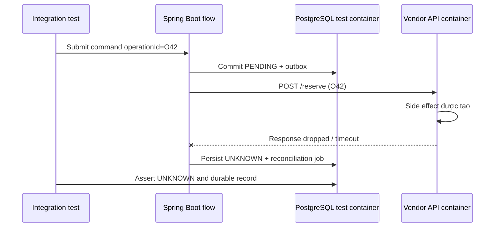

# `@DynamicPropertySource` cho dịch vụ chưa có hỗ trợ service connection

## 1. Bài toán: container đã khởi động nhưng ứng dụng không biết kết nối tới đâu

Một hệ thống Spring Boot thường tích hợp PostgreSQL, Redis, Kafka hoặc RabbitMQ, đồng thời gọi những dịch vụ riêng của doanh nghiệp: HTTP API ERP, máy chủ SFTP, cổng SOAP, dịch vụ gRPC nội bộ hoặc một bộ giả lập API của đối tác. Với những loại phổ biến, Spring Boot có thể hỗ trợ **`@ServiceConnection`** để cấp `ConnectionDetails` cho auto-configuration. Nhưng một dịch vụ **không có `ConnectionDetails` factory phù hợp** hoặc một endpoint được cấu hình qua property riêng như `integration.vendor.base-url` thì Spring Boot không tự suy được địa chỉ đó.

Trong môi trường Testcontainers, host port thường được **Docker ánh xạ động**:

```text
Container bên trong Docker:
  HTTP API lắng nghe cổng 80

Test JVM trên máy chạy:
  http://<container.getHost()>:<container.getMappedPort(80)>

Spring Boot application trong test:
  cần integration.vendor.base-url trỏ tới đúng host:port nêu trên
```

Ghi cố định `http://localhost:8080` vào `application-test.yml` không đáng tin cậy: port có thể khác trên laptop, CI hoặc remote Docker daemon. **`@DynamicPropertySource`** cho phép test đưa các giá trị kết nối **tính từ container ở runtime** vào Spring `Environment` trước khi những bean cần chúng được khởi tạo.

Bài thuộc chương **Kiểm thử tích hợp** của module **SPRING_BOOT_INTEGRATION**: xây luồng tích hợp HTTP client, cơ sở dữ liệu, cache, broker và các adapter Spring Integration với cấu hình đúng, hợp đồng dữ liệu nhất quán, giao dịch, lỗi, chống trùng lặp, kiểm thử và quan sát có thể xác minh.

Bài này tập trung vào câu hỏi: **khi chưa có service connection hỗ trợ cho một phụ thuộc, dùng `@DynamicPropertySource` thế nào để test thật sự sử dụng dịch vụ đúng, không tạo môi trường flaky hoặc vô tình truy cập production?**

Sau bài học, bạn có thể:

- Phân biệt nhiệm vụ của `@Container`, `@ServiceConnection`, `@DynamicPropertySource` và `DynamicPropertyRegistry`.
- Kết nối một `GenericContainer` HTTP tới bean ứng dụng bằng property riêng, không hard-code port.
- Áp cùng cơ chế cho host/port/URL của SFTP, API nội bộ hoặc database khi `ConnectionDetails` không áp dụng.
- Hiểu thời điểm supplier được đánh giá, ưu tiên property, vòng đời container và cache `ApplicationContext`.
- Kết hợp service connections được hỗ trợ với dynamic properties cho dịch vụ **chưa được hỗ trợ**.
- Kiểm thử lỗi kết nối, timeout, contract, CI, bảo mật và observability ở đúng ranh giới.

## 2. `@DynamicPropertySource` thực chất làm gì?

`@DynamicPropertySource` nằm trong Spring Test (`org.springframework.test.context.DynamicPropertySource`). Một phương thức `static` được đánh dấu annotation này sẽ nhận **`DynamicPropertyRegistry`**. Phương thức đăng ký tên property cùng một **`Supplier<?>`** để Spring Test thêm vào nguồn property động của test `ApplicationContext`.

Ví dụ tối thiểu:

```java
import org.springframework.test.context.DynamicPropertyRegistry;
import org.springframework.test.context.DynamicPropertySource;

@DynamicPropertySource
static void registerEndpoint(DynamicPropertyRegistry registry) {
    registry.add("integration.vendor.base-url",
            () -> "http://127.0.0.1:18080");
}
```

Giá trị ví dụ trên được hard-code chỉ để trình bày API, **chưa khai thác container**. Trong test thật, supplier sẽ lấy host/port do Testcontainers cấp.

Các đặc tính thiết yếu:

1. Phương thức được đánh dấu `@DynamicPropertySource` **phải là `static`** theo cách sử dụng thông thường của Spring Test, nhận một đối số `DynamicPropertyRegistry`, và không tự thực thi business test.
2. `registry.add(name, supplier)` đăng ký cách lấy giá trị; **supplier được đánh giá khi property được truy vấn**, không bắt buộc ngay trong lúc đăng ký.
3. Giá trị này có thể được sử dụng bởi `@Value`, `@ConfigurationProperties` và nhiều auto-configurations có đọc property từ `Environment`.
4. Đây là **cơ chế cấu hình test**, không tạo HTTP client, không start Docker container, không sinh credentials và không định nghĩa giao dịch.
5. Việc một property được đọc lazily **không** có nghĩa client bean đã được khởi tạo sẽ tự rebind nếu giá trị thay đổi sau `ApplicationContext.refresh()`.

### 2.1. Ba vai trò nên được nhìn tách biệt

| Công cụ | Sở hữu nhiệm vụ nào? | Không tự làm điều gì? |
|---|---|---|
| **Testcontainers `@Container`** | Cho JUnit Jupiter quản lý start/stop một container field khi có `@Testcontainers`. | Không biết property ứng dụng như `integration.vendor.base-url`. |
| **`@ServiceConnection`** | Nhờ Spring Boot tạo `ConnectionDetails` từ container thuộc loại có factory hỗ trợ. | Không tạo property tùy ý của mọi SDK/đối tác. |
| **`@DynamicPropertySource`** | Đăng ký property runtime bằng supplier trong Spring test context. | Không tạo container hoặc tự map các property sang client ngoài framework. |
| **`@ConfigurationProperties`** | Bind các giá trị thành cấu hình typed bean. | Không tìm Docker host/port nếu chưa được cung cấp. |
| **`RestClient.Builder`/SDK builder** | Xây client/transport theo config đã bind. | Không mặc nhiên đọc một property custom nếu ứng dụng không cấu hình. |

```mermaid
flowchart LR
    A[JUnit Jupiter] --> B[Testcontainers @Container]
    B --> C[Container runtime + random mapped port]
    C --> D[@DynamicPropertySource supplier]
    D --> E[Spring Test Environment]
    E --> F[ConfigurationProperties / @Value]
    F --> G[Client bean / gateway]
    G --> H[HTTP / SFTP / custom service container]
```

Nhầm lẫn thường gặp: nhìn thấy container đang chạy rồi cho rằng Spring tự kết nối; nhưng nếu thiếu bước **đưa endpoint vào Environment** và **bean thật dùng endpoint đó**, test vẫn có thể gọi endpoint khác.

## 3. Chọn `@ServiceConnection` hay `@DynamicPropertySource`?

Spring Boot 3.1+ giới thiệu cơ chế service connection cho một số loại container và auto-configurations được hỗ trợ. Có thể ưu tiên `@ServiceConnection` khi nó bao phủ đúng protocol/client đang dùng; ví dụ `PostgreSQLContainer` với JDBC auto-configuration trong môi trường tương thích.

Tuy nhiên, `@DynamicPropertySource` là lựa chọn rất phù hợp nếu:

- Phụ thuộc là **API/SDK riêng**, không có `ConnectionDetails` factory do Boot hoặc thư viện cung cấp.
- Dịch vụ chạy bằng `GenericContainer<?>`, endpoint được nhận diện qua **custom application property**, không phải datasource/Redis factory tiêu chuẩn.
- Test cần gán một chuỗi base URL, host, port, bucket, namespace, timeout thử nghiệm hoặc feature switch.
- Ứng dụng dùng Spring Framework/Spring Boot phiên bản chưa có cơ chế service connection tương ứng.
- Test dùng một HTTP stub/SFTP server/custom simulator và cần map địa chỉ vào adapter thực tế.
- Cần một property tùy biến **bên cạnh** các `@ServiceConnection` cho PostgreSQL, Redis hoặc Kafka.

| Tiêu chí | `@ServiceConnection` | `@DynamicPropertySource` |
|---|---|---|
| Cách kết nối | Boot tìm `ConnectionDetails` factory, liên kết auto-configuration. | Test tự đăng ký property và supplier. |
| Đúng đối tượng | Container/type/service name được factory nhận diện. | Gần như bất kỳ thuộc tính `Environment` có thể cấu hình được. |
| Khi endpoint là custom SDK | Không có factory thì không đủ. | Phù hợp với `integration.vendor.*`. |
| Boilerplate với PostgreSQL được hỗ trợ | Ít code hơn. | Phải đăng ký URL, user, password riêng. |
| Nhận host và mapped port động | Được factory hỗ trợ khi phù hợp. | Chủ động lấy `getHost()`/`getMappedPort()`. |
| Tính đúng đắn nghiệp vụ | Không tự đảm bảo. | Không tự đảm bảo. |
| Tương thích phiên bản | Phụ thuộc Boot factory/module support. | Spring Test hỗ trợ; vẫn cần API/version tương ứng. |

**Không tạo `@ServiceConnection` cho một loại dịch vụ chưa được hỗ trợ rồi kỳ vọng annotation tự sinh factory mới.** Nếu có nhu cầu tái sử dụng trên nhiều dự án, có thể phát triển `ConnectionDetails` abstraction/factory riêng; nhưng với một test cần URL của API nội bộ, `@DynamicPropertySource` thường rõ và đơn giản hơn.

### 3.1. Không khai báo hai nguồn cạnh tranh cho cùng tài nguyên một cách tùy tiện

Một `PostgreSQLContainer` đã có `@ServiceConnection` cung cấp `JdbcConnectionDetails` có thể được Boot ưu tiên so với `spring.datasource.url` khai báo ở Environment. Vì vậy, **đừng dùng `@ServiceConnection` cho PostgreSQL rồi lại đăng ký URL của một PostgreSQL khác trong `@DynamicPropertySource`** mà không hiểu cách auto-configuration chọn nguồn kết nối.

Khi kết hợp nhiều dependency, hãy để mỗi resource có **một nguồn kết nối rõ ràng**.

## 4. Dependency và điều kiện môi trường

Một ví dụ Gradle Kotlin DSL cho Spring Boot 3.2+ dùng outbound `RestClient` và Testcontainers:

```kotlin
dependencies {
    implementation("org.springframework.boot:spring-boot-starter-web")
    // Dependency tích hợp thực tế của ứng dụng có thể còn JDBC, Redis, Kafka...

    testImplementation("org.springframework.boot:spring-boot-starter-test")
    testImplementation("org.testcontainers:junit-jupiter")
    testImplementation("org.testcontainers:testcontainers")

    // Chỉ cần khi test đồng thời dùng các service connections của Boot:
    testImplementation("org.springframework.boot:spring-boot-testcontainers")
}
```

Nếu build quản lý phiên bản qua Spring Boot BOM/Gradle dependency management, dùng các module Testcontainers tương thích. Ở các thế hệ Testcontainers mới, tọa độ module/artifact có thể thay đổi theo BOM; kiểm tra dependency graph của dự án nếu build không nhận tên module.

Với Maven, ví dụ dependency test chủ yếu:

```xml
<dependency>
    <groupId>org.springframework.boot</groupId>
    <artifactId>spring-boot-starter-test</artifactId>
    <scope>test</scope>
</dependency>
<dependency>
    <groupId>org.testcontainers</groupId>
    <artifactId>junit-jupiter</artifactId>
    <scope>test</scope>
</dependency>
<dependency>
    <groupId>org.testcontainers</groupId>
    <artifactId>testcontainers</artifactId>
    <scope>test</scope>
</dependency>
```

`@DynamicPropertySource` thuộc **Spring Test**, thường đã có thông qua `spring-boot-starter-test`; nó **không đòi `spring-boot-testcontainers` chỉ để đăng ký dynamic properties**. Module `spring-boot-testcontainers` cần cho `@ServiceConnection` và các hỗ trợ Testcontainers của Boot khi dùng chúng.

Ngoài dependency, máy chạy test phải truy cập được Docker/container runtime tương thích; có quyền pull image, tạo network, map ports, start/stop và cleanup. Không biến test xanh bằng cách âm thầm skip khi CI thiếu Docker mà suite tích hợp được kỳ vọng phải chạy.

## 5. Ví dụ hoàn chỉnh: một HTTP API chưa có service connection factory

Để tránh phụ thuộc SDK bên ngoài, ta dùng container `nginx:1.27-alpine` làm **mô phỏng một HTTP endpoint**. Nó trả HTTP 200 ở đường dẫn `/` theo image mặc định. Mục tiêu của ví dụ không phải xác minh hợp đồng ERP, mà chứng minh cấu hình động đi từ container vào Spring-managed client.

### 5.1. Client bean trong ứng dụng

Tạo một gateway Spring bean sử dụng `RestClient.Builder` do Spring Boot quản lý:

```java
package com.example.integration.vendor;

import org.springframework.beans.factory.annotation.Value;
import org.springframework.stereotype.Component;
import org.springframework.web.client.RestClient;

@Component
public class VendorHealthClient {

    private final RestClient client;

    public VendorHealthClient(
            RestClient.Builder bootBuilder,
            @Value("${integration.vendor.base-url}") String baseUrl) {

        this.client = bootBuilder.baseUrl(baseUrl).build();
    }

    public boolean isReachable() {
        return client.get()
                .uri("/")
                .retrieve()
                .toBodilessEntity()
                .getStatusCode()
                .is2xxSuccessful();
    }
}
```

`integration.vendor.base-url` là **property của ứng dụng**, không phải một property tiêu chuẩn mà Boot tự kết nối cho HTTP API bên ngoài. Test sẽ cung cấp nó bằng `@DynamicPropertySource`.

Vì mục tiêu là kiểm thử wiring thật, hãy sử dụng **bean production** `VendorHealthClient` trong test, không tạo một `RestClient.create(...)` khác ở test rồi cho rằng đã kiểm tra đúng client.

### 5.2. Integration test dùng `GenericContainer`

```java
package com.example.integration.vendor;

import org.junit.jupiter.api.Test;
import org.springframework.beans.factory.annotation.Autowired;
import org.springframework.boot.test.context.SpringBootTest;
import org.springframework.test.context.DynamicPropertyRegistry;
import org.springframework.test.context.DynamicPropertySource;
import org.testcontainers.containers.GenericContainer;
import org.testcontainers.containers.wait.strategy.Wait;
import org.testcontainers.junit.jupiter.Container;
import org.testcontainers.junit.jupiter.Testcontainers;
import org.testcontainers.utility.DockerImageName;

import static org.junit.jupiter.api.Assertions.assertTrue;

@SpringBootTest
@Testcontainers
class VendorHealthClientIT {

    @Container
    static GenericContainer<?> vendor =
            new GenericContainer<>(
                    DockerImageName.parse("nginx:1.27-alpine"))
                .withExposedPorts(80)
                .waitingFor(Wait.forHttp("/").forStatusCode(200));

    @DynamicPropertySource
    static void registerVendor(DynamicPropertyRegistry registry) {
        registry.add(
                "integration.vendor.base-url",
                () -> "http://" + vendor.getHost()
                    + ":" + vendor.getMappedPort(80));
    }

    @Autowired
    VendorHealthClient client;

    @Test
    void reachesVendorOnContainerMappedPort() {
        assertTrue(client.isReachable());
    }
}
```

Để chạy ví dụ, ứng dụng Spring Boot phải scan `VendorHealthClient`, có `spring-boot-starter-web`/`RestClient.Builder` tương ứng và các bean khác của application context phải cấu hình được. Các class trong hai đoạn có thể nằm ở cùng package application; test này là một **kiểm thử kết nối và wiring**, không phải contract test đầy đủ cho API ERP.

Trình tự thực tế:

1. JUnit Jupiter kích hoạt `@Testcontainers` extension.
2. Field `static @Container` được start trong lifecycle test class.
3. Docker map cổng nội bộ `80` sang cổng host có thể ngẫu nhiên.
4. Spring Test đăng ký supplier `integration.vendor.base-url` qua `@DynamicPropertySource`.
5. Khi tạo `VendorHealthClient`, Spring resolve `@Value`; supplier cung cấp host/port đã map.
6. Gateway được build từ `RestClient.Builder` do Boot inject rồi gọi endpoint trong container.
7. Assertion kiểm tra HTTP response thực, không phải mock Java method.

**Không thêm `@ServiceConnection` ở ví dụ này.** Đây là một custom HTTP endpoint có property riêng và không sử dụng một factory service connection của Boot.

### 5.3. Mục đích của ví dụ, và giới hạn

Test thành công chứng minh bean được cấu hình với địa chỉ runtime của container và có thể giao tiếp HTTP. Nó chưa chứng minh một ERP thật có đúng JSON schema, authentication, retries, timeout hoặc headers. Hãy dùng HTTP stub có kiểm soát (WireMock/MockServer) hoặc sandbox/contract test khác khi cần xác minh payload và error mapping.

## 6. Vì sao supplier phải tính host/port ở đúng thời điểm?

Một anti-pattern:

```java
// KHÔNG làm thế nếu container chưa được start:
static String fixedUrl = "http://" + vendor.getHost()
        + ":" + vendor.getMappedPort(80);
```

Field initializer có thể chạy khi Testcontainers vẫn chưa start container; `getMappedPort(80)` lúc đó có thể ném lỗi vì cổng chưa được map. Trong nhiều test, đăng ký supplier sẽ tránh truy vấn host/port quá sớm:

```java
@DynamicPropertySource
static void register(DynamicPropertyRegistry registry) {
    registry.add(
        "integration.vendor.base-url",
        () -> "http://" + vendor.getHost()
            + ":" + vendor.getMappedPort(80));
}
```

**Phân biệt đăng ký với đánh giá:**

- Lời gọi `registry.add(...)` diễn ra trong giai đoạn Spring Test xây `Environment`.
- Lambda `() -> ...` có thể chạy sau, khi bean cần giá trị property.
- Điều này không phải cam kết “container sẽ tự start khi supplier chạy”. Lifecycle container vẫn phải được thiết kế đúng.
- Nếu bean được khởi tạo sau khi container đã stop vì `ApplicationContext` bị cache/reuse sai, supplier hoặc client vẫn lỗi dù đăng ký hợp lệ.

### 6.1. Không khai báo supplier có side effect

Một supplier tốt nên chỉ **đọc endpoint đã sẵn sàng**:

```java
registry.add("integration.vendor.port", () -> vendor.getMappedPort(80));
```

Đừng viết supplier gọi `vendor.start()`, thay đổi cấu hình container hoặc liên tục tạo credentials mới. Một property có thể được resolve hơn một lần; supplier có side effect sẽ khiến môi trường khó tái lập.

## 7. Property binding: giá trị động phải đến đúng bean

Một lỗi khác: test đăng ký property đúng nhưng gateway **không sử dụng nó**, ví dụ application code gọi:

```java
RestClient client = RestClient.create(
        "https://vendor.production.example");
```

Test có thể không phát hiện sai wiring nếu chỉ kiểm tra repository hoặc không gọi gateway. Nên ưu tiên typed properties cho dịch vụ custom có nhiều tham số.

### 7.1. `@ConfigurationProperties` cho endpoint riêng

```java
package com.example.integration.vendor;

import java.net.URI;
import java.time.Duration;
import org.springframework.boot.context.properties.ConfigurationProperties;

@ConfigurationProperties(prefix = "integration.vendor")
public record VendorProperties(
        URI baseUrl,
        Duration responseTimeout) {}
```

Đăng ký:

```java
import org.springframework.boot.context.properties.EnableConfigurationProperties;
import org.springframework.context.annotation.Configuration;

@Configuration(proxyBeanMethods = false)
@EnableConfigurationProperties(VendorProperties.class)
class VendorPropertiesConfiguration {}
```

Trong test:

```java
@DynamicPropertySource
static void vendorProperties(DynamicPropertyRegistry registry) {
    registry.add(
        "integration.vendor.base-url",
        () -> "http://" + vendor.getHost()
                + ":" + vendor.getMappedPort(80));
    registry.add(
        "integration.vendor.response-timeout",
        () -> "1500ms");
}
```

Spring Boot binder có thể chuyển kiểu `URI` và `Duration` tương ứng. **Field `responseTimeout` không tự làm RestClient timeout**; adapter phải áp nó vào transport/request factory hoặc chính sách request theo loại HTTP client thực. Với `URI` có thể dùng `baseUrl().toString()` khi build client.

Hãy validate property bắt buộc ở startup (scheme/host/port, timeout dương) thay vì để ứng dụng âm thầm fallback sang production endpoint. Nếu dùng Jakarta Bean Validation, bổ sung đúng dependency và annotations tương ứng; validation cần được cấu hình, không tự có chỉ vì record được khai báo.

### 7.2. Khi cần nhiều property từ một container

```java
@DynamicPropertySource
static void registerSftp(DynamicPropertyRegistry registry) {
    // Giả định sftpContainer đã được tạo và sở hữu lifecycle đúng.
    registry.add("integration.sftp.host", sftpContainer::getHost);
    registry.add("integration.sftp.port",
            () -> sftpContainer.getMappedPort(22));
    registry.add("integration.sftp.username", () -> "test-user");
    registry.add("integration.sftp.password", () -> "test-secret");
}
```

Đây là **đoạn mở rộng minh họa**, không phải một test SFTP chạy độc lập: cần cấu hình image, user, authentication và server startup phù hợp. Credential chỉ dùng trong container test, không được sử dụng tài khoản production hoặc ghi thẳng secret vào log/metric.

Nếu SFTP adapter hoặc SDK chỉ hiểu tên property `vendor.sftp.remote-host` khác với tên ở ví dụ, hãy đăng ký **đúng key mà configuration của ứng dụng bind**. `@DynamicPropertySource` không tự chuyển key custom thành connection factory nếu không có bean sử dụng nó.

## 8. `@ServiceConnection` được hỗ trợ và dynamic property có thể cùng tồn tại

Một luồng kiểm thử có thể cần PostgreSQL **và** một HTTP ERP stub. PostgreSQL đã có `ConnectionDetails` factory, còn HTTP stub dùng property riêng:

```java
import org.springframework.boot.testcontainers.service.connection.ServiceConnection;
import org.testcontainers.containers.PostgreSQLContainer;

@SpringBootTest
@Testcontainers
class OrderFlowIntegrationIT {

    @Container
    @ServiceConnection
    static PostgreSQLContainer<?> postgres =
            new PostgreSQLContainer<>("postgres:16-alpine");

    @Container
    static GenericContainer<?> erpStub =
            new GenericContainer<>(
                    DockerImageName.parse("nginx:1.27-alpine"))
                .withExposedPorts(80)
                .waitingFor(Wait.forHttp("/"));

    @DynamicPropertySource
    static void setExternalApiUrl(DynamicPropertyRegistry registry) {
        registry.add("integration.erp.base-url",
                () -> "http://" + erpStub.getHost()
                    + ":" + erpStub.getMappedPort(80));
    }

    // @Autowired repository + application gateway;
    // @Test verifies DB state and outbound HTTP flow.
}
```

Đây là **khung kiến trúc**: các imports khác, repository/gateway, test fixture và assertions tùy dự án. Khi dùng `@ServiceConnection`, test cần `spring-boot-testcontainers` và JDBC support tương ứng; khi dùng custom HTTP property, chính `@DynamicPropertySource` cung cấp URL.

Ưu điểm của cách kết hợp: không phải viết boilerplate `spring.datasource.url` khi Boot đã hỗ trợ PostgreSQL, nhưng vẫn linh hoạt với dịch vụ nội bộ chưa có factory. Đồng thời giảm nguy cơ hai nguồn cùng điều khiển một datasource.

### 8.1. Khi không có service connection cho database

Nếu dự án dùng Spring Boot cũ hoặc loại database/SDK chưa được factory hỗ trợ, có thể khai báo thuộc tính datasource rõ ràng từ specialized Testcontainers class:

```java
@Container
static PostgreSQLContainer<?> postgres =
        new PostgreSQLContainer<>("postgres:16-alpine");

@DynamicPropertySource
static void jdbcProperties(DynamicPropertyRegistry registry) {
    registry.add("spring.datasource.url", postgres::getJdbcUrl);
    registry.add("spring.datasource.username", postgres::getUsername);
    registry.add("spring.datasource.password", postgres::getPassword);
}
```

Ví dụ này là **phương án thay thế** cho trường hợp JDBC auto-configuration dùng `spring.datasource.*` mà không có `JdbcConnectionDetails` tương ứng. Trong dự án dùng `@ServiceConnection` hoạt động, ưu tiên nó và **không nhân đôi khai báo cho cùng PostgreSQL**.

## 9. Tên property, placeholder và thứ tự ưu tiên

Trong Spring Test, dynamic properties được đăng ký qua `@DynamicPropertySource` có **độ ưu tiên cao hơn** nhiều nguồn thông thường như `@TestPropertySource`, system environment/properties và `@PropertySource`. Điều này giúp endpoint container ghi đè cấu hình placeholder của test profile.

Ví dụ `application-test.yml`:

```yaml
integration:
  vendor:
    base-url: http://127.0.0.1:9999
```

Nếu test đăng ký:

```java
registry.add("integration.vendor.base-url",
    () -> "http://" + vendor.getHost()
        + ":" + vendor.getMappedPort(80));
```

thì bean đọc `integration.vendor.base-url` từ `Environment` của test thường sẽ nhận giá trị động. Tuy nhiên, phải phân biệt **ưu tiên `PropertySource`** với **quy tắc một auto-configuration chọn `ConnectionDetails` hay properties**; hai cơ chế không hoàn toàn đồng nhất.

### 9.1. Khi giá trị từ môi trường vẫn không đổi

Nguyên nhân có thể là:

- Bean/client tự hard-code endpoint.
- Property tên sai, ví dụ `vendor.base-url` thay vì `integration.vendor.base-url`.
- Test đang nạp context khác hoặc dùng bean của profile khác.
- Client/SDK được tự khởi tạo trước khi Spring bind property.
- Một `@Bean`/`ConnectionDetails` tùy biến ghi đè nguồn cấu hình.
- Giá trị được bind một lần ở startup rồi test thay static field và kỳ vọng client tự cập nhật.
- Có nhiều dynamic-property registrars đăng ký cùng key làm nguồn gốc không rõ.

**Đừng chỉ in `Environment.getProperty(...)` rồi cho rằng client thực sự đang dùng nó.** Kiểm tra cả request đến đúng container và thiết lập trong bean.

## 10. Host, container port và mapped port

Phân biệt rõ địa chỉ **bên trong Docker** và địa chỉ **JVM test dùng**:

| Thuộc tính Testcontainers | Ý nghĩa | Khi dùng |
|---|---|---|
| `withExposedPorts(80)` | Yêu cầu publish cổng container 80 ra host. | Khi tạo container. |
| `getMappedPort(80)` | Cổng host được map tới cổng container 80. | Khi container đã chạy. |
| `getHost()` | Host để **JVM test** truy cập container theo runtime. | Ghép với mapped port. |
| `getFirstMappedPort()` | Cổng host đầu tiên, khi chỉ có một cổng. | Tránh trong container có nhiều cổng, vì dễ nhầm. |
| `withNetworkAliases("vendor")` | Tên truy cập container trong một Docker network chung. | Khi **container khác** gọi container này. |

**Sai khi test chạy trong môi trường remote Docker:**

```java
registry.add("integration.vendor.base-url",
    () -> "http://localhost:" + vendor.getMappedPort(80));
```

Đúng:

```java
registry.add("integration.vendor.base-url",
    () -> "http://" + vendor.getHost()
        + ":" + vendor.getMappedPort(80));
```

`localhost` của JVM có thể khác host Docker daemon trên CI. Testcontainers cung cấp host có thể dùng từ test process qua `getHost()`.

### 10.1. Container gọi container khác thì khác

Nếu Spring Boot application cũng nằm **trong một container** ở cùng Docker network, không tự lấy `getHost() + getMappedPort()` rồi áp vào địa chỉ container-to-container. Khi ấy có thể cần **network alias + internal port** như `http://vendor:80`. Mẫu `@DynamicPropertySource` ở đây giả định **Spring Boot chạy trong JVM test bên ngoài container**.

### 10.2. URL encoding và IPv6

Nếu host là IPv6 literal hoặc URL có path/base prefix đặc thù, ghép chuỗi URL thủ công dễ sai dấu ngoặc vuông/encoding. Nên dùng builder `URI` phù hợp hoặc API container đã cung cấp URL chuẩn (ví dụ `PostgreSQLContainer.getJdbcUrl()`). Không tự thêm `http://` cho protocol yêu cầu `https://` hoặc mTLS.

## 11. Readiness: container started chưa chắc service ready

`@Container` quản lý start/stop, nhưng ứng dụng có thể crash nếu `Client bean` thử kết nối trước khi service sẵn sàng theo đúng protocol. Testcontainers có wait strategies để chờ port, log hoặc HTTP endpoint.

Ví dụ custom HTTP:

```java
static GenericContainer<?> vendor = new GenericContainer<>(
        DockerImageName.parse("nginx:1.27-alpine"))
    .withExposedPorts(80)
    .waitingFor(
        Wait.forHttp("/")
            .forStatusCode(200)
            .withStartupTimeout(java.time.Duration.ofSeconds(60)));
```

Với dịch vụ có startup phức tạp, đợi port mở có thể chưa đủ: HTTP endpoint health cần xác nhận database migration, service discovery hoặc dependency nội bộ đã hoạt động. Tuy nhiên, cũng không nên đợi endpoint nghiệp vụ mà chỉ có thể thành công **sau khi Spring app khởi động**, vì sẽ tạo vòng phụ thuộc.

### 11.1. Không đồng nhất readiness với contract correctness

Nginx trả `200` chứng minh lắng nghe HTTP, không chứng minh API ERP đã sẵn sàng với `POST /orders` hoặc schema JSON. Để test hợp đồng, dùng HTTP mock server có endpoints được cấu hình trước, hoặc fake service chuyên dụng. Nếu không thể mô phỏng protocol bên ngoài đúng, hãy ghi rõ giới hạn của integration test.

## 12. Lifecycle của `static @Container` và `ApplicationContext`

Đây là phần thường gây lỗi flaky khó hiểu.

Với JUnit Jupiter `@Testcontainers`:

- `static @Container` thường được start **một lần cho test class**, stop sau test class.
- `@Container` ở instance field thường start/stop **cho từng test method**, không phù hợp khi toàn bộ Spring context cần giữ một URL cố định qua nhiều test methods.
- Spring Test có cơ chế **cache ApplicationContext** để tái sử dụng context giữa nhiều test classes tương đương cấu hình.
- Context có thể vẫn giữ `DataSource`, HTTP client hoặc SDK đã bind tới endpoint của **container cũ đã bị stop**.

Hậu quả: test class A pass, test class B dùng context được reuse nhưng gọi port của container A đã tắt và nhận `Connection refused`. Dòng `@DynamicPropertySource` ở class B có thể trông đúng, nhưng client bean được cache từ context trước chưa hề được tạo lại.

### 12.1. Phương án khắc phục theo độ phức tạp

| Phương án | Khi nên dùng | Giá phải trả |
|---|---|---|
| Mỗi test class tự có context và static container tương ứng; dùng `@DirtiesContext` khi cần. | Nhóm test nhỏ, fixture khác nhau. | Khởi tạo Spring context lặp lại. |
| Chia sẻ container theo test suite và giữ container sống tương ứng với context được cache. | Nhiều test classes cùng một dependency. | Phải kiểm soát trạng thái dữ liệu/cleanup. |
| Spring-managed container bean khi Boot version hỗ trợ. | Muốn lifecycle theo ApplicationContext thay vì JUnit field. | Phải hiểu cơ chế Boot testcontainers, không trộn owner. |
| Định nghĩa các cấu hình test khác nhau thật sự khi endpoint khác. | Các class cần URL/config khác. | Nhiều context hơn, thêm startup time. |
| Dọn database/topic/Redis state theo mỗi test. | Dùng chung container nhưng cần test độc lập. | Cần fixture và transaction/cleanup cẩn thận. |

Nếu các subclass kế thừa cùng `@DynamicPropertySource` từ base class nhưng yêu cầu **giá trị dynamic khác nhau**, Spring Test khuyến nghị cân nhắc `@DirtiesContext` để context không dùng lại cấu hình cũ. Điều quan trọng là **đời container và đời context** khớp nhau, không phải chỉ thêm annotation chữa triệu chứng.

### 12.2. `@DirtiesContext` khi cần phá context cache

```java
import org.springframework.test.annotation.DirtiesContext;

@DirtiesContext(classMode =
        DirtiesContext.ClassMode.AFTER_CLASS)
@SpringBootTest
@Testcontainers
class VendorSpecificIT {
    // static @Container + @DynamicPropertySource riêng.
}
```

Ví dụ trên đảm bảo test class đánh dấu context cần đóng sau khi hoàn tất. Nó không tự biến tests thành độc lập nếu chúng dùng shared database mà không cleanup; cũng không nên áp cho mọi class nếu có thể tổ chức container/context lifetime hợp lý hơn.

## 13. Test class kế thừa và `@DynamicPropertySource`

Spring Test có thể phát hiện các `@DynamicPropertySource` methods được kế thừa từ test superclass hoặc interface theo cơ chế hỗ trợ của phiên bản Framework. Mẫu base class được dùng để tránh lặp cấu hình:

```java
abstract class AbstractVendorContainerIT {

    @Container
    static final GenericContainer<?> vendor =
            new GenericContainer<>(
                    DockerImageName.parse("nginx:1.27-alpine"))
                .withExposedPorts(80)
                .waitingFor(Wait.forHttp("/"));

    @DynamicPropertySource
    static void vendorProperty(DynamicPropertyRegistry registry) {
        registry.add("integration.vendor.base-url",
                () -> "http://" + vendor.getHost()
                    + ":" + vendor.getMappedPort(80));
    }
}

@SpringBootTest
@Testcontainers
class VendorOrderIT extends AbstractVendorContainerIT {
    // ...
}
```

**Lưu ý lifecycle:** việc inherited `@Container` có được JUnit extension quản lý theo version/cấu hình cần được xác minh. Nếu nhiều subclass cùng dùng **một static container của base class**, JUnit extension có thể stop container giữa các test classes trong khi context hoặc class khác vẫn cần nó; không mặc định đây là singleton sống suốt suite. Thiết kế owner/lifetime có chủ đích, hoặc tách các nhóm test/contexts khi cần.

Đừng dùng một static field thay instance của container giữa các subclass rồi nghĩ rằng `@DynamicPropertySource` sẽ khiến đã khởi tạo bean reconnect tự động.

## 14. Test context caching và sự thay đổi thuộc tính động

`DynamicPropertyRegistry` đăng ký supplier. Khi Spring tạo bean `VendorHealthClient`, nó đọc base URL **một lần** và build `RestClient`. Nếu sau đó bạn thay địa chỉ trong supplier hoặc restart container ở port khác, bean `RestClient` cũ không tự thay `baseUrl`.

```text
Test context build:
  Dynamic property = http://host:49123
  RestClient được tạo với baseUrl 49123

Container stop/restart:
  New mapped port = 49175

Existing RestClient bean:
  Vẫn dùng 49123 -> Connection refused
```

Do đó, không nên restart cùng `@Container` giữa các test methods dùng chung context. Nếu bắt buộc thay endpoint, cần thiết kế cơ chế client rebuild/reconfigure rõ ràng hoặc tạo context mới. Trong đa số integration tests, **giữ container ổn định suốt scope của context**, còn test data được reset.

## 15. Dynamic properties cho dịch vụ có nhiều endpoints

Một custom server có thể mở nhiều cổng: HTTP API, management và event callback. Đăng ký chúng tách biệt:

```java
@DynamicPropertySource
static void endpointProperties(DynamicPropertyRegistry registry) {
    registry.add("integration.vendor.api-base-url",
        () -> "http://" + vendor.getHost()
            + ":" + vendor.getMappedPort(8080));

    registry.add("integration.vendor.admin-base-url",
        () -> "http://" + vendor.getHost()
            + ":" + vendor.getMappedPort(9090));
}
```

Đoạn code này **giả định container đã khai báo và expose cả 8080, 9090** với service thật lắng nghe từng cổng. Nếu không, `getMappedPort(9090)` sẽ lỗi. Tách admin endpoint khỏi public API, không vô tình gửi business token sang admin port. Tên `integration.vendor.*` là ví dụ, mỗi adapter cần bind đúng property.

### 15.1. TLS, mTLS và secret test

Nếu dịch vụ dùng TLS, URL cần là `https://` và client phải tin certificate được cấp cho test. `@DynamicPropertySource` có thể cung cấp URL hoặc path tới truststore test, nhưng **không** tự cài SSL context cho SDK. Hãy quản lý certificate test riêng, dùng cơ chế SSL bundle/transport tương ứng và xác minh hostname.

Không dùng giải pháp tắt TLS verification trong production code chỉ để test qua một container. Có thể dùng test CA/certificate đúng host và setup test riêng. Không log password, private key hoặc access token, kể cả trong CI.

## 16. Khi nhiều thuộc tính cần cùng một nguồn sự thật

Có thể dùng helper **thuần** để tránh hai supplier tạo URI không nhất quán:

```java
private static String vendorBaseUrl() {
    return "http://" + vendor.getHost()
            + ":" + vendor.getMappedPort(80);
}

@DynamicPropertySource
static void register(DynamicPropertyRegistry registry) {
    registry.add("integration.vendor.base-url",
            VendorHealthClientIT::vendorBaseUrl);
}
```

Không tạo một `String BASE_URL` quá sớm trong static initializer. Khi chạy song song, container có thể bị stop hoặc context thay đổi; helper vẫn chỉ nên đọc địa chỉ từ container đã được lifecycle quản lý ổn định.

Nếu nhiều service cùng cần URL ấy, một typed `VendorProperties` bean là cách phân phối nhất quán, thay vì mỗi adapter tự đọc Docker API hoặc nhận `GenericContainer` trong production code.

## 17. Dịch vụ custom qua Spring Integration adapters

Một flow Spring Integration có thể gọi SFTP, FTP, SMTP, MQTT, TCP hay HTTP outbound adapter. Nhiều trường hợp được cấu hình bằng **bean factory/SDK settings của ứng dụng**, không nhất thiết có `@ServiceConnection` sẵn.

Ví dụ luồng khái niệm:

```mermaid
flowchart LR
    A[HTTP / Kafka inbound] --> B[Validate command]
    B --> C[Spring Integration flow]
    C --> D[Vendor outbound adapter]
    E[@DynamicPropertySource test property] --> F[Vendor adapter config bean]
    F --> D
    D --> G[GenericContainer: custom protocol]
    C --> H[(PostgreSQL state/outbox)]
```

Với SFTP, những thuộc tính thường cần gồm host, port, username, key/known_hosts hoặc password test, remote directory và timeout. Test phải kiểm tra:

1. Adapter thực sự đọc `integration.sftp.host/port` qua bean configuration của ứng dụng.
2. Consumer/inbound message đưa tới adapter đúng channel.
3. File upload/download thành công và kiểm tra **nội dung**, không chỉ connection.
4. Timeout/permission error được phân loại, retry có giới hạn.
5. Side effect lặp không tạo file trùng hoặc overwrite ngoài ý muốn nếu workflow cần idempotency.

`@DynamicPropertySource` là **cầu nối cấu hình**; Spring Integration flow vẫn phải tự quản lý retry, transaction, error channel, state và acknowledgment. Nếu channel là in-memory, việc adapter enqueue task không biến task thành durable.

## 18. Contract test cho HTTP service không có factory

Ví dụ nginx ở phần 5 chỉ kiểm tra kết nối. Khi cần kiểm tra contract REST/SOAP, nên chạy server mock mà test có thể **định nghĩa kịch bản phản hồi**:

- `GET /orders/O-42` → JSON đúng schema.
- `POST /orders` → 201 + location khi thành công.
- HTTP 429/503 → retry/backoff có giới hạn.
- Response delay → timeout và deadline.
- HTTP 200 có business error → phân loại theo payload.
- SOAP fault XML đúng namespace → mapping lỗi.
- Connection drop sau request body → kết quả write có thể `UNKNOWN`.

Test ứng dụng phải gọi **bean gateway production** với base URL động của mock server. Không tạo một HTTP client mới từ `RestClient.create(...)` trong test rồi bỏ qua builder, headers, observation và authentication thật.

### 18.1. Luồng kiểm thử hiệu quả

```text
Container HTTP stub started + ready
  -> DynamicPropertySource sets integration.erp.base-url
  -> Spring Boot builds ERP gateway using configured builder
  -> Test invokes application service / flow
  -> Stub records actual requests
  -> Assert URL, headers, payload and retry attempts
  -> Assert DB/outbox business state and observability
```

Nếu mock HTTP server chạy như một Java in-process server mà không có Docker, `@DynamicPropertySource` vẫn dùng được để cung cấp port được chọn động. Giá trị của annotation là **đưa endpoint runtime vào Spring Test Environment**, không giới hạn ở Testcontainers.

## 19. Broker và database: chỉ dùng dynamic property ở nơi cần

Với PostgreSQL, Redis, Kafka đã có `@ServiceConnection` tương thích, ưu tiên dùng chúng để tránh tự cấu hình host/port/user sai. Nhưng với một custom broker client, một Kafka admin URL do ứng dụng tự định nghĩa hoặc dịch vụ chưa có factory, dynamic property vẫn cần thiết.

Ví dụ kiểu cấu hình tự định nghĩa:

```java
@DynamicPropertySource
static void customBrokerProperties(DynamicPropertyRegistry registry) {
    registry.add("integration.partner-bus.host",
            partnerBus::getHost);
    registry.add("integration.partner-bus.port",
            () -> partnerBus.getMappedPort(7001));
}
```

Đoạn này giả định `partnerBus` là container đang chạy, đã expose port 7001 và ứng dụng có bean đọc `integration.partner-bus.*`. Đây là **fragment cho custom SDK**, không phải property tiêu chuẩn `spring.kafka.*` hay `spring.rabbitmq.*`.

Không nhầm `Spring Boot auto-configure KafkaTemplate` với cách `VendorBusClient` riêng đọc property. Nếu Kafka dùng `spring.kafka.bootstrap-servers`, test phải cung cấp **bootstrap address thực sự dùng được**, và specialized Kafka container có thể cung cấp `getBootstrapServers()` phù hợp hơn việc tự ghép host/port do advertised listeners.

## 20. Giao dịch, idempotency và kết quả chưa rõ trong test tích hợp

Đăng ký URL runtime là điều kiện cần để kết nối, nhưng **không** chứng minh tính đúng đắn khi DB đã commit mà remote HTTP/FTP side effect thất bại hoặc response bị mất.

Ví dụ:



Với stub tùy chỉnh, test có thể chủ động tạo tình huống timeout. Sau đó assert:

- Ứng dụng không kết luận “chắc chắn thất bại” khi kết quả có thể đã xảy ra.
- Idempotency key ổn định qua retry/redelivery/replay.
- Bản ghi lỗi/UNKNOWN được commit trước khi ack broker message nếu hợp đồng yêu cầu.
- Transaction DB và outbox có rollback/commit đúng.
- Flow không giữ JDBC transaction mở suốt remote call hoặc backoff dài.

`@DynamicPropertySource` không điều khiển transaction hay idempotency; nó chỉ giúp test gọi **đúng dependency** để có thể kiểm chứng các vấn đề ấy.

### 20.1. Không che giấu after-commit bằng test transaction

Gắn `@Transactional` lên test method có thể khiến test transaction tự rollback lúc kết thúc; listener `@TransactionalEventListener(AFTER_COMMIT)` và outbox dispatcher có thể **không chạy** như production. Để kiểm tra after-commit, tạo transaction từ application service và xác minh commit thật, hoặc dùng `TestTransaction` để điều khiển mốc commit trong test phù hợp.

## 21. Dữ liệu test: bền vững vừa đủ, cô lập giữa các lần chạy

Container test không nên dùng production secrets hoặc dữ liệu khách hàng thật. Khi test nhiều methods/classes cùng sử dụng container:

- Đặt business IDs/test keys riêng, có thể dùng UUID.
- Làm sạch bảng DB/Redis keys trong phạm vi test, không xóa bừa dữ liệu của test khác.
- Với broker, dùng topic/queue/consumer group riêng khi cần.
- Cấu hình stub requests/mappings theo test và reset đúng lifecycle.
- Nếu test chạy song song, tránh chung trạng thái server hoặc có cơ chế khóa/reset an toàn.
- Không dựa vào thứ tự test classes để giữ container sống.

### 21.1. Khi context được chia sẻ nhưng dữ liệu thì không

Có thể giữ **cùng container và cùng Spring context** qua nhiều tests để tăng tốc, đồng thời reset **dữ liệu nghiệp vụ** giữa tests. Trái lại, restart container sang port mới giữa các test methods nhưng không rebuild context dễ tạo flaky failure. Tách **lifecycle hạ tầng** khỏi **lifecycle fixtures**.

## 22. CI và remote Docker: những giả định cần kiểm tra

Một test chạy trên laptop có thể fail trong CI vì:

| Triệu chứng | Khả năng gốc | Hướng xử lý |
|---|---|---|
| Testcontainers không tìm thấy Docker | Daemon/socket không tồn tại hoặc quyền không đủ. | Kiểm tra runner và Docker access; không silently skip. |
| Image pull thất bại | Registry/proxy/network/tag/credentials. | Pin image hợp lệ và cho CI truy cập registry. |
| `Connection refused` dù container đang chạy | Hard-code `localhost` hoặc dùng internal port thay mapped port. | Dùng `getHost()` + `getMappedPort()`. |
| `IllegalStateException` khi lấy mapped port | Supplier bị gọi trước container start hoặc port chưa expose. | Sửa lifecycle, đợi container, đăng ký supplier lazy. |
| Test class B fail sau class A | Cached context trỏ tới container class A đã stop. | Đồng bộ lifetime hoặc dùng `@DirtiesContext`. |
| HTTP 404 thay vì 200 | Stub chưa có mapping hoặc test path khác. | Kiểm tra request thực, contract và readiness. |
| Host/port đúng nhưng app gọi production | Bean không đọc property dynamic, có hard-code hoặc profile khác. | Kiểm tra Bean wiring và actual requests. |
| `@ServiceConnection` không áp dụng | Factory không có, thiếu Boot testcontainers module, class không được nhận diện. | Dùng dynamic properties hoặc bổ sung factory theo nhu cầu. |
| Test chậm và flaky | Container start nhiều lần, wait strategy yếu, shared state. | Tối ưu scope và readiness; polling assertions có deadline. |
| Test vẫn xanh khi Docker không có | Tích hợp bị skip ngầm. | CI job bắt buộc phải thực thi integration suite. |

Trên shared CI, Docker socket là tài nguyên có quyền cao. Không chạy untrusted container images hoặc đưa secrets production vào environment. Hạn chế image pull, quản lý cache/pinning và cleanup theo chính sách tổ chức.

### 22.1. Cách xác minh property cuối cùng

Trong test, có thể inject `Environment` và so sánh:

```java
@Autowired
org.springframework.core.env.Environment environment;

@Test
void endpointWasRegistered() {
    String configured =
            environment.getRequiredProperty(
                    "integration.vendor.base-url");

    String expected = "http://" + vendor.getHost()
            + ":" + vendor.getMappedPort(80);

    org.junit.jupiter.api.Assertions.assertEquals(
            expected, configured);
}
```

Test này giúp chẩn đoán **property layer**; vẫn cần một test gọi client thực để chứng minh **bean/SDK layer** sử dụng property ấy. Không in mọi `Environment` keys hoặc config values ra CI log nếu có password/token.

## 23. Security và quyền truy cập endpoint trong test

`@DynamicPropertySource` có thể gán bất kỳ property, bao gồm URL và credentials; khả năng ấy đòi kiểm soát:

1. **Fail closed khi thiếu test endpoint:** không đặt production endpoint làm fallback trong profile test.
2. **Không dùng token thật:** tạo credentials/certificates riêng cho container test.
3. **Không log credentials** khi Spring binding lỗi; lọc/redact các thuộc tính nhạy cảm.
4. **Chặn SSRF và URL tùy ý:** endpoint lấy từ test-controlled container, không ghép từ payload người dùng trong application code.
5. **Giới hạn broker/database access:** container test ở môi trường cô lập, không cho test sửa dữ liệu production.
6. **Dùng TLS chính xác nếu contract đòi hỏi:** không tắt xác minh certificate ở production code.
7. **Bảo vệ Docker daemon:** CI job cần quyền container phải được tách khỏi mã không tin cậy.

Đừng viết dynamic property trỏ tới địa chỉ production để “kiểm thử thật” nếu test có thao tác ghi hoặc tác động dữ liệu. Sandbox/staging phải có chính sách rõ.

## 24. Quan sát để biết luồng test đang gọi đúng dịch vụ

Một HTTP test chỉ assert response `200` có thể pass nhờ một mock sai mà không phát hiện gateway đã bỏ qua ObservationRegistry/trace context. Các tín hiệu nên kiểm tra:

| Thành phần | Tín hiệu cần xác minh |
|---|---|
| Dynamic property | Endpoint đúng container runtime, không hard-code. |
| HTTP client | Request/response, timeout, retries, status và URI template. |
| JDBC | Connection đến test DB, transaction commit/rollback. |
| Redis | Serializer/TTL/invalidation thực, không chỉ mock cache. |
| Broker | Publish/consumer ack, DLQ, event ordering/idempotency. |
| Spring Integration | Channel, handler attempts, error channel và durable recovery. |
| End-to-end | Business outcome, correlation ID, trạng thái outbox/operation. |

Micrometer/Actuator có thể bị giảm hoặc tắt export trong test context. Nếu test cần assert telemetry, dùng in-memory/test registry và cấu hình observability tương thích phiên bản Boot, không export sang production. Không thêm `eventId`/`orderId` làm metric tag; chỉ dùng những tag cardinality thấp như `dependency=vendor`, `operation=ping`, `outcome=success|timeout`.

### 24.1. Readiness khác uptime và SLO

HTTP stub trả `200` tại `/` chỉ là kiểm tra sống; SLO của business flow phải dựa trên latency của operation, retry, queue wait và transaction state. Với API tạo lệnh có side effect, thời gian response timeout không khẳng định command đã thất bại.

## 25. Những lỗi thiết kế phổ biến

1. **Dùng `@ServiceConnection` trên custom service rồi nghĩ Boot tự biết property SDK.** Không có factory/auto-config phù hợp thì không có liên kết cần thiết.
2. **Hard-code `localhost` hoặc cổng 5432/6379/8080 cho host JVM.** Testcontainers map port động.
3. **Lấy mapped port trong static initializer trước container start.** Dễ gây lỗi startup.
4. **Chạy `container.start()` bên trong property supplier.** Supplier có thể chạy nhiều lần, lifecycle khó kiểm soát.
5. **Gắn `@DynamicPropertySource` lên instance method hoặc constructor.** Không đúng hợp đồng discovery thông thường của Spring Test.
6. **Đăng ký property có tên khác với bean thực sự đọc.** Test không kiểm tra wiring nên bỏ lọt lỗi.
7. **Dùng cả `@ServiceConnection` và dynamic JDBC URL của hai database khác nhau.** Nguồn kết nối cạnh tranh.
8. **Restart container mỗi test method trong khi context/cache client vẫn giữ port cũ.**
9. **Dùng chung static container giữa subclasses mà không xem xét JUnit extension và context lifetime.**
10. **Tin supplier lazy sẽ làm client tự rebind khi port thay đổi.** Bean đã khởi tạo không tự cập nhật.
11. **Chỉ test `Environment.getProperty` rồi bỏ qua thực tế client gọi endpoint nào.**
12. **Dùng nginx health 200 để khẳng định đã test được hợp đồng ERP.**
13. **Dùng test-level `@Transactional` rồi kết luận after-commit handler đã chạy.**
14. **Đặt credentials production hoặc vô hiệu TLS trong integration test.**
15. **Không có readiness và cleanup dữ liệu**, khiến CI chậm hoặc flaky.
16. **Coi dynamic properties là giải pháp retry, transaction, idempotency.** Nó chỉ giải quyết injection cấu hình.

## 26. Checklist trước khi đưa vào dự án

- [ ] Đã xác định dịch vụ thực sự **chưa có ConnectionDetails factory** hoặc endpoint là property custom.
- [ ] Có Spring Test, Testcontainers/JUnit Jupiter và Docker runtime tương thích.
- [ ] Dùng `@Testcontainers` + `static @Container` đúng lifecycle cho integration context.
- [ ] Container đã expose internal port đúng và có readiness/wait strategy.
- [ ] `@DynamicPropertySource` là static method nhận `DynamicPropertyRegistry`.
- [ ] `registry.add` dùng supplier đọc host/mapped port **sau khi container start**.
- [ ] URL từ `getHost()` và `getMappedPort(...)`, không hard-code localhost/host port.
- [ ] Typed properties/`@Value` của ứng dụng bind đúng key dynamic.
- [ ] Client/gateway **production bean** sử dụng endpoint ấy; test gọi bean thực.
- [ ] Dịch vụ được Boot hỗ trợ như PostgreSQL dùng `@ServiceConnection` khi phù hợp.
- [ ] Không tạo hai nguồn cạnh tranh cho cùng datasource/broker.
- [ ] Nếu nhiều classes dùng context cache, container lifetime phải phù hợp hoặc dùng `@DirtiesContext` có chủ đích.
- [ ] Fixtures, broker topics, Redis keys và DB rows được reset/isolated.
- [ ] Kiểm tra schema/contract, timeout, retry, error mapping và side effect ở test thích hợp.
- [ ] Với lệnh ghi, test idempotency và trạng thái UNKNOWN khi response mất.
- [ ] Với message flow, test DB commit/ack/outbox/retry/DLQ, không chỉ gửi message thành công.
- [ ] CI không âm thầm skip khi Docker không có; image/registry và cleanup có kiểm soát.
- [ ] Không đưa secrets/PII production vào container hoặc test logs.
- [ ] Có telemetry/test assertions đủ chứng minh routing, error và business outcome.

## 27. Tổng kết

**`@DynamicPropertySource` đưa giá trị cấu hình được xác định tại runtime vào `Environment` của Spring test thông qua `DynamicPropertyRegistry` và các supplier.** Khi một `GenericContainer` hoặc custom service chưa có hỗ trợ `@ServiceConnection` phù hợp, cách này cho phép application bean dùng **đúng host/port động** mà không cần thay đổi code production hoặc hard-code cổng trên CI.

Trong **SPRING_BOOT_INTEGRATION**, hãy tách rõ ba trách nhiệm: **Testcontainers quản lý vòng đời phụ thuộc; `@DynamicPropertySource` cung cấp thông tin kết nối; application bean/adapter thực sự sử dụng thông tin ấy**. Đồng bộ container lifecycle với Spring context cache, giữ cấu hình từng dịch vụ rõ ràng, rồi kiểm thử hợp đồng dữ liệu, transaction, retry, idempotency và observability bằng đường gọi thật. Làm được như vậy, bài kiểm thử không chỉ “có Docker container” mà còn chứng minh một luồng tích hợp có thể chạy và thất bại đúng cách trong môi trường tái lập được.
